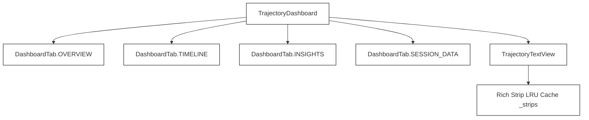
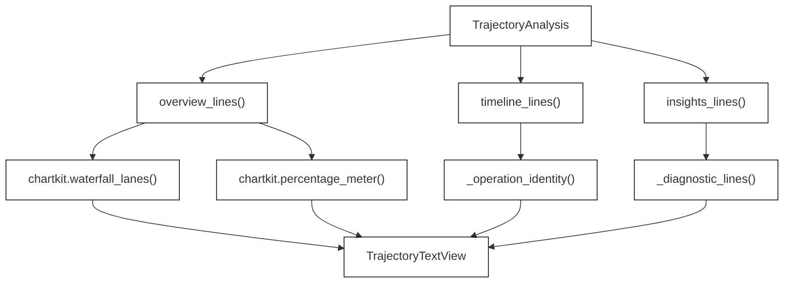
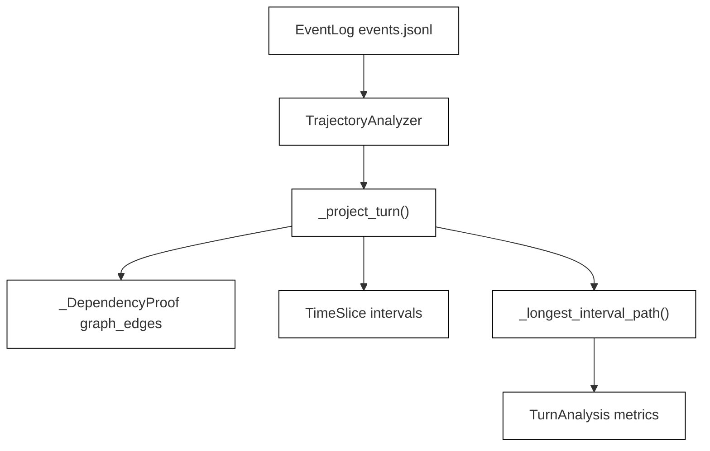
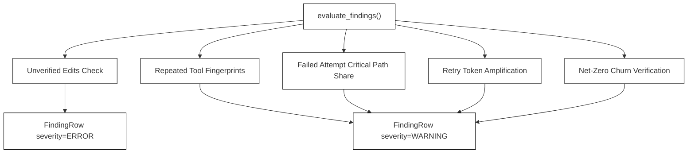

<!-- source: DeepWiki mcp.deepwiki.com · repo openJiuwen-ai/iCode · page 8.4 Trajectory Dashboard and Analytics · fetched 2026-11-02 -->

# Trajectory Dashboard and Analytics

Relevant source files

The following files were used as context for generating this wiki page:

- [src/chrys/app/tui/screens/dialogs/session_title.py](src/chrys/app/tui/screens/dialogs/session_title.py)
- [src/chrys/app/tui/screens/dialogs/session_title.tcss](src/chrys/app/tui/screens/dialogs/session_title.tcss)
- [src/chrys/app/tui/widgets/trajectory/__init__.py](src/chrys/app/tui/widgets/trajectory/__init__.py)
- [src/chrys/app/tui/widgets/trajectory/chartkit.py](src/chrys/app/tui/widgets/trajectory/chartkit.py)
- [src/chrys/app/tui/widgets/trajectory/insights.py](src/chrys/app/tui/widgets/trajectory/insights.py)
- [src/chrys/app/tui/widgets/trajectory/overview.py](src/chrys/app/tui/widgets/trajectory/overview.py)
- [src/chrys/app/tui/widgets/trajectory/panel.py](src/chrys/app/tui/widgets/trajectory/panel.py)
- [src/chrys/app/tui/widgets/trajectory/presentation.py](src/chrys/app/tui/widgets/trajectory/presentation.py)
- [src/chrys/app/tui/widgets/trajectory/text_view.py](src/chrys/app/tui/widgets/trajectory/text_view.py)
- [src/chrys/app/tui/widgets/trajectory/timeline.py](src/chrys/app/tui/widgets/trajectory/timeline.py)
- [src/chrys/foundation/platform/__init__.py](src/chrys/foundation/platform/__init__.py)
- [src/chrys/foundation/platform/c_api.py](src/chrys/foundation/platform/c_api.py)
- [src/chrys/foundation/platform/process.py](src/chrys/foundation/platform/process.py)
- [src/chrys/foundation/platform/win_console.py](src/chrys/foundation/platform/win_console.py)
- [src/chrys/service/analytics/__init__.py](src/chrys/service/analytics/__init__.py)
- [src/chrys/service/analytics/_actions.py](src/chrys/service/analytics/_actions.py)
- [src/chrys/service/analytics/_context_evidence.py](src/chrys/service/analytics/_context_evidence.py)
- [src/chrys/service/analytics/_insights.py](src/chrys/service/analytics/_insights.py)
- [src/chrys/service/analytics/_metric_ops.py](src/chrys/service/analytics/_metric_ops.py)
- [src/chrys/service/analytics/_timeline.py](src/chrys/service/analytics/_timeline.py)
- [src/chrys/service/analytics/_turn_graph.py](src/chrys/service/analytics/_turn_graph.py)
- [src/chrys/service/analytics/_turns.py](src/chrys/service/analytics/_turns.py)
- [src/chrys/service/analytics/aggregation.py](src/chrys/service/analytics/aggregation.py)
- [src/chrys/service/analytics/classification.py](src/chrys/service/analytics/classification.py)
- [src/chrys/service/analytics/findings.py](src/chrys/service/analytics/findings.py)
- [src/chrys/service/profiles/coercion.py](src/chrys/service/profiles/coercion.py)
- [src/chrys/service/skills/runner.py](src/chrys/service/skills/runner.py)
- [tests/app/tui/widgets/_trajectory_fixtures.py](tests/app/tui/widgets/_trajectory_fixtures.py)
- [tests/app/tui/widgets/test_trajectory_dashboard.py](tests/app/tui/widgets/test_trajectory_dashboard.py)
- [tests/app/tui/widgets/test_trajectory_overview.py](tests/app/tui/widgets/test_trajectory_overview.py)
- [tests/app/tui/widgets/test_trajectory_render_helpers.py](tests/app/tui/widgets/test_trajectory_render_helpers.py)
- [tests/app/tui/widgets/test_trajectory_timeline.py](tests/app/tui/widgets/test_trajectory_timeline.py)
- [tests/service/analytics/test_tool_fan_in.py](tests/service/analytics/test_tool_fan_in.py)
- [tests/service/skills/test_runner.py](tests/service/skills/test_runner.py)

This page details the implementation of section 8.4, covering the trajectory inspection dashboard, its underlying Textual TUI widgets, views, chart rendering, and the backend analytics engine responsible for event parsing, turn graph projection, diagnostics, and findings evaluation.

---

## 1. Trajectory Dashboard Architecture & TUI Widgets

The trajectory panel is implemented as an atomic overlay container class `TrajectoryDashboard` located in `[src/chrys/app/tui/widgets/trajectory/panel.py]().` It manages the active navigation tabs, background loading workers, live-refresh timers, and presentation caches.

The dashboard uses a four-tab information architecture defined by the `DashboardTab` enumeration (`[src/chrys/app/tui/widgets/trajectory/panel.py:105-112]()`):
* `OVERVIEW`: KPIs, waterfall chart, utilization metrics, token use, and failure recovery.
* `TIMELINE`: Per-turn execution hierarchies, identity rulers, and operation flows.
* `INSIGHTS`: Aggregated analyzer findings, tool performance, and structured diagnostics.
* `SESSION_DATA`: Raw JSON session viewer backed by `SessionJsonPanel`.

Text presentation and high-performance virtualization are driven by `TrajectoryTextView` (`[src/chrys/app/tui/widgets/trajectory/text_view.py:25-132]()`), a subclass of Textual's `ScrollView`. It renders Rich `Text` lines into cell-width-aware `Strip` objects, caching rendered strips in an LRU cache (`_strips`) or `DetachedLruCache` during GC freeze blocks.

*Sources: [src/chrys/app/tui/widgets/trajectory/panel.py:105-186](), [src/chrys/app/tui/widgets/trajectory/text_view.py:25-132]()*

---

## 2. Dashboard Views and Chartkit Presentation

Each dashboard tab compiles analysis models into rendered Rich lines through dedicated presentation modules:

* **Overview View (`overview.py`)**: Renders session metadata, storage footprint via `SessionStorage` (`[src/chrys/app/tui/widgets/trajectory/session_info.py]()`), high-level KPI blocks (Time & usage, Where time went, Parallelism & busy), action funnels, token usage breakdowns, change verification states, and submission latencies (`[src/chrys/app/tui/widgets/trajectory/overview.py:1-159]()`).
* **Timeline View (`timeline.py`)**: Renders turn operation hierarchies, duration bars, tool identity strings, and dependency graph overlays (`[src/chrys/app/tui/widgets/trajectory/timeline.py]()`). When the terminal width drops below 71 cells, the timeline maintains fixed column formatting on a 92-cell virtual canvas supporting horizontal scrolling (`[tests/app/tui/widgets/test_trajectory_timeline.py:98-153]()`).
* **Insights View (`insights.py`)**: Aggregates finding rows, tool activities, MCP usage, skill changes, token economics, and error diagnostics into structured reporting sections (`[src/chrys/app/tui/widgets/trajectory/insights.py]()`, `[tests/app/tui/widgets/test_trajectory_dashboard.py:104-153]`).
* **Chartkit (`chartkit.py`)**: Provides low-level text chart primitives including `waterfall_lanes`, `percentage_meter`, `coverage_bar`, `time_ruler`, and `fit_cells` (`[src/chrys/app/tui/widgets/trajectory/chartkit.py]()`).

*Sources: [src/chrys/app/tui/widgets/trajectory/overview.py:1-80](), [src/chrys/app/tui/widgets/trajectory/timeline.py](), [src/chrys/app/tui/widgets/trajectory/chartkit.py](), [src/chrys/app/tui/widgets/trajectory/insights.py]()*

---

## 3. Analytics Engine and Turn Causal Graph

The analytics engine (`TrajectoryAnalyzer`) ingests trajectory event logs (`events.jsonl`) to construct normalized session analysis objects (`TrajectoryAnalysis`). 

At the center of turn-level processing is `_project_turn` (`[src/chrys/service/analytics/_turn_graph.py:92-173]()`). It analyzes resolved event nodes within a physical turn attempt and builds a causal graph (`_DependencyProof`):

1. **Displacing Parent Resolution**: `_displacing_parent()` links child operations to their parent context (e.g. tool preambles, active tool executions, or hook boundaries).
2. **Causal Edge Linking**: Processes `LinkRelation.CAUSED_BY` edges to establish direct dependency graphs between operations.
3. **Time Slice Partitioning**: Subtracts child intervals and suspension deductions from parent intervals to build non-overlapping `TimeSlice` allocations across `WallBucket` categories (`IDLE`, `WAIT`, `TOOLS`, `MODEL`).
4. **Critical Path Calculation**: `_longest_interval_path()` evaluates compute paths (`compute_ns`) and response latency paths (`response_ns`) to isolate bottlenecks.

*Sources: [src/chrys/service/analytics/_turn_graph.py:61-173](), [src/chrys/service/analytics/_critical_path.py]()`*

---

## 4. Findings, Diagnostics, and Validation Rules

The module `[src/chrys/service/analytics/findings.py]()` evaluates rollback-stable rules to generate compact finding rows (`FindingRow`) that surface potential agent errors or anomalies.

Key evaluation logic inside `evaluate_findings()` (`[src/chrys/service/analytics/findings.py:36-169]`) includes:
* **Unverified Changes**: Identifies file edit actions (`ActionClass.EDIT`) not covered by a subsequent successful verify action (`ActionClass.VERIFY`), reporting `FindingSeverity.ERROR`.
* **Repeated Tool Fingerprints**: Detects identical tool names and argument fingerprints (`argument_fingerprint`) executed multiple times within a session, reporting `FindingSeverity.WARNING`.
* **Failed Attempt Critical Path**: Flags tool failures that consume a significant share (`_FAILED_CRITICAL_PATH_SHARE = 0.25`) of the turn's response critical path (`response_cp_ns`).
* **Retry Token Amplification**: Correlates validation metrics (`validation.retry_amplification_tokens`) with retry evidence.
* **Net-Zero Churn**: Inspects file modification sequences that cancel out (`ChangeVerificationState.NET_ZERO`) to warn about unproductive file churn.

*Sources: [src/chrys/service/analytics/findings.py:1-169](), [src/chrys/service/analytics/model.py]()*

---

