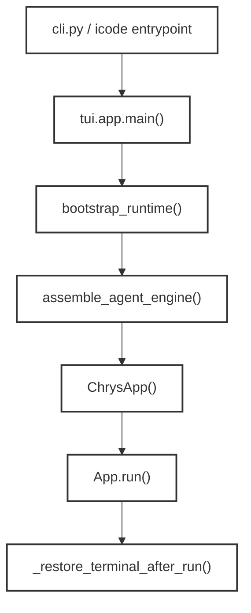
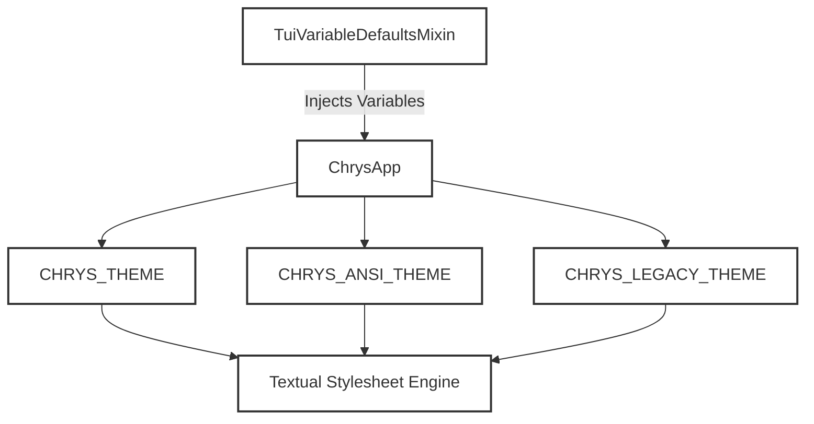
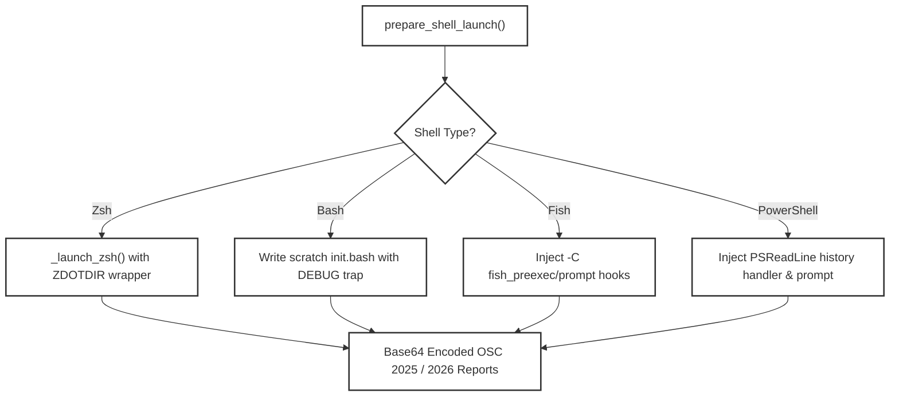

<!-- source: DeepWiki mcp.deepwiki.com · repo openJiuwen-ai/iCode · page 8.5 Terminal, Themes and App Shell · fetched 2026-11-02 -->

# Terminal, Themes and App Shell

<details>
<summary>Relevant source files</summary>

The following files were used as context for generating this wiki page:

- [src/chrys/app/tui/app.py](src/chrys/app/tui/app.py)
- [src/chrys/app/tui/terminal/shell_integration.py](src/chrys/app/tui/terminal/shell_integration.py)
- [src/chrys/app/tui/terminal/title.py](src/chrys/app/tui/terminal/title.py)
- [src/chrys/app/tui/util/spinner.py](src/chrys/app/tui/util/spinner.py)
- [src/chrys/app/tui/widgets/workflow/output.py](src/chrys/app/tui/widgets/workflow/output.py)
- [src/chrys/app/tui/widgets/workflow/panel.py](src/chrys/app/tui/widgets/workflow/panel.py)
- [src/chrys/foundation/patches/textual_one_shot_timer.py](src/chrys/foundation/patches/textual_one_shot_timer.py)
- [src/chrys/foundation/patches/textual_removed_screen_callbacks.py](src/chrys/foundation/patches/textual_removed_screen_callbacks.py)
- [tests/app/acp/test_session_manager_profiles.py](tests/app/acp/test_session_manager_profiles.py)
- [tests/app/tui/behaviors/test_app_startup.py](tests/app/tui/behaviors/test_app_startup.py)
- [tests/app/tui/behaviors/test_chrys_themes.py](tests/app/tui/behaviors/test_chrys_themes.py)
- [tests/app/tui/screens/main/test_workflow.py](tests/app/tui/screens/main/test_workflow.py)
- [tests/app/tui/screens/main/test_workflow_run_sessions.py](tests/app/tui/screens/main/test_workflow_run_sessions.py)
- [tests/app/tui/terminal/test_shell_integration.py](tests/app/tui/terminal/test_shell_integration.py)
- [tests/app/tui/widgets/test_workflow_run_text_inset.py](tests/app/tui/widgets/test_workflow_run_text_inset.py)

</details>


## Purpose and Scope

This page documents the application shell bootstrap, terminal integration, styling/theming engine, and UI utilities for the `icode` Terminal User Interface (TUI). It covers the initialization of `ChrysApp`, terminal state restoration sequences, Textual CSS (TCSS) variables, theme pins, terminal window titles, shell integration hooks (OSC 2025/2026 reports), progress indicators (`spinner.py`), notifications, and the buddy feature lifecycle.

Sources: `src/chrys/app/tui/app.py`, `src/chrys/app/tui/theme.py`, `src/chrys/app/tui/terminal/title.py`, `src/chrys/app/tui/terminal/shell_integration.py`, `src/chrys/app/tui/util/spinner.py`

---

## 1. TUI Application Bootstrap and Lifecycle

The TUI entry point initializes the Textual application framework, orchestrates backend binding via the `EventBus`, configures standard I/O streams, and guarantees terminal state restoration upon exit (even under abrupt failures or signals).

### App Bootstrap and Main Entry Point
The primary execution flow begins in `src/chrys/app/tui/app.py`, where `ChrysApp` subclass of Textual's `App` is instantiated and run. 


*Figure 1: TUI bootstrap sequence mapping CLI launch to `ChrysApp` execution.*

Sources: `src/chrys/app/tui/app.py:1-200`, `tests/app/tui/behaviors/test_app_startup.py:124-175`

### Terminal State Reset and Safety Nets
Upon completion or failure of the TUI session, `_restore_terminal_after_run` executes a hard reset sequence (`_TERMINAL_MODE_RESET`) to clear mouse tracking, alternate scroll modes, bracketed paste, and keyboard protocol overrides (such as Kitty or win32-input-mode) [src/chrys/app/tui/app.py:139-154](). 

When running under `textual-serve` (`textual.drivers.web_driver:WebDriver`), native terminal reset sequences are skipped to prevent stderr corruption in web-streamed environments [src/chrys/app/tui/terminal/title.py:201-203]().

Sources: `src/chrys/app/tui/app.py:139-154`, `src/chrys/app/tui/terminal/title.py:201-204`

---

## 2. Themes, Stylesheets, and Color Systems

The TUI utilizes Textual's native theme registration API along with custom CSS variable mixing to support light, dark, and ANSI-compatible display profiles.

### Theme Definitions and Color Variables
The codebase defines standard theme objects in `src/chrys/app/tui/theme.py`:
- `CHRYS_THEME`: Default high-fidelity theme providing specific hex color pins for primary UI elements, backgrounds, borders, and text accents.
- `CHRYS_ANSI_THEME`: Restricts palette output to 8-bit / ANSI color systems, ensuring legibility in constrained terminal multiplexers.
- `CHRYS_LEGACY_THEME`: Fallback compatibility theme.

The `TuiVariableDefaultsMixin` injects dynamic CSS variables into widgets based on the active theme profile [tests/app/tui/behaviors/test_chrys_themes.py:37-43]().


*Figure 2: Theme architecture and variable injection.*

Sources: `src/chrys/app/tui/theme.py`, `tests/app/tui/behaviors/test_chrys_themes.py:1-153`

---

## 3. Terminal Integration: Title Management and Shell Hooks

Terminal integration spans two subsystems: window title manipulation (`title.py`) and PTY shell command monitoring (`shell_integration.py`).

### Terminal Window Titles
`src/chrys/app/tui/terminal/title.py` exposes helper functions to set terminal window and tab titles using OSC 0 and OSC 2 escape sequences. 

- `set_terminal_title(title: str)`: Cleans unsafe characters and writes ANSI escape sequences to stderr or the Textual driver's writer [src/chrys/app/tui/terminal/title.py:24-37]().
- `TerminalTabText`: Value object managing tab previews and workspace directory names [src/chrys/app/tui/terminal/title.py:82-109]().
- `_title_safe_text(text: str)`: Strips ANSI control sequences and non-printable control characters before formatting titles [src/chrys/app/tui/terminal/title.py:110-124]().

Sources: `src/chrys/app/tui/terminal/title.py:1-204`

### Shell Integration Hooks
To report real-time working directory changes and active command executions from embedded PTY shells, `src/chrys/app/tui/terminal/shell_integration.py` injects customized startup scripts depending on the shell binary (Bash, Zsh, Fish, or PowerShell).


*Figure 3: Shell hook injection pipeline for PTY integration.*

- **OSC 2025**: Reports the working directory ahead of every prompt [src/chrys/app/tui/terminal/shell_integration.py:89-94]().
- **OSC 2026**: Reports the command line about to execute via `preexec` or `DEBUG` traps [src/chrys/app/tui/terminal/shell_integration.py:74-87]().
- **Payload Encoding**: Payloads are base64-encoded to prevent malformed characters or escape sequence injections from terminating the control sequence prematurely [src/chrys/app/tui/terminal/shell_integration.py:23-26]().

Sources: `src/chrys/app/tui/terminal/shell_integration.py:1-200`, `tests/app/tui/terminal/test_shell_integration.py:1-173`

---

## 4. UI Polish Primitives: Spinners and Notifications

### Braille Spinners
To maintain a consistent loading visual across tool cards, workflow nodes, auto-review labels, the input bar, and terminal tabs, `src/chrys/app/tui/util/spinner.py` defines standard braille animation frames:

```python
SPINNER_FRAMES = "⠋⠙⠹⠸⠼⠴⠦⠧⠇⠏"
STATIC_SPINNER = "●"
```
When user settings or environment configurations disable animations, `STATIC_SPINNER` is substituted automatically [src/chrys/app/tui/util/spinner.py:11-13]().

Sources: `src/chrys/app/tui/util/spinner.py:1-14`

### Notification Service
The notification subsystem (`NotificationService` and `NotificationSettings`) initialized in `ChrysApp` manages toast messages, session alerts, and warning notifications routed through Textual's UI framework [src/chrys/app/tui/app.py:41]().

Sources: `src/chrys/app/tui/app.py:41`

---

## 5. App Shell & Buddy Integration

The application shell (`MainScreen`) coordinates chat panels, sidebar navigation, dialog gateways, and feature hooks. 

### Buddy Feature Lifecycle
The buddy assistant integration (`chrys.app.features.buddy.lifecycle`) hooks into engine turn completions via `on_successful_turn` to update persistent session states, trigger contextual side-tasks, and manage mascot states without blocking the core agent loop [src/chrys/app/tui/app.py:35]().

Sources: `src/chrys/app/tui/app.py:35`

---

