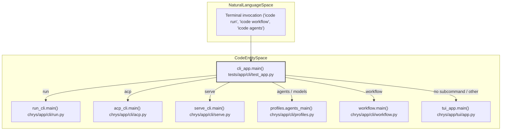
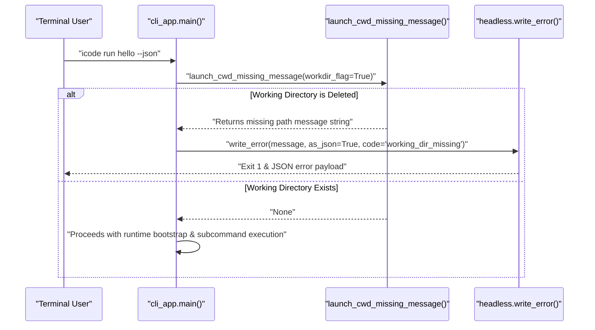

<!-- source: DeepWiki mcp.deepwiki.com · repo openJiuwen-ai/iCode · page 8.6 CLI Commands · fetched 2026-11-02 -->

# CLI Commands

Relevant source files

The following files were used as context for generating this wiki page:

- [.github/workflows/cd.yml](.github/workflows/cd.yml)
- [.github/workflows/ci.yml](.github/workflows/ci.yml)
- [.github/workflows/gc-freeze-calibration.yml](.github/workflows/gc-freeze-calibration.yml)
- [.python-version](.python-version)
- [README.md](README.md)
- [README.zh.md](README.zh.md)
- [docs/en/guides/running/icode-run.md](docs/en/guides/running/icode-run.md)
- [docs/zh-Hans/guides/running/icode-run.md](docs/zh-Hans/guides/running/icode-run.md)
- [scripts/build.ps1](scripts/build.ps1)
- [scripts/build.sh](scripts/build.sh)
- [src/chrys/app/acp/session_manager.py](src/chrys/app/acp/session_manager.py)
- [src/chrys/app/cli/profiles.py](src/chrys/app/cli/profiles.py)
- [src/chrys/app/cli/run.py](src/chrys/app/cli/run.py)
- [src/chrys/app/cli/workflow.py](src/chrys/app/cli/workflow.py)
- [src/chrys/app/tui/screens/dialogs/file_picker.py](src/chrys/app/tui/screens/dialogs/file_picker.py)
- [src/chrys/orchestration/engine/run/runner.py](src/chrys/orchestration/engine/run/runner.py)
- [src/chrys/orchestration/engine/session_lifecycle.py](src/chrys/orchestration/engine/session_lifecycle.py)
- [src/chrys/orchestration/session_host.py](src/chrys/orchestration/session_host.py)
- [src/chrys/orchestration/workflows/coordinator.py](src/chrys/orchestration/workflows/coordinator.py)
- [src/chrys/orchestration/workflows/preview.py](src/chrys/orchestration/workflows/preview.py)
- [src/chrys/orchestration/workflows/worker_client.py](src/chrys/orchestration/workflows/worker_client.py)
- [tests/app/cli/test_app.py](tests/app/cli/test_app.py)
- [tests/app/cli/test_missing_working_dir.py](tests/app/cli/test_missing_working_dir.py)
- [tests/app/cli/test_run.py](tests/app/cli/test_run.py)
- [tests/app/tui/screens/test_file_picker.py](tests/app/tui/screens/test_file_picker.py)
- [tests/architecture/test_python_pin.py](tests/architecture/test_python_pin.py)
- [tests/orchestration/engine/run/test_retry_lifecycle.py](tests/orchestration/engine/run/test_retry_lifecycle.py)
- [tests/orchestration/workflows/test_worker_client.py](tests/orchestration/workflows/test_worker_client.py)

The application CLI layer (`src/chrys/app/cli/`) provides the terminal entry point for iCode (`icode` or `chrys`). It handles argument parsing, subcommand dispatching, runtime initialization, launch-directory validation, and formatted output generation (supporting both Rich terminal tables and machine-readable JSON formats).

Sources: `[tests/app/cli/test_app.py:1-224]`, `[src/chrys/app/cli/profiles.py:1-45]`

---

## 1. Top-Level Dispatcher and Entry Point

The top-level entry point inspects command-line arguments (`sys.argv`) and routes execution to specific subcommand handlers or defaults to launching the Textual TUI (`__tui_subprocess__`).

*Sources:* `[tests/app/cli/test_app.py:20-218]`

---

## 2. Subcommands Overview and Implementation

The CLI supports a rich suite of subcommands covering execution, inspection, profile management, and workflow coordination:

| Subcommand | Module / Entry Point | Description |
| :--- | :--- | :--- |
| `run` | `chrys.app.cli.run` | Executes single-shot or interactive agent sessions with prompt arguments. |
| `headless` | `chrys.app.cli.headless` | Runs agents in headless mode without a TUI interface. |
| `serve` | `chrys.app.cli.serve` | Starts the HTTP and Server-Sent Events (SSE) background server. |
| `acp` | `chrys.app.cli.acp` | Launches the Agent Client Protocol (ACP) server interface. |
| `agents` / `models` | `chrys.app.cli.profiles` | Lists, inspects, and validates agent and model profiles (`agents_main`, `models_main`). |
| `workflow` | `chrys.app.cli.workflow` | Discovers, validates, and headlessly executes workflows (`workflow.main`). |
| `trajectory` | `chrys.app.cli.trajectory` | Inspects turn trajectories, analytics, and token metrics. |
| `install` / `uninstall` | PyApp / Build scripts | Manages self-contained binary deployment, offline distributions, and updates. |

### Profile Discovery (`chrys agents` and `chrys models`)
The profile CLI modules (`src/chrys/app/cli/profiles.py`) load available agent and model profiles using `AgentProfileRegistry` and `ModelProfileRegistry`. They support JSON formatting via `--json` flags:

* `build_agents_parser()`: Constructs the argument parser for `chrys agents` [src/chrys/app/cli/profiles.py:46-58]().
* `agents_main()`: Bootstraps runtime settings, queries agent profiles, and outputs rich tables or JSON payloads [src/chrys/app/cli/profiles.py:76-111]().
* `build_models_parser()`: Constructs the argument parser for `chrys models` [src/chrys/app/cli/profiles.py:61-73]().
* `models_main()`: Resolves active model profiles and displays status flags (`stream`, `vision`, etc.) [src/chrys/app/cli/profiles.py:113-138]().

### Workflow Coordination (`chrys workflow`)
The workflow CLI (`src/chrys/app/cli/workflow.py`) provides three subcommands: `list`, `validate`, and `run`. It integrates with `WorkflowCatalog` and `Discovery` to execute workflows headlessly with progress reporting.

* `build_parser()`: Configures the multi-command workflow parser with sanitization [src/chrys/app/cli/workflow.py:61-132]().
* `_list_command()`: Discovers and displays builtin and user workflows [src/chrys/app/cli/workflow.py:165-]().

*Sources:* `[src/chrys/app/cli/profiles.py:46-138]`, `[src/chrys/app/cli/workflow.py:61-132]`, `[tests/app/cli/test_app.py:77-123]`

---

## 3. Launch Directory Validation and Safety

CLI entry points validate that the process working directory still exists before starting up. If a shell session deletes the current working directory (e.g., via `rm -r`), `launch_cwd_missing_message()` catches the failure and aborts execution cleanly.

*Sources:* `[tests/app/cli/test_missing_working_dir.py:31-183]`, `[src/chrys/app/cli/profiles.py:148-154]`

---

## 4. Packaging, Installation, and Update Checks

The CLI environment handles self-contained binary packaging through integration scripts (`scripts/build.sh`, `scripts/build.ps1`) and PyApp configuration (.toml/.env metadata). Update checks periodically query PyPI or GitHub release endpoints for newer versions without transmitting user telemetry or personal data (as specified in the privacy guidelines).

*Sources:* `[README.md:116-157]`, `[scripts/build.sh:1-168]`, `[scripts/build.ps1:1-147]`

---

