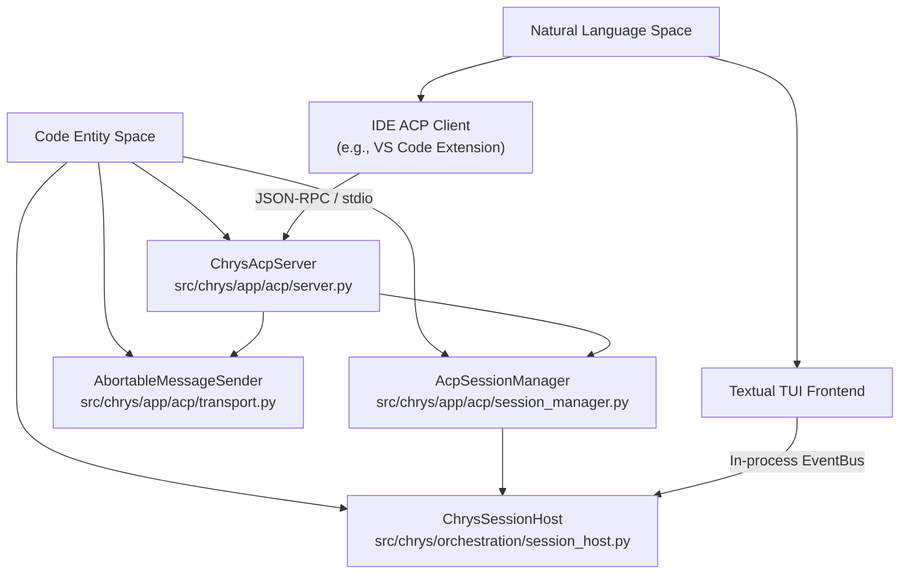
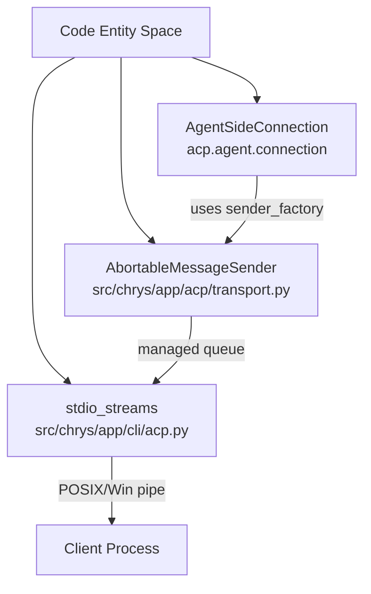
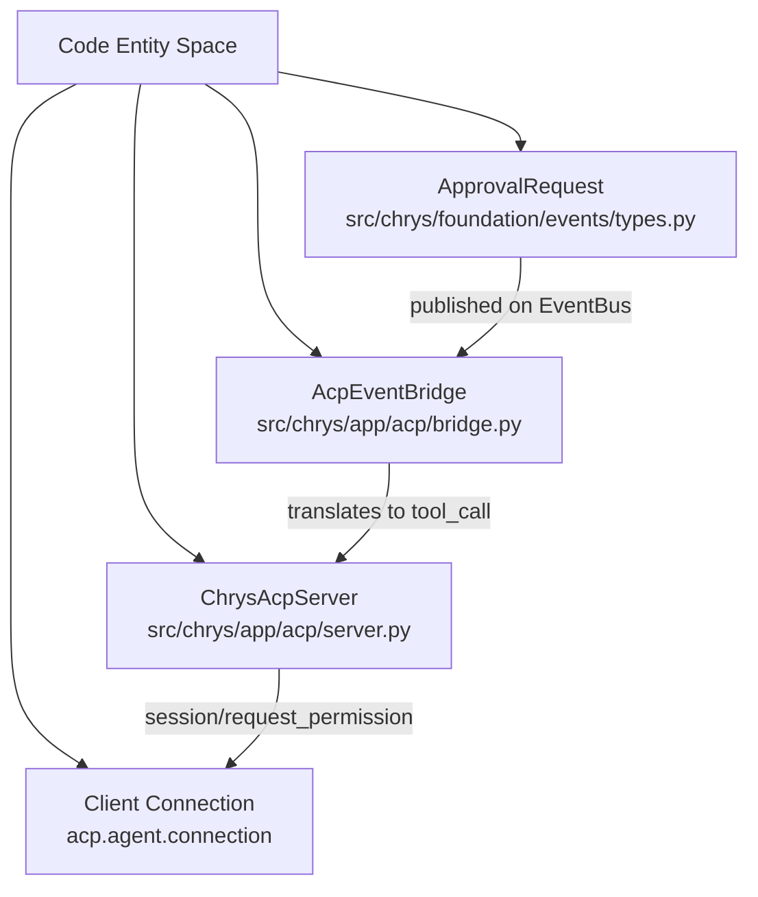

<!-- source: DeepWiki mcp.deepwiki.com · repo openJiuwen-ai/iCode · page 8.7 ACP Server and Frontend API · fetched 2026-11-02 -->

# ACP Server and Frontend API

Relevant source files

The following files were used as context for generating this wiki page:

- [docs/en/guides/running/icode-acp.md](docs/en/guides/running/icode-acp.md)
- [docs/zh-Hans/guides/running/icode-acp.md](docs/zh-Hans/guides/running/icode-acp.md)
- [src/chrys/app/acp/doc/frontend-api.md](src/chrys/app/acp/doc/frontend-api.md)
- [src/chrys/app/acp/server.py](src/chrys/app/acp/server.py)
- [src/chrys/app/acp/transport.py](src/chrys/app/acp/transport.py)
- [src/chrys/app/cli/acp.py](src/chrys/app/cli/acp.py)
- [src/chrys/app/tui/screens/dialogs/approval/bodies/file_edit.py](src/chrys/app/tui/screens/dialogs/approval/bodies/file_edit.py)
- [src/chrys/app/tui/screens/dialogs/approval/dialog.py](src/chrys/app/tui/screens/dialogs/approval/dialog.py)
- [src/chrys/app/tui/screens/main/dialog_gateway.py](src/chrys/app/tui/screens/main/dialog_gateway.py)
- [src/chrys/app/tui/screens/main/ports.py](src/chrys/app/tui/screens/main/ports.py)
- [src/chrys/app/tui/screens/main/view_adapter.py](src/chrys/app/tui/screens/main/view_adapter.py)
- [tests/app/acp/test_server_permissions.py](tests/app/acp/test_server_permissions.py)
- [tests/app/cli/test_acp_output_shutdown.py](tests/app/cli/test_acp_output_shutdown.py)
- [tests/app/tui/screens/main/test_settings_wiring.py](tests/app/tui/screens/main/test_settings_wiring.py)

## Purpose and Scope

This page documents the Agent Client Protocol (ACP) server implementation and frontend API in `iCode` (`chrys`). The ACP server surface allows non-TUI clients (such as IDE extensions like VS Code) to achieve operational parity with the Textual TUI by communicating directly with the core backend runtime (`AgentEngine` + `ChrysSessionHost`) via standard JSON-RPC over `stdio` and Chrys-specific protocol extensions.

Sources: `src/chrys/app/acp/doc/frontend-api.md:1-10()`, `src/chrys/app/cli/acp.py:1-35()`

---

## Design Model and Architecture

`iCode` adopts a symmetric frontend contract: both the Textual TUI and external ACP clients share the identical backend runtime driven by an internal `EventBus`. 

- **TUI Frontend**: Subscribes to `EventBus` events directly and invokes engine/session helpers in-process.
- **ACP Client**: Speaks standard ACP plus Chrys-private extension namespaces (`chrys/*`, `session/*`, `sub_agent/*`, `profiles/*`, `settings/*`, and `mcp/*`).

Sources: `src/chrys/app/acp/doc/frontend-api.md:12-36()`, `src/chrys/app/acp/server.py:173-182()`

---

## Transport and AbortableMessageSender

The ACP server runs over standard input/output using the Python ACP SDK. Standard ACP methods are dispatched by name, while non-standard operations ride on two escape hatches:
1. `ext_method(method, params)`: Request/response queries/actions from Client to Backend, or `chrys/request_input` (`ask_user`) notifications pushed Backend to Client.
2. `ext_notification(method, params)`: One-way push notifications from backend `EventBus` events [src/chrys/app/acp/doc/frontend-api.md:37-47()].

To prevent teardown deadlock when a client departs abruptly or a pipe experiences backpressure, `iCode` implements `AbortableMessageSender` [src/chrys/app/acp/transport.py:13-36()]. 

`AbortableMessageSender` overrides `.send()` and `.close()` to discard unsent output upon closure, preventing SDK request cancellation tasks from wedging indefinitely on blocked stdout pipes:
- `send()`: Checks `self._closed` to drop queued output if teardown has started [src/chrys/app/acp/transport.py:22-29()].
- `close()`: Cancels the underlying sender task immediately and gathers exceptions without flushing or waiting on blocked read streams [src/chrys/app/acp/transport.py:30-36()].

Sources: `src/chrys/app/acp/transport.py:1-36()`, `src/chrys/app/cli/acp.py:160-175()`

---

## ChrysAcpServer and Standard ACP Methods

`ChrysAcpServer` [src/chrys/app/acp/server.py:173-182()] implements standard ACP methods backed by `AcpSessionManager` and `ChrysSessionHost`:
- **Lifecycle Methods**: `initialize`, `session/new`, `session/load`, `session/list`, `session/prompt`, `session/cancel`, `session/close`, and `delete_session` [src/chrys/app/acp/doc/frontend-api.md:51-57()].
- **Server to Client Notifications**: `session/request_permission` (approvals) and `session/update` (agent thought chunks, tool calls, `usage_update`, `session_info_update`, `current_mode_update`, and `plan`) [src/chrys/app/acp/doc/frontend-api.md:58-64()].
- **Session Modes**: Approval mode mapping utilizes ACP's native session modes (`manual`, `auto`, `bypass`) via `set_session_mode(mode_id, session_id)` [src/chrys/app/acp/doc/frontend-api.md:92-101()].
- **Session Models**: Model selection uses ACP's native model mechanism via `set_session_model(model_id, session_id)`, swapping `settings.model_profile` in-memory per-session without writing global settings [src/chrys/app/acp/doc/frontend-api.md:103-118()].

Sources: `src/chrys/app/acp/doc/frontend-api.md:51-118()`, `src/chrys/app/acp/server.py:173-195()`

---

## Extension RPCs and Namespaces

All non-standard capabilities are routed through `ext_method` and categorized into specific domains:

| Namespace / Domain | Purpose / Key RPC Methods |
| :--- | :--- |
| `session/*` | Session manipulation like `session/delete`, `session/inject`, `session/rollback` [src/chrys/app/acp/doc/frontend-api.md:123-128()] |
| `chrys/*` | Internal callbacks and runtime data prompts like `chrys/request_input` |
| `sub_agent/*` | Sub-agent inspection, execution metrics, and child tool tracking |
| `profiles/*` | Agent and model profile discovery and switching |
| `settings/*` | Configuration inspection and option setting (`session/set_config_option`) |
| `mcp/*` | Model Context Protocol server status and integration hooks |

Sources: `src/chrys/app/acp/doc/frontend-api.md:34-49()`, `src/chrys/app/acp/server.py:111-144()`

---

## Permissions, Approvals, and Event Bridge

Tool execution requests that require human intervention are intercepted by `ApprovalMiddleware` and emitted as `ApprovalRequest` events on the session `EventBus`. 

- **Permission Bridging**: `AcpEventBridge` converts internal `ApprovalRequest` events into standard ACP `session/request_permission` calls, populating tool call title, kind, and field metadata [tests/app/acp/test_server_permissions.py:100-125()].
- **Auto-Review / Judge Handling**: When `judging=True`, calls evaluated by the auto-review LLM judge wait for review results before prompting the client if flagged [tests/app/acp/test_server_permissions.py:154-192()].
- **Timeouts**: Approval requests respect `permission_timeout_seconds` configured via settings or CLI arguments [src/chrys/app/cli/acp.py:148-152()].

Sources: `src/chrys/app/acp/bridge.py:1-50()`, `tests/app/acp/test_server_permissions.py:87-126()`

---

## Shutdown Semantics and Pipe Backpressure

When `icode acp` shuts down (either via EOF on standard input, client cancellation, or SIGTERM), `_serve_agent()` coordinates clean termination of the session manager and the underlying `AgentSideConnection` [src/chrys/app/cli/acp.py:160-175()]:
1. **Prompt Locks Released**: Active prompts holding session locks are forcibly unblocked via task cancellation and stream cleanup [tests/app/cli/test_acp_output_shutdown.py:120-128()].
2. **Backpressure Avoidance**: `AbortableMessageSender` ensures that backpressured or broken stdout pipes (`BrokenPipeError`, `ConnectionResetError`) do not block the asyncio event loop from releasing active approval tasks and shutting down session host resources safely [tests/app/cli/test_acp_output_shutdown.py:107-119()].

Sources: `src/chrys/app/cli/acp.py:153-175()`, `tests/app/cli/test_acp_output_shutdown.py:30-144()`

---

