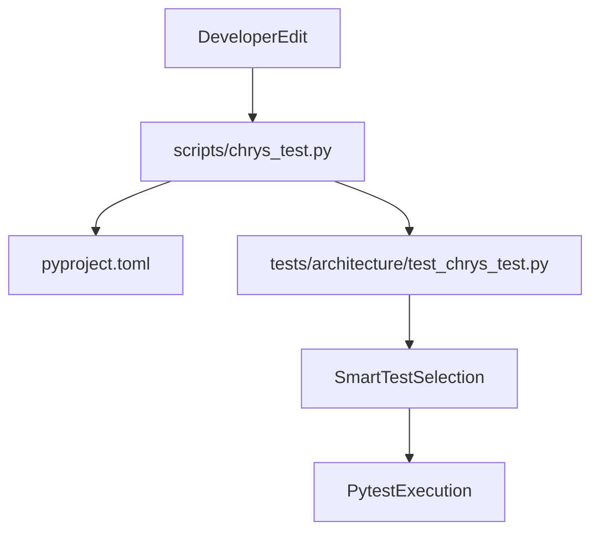
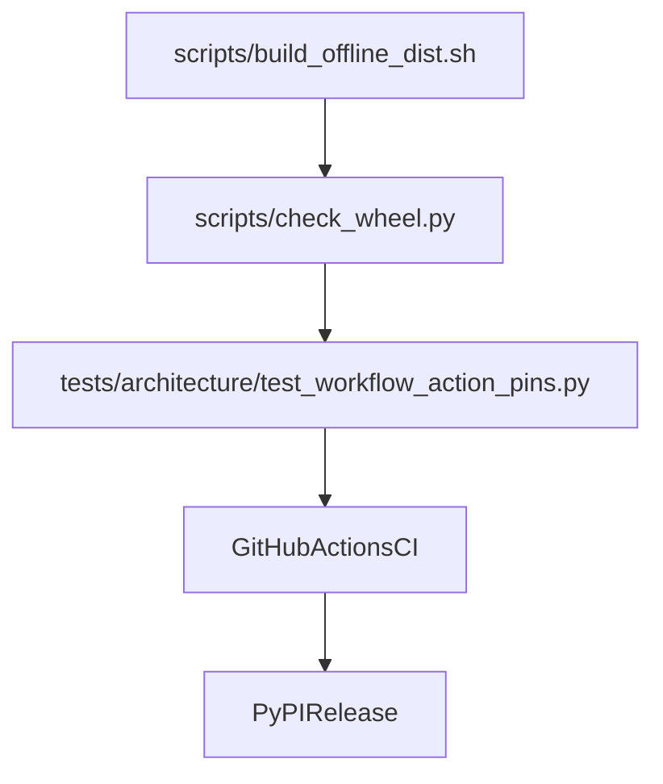
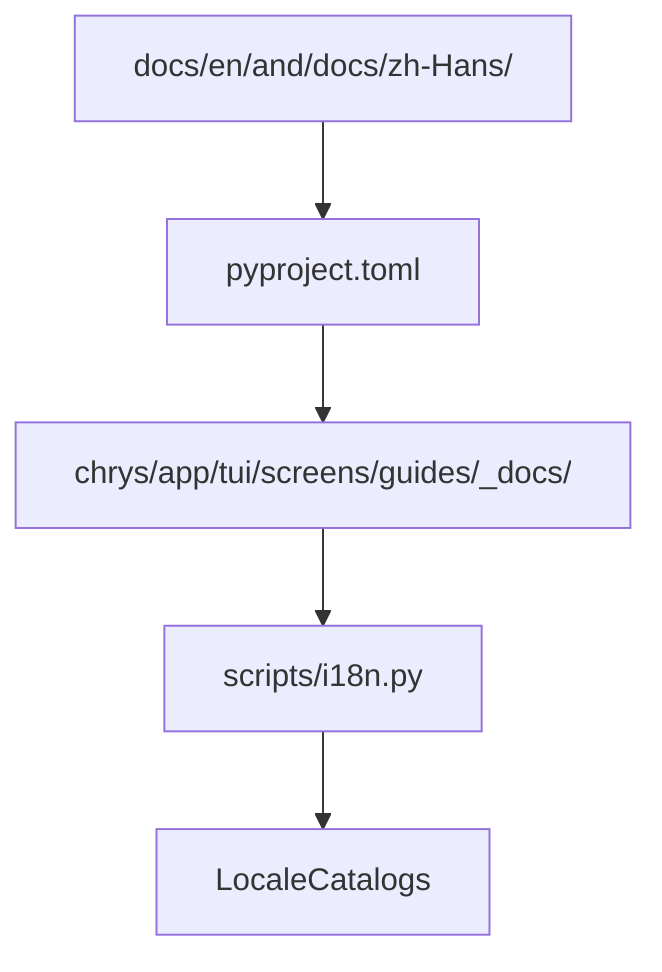

<!-- source: DeepWiki mcp.deepwiki.com · repo openJiuwen-ai/iCode · page 9 Development, Testing and Release · fetched 2026-11-02 -->

# Development, Testing and Release

Relevant source files

The following files were used as context for generating this wiki page:

- [.github/workflows/pillow-manylinux2014.yml](.github/workflows/pillow-manylinux2014.yml)
- [AGENTS.md](AGENTS.md)
- [NOTICE](NOTICE)
- [docs/en/start/getting-started.md](docs/en/start/getting-started.md)
- [docs/zh-Hans/start/getting-started.md](docs/zh-Hans/start/getting-started.md)
- [pyproject.toml](pyproject.toml)
- [scripts/build_offline_dist.sh](scripts/build_offline_dist.sh)
- [scripts/check_wheel.py](scripts/check_wheel.py)
- [scripts/chrys_test.py](scripts/chrys_test.py)
- [scripts/offline_wheel_overrides.txt](scripts/offline_wheel_overrides.txt)
- [tests/architecture/test_chrys_test.py](tests/architecture/test_chrys_test.py)
- [tests/architecture/test_workflow_action_pins.py](tests/architecture/test_workflow_action_pins.py)
- [uv.lock](uv.lock)

## Purpose and Scope

This page provides a high-level overview of the contributor workflow, test tooling, CI/CD pipelines, packaging scripts, and documentation/localization processes for the iCode (`chrys`) platform. Development rules, supply-chain requirements, and verification gates are enforced through structured scripts and architecture tests defined in `pyproject.toml` and `scripts/` [AGENTS.md:7-19]().

For detailed information, refer to the child pages:
- [Testing Infrastructure](#9.1)
- [CI/CD and Packaging](#9.2)
- [Documentation and Localization Workflow](#9.3)

---

## 9.1 Testing Infrastructure

Local test execution and test selection are managed via `scripts/chrys_test.py`, which implements smart test selection based on runtime imports, filesystem watches, and fixture consumers [scripts/chrys_test.py:3-9](). Pytest is configured in `pyproject.toml` with default concurrency (`-n 8`), strict markers, and a 60-second thread timeout to handle potential deadlocks [pyproject.toml:120-136](). Architecture guards (such as `tests/architecture/test_chrys_test.py` and `tests/architecture/test_workflow_action_pins.py`) enforce code structure, import hygiene, and action pinning constraints [scripts/chrys_test.py:109-169, tests/architecture/test_workflow_action_pins.py:3-19]().

For details, see [Testing Infrastructure](#9.1).

Sources: `scripts/chrys_test.py:3-9`, `pyproject.toml:120-136`, `tests/architecture/test_chrys_test.py:3-15`

---

## 9.2 CI/CD and Packaging

Release automation and dependency management rely on GitHub Actions workflows with strict security controls. Third-party actions are pinned to full 40-character commit SHAs with version comments, verified by `tests/architecture/test_workflow_action_pins.py` [tests/architecture/test_workflow_action_pins.py:3-19](). Built wheels are validated using `scripts/check_wheel.py` to simulate a clean PyPI installation [scripts/check_wheel.py:3-19](). Offline distributions and standalone binaries (bundled via PyApp) are built using `scripts/build_offline_dist.sh`, enforcing a `glibc 2.17` floor on Linux via overrides in `scripts/offline_wheel_overrides.txt` [pyproject.toml:35-38, scripts/build_offline_dist.sh:1-42]().

For details, see [CI/CD and Packaging](#9.2).

Sources: `scripts/check_wheel.py:3-19`, `scripts/build_offline_dist.sh:1-42`, `tests/architecture/test_workflow_action_pins.py:3-19`

---

## 9.3 Documentation and Localization Workflow

User guides and in-app documentation reside under `docs/en/` and `docs/zh-Hans/`. During the build process, Hatchling bundles these Markdown files into the wheel via `force-include` configuration so they are accessible in-app at runtime [pyproject.toml:111-114]() through `chrys.foundation.documentation.resolve_docs_root()` [scripts/check_wheel.py:61-83](). Localization catalogs (`.pot`, `.po`, `.mo`) are maintained and synchronized using translation scripts such as `scripts/i18n.py` [AGENTS.md:18]().

For details, see [Documentation and Localization Workflow](#9.3).

Sources: `pyproject.toml:111-114`, `scripts/check_wheel.py:61-83`, `AGENTS.md:18`

---

