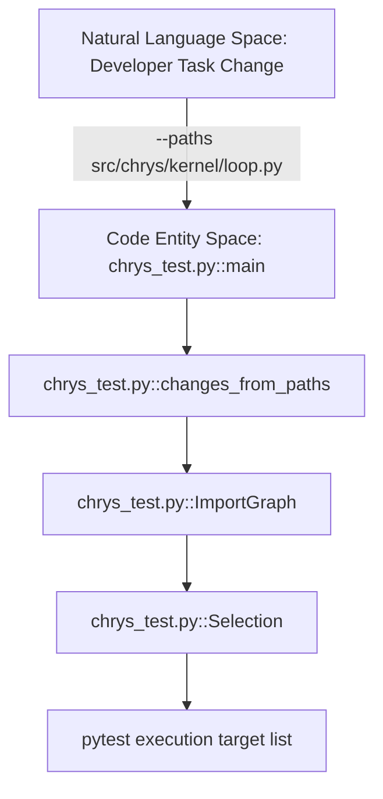
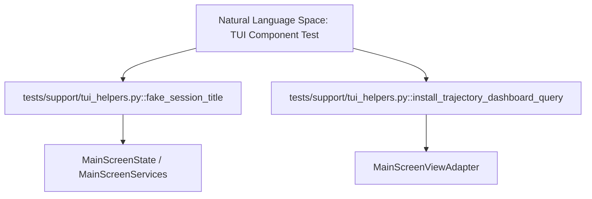

<!-- source: DeepWiki mcp.deepwiki.com · repo openJiuwen-ai/iCode · page 9.1 Testing Infrastructure · fetched 2026-11-02 -->

# Testing Infrastructure

Relevant source files

The following files were used as context for generating this wiki page:

- [.github/workflows/pillow-manylinux2014.yml](.github/workflows/pillow-manylinux2014.yml)
- [AGENTS.md](AGENTS.md)
- [NOTICE](NOTICE)
- [scripts/build_offline_dist.sh](scripts/build_offline_dist.sh)
- [scripts/chrys_test.py](scripts/chrys_test.py)
- [scripts/offline_wheel_overrides.txt](scripts/offline_wheel_overrides.txt)
- [src/chrys/app/features/buddy/pixel_sprites.py](src/chrys/app/features/buddy/pixel_sprites.py)
- [src/chrys/app/tui/widgets/chat/image_preview.py](src/chrys/app/tui/widgets/chat/image_preview.py)
- [src/chrys/app/tui/widgets/chrome/image_paste.py](src/chrys/app/tui/widgets/chrome/image_paste.py)
- [src/chrys/service/tools/builtins/doc_converter/artifacts.py](src/chrys/service/tools/builtins/doc_converter/artifacts.py)
- [src/chrys/service/tools/builtins/doc_converter/parsers/base.py](src/chrys/service/tools/builtins/doc_converter/parsers/base.py)
- [src/chrys/service/tools/builtins/doc_converter/parsers/pdf.py](src/chrys/service/tools/builtins/doc_converter/parsers/pdf.py)
- [src/chrys/service/tools/builtins/doc_converter/parsers/xlsx.py](src/chrys/service/tools/builtins/doc_converter/parsers/xlsx.py)
- [tests/app/features/buddy/test_pixel_sprites.py](tests/app/features/buddy/test_pixel_sprites.py)
- [tests/architecture/test_chrys_test.py](tests/architecture/test_chrys_test.py)
- [tests/architecture/test_test_hygiene.py](tests/architecture/test_test_hygiene.py)
- [tests/architecture/test_trajectory_wait_inventory.py](tests/architecture/test_trajectory_wait_inventory.py)
- [tests/architecture/test_workflow_action_pins.py](tests/architecture/test_workflow_action_pins.py)
- [tests/support/trajectory_wait_inventory.py](tests/support/trajectory_wait_inventory.py)
- [tests/support/tui_helpers.py](tests/support/tui_helpers.py)

## Purpose and Scope

The testing infrastructure of the iCode/chrys codebase provides a local-first optimization engine for test execution, rigorous architecture and hygiene guard suites, AST-based tracking for trajectory-accounted asynchronous operations, and standardized test fixtures and support helpers. The primary verification entrypoint is `scripts/chrys_test.py`, which implements a smart selection mechanism to run only tests affected by active file changes without relying on full-suite execution during local development.

Sources: `AGENTS.md:1-22`, `scripts/chrys_test.py:1-10`

---

## Smart Test Selection Engine (`scripts/chrys_test.py`)

The smart test selection tool analyzes changed repository paths against a dependency graph and explicit rule registries to identify relevant test targets. It is implemented in `scripts/chrys_test.py` and operates in either smart mode (`--smart`) or complete non-integration mode (`--full`).

### Core Data Structures and Flow

The selection process relies on several core dataclasses defined in `scripts/chrys_test.py`:
- `Change`: Represents a repository-relative changed path combined with its observed Git states (`[scripts/chrys_test.py:48-60]()`).
- `TestRule`: Maps specific watched file patterns or paths to target test files (`[scripts/chrys_test.py:62-69]()`).
- `ImportGraph`: Tracks module paths, reverse dependency edges, parse errors, and fixture consumers (`[scripts/chrys_test.py:70-85]()`).
- `Selection`: Accumulates target pytest files separated into regular test groups and architecture test groups, along with human-readable selection reasons (`[scripts/chrys_test.py:86-104]()`).

Architecture tests are classified explicitly via `ARCHITECTURE_RULES`, which associate system components with their corresponding architecture verification scripts (`[scripts/chrys_test.py:109-169]()`).

*Figure 1: Smart Test Selection Architecture mapping developer task changes to execution targets.*

Sources: `scripts/chrys_test.py:48-169`, `tests/architecture/test_chrys_test.py:1-46`

---

## Pytest Configuration, Markers and Conftest Layout

Pytest runs are configured to exclude integration tests and garbage collection calibration tests by default using exclusion markers (`_EXCLUDED_MARKERS = "not integration and not gc_calibration"`) (`[scripts/chrys_test.py:37-37]()`). 

Local executions of `scripts/chrys_test.py` automatically lower the process priority to `_BELOW_NORMAL_NICENESS` (niceness value 10) to ensure development responsiveness (`[scripts/chrys_test.py:45-45]`, `[tests/architecture/test_chrys_test.py:40-45]()`).

Sources: `scripts/chrys_test.py:37-45`, `tests/architecture/test_chrys_test.py:40-81`

---

## Test Support Helpers (`tests/support/`)

The `tests/support/` directory houses shared infrastructure for testing complex subsystems, notably the Textual TUI (`tests/support/tui_helpers.py`), asynchronous waiting primitives (`tests/support/waiting.py`), and CI metadata guards (`tests/support/ci.py`).

TUI test helpers provide mock controllers, worker dispatch stand-ins, and view adapter fakes such as `fake_session_title()` and `install_trajectory_dashboard_query()` to isolate widget interactions from full application state (`[tests/support/tui_helpers.py:61-131]()`).

*Figure 2: TUI Test Support Bridge mapping natural language test intent to support helpers.*

Sources: `tests/support/tui_helpers.py:61-170`

---

## Trajectory Wait Inventory and Manifest System

Asynchronous operations under foundation, kernel, service, and orchestration layers that can block trajectory-accounted execution are tracked using an AST scanner and manifest system (`tests/support/trajectory_wait_inventory.py` and `tests/architecture/trajectory_wait_manifest.json`) (`[tests/support/trajectory_wait_inventory.py:1-26]()`).

### Manifest Rules and Ordinals

The manifest schema version 2 stores a `rules` definition table followed by module-level function entries. Each wait expression generates a `WaitNode` capturing its module, qualname, source ordinal, primitive type (`_ASYNCIO_CALLS` and `_METHOD_CALLS`), and line/column information (`[tests/support/trajectory_wait_inventory.py:27-60]()`). 

Adding, removing, or reordering an asynchronous wait (`await`, `async with`, `async for`) invalidates the reviewed rule for that function slot, causing the manifest validation gate (`tests/architecture/test_trajectory_wait_inventory.py`) to fail-closed with an `unresolved` degradation rule unless refreshed via `uv run python -m tests.support.trajectory_wait_inventory` (`[AGENTS.md:29-29]`, `[tests/architecture/test_trajectory_wait_inventory.py:117-120]()`).

Sources: `tests/support/trajectory_wait_inventory.py:1-60`, `tests/architecture/test_trajectory_wait_inventory.py:1-38`

---

## Architecture and Hygiene Guard Tests

Architecture tests (`tests/architecture/`) enforce codebase layering rules, lazy import constraints, i18n message construction canons, and supply-chain guarantees.

### Hygiene Sweeps and Sharding

Hygiene rule registries execute file-local AST checks across source and test directories. To optimize CI performance while avoiding memory overhead on resource-constrained runners, the hygiene test sweep is sharded across `_SWEEP_SHARDS` partitions (`[tests/architecture/test_test_hygiene.py:27-37]`, `[tests/architecture/test_test_hygiene.py:136-157]()`).

### Supply-Chain Action Pins

Supply-chain security guards (`tests/architecture/test_workflow_action_pins.py`) parse GitHub Actions workflow files under `.github/workflows/` to ensure every third-party action is pinned to a 40-character commit SHA accompanied by a matching `# <version>` comment, and that all permission scopes are explicitly allowlisted (`[tests/architecture/test_workflow_action_pins.py:32-128]()`).

Sources: `tests/architecture/test_test_hygiene.py:27-157`, `tests/architecture/test_workflow_action_pins.py:63-128`

---

