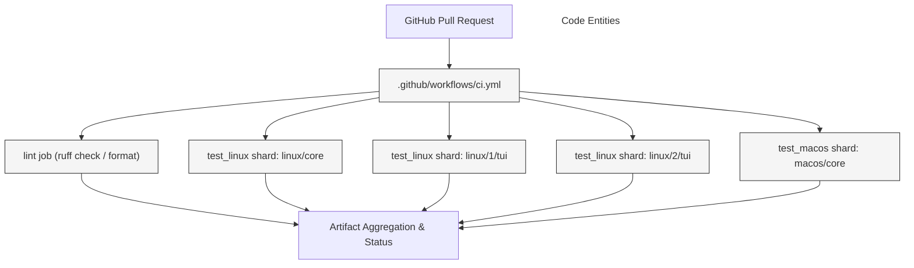
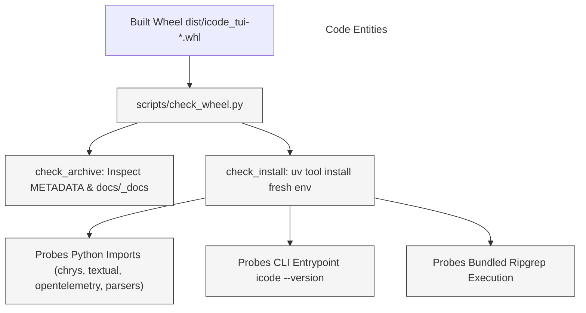

<!-- source: DeepWiki mcp.deepwiki.com · repo openJiuwen-ai/iCode · page 9.2 CI/CD and Packaging · fetched 2026-11-02 -->

# CI/CD and Packaging

Relevant source files

The following files were used as context for generating this wiki page:

- [.github/workflows/cd.yml](.github/workflows/cd.yml)
- [.github/workflows/ci.yml](.github/workflows/ci.yml)
- [.github/workflows/gc-freeze-calibration.yml](.github/workflows/gc-freeze-calibration.yml)
- [.github/workflows/pillow-manylinux2014.yml](.github/workflows/pillow-manylinux2014.yml)
- [.python-version](.python-version)
- [AGENTS.md](AGENTS.md)
- [NOTICE](NOTICE)
- [README.md](README.md)
- [README.zh.md](README.zh.md)
- [docs/en/start/getting-started.md](docs/en/start/getting-started.md)
- [docs/zh-Hans/start/getting-started.md](docs/zh-Hans/start/getting-started.md)
- [pyproject.toml](pyproject.toml)
- [scripts/build.ps1](scripts/build.ps1)
- [scripts/build.sh](scripts/build.sh)
- [scripts/build_offline_dist.sh](scripts/build_offline_dist.sh)
- [scripts/check_wheel.py](scripts/check_wheel.py)
- [scripts/chrys_test.py](scripts/chrys_test.py)
- [scripts/offline_wheel_overrides.txt](scripts/offline_wheel_overrides.txt)
- [tests/app/cli/test_app.py](tests/app/cli/test_app.py)
- [tests/architecture/test_chrys_test.py](tests/architecture/test_chrys_test.py)
- [tests/architecture/test_python_pin.py](tests/architecture/test_python_pin.py)
- [tests/architecture/test_workflow_action_pins.py](tests/architecture/test_workflow_action_pins.py)
- [uv.lock](uv.lock)

This page covers the continuous integration, verification pipelines, wheel packaging, offline distribution construction, and runtime version floors for **iCode** (`chrys`), distributed on PyPI as `iCode-TUI` [AGENTS.md:1-3]().

---

## 1. GitHub Workflows and Action Pinning

The project uses GitHub Actions workflows for continuous integration (`.github/workflows/ci.yml`) and continuous delivery/release (`.github/workflows/cd.yml`). To secure the software supply chain against upstream compromises, every third-party action in `.github/workflows/ci.yml` and other workflow files must be pinned to an immutable 40-character commit SHA, followed by a `# v<version>` version comment [AGENTS.md:33-35]().

A dedicated architecture guard test, `tests/architecture/test_workflow_action_pins.py`, parses all workflow files in `.github/workflows/` and asserts that every `uses:` directive complies with this SHA-pinning requirement.

### CI Sharding and Test Partitions
The PR CI workflow (`.github/workflows/ci.yml`) partitions tests across Linux and macOS runner matrices to optimize execution time [.github/workflows/ci.yml:39-165](). It provisions Python using `.python-version` as a version file [.github/workflows/ci.yml:31-33](), runs `uv sync` [.github/workflows/ci.yml:35](), prewarms bytecode compilation [.github/workflows/ci.yml:82-83](), fetches the vendored ripgrep binary [.github/workflows/ci.yml:89-90](), and executes pytest shards while omitting integration and gc-calibration markers [.github/workflows/ci.yml:93-98]().

*Figure 1: CI Pipeline Sharding and Execution Structure.*

Sources: `AGENTS.md` [AGENTS.md:33-37](), `.github/workflows/ci.yml` [.github/workflows/ci.yml:1-111](), `tests/architecture/test_workflow_action_pins.py` [tests/architecture/test_workflow_action_pins.py]()

---

## 2. Wheel Packaging and Validation

The package is built using Hatchling as specified in `pyproject.toml` [pyproject.toml:88-90](). The build target packages `src/chrys` [pyproject.toml:108-109]() and force-includes the documentation tree (`docs`) into the wheel under `chrys/app/tui/screens/guides/_docs`, allowing the in-app help system and user guide resolver (`src/chrys/foundation/documentation.py`) to access guides offline [pyproject.toml:111-114]().

### Wheel Validation Script
Before publishing or during release candidate checks, packaging pipelines execute `scripts/check_wheel.py` [scripts/check_wheel.py:3-16](). This script performs two core validation phases:
1. **Archive Inspection**: It opens the `.whl` zip archive, verifies that the `METADATA` file names `iCode-TUI`, confirms version matching, ensures no unexpected extras are declared, checks description content types, validates `console_scripts` entry points (`icode = chrys.app.cli.app:main`), and verifies that all markdown user guide files from `docs/` are present in the bundled archive [scripts/check_wheel.py:109-147]().
2. **Tool Environment Probe**: It uses `uv tool install` to install the built wheel into a temporary tool environment (ignoring `uv.lock` to simulate an exact end-user PyPI install), and executes a probe script that imports core subtrees, tests optional document parsers (`docx`, `openpyxl`, `pypdf`, etc.), verifies OpenTelemetry instrumentation logging handlers, ensures `chrys.__version__` matches, and validates that the bundled ripgrep binary executes correctly [scripts/check_wheel.py:55-100, 149-164]().

*Figure 2: Wheel Verification Lifecycle.*

Sources: `pyproject.toml` [pyproject.toml:88-119](), `scripts/check_wheel.py` [scripts/check_wheel.py:1-164]()

---

## 3. Offline Distribution Builds and Runtime Floors

For environments lacking PyPI access or standard Python runtimes, standalone offline packages are built using `scripts/build_offline_dist.sh`, `scripts/build.sh`, and `scripts/build.ps1` [docs/en/start/getting-started.md:21-79](). These bundle a precompiled CPython interpreter via `python-build-standalone` along with the application package and all binary dependencies.

### Glibc Version Floors
- **PyPI Wheels**: Standard PyPI Linux wheels require `glibc 2.27` or later (as mandated by recent package dependency selections like `pillow`) [pyproject.toml:35-38]().
- **Offline Distributions**: Linux offline binaries enforce a strict `glibc 2.17` floor (or `2.18` on ARM64) [docs/en/start/getting-started.md:71](). To achieve this, Linux offline builds override specific dependencies (such as building `pillow` against a manylinux2014 glibc 2.17 container via `.github/workflows/pillow-manylinux2014.yml`), tracked via `scripts/offline_wheel_overrides.txt` [AGENTS.md:36](), [.github/workflows/pillow-manylinux2014.yml:3-10]().

### Interpreter Version Pinning
The Python interpreter version is strictly locked by `.python-version` at the repository root [AGENTS.md:37](). This pin is validated by `tests/architecture/test_python_pin.py`, ensuring that local `uv` runs, GitHub Actions workflows (`setup-python`), and standalone release binaries are identically aligned [AGENTS.md:37]().

Sources: `AGENTS.md` [AGENTS.md:33-37](), `docs/en/start/getting-started.md` [docs/en/start/getting-started.md:21-82](), `.github/workflows/pillow-manylinux2014.yml` [.github/workflows/pillow-manylinux2014.yml:1-64]()

---

