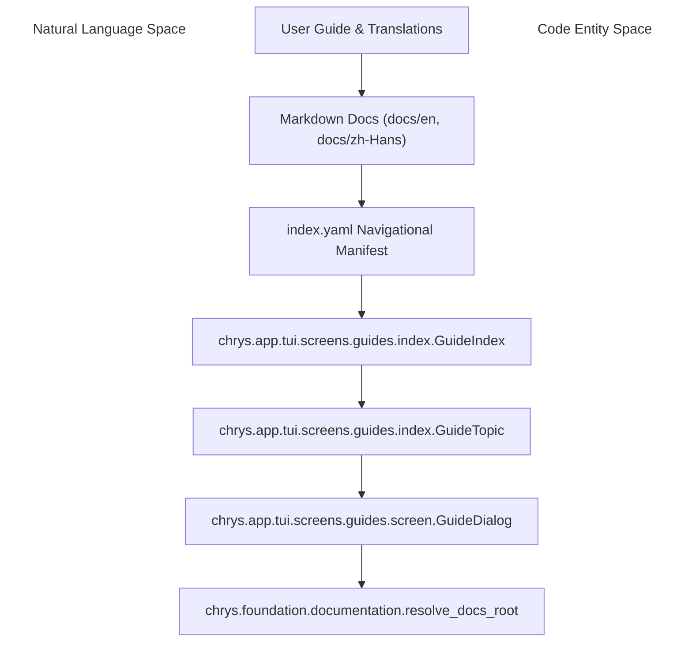
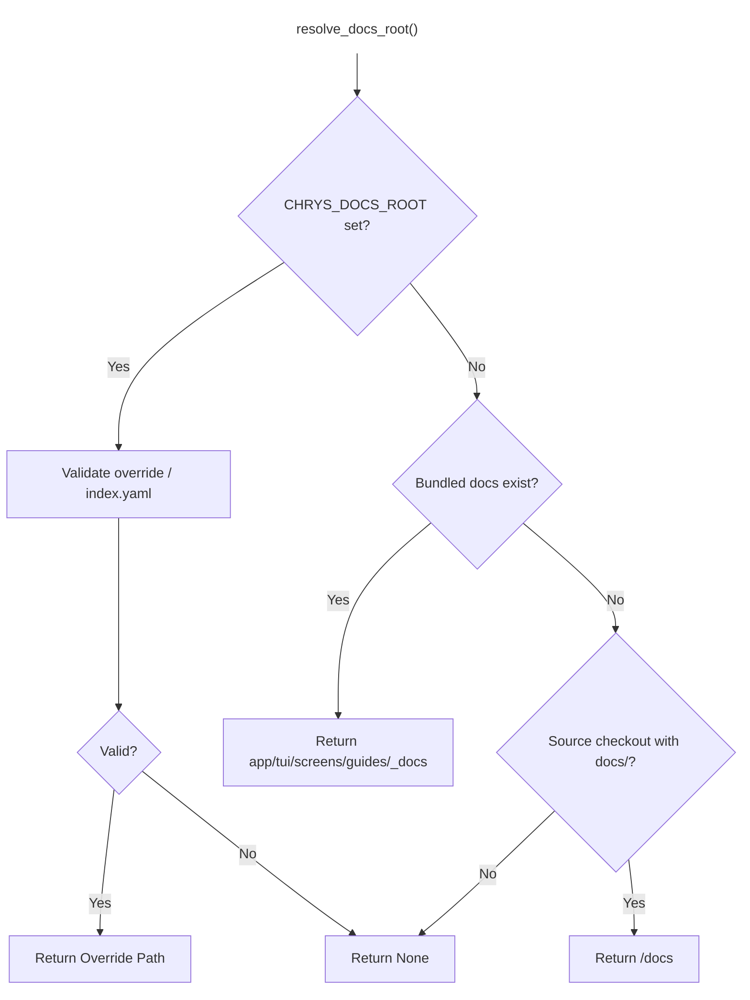
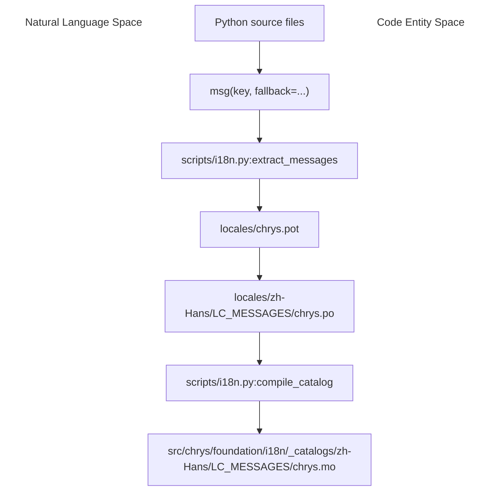

<!-- source: DeepWiki mcp.deepwiki.com · repo openJiuwen-ai/iCode · page 9.3 Documentation and Localization Workflow · fetched 2026-11-02 -->

# Documentation and Localization Workflow

Relevant source files

The following files were used as context for generating this wiki page:

- [scripts/calibrate_gc_freeze.py](scripts/calibrate_gc_freeze.py)
- [scripts/gc_freeze_calibration_math.py](scripts/gc_freeze_calibration_math.py)
- [scripts/i18n.py](scripts/i18n.py)
- [src/chrys/app/tui/screens/guides/index.py](src/chrys/app/tui/screens/guides/index.py)
- [src/chrys/app/tui/screens/guides/screen.py](src/chrys/app/tui/screens/guides/screen.py)
- [src/chrys/app/tui/theme.py](src/chrys/app/tui/theme.py)
- [src/chrys/app/tui/widgets/chat/messages.py](src/chrys/app/tui/widgets/chat/messages.py)
- [src/chrys/app/tui/widgets/sidebar/toc.py](src/chrys/app/tui/widgets/sidebar/toc.py)
- [src/chrys/foundation/documentation.py](src/chrys/foundation/documentation.py)
- [src/chrys/orchestration/invoker/runtime.py](src/chrys/orchestration/invoker/runtime.py)
- [src/chrys/service/context/providers/context_management.py](src/chrys/service/context/providers/context_management.py)
- [src/chrys/service/context/providers/documentation.py](src/chrys/service/context/providers/documentation.py)
- [tests/app/tui/support/test_gc_freeze_calibration.py](tests/app/tui/support/test_gc_freeze_calibration.py)
- [tests/foundation/i18n/test_catalog_artifacts.py](tests/foundation/i18n/test_catalog_artifacts.py)
- [tests/foundation/test_documentation.py](tests/foundation/test_documentation.py)
- [tests/service/context/providers/test_context_management.py](tests/service/context/providers/test_context_management.py)

### Purpose and Scope

This page details the technical architecture governing documentation management, localization (i18n), and translation pipelines in the `iCode` codebase (`chrys`). It covers the directory layout of `docs/en` and `docs/zh-Hans`, the YAML-driven topic index schema, the mechanism for bundling documentation into application wheels (`app/tui/screens/guides/_docs`), runtime resolution via `resolve_docs_root()`, the AST-based i18n extraction script (`scripts/i18n.py`), and validation tests guarding catalog consistency.

---

### 1. Documentation Architecture and Topic Index

Product documentation is authored in Markdown format and structured hierarchically within regional subdirectories under the repository root (`docs/en/` and `docs/zh-Hans/`). A single machine-readable manifest, `docs/index.yaml`, defines the navigational tree, active locales, and default landing topics.

The core data structures parsing this manifest are defined in `src/chrys/app/tui/screens/guides/index.py`:
- `GuideTopic`: Represents a single node (branch or leaf) carrying an optional stable identifier (`id`), a Markdown `path` relative to the locale directory, locale-specific `labels`, and nested `children` `[src/chrys/app/tui/screens/guides/index.py:25-37]()`.
- `GuideIndex`: Encapsulates the ordered tuple of supported `locales`, the `default_topic_id`, and root-level topics `[src/chrys/app/tui/screens/guides/index.py:47-55]()`.

The function `load_guide_index(docs_root)` reads and validates `index.yaml`, throwing `GuideIndexError` upon schema violations or malformed mappings so that UI callers can gracefully fall back to localized error states instead of crashing `[src/chrys/app/tui/screens/guides/index.py:57-77]().`

*Figure 1: Bridging Documentation Artefacts to TUI Guide Controllers.*

Sources: `src/app/tui/screens/guides/index.py:25-77()`, `src/chrys/foundation/documentation.py:10-36()`

---

### 2. Bundled In-App Guides and Path Resolution

To ensure accessibility when `iCode` is installed as a packaged wheel from PyPI (where source checkouts are absent), documentation and the topic index are bundled directly inside the package hierarchy at `src/chrys/app/tui/screens/guides/_docs` via Hatch build targets configured in `pyproject.toml`.

The runtime discovery of these documents is governed by `resolve_docs_root()` in `src/chrys/foundation/documentation.py`:
1. **Environment Override**: Checks `os.environ.get("CHRYS_DOCS_ROOT")`. If present, validates that `index.yaml` exists within the targeted directory; if invalid or missing, returns `None` to prevent fallback to unintended local copies `[src/chrys/foundation/documentation.py:22-28]()`.
2. **Bundled Docs**: Inspects the package-relative path `app/tui/screens/guides/_docs`. If verified, returns the bundled directory `[src/chrys/foundation/documentation.py:29-32]()`.
3. **Repository Source Checkout**: Falls back to walking up to the repository root and verifying `docs/index.yaml` in development checkouts `[src/chrys/foundation/documentation.py:33-36]()`.

*Figure 2: Documentation Root Resolution Strategy.*

Sources: `src/chrys/foundation/documentation.py:14-36()`

---

### 3. Internationalization (i18n) Extraction and Catalog Workflow

`iCode` manages UI and message localizations via GNU `gettext` portable object (`.po`) and binary machine object (`.mo`) catalogs, coordinated by the maintenance script `scripts/i18n.py`.

#### Source of Truth and Metadata
The sole English source of truth resides entirely within Python source definitions using the `msg()` helper function. Extraction scans `src/chrys` using an AST-based parser (`extract_messages()`) rather than generic regex tools `[scripts/i18n.py:175-200]()`.

Each extracted translation catalog entry includes deterministic Babel automated comments (`#.`) formatted as:
- `English: <prose>` / `English-plural: <prose>`: Translator-facing fallback text `[scripts/i18n.py:8-10]()`.
- `chrys-meta=<json>`: A compact JSON object containing the SHA-256 `fingerprint` of the singular/plural fallback pair, multiline policy, and sorted non-count placeholders schema. This guarantees source freshness verification across round-trips `[scripts/i18n.py:14-20]()`.

*Figure 3: i18n Catalog Extraction, Translation, and Compilation Pipeline.*

Sources: `scripts/i18n.py:1-66()`, `scripts/i18n.py:175-200()`

---

### 4. Documentation Tests and Catalog Verification

Integrity guards and test suites ensure that documentation trees and localization artifacts never drift or corrupt at build time.

- **Documentation Resolution Tests**: `tests/foundation/test_documentation.py` validates `resolve_docs_root()` under environment variables overrides, missing index files, relative paths, and PyPI wheel layouts `[tests/foundation/test_documentation.py:25-103]()`.
- **Catalog Artifact Tests**: `tests/foundation/i18n/test_catalog_artifacts.py` exercises deterministic extraction, plural shapes, placeholder validations, and semantic consistency between `.pot`, `.po`, and compiled `.mo` files `[tests/foundation/i18n/test_catalog_artifacts.py:74-106]()`. If tampered metadata comments fail cryptographic fingerprint verification, catalog check operations throw `CatalogToolError` and refuse to overwrite active binary compilation artifacts `[tests/foundation/i18n/test_catalog_artifacts.py:51-71]()`.

Sources: `tests/foundation/test_documentation.py:25-104()`, `tests/foundation/i18n/test_catalog_artifacts.py:51-106()`

---

