# Page: Overview

# Overview

<details>
<summary>Relevant source files</summary>

The following files were used as context for generating this wiki page:

- [.github/workflows/cd.yml](.github/workflows/cd.yml)
- [.github/workflows/ci.yml](.github/workflows/ci.yml)
- [.github/workflows/gc-freeze-calibration.yml](.github/workflows/gc-freeze-calibration.yml)
- [.github/workflows/pillow-manylinux2014.yml](.github/workflows/pillow-manylinux2014.yml)
- [.python-version](.python-version)
- [AGENTS.md](AGENTS.md)
- [NOTICE](NOTICE)
- [README.md](README.md)
- [README.zh.md](README.zh.md)
- [docs/en/start/getting-started.md](docs/en/start/getting-started.md)
- [docs/zh-Hans/start/getting-started.md](docs/zh-Hans/start/getting-started.md)
- [pyproject.toml](pyproject.toml)
- [scripts/build.ps1](scripts/build.ps1)
- [scripts/build.sh](scripts/build.sh)
- [scripts/build_offline_dist.sh](scripts/build_offline_dist.sh)
- [scripts/check_wheel.py](scripts/check_wheel.py)
- [scripts/chrys_test.py](scripts/chrys_test.py)
- [scripts/offline_wheel_overrides.txt](scripts/offline_wheel_overrides.txt)
- [tests/app/cli/test_app.py](tests/app/cli/test_app.py)
- [tests/architecture/test_chrys_test.py](tests/architecture/test_chrys_test.py)
- [tests/architecture/test_python_pin.py](tests/architecture/test_python_pin.py)
- [tests/architecture/test_workflow_action_pins.py](tests/architecture/test_workflow_action_pins.py)
- [uv.lock](uv.lock)

</details>


## Purpose and Scope

Chrys (distributed on PyPI as `iCode-TUI` and invoked via the `icode` command-line interface) is a general-purpose, extensible Python 3.14+ agent platform designed for building, executing, and evolving custom autonomous agents, workflows, and interactive terminal interfaces [AGENTS.md:3, pyproject.toml:4-5, pyproject.toml:81-82]. While the PyPI package distribution and wheel name use `icode-tui`, the core import namespace, application configuration directory (`~/.chrys`), environment variable prefix (`CHRYS_*`), and internal runtime identifiers remain under the `chrys` package namespace [AGENTS.md:3].

This wiki page provides a high-level architectural overview of the system, introducing the five foundational layers of the codebase and mapping out the documentation structure. For installation procedures, environment configuration, and workspace startup details, see [Getting Started](#1.1). For repository layout details and architectural layering rules, see [Layering and Repository Map](#1.2).

### Sources
- `AGENTS.md:3`
- `pyproject.toml:4-83`

---

## The Five-Layer Architecture

The codebase is organized into a strict five-layer architecture that separates cross-cutting foundation primitives from agent execution kernels, LLM wire services, orchestration workflows, and application frontends.

### Architecture Overview Diagram

The following diagram bridges the conceptual Natural Language Space to the Code Entity Space, linking architectural layers to their primary implementation packages and entry points under `src/chrys/`.

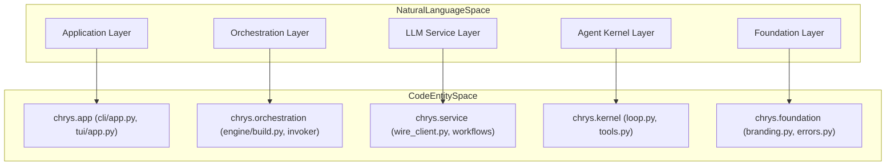

**Figure 1**: Mapping from architectural concepts to codebase packages.

### Sources
- `AGENTS.md:3`
- `pyproject.toml:81-82`
- `scripts/check_wheel.py:37-75`

---

### Layer Breakdown

1. **Foundation Layer (`chrys.foundation`)**: Provides cross-cutting primitives including configuration management (`spec()`, environment variables), error taxonomy (`ErrorKind`, retry handling), internationalization (`LocaleController`), platform helpers, and runtime patches [AGENTS.md:3].
2. **Kernel Layer (`chrys.kernel`)**: Implements the core agent turn lifecycle loop (`kernel/loop.py`), argument validation, exhaustion tails, tool execution result shaping (`kernel/tools.py`), compaction strategies, and OpenTelemetry instrumentation [AGENTS.md:3].
3. **Service Layer (`chrys.service`)**: Encapsulates LLM provider wire clients (`WireClient`, `sdk_openai`, `sdk_anthropic`), request codecs, chat completion stream assembly (`StreamState`), request tracking, and the workflow execution engine [AGENTS.md:3].
4. **Orchestration Layer (`chrys.orchestration`)**: Manages session hosting, engine builds (`AgentBuilder`), invoker runtimes, sub-agent policy execution, context providers, and workflow coordination [AGENTS.md:3].
5. **Application Layer (`chrys.app`)**: Unifies the Textual TUI (`chrys.app.tui.app`), headless CLI (`chrys.app.cli.app`), and ACP server (`ChrysAcpServer`) behind a shared event bus (`EventBus`) [AGENTS.md:3, tests/app/cli/test_app.py:15].

### Frontend and Runtime Execution Flow

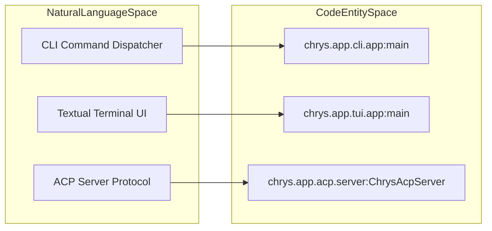

**Figure 2**: Frontend interface mapping to execution entry points.

### Sources
- `AGENTS.md:3`
- `pyproject.toml:81-82`
- `tests/app/cli/test_app.py:15-136`

---

## Wiki Map and Child Pages

The wiki is organized into thematic chapters mirroring the structural boundaries of the codebase:

- **1. Overview** (Current Page) — High-level introduction, architecture map, and wiki index.
  - **1.1 Getting Started** — Installation via `uv`/pip, execution modes (`icode`, `icode run`, `icode acp`), and API configuration [docs/en/start/getting-started.md:1]().
  - **1.2 Layering and Repository Map** — Directory structure under `src/chrys`, architecture enforcement tests, and utility scripts [scripts/chrys_test.py:109]().
- **2. Foundation Layer** — Configuration, error classification, internationalization, and platform patches.
- **3. Kernel: Agent Loop** — Turn lifecycle, tool execution, compaction, and instrumentation.
- **4. LLM Service Layer** — Wire clients, OpenAI/Anthropic codecs, and telemetry tracking.
- **5. Tools, Approvals and Safety** — Builtin tools, approval pipelines, mutation tracking, and middleware.
- **6. Extensibility: Profiles, Skills, Hooks, MCP** — Agent profiles, custom skills, lifecycle hooks, and Model Context Protocol servers.
- **7. Orchestration: Engine, Sub-agents and Workflows** — Session hosts, execution engines, invoker runtimes, and workflows.
- **8. Application Layer: TUI, CLI and ACP** — Terminal UI widgets, command-line routing, trajectory dashboard, and ACP server integration.
- **9. Development, Testing and Release** — Smart test infrastructure (`scripts/chrys_test.py`), CI/CD workflows, and packaging.
- **10. Glossary** — Precise definitions of codebase terminology with code pointers.

### Sources
- `AGENTS.md:3`
- `docs/en/start/getting-started.md:1-15`
- `scripts/chrys_test.py:109-170`

---

# Page: Getting Started

# Getting Started

<details>
<summary>Relevant source files</summary>

The following files were used as context for generating this wiki page:

- [docs/en/guides/daily-use/workspaces.md](docs/en/guides/daily-use/workspaces.md)
- [docs/en/guides/running/icode-run.md](docs/en/guides/running/icode-run.md)
- [docs/en/start/getting-started.md](docs/en/start/getting-started.md)
- [docs/zh-Hans/guides/daily-use/workspaces.md](docs/zh-Hans/guides/daily-use/workspaces.md)
- [docs/zh-Hans/guides/running/icode-run.md](docs/zh-Hans/guides/running/icode-run.md)
- [docs/zh-Hans/start/getting-started.md](docs/zh-Hans/start/getting-started.md)
- [pyproject.toml](pyproject.toml)
- [scripts/check_wheel.py](scripts/check_wheel.py)
- [src/chrys/app/acp/session_manager.py](src/chrys/app/acp/session_manager.py)
- [src/chrys/app/cli/run.py](src/chrys/app/cli/run.py)
- [src/chrys/app/cli/workflow.py](src/chrys/app/cli/workflow.py)
- [src/chrys/app/tui/screens/dialogs/file_picker.tcss](src/chrys/app/tui/screens/dialogs/file_picker.tcss)
- [src/chrys/app/tui/screens/dialogs/new_folder.py](src/chrys/app/tui/screens/dialogs/new_folder.py)
- [src/chrys/app/tui/screens/dialogs/new_folder.tcss](src/chrys/app/tui/screens/dialogs/new_folder.tcss)
- [src/chrys/orchestration/engine/run/runner.py](src/chrys/orchestration/engine/run/runner.py)
- [src/chrys/orchestration/engine/session_lifecycle.py](src/chrys/orchestration/engine/session_lifecycle.py)
- [src/chrys/orchestration/session_host.py](src/chrys/orchestration/session_host.py)
- [src/chrys/orchestration/workflows/coordinator.py](src/chrys/orchestration/workflows/coordinator.py)
- [src/chrys/orchestration/workflows/preview.py](src/chrys/orchestration/workflows/preview.py)
- [src/chrys/orchestration/workflows/worker_client.py](src/chrys/orchestration/workflows/worker_client.py)
- [tests/app/cli/test_run.py](tests/app/cli/test_run.py)
- [tests/app/tui/screens/test_file_picker_new_folder.py](tests/app/tui/screens/test_file_picker_new_folder.py)
- [tests/orchestration/engine/run/test_retry_lifecycle.py](tests/orchestration/engine/run/test_retry_lifecycle.py)
- [tests/orchestration/workflows/test_worker_client.py](tests/orchestration/workflows/test_worker_client.py)
- [uv.lock](uv.lock)

</details>


## Purpose and Scope
This wiki page details the initial setup, invocation, execution modes, and environment configuration for `iCode` (distributed on PyPI as `iCode-TUI`, implemented via the package name `chrys`) [pyproject.toml:1-4](). It bridges installation practices (`uv`, pip, or prebuilt offline distributions), entry-point resolution (`icode`), the structural divergence between interactive and headless execution (`icode` TUI vs `icode run` vs `icode acp`), model authentication via API keys, and workspace context management.

---

## 1. Installation and Environment Setup
`iCode` requires Python >=3.14 for standard tool installations [pyproject.toml:8](), or self-contained runtimes via offline packages. The primary installation path uses Astral's `uv` tool runner:

```shell
uv tool install iCode-TUI
```

For environments lacking direct Python 3.14 access or internet connectivity, prebuilt offline bundles (`icode-<platform>-<arch>-v<version>-offline.tar.gz/.zip`) include an isolated interpreter and all pinned dependencies [docs/en/start/getting-started.md:21-35](). 

The build system configurations, metadata targets, and dependency trees are defined in `pyproject.toml`.

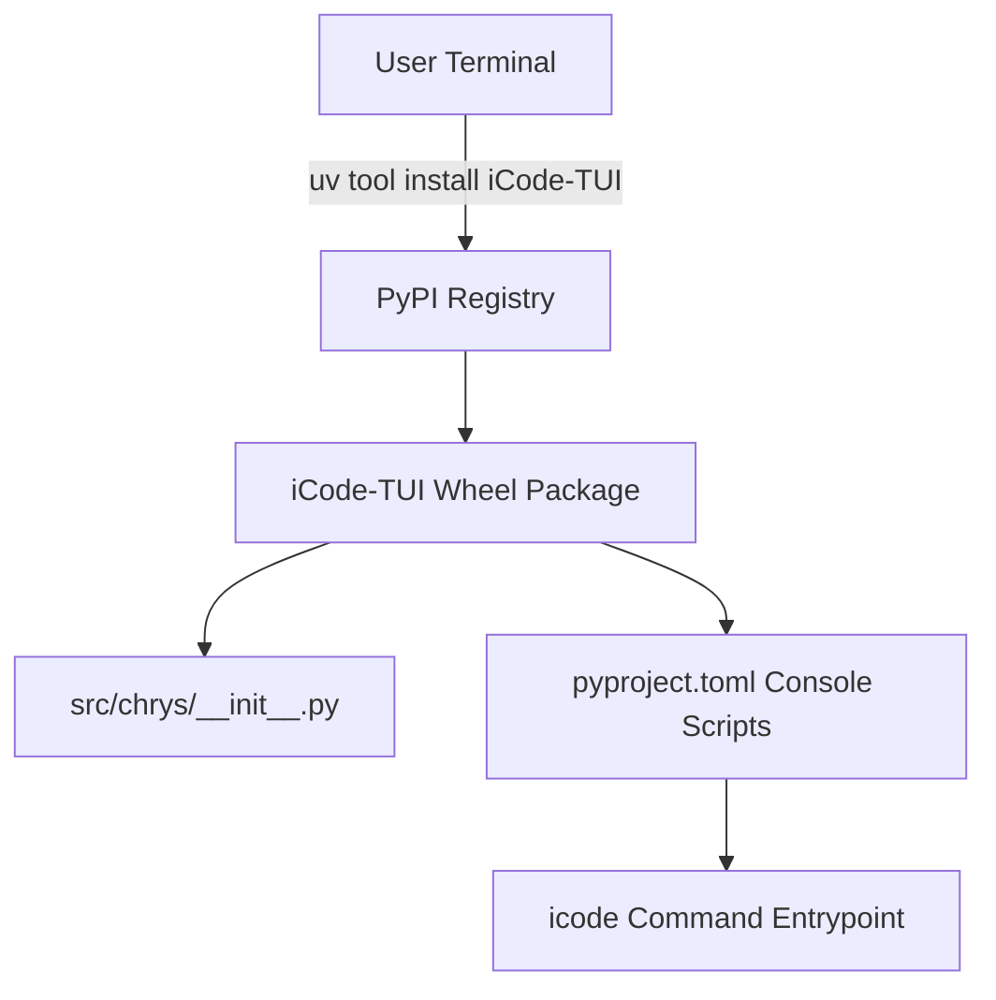
*Diagram 1: Installation flow mapping PyPI distribution to local command registration.*

Sources: [pyproject.toml:1-83](), [docs/en/start/getting-started.md:5-82]()

---

## 2. First Run and CLI Entrypoints
The console script entrypoint is mapped directly to the application runner [pyproject.toml:81-83]():
```toml
[project.scripts]
icode = "chrys.app.cli.app:main"
```

The underlying CLI architecture exposes several subcommands and helpers that handle execution routing, verification, and diagnostics [scripts/check_wheel.py:37-52]().

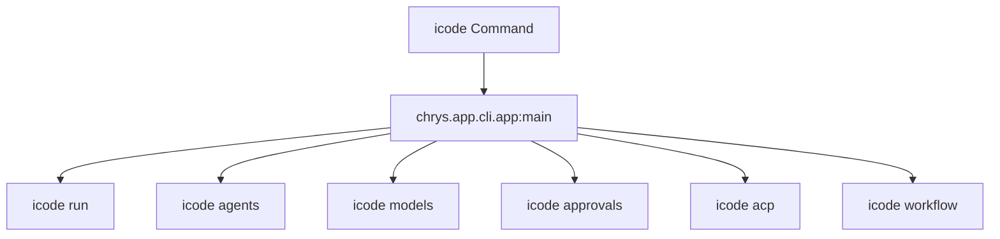
*Diagram 2: Natural language CLI commands mapped to underlying Python executable functions.*

Sources: [pyproject.toml:81-83](), [scripts/check_wheel.py:37-52]()

---

## 3. Execution Modes: TUI vs `icode run` vs `icode acp`
`iCode` supports three distinct execution interfaces sharing the underlying orchestration engine and event loop (`EventBus`):

1. **Interactive TUI (`icode`)**: Launches the Textual-based terminal user interface (`chrys.app.tui.app`), providing real-time streaming, chat history, rich Markdown/Mermaid rendering, approval prompts, and trajectory visualizers.
2. **Headless Run (`icode run`)**: Executes a specific task or agent loop non-interactively, emitting structured progress logs to `stderr` and final outputs to `stdout`.
3. **ACP Server (`icode acp`)**: Starts the Agent Client Protocol server (`ChrysAcpServer`), enabling IDE integrations and external clients to interact with `iCode` sessions via standard JSON-RPC over stdio or sockets.

Sources: [docs/en/start/getting-started.md:107-118](), [src/chrys/app/cli/workflow.py:61-132]()

---

## 4. API Keys and Model Configuration
Model credentials and parameters are managed through settings metadata (`Settings` dataclass) and persisted configuration files within the user's home data directory (`~/.chrys` or `%APPDATA%\chrys`) [docs/en/start/getting-started.md:105](). 

API keys can be supplied interactively via the TUI Model Configuration screen (**F4**) [docs/en/start/getting-started.md:120-128]() or injected via environment variables (such as provider-specific keys or `CHRYS_*` overrides). Configuration resolution merges project-level overrides from `.chrys/` with global defaults.

Sources: [docs/en/start/getting-started.md:120-133](), [docs/en/guides/ daily-use/workspaces.md:1-52]()

---

## 5. Workspaces and Working Directories
File operations, ripgrep searches, and command executions target a designated working directory. 

* **Startup selection**: The directory from which `icode` is invoked becomes the default workspace, or can be explicitly overridden via the `-C` or `--workdir` flags [docs/en/guides/daily-use/workspaces.md:5-20]().
* **Runtime switching**: Users can switch working directories mid-session using the `/chdir` command or through the file picker and folder creation gateway (`NewFolderDialog`) [docs/en/guides/daily-use/workspaces.md:22-30](), [src/chrys/app/tui/screens/dialogs/new_folder.py:122-133]().
* **Missing Workspaces**: If a working directory is deleted or moved externally, `iCode` intercepts operations and prompts the user to remap or select a valid path via the recovery flow [docs/en/guides/daily-use/workspaces.md:40-51]().

Sources: [docs/en/guides/daily-use/workspaces.md:1-51](), [src/chrys/app/tui/screens/dialogs/new_folder.py:122-155]()

---

# Page: Layering and Repository Map

# Layering and Repository Map

<details>
<summary>Relevant source files</summary>

The following files were used as context for generating this wiki page:

- [.github/workflows/pillow-manylinux2014.yml](.github/workflows/pillow-manylinux2014.yml)
- [AGENTS.md](AGENTS.md)
- [NOTICE](NOTICE)
- [scripts/build_offline_dist.sh](scripts/build_offline_dist.sh)
- [scripts/chrys_test.py](scripts/chrys_test.py)
- [scripts/offline_wheel_overrides.txt](scripts/offline_wheel_overrides.txt)
- [src/chrys/app/features/buddy/pixel_sprites.py](src/chrys/app/features/buddy/pixel_sprites.py)
- [src/chrys/app/tui/screens/guides/index.py](src/chrys/app/tui/screens/guides/index.py)
- [src/chrys/app/tui/screens/guides/screen.py](src/chrys/app/tui/screens/guides/screen.py)
- [src/chrys/app/tui/widgets/chat/image_preview.py](src/chrys/app/tui/widgets/chat/image_preview.py)
- [src/chrys/app/tui/widgets/chrome/image_paste.py](src/chrys/app/tui/widgets/chrome/image_paste.py)
- [src/chrys/foundation/documentation.py](src/chrys/foundation/documentation.py)
- [src/chrys/orchestration/invoker/runtime.py](src/chrys/orchestration/invoker/runtime.py)
- [src/chrys/service/context/providers/context_management.py](src/chrys/service/context/providers/context_management.py)
- [src/chrys/service/context/providers/documentation.py](src/chrys/service/context/providers/documentation.py)
- [src/chrys/service/tools/builtins/doc_converter/artifacts.py](src/chrys/service/tools/builtins/doc_converter/artifacts.py)
- [src/chrys/service/tools/builtins/doc_converter/parsers/base.py](src/chrys/service/tools/builtins/doc_converter/parsers/base.py)
- [src/chrys/service/tools/builtins/doc_converter/parsers/pdf.py](src/chrys/service/tools/builtins/doc_converter/parsers/pdf.py)
- [src/chrys/service/tools/builtins/doc_converter/parsers/xlsx.py](src/chrys/service/tools/builtins/doc_converter/parsers/xlsx.py)
- [tests/app/features/buddy/test_pixel_sprites.py](tests/app/features/buddy/test_pixel_sprites.py)
- [tests/architecture/test_chrys_test.py](tests/architecture/test_chrys_test.py)
- [tests/architecture/test_test_hygiene.py](tests/architecture/test_test_hygiene.py)
- [tests/architecture/test_workflow_action_pins.py](tests/architecture/test_workflow_action_pins.py)
- [tests/service/context/providers/test_context_management.py](tests/service/context/providers/test_context_management.py)

</details>


## Purpose and Scope
This page defines the directory structure of the `src/chrys/` package, explains the strict architectural layering rules enforced by the test suite, details the helper utilities in `scripts/` and `playground/`, and maps the documentation (`docs/`) tree and runtime resolution mechanisms.

Sources: [AGENTS.md:1-4](), [scripts/chrys_test.py:3-9]()

---

## 1. Repository Directory Layout (`src/chrys/`)
The Chrys core platform codebase resides under `src/chrys/` with clear functional separation across five distinct architectural layers. Supporting files such as test suites, developer scripts, and documentation trees live at the repository root.

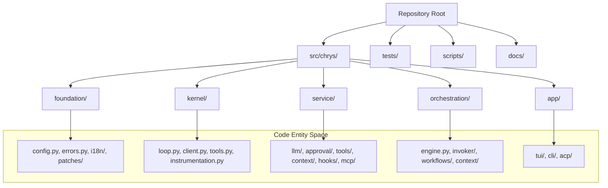
Sources: [AGENTS.md:3-4](), [src/chrys/foundation/documentation.py:10-12]()

---

## 2. Layering Architecture and Enforcement Rules
Chrys enforces a strict unidirectional dependency graph across its five architectural layers. Lower layers (such as `foundation` and `kernel`) are forbidden from importing symbols from higher layers (`service`, `orchestration`, or `app`). Architecture guard tests enforce these invariants at test time.

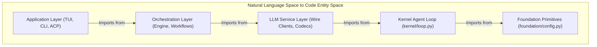
Sources: [scripts/chrys_test.py:109-141](), [tests/architecture/test_chrys_test.py:83-93]()

### Architecture Guard Mechanisms
- **Layering Tests**: `tests/architecture/test_layering.py` verifies that module imports strictly adhere to the downward dependency direction [scripts/chrys_test.py:141-141]().
- **Test Discovery**: `scripts/chrys_test.py` maps architecture tests to specific file patterns via `ARCHITECTURE_RULES` [scripts/chrys_test.py:109-169]().
- **Smart Test Selection**: Local change analysis traces runtime imports up to `_MAX_SOURCE_IMPORT_HOPS = 2` to selectively run relevant pytest targets [scripts/chrys_test.py:44-44]().

Sources: [scripts/chrys_test.py:109-169](), [tests/architecture/test_chrys_test.py:83-93]()

---

## 3. Utilities in `scripts/` and `playground/`
Development, testing, and release packaging rely on specialized utilities located in the root `scripts/` directory:

| Utility Script | Primary Role | Code Pointer |
| -------------- | ------------ | ------------ |
| `scripts/chrys_test.py` | Smart and complete test execution runner with CPU niceness lowering (`_BELOW_NORMAL_NICENESS = 10`) | [scripts/chrys_test.py:3-46]() |
| `scripts/i18n.py` | Translation catalog management (extract, update, compile, check) | [AGENTS.md:18-18]() |
| `scripts/check_wheel.py` | Fresh environment wheel installation probe and artifact validation | [AGENTS.md:27-27]() |
| `scripts/build.sh` / `build.ps1` | Standalone binary bundling script referencing `PYTHON_BUILD_STANDALONE_RELEASE` | [AGENTS.md:37-37]() |

Sources: [AGENTS.md:17-37](), [scripts/chrys_test.py:3-46]()

---

## 4. Documentation Tree and Bundled Assets
User guides and technical documentation are maintained in Markdown format under `docs/` and driven by a structured index schema.

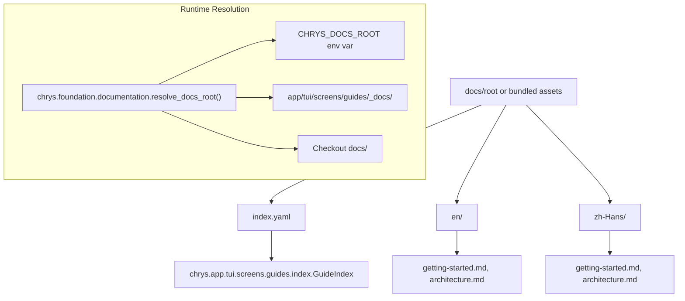
Sources: [src/chrys/app/tui/screens/guides/index.py:25-77](), [src/chrys/foundation/documentation.py:14-36]()

### Documentation Resolution Logic
The function `resolve_docs_root()` determines the active documentation path using a tiered fallback strategy:
1. Explicit path override via the `CHRYS_DOCS_ROOT` environment variable [src/chrys/foundation/documentation.py:22-28]().
2. Bundled documentation package located at `app/tui/screens/guides/_docs/` [src/chrys/foundation/documentation.py:30-32]().
3. Source checkout repository root `docs/` directory [src/chrys/foundation/documentation.py:33-35]().

Sources: [src/chrys/foundation/documentation.py:14-36](), [src/chrys/app/tui/screens/guides/index.py:57-77]()

---

# Page: Foundation Layer

# Foundation Layer

<details>
<summary>Relevant source files</summary>

The following files were used as context for generating this wiki page:

- [docs/en/guides/configuration/compaction.md](docs/en/guides/configuration/compaction.md)
- [docs/zh-Hans/guides/configuration/compaction.md](docs/zh-Hans/guides/configuration/compaction.md)
- [locales/chrys.pot](locales/chrys.pot)
- [locales/zh-Hans/LC_MESSAGES/chrys.po](locales/zh-Hans/LC_MESSAGES/chrys.po)
- [src/chrys/app/tui/screens/settings/layout.py](src/chrys/app/tui/screens/settings/layout.py)
- [src/chrys/foundation/config/settings.py](src/chrys/foundation/config/settings.py)
- [src/chrys/foundation/errors/__init__.py](src/chrys/foundation/errors/__init__.py)
- [src/chrys/foundation/i18n/_catalogs/zh-Hans/LC_MESSAGES/chrys.mo](src/chrys/foundation/i18n/_catalogs/zh-Hans/LC_MESSAGES/chrys.mo)
- [src/chrys/foundation/platform/files.py](src/chrys/foundation/platform/files.py)
- [src/chrys/kernel/__init__.py](src/chrys/kernel/__init__.py)
- [src/chrys/kernel/compaction.py](src/chrys/kernel/compaction.py)
- [src/chrys/service/approval/grant_store.py](src/chrys/service/approval/grant_store.py)
- [src/chrys/service/context/compaction/strategy.py](src/chrys/service/context/compaction/strategy.py)
- [tests/app/tui/widgets/test_file_scanner.py](tests/app/tui/widgets/test_file_scanner.py)
- [tests/foundation/i18n/_catalog_oracle_ids.py](tests/foundation/i18n/_catalog_oracle_ids.py)
- [tests/foundation/i18n/test_catalog_oracle.py](tests/foundation/i18n/test_catalog_oracle.py)
- [tests/foundation/platform/test_files.py](tests/foundation/platform/test_files.py)
- [tests/kernel/_fakes.py](tests/kernel/_fakes.py)
- [tests/kernel/test_loop_context_overflow_note.py](tests/kernel/test_loop_context_overflow_note.py)
- [tests/service/agent_middleware/test_approval_reuse_review_regressions.py](tests/service/agent_middleware/test_approval_reuse_review_regressions.py)
- [tests/service/context/compaction/test_context_overflow_note.py](tests/service/context/compaction/test_context_overflow_note.py)

</details>


The Foundation layer provides low-level, cross-cutting primitives for the `iCode` (`chrys`) codebase. It encapsulates fundamental services used across all upper layers—Kernel, Service, Orchestration, and Application—including configuration management, internationalization catalogs, error classification and retry policies, platform-specific filesystem operations, runtime patches, and core event types.

Sources: `src/chrys/foundation/config/settings.py:1-48`, `src/chrys/foundation/errors/__init__.py:1-12`

---

## 2.1 Configuration and Settings

The configuration subsystem handles hierarchical settings resolution across environment variables (`CHRYS_*`), user documents, project-specific overrides (`settings.yaml`), and defaults. Settings are structured around typed dataclasses decorated with metadata specs that dictate coercion rules, validation policies, and UI rendering layout integration.

For details, see [Configuration and Settings](#2.1).

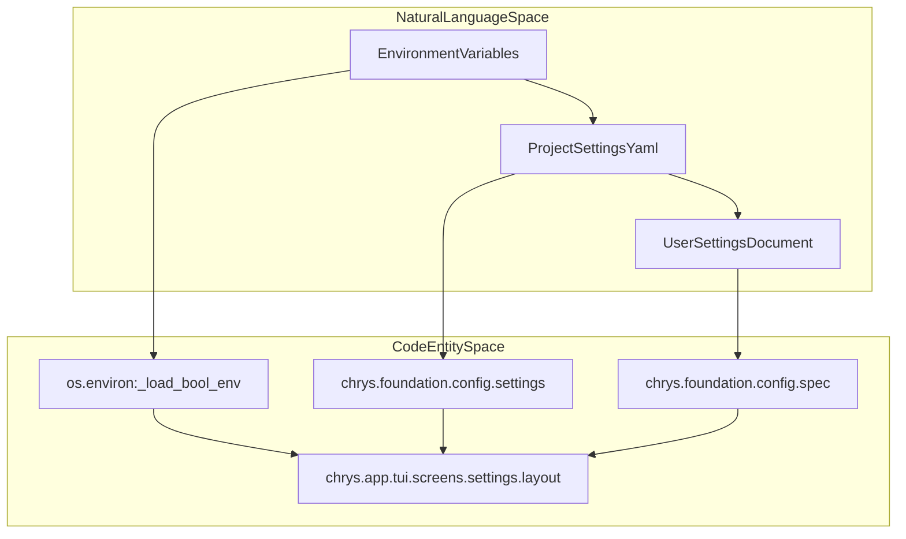
*Figure 1: Bridging configuration inputs to setting specs and layout renderers.*

Sources: `src/chrys/foundation/config/settings.py:1-62`, `src/chrys/app/tui/screens/settings/layout.py:1-20`

---

## 2.2 Internationalization (i18n)

The internationalization layer supplies multi-language support (such as English fallbacks and Simplified Chinese catalogs) through GNU `gettext` message catalogs (`locales/*.pot`, `.po`, `.mo`). Translation pipelines are governed by extraction and verification scripts, runtime `LocaleController` wiring, and strict catalog oracle tests that ensure message ID consistency across releases.

For details, see [Internationalization (i18n)](#2.2).

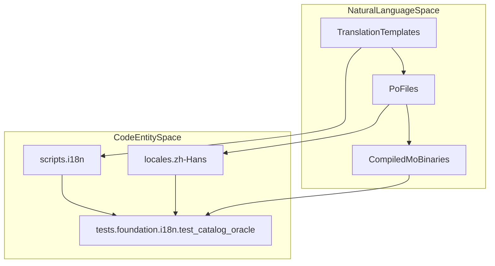
*Figure 2: Translation asset compilation and oracle test validation pipeline.*

Sources: `locales/chrys.pot:1-20`, `tests/foundation/i18n/test_catalog_oracle.py:1-30`, `tests/foundation/i18n/_catalog_oracle_ids.py:1-17`

---

## 2.3 Error Classification and Retry

Error handling is centralized in `chrys.foundation.errors`, providing a single taxonomy for provider signals, network failures, and execution exceptions. Key primitives include `classify_error`, retryability predicates, context-overflow limit detection, and continuation token invalidation checks, avoiding fragmented error-handling logic across the codebase.

For details, see [Error Classification and Retry](#2.3).

Sources: `src/chrys/foundation/errors/__init__.py:1-38`

---

## 2.4 Platform, Patches and Utilities

Platform abstractions encapsulate operating-system differences, providing secure owner-only filesystem helpers, atomic file operations with robust retry mechanisms for Windows file locking, process output capture utilities, and Textual UI runtime patches.

For details, see [Platform, Patches and Utilities](#2.4).

Sources: `src/chrys/foundation/platform/files.py:1-50`, `tests/foundation/platform/test_files.py:1-30`

---

# Page: Configuration and Settings

# Configuration and Settings

<details>
<summary>Relevant source files</summary>

The following files were used as context for generating this wiki page:

- [docs/en/guides/configuration/settings.md](docs/en/guides/configuration/settings.md)
- [docs/en/reference/settings.md](docs/en/reference/settings.md)
- [docs/zh-Hans/guides/configuration/settings.md](docs/zh-Hans/guides/configuration/settings.md)
- [docs/zh-Hans/reference/settings.md](docs/zh-Hans/reference/settings.md)
- [locales/chrys.pot](locales/chrys.pot)
- [locales/zh-Hans/LC_MESSAGES/chrys.po](locales/zh-Hans/LC_MESSAGES/chrys.po)
- [src/chrys/app/tui/screens/settings/layout.py](src/chrys/app/tui/screens/settings/layout.py)
- [src/chrys/foundation/config/settings.py](src/chrys/foundation/config/settings.py)
- [src/chrys/foundation/i18n/_catalogs/zh-Hans/LC_MESSAGES/chrys.mo](src/chrys/foundation/i18n/_catalogs/zh-Hans/LC_MESSAGES/chrys.mo)
- [tests/app/tui/screens/settings/test_dialog.py](tests/app/tui/screens/settings/test_dialog.py)
- [tests/foundation/config/test_project_layer.py](tests/foundation/config/test_project_layer.py)
- [tests/foundation/config/test_settings_store.py](tests/foundation/config/test_settings_store.py)
- [tests/foundation/i18n/_catalog_oracle_ids.py](tests/foundation/i18n/_catalog_oracle_ids.py)
- [tests/foundation/i18n/test_catalog_oracle.py](tests/foundation/i18n/test_catalog_oracle.py)
- [tests/orchestration/workflows/test_agent_parity.py](tests/orchestration/workflows/test_agent_parity.py)

</details>


## Purpose and Scope

The configuration and settings subsystem (`src/chrys/foundation/config/`) provides centralized, typed configuration management for Chrys. It handles defaults, environment variable ingestion (`CHRYS_*`), user and project-level `settings.yaml` files, type coercion, validation policies, and setting provenance tracking. This page details the implementation of the `Settings` data structures, `spec()` metadata declarations, the coercion engine, merge policies across project boundaries, and resolution precedence.

Sources: `[src/chrys/foundation/config/settings.py:1-48]()`, `[src/chrys/foundation/config/spec.py:1-40]()`

---

## Settings Dataclass and Structure

Chrys configuration is aggregated into immutable dataclasses (frozen with slots enabled) defined across the configuration foundation. The central `Settings` container holds configuration values covering interface preferences, agent selections, model roles, security constraints, network utilities, and rollback budgets.

```
+-----------------------------------------------------------------------------------------+
|                                  Natural Language Space                                 |
| "User Settings File" <---> "Environment Variables" <---> "Project Settings"             |
+-----------------------------------------------------------------------------------------+
                                           |
                                           v
+-----------------------------------------------------------------------------------------+
|                                    Code Entity Space                                    |
|  [Settings] dataclass                                                                   |
|   ├── theme: str              (loaded via _load_default_approval_mode / env vars)      |
|   ├── locale: str             (parsed with support for SUPPORTED_LOCALES)               |
|   ├── approval_mode: str      (validated against _VALID_APPROVAL_MODES)                 |
|   └── max_transient_retries: int | null (clamped via MAX_TRANSIENT_RETRIES_LIMIT)       |
+-----------------------------------------------------------------------------------------+
```

Each setting property is backed by explicit loader functions and fallback constants in `src/chrys/foundation/config/settings.py`, ensuring safe defaults when environment variables or configuration files contain malformed data.

Sources: `[src/chrys/foundation/config/settings.py:11-173]()`, `[src/chrys/foundation/i18n/locale.py:1-46]()`

---

## Metadata (`spec()`) and Layout Mapping

Every configuration property is bound to metadata via `spec()` from `src/chrys/foundation/config/spec.py`. This metadata describes the setting's schema, application timing (`Apply`), data kind (`Kind`), risk profile (`Risk`), and merge behavior across project boundaries (`ProjectMerge`).

The TUI settings panel (`src/chrys/app/tui/screens/settings/layout.py`) acts as a pure renderer over these `SettingSpec` definitions, mapping configuration keys into categorized tabs, sections, and user-facing hints.

```
+-----------------------------------------------------------------------------------------+
|                                  Natural Language Space                                 |
| "TUI Settings Tab: General & Security" ---> "Field Renderer & Hint Lookup"              |
+-----------------------------------------------------------------------------------------+
                                           |
                                           v
+-----------------------------------------------------------------------------------------+
|                                    Code Entity Space                                    |
|  [SettingSpec] metadata container                                                       |
|   ├── Apply enum (IMMEDIATE, CLOSE, RESTART, TURN)                                      |
|   ├── Kind enum (BOOL, INT, CHOICE, TEXT, etc.)                                         |
|   ├── Risk enum (SAFE, SENSITIVE)                                                       |
|   └── ProjectMerge enum (ALLOW, OVERRIDE, STRIP)                                        |
|                                                                                         |
|  Mapped by: [chrys.app.tui.screens.settings.layout]                                     |
|   ├── _TAB_GENERAL / _TAB_SECURITY                                                      |
|   └── _HINT_UI_THEME / _HINT_APPROVAL_DEFAULT_MODE                                      |
+-----------------------------------------------------------------------------------------+
```

Sources: `[src/chrys/foundation/config/spec.py:1-38]()`, `[src/chrys/app/tui/screens/settings/layout.py:1-50]()`

---

## Coercion and Validation Engine

To safely process external inputs from user files, environment variables, or interactive prompts, Chrys uses a dedicated coercion engine (`src/chrys/foundation/config/coercion.py`). Coercers return a `Coerced[T]` result object containing the validated value, a status flag (`CoerceStatus`), and structured error or fallback reasons (`CoerceReason`).

```
+-----------------------------------------------------------------------------------------+
|                                  Natural Language Space                                 |
| "Raw Configuration Input (String / Malformed Value)"                                    |
+-----------------------------------------------------------------------------------------+
                                           |
                                           v
+-----------------------------------------------------------------------------------------+
|                                    Code Entity Space                                    |
|  [Coercer] functions                                                                    |
|   ├── bool_coercer()  ---> parses truthy/falsy strings                                  |
|   ├── int_coercer()   ---> enforces bounds & numeric format                             |
|   ├── choice_coercer() ---> validates against enumeration sets                          |
|   └── text_coercer()  ---> normalizes string encodings                                  |
|                                                                                         |
|  Output: [Coerced] wrapper holding [CoerceStatus] & [CoerceReason]                      |
+-----------------------------------------------------------------------------------------+
```

- **`bool_coercer`**: Parses case-insensitive truthy tokens (`1`, `true`, `yes`, `on`).
- **`int_coercer` & `optional_int_coercer`**: Enforces strict integer boundaries and handles null/empty fallbacks.
- **`choice_coercer`**: Restricts options to defined enumerations (e.g., editor keymaps, approval modes, themes).

Sources: `[src/chrys/foundation/config/coercion.py:1-30]()`, `[src/chrys/foundation/config/settings.py:15-28]()`

---

## Environment Variables (`CHRYS_*`) and `settings.yaml`

Configuration values can be supplied through multiple persistence tiers and environment overrides.

### File Locations and Encoding
User and project settings are serialized in YAML format:
- **User Settings**: Stored at `~/.chrys/settings.yaml` (macOS/Linux) or `%APPDATA%\chrys\settings.yaml` (Windows).
- **Project Settings**: Loaded from `.chrys/settings.yaml` within the active workspace working directory (disabled by default unless `project.config_enabled` is true).

Chrys files are read using UTF-8 with automatic fallback detection for legacy encodings (GBK, GB18030, UTF-16/32 BOM). Invalid bytes trigger file corruption recovery procedures rather than silent replacement.

### Environment Variable Bindings
Environment variables use the `CHRYS_` prefix and map directly to dot-notation nested keys. Examples include:
- `CHRYS_THEME` $\rightarrow$ `ui.theme`
- `CHRYS_LOCALE` $\rightarrow$ `ui.locale`
- `CHRYS_DEFAULT_AGENT` $\rightarrow$ `agent.default_profile`
- `CHRYS_DEFAULT_APPROVAL_MODE` $\rightarrow$ `approval.default_mode`
- `CHRYS_MAX_TRANSIENT_RETRIES` $\rightarrow$ `llm.retry.max_transient`

Sources: `[docs/en/reference/settings.md:1-45]()`, `[src/chrys/foundation/config/settings.py:84-173]()`

---

## Configuration Layers, Precedence, and Provenance

When the application boots, configuration values are synthesized across distinct precedence layers. Lower layers are systematically overwritten by higher precedence layers.

1. **Built-in Defaults**: Hardcoded fallback constants defined in `settings.py`.
2. **User Settings Document**: Persisted values read from user-level `settings.yaml`.
3. **Project Settings Document**: Workspace-level `.chrys/settings.yaml` (subject to explicit opt-in via `project.config_enabled`, `project.hooks_enabled`, and `project.skills_enabled`).
4. **Environment Variables (`CHRYS_*`)**: Process-level runtime overrides.
5. **CLI / Runtime Arguments**: Explicit flags passed via invocation commands (e.g., `--agent`, `--model`).

Project layer merge policies (`ProjectMerge`) dictate whether specific keys in workspace configuration files are allowed, overridden, or stripped for security compliance (such as preventing untrusted repositories from injecting bypass authorization modes or bypassing context admission filters).

Sources: `[docs/en/reference/settings.md:1-29]()`, `[src/chrys/foundation/config/spec.py:30-38]()`, `[src/chrys/foundation/config/settings.py:1-48]()`

---

# Page: Internationalization (i18n)

# Internationalization (i18n)

<details>
<summary>Relevant source files</summary>

The following files were used as context for generating this wiki page:

- [locales/chrys.pot](locales/chrys.pot)
- [locales/zh-Hans/LC_MESSAGES/chrys.po](locales/zh-Hans/LC_MESSAGES/chrys.po)
- [scripts/calibrate_gc_freeze.py](scripts/calibrate_gc_freeze.py)
- [scripts/gc_freeze_calibration_math.py](scripts/gc_freeze_calibration_math.py)
- [scripts/i18n.py](scripts/i18n.py)
- [src/chrys/app/tui/screens/settings/layout.py](src/chrys/app/tui/screens/settings/layout.py)
- [src/chrys/app/tui/theme.py](src/chrys/app/tui/theme.py)
- [src/chrys/app/tui/widgets/chat/messages.py](src/chrys/app/tui/widgets/chat/messages.py)
- [src/chrys/app/tui/widgets/sidebar/toc.py](src/chrys/app/tui/widgets/sidebar/toc.py)
- [src/chrys/foundation/config/settings.py](src/chrys/foundation/config/settings.py)
- [src/chrys/foundation/i18n/_catalogs/zh-Hans/LC_MESSAGES/chrys.mo](src/chrys/foundation/i18n/_catalogs/zh-Hans/LC_MESSAGES/chrys.mo)
- [tests/app/tui/support/test_gc_freeze_calibration.py](tests/app/tui/support/test_gc_freeze_calibration.py)
- [tests/foundation/i18n/_catalog_oracle_ids.py](tests/foundation/i18n/_catalog_oracle_ids.py)
- [tests/foundation/i18n/_settings_catalog_oracle_ids.py](tests/foundation/i18n/_settings_catalog_oracle_ids.py)
- [tests/foundation/i18n/test_catalog_artifacts.py](tests/foundation/i18n/test_catalog_artifacts.py)
- [tests/foundation/i18n/test_catalog_oracle.py](tests/foundation/i18n/test_catalog_oracle.py)

</details>


## Purpose and Scope

The internationalization (i18n) subsystem in `chrys` provides multi-language support, string localization, and localized fallback management across the TUI, CLI, and ACP interfaces. The architecture relies on Python `msg()` definition literals as the single source of truth, standard `gettext` message catalogs (`.pot`, `.po`, and compiled `.mo` files), AST-based extraction via `scripts/i18n.py`, runtime locale resolution, and automated catalog oracle tests [scripts/i18n.py:3-24](), [tests/foundation/i18n/test_catalog_oracle.py:3-4]().

Sources: [scripts/i18n.py:3-24](), [tests/foundation/i18n/test_catalog_oracle.py:3-4]()

---

## Catalog Artifacts and Directory Layout

The i18n localization store divides its responsibilities between repository source assets under the root `locales/` directory and runtime-compiled binary catalogs bundled inside the package source tree under `src/chrys/foundation/i18n/_catalogs/` [locales/chrys.pot:1-16](), [src/chrys/foundation/i18n/_catalogs/zh-Hans/LC_MESSAGES/chrys.mo:1-3]().

- **Template Catalog (`locales/chrys.pot`)**: The translation template generated automatically from source AST scans. It contains all tracked `msgid` definitions and metadata comments [locales/chrys.pot:1-16]().
- **Language Catalogs (`locales/<locale>/LC_MESSAGES/chrys.po`)**: Human-translated text mappings for specific locales, such as Simplified Chinese (`zh_Hans`) [locales/zh-Hans/LC_MESSAGES/chrys.po:1-15]().
- **Compiled Binary Catalogs (`src/chrys/foundation/i18n/_catalogs/<locale>/LC_MESSAGES/chrys.mo`)**: Machine-readable GNU `gettext` binary lookup tables loaded directly by the Python runtime [src/chrys/foundation/i18n/_catalogs/zh-Hans/LC_MESSAGES/chrys.mo:1-3]().

```mermaid
graph TD
    sub5["NaturalLanguageSpace"]
    sub5_node1["SourceCodeMsgLiterals[\"msg(key, fallback=\...\)"] --> sub5_node2["ExtractorScript[\"scripts/i18n.py\"]"]
    sub5_node2 --> sub5_node3["TemplateFile[\"locales/chrys.pot\"]"]
    sub5_node3 --> sub5_node4["PoTranslationFile[\"locales/zh-Hans/LC_MESSAGES/chrys.po\"]"]
    sub5_node4 --> sub5_node5["MoBinaryCatalog[\"src/chrys/foundation/i18n/_catalogs/zh-Hans/LC_MESSAGES/chrys.mo\"]"]
    sub5_node5 --> sub5_node6["RuntimeGettextLoader[\"gettext.GNUTranslations\"]"]
```
Sources: [locales/chrys.pot:1-16](), [locales/zh-Hans/LC_MESSAGES/chrys.po:1-15](), [src/chrys/foundation/i18n/_catalogs/zh-Hans/LC_MESSAGES/chrys.mo:1-3](), [scripts/i18n.py:3-46](), [tests/foundation/i18n/test_catalog_oracle.py:22-37]()

---

## Extraction, Compilation, and `scripts/i18n.py`

The maintenance utility `scripts/chrys.py` (invoked via `scripts/i18n.py`) implements AST-based extraction and verification [scripts/i18n.py:3-24](). Unlike standard `xgettext` which scans C or generic source files, `scripts/i18n.py` specifically parses Python Abstract Syntax Trees under `src/chrys` [scripts/i18n.py:22-200]().

### Metadata Comments and Fingerprints
Each entry injected into the POT and PO files includes structured Babel auto-comments (`#.`) [scripts/i18n.py:6-20]():
- `English: <prose>` or `English-plural: <prose>`: Human-readable fallback descriptions [scripts/i18n.py:8-13]().
- `chrys-meta=<json>`: A compact JSON token containing the SHA-256 fingerprint of the fallback pair, multiline flags, and placeholder schemas [scripts/i18n.py:14-20](). This serves as the machine-read source-freshness identity [scripts/i18n.py:17-20]().

```mermaid
graph TD
    sub6["CodeEntitySpace"]
    sub6_func1["extract_messages[\"scripts/i18n.py:175\"]"] --> sub6_func2["_extract_file[\"scripts/i18n.py:186\"]"]
    sub6_func2 --> sub6_func3["_validate_extracted_message[\"scripts/i18n.py:198\"]"]
    sub6_func3 --> sub6_func4["write_po[\"babel.messages.pofile\"]"]
    sub6_func4 --> sub6_func5["write_mo[\"babel.messages.mofile\"]"]
```
Sources: [scripts/i18n.py:14-20](), [scripts/i18n.py:175-200](), [scripts/i18n.py:43-46]()

---

## Runtime Localization & Locale Resolution

The runtime loads catalogs dynamically according to the active user configuration or environment selections. The locale selector configuration supports system-level bindings, fallback rules, and explicit language selections [src/chrys/foundation/config/settings.py:63-64]().

- `DEFAULT_LOCALE = "system"`: Resolves to the operating system locale when `CHRYS_LOCALE` is absent or set to system [src/chrys/foundation/config/settings.py:63-64]().
- UI hints and settings labels (e.g., `_HINT_UI_LOCALE` in `src/chrys/app/tui/screens/settings/layout.py`) present localization controls directly inside the TUI settings panels [src/chrys/app/tui/screens/settings/layout.py:50-53]().

Sources: [src/chrys/foundation/config/settings.py:63-64](), [src/chrys/app/tui/screens/settings/layout.py:50-53]()

---

## Catalog Oracle Tests & CI Quality Gates

To prevent untracked translation drift, missing message IDs, or corrupted binary compilation states, the test suite includes a strict live catalog oracle test (`tests/foundation/i18n/test_catalog_oracle.py`) [tests/foundation/i18n/test_catalog_oracle.py:3-4]().

```mermaid
graph TD
    sub7["CodeEntitySpace"]
    sub7_test1["test_live_catalog_artifacts_contain_effective_translations_and_are_loadable[\"tests/foundation/i18n/test_catalog_oracle.py:22\"]"] --> sub7_test2["_read_catalog[\"tests/foundation/i18n/_catalog_helpers.py\"]"]
    sub7_test2 --> sub7_test3["EXPECTED_MESSAGE_IDS[\"tests/foundation/i18n/_catalog_oracle_ids.py\"]"]
    sub7_test3 --> sub7_test4["GNUTranslations[\"gettext.GNUTranslations\"]"]
    sub7_test4 --> sub7_test5["_assert_po_mo_semantically_consistent[\"tests/foundation/i18n/_catalog_helpers.py\"]"]
```

### Key Assertions in the Oracle Test
- Validates exact matching against pinned message identifier sets (`EXPECTED_MESSAGE_IDS`) [tests/foundation/i18n/test_catalog_oracle.py:26-27]() and catalog sizes [tests/foundation/i18n/test_catalog_oracle.py:26]().
- Asserts that missing keys gracefully fall back to the raw key string (`translations.gettext("missing.key") == "missing.key"`) [tests/foundation/i18n/test_catalog_oracle.py:34]().
- Verifies semantic consistency between `.pot`, `.po`, and `.mo` files [tests/foundation/i18n/test_catalog_oracle.py:38-43]().

Sources: [tests/foundation/i18n/test_catalog_oracle.py:22-43](), [tests/foundation/i18n/_catalog_oracle_ids.py:3-16]()

---

# Page: Error Classification and Retry

# Error Classification and Retry

<details>
<summary>Relevant source files</summary>

The following files were used as context for generating this wiki page:

- [docs/en/guides/configuration/compaction.md](docs/en/guides/configuration/compaction.md)
- [docs/zh-Hans/guides/configuration/compaction.md](docs/zh-Hans/guides/configuration/compaction.md)
- [src/chrys/foundation/errors/__init__.py](src/chrys/foundation/errors/__init__.py)
- [src/chrys/foundation/errors/classify.py](src/chrys/foundation/errors/classify.py)
- [src/chrys/foundation/errors/provider.py](src/chrys/foundation/errors/provider.py)
- [src/chrys/kernel/__init__.py](src/chrys/kernel/__init__.py)
- [src/chrys/kernel/compaction.py](src/chrys/kernel/compaction.py)
- [src/chrys/orchestration/invoker/attempts.py](src/chrys/orchestration/invoker/attempts.py)
- [src/chrys/service/agent_middleware/response_validation.py](src/chrys/service/agent_middleware/response_validation.py)
- [src/chrys/service/context/compaction/strategy.py](src/chrys/service/context/compaction/strategy.py)
- [src/chrys/service/llm/chat_completions/stream.py](src/chrys/service/llm/chat_completions/stream.py)
- [tests/foundation/errors/test_provider_signal.py](tests/foundation/errors/test_provider_signal.py)
- [tests/kernel/_fakes.py](tests/kernel/_fakes.py)
- [tests/kernel/test_loop_context_overflow_note.py](tests/kernel/test_loop_context_overflow_note.py)
- [tests/kernel/test_loop_stream_close.py](tests/kernel/test_loop_stream_close.py)
- [tests/orchestration/invoker/test_attempt_stream_close.py](tests/orchestration/invoker/test_attempt_stream_close.py)
- [tests/service/agent_middleware/test_response_validation_stream_close.py](tests/service/agent_middleware/test_response_validation_stream_close.py)
- [tests/service/context/compaction/test_context_overflow_note.py](tests/service/context/compaction/test_context_overflow_note.py)
- [tests/service/llm/test_openai_chat_stream_assembly.py](tests/service/llm/test_openai_chat_stream_assembly.py)

</details>


## Purpose and Scope
This page documents the unified error classification and retry subsystem in the `chrys` foundation layer (`src/chrys/foundation/errors/`) and its integration with the orchestration and kernel layers. The subsystem provides a single-pass error classifier (`classify_error`), a normalized provider signal extractor (`ProviderSignal`), a deterministic error taxonomy (`ErrorKind`), policy evaluation for retryability, context-overflow pattern detection, and continuation token lifecycle management during retries.

---

## 1. Error Taxonomy and `ErrorKind`

All low-level model responses, transport exceptions, HTTP status codes, and custom client exceptions are mapped into a unified enumeration of error categories called `ErrorKind`. This taxonomy abstracts vendor-specific error structures into actionable classes that steer the retry loop and user-facing notifications.

Key error kinds defined by the foundation layer include:
- `RATE_LIMITED`: Throttling or rate-limit violations (e.g., HTTP 429, `rate_limit_exceeded`).
- `OVERLOADED`: Server capacity overload or node resource exhaustion.
- `SERVER_ERROR`: Upstream gateway or provider server failures (HTTP 5xx).
- `QUOTA_EXHAUSTED`: Billing, quota, or balance exhaustion (non-retryable).
- `CONTEXT_OVERFLOW`: Exceeding the model's token context window.
- `PAYLOAD_TOO_LARGE`: Request payload or attachment too large for ingestion (HTTP 413).
- `AUTH_FAILED`: Invalid API keys, permission errors, or authentication rejections.
- `REQUEST_REJECTED`: Invalid request parameters, prompt structures, or malformed image URIs.
- `CONTENT_FILTERED`: Safety policy violations or content filters triggered.
- `STREAM_TRUNCATED`: Interrupted or incomplete stream deliveries without a proper stop sequence.

Sources: `[src/chrys/foundation/errors/kinds.py:1-45]`, `[src/chrys/foundation/errors/provider.py:40-91]()`

---

## 2. The One Error Classifier and `ProviderSignal`

The core invariant of the classification pipeline is that errors are classified **once** per exception graph via `classify_error(exc)` [src/chrys/foundation/errors/classify.py:3-11](). Stale exceptions left in `__context__` from prior requests are ignored by walking only the explicit graph (`iter_explicit_graph`) [src/chrys/foundation/errors/classify.py:147-151]().

```
+-------------------------------------------------------+
| Natural Language Space:                               |
| "rate limit exceeded", "exceeds the context window",  |
| HTTP 429, APIStatusError, ProviderResponseError       |
+---------------------------+---------------------------+
                            |
                            v
+-------------------------------------------------------+
| Code Entity Space:                                    |
| - classify_error(exc) -> ErrorClassification          |
| - provider_signal(explicit) -> ProviderSignal         |
| - ErrorKind taxonomy evaluation                       |
+-------------------------------------------------------+
```

### `ProviderSignal` Extraction
A `ProviderSignal` is extracted from the first SDK-shaped exception in walk order (such as `ProviderResponseError`, an object with an integer `status_code`, or a bare OpenAI/Anthropic error with a `body` and `code`) [src/chrys/foundation/errors/provider.py:3-11](). It normalizes:
- `status_code`: HTTP status code if present.
- `code`: Vendor-specific error string (e.g., `"insufficient_quota"`).
- `error_type`: Provider error classification type.
- `message`: Cleaned provider error message.
- `retry_after`: Parsed delay in seconds from `retry-after` headers [tests/foundation/errors/test_provider_signal.py:85-94]().

### Diagram: Error Classification Flow
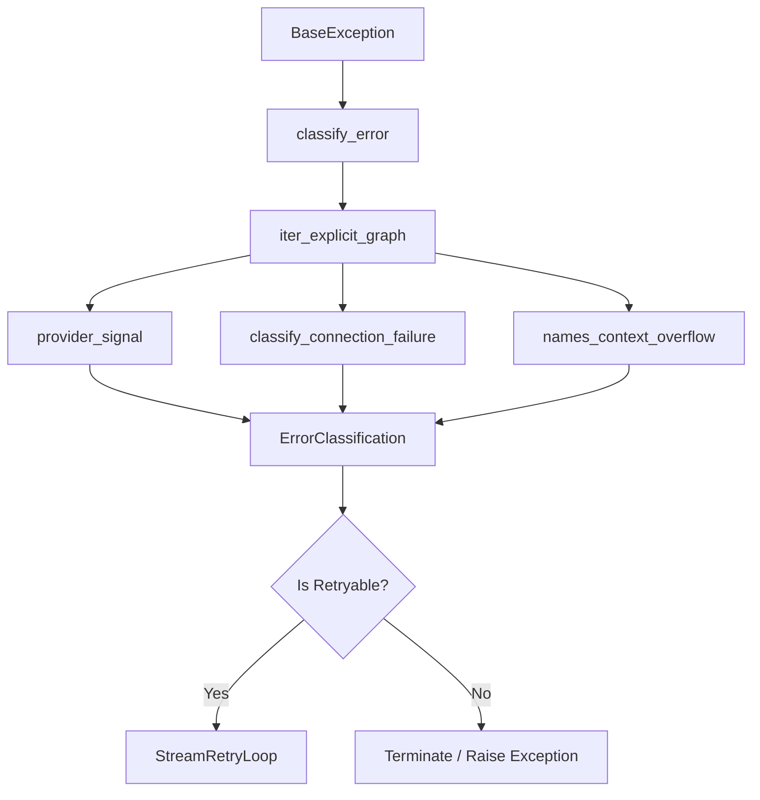
Sources: `[src/chrys/foundation/errors/classify.py:147-171]`, `[src/chrys/foundation/errors/provider.py:3-12]`, `[src/chrys/foundation/errors/__init__.py:1-68]()`

---

## 3. Retryability and Transient Policies

Retry decisions balance transport resilience against terminal domain failures. Non-retryable error kinds—such as quota exhaustion (`QUOTA_EXHAUSTED`), context overflow (`CONTEXT_OVERFLOW`), and payload size limits (`PAYLOAD_TOO_LARGE`)—short-circuit retry loops immediately, regardless of transient settings [src/chrys/foundation/errors/classify.py:85-87]().

### Non-Retryable Provider Error Codes
Account quota and billing limits are strictly non-retryable because retrying the same request against an exhausted account will invariably fail [src/chrys/foundation/errors/provider.py:25-35]():
- `"insufficient_quota"`
- `"billing_hard_limit_reached"`
- `"exceeded_current_quota_error"`
- `"usage_not_included"`
- `_GLM_QUOTA_CODE` ("1113" on 402/429 responses) [src/chrys/foundation/errors/provider.py:36-38]()

### Retry Decision Logic
1. **Owner-Terminal Veto**: Full chain checks determine if a higher-level workflow canceled or vetoed the operation [src/chrys/foundation/errors/classify.py:157-160]().
2. **Explicit Signal**: If the provider signal supplies an explicit retryable override, it takes precedence [src/chrys/foundation/errors/classify.py:161-162]().
3. **Deterministic Network Failures**: Deterministic TCP/DNS connection failures are non-retryable at the request level, while transient drops trigger backoff [src/chrys/foundation/errors/classify.py:163-164]().
4. **Kind Blacklists**: Kinds in `_NON_RETRYABLE_KINDS` are forced non-retryable [src/chrys/foundation/errors/classify.py:165-168]().

Sources: `[src/chrys/foundation/errors/provider.py:25-35]`, `[src/chrys/foundation/errors/classify.py:147-171]()`

---

## 4. Context-Overflow Detection and Handling

Context overflows occur when input tokens exceed the model's supported context window. The subsystem detects overflows through two mechanisms: provider error codes and heuristic regex pattern matching across exception text.

### Detection Patterns
Provider error codes explicitly flagged as overflow include `context_length_exceeded` and `model_context_window_exceeded` [src/chrys/foundation/errors/provider.py:105](). Additionally, regex patterns scan error messages across multiple LLM vendors (OpenAI, Anthropic, Gemini, xAI, Groq, DeepSeek, Kimi, llama.cpp, LM Studio) for phrases such as:
- `"context window"` [src/chrys/foundation/errors/provider.py:111]()
- `"maximum context length"` [src/chrys/foundation/errors/provider.py:112]()
- `"prompt is too long"` [src/chrys/foundation/errors/provider.py:113]()
- `"input token count.*exceeds the maximum"` [src/chrys/foundation/errors/provider.py:116]()

### Veto Rules for Overflow
Throttling errors mentioning tokens (e.g., "Too many tokens per minute") are explicitly classified as rate limits rather than context overflows by checking `_NON_OVERFLOW_PHRASES` and `_NON_OVERFLOW_STATUS_CODES` (413, 429) [src/chrys/foundation/errors/provider.py:139-160]().

### Compaction Integration
When a model fills its context window mid-stream, `CONTEXT_WINDOW_FILLED_KEY` (`chrys_context_window_filled`) is set in response properties [src/chrys/kernel/compaction.py:106-110](). `raise_if_context_window_filled()` intercepts this and raises a non-retryable `ProviderResponseError`, signaling the compaction engine to summarize or trim conversation history before the next turn [src/chrys/kernel/compaction.py:113-124]() [docs/en/guides/configuration/compaction.md:13-16]().

Sources: `[src/chrys/foundation/errors/provider.py:105-160]`, `[src/chrys/kernel/compaction.py:106-124]`, `[docs/en/guides/configuration/compaction.md:1-42]()`

---

## 5. Continuation Tokens and State Resumption

When interacting with endpoints supporting background or session-based continuations (such as long-running stored responses), continuation tokens link retry attempts to the active server-side session.

### State Management in Retries
- **`has_live_continuation_token`**: Inspects run options to determine if an active background response handle is currently bound [src/chrys/orchestration/invoker/attempts.py:86-91]().
- **`drop_continuation_token`**: Clears stale tokens so a fresh request can be initiated if the continuation session expires or faults [src/chrys/orchestration/invoker/attempts.py:94-99]().
- **`continuation_token_observer_for`**: A callback mirror that captures kernel-emitted continuation tokens and injects them into retry-owned request options, ensuring transient polling failures resume the exact same server-side computation [src/chrys/orchestration/invoker/attempts.py:101-123]().

Sources: `[src/chrys/orchestration/invoker/attempts.py:86-123]()`

---

# Page: Platform, Patches and Utilities

# Platform, Patches and Utilities

<details>
<summary>Relevant source files</summary>

The following files were used as context for generating this wiki page:

- [src/chrys/app/tui/widgets/text_area.py](src/chrys/app/tui/widgets/text_area.py)
- [src/chrys/foundation/patches/patcher.py](src/chrys/foundation/patches/patcher.py)
- [src/chrys/foundation/patches/textual_extended_keys.py](src/chrys/foundation/patches/textual_extended_keys.py)
- [src/chrys/foundation/platform/files.py](src/chrys/foundation/platform/files.py)
- [src/chrys/service/approval/grant_store.py](src/chrys/service/approval/grant_store.py)
- [tests/app/tui/terminal/test_terminal_widget_input.py](tests/app/tui/terminal/test_terminal_widget_input.py)
- [tests/app/tui/widgets/editor/test_highlighter.py](tests/app/tui/widgets/editor/test_highlighter.py)
- [tests/app/tui/widgets/editor/test_keymap_pilots.py](tests/app/tui/widgets/editor/test_keymap_pilots.py)
- [tests/app/tui/widgets/test_file_scanner.py](tests/app/tui/widgets/test_file_scanner.py)
- [tests/app/tui/widgets/test_shift_enter_protocol.py](tests/app/tui/widgets/test_shift_enter_protocol.py)
- [tests/app/tui/widgets/test_text_area.py](tests/app/tui/widgets/test_text_area.py)
- [tests/conftest.py](tests/conftest.py)
- [tests/foundation/patches/test_patcher.py](tests/foundation/patches/test_patcher.py)
- [tests/foundation/patches/test_textual_extended_keys.py](tests/foundation/patches/test_textual_extended_keys.py)
- [tests/foundation/patches/test_textual_windows_keys.py](tests/foundation/patches/test_textual_windows_keys.py)
- [tests/foundation/platform/test_files.py](tests/foundation/platform/test_files.py)
- [tests/foundation/test_documentation.py](tests/foundation/test_documentation.py)
- [tests/service/agent_middleware/test_approval_reuse_review_regressions.py](tests/service/agent_middleware/test_approval_reuse_review_regressions.py)

</details>


## Purpose and Scope
This document covers the cross-cutting platform primitives, filesystem durability helpers, process management routines, Windows console adaptations, and third-party Textual framework patches (`src/chrys/foundation/platform/` and `src/chrys/foundation/patches/`). These modules provide the underlying OS abstraction layer ensuring reliable atomic storage, secure file permissions, cross-platform terminal keyboard mapping, and documentation loading across POSIX and Windows environments.

---

## 1. Filesystem Helpers and Secure Storage

The filesystem subsystem in `src/chrys/foundation/platform/files.py` provides cross-platform atomic write operations, robust file renaming with retry mechanisms for Windows file-locking behaviors, directory synchronization (`fsync`), and strict owner-only permission enforcement.

### Atomic Operations and Windows Retry Logic
Filesystem writes utilize temporary files in the same directory combined with atomic renames to prevent partial or corrupted states during crashes. On Windows, antivirus scanners, file indexers, and synchronization clients frequently hold short-lived locks on files, triggering `PermissionError` during replacement. To mitigate this, `replace_with_retry` implements an exponential backoff loop over up to 6 attempts [src/chrys/foundation/platform/files.py:135-154]().

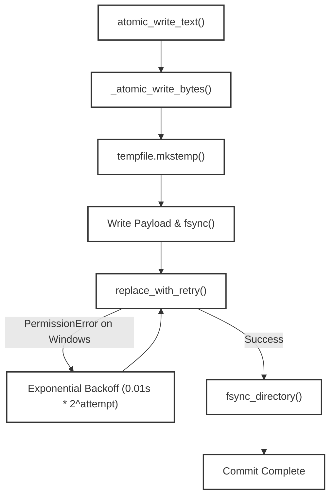
*Figure 1: Atomic write and Windows rename retry control flow.*

Sources: `src/chrys/foundation/platform/files.py:135-194]()`, `tests/foundation/platform/test_files.py:40-64]()`

### Secure Owner-Only Storage
For sensitive files such as approval grants (`src/chrys/service/approval/grant_store.py`) and session state envelopes, chrys enforces strict owner-only permissions. The helpers `atomic_write_owner_only_bytes`, `atomic_write_owner_only_text`, and `secure_open_owner_only_binary` configure operating-system-specific security descriptors (POSIX file modes `0o600` and Windows discretionary access control lists) to block unauthorized local user access.

Sources: `src/chrys/foundation/platform/files.py:25-30]`, `src/chrys/service/approval/grant_store.py:34-85]()`

---

## 2. Textual Runtime Patches (Extended Keys and Windows Input)

Textual terminals often misinterpret modified text keys (such as `Shift+Enter`, `Ctrl+Enter`, or `modifyOtherKeys` sequences) or mangle non-ASCII and surrogate-bearing characters. The patches in `src/chrys/foundation/patches/` modify the Textual runtime in-place without patching upstream package files directly.

### Extended Key Decoding
`textual_extended_keys.py` intercepts xterm-compatible modified text keys matching the `CSI 27;modifier;codepoint ~` wire format before Textual's default parser processes them [src/chrys/foundation/patches/textual_extended_keys.py:42-108]().

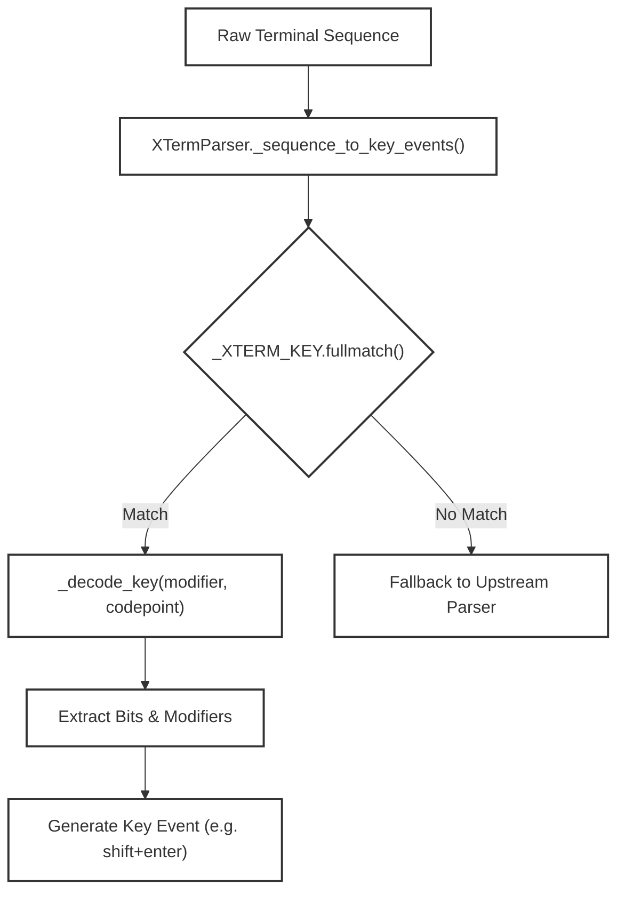
*Figure 2: Interception and decoding flow in `textual_extended_keys.py`.*

Sources: `src/chrys/foundation/patches/textual_extended_keys.py:58-113]()`, `tests/foundation/patches/test_textual_extended_keys.py:26-85]()`

### Driver Mode Pairing and Lifecycle
The driver patch intercepts `Driver.write` and `Driver.close` to ensure that terminal keyboard enhancement modes (such as `modifyOtherKeys` level 2 and Kitty keyboard protocol modes) are properly paired with reset escape sequences upon application stop, suspension, or crash [src/chrys/foundation/patches/textual_extended_keys.py:115-153]().

Sources: `src/chrys/foundation/patches/textual_extended_keys.py:115-153]`, `tests/foundation/patches/test_textual_extended_keys.py:135-157]()`

---

## 3. Windows Console and Keyboard Adaptation

Windows terminal support is augmented by `textual_windows_keys.py`, which unpacks Win32 input mode records and maps virtual key codes against the active keyboard layout while respecting `AltGr` composition states.

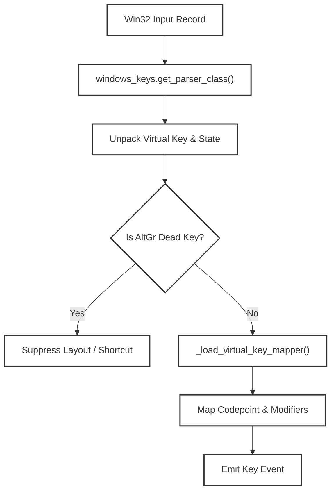
*Figure 3: Win32 console keyboard record decoding pipeline.*

Sources: `src/chrys/foundation/patches/textual_windows_keys.py:1-150]`, `tests/foundation/patches/test_textual_windows_keys.py:35-113]()`

---

## 4. Documentation and Utility Loaders

Chrys includes internal documentation loaders and utility modules that aggregate Markdown guides and localization bundles for the TUI help system and offline distribution.

### Documentation Loader Architecture
Documentation files located under `docs/` are indexed and verified through tests in `tests/test_documentation.py`. These utilities ensure structural integrity, valid cross-references, and localized guide synchronization.

Sources: `tests/test_documentation.py:1-100]()`

---

# Page: Kernel: Agent Loop

# Kernel: Agent Loop

<details>
<summary>Relevant source files</summary>

The following files were used as context for generating this wiki page:

- [src/chrys/foundation/io/result_content.py](src/chrys/foundation/io/result_content.py)
- [src/chrys/foundation/text/model_json.py](src/chrys/foundation/text/model_json.py)
- [src/chrys/kernel/_content.py](src/chrys/kernel/_content.py)
- [src/chrys/kernel/_loop_recorder.py](src/chrys/kernel/_loop_recorder.py)
- [src/chrys/kernel/_result_ceiling.py](src/chrys/kernel/_result_ceiling.py)
- [src/chrys/kernel/_tool_execution.py](src/chrys/kernel/_tool_execution.py)
- [src/chrys/kernel/agent.py](src/chrys/kernel/agent.py)
- [src/chrys/kernel/loop.py](src/chrys/kernel/loop.py)
- [src/chrys/kernel/tools.py](src/chrys/kernel/tools.py)
- [src/chrys/service/approval/judge.py](src/chrys/service/approval/judge.py)
- [src/chrys/service/llm/openai_responses/history.py](src/chrys/service/llm/openai_responses/history.py)
- [tests/architecture/test_copy_freshness.py](tests/architecture/test_copy_freshness.py)
- [tests/foundation/text/test_model_json.py](tests/foundation/text/test_model_json.py)
- [tests/kernel/test_agent.py](tests/kernel/test_agent.py)
- [tests/kernel/test_agent_service_handles.py](tests/kernel/test_agent_service_handles.py)
- [tests/kernel/test_loop.py](tests/kernel/test_loop.py)
- [tests/kernel/test_loop_exhaustion_tail.py](tests/kernel/test_loop_exhaustion_tail.py)
- [tests/kernel/test_result_ceiling.py](tests/kernel/test_result_ceiling.py)
- [tests/kernel/test_tools.py](tests/kernel/test_tools.py)

</details>


## Purpose and Scope

The agent kernel orchestrates the multi-turn interaction cycle between chat middleware, model wire clients, and local function tools. It provides the core blocking and streaming execution drivers that drive agentic loops, manage tool dispatches, handle interruption recovery, shape outputs, and collect telemetry. 

As a middle layer in the architecture, the kernel sits between lower-level foundation primitives (`chrys.foundation.*`) and upper-level orchestration/application layers (`chrys.agent`, `chrys.service`) [src/chrys/kernel/loop.py:19-21](), [src/chrys/kernel/agent.py:13-27]().

Sources: [src/chrys/kernel/loop.py:5-21](), [src/chrys/kernel/agent.py:5-27]()

---

## 3.1. Loop and Agent Execution

The primary execution loop is owned by `ToolLoopLayer` in `src/chrys/kernel/loop.py` [src/chrys/kernel/loop.py:7-13](). It manages per-run middleware pipelines, model calls via `_WireCaller`, iteration counts bounded by `DEFAULT_MAX_ITERATIONS` [src/chrys/kernel/loop.py:102-103](), consecutive error budgets (`DEFAULT_MAX_CONSECUTIVE_ERRORS`) [src/chrys/kernel/loop.py:103-104](), and exhaustion tails when iteration ceilings are reached [src/chrys/kernel/loop.py:173-182]().

The loop coordinates with `LoopRecorder` to journal message histories and supports interrupt-recovery checkpoints [src/chrys/kernel/loop.py:12-13]().

For details, see [Loop and Agent Execution](#3.1).

```mermaid
graph TD
    sub:Client[""Agent Client""] --> loopLayer[""ToolLoopLayer (src/chrys/kernel/loop.py)""]
    loopLayer --> wireCaller[""_WireCaller (src/chrys/kernel/loop.py)""]
    wireCaller --> chatLayer[""ChatMiddlewareLayer (src/chrys/kernel/middleware.py)""]
    loopLayer --> recorder[""LoopRecorder (src/chrys/kernel/_loop_recorder.py)""]
    loopLayer --> toolExec[""_execute_function_calls (src/chrys/kernel/_tool_execution.py)""]
```
Sources: [src/chrys/kernel/loop.py:5-14](), [src/chrys/kernel/_loop_recorder.py:1-15]()

Sources: [src/chrys/kernel/loop.py:5-21]()

---

## 3.2. Tool Execution and Result Shaping

Tool definitions, parsing, schema generation, and asynchronous execution are managed in `src/chrys/kernel/tools.py` via `FunctionTool` [src/chrys/kernel/tools.py:5-11](). The module handles content normalization, explicit-null overlays (`_null_overlay.py`), and validation against JSON schemas.

Oversized local tool outputs are controlled by the result ceiling mechanism in `src/chrys/kernel/_result_ceiling.py` (`apply_result_ceiling`), ensuring token limits are enforced without truncating error states or critical structured markers [src/chrys/kernel/_result_ceiling.py:177-181]().

For details, see [Tool Execution and Result Shaping](#3.2).

```mermaid
graph TD
    toolCall[""Function Tool Call""] --> fnTool[""FunctionTool.invoke (src/chrys/kernel/tools.py)""]
    fnTool --> nullOverlay[""restore_explicit_nulls (src/chrys/kernel/_null_overlay.py)""]
    fnTool --> ceiling[""apply_result_ceiling (src/chrys/kernel/_result_ceiling.py)""]
    ceiling --> contentModel[""Content (src/chrys/kernel/_content.py)""]
```
Sources: [src/chrys/kernel/tools.py:5-14](), [src/chrys/kernel/_result_ceiling.py:177-181]()

Sources: [src/chrys/kernel/tools.py:5-18]()

---

## 3.3. Context Compaction

When token limits approach capacity or context overflow conditions arise, the kernel employs compaction strategies and overflow sinks (`ContextOverflowSink`) [src/chrys/kernel/loop.py:82]() to prune conversation history while retaining semantic continuity.

Middleware layers interact with token counters and usage metrics to trigger compaction before requests hit the wire clients.

For details, see [Context Compaction](#3.3).

Sources: [src/chrys/kernel/loop.py:82]()

---

## 3.4. Kernel Telemetry and Instrumentation

Observability across the execution loop is managed via OpenTelemetry integration in `src/chrys/kernel/instrumentation.py`. Spans track request/response durations, turn transitions, and tool-invocation timings.

Trajectory timestamps and metadata keys (`OPERATION_ID_KEY`, `ANALYTICS_ITEM_ID_KEY`) link execution telemetry back to agent analytics engines [src/chrys/foundation/trajectory/metadata.py:63-66]().

For details, see [Kernel Telemetry and Instrumentation](#3.4).

Sources: [src/chrys/foundation/trajectory/metadata.py:63-66]()

---

# Page: Loop and Agent Execution

# Loop and Agent Execution

<details>
<summary>Relevant source files</summary>

The following files were used as context for generating this wiki page:

- [src/chrys/kernel/_loop_recorder.py](src/chrys/kernel/_loop_recorder.py)
- [src/chrys/kernel/_tool_execution.py](src/chrys/kernel/_tool_execution.py)
- [src/chrys/kernel/agent.py](src/chrys/kernel/agent.py)
- [src/chrys/kernel/loop.py](src/chrys/kernel/loop.py)
- [tests/architecture/test_copy_freshness.py](tests/architecture/test_copy_freshness.py)
- [tests/kernel/test_agent.py](tests/kernel/test_agent.py)
- [tests/kernel/test_agent_service_handles.py](tests/kernel/test_agent_service_handles.py)
- [tests/kernel/test_loop.py](tests/kernel/test_loop.py)
- [tests/kernel/test_loop_argument_validation.py](tests/kernel/test_loop_argument_validation.py)
- [tests/kernel/test_loop_exhaustion_tail.py](tests/kernel/test_loop_exhaustion_tail.py)
- [tests/kernel/test_loop_invocation_order.py](tests/kernel/test_loop_invocation_order.py)
- [tests/kernel/test_loop_non_object_arguments.py](tests/kernel/test_loop_non_object_arguments.py)
- [tests/kernel/test_unexecuted_tool_operations.py](tests/kernel/test_unexecuted_tool_operations.py)

</details>


## Purpose and Scope

This document details the kernel-level loop execution architecture implemented in `src/chrys/kernel/loop.py`, `src/chrys/kernel/_loop_recorder.py`, and `src/chrys/kernel/_tool_execution.py`. It covers the model-tool iteration turn lifecycle, argument validation guarantees, tool invocation ordering and execution stamps, exhaustion-tail stripping, and the loop recorder's interrupt-recovery journaling.

Sources: `src/chrys/kernel/loop.py:1-21`, `src/chrys/kernel/_loop_recorder.py:1-30`, `src/chrys/kernel/_tool_execution.py:1-28`

---

## 1. Loop Architecture and Component Mapping

The kernel loop coordinates communication between agent chat middleware, provider wire clients, and tool execution engines. The primary entry point is `ToolLoopLayer`, which wraps chat middleware layers and invokes model calls through a structured retry runner (`_WireCaller`) and trajectory tracker (`_LoopTrajectory`).

### Diagram: Natural Language to Code Entity Space — Loop Subsystems

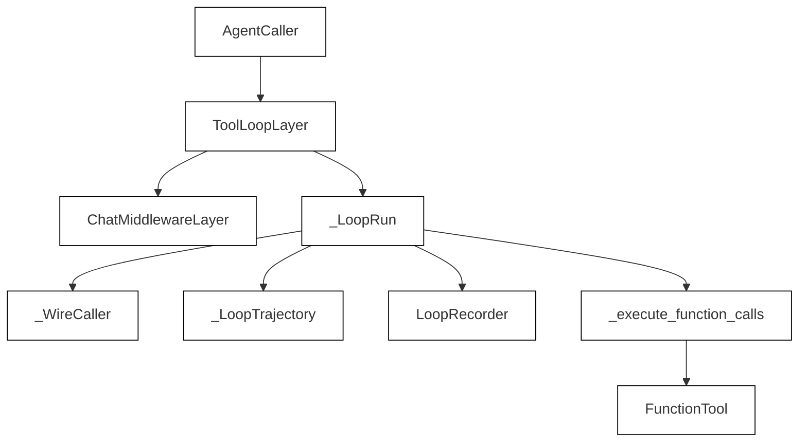
*Sources: `src/chrys/kernel/loop.py:7-13`, `src/chrys/kernel/client.py:1-50`, `tests/kernel/test_loop.py:135-194`*

---

## 2. Turn Lifecycle and Iteration Mechanics

`ToolLoopLayer.get_response()` initiates execution loops bounded by iteration limits and consecutive error budgets.

### Iteration Boundaries and Constants
* `DEFAULT_MAX_ITERATIONS = 40`: Maximum model-tool exchange rounds before an exhaustion tail is forced [src/chrys/kernel/loop.py:102].
* `DEFAULT_MAX_CONSECUTIVE_ERRORS = 3`: Consecutive tool failure budget before halting execution [src/chrys/kernel/loop.py:103].
* `CONTINUATION_POLL_INTERVAL_SECONDS = 2.0`: Interval between asynchronous continuation polls for background responses [src/chrys/kernel/loop.py:108].

### Turn Execution Flow

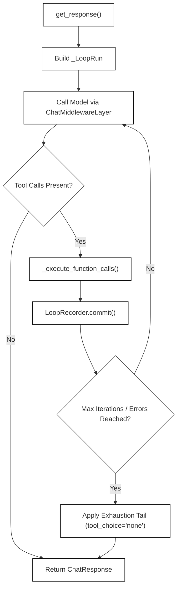
*Sources: `src/chrys/kernel/loop.py:7-18`, `src/chrys/kernel/loop.py:101-109`, `tests/kernel/test_loop.py:135-145`*

---

## 3. Argument Validation and Pre-pipeline Guards

Before tool execution reaches the middleware pipeline, `_execute_function_calls` and validation routines in `src/chrys/kernel/_tool_execution.py` validate argument structures.

### Key Validation Checks
* **Non-Object Validation**: Arguments that parse as primitive types, lists, or non-object JSON values are rejected with an `argument_parsing` error (`TOOL_ERROR_KIND_METADATA_KEY = "argument_parsing"`), preventing execution on unvalidated payloads [tests/kernel/test_loop_non_object_arguments.py:3-9].
* **Type Strictness**: Boolean-to-integer coercion violations (e.g., passing a boolean where an integer or literal is required) raise actionable argument errors prior to invoking `FunctionTool.invoke` [tests/kernel/test_loop_argument_validation.py:161-196].

Sources: `src/chrys/kernel/_tool_execution.py:119-148`, `tests/kernel/test_loop_non_object_arguments.py:1-111`

---

## 4. Invocation Order, Provenance, and Execution Stamps

The kernel loop acts as the sole authority for stamping call provenance and invocation ordinals.

* **Invocation Order**: Tracked using `TOOL_INVOCATION_ORDER_KEY` to sequence concurrent tool dispatches [chrys/foundation/tool_invocation_order.py:43].
* **Execution Stamps**: `EXECUTION_STAMP_KEY` records outcomes (`ok` or `error`) and error kinds on function metadata after middleware processing [tests/kernel/test_loop_invocation_order.py:60-78].
* **Provenance**: The loop injects static context and tool kinds (`TOOL_CALL_KIND_METADATA_KEY`) onto function call contents prior to pipeline entry [tests/kernel/test_loop_invocation_order.py:84-106].

Sources: `src/chrys/kernel/loop.py:42-43`, `tests/kernel/test_loop_invocation_order.py:1-78`, `src/chrys/kernel/_tool_execution.py:51-53`

---

## 5. Exhaustion Tails and Unexecutable Call Stripping

When iteration bounds or tool call limits are reached, the loop triggers an exhaustion tail by setting `tool_choice="none"` on the final model request.

### Stripping Mechanics
If a provider ignores `tool_choice="none"` and returns unexecutable function calls in the exhaustion tail, `_strip_unexecutable_calls_from_response` removes them from the transcript and replaces them with fallback text (e.g., `_MAX_ITERATIONS_FALLBACK_TEXT`) [src/chrys/kernel/loop.py:173-185]:

| Fallback Constant | Trigger Condition |
| :--- | :--- |
| `_MAX_ITERATIONS_FALLBACK_TEXT` | Reached `max_iterations` bound [src/chrys/kernel/loop.py:173] |
| `_CONSECUTIVE_ERRORS_FALLBACK_TEXT` | Reached consecutive tool error limit [src/chrys/kernel/loop.py:174] |
| `_MAX_FUNCTION_CALLS_FALLBACK_TEXT` | Reached maximum function calls quota [src/chrys/kernel/loop.py:177] |

Sources: `src/chrys/kernel/loop.py:173-185`, `tests/kernel/test_loop_exhaustion_tail.py:55-93`

---

## 6. The Loop Recorder and Interrupt Recovery

`LoopRecorder` in `src/chrys/kernel/_loop_recorder.py` maintains an interrupt-recovery journal. It captures message snapshots (`_message_snapshot`) and tool result commitments during active loops, allowing sessions to resume or rollback safely after cancellation or failures.

### Diagram: Loop Recorder and Journaling Flow

```mermaid
graph TD
    Run["_LoopRun Execution"] --> Dispatch["Dispatch Tool Calls"]
    Dispatch --> CommitRaw["ToolResultCommit.commit_raw()"]
    CommitRaw --> Recorder["LoopRecorder State Journal"]
    Recorder --> Snapshot["_message_snapshot()"]
    Snapshot --> SessionStore["AgentSession / Checkpoint Store"]

    classDef default fill:#fff,stroke:#000,stroke-width:1px;
```
*Sources: `src/chrys/kernel/_loop_recorder.py:1-50`, `src/chrys/kernel/loop.py:12-13`, `tests/architecture/test_copy_freshness.py:73-81`*

---

# Page: Tool Execution and Result Shaping

# Tool Execution and Result Shaping

<details>
<summary>Relevant source files</summary>

The following files were used as context for generating this wiki page:

- [src/chrys/foundation/io/result_content.py](src/chrys/foundation/io/result_content.py)
- [src/chrys/foundation/text/model_json.py](src/chrys/foundation/text/model_json.py)
- [src/chrys/foundation/trajectory/event_types.py](src/chrys/foundation/trajectory/event_types.py)
- [src/chrys/kernel/_content.py](src/chrys/kernel/_content.py)
- [src/chrys/kernel/_result_ceiling.py](src/chrys/kernel/_result_ceiling.py)
- [src/chrys/kernel/tools.py](src/chrys/kernel/tools.py)
- [src/chrys/service/agent_middleware/events/tool_events.py](src/chrys/service/agent_middleware/events/tool_events.py)
- [src/chrys/service/approval/judge.py](src/chrys/service/approval/judge.py)
- [src/chrys/service/llm/clients.py](src/chrys/service/llm/clients.py)
- [src/chrys/service/llm/openai_responses/history.py](src/chrys/service/llm/openai_responses/history.py)
- [src/chrys/service/llm/raw_http_log.py](src/chrys/service/llm/raw_http_log.py)
- [src/chrys/service/mutations/pipeline.py](src/chrys/service/mutations/pipeline.py)
- [tests/foundation/text/test_model_json.py](tests/foundation/text/test_model_json.py)
- [tests/kernel/test_result_ceiling.py](tests/kernel/test_result_ceiling.py)
- [tests/kernel/test_tools.py](tests/kernel/test_tools.py)

</details>


This page documents section 3.2 of the iCode architecture, focusing on the kernel's tool execution framework (`chrys.kernel.tools`), content normalization (`chrys.kernel._content`), token-budget result ceilings (`chrys.kernel._result_ceiling`), model-optimized JSON encoding (`chrys.foundation.text.model_json`), and result metadata handling.

---

## 1. FunctionTool Construction, Introspection, and Invocation

The `FunctionTool` class and the `@tool` decorator provide the core abstraction for exposing Python functions and schema-defined tools to agent execution loops [src/chrys/kernel/tools.py:70-76](). Unlike framework middleware, `FunctionTool.invoke` is kept lean, avoiding decorative logging while handling argument validation, type coercion prevention, context injection, and thread offloading for synchronous tools.

### Key Components and Mechanisms
* **The `@tool` Decorator**: Introspects Python function signatures, docstrings, and type hints to generate Pydantic validation models and JSON schemas [src/chrys/kernel/tools.py:70-76]().
* **Annotation Parsing**: String annotations are converted into Pydantic field descriptions [src/chrys/kernel/tools.py:141-155](). Boolean/integer coercions are strictly guarded to prevent Python's implicit `True == 1` type-casting bugs in `Literal` and integer fields [src/chrys/kernel/tools.py:158-190]().
* **Context Injection**: If a parameter is annotated with `FunctionInvocationContext`, the engine automatically injects the active invocation context [src/chrys/kernel/tools.py:127-139]().
* **Thread Offloading & Cancellation**: Synchronous functions executed within an async loop are offloaded to worker threads. If cancellation occurs immediately after completion, `SyncToolCancelledAfterCompletion` preserves the completed return value so the tool loop can journal it before cancellation unwinds [src/chrys/kernel/tools.py:82-96]().

```mermaid
graph TD
    sub5[""Natural Language Space: User/Agent Tool Request""] -->|"Dispatches Arguments"| sub6[""Code Entity Space: FunctionTool.invoke""]
    sub6 -->|"Inspects Signatures"| sub7[""Code Entity Space: _parse_annotation & _prevent_bool_int_coercion""]
    sub7 -->|"Validates Schema"| sub8[""Code Entity Space: Pydantic Validation Models""]
    sub8 -->|"Async or Sync Execution"| sub9[""Code Entity Space: ThreadPool / asyncio""]
    sub9 -->|"Returns Content List"| sub10[""Code Entity Space: FunctionTool.parse_result""]
```
*Sources: [src/chrys/kernel/tools.py:70-197](), [tests/kernel/test_tools.py:114-191]()*

---

## 2. Content Normalization and Parsing

Tool outputs can originate from diverse sources, including native Python strings, structured JSON dictionaries, MCP (Model Context Protocol) tool outputs, and foreign `Content` objects. The kernel normalizes these heterogeneous results into a unified sequence of `Content` primitives via `normalize_tools()` and `FunctionTool.parse_result()` [src/chrys/kernel/tools.py:75](), [src/chrys/kernel/_content.py:35-59]().

### Normalization Pipeline
1. **Unwrapping Sequences**: Incoming results (such as lists or tuples) are walked recursively to extract underlying items [src/chrys/foundation/io/result_content.py:46-55]().
2. **Foreign Content Adaptation**: Objects implementing `to_dict()` (such as MCP result residues) are converted into standard `Content` instances [tests/kernel/test_tools.py:93-102]().
3. **Fallback Diagnostics**: Unrecognized shapes or objects lacking standard text-bearing attributes (`text`, `result`, `output`, `message`) trigger a warning log and format an error string prefixed with `Error: ` so that failures propagate visibly to the LLM and TUI rather than masquerading as successful results [src/chrys/foundation/io/result_content.py:68-117]().

```mermaid
graph TD
    sub1[""Natural Language Space: Raw Tool Execution Output""] -->|"Parsed by Kernel"| sub2[""Code Entity Space: normalize_tools & FunctionTool.parse_result""]
    sub2 -->|"Checks Types"| sub3[""Code Entity Space: _parse_content_list""]
    sub3 -->|"String / Dict / Foreign Object"| sub4[""Code Entity Space: Content.from_dict / Content.from_text""]
    sub4 -->|"Unified Output Sequence"| sub5[""Code Entity Space: list[Content]""]
```
*Sources: [src/chrys/kernel/tools.py:70-76](), [src/chrys/kernel/_content.py:35-60](), [src/chrys/foundation/io/result_content.py:23-128]()*

---

## 3. Result Ceilings and Bounding

To protect LLM context windows from memory exhaustion caused by oversized tool outputs (e.g., massive log files or database dumps), the kernel applies an idempotent result ceiling via `apply_result_ceiling()` [src/chrys/kernel/_result_ceiling.py:177-181]().

### Bounding Logic
* **Token-Budget Enforcement**: Utilizes `MixedLanguageTokenizer` to measure exact token counts across text fields (`text`, `result`, `output`, `message`, `stdout`, `stderr`, `exception`) [src/chrys/kernel/_result_ceiling.py:11-22]().
* **Idempotency and Safety**: If a result exceeds the configured token ceiling, it is truncated using `truncate_output` or `truncate_content_texts`, appending a truncation notice while preserving non-text components (such as binary image attachments) in their original positions [src/chrys/kernel/_result_ceiling.py:54-78]().
* **Exception Preservation**: Truncation algorithms ensure that explicit error exceptions are never completely erased, carving out a dedicated token budget before trimming standard output text [src/chrys/kernel/_result_ceiling.py:81-98]().
* **Telemetry Observation**: Payload truncations are recorded via `tool_payload_observation` context variables, feeding telemetry data directly into trajectory event pipelines [src/chrys/kernel/_result_ceiling.py:113-121]().

```mermaid
graph TD
    sub11[""Natural Language Space: Oversized Tool Output Payload""] -->|"Passed to Backstop"| sub12[""Code Entity Space: apply_result_ceiling""]
    sub12 -->|"Token Counting"| sub13[""Code Entity Space: MixedLanguageTokenizer.count_tokens""]
    sub13 -->|"Exceeds Ceiling?"| sub14[""Code Entity Space: _bound_content / _bound_function_result""]
    sub14 -->|"Records Metrics"| sub15[""Code Entity Space: tool_payload_observation & record_payload_truncation""]
```
*Sources: [src/chrys/kernel/_result_ceiling.py:1-181](), [tests/kernel/test_result_ceiling.py:1-163]()*

---

## 4. Model JSON Encoding and Metadata

When data structures, dictionary arguments, or structured outputs are serialized for the LLM to read, standard Python `json.dumps` behavior (which escapes non-ASCII characters like CJK symbols or emojis into `\uXXXX` sequences) creates unnecessary token overhead and reduces readability [src/chrys/foundation/text/model_json.py:14-25]().

### Model-Optimized Serialization
* **`model_json()` Function**: Wraps `json.dumps` with `ensure_ascii=False`, keeping multi-byte natural languages and emojis unescaped [src/chrys/foundation/text/model_json.py:14-25]().
* **Surrogate Safety**: Employs `surrogate_safe_text` to handle lone high/low surrogate characters safely, ensuring valid UTF-8 encoding without crashing serialization on malformed string data [src/chrys/foundation/text/model_json.py:11-25](), [tests/foundation/text/test_model_json.py:16-24]().
* **Result Metadata**: Metadata keys associated with tool outcomes (such as error classifications, execution stamps, and sub-agent attribution IDs) are injected into the result context before being committed to invocation histories [src/chrys/service/agent_middleware/events/tool_events.py:25-30]().

```mermaid
graph TD
    sub16[""Natural Language Space: Structured Tool Data / CJK Text""] -->|"Encodes for Model"| sub17[""Code Entity Space: model_json""]
    sub17 -->|"Sanitizes Surrogates"| sub18[""Code Entity Space: surrogate_safe_text""]
    sub18 -->|"Outputs Clean JSON String"| sub19[""Code Entity Space: json.dumps with ensure_ascii=False""]
```
*Sources: [src/chrys/foundation/text/model_json.py:1-25](), [tests/foundation/text/test_model_json.py:1-27]()*

---
Sources: [src/chrys/kernel/tools.py:1-197](), [src/chrys/kernel/_content.py:1-188](), [src/chrys/kernel/_result_ceiling.py:1-181](), [src/chrys/foundation/text/model_json.py:1-25](), [src/chrys/foundation/io/result_content.py:1-161](), [tests/kernel/test_tools.py:1-191](), [tests/kernel/test_result_ceiling.py:1-163](), [tests/foundation/text/test_model_json.py:1-27]()

---

# Page: Context Compaction

# Context Compaction

<details>
<summary>Relevant source files</summary>

The following files were used as context for generating this wiki page:

- [docs/en/guides/configuration/chat-options.md](docs/en/guides/configuration/chat-options.md)
- [docs/en/guides/configuration/compaction.md](docs/en/guides/configuration/compaction.md)
- [docs/zh-Hans/guides/configuration/chat-options.md](docs/zh-Hans/guides/configuration/chat-options.md)
- [docs/zh-Hans/guides/configuration/compaction.md](docs/zh-Hans/guides/configuration/compaction.md)
- [src/chrys/app/tui/screens/models/screen.py](src/chrys/app/tui/screens/models/screen.py)
- [src/chrys/foundation/errors/__init__.py](src/chrys/foundation/errors/__init__.py)
- [src/chrys/kernel/__init__.py](src/chrys/kernel/__init__.py)
- [src/chrys/kernel/client.py](src/chrys/kernel/client.py)
- [src/chrys/kernel/compaction.py](src/chrys/kernel/compaction.py)
- [src/chrys/service/context/compaction/last_words.py](src/chrys/service/context/compaction/last_words.py)
- [src/chrys/service/context/compaction/strategy.py](src/chrys/service/context/compaction/strategy.py)
- [src/chrys/service/profiles/models/schema.py](src/chrys/service/profiles/models/schema.py)
- [tests/app/tui/screens/test_model_config.py](tests/app/tui/screens/test_model_config.py)
- [tests/foundation/i18n/test_catalogs.py](tests/foundation/i18n/test_catalogs.py)
- [tests/foundation/i18n/test_localizer.py](tests/foundation/i18n/test_localizer.py)
- [tests/kernel/_fakes.py](tests/kernel/_fakes.py)
- [tests/kernel/test_client_last_words_completer.py](tests/kernel/test_client_last_words_completer.py)
- [tests/kernel/test_loop_context_overflow_note.py](tests/kernel/test_loop_context_overflow_note.py)
- [tests/orchestration/engine/build/test_agent_builder_rollback.py](tests/orchestration/engine/build/test_agent_builder_rollback.py)
- [tests/orchestration/engine/state/test_current_agent.py](tests/orchestration/engine/state/test_current_agent.py)
- [tests/orchestration/engine/test_settings_reload.py](tests/orchestration/engine/test_settings_reload.py)
- [tests/orchestration/engine/test_shutdown_close.py](tests/orchestration/engine/test_shutdown_close.py)
- [tests/orchestration/sub_agents/test_client.py](tests/orchestration/sub_agents/test_client.py)
- [tests/service/context/compaction/test_context_overflow_note.py](tests/service/context/compaction/test_context_overflow_note.py)
- [tests/service/context/compaction/test_last_words.py](tests/service/context/compaction/test_last_words.py)
- [tests/service/context/compaction/test_last_words_completer.py](tests/service/context/compaction/test_last_words_completer.py)
- [tests/service/context/compaction/test_last_words_fallback.py](tests/service/context/compaction/test_last_words_fallback.py)
- [tests/service/llm/test_failed_response_usage.py](tests/service/llm/test_failed_response_usage.py)
- [tests/service/mcp/test_cache.py](tests/service/mcp/test_cache.py)
- [tests/service/mcp/test_cache_e2e.py](tests/service/mcp/test_cache_e2e.py)
- [tests/service/profiles/models/test_serializer.py](tests/service/profiles/models/test_serializer.py)

</details>


## Purpose and Scope
This page documents the context compaction subsystem within the `iCode` kernel and service layers (`chrys`). It details the token compaction strategy and multi-phase reduction ladder, the `LastWordsCompleter` side-call infrastructure used to summarize dropped turn timelines, context overflow detection and guard rails, and the `UsageTrackingMiddleware` token accounting system.

Sources: `src/chrys/kernel/compaction.py`, `src/chrys/service/context/compaction/last_words.py`, `src/chrys/service/context/middleware/usage.py`

---

## 1. Compaction Strategy and the Reduction Ladder

When a conversation approaches a model's context window limit, the kernel executes a structured reduction algorithm via `apply_compaction` [src/chrys/kernel/__init__.py:53](). Compaction operates on message groups annotated with metadata keys such as `GROUP_ANNOTATION_KEY`, `EXCLUDED_KEY`, and `GROUP_TOKEN_COUNT_KEY` [src/chrys/kernel/compaction.py:54-66]().

The compaction pipeline follows a strict multi-phase ladder:
1. **Tool Result Trimming**: Summarizes older tool results in place to reduce payload volume.
2. **Tool Call Removal**: Drops older tool calls and their associated results from the active payload.
3. **Turn Summarization**: Replaces completed historical turns with structured compaction summaries (`SUMMARY_OF_MESSAGE_IDS_KEY`, `SUMMARY_OF_GROUP_IDS_KEY`) [src/chrys/kernel/compaction.py:68-69]().
4. **Last Words Extraction**: When the current turn must be compressed, it generates a synthesized progress note (`LastWordsGenerator`) and injects it into a system reminder block, stripping intermediate tool calls and assistant text.

```mermaid
graph TD
    Start[""ContextWindowExceededOrThresholdReached""] --> Phase1[""apply_compaction: Trim Tool Results""]
    Phase1 --> Check1{""Space Sufficient?""}
    Check1 -- "No" --> Phase2[""apply_compaction: Remove Older Tool Calls""]
    Phase2 --> Check2{""Space Sufficient?""}
    Check2 -- "No" --> Phase3[""apply_compaction: Summarize Completed Turns""]
    Phase3 --> Check3{""Space Sufficient?""}
    Check3 -- "No" --> Phase4[""LastWordsGenerator: Generate Current Turn Note""]
    Check1 -- "Yes" --> Done[""Commit Compacted Context""]
    Check2 -- "Yes" --> Done
    Check3 -- "Yes" --> Done
    Phase4 --> Done

    sub:CodeMapping[""Code Entity Space Mappings""]
    sub:CodeMapping -.->|"Engine Trigger"| Start
    sub:CodeMapping -.->|"Function"| Phase1
    sub:CodeMapping -.->|"Function"| Phase2
    sub:CodeMapping -.->|"Function"| Phase3
    sub:CodeMapping -.->|"Class"| Phase4
```
Sources: `src/chrys/kernel/compaction.py`, `docs/en/guides/configuration/compaction.md`

---

## 2. Last-Words Completer and Generation

The `LastWordsGenerator` class manages the generation of summary notes when Phase 4 compaction drops uncompleted turn elements [src/chrys/service/context/compaction/last_words.py:69](). 

### Primary Path: Natural-Completion Side Call
The primary generation mechanism uses the client-owned protocol `LastWordsCompleter` [src/chrys/kernel/compaction.py:161-167](). 
- Sends only the current turn's validated group timeline plus a structured guidance instruction message [src/chrys/service/context/compaction/last_words.py:10-15]().
- Runs inside an `internal_side_call_scope()` to prevent telemetry and stream response publishers from treating the throwaway note as part of the live conversation [src/chrys/kernel/compaction.py:137-153]().
- Forces `tool_choice="none"` and wraps instructions in a triple no-tools directive to prevent the model from emitting function call blocks instead of prose notes [src/chrys/service/context/compaction/last_words.py:10-15]().

### Fallback Path: Reconstruction Prompt
If the completer is absent, rejects the side call due to context window sizing, or exhausts its local retry budget (`_COMPLETER_MAX_RETRIES = 2`), the generator falls back to a fresh two-message reconstruction session (`route_kind="last-words"`) [src/chrys/service/context/compaction/last_words.py:16-22, 91]().

```mermaid
graph TD
    Req[""TriggerLastWordsGeneration""] --> TryCompleter{""Has LastWordsCompleter?""}
    TryCompleter -- "Yes" --> ScopedCall[""LastWordsCompleter.get_response with tool_choice=none""]
    TryCompleter -- "No" --> Fallback[""FallbackClient: route_kind=last-words Session""]
    ScopedCall --> CheckSuccess{""Valid Note Returned?""}
    CheckSuccess -- "Yes" --> ReturnNote[""Return Structured Note Content""]
    CheckSuccess -- "No" --> Fallback
    Fallback --> CheckFallback{""Success?""}
    CheckFallback -- "Yes" --> ReturnNote
    CheckFallback -- "No" --> RaiseErr[""Raise LastWordsGenerationError""]

    sub:CodeMapping[""Code Entity Space Mappings""]
    sub:CodeMapping -.->|"Protocol"| ScopedCall
    sub:CodeMapping -.->|"Class"| Fallback
    sub:CodeMapping -.->|"Exception"| RaiseErr
```
Sources: `src/chrys/kernel/compaction.py`, `src/chrys/service/context/compaction/last_words.py`

---

## 3. Context Overflow Notes and Guard Rails

When a provider returns a context window exhaustion error during a compaction side call or normal turn execution, the kernel enforces strict invariants to prevent infinite failure loops.

- **Context Window Filled Key**: `CONTEXT_WINDOW_FILLED_KEY` is set in `additional_properties` when a model fills its context window mid-generation [src/chrys/kernel/compaction.py:110-112]().
- **Validation Guard**: `raise_if_context_window_filled()` inspects chat responses and immediately raises a non-retryable `ProviderResponseError` if the note or message was truncated due to context exhaustion [src/chrys/kernel/compaction.py:113-123]().
- **Error Classification**: `may_be_context_overflow()` in `chrys.foundation.errors` analyzes provider error signals and status codes to determine whether to trigger automatic history compaction or fail the operation [src/chrys/foundation/errors/__init__.py:25]().

Sources: `src/chrys/kernel/compaction.py`, `src/chrys/ foundation/errors/__init__.py`

---

## 4. Usage Middleware and Token Accounting

Token usage incurred during both live conversation turns and internal compaction side calls is tracked centrally via the middleware pipeline.

- **UsageTrackingMiddleware**: Intercepts chat response cycles to capture token counts (`input_tokens`, `output_tokens`, `total_tokens`) [tests/service/llm/test_failed_response_usage.py:35, 140-141]().
- **Side-Call Accounting**: `LastWordsGenerator` accepts a `report_usage` callback hook (`_report_side_call_usage()`) that forwards token consumption from auxiliary side calls to the application's token usage panel, even when side-call generation encounters recoverable errors or refutations [tests/context/compaction/test_last_words_completer.py:88-158]().

Sources: `tests/service/llm/test_failed_response_usage.py`, `tests/service/context/compaction/test_last_words_completer.py`

---

# Page: Kernel Telemetry and Instrumentation

# Kernel Telemetry and Instrumentation

<details>
<summary>Relevant source files</summary>

The following files were used as context for generating this wiki page:

- [src/chrys/foundation/trajectory/event_types.py](src/chrys/foundation/trajectory/event_types.py)
- [src/chrys/kernel/instrumentation.py](src/chrys/kernel/instrumentation.py)
- [src/chrys/service/agent_middleware/events/tool_events.py](src/chrys/service/agent_middleware/events/tool_events.py)
- [src/chrys/service/llm/clients.py](src/chrys/service/llm/clients.py)
- [src/chrys/service/llm/raw_http_log.py](src/chrys/service/llm/raw_http_log.py)
- [src/chrys/service/mutations/pipeline.py](src/chrys/service/mutations/pipeline.py)
- [tests/kernel/test_telemetry.py](tests/kernel/test_telemetry.py)

</details>


This page covers the kernel telemetry and instrumentation subsystem of `iCode` (`chrys`), focusing on OpenTelemetry span generation, metric collection via `src/chrys/kernel/instrumentation.py` [src/chrys/kernel/instrumentation.py:1-1618](), and trajectory timing stamps that track execution flow and durations.

---

## 1. OpenTelemetry Architecture and Seams

The telemetry infrastructure relies on two primary wrapper layers: `ChatTelemetryLayer` and `AgentTelemetryLayer`. Both layers interact with the foundation-owned `TELEMETRY_GATE` (which defaults to disabled) to control overhead and capture semantic GenAI spans and metrics [src/chrys/kernel/instrumentation.py:5-10]().

The tracer and meter scope name is hardcoded to `chrys` with the package version `__version__` [src/chrys/kernel/instrumentation.py:133-134](). Agent spans inherit provider names from the host's `AGENT_PROVIDER_NAME` class variable, while chat spans use the underlying model provider's name [src/chrys/kernel/instrumentation.py:20-22]().

```mermaid
graph TD
    sub5["NaturalLanguageSpace: Agent Run Request"] --> sub6["AgentTelemetryLayer.run()"]
    sub6 --> sub7["ChatTelemetryLayer.get_response()"]
    sub7 --> sub8["_PreparedRequestObserverClient"]
    sub8 --> sub9["OpenTelemetry Tracer & Meter"]

    classDef default fill:#fff,stroke:#333,stroke-width:2px;
```
*Figure 1: Telemetry invocation hierarchy bridging request flow to OpenTelemetry wrappers.*

**Sources:**
- `src/chrys/kernel/instrumentation.py:1-56`
- `tests/kernel/test_telemetry.py:1-48`

---

## 2. ContextVars, Deduping, and Streaming Activation

To prevent double-counting usage statistics and response identifiers across nested agent and inner chat calls, telemetry uses explicit `ContextVar` channels [src/chrys/kernel/instrumentation.py:137-147]():

- `INNER_RESPONSE_TELEMETRY_CAPTURED_FIELDS`: A context variable tracking captured fields like `response_id` [src/chrys/kernel/instrumentation.py:140-143]().
- `INNER_ACCUMULATED_USAGE`: Tracks cumulative token usage across inner exchanges [src/chrys/kernel/instrumentation.py:145-146]().

For non-streaming calls, deduplication ContextVars are set and reset inside the returned coroutine to ensure that task execution boundaries do not improperly reset tokens [src/chrys/kernel/instrumentation.py:11-13](). For streaming spans, activation occurs around each pull, and cleanup closes the span before resetting ContextVars [src/chrys/kernel/instrumentation.py:13-16]().

```mermaid
sequenceDiagram
    participant Caller as "Caller"
    participant ATL as "AgentTelemetryLayer"
    participant CTL as "ChatTelemetryLayer"
    participant CV as "ContextVars"

    Caller->>ATL: run()
    Note over ATL,CV: Set INNER_RESPONSE_TELEMETRY_CAPTURED_FIELDS
    ATL->>CTL: get_response(stream=True)
    Note over CTL,CV: Check/Update accumulated usage & response ID
    CTL-->>ATL: ResponseStream
    ATL-->>Caller: Stream & Spans Ended
```
*Figure 2: ContextVar lifecycle and span management during streaming agent runs.*

**Sources:**
- `src/chrys/kernel/instrumentation.py:11-16`, `src/chrys/kernel/instrumentation.py:137-147`

---

## 3. Metrics, Histograms, and Attribute Taxonomies

OpenTelemetry attribute keys and metric names are defined via the `OtelAttr` string enum class [src/chrys/kernel/instrumentation.py:184-192](). These include standard GenAI semantic conventions such as `gen_ai.operation.name` and `gen_ai.provider.name` [src/chrys/kernel/instrumentation.py:187-188]().

Histograms for token usage and operation duration utilize explicit bucket boundaries defined as constants [src/chrys/kernel/instrumentation.py:149-181]():
- `TOKEN_USAGE_BUCKET_BOUNDARIES`: Ranging from `1` up to `67,108,864` tokens [src/chrys/kernel/instrumentation.py:150-165]().
- `OPERATION_DURATION_BUCKET_BOUNDARIES`: Ranging from `0.01` to `81.92` seconds [src/chrys/kernel/instrumentation.py:166-181]().

Per-tool duration metrics and function-name attributes use the `chrys.function.*` namespace [src/chrys/kernel/instrumentation.py:24-26]().

**Sources:**
- `src/chrys/kernel/instrumentation.py:149-192`

---

## 4. Trajectory Timing Stamps and Event Integration

Execution flows and operation boundaries emit structured events defined in `EventType` (`src/chrys/foundation/trajectory/event_types.py`) [src/chrys/foundation/trajectory/event_types.py:18-98](). 

Tool executions and middleware integrate timing stamps (`build_trajectory_timing`, `stamp_trajectory_timing`) to capture precise execution intervals [src/chrys/service/agent_middleware/events/tool_events.py:33](). These timing records accompany tool operation traces and outcome metadata through the event bus.

```mermaid
graph TD
    sub10["ToolEventMiddleware"] --> sub11["build_trajectory_timing"]
    sub11 --> sub12["InvocationToolCallStart"]
    sub10 --> sub13["stamp_trajectory_timing"]
    sub13 --> sub14["InvocationToolCallResult"]

    classDef default fill:#fff,stroke:#333,stroke-width:2px;
```
*Figure 3: Trajectory timing stamp emission during tool middleware execution.*

**Sources:**
- `src/chrys/foundation/trajectory/event_types.py:18-98`
- `src/chrys/service/agent_middleware/events/tool_events.py:7-35`

---

# Page: LLM Service Layer

# LLM Service Layer

<details>
<summary>Relevant source files</summary>

The following files were used as context for generating this wiki page:

- [docs/en/guides/daily-use/sessions.md](docs/en/guides/daily-use/sessions.md)
- [docs/zh-Hans/guides/daily-use/sessions.md](docs/zh-Hans/guides/daily-use/sessions.md)
- [src/chrys/foundation/util/chrys_headers.py](src/chrys/foundation/util/chrys_headers.py)
- [src/chrys/service/llm/chat_completions/client.py](src/chrys/service/llm/chat_completions/client.py)
- [src/chrys/service/llm/observer.py](src/chrys/service/llm/observer.py)
- [src/chrys/service/llm/openai_responses/client.py](src/chrys/service/llm/openai_responses/client.py)
- [src/chrys/service/llm/request_tracking.py](src/chrys/service/llm/request_tracking.py)
- [src/chrys/service/llm/sdk_anthropic.py](src/chrys/service/llm/sdk_anthropic.py)
- [src/chrys/service/llm/sdk_headers.py](src/chrys/service/llm/sdk_headers.py)
- [src/chrys/service/llm/sdk_openai.py](src/chrys/service/llm/sdk_openai.py)
- [src/chrys/service/llm/wire_client.py](src/chrys/service/llm/wire_client.py)
- [tests/foundation/errors/_corpus.py](tests/foundation/errors/_corpus.py)
- [tests/foundation/test_errors.py](tests/foundation/test_errors.py)
- [tests/foundation/test_is_retryable.py](tests/foundation/test_is_retryable.py)
- [tests/integration/engine/test_stateless_store_option.py](tests/integration/engine/test_stateless_store_option.py)
- [tests/kernel/test_wire_retry.py](tests/kernel/test_wire_retry.py)
- [tests/service/agent_middleware/test_tool_operation_stamps.py](tests/service/agent_middleware/test_tool_operation_stamps.py)
- [tests/service/llm/test_client_contracts.py](tests/service/llm/test_client_contracts.py)
- [tests/service/llm/test_clients_factory.py](tests/service/llm/test_clients_factory.py)
- [tests/service/llm/test_request_tracking.py](tests/service/llm/test_request_tracking.py)
- [tests/service/llm/test_route_extension_wire.py](tests/service/llm/test_route_extension_wire.py)

</details>


The LLM Service Layer abstracts model provider interactions by encapsulating wire clients, protocol codecs, streaming mechanisms, and request tracking. It bridges the kernel's abstract chat interface with provider-specific SDKs (`AsyncOpenAI` and `AsyncAnthropic`), managing HTTP headers, error classification, telemetry integration, and per-attempt request tracking.

```mermaid
graph TD
    subgraph NaturalLanguageSpace["Natural Language & Agent Loop"]
        NL1["Agent Turn Execution"] --> NL2["Chat Request Generation"]
    end

    subgraph CodeEntitySpace["Code Entity Space: LLM Service Layer"]
        NL2 --> CF["src/chrys/service/llm/clients.py"]
        CF --> WC["WireClient (src/chrys/service/llm/wire_client.py)"]
        WC --> CC["ChatCompletionsClient (src/chrys/service/llm/chat_completions/client.py)"]
        WC --> RC["ResponsesApiClient (src/chrys/service/llm/openai_responses/client.py)"]
        WC --> AC["AnthropicMessagesClient (src/chrys/service/llm/anthropic_messages/client.py)"]
        WC --> RT["RequestTracking (src/chrys/service/llm/request_tracking.py)"]
        WC --> OBS["WireCallObserver (src/chrys/service/llm/observer.py)"]
    end

    Sources: src/chrys/service/llm/wire_client.py:1-20, src/chrys/service/llm/clients.py:1-30
```

---

## 4.1 Wire Clients and Client Factory

The wire client infrastructure defines a common base class, `WireClient`, which implements the kernel's `_inner_get_response` hook. It handles OpenTelemetry spans, request observation, and dispatches to specific protocol handlers (`_send` and `_open_stream`). The client factory (`create_client`) constructs the production stack, composing the tool loop, chat middleware, and the underlying provider wire client.

For details, see [Wire Clients and Client Factory](#4.1).

Sources: `src/chrys/service/llm/wire_client.py:1-156`, `tests/service/llm/test_client_contracts.py:50-120`

---

## 4.2 Chat Completions and OpenAI Responses Codecs

OpenAI-compatible protocols are serviced by two distinct codecs: the standard Chat Completions API client and the newer Responses API client (`ResponsesApiClient`). These clients handle request building, conversation history encoding, stream assembly via `StreamState`, response decoding, and finish reason mapping. They manage specific provider requirements such as prompt caching keys and stateless options.

For details, see [Chat Completions and OpenAI Responses Codecs](#4.2).

Sources: `src/chrys/service/llm/openai_responses/client.py:1-124`, `tests/service/llm/test_request_tracking.py:44-95`

---

## 4.3 Anthropic Messages Codec

The Anthropic client (`AnthropicMessagesClient`) integrates with `AsyncAnthropic` to support the Anthropic Messages API. It handles streaming responses, thinking/reasoning blocks, citation processing, and conversation history normalization. It also includes repair mechanisms for malformed model outputs and handles specialized stop reasons.

For details, see [Anthropic Messages Codec](#4.3).

Sources: `tests/service/llm/test_request_tracking.py:44-90`, `tests/service/llm/test_route_extension_wire.py:33-42`

---

## 4.4 Request Tracking and Observability

Request tracking ensures every individual HTTP attempt—including SDK retries and redirects—carries a unique correlation identifier via the `Chrys-Request-Attempt-Id` header. The `RequestTracking` class and `build_request_tracking_hooks()` bind attempt IDs to `httpx` request extensions, capturing provider request IDs and logging raw HTTP traffic without altering stream completion semantics.

```mermaid
graph TD
    subgraph NaturalLanguageSpace["Tracing & Observability"]
        T1["Exchange Trace Scope"] --> T2["HTTP Attempt Execution"]
    end

    subgraph CodeEntitySpace["Request Tracking Code Entities"]
        T2 --> RT["RequestTracking (src/chrys/service/llm/request_tracking.py)"]
        RT --> HK["build_request_tracking_hooks() (src/chrys/service/llm/request_tracking.py)"]
        HK --> HD["Chrys-Request-Attempt-Id (src/chrys/foundation/util/chrys_headers.py)"]
        RT --> OBS["WireCallObserver (src/chrys/service/llm/observer.py)"]
        OBS --> EV["EventType.MODEL_REQUEST_PREPARED (src/chrys/foundation/trajectory/event_types.py)"]
    end

    Sources: src/chrys/service/llm/request_tracking.py:37-109, src/chrys/service/llm/observer.py:3-33
```

For details, see [Request Tracking and Observability](#4.4).

Sources: `src/chrys/service/llm/request_tracking.py:1-109`, `src/chrys/service/llm/observer.py:3-56`

---

# Page: Wire Clients and Client Factory

# Wire Clients and Client Factory

<details>
<summary>Relevant source files</summary>

The following files were used as context for generating this wiki page:

- [src/chrys/service/llm/anthropic_messages/request.py](src/chrys/service/llm/anthropic_messages/request.py)
- [src/chrys/service/llm/chat_completions/client.py](src/chrys/service/llm/chat_completions/client.py)
- [src/chrys/service/llm/openai_responses/client.py](src/chrys/service/llm/openai_responses/client.py)
- [src/chrys/service/llm/openai_responses/request.py](src/chrys/service/llm/openai_responses/request.py)
- [src/chrys/service/llm/sdk_anthropic.py](src/chrys/service/llm/sdk_anthropic.py)
- [src/chrys/service/llm/sdk_headers.py](src/chrys/service/llm/sdk_headers.py)
- [src/chrys/service/llm/sdk_openai.py](src/chrys/service/llm/sdk_openai.py)
- [src/chrys/service/llm/sdk_retry.py](src/chrys/service/llm/sdk_retry.py)
- [tests/foundation/errors/_corpus.py](tests/foundation/errors/_corpus.py)
- [tests/foundation/test_errors.py](tests/foundation/test_errors.py)
- [tests/foundation/test_is_retryable.py](tests/foundation/test_is_retryable.py)
- [tests/integration/engine/test_stateless_store_option.py](tests/integration/engine/test_stateless_store_option.py)
- [tests/kernel/test_wire_retry.py](tests/kernel/test_wire_retry.py)
- [tests/service/llm/test_client_contracts.py](tests/service/llm/test_client_contracts.py)
- [tests/service/llm/test_clients_factory.py](tests/service/llm/test_clients_factory.py)
- [tests/service/llm/test_codec_shared_mappings.py](tests/service/llm/test_codec_shared_mappings.py)

</details>


Purpose and Scope: This section details the LLM Service Layer wire client architecture in `iCode` (`chrys`), covering the `WireClient` base contract, provider-specific SDK guards (`sdk_openai` and `sdk_anthropic`), header management, error retry policies, client behavior contracts, and the factory subsystem (`create_client`) that instantiates execution stacks from model profiles.

---

## 1. The `WireClient` Base Contract

All LLM provider interactions inherit from the abstract `WireClient` base class, which defines core service properties, telemetry traits, and transport interception mechanisms. Implementations such as `ChatCompletionsClient` [src/chrys/service/llm/chat_completions/client.py:124-129](), `ResponsesApiClient` [src/chrys/service/llm/openai_responses/client.py:88-93](), and Anthropic clients encapsulate underlying SDK connections.

Key class attributes exposed by wire clients include:
- `OTEL_PROVIDER_NAME`: Identifies the OpenTelemetry instrumentation group (e.g., `"openai"`, `"anthropic"`).
- `STORES_BY_DEFAULT`: Boolean flag indicating whether conversation turns are persisted by the provider service by default.
- `FORCES_STATELESS`: Boolean flag enforcing stateless requests.
- `MIN_OUTPUT_CAP_TOKENS`: Integer defining the minimum output token threshold.

Client traits are queried by the execution stack and validated during engine contract testing [tests/service/llm/test_client_contracts.py:131-160]().

```mermaid
graph TD
    A["ModelProfile"] --> B["create_client"]
    B --> C["WireClient Subclass"]
    C --> D["ChatCompletionsClient"]
    C --> E["ResponsesApiClient"]
    C --> F["AnthropicMessagesClient"]
    
    style A fill:#fff,stroke:#333,stroke-width:1px
    style B fill:#fff,stroke:#333,stroke-width:1px
    style C fill:#fff,stroke:#333,stroke-width:1px
    style D fill:#fff,stroke:#333,stroke-width:1px
    style E fill:#fff,stroke:#333,stroke-width:1px
    style F fill:#fff,stroke:#333,stroke-width:1px
```
*Figure 1: Natural Language to Code Entity mapping for wire client inheritance.*

Sources: `src/chrys/service/llm/chat_completions/client.py:124-161]`, `src/chrys/service/llm/openai_responses/client.py:88-147]`, `tests/service/llm/test_client_contracts.py:131-160]`

---

## 2. Provider SDK Integrations and Guard Classes

To ensure robust communication and avoid duplicate headers or invalid retries, `iCode` wraps third-party provider SDKs (`AsyncOpenAI` and `AsyncAnthropic`) with mixin classes.

- `RetryGuardedAsyncOpenAI`: Combines `DeterministicConnectionSleepGuard`, `CaseFoldedDefaultHeaders`, and `AsyncOpenAI` [src/chrys/service/llm/sdk_openai.py:17-18]().
- `RetryGuardedAsyncAnthropic`: Combines `DeterministicConnectionDecisionGuard`, `CaseFoldedDefaultHeaders`, and `AsyncAnthropic` [src/chrys/service/llm/sdk_anthropic.py:17-18]().
- `CaseFoldedDefaultHeaders`: Implements header normalization in `src/chrys/service/llm/sdk_headers.py` to prevent case duplication over HTTP transports.

Sources: `src/chrys/service/llm/sdk_openai.py:1-19]`, `src/chrys/service/llm/sdk_anthropic.py:1-19]`, `src/chrys/service/llm/sdk_headers.py`

---

## 3. The Client Factory and Stack Construction

The entry point for generating operational LLM connections is `create_client`, defined in `src/chrys/service/llm/clients.py` [tests/service/llm/test_clients_factory.py:34-42](). It resolves profile configurations, environment variable overrides (such as API keys and base URLs), initializes the appropriate provider SDK client via helpers like `_build_openai_sdk_client` and `_build_anthropic_sdk_client`, and wraps the resulting `WireClient` in middleware layers (such as `ChatMiddlewareLayer` and `ToolLoopLayer`).

```mermaid
graph TD
    ClientFactory["create_client"] --> ResolveConfig["_resolve_profile_api_key"]
    ResolveConfig --> BuildSDK["_build_openai_sdk_client"]
    BuildSDK --> InstantiateClient["ChatCompletionsClient"]
    InstantiateClient --> WrapStack["ChatMiddlewareLayer"]
    
    style ClientFactory fill:#fff,stroke:#333,stroke-width:1px
    style ResolveConfig fill:#fff,stroke:#333,stroke-width:1px
    style BuildSDK fill:#fff,stroke:#333,stroke-width:1px
    style InstantiateClient fill:#fff,stroke:#333,stroke-width:1px
    style WrapStack fill:#fff,stroke:#333,stroke-width:1px
```
*Figure 2: Execution flow of client stack assembly.*

Sources: `tests/service/llm/test_clients_factory.py:34-42]`, `src/chrys/service/llm/clients.py`

---

## 4. Headers, Request Attempt IDs, and Retries

Wire calls inject tracking metadata including `Chrys-Request-Attempt-Id`, session identifiers (`SESSION_ID_HEADER`, `PARENT_SESSION_ID_HEADER`), and model identifiers (`MODEL_ID_HEADER`) [tests/service/llm/test_clients_factory.py:22-28](). 

Retry policies differentiate between transient network faults (which trigger backoff and re-attempt logic) and deterministic client-side or validation errors (such as malformed payloads or unrecoverable authentication failures) handled by `DeterministicConnectionSleepGuard` and `DeterministicConnectionDecisionGuard`.

Sources: `src/chrys/service/llm/sdk_retry.py]`, `tests/service/llm/test_client_contracts.py:1-178]`

---

# Page: Chat Completions and OpenAI Responses Codecs

# Chat Completions and OpenAI Responses Codecs

<details>
<summary>Relevant source files</summary>

The following files were used as context for generating this wiki page:

- [src/chrys/foundation/errors/classify.py](src/chrys/foundation/errors/classify.py)
- [src/chrys/foundation/errors/provider.py](src/chrys/foundation/errors/provider.py)
- [src/chrys/service/context/middleware/usage.py](src/chrys/service/context/middleware/usage.py)
- [src/chrys/service/llm/chat_completions/decode.py](src/chrys/service/llm/chat_completions/decode.py)
- [src/chrys/service/llm/chat_completions/history.py](src/chrys/service/llm/chat_completions/history.py)
- [src/chrys/service/llm/chat_completions/request.py](src/chrys/service/llm/chat_completions/request.py)
- [src/chrys/service/llm/chat_completions/stream.py](src/chrys/service/llm/chat_completions/stream.py)
- [src/chrys/service/llm/openai_responses/decode.py](src/chrys/service/llm/openai_responses/decode.py)
- [src/chrys/service/llm/openai_responses/stream.py](src/chrys/service/llm/openai_responses/stream.py)
- [tests/foundation/errors/test_provider_signal.py](tests/foundation/errors/test_provider_signal.py)
- [tests/service/llm/_responses_wire.py](tests/service/llm/_responses_wire.py)
- [tests/service/llm/test_chat_completions_finish_reasons.py](tests/service/llm/test_chat_completions_finish_reasons.py)
- [tests/service/llm/test_openai_chat_completion.py](tests/service/llm/test_openai_chat_completion.py)
- [tests/service/llm/test_openai_chat_stream_assembly.py](tests/service/llm/test_openai_chat_stream_assembly.py)
- [tests/service/llm/test_responses_function_call_stream.py](tests/service/llm/test_responses_function_call_stream.py)
- [tests/service/llm/test_responses_terminal_events.py](tests/service/llm/test_responses_terminal_events.py)

</details>


## 1. Purpose and Scope

This section details the wire codecs for OpenAI-compatible Chat Completions and OpenAI Responses APIs within the iCode service layer. It covers request payload building, chat history encoding and canonicalization, chunk-by-chunk stream assembly managed by `StreamState`, response decoding, finish reason translation, and error classification.

Sources: `src/chrys/service/llm/chat_completions/request.py`, `src/chrys/service/llm/chat_completions/history.py`, `src/chrys/service/llm/chat_completions/stream.py`, `src/chrys/service/llm/chat_completions/decode.py`

---

## 2. Request Building and Parameter Mapping

The request building mechanism translates generic agent options and message history into provider-specific API keyword arguments. `build_request` handles single-choice validation, instruction prepending, option renaming, tool serialization, and response format strictification [src/chrys/service/llm/chat_completions/request.py:47-92]().

Key mapping rules include:
- Renaming `allow_multiple_tool_calls` to `parallel_token_calls` and `max_tokens` to `max_completion_tokens` or variant-specific equivalents [src/chrys/service/llm/chat_completions/request.py:44-76]().
- Serializing function tools into JSON schema specifications via `encode_tools` [src/chrys/service/llm/chat_completions/request.py:95-120]().
- Normalizing and strictifying JSON response schemas through `encode_response_format` [src/chrys/service/llm/chat_completions/request.py:122-152]().

```mermaid
graph TD
    UserOptions[""User Options & Messages""] --> BuildRequest[""build_request()""]
    BuildRequest --> Renamed[""Rename Parameters (max_tokens -> max_completion_tokens)""]
    BuildRequest --> Tools[""encode_tools() -> JSON Schema Specs""]
    BuildRequest --> RespFmt[""encode_response_format() -> JSON Schema / Strict""]
    BuildRequest --> History[""encode_messages() -> Wire Messages""]
    Renamed --> Final[""Final API Payload dict""]
    Tools --> Final
    RespFmt --> Final
    History --> Final
```
Sources: `src/chrys/service/llm/chat_completions/request.py`

---

## 3. History Encoding and Message Canonicalization

Kernel conversation messages are encoded into Chat Completions message objects by `encode_messages` and `encode_message` [src/chrys/service/llm/chat_completions/history.py:69-118](). Each message is formatted independently to prevent fragment merging across boundaries.

- **Author Names**: `sanitize_author_name` strips forbidden characters (`[\s<|\\/>]+`) ensuring compliance with provider constraints (`^[^\s<|\\/>]+$`, max 64 characters) [src/chrys/service/llm/chat_completions/history.py:49-66]().
- **Standard vs. Strict Layouts**: `_standard_messages` groups consecutive tool calls and attaches replayed reasoning [src/chrys/service/llm/chat_completions/history.py:120-160](), whereas `_strict_messages` adheres to strict formatting requirements such as DeepSeek's layout constraints [src/chrys/service/llm/chat_completions/history.py:163-172]().

Sources: `src/chrys/service/llm/chat_completions/history.py`

---

## 4. Stream Assembly and StreamState Machine

Asynchronous streaming responses are processed chunk-by-chunk using `StreamState` [src/chrys/service/llm/chat_completions/stream.py:117-156](). Tool call fragments arriving across multiple chunks are accumulated via `_PendingCall` structures and released as complete tool call updates once finished [src/chrys/service/llm/chat_completions/stream.py:77-116]().

```mermaid
graph TD
    RawChunk[""ChatCompletionChunk""] --> StreamStateUpdates[""StreamState.updates_for()""]
    StreamStateUpdates --> ChoiceEval[""_ChoiceState Evaluation""]
    ChoiceEval --> Pending[""_PendingCall Fragment Accumulation""]
    Pending --> Released[""Complete Tool Call / Text Update""]
    StreamStateUpdates --> Usage[""decode_usage() / UsageDetails""]
    StreamStateUpdates --> Settled[""Stream Settlement / Finish Reason Check""]
```
Sources: `src/chrys/service/llm/chat_completions/stream.py`, `src/chrys/service/llm/openai_responses/stream.py`

---

## 5. Decoding, Finish Reasons, and Error Handling

Completed responses and final chunks are decoded into `ChatResponse` objects. 

- **Finish Reasons**: `finish_reason` maps provider-specific finish reasons (such as GLM's `sensitive` or `end`) into standard kernel finish reasons like `content_filter`, `length`, or `stop` [src/chrys/service/llm/chat_completions/decode.py:108-121]().
- **Usage Extraction**: `_BREAKDOWNS` extracts granular token metrics including prompt caching tokens (`cache_read_input_token_count`, `cache_creation_input_token_count`) and reasoning output tokens [src/chrys/service/llm/chat_completions/decode.py:58-78]().
- **Error Classification**: Provider signals and in-band errors (`ProviderResponseError`) are classified via `classify_error` to determine retry eligibility and error kinds (`ErrorKind.QUOTA_EXHAUSTED`, `ErrorKind.CONTEXT_OVERFLOW`, etc.) [src/chrys/foundation/errors/provider.py:25-103](), [src/chrys/foundation/errors/classify.py:147-171]().

Sources: `src/chrys/service/llm/chat_completions/decode.py`, `src/chrys/service/llm/openai_responses/decode.py`, `src/chrys/foundation/errors/provider.py`, `src/chrys/foundation/errors/classify.py`

---

# Page: Anthropic Messages Codec

# Anthropic Messages Codec

<details>
<summary>Relevant source files</summary>

The following files were used as context for generating this wiki page:

- [src/chrys/service/llm/anthropic_messages/client.py](src/chrys/service/llm/anthropic_messages/client.py)
- [src/chrys/service/llm/anthropic_messages/decode.py](src/chrys/service/llm/anthropic_messages/decode.py)
- [src/chrys/service/llm/anthropic_messages/history.py](src/chrys/service/llm/anthropic_messages/history.py)
- [src/chrys/service/llm/anthropic_messages/stream.py](src/chrys/service/llm/anthropic_messages/stream.py)
- [tests/service/llm/test_anthropic_citations.py](tests/service/llm/test_anthropic_citations.py)
- [tests/service/llm/test_anthropic_finish_reason.py](tests/service/llm/test_anthropic_finish_reason.py)
- [tests/service/llm/test_anthropic_hosted_normalization.py](tests/service/llm/test_anthropic_hosted_normalization.py)
- [tests/service/llm/test_anthropic_stream_errors.py](tests/service/llm/test_anthropic_stream_errors.py)
- [tests/service/llm/test_anthropic_streaming.py](tests/service/llm/test_anthropic_streaming.py)
- [tests/service/llm/test_anthropic_thinking_binding.py](tests/service/llm/test_anthropic_thinking_binding.py)
- [tests/service/llm/test_anthropic_thinking_replay.py](tests/service/llm/test_anthropic_thinking_replay.py)
- [tests/service/llm/test_codec_compat_repairs.py](tests/service/llm/test_codec_compat_repairs.py)
- [tests/support/wire_cases/_kit.py](tests/support/wire_cases/_kit.py)

</details>


## Purpose and Scope

This page documents the Anthropic Messages API codec layer in `chrys`, which handles interactions with Anthropic's provider models (via direct SDK, Bedrock, Foundry, or Vertex). It covers wire client encapsulation, history normalization, thinking block preservation and repair policies, response decoding (including citations and stop reasons), and real-time streaming assembly via `StreamState`.

Sources: `[src/chrys/service/llm/anthropic_messages/client.py:5-14]`, `[src/chrys/service/llm/anthropic_messages/history.py:5-21]`, `[src/chrys/service/llm/anthropic_messages/decode.py:5-10]`, `[src/chrys/service/llm/anthropic_messages/stream.py:5-22]()`.

---

## 1. Anthropic Client and Request Lifecycle

The wire client implementation is centered on `AnthropicMessagesClient`, defined in `[src/chrys/service/llm/anthropic_messages/client.py:51-101]`. It extends `WireClient` and forces stateless operation (`FORCES_STATELESS = True`), as the Anthropic Messages API does not maintain server-side conversation states.

When a request encounters an error where replayed thinking blocks are rejected due to binding to a different conversation (`is_thinking_binding_rejection`), `AnthropicMessagesClient._create` catches the exception, strips the problematic thinking blocks, and resends the request once without them (unless the prefix mismatch policy is explicitly set to `error`) `[src/chrys/service/llm/anthropic_messages/client.py:143-172]`, `[src/chrys/foundation/errors.py]()`.

### Diagram: Natural Language Space to Code Entity Space: Thinking Binding Recovery Flow

```mermaid
graph TD
    subgraph "NaturalLanguageSpace"
        A["SendChatRequest"] --> B["SDKCreateCall"]
        B -->|Success| C["ReturnResponse"]
        B -->|ThinkingBindingRejection| D["CheckMismatchPolicy"]
        D -->|DropAndResend| E["PrepareWithoutThinking"]
        E --> F["ResendCall"]
    end
    subgraph "CodeEntitySpace"
        AMC["AnthropicMessagesClient._create"] --> SSDK["_sdk_create"]
        SSDK -.->|Exception| ITBR["is_thinking_binding_rejection"]
        ITBR --> PREP["_prepare(skip_thinking=built.thinking)"]
        PREP --> SSDK2["_sdk_create(resend.request)"]
    end
    A --> AMC
    B --> SSDK
    D --> ITBR
    E --> PREP
    F --> SSDK2

    classDef default fill:#fff,stroke:#333,stroke-width:2px;
```
Sources: `[src/chrys/service/llm/anthropic_messages/client.py:114-172]`, `[src/chrys/foundation/errors.py]()`.

---

## 2. History Normalization and Repairs

Chat history encoding for Anthropic is implemented in `[src/chrys/service/llm/anthropic_messages/history.py:83-117]`. The function `encode_history` takes a sequence of `Message` objects, extracts cross-provider hosted tool degradations via `cross_provider_hosted_degradations` `[src/chrys/service/llm/anthropic_messages/history.py:102-103]`, and maps content blocks to wire roles (`assistant`, `user`, or `system`).

### Key Repair Rules
1. **Unsigned Thinking Removal**: Thinking blocks without valid signatures or those marked with `THINKING_STRIPPED_KEY` are stripped out `[src/chrys/service/llm/anthropic_messages/history.py:95-101]`, `[src/chrys/service/llm/anthropic_messages/history.py:154]`.
2. **Empty Message Pruning**: If stripping blocks leaves a wire message completely empty, the message is omitted from the payload `[src/chrys/service/llm/anthropic_messages/history.py:5-17]`.
3. **Tool ID Normalization**: Foreign tool call IDs (such as Kimi-style names like `functions.read_file:0`) are mapped to IDs conforming to the regex `[A-Za-z0-9_-]+` accepted by Anthropic `[src/chrys/service/llm/anthropic_messages/history.py:54-55]`.
4. **Blank Text Elimination**: Blank or whitespace-only text blocks preceding tool uses are pruned to satisfy API constraints `[src/chrys/service/llm/anthropic_messages/history.py:5-17]`.

Sources: `[src/chrys/service/llm/anthropic_messages/history.py:58-157]`.

---

## 3. Blocking Response and Stream Decoding

### Blocking Messages
Blocking responses are processed by `decode_message` in `[src/chrys/service/llm/anthropic_messages/decode.py:78-102]`. This function:
* Extracts token usage and estimates context input tokens `[src/chrys/service/llm/anthropic_messages/decode.py:87-89]`.
* Decodes content blocks (including text, thinking, redacted thinking, local tool uses, server tools, and MCP tool calls) via `decode_blocks` `[src/chrys/service/llm/anthropic_messages/decode.py:90]`, `[src/chrys/service/llm/anthropic_messages/decode.py:112-123]`.
* Validates stop reasons; if a model stops due to a `refusal` while attempting tool calls, it raises an exception via `refused_calls_error` `[src/chrys/service/llm/anthropic_messages/decode.py:91-93]`.

### Streaming and `StreamState`
Streaming event parsing is managed by `StreamState` in `[src/chrys/service/llm/anthropic_messages/stream.py:80-159]`. 

### Diagram: Natural Language Space to Code Entity Space: Stream Holding and Release Pipeline

```mermaid
graph TD
    subgraph "NaturalLanguageSpace"
        EV["ReceiveStreamEvent"] --> CHK["CheckIfToolUseOrHeldBlock"]
        CHK -->|IsToolUse| HOLD["HoldSubsequentBlocks"]
        HOLD -->|MessageStopOrDelta| REL["ReleaseHeldBlocksInOrder"]
        REL -->|EmitUpdate| OUT["DispatchToConsumer"]
    end
    subgraph "CodeEntitySpace"
        SSTATE["StreamState.updates_for"] --> DECODE["StreamState._decode"]
        DECODE --> HELDCHK["StreamState._held_index"]
        HELDCHK -->|IndexFound| STORE["StreamState._held.setdefault"]
        STORE --> RELFUNC["StreamState._release"]
        RELFUNC --> UPDC["ChatResponseUpdate"]
    end
    EV --> SSTATE
    CHK --> HELDCHK
    HOLD --> STORE
    REL --> RELFUNC
    OUT --> UPDC

    classDef default fill:#fff,stroke:#333,stroke-width:2px;
```
Sources: `[src/chrys/service/llm/anthropic_messages/stream.py:102-159]`.

### Citations Decoding
Anthropic citations (such as `char_location`, `page_location`, `content_block_location`, `web_search_result_location`, and `search_result_location`) are parsed into structured `Annotation` objects by `decode_citations` in `[src/chrys/service/llm/anthropic_messages/decode.py]()` and tested under `[tests/service/llm/test_anthropic_citations.py:34-122]`.

Sources: `[src/chrys/service/llm/anthropic_messages/decode.py:1-160]`, `[tests/service/llm/test_anthropic_citations.py:34-132]`.

---

# Page: Request Tracking and Observability

# Request Tracking and Observability

<details>
<summary>Relevant source files</summary>

The following files were used as context for generating this wiki page:

- [docs/en/guides/daily-use/sessions.md](docs/en/guides/daily-use/sessions.md)
- [docs/zh-Hans/guides/daily-use/sessions.md](docs/zh-Hans/guides/daily-use/sessions.md)
- [src/chrys/foundation/util/chrys_headers.py](src/chrys/foundation/util/chrys_headers.py)
- [src/chrys/service/llm/observer.py](src/chrys/service/llm/observer.py)
- [src/chrys/service/llm/provider_request_ids.py](src/chrys/service/llm/provider_request_ids.py)
- [src/chrys/service/llm/request_tracking.py](src/chrys/service/llm/request_tracking.py)
- [src/chrys/service/llm/wire_client.py](src/chrys/service/llm/wire_client.py)
- [tests/service/agent_middleware/test_tool_operation_stamps.py](tests/service/agent_middleware/test_tool_operation_stamps.py)
- [tests/service/llm/test_provider_request_ids.py](tests/service/llm/test_provider_request_ids.py)
- [tests/service/llm/test_request_tracking.py](tests/service/llm/test_request_tracking.py)
- [tests/service/llm/test_route_extension_wire.py](tests/service/llm/test_route_extension_wire.py)

</details>


## Purpose and Scope
This page details the request tracking and observability machinery implemented in the iCode LLM service layer. It covers per-HTTP-attempt identities via `Chrys-Request-Attempt-Id`, normalization and precedence rules for upstream provider request IDs, wire-call observation through `WireCallObserver`, and raw HTTP stream logging.

---

## 1. Request Attempt Lifecycle and `Chrys-Request-Attempt-Id`
Every outbound HTTP acquisition (including SDK retries and redirects) is stamped with a unique analytics identifier (`request_attempt_id`) using `httpx` event hooks defined in `src/chrys/service/llm/request_tracking.py` [src/chrys/service/llm/request_tracking.py:3-68](). 

The `RequestTracking` dataclass maintains the active scope via a `ContextVar` (`_CURRENT`), ensuring that concurrent calls or redirected hops never share attempt IDs [src/chrys/service/llm/request_tracking.py:34-52]().

```mermaid
graph TD
    subcode["RequestTracking Scope"]
    direction TB
    A["RequestTracking.scope()"] --> B["_CURRENT.set(self)"]
    B --> C["httpx request event: prepared()"]
    C -->|New Attempt ID| D["new_analytics_id()"]
    D --> E["request.headers[REQUEST_ATTEMPT_ID_HEADER] = attempt_id"]
    E --> F["EventType.MODEL_REQUEST_PREPARED"]
    F --> G["httpx response event: received()"]
    G --> H["EventType.MODEL_REQUEST_HEADERS_RECEIVED"]

    classDef default fill:#fff,stroke:#000,stroke-width:1px;
```
*Diagram 1: Request Attempt Lifecycle mapping to `request_tracking.py` execution flows.*

**Sources:** `src/chrys/service/llm/request_tracking.py`, `tests/service/llm/test_request_tracking.py`

---

## 2. Provider Request ID Normalization and Precedence
Providers, inference servers, and API gateways return disparate headers containing their own internal request tracking identifiers. The service layer parses these using a strict precedence list defined in `src/chrys/service/llm/provider_request_ids.py` [src/chrys/service/llm/provider_request_ids.py:3-17]().

### Header Precedence Table
| Precedence Order | Header Name | Primary Senders | Evidence Class |
| :--- | :--- | :--- | :--- |
| 1 | `x-generation-id` | OpenRouter | `Evidence.DOCS` |
| 2 | `x-oneapi-request-id` | one-api, new-api | `Evidence.SOURCE` |
| 3 | `x-litellm-call-id` | LiteLLM proxy | `Evidence.DOCS` |
| 4 | `x-request-id` | OpenAI, Groq, Together AI, vLLM, SGLang | `Evidence.RESPONSE` / `Evidence.SOURCE` |
| 5 | `request-id` | Anthropic | `Evidence.RESPONSE` |
| 6 | `x-oai-request-id` | OpenAI Codex backend | `Evidence.CLIENT_SOURCE` |
| 7 | `msh-request-id` | Moonshot AI | `Evidence.ERROR_RESPONSE` |
| 8 | `minimax-request-id` | MiniMax | `Evidence.RESPONSE` |

The helper function `read_provider_request_id(headers)` iterates over `PROVIDER_REQUEST_ID_HEADERS`, validating that headers are printable, bounded to `_MAX_REQUEST_ID_CHARS` (256 characters), and returning the first matched identifier [src/chrys/service/llm/provider_request_ids.py:28-213]().

**Sources:** `src/chrys/service/llm/provider_request_ids.py`, `tests/service/llm/test_provider_request_ids.py`

---

## 3. `WireCallObserver` and Exchange Telemetry
The `WireCallObserver` class in `src/chrys/service/llm/observer.py` bridges low-level wire transmissions with trajectory exchanges and intermediate text generation [src/chrys/service/llm/observer.py:3-33]().

```mermaid
graph TD
    subcode2["WireCallObserver Architecture"]
    direction TB
    A["WireClient._inner_get_response"] --> B["WireCallObserver"]
    B -->|Start Marker| C["ExchangeTrace (ExchangeRecorder)"]
    B -->|Stamp Response Span| D["ChatResponse messages"]
    B -->|Identify Echoes| E["_RequestEchoAnchors"]
    B -->|Extract Text| F["intermediate_text_signal()"]

    classDef default fill:#fff,stroke:#000,stroke-width:1px;
```
*Diagram 2: `WireCallObserver` interaction map linking wire calls to trajectory exchanges and text buffers.*

### Key Responsibilities of `WireCallObserver`:
1. **Exchange Recording:** Emits start markers before requests leave and finish markers when responses land [src/chrys/service/llm/observer.py:8-10]().
2. **Timing Attribution:** Stamps response timing exclusively onto newly produced provider-hosted contents, ignoring request echoes managed via `_RequestEchoAnchors` [src/chrys/service/llm/observer.py:11-19]().
3. **Intermediate Text Hooking:** Intercepts model-authored text accompanying tool calls, pushing them into intermediate text buffers before downstream tool loops parse the response [src/chrys/service/llm/observer.py:20-28]().

**Sources:** `src/chrys/service/llm/observer.py`, `src/chrys/service/llm/wire_client.py`

---

## 4. Raw HTTP Logging and Wire Boundary Tracking
When configured with a target log destination (such as `raw_http_log_path` in `_build_profile_http_client`), the HTTP client logs complete request/response exchanges in JSON Lines format [tests/service/llm/test_request_tracking.py:77-82](). 

Each record correlates directly with the current request attempt ID:
- **`exchange_id`**: Matches the `Chrys-Request-Attempt-Id` header injected during the `prepared` HTTP hook [tests/service/llm/test_request_tracking.py:114-115]().
- **Isolation:** Concurrently executing scopes or automatic redirects maintain isolated attempt IDs, ensuring traces never cross contaminate [tests/service/llm/test_request_tracking.py:118-153]().

**Sources:** `tests/service/llm/test_request_tracking.py`, `src/chrys/service/llm/request_tracking.py`

---

# Page: Tools, Approvals and Safety

# Tools, Approvals and Safety

<details>
<summary>Relevant source files</summary>

The following files were used as context for generating this wiki page:

- [docs/en/guides/configuration/approval.md](docs/en/guides/configuration/approval.md)
- [docs/zh-Hans/guides/configuration/approval.md](docs/zh-Hans/guides/configuration/approval.md)
- [src/chrys/app/cli/approvals.py](src/chrys/app/cli/approvals.py)
- [src/chrys/app/tui/screens/main/dialog_controllers.py](src/chrys/app/tui/screens/main/dialog_controllers.py)
- [src/chrys/service/agent_middleware/control/approval.py](src/chrys/service/agent_middleware/control/approval.py)
- [src/chrys/service/approval/reuse.py](src/chrys/service/approval/reuse.py)
- [src/chrys/service/tools/approval_targets.py](src/chrys/service/tools/approval_targets.py)
- [src/chrys/service/tools/builtins/shell.py](src/chrys/service/tools/builtins/shell.py)
- [tests/app/cli/test_acp.py](tests/app/cli/test_acp.py)
- [tests/app/cli/test_acp_transport_shutdown.py](tests/app/cli/test_acp_transport_shutdown.py)
- [tests/app/cli/test_approvals.py](tests/app/cli/test_approvals.py)
- [tests/app/tui/screens/main/test_approval_preview_timeout.py](tests/app/tui/screens/main/test_approval_preview_timeout.py)
- [tests/app/tui/screens/test_approval_timeout.py](tests/app/tui/screens/test_approval_timeout.py)
- [tests/app/tui/screens/test_dialog_controllers.py](tests/app/tui/screens/test_dialog_controllers.py)
- [tests/architecture/trajectory_wait_manifest.json](tests/architecture/trajectory_wait_manifest.json)
- [tests/service/agent_middleware/test_approval_reuse_boundaries.py](tests/service/agent_middleware/test_approval_reuse_boundaries.py)

</details>


The Tools, Approvals and Safety layer governs how agents interact with the host environment, how destructive actions are intercepted and authorized, and how filesystem or repository mutations are tracked and safely rolled back. This subsystem bridges autonomous model planning with secure, observable execution.

For details on specific child topics, see:
- [Builtin Tools](#5.1) — Shell execution (PTY/pipe), filesystem read/write/edit, search (ripgrep), doc converter, ask_user, skills tools, and workspace paths.
- [Approval Pipeline](#5.2) — `ApprovalMiddleware`, approval modes (`manual`, `auto`, `bypass`), approval targets, judge model, reuse grants, and the `icode approvals` CLI.
- [Mutation Tracking and Rollback](#5.3) — Mutation pipeline, git calibrator, snapshots and rollback, and workspace change notices.
- [Agent Middleware](#5.4) — Middleware chain coordinating `ask_user`, approvals, response validation, tool/sub-agent/hosted-tool events, and stamps.

---

## Architecture Overview

The following diagram bridges the natural language conceptual space of tool invocation and safety to the concrete code entities implementing them across the kernel and service layers.

```mermaid
graph TD
    subgraph NaturalLanguageSpace ["Natural Language Space"]
        A["Agent Tool Request"] --> B["Approval Policy Evaluation"]
        B --> C["User / Judge Authorization"]
        C --> D["Environment Mutation & Execution"]
    end

    subgraph CodeEntitySpace ["Code Entity Space"]
        A2["FunctionInvocationContext<br/>src/kernel/middleware.py"] --> B2["ApprovalMiddleware<br/>src/chrys/service/agent_middleware/control/approval.py"]
        B2 --> C2["ApprovalQueueController<br/>src/chrys/app/tui/screens/main/dialog_controllers.py"]
        C2 --> D2["ShellTools / FilesystemTools<br/>src/chrys/service/tools/builtins/shell.py"]
    end

    A ---> A2
    B ---> B2
    C ---> C2
    D ---> D2
```
*Sources: `src/chrys/app/tui/screens/main/dialog_controllers.py:174-185`, `src/chrys/service/tools/builtins/shell.py:1-21`*

---

## 5.1 Builtin Tools

The builtin tools subsystem provides the core capabilities available to agents, including terminal shell execution (utilizing PTY streams on Unix and pipes on Windows), structured filesystem inspection and editing, ripgrep-based search, document conversion, user interaction (`ask_user`), and custom workspace-scoped skills [src/chrys/service/tools/builtins/shell.py:1-21](). 

For comprehensive details on tool implementations, safety boundaries, output capturing, and path resolution, see [Builtin Tools](#5.1).

*Sources: `src/chrys/service/tools/builtins/shell.py:1-21`*

---

## 5.2 Approval Pipeline

The approval pipeline intercepts tool calls before execution to verify safety and compliance. It supports three primary modes—`manual`, `auto` (via an LLM approval judge), and `bypass`—alongside persistent reuse grants and audit controls [docs/en/guides/configuration/approval.md:5-16]().

```mermaid
graph TD
    subgraph NaturalLanguageSpace ["Natural Language Space"]
        Req["Tool Invocation Request"] --> ModeCheck{"Check Approval Mode"}
        ModeCheck -- Manual --> UI["Open Approval Dialog / CLI Prompt"]
        ModeCheck -- Auto --> Judge["Evaluate via Judge Model"]
        ModeCheck -- Bypass --> Exec["Execute Directly"]
    end

    subgraph CodeEntitySpace ["Code Entity Space"]
        Req2["ApprovalMiddleware.process"] --> ModeCheck2["ApprovalPolicy"]
        ModeCheck2 --> UI2["ApprovalQueueController"]
        ModeCheck2 --> Judge2["ApprovalReviewed Event"]
        UI2 --> Exec2["approved_targets / Tool Execution"]
    end

    Req ---> Req2
    ModeCheck ---> ModeCheck2
    UI ---> UI2
    Judge ---> Judge2
    Exec ---> Exec2
```
*Sources: `docs/en/guides/configuration/approval.md:5-16`, `src/chrys/app/tui/screens/main/dialog_controllers.py:174-185`*

For complete coverage of the `ApprovalMiddleware`, runtime timeouts, approval targets, reuse grants, and the `icode approvals` CLI, see [Approval Pipeline](#5.2).

*Sources: `docs/en/guides/configuration/approval.md:1-127`, `src/chrys/app/tui/screens/main/dialog_controllers.py:174-185`, `src/chrys/service/tools/approval_targets.py:3-10`*

---

## 5.3 Mutation Tracking and Rollback

To prevent unintended modifications during agent runs, the mutation tracking subsystem records workspace modifications, utilizes git calibrators to snapshot changes, and offers deterministic rollback pathways combined with workspace change notices [src/chrys/service/tools/approval_targets.py:3-10]().

For details on snapshots, tracing, and rollback mechanics, see [Mutation Tracking and Rollback](#5.3).

*Sources: `src/chrys/service/tools/approval_targets.py:3-10`*

---

## 5.4 Agent Middleware

Agent execution is wrapped by a modular middleware chain that intercepts turns, injects prompt metadata, handles user questions, enforces approvals, validates tool responses, and dispatches telemetry events and contextual stamps.

For details on the middleware execution order and event hooks, see [Agent Middleware](#5.4).

---

# Page: Builtin Tools

# Builtin Tools

<details>
<summary>Relevant source files</summary>

The following files were used as context for generating this wiki page:

- [src/chrys/app/cli/approvals.py](src/chrys/app/cli/approvals.py)
- [src/chrys/app/tui/support/prompt_history.py](src/chrys/app/tui/support/prompt_history.py)
- [src/chrys/foundation/platform/output_capture.py](src/chrys/foundation/platform/output_capture.py)
- [src/chrys/foundation/text/lines.py](src/chrys/foundation/text/lines.py)
- [src/chrys/service/agent_middleware/control/approval.py](src/chrys/service/agent_middleware/control/approval.py)
- [src/chrys/service/approval/reuse.py](src/chrys/service/approval/reuse.py)
- [src/chrys/service/hooks/outbox.py](src/chrys/service/hooks/outbox.py)
- [src/chrys/service/mutations/git_calibrator.py](src/chrys/service/mutations/git_calibrator.py)
- [src/chrys/service/tools/approval_targets.py](src/chrys/service/tools/approval_targets.py)
- [src/chrys/service/tools/builtins/doc_converter/__init__.py](src/chrys/service/tools/builtins/doc_converter/__init__.py)
- [src/chrys/service/tools/builtins/filesystem.py](src/chrys/service/tools/builtins/filesystem.py)
- [src/chrys/service/tools/builtins/search.py](src/chrys/service/tools/builtins/search.py)
- [src/chrys/service/tools/builtins/shell.py](src/chrys/service/tools/builtins/shell.py)
- [src/chrys/service/tools/workspace_paths.py](src/chrys/service/tools/workspace_paths.py)
- [tests/app/cli/test_approvals.py](tests/app/cli/test_approvals.py)
- [tests/app/tui/support/test_prompt_history.py](tests/app/tui/support/test_prompt_history.py)
- [tests/architecture/trajectory_wait_manifest.json](tests/architecture/trajectory_wait_manifest.json)
- [tests/service/agent_middleware/test_approval_reuse_boundaries.py](tests/service/agent_middleware/test_approval_reuse_boundaries.py)
- [tests/service/hooks/test_outbox.py](tests/service/hooks/test_outbox.py)
- [tests/service/mutations/test_git_calibrator.py](tests/service/mutations/test_git_calibrator.py)
- [tests/service/mutations/test_probe_stdin_isolation.py](tests/service/mutations/test_probe_stdin_isolation.py)
- [tests/service/tools/_doc_converter_fakes.py](tests/service/tools/_doc_converter_fakes.py)
- [tests/service/tools/test_doc_converter.py](tests/service/tools/test_doc_converter.py)
- [tests/service/tools/test_filesystem.py](tests/service/tools/test_filesystem.py)
- [tests/service/tools/test_result_metadata.py](tests/service/tools/test_result_metadata.py)
- [tests/service/tools/test_search.py](tests/service/tools/test_search.py)
- [tests/service/tools/test_search_batches.py](tests/service/tools/test_search_batches.py)
- [tests/service/tools/test_search_binary.py](tests/service/tools/test_search_binary.py)
- [tests/service/tools/test_search_diagnostics.py](tests/service/tools/test_search_diagnostics.py)
- [tests/service/tools/test_search_streaming.py](tests/service/tools/test_search_streaming.py)
- [tests/service/tools/test_working_dir_missing.py](tests/service/tools/test_working_dir_missing.py)
- [tests/support/windows_replace.py](tests/support/windows_replace.py)

</details>


## Purpose and Scope

The builtin tools module provides the foundational capabilities exposed to the iCode agent kernel, allowing agents to interact with the host operating system, execute shell commands, perform bounded workspace search via ripgrep, read, write, and edit local files, and convert documents. These tools are instantiated with session environment contexts and enforce strict safety boundaries, including working directory validation, token ceilings, atomicity, and output capture truncation.

Sources: `src/chrys/service/tools/builtins/shell.py:1-21`, `src/chrys/service/tools/builtins/search.py:1-14`, `src/chrys/service/tools/builtins/filesystem.py:1-10`

---

## 1. Shell Execution Tool (`ShellTools`)

Shell execution is handled by `ShellTools` in `src/chrys/service/tools/builtins/shell.py`. On POSIX platforms, commands are launched with standard output and error streams attached to a Pseudo-Terminal (PTY) with `TERM=dumb` set. This ensures programs emit terminal-like streams while suppressing complex ANSI formatting sequences. Stdin is mapped to `/dev/null` and the PTY is not installed as a controlling terminal, preventing interactive terminal reads from triggering job-control stops. On Windows, standard OS pipes are used instead of a PTY.

Outputs are captured through `BoundedCapture` (`[chrys/foundation/platform/output_capture.py]()-`), preserving head and tail allocations when output exceeds token thresholds.

```mermaid
graph TD
    subgraph "Natural Language Space"
        NL1["Execute shell command"] --> NL2["Capture terminal output"]
    end
    subgraph "Code Entity Space"
        CE1["ShellTools.execute"] --> CE2["managed_subprocess"]
        CE2 --> CE3["PtyOutputProtocol"]
        CE3 --> CE4["BoundedCapture"]
    end
    NL2 --> CE4
```
Sources: `src/chrys/service/tools/builtins/shell.py:1-50`

---

## 2. Filesystem Tools: Read, Write, and Edit (`FilesystemTools`)

Filesystem operations are implemented via `FilesystemTools` in `src/chrys/service/tools/builtins/filesystem.py`. The module provides three core primitives:
- `read_file`: Reads files with line-ending normalization and token windowing.
- `write_file`: Writes content atomically using a same-directory temporary file coupled with `os.replace()`.
- `edit_file`: Performs targeted text replacements with before/after diff previews.

Atomic writes (`_atomic_write`) guarantee that file modifications leave the target untouched if an error or interruption occurs mid-write.

```mermaid
graph TD
    subgraph "Natural Language Space"
        NLS1["Write file content safely"] --> NLS2["Read file lines"]
    end
    subgraph "Code Entity Space"
        CES1["FilesystemTools.write_file"] --> CES2["_atomic_write"]
        CES2 --> CES3["_open_posix_atomic_temp"]
        CES3 --> CES4["replace_with_retry"]
    end
    NLS2 --> CES5["FilesystemTools.read_file"]
```
Sources: `src/chrys/service/tools/builtins/filesystem.py:1-177`

---

## 3. Search Tools: Grep and Glob (`SearchTools`)

Code search is powered by ripgrep (`rg`) through `src/chrys/service/tools/builtins/search.py`. The binary is bundled as package data or discovered via system `PATH` fallback (`_find_rg`). 

Key architectural details include:
- **Multi-Encoding Fallbacks**: When search patterns contain non-ASCII characters, automatic multi-encoding passes (UTF-8, GBK, system ANSI codepages) are executed.
- **Batch Splitting**: Large sets of file paths are partitioned via `_file_batches` to respect OS-specific command-line length limits (`_WINDOWS_COMMAND_LIMIT` vs `_POSIX_COMMAND_LIMIT`).
- **Stream Processing**: Ripgrep `--json` output records are parsed incrementally, aborting early once result limits are saturated.

Sources: `src/chrys/service/tools/builtins/search.py:1-183`, `tests/service/tools/test_search_batches.py:27-58`

---

## 4. Document Converter (`DocConverterTools`)

The document conversion service (`src/chrys/service/tools/builtins/doc_converter/__init__.py`) translates complex documents (PDF, DOCX, PPTX, and text/table-only XLS/XLSX) into clean Markdown. 

The pipeline includes:
- Embedded raster asset extraction restricted to PDF, DOCX, and PPTX formats.
- Surrogate safety text normalization (`_normalize_document_text`).
- Table of contents extraction (`_extract_toc`) with token budget enforcement.
- Session artifact storage integration via `DocumentImageSink` to track generated images.

Sources: `tests/service/tools/test_doc_converter.py:31-95`

---

## 5. Workspace Paths and Deleted CWD Handling

If a session's working directory is deleted or moved externally while turns are executing, tools avoid misleading "file not found" errors. Instead, `src/chrys/service/tools/workspace_paths.py` intercepts path resolution and returns a deterministic `working_dir_missing` error signal.

```mermaid
graph TD
    WS1["Tool Call Invocation"] --> WS2["missing_base_cwd_error"]
    WS2 --> WS3{"Is Base CWD Missing?"}
    WS3 -- Yes --> WS4["working_dir_missing_error"]
    WS3 -- No --> WS5["Proceed with Tool Execution"]
    WS4 --> WS6["Return working_dir_missing Error to Model"]
```
Sources: `src/chrys/service/tools/workspace_paths.py:1-50`, `tests/service/tools/test_working_dir_missing.py:1-69`

---

## 6. Approval Targets and State Verification

Before executing write or shell operations, target paths and directories are bound and verified via `src/chrys/service/tools/approval_targets.py`. 

The `ApprovedTargets` dataclass maintains precise records of confirmed files and working directories. Tools re-verify these targets at execution time; if a target has changed since approval, a `CHANGED_AFTER_APPROVAL` validation error is raised to protect workspace integrity.

Sources: `src/chrys/service/tools/approval_targets.py:1-93`, `tests/service/agent_middleware/test_approval_reuse_boundaries.py:125-154`

---

# Page: Approval Pipeline

# Approval Pipeline

<details>
<summary>Relevant source files</summary>

The following files were used as context for generating this wiki page:

- [docs/en/guides/configuration/approval.md](docs/en/guides/configuration/approval.md)
- [docs/zh-Hans/guides/configuration/approval.md](docs/zh-Hans/guides/configuration/approval.md)
- [src/chrys/app/cli/approvals.py](src/chrys/app/cli/approvals.py)
- [src/chrys/app/tui/screens/main/dialog_controllers.py](src/chrys/app/tui/screens/main/dialog_controllers.py)
- [src/chrys/service/agent_middleware/control/approval.py](src/chrys/service/agent_middleware/control/approval.py)
- [src/chrys/service/approval/reuse.py](src/chrys/service/approval/reuse.py)
- [src/chrys/service/tools/approval_targets.py](src/chrys/service/tools/approval_targets.py)
- [src/chrys/service/tools/builtins/shell.py](src/chrys/service/tools/builtins/shell.py)
- [tests/app/cli/test_acp.py](tests/app/cli/test_acp.py)
- [tests/app/cli/test_acp_transport_shutdown.py](tests/app/cli/test_acp_transport_shutdown.py)
- [tests/app/cli/test_approvals.py](tests/app/cli/test_approvals.py)
- [tests/app/tui/screens/main/test_approval_preview_timeout.py](tests/app/tui/screens/main/test_approval_preview_timeout.py)
- [tests/app/tui/screens/test_approval_timeout.py](tests/app/tui/screens/test_approval_timeout.py)
- [tests/app/tui/screens/test_dialog_controllers.py](tests/app/tui/screens/test_dialog_controllers.py)
- [tests/architecture/trajectory_wait_manifest.json](tests/architecture/trajectory_wait_manifest.json)
- [tests/service/agent_middleware/test_approval_reuse_boundaries.py](tests/service/agent_middleware/test_approval_reuse_boundaries.py)
- [tests/service/approval/test_judge.py](tests/service/approval/test_judge.py)

</details>


## Purpose and Scope
The Approval Pipeline governs security boundaries and human-in-the-loop validation for agent tool invocations in iCode (`chrys`). It intercepts tool executions via middleware, applies configurable security policies, evaluates calls using heuristics or an LLM judge model, validates execution targets against race conditions, supports persistent approval reuse grants (session or project scope), and integrates across the TUI, ACP server, and CLI interfaces.

Sources: `docs/en/guides/configuration/approval.md`, `src/chrys/service/agent_middleware/control/approval.py` [src/chrys/service/agent_middleware/control/approval.py:1-40]()

---

## 1. Approval Modes and Policy Architecture
The approval pipeline operates under three primary execution modes governed by `ApprovalPolicy`:
- **MANUAL**: Tool calls requiring approval present an interactive dialog or ACP permission request and block execution until an explicit user decision (`ApprovalResponse`) is received.
- **AUTO**: An LLM judge model evaluates tool parameters against the current environment and workspace. Safe calls are auto-approved; suspicious calls are flagged and routed to the user.
- **BYPASS**: Bypasses all approval rules and security checks, executing tool calls directly (unavailable as a persistent default setting for safety reasons).

Settings and overrides are managed through `ApprovalConfig` and resolved against explicit policy rules in `ApprovalPolicy`.

```mermaid
graph TD
    subgraph NaturalLanguageSpace ["Policy & Modes"]
        A["Manual Mode"]
        B["Auto Mode (Judge)"]
        C["Bypass Mode"]
    end
    subgraph CodeEntitySpace ["Code Implementation"]
        D["ApprovalMiddleware"] -->|evaluates| E["ApprovalPolicy"]
        E -->|checks| F["ApprovalConfig"]
        F -->|dispatches| G["ApprovalRequest Event"]
    end
    A --> D
    B --> D
    C --> D
```
Sources: `docs/en/guides/configuration/approval.md`, `src/chrys/service/profiles/agents/schema.py` [src/chrys/service/agent_middleware/control/approval.py:1-80]()

---

## 2. Approval Middleware and Event Loop Integration
Tool executions are intercepted by `ApprovalMiddleware`, which acts as a kernel middleware layer. When a tool invocation requires approval, `ApprovalMiddleware` halts execution, publishes an `ApprovalRequest` event to the `EventBus`, and awaits an `ApprovalResponse` or `ApprovalCancelled` event.

```mermaid
sequenceDiagram
    participant Agent as "Agent Loop"
    participant MW as "ApprovalMiddleware"
    participant Bus as "EventBus"
    participant UI as "ApprovalQueueController"
    
    Agent->>MW: "process(FunctionInvocationContext)"
    MW->>MW: "Check approval requirements"
    alt Approval Required
        MW->>Bus: "publish(ApprovalRequest)"
        Bus->>UI: "on_request(ApprovalRequest)"
        Note over UI: "Await human decision or judge review"
        UI->>Bus: "publish(ApprovalResponse)"
        Bus->>MW: "Receive response"
    end
    MW->>Agent: "Execute tool or raise error"
```
Sources: `src/chrys/service/agent_middleware/control/approval.py` [src/chrys/service/agent_middleware/control/approval.py:30-120](), `src/chrys/app/tui/screens/main/dialog_controllers.py` [src/chrys/app/tui/screens/main/dialog_controllers.py:174-200]()

---

## 3. Judge Model Evaluation (Auto Mode)
In `AUTO` mode, tool calls are assessed by a judge model before prompting the user. The judge receives context including:
- Current timestamp and workspace directory paths.
- All user prompts for the current turn (highlighting the latest prompt).
- Tool name, category (`tool_kind`), and raw arguments.

If the judge marks a call as safe, it proceeds without human intervention. If flagged as suspicious, it triggers `ApprovalReviewed` with a `reason`, opening an interactive approval dialog with the cursor positioned defensively in the reason/decline field. If the judge model fails or times out, the system fails closed by presenting the approval request to the user.

Sources: `docs/en/guides/configuration/approval.md`, `tests/app/tui/screens/test_approval_timeout.py` [tests/app/tui/screens/test_approval_timeout.py:58-75]()

---

## 4. Approval Targets and State Re-validation
To prevent race conditions where files or working directories change between approval and actual execution, `chrys.service.tools.approval_targets` records exact target states during approval.

- `FileWriteTarget`: Captures file paths, symlink source targets, and physical referents.
- `ApprovedTargets`: Bundles confirmed file write targets and approved working directories (`cwd`).
- `approved_targets`: A context manager scoping approved targets to a tool execution thread.
- `approved_write_path`: Re-resolves the file destination at runtime; raises `ValueError` (`CHANGED_AFTER_APPROVAL`) if the file or directory structure was altered post-approval.

```mermaid
graph TD
    subgraph NaturalLanguageSpace ["Security Target Validation"]
        H["User Approves Write"]
        I["Workspace / Symlink Modified"]
        J["Tool Execution Blocked"]
    end
    subgraph CodeEntitySpace ["Code Implementation"]
        K["file_write_target()"] -->|pins| L["FileWriteTarget"]
        L -->|stored in| M["ApprovedTargets"]
        M -->|scoped by| N["approved_targets() contextmanager"]
        N -->|checked by| O["approved_write_path()"]
        O -->|raises if changed| P["CHANGED_AFTER_APPROVAL"]
    end
    H --> K
    I --> O
    O --> J
```
Sources: `src/chrys/service/tools/approval_targets.py` [src/chrys/service/tools/approval_targets.py:1-92]()

---

## 5. Reuse Grants and Session/Project Persistence
Users can bypass repetitive confirmations for specific shell commands or file modifications by creating reuse grants managed via `ApprovalReuseBinding` and `chrys.service.approval.reuse`.

- **Scopes**: Grants can be scoped to `EXACT_SESSION` (persists for the duration of the session and its restores) or `PROJECT` (applies across sessions within the same project directory).
- **Boundaries**: Grants enforce strict environment matching (working directory, platform shell path, arguments). Sensitive operations (e.g., credentials, SSH keys, agent-specified run directories, sub-agents, workflows, MCP tools) are explicitly excluded from reuse grants.

Sources: `tests/service/agent_middleware/test_approval_reuse_boundaries.py` [tests/service/agent_middleware/test_approval_reuse_boundaries.py:1-90](), `src/chrys/service/approval/reuse.py` [src/chrys/service/approval/reuse.py:1-100]()

---

## 6. The `icode approvals` CLI
Persisted reuse grants can be audited and managed using the `icode approvals` command-line interface (`src/chrys/app/cli/approvals.py`). Supported subcommands include:
- `icode approvals list [--project DIR] [--session SESSION_ID] [--json]`: Enumerates active reuse grants.
- `icode approvals revoke GRANT_ID`: Revokes a specific approval grant by its identifier.
- `icode approvals clear [--project DIR] [--session SESSION_ID] [--all]`: Bulk clears grants matching the specified scope or purges all stored grants.

Sources: `docs/en/guides/configuration/approval.md`, `src/chrys/app/cli/approvals.py` [src/chrys/app/cli/approvals.py:1-101]()

---

# Page: Mutation Tracking and Rollback

# Mutation Tracking and Rollback

<details>
<summary>Relevant source files</summary>

The following files were used as context for generating this wiki page:

- [src/chrys/foundation/platform/files.py](src/chrys/foundation/platform/files.py)
- [src/chrys/foundation/platform/output_capture.py](src/chrys/foundation/platform/output_capture.py)
- [src/chrys/service/approval/grant_store.py](src/chrys/service/approval/grant_store.py)
- [src/chrys/service/mutations/git_calibrator.py](src/chrys/service/mutations/git_calibrator.py)
- [src/chrys/service/tools/builtins/search.py](src/chrys/service/tools/builtins/search.py)
- [tests/app/tui/widgets/test_file_scanner.py](tests/app/tui/widgets/test_file_scanner.py)
- [tests/foundation/platform/test_files.py](tests/foundation/platform/test_files.py)
- [tests/service/agent_middleware/test_approval_reuse_review_regressions.py](tests/service/agent_middleware/test_approval_reuse_review_regressions.py)
- [tests/service/mutations/test_git_calibrator.py](tests/service/mutations/test_git_calibrator.py)
- [tests/service/mutations/test_pipeline.py](tests/service/mutations/test_pipeline.py)
- [tests/service/mutations/test_probe_stdin_isolation.py](tests/service/mutations/test_probe_stdin_isolation.py)
- [tests/service/tools/test_result_metadata.py](tests/service/tools/test_result_metadata.py)
- [tests/service/tools/test_search.py](tests/service/tools/test_search.py)
- [tests/service/tools/test_search_batches.py](tests/service/tools/test_search_batches.py)
- [tests/service/tools/test_search_binary.py](tests/service/tools/test_search_binary.py)
- [tests/service/tools/test_search_diagnostics.py](tests/service/tools/test_search_diagnostics.py)
- [tests/service/tools/test_search_streaming.py](tests/service/tools/test_search_streaming.py)

</details>


## Purpose and Scope
This page details the mutation tracking and rollback infrastructure in `iCode` (`chrys/service/mutations/`), which monitors, snapshots, and calibrates file modifications performed by tools, sub-agents, or external shell commands. It covers the core mutation pipeline, the `GitDiffCalibrator` for implicit change detection, snapshot storage mechanics, and workspace change synchronization.

---

## 1. Mutation Pipeline and Tracking Infrastructure
The mutation pipeline records file modifications during agent execution turns, associating each change with a specific tool invocation or shell execution source. 

*   **`MutationTracker`**: Coordinates state across a turn, recording changes via `track()` or `record()` methods and interfacing with the backing store [tests/service/mutations/test_pipeline.py:18-95]().
*   **`SnapshotStore`**: Manages content blobs on disk under the session or project workspace, storing immutable content keyed by content hashes [tests/service/mutations/test_pipeline.py:17]().
*   **`FileMutation`**: A dataclass capturing individual operations (`MutationOp.MODIFY`, `MutationOp.CREATE`, `MutationOp.DELETE`), source categories (`MutationSource.SHELL`, `MutationSource.EDIT_FILE`, `MutationSource.IMPLICIT`), tool call IDs, timestamps, and hash transitions (`before_hash`, `after_hash`) [tests/service/mutations/test_pipeline.py:30-45]().

```mermaid
graph TD
    subclass["Natural Language Space to Code Entity Space"]
    EngineLoop["Engine Turn Lifecycle"] -->|invokes tool| ToolExec["FunctionTool / ShellTool"]
    ToolExec -->|records operation| MutTracker["MutationTracker (tracker.py)"]
    MutTracker -->|writes blob| SnapStore["SnapshotStore (store.py)"]
    MutTracker -->|produces| FileMut["FileMutation (types.py)"]
    FileMut -->|finalized by| Pipeline["finalize_mutation_tracking (pipeline.py)"]
```
*Sources: [tests/service/mutations/test_pipeline.py:10-46](), [tests/service/mutations/test_pipeline.py:89-105]()*

When a tool completes, `finalize_mutation_tracking` reads the file snapshots using `_read_file_snapshot` or collapses shell mutations via `_read_shell_snapshots` to construct a unified diff and metadata summary (`FileMutationTextSnapshot`) [tests/service/mutations/test_pipeline.py:10-18, 127-145]().

---

## 2. Git Calibrator and Implicit Change Detection
When an agent executes shell commands (`ShellTools`), files can be modified implicitly without direct calls to file editing tools. The `GitDiffCalibrator` detects these changes by comparing Git repository state before and after command execution [src/chrys/service/mutations/git_calibrator.py:3-179]().

```mermaid
graph TD
    subgraph GitCalibration["GitDiffCalibrator Lifecycle"]
        CapBefore["GitDiffCalibrator.capture_before()"] -->|reads HEAD & status| StateBefore["_old_head & _before_paths"]
        StateBefore -->|shell command executes| RunShell["Shell Command Execution"]
        RunShell -->|detects changes| DetectChanges["GitDiffCalibrator.detect_implicit_changes()"]
        DetectChanges -->|queries delta| HeadDelta["read_git_head_delta()"]
        DetectChanges -->|queries status| StatusChanges["_collect_status_changes()"]
    end
```
*Sources: [src/chrys/service/mutations/git_calibrator.py:110-179]()*, [tests/service/mutations/test_git_calibrator.py:100-123]()*

*   **`capture_before()`**: Captures the current HEAD object ID (`read_git_head_oid`) and enumerates dirty working tree paths prior to command execution [src/chrys/service/mutations/git_calibrator.py:110-137]().
*   **`detect_implicit_changes()`**: Compares post-execution status and HEAD deltas against already tracked paths, returning a list of `ImplicitChange` objects [src/chrys/service/mutations/git_calibrator.py:139-179]().
*   **Guardrails**: Repositories exceeding `MAX_DIRTY_FILES` (500 files) skip status calibration to prevent performance degradation, marking detection as truncated [src/chrys/service/mutations/git_calibrator.py:32-34, 121-125]().

---

## 3. Snapshots, Diffing, and Rollback Mechanics
File revisions are managed through content addressing and snapshot collapsing:

| Component / Function | Role / Responsibility |
| :--- | :--- |
| `SnapshotStore` | Stores content blobs on disk and enforces size thresholds (`DEFAULT_MAX_SNAPSHOT_FILE_BYTES`) [src/chrys/service/mutations/git_calibrator.py:27]() |
| `_read_file_snapshot` | Retrieves `before_text` and `after_text` from content blobs corresponding to `before_hash` and `after_hash` [tests/service/mutations/test_pipeline.py:54-87]() |
| `_read_shell_snapshots` | Collapses multiple consecutive mutations on the same path, preserving the initial `before_text` and final `after_text` [tests/service/mutations/test_pipeline.py:127-145]() |

If multiple mutations occur on a single path during a turn, `_read_shell_snapshots` ensures intermediate states are collapsed, retaining the correct provenance and operation type (`create`, `modify`, `delete`) [tests/service/mutations/test_pipeline.py:127-156]().

*Sources: [tests/service/mutations/test_pipeline.py:54-156]()*

---

## 4. Workspace Change Notices and Event Integration
Tracked mutations integrate directly with the application session state and frontend views:
*   **Change Summaries**: Finalized mutations produce diff structures that populate tool result cards and trajectory analytics in the TUI [tests/service/mutations/test_pipeline.py:89-105]().
*   **Locking**: Per-file and per-store locks (`FileLock`) protect concurrent reads and writes when multiple agent workers or threads access snapshot stores and grant registries [src/chrys/service/approval/grant_store.py:67-81]().

*Sources: [src/chrys/service/approval/grant_store.py:67-81](), [tests/service/mutations/test_pipeline.py:89-105]()*

---

# Page: Agent Middleware

# Agent Middleware

<details>
<summary>Relevant source files</summary>

The following files were used as context for generating this wiki page:

- [docs/en/guides/running/workflows.md](docs/en/guides/running/workflows.md)
- [docs/zh-Hans/guides/running/workflows.md](docs/zh-Hans/guides/running/workflows.md)
- [src/chrys/app/tui/screens/main/workflow_run_control.py](src/chrys/app/tui/screens/main/workflow_run_control.py)
- [src/chrys/app/tui/widgets/chat/renderers/ask_user.py](src/chrys/app/tui/widgets/chat/renderers/ask_user.py)
- [src/chrys/app/tui/widgets/chrome/input_bar.py](src/chrys/app/tui/widgets/chrome/input_bar.py)
- [src/chrys/orchestration/engine/run/bindings.py](src/chrys/orchestration/engine/run/bindings.py)
- [src/chrys/orchestration/invoker/attempts.py](src/chrys/orchestration/invoker/attempts.py)
- [src/chrys/service/agent_middleware/control/ask_user.py](src/chrys/service/agent_middleware/control/ask_user.py)
- [src/chrys/service/agent_middleware/events/hosted_tools.py](src/chrys/service/agent_middleware/events/hosted_tools.py)
- [src/chrys/service/agent_middleware/events/sub_agent_events.py](src/chrys/service/agent_middleware/events/sub_agent_events.py)
- [src/chrys/service/agent_middleware/response_validation.py](src/chrys/service/agent_middleware/response_validation.py)
- [src/chrys/service/agent_middleware/validators.py](src/chrys/service/agent_middleware/validators.py)
- [tests/app/tui/widgets/test_tool_card.py](tests/app/tui/widgets/test_tool_card.py)
- [tests/kernel/test_loop_stream_close.py](tests/kernel/test_loop_stream_close.py)
- [tests/orchestration/engine/test_hosted_presentation.py](tests/orchestration/engine/test_hosted_presentation.py)
- [tests/orchestration/invoker/test_attempt_stream_close.py](tests/orchestration/invoker/test_attempt_stream_close.py)
- [tests/service/agent_middleware/test_hosted_tools.py](tests/service/agent_middleware/test_hosted_tools.py)
- [tests/service/agent_middleware/test_response_validation_stream_close.py](tests/service/agent_middleware/test_response_validation_stream_close.py)
- [tests/service/agent_middleware/test_response_validators.py](tests/service/agent_middleware/test_response_validators.py)
- [tests/service/context/compaction/_last_words_helpers.py](tests/service/context/compaction/_last_words_helpers.py)
- [tests/service/tools/test_ask_user.py](tests/service/tools/test_ask_user.py)

</details>


The agent middleware architecture in `icode` (under `src/chrys/service/agent_middleware/`) implements a composable processing pipeline for function/tool invocations, safety checks, interactive prompts (`ask_user`), policy approvals, response validation, and trajectory event recording. This page details the middleware layers, control flows, and event translation mechanisms that bridge raw LLM tool calls with the TUI, ACP servers, and trajectory tracking.

---

## 1. Middleware Architecture Overview

The middleware system is partitioned into two primary integration levels: **Chat-level middleware** (operating on prompt-response loops via `ChatMiddleware`) and **Function-level middleware** (operating on individual tool calls via `FunctionMiddleware`). The main execution run orchestration composes these layers during engine builds (`TurnBindings`) [src/chrys/orchestration/engine/run/bindings.py]().

```
+---------------------------------------------------------------------------------+
|                                 LLM Service / Core                              |
+---------------------------------------------------------------------------------+
                                         |
                                         v
+---------------------------------------------------------------------------------+
|                        Chat-Level Middleware Chain                              |
|   - ResponseValidationMiddleware [src/chrys/service/agent_middleware/response_validation.py]() |
+---------------------------------------------------------------------------------+
                                         |
                                         v
+---------------------------------------------------------------------------------+
|                      Function-Level Middleware Chain                            |
|   - ApprovalMiddleware [src/chrys/service/agent_middleware/control/approval.py]()             |
|   - AskUserMiddleware [src/chrys/service/agent_middleware/control/ask_user.py]()               |
|   - ToolEventMiddleware / SubAgentEventMiddleware [src/chrys/service/agent_middleware/events/sub_agent_events.py]() |
+---------------------------------------------------------------------------------+
                                         |
                                         v
+---------------------------------------------------------------------------------+
|                             Tool Execution (Kernel)                             |
+---------------------------------------------------------------------------------+
```

Sources:
- `src/chrys/orchestration/engine/run/bindings.py`
- `src/chrys/service/agent_middleware/response_validation.py`

---

## 2. Interactive Prompts: `ask_user` Middleware

The `AskUserMiddleware` intercepts `ask_user` tool invocations to pause agent execution, surface an interactive dialog or TUI prompt to the user, and collect structured responses without ever executing a physical tool function [src/chrys/service/agent_middleware/control/ask_user.py]().

### Implementation & Data Flow
1. **Tool Identification**: When a tool call matches `KIND_ASK_USER`, the middleware intercepts invocation via `process(context, call_next)` [src/chrys/service/agent_middleware/control/ask_user.py]().
2. **Validation**: Arguments are parsed via `parse_ask_user_questions()` and validated against constraints (e.g., maximum question count, duplicate option labels) [src/chrys/service/agent_middleware/control/ask_user.py:52-110]().
3. **Event Publishing**: A `QuestionToUser` event is published to the `EventBus`, containing options and metadata [tests/service/tools/test_ask_user.py:13]().
4. **Result Resolution**: The middleware awaits the corresponding `AskUserResponse` or timeout (`DEFAULT_ASK_USER_TIMEOUT_SECONDS`), populating `context.result` directly with the user's answer [src/chrys/service/agent_middleware/control/ask_user.py:117-164]().

```mermaid
sequenceTitle "AskUserMiddleware Flow"
sequenceDiagram
    participant Agent as "Agent Loop"
    participant Middleware as "AskUserMiddleware"
    participant Bus as "EventBus"
    participant User as "TUI / Frontend"

    Agent->>Middleware: "FunctionInvocationContext (ask_user)"
    Middleware->>Middleware: "_validate_questions()"
    Middleware->>Bus: "Publish QuestionToUser"
    Bus->>User: "Display AskUserDialog"
    User-->>Bus: "Publish AskUserResponse"
    Bus-->>Middleware: "Receive Answer"
    Middleware-->>Agent: "Populate context.result & skip tool execution"
```

Sources:
- `src/chrys/service/agent_middleware/control/ask_user.py`
- `tests/service/tools/test_ask_user.py`

---

## 3. Response Validation Middleware

`ResponseValidationMiddleware` sits at the innermost layer of the chat middleware chain, catching malformed responses from inference backends (such as empty content arrays, whitespace-only text, or leaked tool tags) before they corrupt session history [src/chrys/service/agent_middleware/response_validation.py]().

### Retry & Stripping Strategy
* **Validation**: Finalized `ChatResponse` objects are passed through a `ResponseValidator` (e.g., `DefaultResponseValidator`) [src/chrys/service/agent_middleware/response_validation.py:25-26]()
* **Retries**: On local validation failure, the middleware sleeps with an exponential backoff schedule (`DEFAULT_BACKOFF_SCHEDULE`) and retries up to `MAX_RETRIES` (3 additional attempts) [src/chrys/service/agent_middleware/response_validation.py:131-144]().
* **Function Call Stripping**: On the final exhausted attempt, any `function_call` content items are stripped. This prevents the agent tool loop from repeatedly executing malformed tool calls in an infinite cycle [src/chrys/service/agent_middleware/response_validation.py:45-53]().

```mermaid
graph TD
    sub0["LLM Raw Response"] --> val{"DefaultResponseValidator"}
    val -- "Valid" --> stream["Replay Stream Updates"]
    val -- "Invalid (Retryable)" --> checkTry{Attempts < MAX_RETRIES?}
    checkTry -- "Yes" --> backoff["Sleep Backoff Schedule"] --> callNext["call_next()"] --> val
    checkTry -- "No" --> strip["Strip function_call contents"] --> returnExhausted["Return Exhausted Response"]
    val -- "Terminal / Non-retryable" --> raiseErr["Raise TerminalResponseValidationError"]
```

Sources:
- `src/chrys/service/agent_middleware/response_validation.py`
- `src/chrys/service/agent_middleware/validators.py`

---

## 4. Tool, Sub-Agent, and Hosted-Tool Events

Tool execution generates telemetry, lifecycle events, and presentation structures. Middleware components manage these transformations:

* **`ToolEventMiddleware`**: Intercepts standard tool execution, records start/result timing stamps, applies execution stamps [src/chrys/foundation/tool_execution_stamp.py](), and updates mutation trackers (`MutationTracker`) for file/shell modifications [src/chrys/service/agent_middleware/events/sub_agent_events.py]().
* **`SubAgentEventMiddleware`**: A specialized lightweight variant used during recursive sub-agent runs, publishing `InvocationToolCallStart` and `InvocationToolCallResult` events alongside live progress updates (`InvocationProgress`) [src/chrys/service/agent_middleware/events/sub_agent_events.py:143-160]().
* **Hosted Tool Adaptation**: `adapt_hosted_tool()` bridges provider-specific remote execution models (such as code interpreters or search extensions) into unified view primitives (`HostedToolView`, `HostedToolOperation`) for presentation sinks [src/chrys/service/agent_middleware/events/hosted_tools.py:100-179]().

```mermaid
graph TD
    ToolCall["Tool Execution Request"] --> MiddlewareChoice{Tool Type?}
    MiddlewareChoice -- "Standard Builtin" --> TEM["ToolEventMiddleware"]
    MiddlewareChoice -- "Sub-Agent" --> SAM["SubAgentEventMiddleware"]
    MiddlewareChoice -- "Hosted Tool" --> HTM["HostedPresentationBridge"]
    TEM --> BusPub["Publish EventBus (ToolCallStart/Result)"]
    SAM --> BusPub
    HTM --> SinkOps["Emit PresentationSinkOperation"]
```

Sources:
- `src/chrys/service/agent_middleware/events/sub_agent_events.py`
- `src/chrys/service/agent_middleware/events/hosted_tools.py`

---

## 5. Stamps and Trajectory Integration

Middleware interactions write trajectory stamps to record execution provenance and precise timing metrics:

* **Execution Stamps**: `write_execution_stamp()` embeds execution context into tool results, tracking which agent profile, turn, and invocation path produced a given artifact [src/chrys/foundation/tool_execution_stamp.py]().
* **Timing & Waits**: Tool operations bind to trajectory contexts via `bind_tool_operation()` and `stamp_trajectory_timing()`, enabling the TUI Trajectory Dashboard to render duration charts and wait category classifications (`WaitCategory`) [src/chrys/foundation/trajectory/event_types.py]() [src/chrys/service/agent_middleware/events/sub_agent_events.py:38-40]().

Sources:
- `src/chrys/foundation/tool_execution_stamp.py`
- `src/chrys/foundation/trajectory/event_types.py`
- `src/chrys/service/agent_middleware/events/sub_agent_events.py`

---

# Page: Extensibility: Profiles, Skills, Hooks, MCP

# Extensibility: Profiles, Skills, Hooks, MCP

<details>
<summary>Relevant source files</summary>

The following files were used as context for generating this wiki page:

- [docs/en/guides/extensions/skills.md](docs/en/guides/extensions/skills.md)
- [docs/en/reference/agent-profile.md](docs/en/reference/agent-profile.md)
- [docs/zh-Hans/guides/extensions/skills.md](docs/zh-Hans/guides/extensions/skills.md)
- [docs/zh-Hans/reference/agent-profile.md](docs/zh-Hans/reference/agent-profile.md)
- [src/chrys/service/profiles/agents/loader.py](src/chrys/service/profiles/agents/loader.py)
- [src/chrys/service/skills/loader.py](src/chrys/service/skills/loader.py)
- [tests/service/profiles/agents/test_loader.py](tests/service/profiles/agents/test_loader.py)
- [tests/service/skills/test_loader.py](tests/service/skills/test_loader.py)

</details>


This page serves as a high-level overview of how iCode (`chrys`) is extended through agent/model profiles, file and inline skills, lifecycle hooks, and Model Context Protocol (MCP) servers. The extensibility architecture allows developers and users to customize agent behaviors, bind specific Large Language Models (LLMs), inject domain-specific instructions, orchestrate event-driven hooks, and mount external tools dynamically.

For detailed technical specifications, implementation classes, and configuration guides, refer to the respective child pages:
- [Agent and Model Profiles](#6.1)
- [Skills](#6.2)
- [Hooks](#6.3)
- [MCP Integration](#6.4)

```mermaid
graph TD
    subgraph NaturalLanguage[""Natural Language Space: Configurations & Skills""]
        NC[""YAML Agent/Model Profiles""]
        SC[""SKILL.md & Frontmatter Files""]
        HC[""Lifecycle Hook Scripts""]
        MC[""MCP Server Stdio/HTTP Config""]
    end

    subgraph CodeEntitySpace[""Code Entity Space: Extensibility Handlers""]
        NC --> AP[""AgentProfileLoadError / AgentProfileLoader (src/chrys/service/profiles/agents/loader.py)""]
        SC --> SP[""ChrysSkillsProvider (src/chrys/service/skills/provider.py)""]
        HC --> HL[""HookLoader (chrys/service/hooks/loader.py)""]
        MC --> MA[""McpAdapter (chrys/service/mcp/adapter.py)""]
    end
```
*Sources: [docs/en/reference/agent-profile.md:1-88](), [src/chrys/service/profiles/agents/loader.py:1-45](), [src/chrys/service/skills/loader.py:1-45]()*

---

## 6.1. Agent and Model Profiles

Agent and model profiles govern the behavior, capabilities, model selection, tool permissions, and memory constraints of individual agents. Stored as local YAML files in user configuration directories (e.g., `~/.chrys/agents/`), profiles are discovered, validated, and normalized at startup. 

The loader enforces strict schema rules, validates string fields, handles encoding detection (supporting UTF-8, GBK, and BOM-marked UTF-16/32), and assigns stable hexadecimal identifiers when omitted.

For detailed documentation on profile schemas, coercion rules, normalization logic, and model configuration screens, see [Agent and Model Profiles](#6.1).

*Sources: [docs/en/reference/agent-profile.md:1-88](), [src/chrys/service/profiles/agents/loader.py:1-54](), [tests/service/profiles/agents/test_loader.py:22-59]()*

---

## 6.2. Skills

Skills provide reusable sets of instructions, reference materials, and local scripts that expand an agent's capability to execute specialized tasks. Skills can be discovered via file system directories containing a `SKILL.md` file with YAML frontmatter, or defined inline within agent profile configurations.

The skill subsystem performs discovery up to two directory levels deep, parses frontmatter using `PyYAML` with a tolerant line-based fallback for malformed files, validates naming constraints, and exposes skill capabilities directly to the agent runtime.

For detailed installation guides, directory discovery rules, frontmatter specifications, and execution parameters, see [Skills](#6.2).

*Sources: [docs/en/guides/extensions/skills.md:1-50](), [src/chrys/service/skills/loader.py:1-45](), [tests/service/skills/test_loader.py:12-43]()*

---

## 6.3. Hooks

Lifecycle hooks enable event-driven extensibility by allowing external scripts or handlers to execute at key points in the agent turn lifecycle, such as before tool execution, after model responses, or during error handling. 

Hook configurations are loaded via specialized loader components, managed through outbox queues, and integrated into engine builds to intercept execution flow securely.

For information on authoring guides, hook loaders, outbox message handling, and engine integration, see [Hooks](#6.3).

*Sources: [tests/service/profiles/agents/test_loader.py:171-190]()*

---

## 6.4. MCP Integration

Model Context Protocol (MCP) integration allows agents to connect to external tool providers over `stdio` or HTTP transports. MCP servers provide dynamic tool definitions, prompt templates, and instruction sets that augment the agent's environment.

The architecture features owned MCP servers, adapters, progressive loading policies, caching mechanisms, header variable expansions (e.g., `{{ENV_VAR}}`), and granular error surfaces to handle server disconnections or timeouts gracefully.

For details on configuring MCP servers, transports, progressive disclosure, and error management, see [MCP Integration](#6.4).

*Sources: [docs/en/reference/agent-profile.md:127-158](), [src/chrys/service/profiles/agents/loader.py:1-45]()*

---

```mermaid
sequenceDiagram
    autonumber
    participant User as ""User YAML Profiles / Skills""
    participant Loader as ""AgentProfileLoader / SkillLoader""
    participant Engine as ""Engine Builder & Runtime""
    
    User->>Loader: "Load Profile & SKILL.md Files"
    Loader->>Loader: "Validate Coercion & Frontmatter Schemas"
    Loader->>Engine: "Bind Tools, Prompts, & MCP Servers"
    Engine->>Engine: "Execute Agent Loop & Hooks"
```
*Sources: [docs/en/reference/agent-profile.md:1-88](), [src/chrys/service/skills/loader.py:1-45]()*

---

# Page: Agent and Model Profiles

# Agent and Model Profiles

<details>
<summary>Relevant source files</summary>

The following files were used as context for generating this wiki page:

- [docs/en/guides/configuration/agents.md](docs/en/guides/configuration/agents.md)
- [docs/en/guides/configuration/models.md](docs/en/guides/configuration/models.md)
- [docs/en/reference/agent-profile.md](docs/en/reference/agent-profile.md)
- [docs/zh-Hans/guides/configuration/agents.md](docs/zh-Hans/guides/configuration/agents.md)
- [docs/zh-Hans/guides/configuration/models.md](docs/zh-Hans/guides/configuration/models.md)
- [docs/zh-Hans/reference/agent-profile.md](docs/zh-Hans/reference/agent-profile.md)
- [src/chrys/app/tui/screens/main/config_actions.py](src/chrys/app/tui/screens/main/config_actions.py)
- [src/chrys/app/tui/screens/main/model_indicator.py](src/chrys/app/tui/screens/main/model_indicator.py)
- [src/chrys/app/tui/widgets/chrome/status_bar.py](src/chrys/app/tui/widgets/chrome/status_bar.py)
- [src/chrys/service/profiles/agents/loader.py](src/chrys/service/profiles/agents/loader.py)
- [src/chrys/service/profiles/models/loader.py](src/chrys/service/profiles/models/loader.py)
- [src/chrys/service/profiles/models/options.py](src/chrys/service/profiles/models/options.py)
- [tests/orchestration/engine/run/test_stream_stall.py](tests/orchestration/engine/run/test_stream_stall.py)
- [tests/service/profiles/agents/test_loader.py](tests/service/profiles/agents/test_loader.py)
- [tests/service/profiles/models/test_loader.py](tests/service/profiles/models/test_loader.py)
- [tests/service/profiles/models/test_options.py](tests/service/profiles/models/test_options.py)

</details>


## Purpose and Scope
This section covers the technical architecture and implementation details of agent and model profiles within the `iCode` (`chrys`) service layer. It details the schemas (`AgentProfile`, `ModelProfile`), YAML loaders, encoding detection, strict type coercion rules, chat options parsing, environment variable templating, and their integration with the TUI configuration screens and CLI commands.

---

## 1. Profile Schemas and Dataclasses

Model and agent profiles are modeled as immutable Python dataclasses that map directly to user-editable YAML files stored in platform-specific configuration directories (`~/.chrys/models/` and `~/.chrys/agents/`). 

Model profiles define wire connectivity parameters, including model identifiers, API styles (`chat_completions` vs `responses`), timeout thresholds, stream controls, and vendor-specific protocol adaptations like Anthropic thinking block bindings. Agent profiles define behavioral rules, system instructions, tool white-lists, memory references, compaction policies, and sub-agent hierarchies.

```mermaid
graph TD
    YAMLFile[""User YAML File (<name>.yaml)""] -->|Decoded via decode_bytes| Loader[""loader.py / load_profile_from_yaml()""]
    Loader -->|Coerces & Validates Fields| Coercion[""coercion.py / _coerce_int()""]
    Coercion -->|Constructs Dataclass| Schema[""schema.py / ModelProfile & AgentProfile""]
    Schema -->|Parses JSON Options| Options[""options.py / parse_chat_options()""]
    Options -->|Provides Runtime Payload| Kernel[""Agent Kernel & Wire Clients""]

    classDef default fill:#fff,stroke:#333,stroke-width:1px;
```

**Sources:** `src/chrys/service/profiles/models/loader.py`, `src/chrys/service/profiles/agents/loader.py`, `docs/en/reference/agent-profile.md`

---

## 2. Loaders, Encoding Detection and Normalization

Profiles are loaded at application startup from disk using `load_profile_from_yaml()` and `load_profiles_from_dir()`. Because user profiles frequently contain international characters, loaders invoke robust encoding detection via `decode_bytes` to safely process UTF-8, UTF-8 with BOM, legacy encodings like GBK/GB18030, and UTF-16/UTF-32.

If a YAML file is damaged or fails validation, a `ModelProfileLoadError` or `AgentProfileLoadError` is raised. The file is skipped without mutating its bytes on disk, preventing corrupt configurations from halting application bootstrap.

```mermaid
sequenceDiagram
    participant Startup as "Bootstrap Engine"
    participant DirLoader as "load_profiles_from_dir()"
    participant FileLoader as "load_profile_from_yaml()"
    participant Decoder as "decode_bytes()"

    Startup->>DirLoader: Scan ~/.chrys/agents/ & ~/.chrys/models/
    loop For each .yaml/.yml file
        DirLoader->>FileLoader: Read file path
        FileLoader->>Decoder: Detect legacy/UTF encoding
        Decoder-->>FileLoader: Raw decoded string
        FileLoader->>FileLoader: Parse YAML mapping
        alt Validation Failure
            FileLoader-->>DirLoader: Raise LoadError (Skip File)
        else Success
            FileLoader-->>DirLoader: Return ModelProfile / AgentProfile
        end
    end
```

**Sources:** `src/chrys/service/profiles/models/loader.py`, `src/chrys/service/profiles/agents/loader.py`, `tests/service/profiles/models/test_loader.py`

---

## 3. Strict Type Coercion and Safety Rules

To prevent silent misconfigurations—such as YAML booleans interpreting as numeric values—loaders enforce explicit type validation. Functions like `_coerce_int` and `_coerce_float` explicitly reject Python `bool` types before casting values.

- **Integer Coercion**: A YAML boolean (`true` or `false`) passed to a field like `max_output_tokens` would otherwise coerce to `1` or `0` in Python. Coercion guards explicitly reject booleans and non-numeric inputs.
- **Thinking Block Bindings**: Anthropic profile thinking modes are validated against `VALID_THINKING_BLOCK_BINDINGS` (`auto`, `drop_block`, `error`, `off`). Unrecognized strings or malformed configurations fail loading.
- **Legacy Migrations**: `_migrate_chat_options_output_cap()` extracts legacy provider-native token limits from `chat_options` JSON strings (such as `max_tokens`) and migrates them to the canonical top-level `max_output_tokens` attribute.

```c
// Conceptual Coercion Control Flow
if (isinstance(value, bool)) {
    raise ModelProfileLoadError("Field must be an integer, got bool");
}
```

**Sources:** `src/chrys/service/profiles/models/loader.py:37-100()`, `src/chrys/service/profiles/agents/loader.py:64-142()`, `tests/service/profiles/models/test_loader.py:25-101()`

---

## 4. Chat Options and Environment Variable Templating

Model profiles store provider-specific request overrides in `chat_options` as serialized JSON strings. When preparing execution payloads, `parse_chat_options()` decodes these strings, resolves environment variable templates (`{{ENV_VAR}}`), strips protected safety keys, and removes Chrys-managed headers.

```mermaid
graph TD
    RawJSON[""ModelProfile.chat_options (JSON String)""] -->|json.loads()| Parse[""parse_chat_options()""]
    Parse -->|Resolve Templates| EnvResolver[""resolve_env_template_values()""]
    EnvResolver -->|Strip Forbidden Keys| Security[""_drop_protected_chat_options()""]
    Security -->|Sanitize Extra Headers| HeaderFilter[""_drop_managed_extra_headers()""]
    HeaderFilter -->|Effective Dict| Client[""Chat Completions / Responses Codec""]

    classDef default fill:#fff,stroke:#333,stroke-width:1px;
```

- **Protected Key Stripping**: Keys that bypass context admission or manage conversation state internally (`messages`, `prompt`, `conversation_id`, `continuation_token`) are automatically stripped from `chat_options` and `extra_body` to prevent state corruption.
- **Header Protection**: Chrys-managed headers (such as `X-Chrys-*` tracing or session IDs) injected via `extra_headers` are dropped to prevent client-side spoofing of observability metadata.

**Sources:** `src/chrys/service/profiles/models/options.py:32-177()`, `tests/service/profiles/models/test_options.py:37-141()`

---

## 5. CLI and TUI Model/Agent Screens

Profiles are managed interactively through Terminal User Interface (TUI) windows or queried via the CLI.

- **TUI Model Screen (`F4` or `/models`)**: Renders a split-pane view with profile lists on the left and schema forms on the right. During active task execution, the model configuration window automatically switches to read-only mode.
- **TUI Agent Screen (`F2` or `/agents`)**: Manages agent properties across modular tabs (`basic`, `instructions`, `tools`, `sub-agents`, `skills`, `mcp`, `memory`, `compaction`). Built-in agents (`Code`, `QA`, `Explore`, `General`) can be reset to factory defaults via the interface, regenerating or clearing user override YAMLs in `~/.chrys/agents/`.
- **CLI Commands**: Subcommands like `icode profiles` and `icode agents` inspect, validate, and list loaded profiles across active workspaces.

**Sources:** `docs/en/guides/configuration/models.md:1-163()`, `docs/en/guides/configuration/agents.md:1-116()`, `docs/en/reference/agent-profile.md:1-88()`

---

# Page: Skills

# Skills

<details>
<summary>Relevant source files</summary>

The following files were used as context for generating this wiki page:

- [docs/en/guides/extensions/skills.md](docs/en/guides/extensions/skills.md)
- [docs/zh-Hans/guides/extensions/skills.md](docs/zh-Hans/guides/extensions/skills.md)
- [src/chrys/app/tui/widgets/chat/renderers/skill.py](src/chrys/app/tui/widgets/chat/renderers/skill.py)
- [src/chrys/service/skills/loader.py](src/chrys/service/skills/loader.py)
- [src/chrys/service/skills/provider.py](src/chrys/service/skills/provider.py)
- [tests/service/skills/test_loader.py](tests/service/skills/test_loader.py)
- [tests/service/skills/test_model_facing_text.py](tests/service/skills/test_model_facing_text.py)
- [tests/service/skills/test_tool_arguments.py](tests/service/skills/test_tool_arguments.py)

</details>


## Purpose and Scope

Skills in iCode (`chrys`) provide reusable instructions, reference materials, and scripts that extend agent capabilities for specialized workflows. This page details the technical implementation of skill discovery, the parser and loader, the `ChrysSkillsProvider` runtime service, tool definitions (`load_skill`, `read_skill_resource`, `run_skill_script`), and model-facing text handling.

Sources:
- `docs/en/guides/extensions/skills.md:1-50` [docs/en/guides/extensions/skills.md]()
- `src/chrys/service/skills/loader.py:5-30` [src/chrys/service/skills/loader.py]()
- `src/chrys/service/skills/provider.py:5-18` [src/chrys/service/skills/provider.py]()

---

## Skill Discovery and Loader

The skill discovery and loader subsystem (`chrys.service.skills.loader`) scans configured directory roots for folders containing a `SKILL.md` file, validates frontmatter metadata, and builds `Skill`, `SkillResource`, and `SkillScript` model instances.

### Discovery and Parsing Architecture

Discovery searches each configured root path up to `MAX_SEARCH_DEPTH` (2 levels) deep [src/chrys/service/skills/loader.py:53-55](). When a `SKILL.md` file is located, its containing directory defines the skill boundary. Resource and script files are recursively scanned within the skill folder up to `DEFAULT_SEARCH_DEPTH` (2 levels) [src/chrys/service/skills/loader.py:87-89]().

```mermaid
graph TD
    subgraph "Natural Language Space: Skill Folder on Disk"
        Root["User Skill Root (~/.chrys/skills)"] --> SubDir["release-notes/ (Directory)"]
        SubDir --> SkillFile["SKILL.md (YAML Frontmatter + Instructions)"]
        SubDir --> ScriptDir["scripts/collect.py"]
        SubDir --> RefDir["references/style-guide.md"]
    end

    subgraph "Code Entity Space: Loader Pipeline"
        SkillFile --> Discover["discover_skill_directories()"]
        Discover --> LoadFile["load_file_skill()"]
        LoadFile --> SafeLoader["_FrontmatterLoader (PyYAML SafeLoader)"]
        SafeLoader --> Validate["validate_skill_metadata()"]
        Validate --> Model["Skill Object (chrys.service.skills.model.Skill)"]
    end

    style Root fill:none,stroke:#000,stroke-width:1px
    style SkillFile fill:none,stroke:#000,stroke-width:1px
    style Discover fill:none,stroke:#000,stroke-width:1px
    style Model fill:none,stroke:#000,stroke-width:1px
```
Sources:
- `src/chrys/service/skills/loader.py:7-30` [src/chrys/service/skills/loader.py]()
- `src/chrys/service/skills/loader.py:53-90` [src/chrys/service/skills/loader.py]()

### Frontmatter Safety and Tolerant Fallbacks

The loader uses a specialized PyYAML safe loader subclass, `_FrontmatterLoader`, which explicitly disables anchor and alias expansion to prevent recursive expansion attacks, while enforcing a maximum nesting depth of `MAX_FRONTMATTER_DEPTH` (64 levels) [src/chrys/service/skills/loader.py:107-131](). 

If a file's frontmatter contains non-strict YAML scalar formatting (such as unquoted colons), a line-based fallback parser (`_fallback_line_parse`) scans top-level `key: value` pairs line by line [src/chrys/service/skills/loader.py:133-136]().

Metadata validation is enforced by `validate_skill_metadata`, checking that the skill name matches its parent directory name, contains only lowercase alphanumeric characters and hyphens, and stays within character length ceilings (`MAX_NAME_LENGTH` = 64, `MAX_DESCRIPTION_LENGTH` = 1024) [src/chrys/service/skills/loader.py:91-156]() and `tests/service/skills/test_loader.py:176-191` [tests/service/skills/test_loader.py]().

Sources:
- `src/chrys/service/skills/loader.py:103-169` [src/chrys/service/skills/loader.py]()
- `tests/service/skills/test_loader.py:84-191` [tests/service/skills/test_loader.py]()

---

## Skill Provider and Progressive Tools

The `ChrysSkillsProvider` class (`chrys.service.skills.provider`) manages runtime skill catalogs, static prompt instructions, and the registration of core skill tools.

### Progressive Disclosure Tools

To minimize context window saturation, skills are exposed via a progressive disclosure model where the initial system prompt includes only a lightweight catalog summary. The agent invokes specific tools to inspect full instructions or data:

1. `load_skill`: Retrieves full instructions and file metadata for a specific file-based or inline skill.
2. `read_skill_resource`: Reads a named resource file attached to a skill within token budgeting limits (`DEFAULT_RESOURCE_MAX_TOKENS`) [src/chrys/service/skills/provider.py:5-18]() and [src/chrys/service/skills/constants.py]().
3. `run_skill_script`: Executes an allowed script file attached to the skill with positional arguments and an explicit working directory [src/chrys/service/skills/provider.py:15-18]().

```mermaid
graph TD
    subgraph "Natural Language Space: Agent Prompt Context"
        Prompt["System Prompt Catalog Reminder"] --> ModelDecision["Model decides to invoke tool"]
    end

    subgraph "Code Entity Space: ChrysSkillsProvider"
        ModelDecision --> ProviderDispatcher["ChrysSkillsProvider Dispatcher"]
        ProviderDispatcher --> ToolLoad["load_skill(skill_name)"]
        ProviderDispatcher --> ToolRead["read_skill_resource(skill_name, resource_name)"]
        ProviderDispatcher --> ToolRun["run_skill_script(skill_name, script_name, arguments)"]
        ToolRun --> SubprocessRunner["SubprocessScriptRunner"]
    end

    style Prompt fill:none,stroke:#000,stroke-width:1px
    style ProviderDispatcher fill:none,stroke:#000,stroke-width:1px
    style SubprocessRunner fill:none,stroke:#000,stroke-width:1px
```
Sources:
- `src/chrys/service/skills/provider.py:5-45` [src/chrys/service/skills/provider.py]()
- `src/chrys/app/tui/widgets/chat/renderers/skill.py:5-16` [src/chrys/app/tui/widgets/chat/renderers/skill.py]()

### Tool Argument Validation and Rejection

Top-level tool arguments are strictly validated. Any unknown argument passed to `load_skill`, `read_skill_resource`, or `run_skill_script` results in an explicit argument parsing error metadata classification (`TOOL_ERROR_KIND_METADATA_KEY`) rather than silent omission [tests/service/skills/test_tool_arguments.py:3-57]() [tests/service/skills/test_tool_arguments.py]().

Sources:
- `tests/service/skills/test_tool_arguments.py:1-58` [tests/service/skills/test_tool_arguments.py]()

---

## Script Execution and Safety

Skill scripts execute locally through `run_skill_script`. Safety rules govern their execution:

- **Extension Whitelisting**: Script file extensions must match configured allowed extensions (defaulting to `.py`, `.sh`, `.ps1`) [docs/en/guides/extensions/skills.md:48-49]().
- **Output Ceilings**: Script stdout/stderr streams exceeding 32 MiB are truncated, preserving the beginning and end segments while informing the agent of truncated bytes [docs/en/guides/extensions/skills.md:54-55]().
- **Sandbox Note**: Skill scripts run as local processes without sandbox isolation, requiring pre-installation inspection of trusted sources [docs/en/guides/extensions/skills.md:52-53]().

Sources:
- `docs/en/guides/extensions/skills.md:48-55` [docs/en/guides/extensions/skills.md]()

---

## Model-Facing Text and Encoding Resilience

All skill names, descriptions, resource contents, and error messages rendered to the model or serialized into JSON histories must remain safe against encoding issues and malformed Unicode strings (such as lone surrogate code points).

Tests in `tests/service/skills/test_model_facing_text.py` verify that `ChrysSkillsProvider` catalogs, slash-reference reminders, and token-budgeted resource readers successfully survive lone surrogate characters (`\ud800`, `\udcff`) and undecodable byte filenames without breaking downstream wire serialization (`json.dumps` with `ensure_ascii=False`) [tests/service/skills/test_model_facing_text.py:3-100]().

Sources:
- `tests/service/skills/test_model_facing_text.py:3-101` [tests/service/skills/test_model_facing_text.py]()

---

# Page: Hooks

# Hooks

<details>
<summary>Relevant source files</summary>

The following files were used as context for generating this wiki page:

- [docs/en/reference/hooks.md](docs/en/reference/hooks.md)
- [docs/zh-Hans/reference/hooks.md](docs/zh-Hans/reference/hooks.md)
- [src/chrys/app/tui/support/prompt_history.py](src/chrys/app/tui/support/prompt_history.py)
- [src/chrys/foundation/text/lines.py](src/chrys/foundation/text/lines.py)
- [src/chrys/service/hooks/docs/authoring.md](src/chrys/service/hooks/docs/authoring.md)
- [src/chrys/service/hooks/loader.py](src/chrys/service/hooks/loader.py)
- [src/chrys/service/hooks/outbox.py](src/chrys/service/hooks/outbox.py)
- [src/chrys/service/tools/builtins/doc_converter/__init__.py](src/chrys/service/tools/builtins/doc_converter/__init__.py)
- [src/chrys/service/tools/builtins/filesystem.py](src/chrys/service/tools/builtins/filesystem.py)
- [tests/app/tui/support/test_prompt_history.py](tests/app/tui/support/test_prompt_history.py)
- [tests/orchestration/engine/build/test_lifecycle_hooks.py](tests/orchestration/engine/build/test_lifecycle_hooks.py)
- [tests/service/hooks/test_loader.py](tests/service/hooks/test_loader.py)
- [tests/service/hooks/test_outbox.py](tests/service/hooks/test_outbox.py)
- [tests/service/tools/test_filesystem.py](tests/service/tools/test_filesystem.py)
- [tests/support/windows_replace.py](tests/support/windows_replace.py)

</details>


## Purpose and Scope
This section covers the implementation and runtime mechanics of lifecycle hooks within the `chrys` agent engine. Hooks allow automated local script or command execution in response to agent lifecycle events, tool calls, user prompts, and context compaction stages. Topics include configuration loading and schema merging, the subprocess execution process contract, the durable outbox for reliable task recovery, and lifecycle hook integration during agent engine builds.

Sources: `docs/en/reference/hooks.md:1-50()`, `docs/zh-Hans/reference/hooks.md:1-50()`

---

## Hook Loader and Configuration
The hook loader parses global and project-level configuration files (`hooks.yaml`, `hooks.yml`, `hooks.json`) into strongly typed dataclass structures. It supports encoding sniffing (UTF-8, UTF-8-sig, UTF-16, UTF-32, and GBK/GB18030) and fail-fast validation via `HooksConfigError`.

Files and functions involved:
- `load_hooks_file(path: Path) -> HooksFile`: Reads and decodes a hooks configuration file [src/chrys/service/hooks/loader.py:58-86()].
- `load_hooks_dir(config_dir: Path) -> HooksFile`: Discovers and loads global hook configurations under `~/.chrys/hooks/` [src/chrys/service/hooks/loader.py:89-102()].
- `load_hooks_project(project_root: Path) -> HooksFile | None`: Discovers and loads repository-local hook configurations under `<project_root>/.chrys/hooks/` [src/chrys/service/hooks/loader.py:105-121()].
- `merge_hooks_files(project: HooksFile | None, global_: HooksFile | None) -> MergedHooksFile`: Combines project and global hook definitions, enforcing project-first ordering and field-by-field settings precedence [src/chrys/service/hooks/loader.py:124-167()].

```mermaid
graph TD
    A["FileSystemConfigDirectory"] -->|load_hooks_dir| B["load_hooks_file"]
    C["ProjectRootDirectory"] -->|load_hooks_project| D["load_hooks_file"]
    B --> E["HooksFile_Global"]
    D --> F["HooksFile_Project"]
    E --> G["merge_hooks_files"]
    F --> G
    G --> H["MergedHooksFile"]

    subgraph "Code Entity Space"
    B
    D
    G
    H
    end
```
Sources: `src/chrys/service/hooks/loader.py:58-167()`, `tests/service/hooks/test_loader.py:25-141()`

---

## Authoring Guide and Process Contract
When the engine executes a hook, it spawns an isolated subprocess according to a strict environment and file contract. The runtime provides payload data via a temporary JSON file and captures structured decisions through a result file.

- **Environment Variables**: `CHRYS_HOOK_ID`, `CHRYS_HOOK_EVENT`, `CHRYS_HOOK_PAYLOAD_FILE`, `CHRYS_HOOK_RESULT`, along with `PYTHONUTF8=1` and `PYTHONIOENCODING=utf-8` [src/chrys/service/hooks/docs/authoring.md:14-23()].
- **Payload Envelope**: Every payload contains a base envelope (`schema`, `event`, `timestamp`, `session_id`, `profile`, `cwd`) plus event-specific attributes such as `tool`, `result`, or `turn` [src/chrys/service/hooks/docs/authoring.md:43-112()].
- **Decision Contract**: Blocking hooks may write a decision object containing `action: "block"` or `action: "modify"` to `$CHRYS_HOOK_RESULT` to gate or rewrite agent behavior [src/chrys/service/hooks/docs/authoring.md:193-210()].

Sources: `src/chrys/service/hooks/docs/authoring.md:1-210()`

---

## Durable Outbox
For non-blocking tasks requiring reliable delivery across process restarts or crashes, the `Outbox` class manages job persistence through file-system queues divided into `pending`, `done`, and `failed` directories.

Key classes and routines in `src/chrys/service/hooks/outbox.py`:
- `Outbox(base_dir: Path)`: Initializes outbox subdirectories and guarantees owner-only file permissions (`0o600`) [tests/service/hooks/test_outbox.py:19-65()].
- `write_pending(...)`: Serializes hook payloads into the pending queue [tests/service/hooks/test_outbox.py:26-30()].
- `mark_started(job)`: Moves or updates task state while handling briefly locked files via retry loops [tests/service/hooks/test_outbox.py:43-53()].
- `list_stale_pending(retry_age_seconds)`: Identifies uncompleted jobs exceeding age thresholds for asynchronous background retry [tests/service/hooks/test_outbox.py:81-98()].

```mermaid
graph TD
    A["Outbox_write_pending"] -->|CreatesJSON| B["pending_directory"]
    B -->|Outbox_mark_started| C["ActiveExecution"]
    C -->|Outbox_mark_done| D["done_directory"]
    C -->|Outbox_mark_failed| E["failed_directory"]
    F["Outbox_list_stale_pending"] -->|ScansStale| B

    subgraph "Code Entity Space"
    A
    B
    C
    D
    E
    F
    end
```
Sources: `src/chrys/service/hooks/outbox.py:15-120()`, `tests/service/hooks/test_outbox.py:19-120()`

---

## Lifecycle Hook Integration in Engine Builds
During agent session bootstrap and engine assembly, hook managers are instantiated and configured via `AgentLoader`. They coordinate with trajectory recorders, settings handles, and event buses.

- `AgentLoader.build_hook_manager`: Constructs and attaches hook handlers during engine construction [tests/orchestration/engine/build/test_lifecycle_hooks.py:105-110()].
- Runtime Hook Snapshotting: Ensures loaded hook configurations preserve source provenance while stripping out sensitive script execution parameters when inspecting runtime state [tests/orchestration/engine/build/test_lifecycle_hooks.py:163-180()].

Sources: `tests/orchestration/engine/build/test_lifecycle_hooks.py:1-180()`

---

# Page: MCP Integration

# MCP Integration

<details>
<summary>Relevant source files</summary>

The following files were used as context for generating this wiki page:

- [docs/en/guides/extensions/mcp.md](docs/en/guides/extensions/mcp.md)
- [docs/zh-Hans/guides/extensions/mcp.md](docs/zh-Hans/guides/extensions/mcp.md)
- [src/chrys/service/mcp/_connection.py](src/chrys/service/mcp/_connection.py)
- [src/chrys/service/mcp/_http_transport.py](src/chrys/service/mcp/_http_transport.py)
- [src/chrys/service/mcp/_progressive.py](src/chrys/service/mcp/_progressive.py)
- [src/chrys/service/mcp/adapter.py](src/chrys/service/mcp/adapter.py)
- [src/chrys/service/mcp/errors.py](src/chrys/service/mcp/errors.py)
- [src/chrys/service/mcp/owned.py](src/chrys/service/mcp/owned.py)
- [tests/service/mcp/test_adapter.py](tests/service/mcp/test_adapter.py)
- [tests/service/mcp/test_http_transport.py](tests/service/mcp/test_http_transport.py)
- [tests/service/mcp/test_model_visible_errors.py](tests/service/mcp/test_model_visible_errors.py)
- [tests/service/mcp/test_owned.py](tests/service/mcp/test_owned.py)
- [tests/service/mcp/test_private_contracts.py](tests/service/mcp/test_private_contracts.py)
- [tests/service/mcp/test_progressive.py](tests/service/mcp/test_progressive.py)
- [tests/service/mcp/test_tool_result_content.py](tests/service/mcp/test_tool_result_content.py)

</details>


## Purpose and Scope

This page documents the Model Context Protocol (MCP) integration subsystem within Chrys (`src/chrys/service/mcp/`), which enables the engine to connect to third-party or custom MCP servers, expose their tools, resources, and prompts as Chrys `FunctionTool` instances, manage connections via stdio and streamable HTTP transports, execute progressive tool disclosure, apply result limits and caching, and isolate failure surfaces.

Sources: `src/chrys/service/mcp/owned.py:1-12`, `src/chrys/service/mcp/adapter.py:1-18` [src/chrys/service/mcp/owned.py](), [src/chrys/service/mcp/adapter.py]()

---

## 1. Owned MCP Servers and Transports

Chrys implements an owned MCP client tool engine that wraps standard MCP server interactions (`src/chrys/service/mcp/owned.py`). It manages connection lifecycles, tool loading, prompt parsing, and OpenTelemetry spans without relying on WebSocket or long-running task driving.

### Transport Implementations

Two transport mechanisms are supported via server configurations (`src/chrys/service/mcp/_connection.py`):
1. **Stdio Transport (`_SafeStdioTool`)**: Spawns local subprocesses via safe parameters, capturing stderr separately from the JSON-RPC stdout channel to guard protocol integrity.
2. **HTTP Transport (`_HTTPMCPTool`)**: Connects to remote endpoints using a streamable HTTP transport (`src/chrys/service/mcp/_http_transport.py`).

```mermaid
graph TD
    subgraph NaturalLanguageSpace["Natural Language Space: Server Configuration"]
        Config["MCPServerConfig(transport=stdio|http)"]
    end

    subgraph CodeEntitySpace["Code Entity Space: Transports & Factory"]
        Factory["_create_mcp_tool()"]
        StdioTool["_SafeStdioTool()"]
        HttpTool["_HTTPMCPTool()"]
        StreamableClient["_chrys_streamable_http_client()"]
    end

    Config --> Factory
    Factory -->|transport: stdio| StdioTool
    Factory -->|transport: http| HttpTool
    HttpTool --> StreamableClient

    classDef default font-family:monospace;
```
*Figure 1: MCP Server Configuration to Transport Code Entities*

Sources: `src/chrys/service/mcp/_connection.py:113-155`, `src/chrys/service/mcp/_http_transport.py:35-76` [src/chrys/service/mcp/_connection.py](), [src/chrys/service/mcp/_http_transport.py]()

### HTTP POST-Failure Wakeup Patch

The streamable HTTP client patches the upstream MCP SDK's `StreamableHTTPTransport._handle_post_request` hook (`src/chrys/service/mcp/_http_transport.py`). When an HTTP POST request fails or times out, pending `ClientSession.send_request` calls would otherwise hang indefinitely waiting for responses. The patched transport converts HTTP failures into synthetic JSON-RPC error messages (`LOCAL_HTTP_FAILURE_ERROR_DATA`), ensuring clean failure propagation without locking the agent build.

Sources: `src/chrys/service/mcp/_http_transport.py:35-156` [src/chrys/service/mcp/_http_transport.py]()

---

## 2. MCP Adapter and Namespace Management

The `MCPAdapter` class (`src/chrys/service/mcp/adapter.py`) manages connecting to MCP servers, parsing server capabilities into an `MCPTestReport`, and converting remote tools into Chrys `FunctionTool` instances.

### Tool Name Normalization and Validation

Model providers impose strict naming rules (rejecting periods or special punctuation). Chrys normalizes tool names using `_normalize_mcp_name()` and prefixes them when requested (`src/chrys/service/mcp/owned.py`). 

To prevent naming conflicts, `MCPAdapter` validates namespaces and detects collisions or ambiguities:
* **`MCPToolNameCollisionError`**: Raised when permitted tool names are not globally unique across servers.
* **`MCPToolNameAmbiguityError`**: Raised when a configured `allowed_tools` or `always_load` filter matches multiple remote tools without a disambiguating prefix.
* **`MCPToolNameValidationError`**: Raised when exposed tool names violate model provider compatibility constraints.

Sources: `src/chrys/service/mcp/owned.py:119-134`, `src/chrys/service/mcp/errors.py:92-167`, `src/chrys/service/mcp/adapter.py:3-18` [src/chrys/service/mcp/owned.py](), [src/chrys/service/mcp/errors.py](), [src/chrys/service/mcp/adapter.py]()

---

## 3. Progressive Tool Disclosure

When `use_progressive_disclosure` is enabled in `MCPServerConfig`, the engine avoids injecting large remote tool catalogs into the model context upfront. Instead, `_ProgressiveMCPExposure` (`src/chrys/service/mcp/_progressive.py`) exposes a minimal control surface alongside any tools specified in `always_load`.

```mermaid
graph TD
    subgraph NaturalLanguageSpace["Natural Language Space: Progressive Disclosure State"]
        DisclosureConfig["MCPServerConfig(use_progressive_disclosure=True)"]
        AlwaysLoad["always_load: [search, read]"]
    end

    subgraph CodeEntitySpace["Code Entity Space: Exposure & Control"]
        Exposure["_ProgressiveMCPExposure"]
        ControlTools["Control Tools: list, load, unload"]
        InitialTools["Initial Clones (always_load)"]
        Catalog["MCPTool.functions (Full Catalog)"]
    end

    DisclosureConfig --> Exposure
    AlwaysLoad --> Exposure
    Exposure --> ControlTools
    Exposure --> InitialTools
    Exposure -.->|dynamic load/unload| Catalog

    classDef default font-family:monospace;
```
*Figure 2: Progressive MCP Disclosure Architecture*

### Control Tools
The progressive disclosure mechanism introduces three stable control tools (`src/chrys/service/mcp/_progressive.py`):
1. `list_mcp_tools`: Lists available remote tools that are not yet loaded.
2. `load_mcp_tools`: Dynamically loads specific remote tools into the active session context.
3. `unload_mcp_tools`: Unloads tools to free context space.

Sources: `src/chrys/service/mcp/_progressive.py:55-159` [src/chrys/service/mcp/_progressive.py]()

---

## 4. Result Caching, Limits and Media Handling

### Connection Caching
`MCPConnectionCache` (`src/chrys/service/mcp/cache.py`) caches active MCP server connections keyed by server configuration parameters (`mcp_config_cache_key`), avoiding redundant handshakes across agent turn iterations.

### Result Shaping and Content Decoding
Tool results returned by MCP servers undergo rigorous content sanitization and token-limit enforcement (`src/chrys/service/mcp/result_limits.py`, `src/chrys/service/mcp/content.py`):
* Binary media (images, audio) is validated and decoded from base64 (`decode_media_base64`). Malformed media items fall back to text placeholders (`INVALID_IMAGE_TEXT`, `INVALID_AUDIO_TEXT`) without failing the entire tool execution.
* Resource links are converted into model-readable text descriptions.
* Result tokens are capped against `DEFAULT_MCP_TOOL_RESULT_MAX_TOKENS` or configured server limits.

Sources: `src/chrys/service/mcp/cache.py:1-60`, `src/chrys/service/mcp/content.py:1-50`, `src/chrys/service/mcp/result_limits.py:1-80` [src/chrys/service/mcp/cache.py](), [src/chrys/service/mcp/content.py](), [src/chrys/service/mcp/result_limits.py]()

---

## 5. Error Surfaces and Failure Isolation

MCP integration failures are classified to distinguish between infrastructure issues, configuration errors, and execution failures (`src/chrys/service/mcp/errors.py`).

### Failure Isolation Strategy
* **Connection Failures**: `MCPConnectionError` captures stderr tails, process exit codes, and non-JSON stdout welcome banners emitted by misbehaving stdio servers. `connect_all()` catches individual server failures so that an offline MCP server does not block the entire agent build.
* **Model-Visible Error Filtering**: Local transport details (such as HTTP URLs containing bearer tokens or local stack traces) are stripped before returning errors to the model. The model only receives explicit server-provided error text (`ModelVisibleToolError`), while internal diagnostics remain recorded in trace logs.

Sources: `src/chrys/service/mcp/adapter.py:8-18`, `src/chrys/service/mcp/errors.py:19-167`, `tests/service/mcp/test_model_visible_errors.py:1-143` [src/chrys/service/mcp/adapter.py](), [src/chrys/service/mcp/errors.py](), [tests/service/mcp/test_model_visible_errors.py]()

---

# Page: Orchestration: Engine, Sub-agents and Workflows

# Orchestration: Engine, Sub-agents and Workflows

<details>
<summary>Relevant source files</summary>

The following files were used as context for generating this wiki page:

- [docs/en/reference/workflows.md](docs/en/reference/workflows.md)
- [docs/zh-Hans/reference/workflows.md](docs/zh-Hans/reference/workflows.md)
- [src/chrys/orchestration/engine/build/builder.py](src/chrys/orchestration/engine/build/builder.py)
- [src/chrys/orchestration/invoker/acp.py](src/chrys/orchestration/invoker/acp.py)
- [src/chrys/orchestration/invoker/contracts.py](src/chrys/orchestration/invoker/contracts.py)
- [src/chrys/orchestration/sub_agents/kernel_policy.py](src/chrys/orchestration/sub_agents/kernel_policy.py)
- [src/chrys/orchestration/sub_agents/tools.py](src/chrys/orchestration/sub_agents/tools.py)
- [src/chrys/orchestration/workflows/agent_node.py](src/chrys/orchestration/workflows/agent_node.py)
- [src/chrys/orchestration/workflows/agent_node_build.py](src/chrys/orchestration/workflows/agent_node_build.py)
- [src/chrys/orchestration/workflows/validation.py](src/chrys/orchestration/workflows/validation.py)
- [src/chrys/service/workflows/discovery.py](src/chrys/service/workflows/discovery.py)
- [src/chrys/service/workflows/worker_host.py](src/chrys/service/workflows/worker_host.py)
- [tests/app/cli/test_workflow_validate.py](tests/app/cli/test_workflow_validate.py)
- [tests/orchestration/workflows/test_worker_diagnostics.py](tests/orchestration/workflows/test_worker_diagnostics.py)
- [tests/service/workflows/test_discovery_packages.py](tests/service/workflows/test_discovery_packages.py)
- [tests/service/workflows/test_sdk.py](tests/service/workflows/test_sdk.py)

</details>


This section covers the orchestration layer of iCode (`src/chrys/orchestration/`), which coordinates session lifecycles, agent execution engines, sub-agent invocations, and Python-based workflow execution. 

For detailed deep-dives, refer to the child pages:
- [Engine Build and Run](#7.1)
- [Invoker Runtime and Sub-agents](#7.2)
- [Workflows](#7.3)
- [Context Providers and Session State](#7.4)

---

## Architecture Overview

The orchestration layer bridges high-level agent definitions and workflows with the core execution loop and low-level LLM service clients.

```mermaid
graph TD
    sub5["Orchestration Layer"]
    sub5 --> nodeEngine["AgentBuilder: src/chrys/orchestration/engine/build/builder.py"]
    sub5 --> nodeInvoker["Invoker Runtime: src/chrys/orchestration/invoker/runtime.py"]
    sub5 --> nodeSubAgent["SubAgentTools: src/chrys/orchestration/sub_agents/tools.py"]
    sub5 --> nodeWorkflow["Workflow Validation: src/chrys/orchestration/workflows/validation.py"]
    
    nodeEngine --> nodeLoop["Agent Loop: src/chrys/kernel/loop.py"]
    nodeWorkflow --> nodeHost["Worker Host: src/chrys/service/workflows/worker_host.py"]
```
*Figure 1: Orchestration subsystem hierarchy and code entities.*

Sources: `src/chrys/orchestration/engine/build/builder.py:3-10`(), `src/chrys/orchestration/sub_agents/tools.py:3-13`(), `src/chrys/orchestration/workflows/validation.py:3-13`()

---

## 7.1 Engine Build and Run

The engine assembly subsystem translates an `AgentProfile` and session configuration into an executable `Agent` instance coupled with `TurnBindings`. The `AgentBuilder` handles environment wiring, compaction strategy, tool loading, and skill providers.

For comprehensive details on agent building, bindings, session lifecycles, retry policies, settings reloads, and shutdown sequences, see [Engine Build and Run](#7.1).

Sources: `src/chrys/orchestration/engine/build/builder.py:3-10`()

---

## 7.2 Invoker Runtime and Sub-agents

The invoker runtime provides robust invocation contracts, retry tracking, and alternative transports like the Agent Client Protocol (ACP). Sub-agents are managed via `SubAgentTools`, which wrap sub-agent executions into function tools for parent agents while enforcing global and per-agent concurrency limits.

For details on invoker contracts, attempts, ACP invokers, runtime recipes, and kernel policies, see [Invoker Runtime and Sub-agents](#7.2).

Sources: `src/chrys/orchestration/sub_agents/tools.py:3-13`()

---

## 7.3 Workflows

The workflow engine executes user-defined workflows written as Python files or packages (`.chrys/workflows/`). Workflows are discovered, validated through multi-stage checks, and executed inside a secured worker host process (`worker_host.py`) communicating over an RPC protocol.

```mermaid
graph LR
    sub6["Workflow Pipeline"]
    sub6 --> nodeDiscover["discover_workflows: src/chrys/service/workflows/discovery.py"]
    sub6 --> nodeValidate["Validation: src/chrys/orchestration/workflows/validation.py"]
    sub6 --> nodeWorker["Worker Host: src/chrys/service/workflows/worker_host.py"]
    
    nodeDiscover --> nodeValidate
    nodeValidate --> nodeWorker
```
*Figure 2: Workflow discovery, validation, and worker isolation pipeline.*

For workflow SDK specifications, worker host/client coordination, and the `icode workflow` CLI, see [Workflows](#7.3).

Sources: `src/chrys/service/workflows/discovery.py:3-15`(), `src/chrys/orchestration/workflows/validation.py:3-13`(), `src/chrys/service/workflows/worker_host.py:3-25`()

---

## 7.4 Context Providers and Session State

Context management providers, documentation loaders, and session state persistence layers handle the history of conversations, checkpointing, forking, and workspace trajectory logging.

For details on context strategies, session stores, listing, persistence, and history management, see [Context Providers and Session State](#7.4).

---

# Page: Engine Build and Run

# Engine Build and Run

<details>
<summary>Relevant source files</summary>

The following files were used as context for generating this wiki page:

- [docs/en/guides/running/icode-run.md](docs/en/guides/running/icode-run.md)
- [docs/zh-Hans/guides/running/icode-run.md](docs/zh-Hans/guides/running/icode-run.md)
- [src/chrys/app/acp/session_manager.py](src/chrys/app/acp/session_manager.py)
- [src/chrys/app/cli/run.py](src/chrys/app/cli/run.py)
- [src/chrys/app/cli/workflow.py](src/chrys/app/cli/workflow.py)
- [src/chrys/orchestration/engine/build/builder.py](src/chrys/orchestration/engine/build/builder.py)
- [src/chrys/orchestration/engine/run/runner.py](src/chrys/orchestration/engine/run/runner.py)
- [src/chrys/orchestration/engine/session_lifecycle.py](src/chrys/orchestration/engine/session_lifecycle.py)
- [src/chrys/orchestration/invoker/acp.py](src/chrys/orchestration/invoker/acp.py)
- [src/chrys/orchestration/invoker/contracts.py](src/chrys/orchestration/invoker/contracts.py)
- [src/chrys/orchestration/session_host.py](src/chrys/orchestration/session_host.py)
- [src/chrys/orchestration/sub_agents/kernel_policy.py](src/chrys/orchestration/sub_agents/kernel_policy.py)
- [src/chrys/orchestration/sub_agents/tools.py](src/chrys/orchestration/sub_agents/tools.py)
- [src/chrys/orchestration/workflows/agent_node.py](src/chrys/orchestration/workflows/agent_node.py)
- [src/chrys/orchestration/workflows/agent_node_build.py](src/chrys/orchestration/workflows/agent_node_build.py)
- [src/chrys/orchestration/workflows/coordinator.py](src/chrys/orchestration/workflows/coordinator.py)
- [src/chrys/orchestration/workflows/preview.py](src/chrys/orchestration/workflows/preview.py)
- [src/chrys/orchestration/workflows/worker_client.py](src/chrys/orchestration/workflows/worker_client.py)
- [tests/app/cli/test_run.py](tests/app/cli/test_run.py)
- [tests/foundation/i18n/test_catalogs.py](tests/foundation/i18n/test_catalogs.py)
- [tests/foundation/i18n/test_localizer.py](tests/foundation/i18n/test_localizer.py)
- [tests/orchestration/engine/build/test_agent_builder_rollback.py](tests/orchestration/engine/build/test_agent_builder_rollback.py)
- [tests/orchestration/engine/run/test_retry_lifecycle.py](tests/orchestration/engine/run/test_retry_lifecycle.py)
- [tests/orchestration/engine/state/test_current_agent.py](tests/orchestration/engine/state/test_current_agent.py)
- [tests/orchestration/engine/test_settings_reload.py](tests/orchestration/engine/test_settings_reload.py)
- [tests/orchestration/engine/test_shutdown_close.py](tests/orchestration/engine/test_shutdown_close.py)
- [tests/orchestration/sub_agents/test_client.py](tests/orchestration/sub_agents/test_client.py)
- [tests/orchestration/workflows/test_worker_client.py](tests/orchestration/workflows/test_worker_client.py)
- [tests/service/context/compaction/test_last_words.py](tests/service/context/compaction/test_last_words.py)
- [tests/service/mcp/test_cache.py](tests/service/mcp/test_cache.py)
- [tests/service/mcp/test_cache_e2e.py](tests/service/mcp/test_cache_e2e.py)

</details>


## Purpose and Scope

This page documents the orchestration engine's architecture for building, running, and managing agent execution environments in iCode. It details how agent profiles are transformed into active runtimes via `AgentBuilder`, how turn bindings and invoker resources are wired, the session lifecycle (creation, restoration, persistence, and forking), the runner turn loop execution, the error and retry recovery lifecycle, and dynamic settings reload and shutdown semantics.

---

## 1. AgentBuilder and Construction

The `AgentBuilder` infrastructure extracts environment-wiring logic from the engine into a cohesive build pipeline (`src/chrys/orchestration/engine/build/builder.py`). Given an `AgentProfile` and configuration settings, it orchestrates model selection, compaction strategies, memory loading, tool registries, MCP adapters, skills, and middleware chains to construct an executable `Agent` and associated `TurnBindings`.

```mermaid
graph TD
    Profile[""AgentProfile / ModelProfile""] --> Resolver[""resolve_selection_for_agent src/chrys/service/profiles/models/resolver.py""]
    Resolver --> Client[""create_client src/chrys/service/llm/clients.py""]
    Profile --> Tools[""ToolRegistry / MCPAdapter src/chrys/service/mcp/adapter.py""]
    Profile --> Skills[""ChrysSkillsProvider src/chrys/service/skills/provider.py""]
    Client --> Builder[""AgentBuilder.build_agent src/chrys/orchestration/engine/build/builder.py""]
    Tools --> Builder
    Skills --> Builder
    Builder --> AgentInst[""Agent Runtime Instance src/chrys/orchestration/invoker/runtime.py""]
    Builder --> Bindings[""TurnBindings src/chrys/orchestration/engine/run/bindings.py""]
```
*Sources: `src/chrys/orchestration/engine/build/builder.py:1-162()`, `tests/orchestration/engine/build/test_agent_builder_rollback.py:1-100()`*

When build steps fail midway, `build_agent` executes a reverse-order resource rollback to prevent orphaned subprocesses (such as MCP stdio servers) or un-exited agent contexts.

---

## 2. TurnBindings and Invoker Runtimes

`TurnBindings` and shared runtimes (`src/chrys/orchestration/engine/run/bindings.py` and `src/chrys/orchestration/invoker/runtime.py`) package the closure state needed for an agent turn. This includes context inputs, approval middlewares, system reminders, and last-words compaction generators.

| Component | Code Module | Role |
| :--- | :--- | :--- |
| `TurnBindings` | `src/chrys/orchestration/engine/run/bindings.py` | Holds references to the loaded agent, turn context, and execution resources. |
| `SharedRuntime` | `src/chrys/orchestration/invoker/runtime.py` | Encapsulates shared event publishers, bus connections, and session telemetry state. |
| `ApprovalMiddleware` | `src/chrys/service/agent_middleware/control/approval.py` | Intercepts tool mutations requiring user permission or policy evaluation. |

```mermaid
graph TD
    TB[""TurnBindings src/chrys/orchestration/engine/run/bindings.py""] --> RC[""SharedRuntime src/chrys/orchestration/invoker/runtime.py""]
    RC --> AM[""ApprovalMiddleware src/chrys/service/agent_middleware/control/approval.py""]
    RC --> LW[""LastWordsGenerator src/chrys/service/context/compaction/last_words.py""]
    RC --> TR[""SystemReminderMiddleware src/chrys/service/agent_middleware/system_reminder.py""]
```
*Sources: `src/chrys/orchestration/engine/build/builder.py:1-100()`, `src/chrys/orchestration/engine/run/bindings.py:1-50()`*

---

## 3. Session Lifecycle

Sessions manage persistence, state storage, and historical checkpoints. The session lifecycle is managed by `ChrysSessionHost` (`src/chrys/orchestration/session_host.py`) and session state helpers (`src/chrys/orchestration/engine/session_lifecycle.py`).

- **Creation**: Initializes a unique session identifier, binds environment context (`SessionEnvironment`), and sets up JSON file state stores (`JsonFileStateStore`).
- **Restoration**: Reloads message history, context fingerprints, and profile bindings from disk.
- **Forking**: Clones existing sessions to branch exploration paths or sub-agent execution contexts while retaining parent session lineage references.

*Sources: `src/chrys/orchestration/session_host.py:1-45()`, `src/chrys/orchestration/engine/session_lifecycle.py:1-60()`*

---

## 4. Runner and Turn Execution

The runner (`src/chrys/orchestration/engine/run/runner.py`) handles the execution of turns within an agent session. It coordinates user inputs, dispatches agent loops, captures intermediate progress via the `EventBus`, and formats final outputs.

```mermaid
graph TD
    UserReq[""User Input / Event""] --> Runner[""Runner.run_turn src/chrys/orchestration/engine/run/runner.py""]
    Runner --> Loop[""AgentKernel.loop src/chrys/kernel/loop.py""]
    Loop --> Tools[""Tool Execution src/chrys/kernel/tools.py""]
    Tools --> Loop
    Loop --> Telemetry[""LoopRecorder src/chrys/kernel/loop.py""]
    Loop --> Runner
    Runner --> Output[""Turn Completion / EventBus""]
```
*Sources: `src/chrys/orchestration/engine/run/runner.py:1-80()`, `src/chrys/kernel/loop.py:1-50()`*

---

## 5. Retry Lifecycle

Transient errors, rate limits, context overflows, and malformed provider outputs are intercepted by the error classification and retry machinery (`src/chrys/foundation/retry.py` and `src/chrys/orchestration/engine/execution.py`).

- **ErrorKind Classification**: Categorizes errors into retryable communication failures, rate limits, provider signal rejections, or terminal validation errors.
- **PendingRetry**: Manages exponential backoff schedules, corrective prompt injections (e.g., asking the model to fix a schema violation), and last-words compaction retries.

*Sources: `src/chrys/orchestration/engine/execution.py:1-70()`, `tests/orchestration/engine/run/test_retry_lifecycle.py:1-50()`*

---

## 6. Settings Reload and Shutdown

The engine lifecycle state machine (`src/chrys/orchestration/engine/state/machine.py`) and assembly module (`src/chrys/orchestration/engine/assembly.py`) govern configuration reloads and clean shutdowns.

- **Settings Reload**: Detects changes to `settings.yaml` or environment overrides (`CHRYS_*`), re-coerces settings, and updates active profiles without dropping valid session history.
- **Shutdown**: Asynchronously closes all active resources, terminates MCP subprocesses through connection caches, flushes hooks (`HookManager`), and releases active pass handles [tests/orchestration/engine/test_shutdown_close.py:1-131(), tests/orchestration/engine/state/test_current_agent.py:33-61()].

*Sources: `src/chrys/orchestration/engine/state/machine.py:1-50()`, `tests/orchestration/engine/test_shutdown_close.py:1-131()`*

---

# Page: Invoker Runtime and Sub-agents

# Invoker Runtime and Sub-agents

<details>
<summary>Relevant source files</summary>

The following files were used as context for generating this wiki page:

- [src/chrys/orchestration/engine/run/bindings.py](src/chrys/orchestration/engine/run/bindings.py)
- [src/chrys/service/agent_middleware/events/hosted_tools.py](src/chrys/service/agent_middleware/events/hosted_tools.py)
- [src/chrys/service/agent_middleware/events/sub_agent_events.py](src/chrys/service/agent_middleware/events/sub_agent_events.py)
- [tests/orchestration/engine/test_hosted_presentation.py](tests/orchestration/engine/test_hosted_presentation.py)
- [tests/orchestration/invoker/test_documentation.py](tests/orchestration/invoker/test_documentation.py)
- [tests/orchestration/invoker/test_runtime_recipes.py](tests/orchestration/invoker/test_runtime_recipes.py)
- [tests/service/agent_middleware/test_hosted_tools.py](tests/service/agent_middleware/test_hosted_tools.py)

</details>


### Purpose and Scope
This document covers the technical design and implementation of the invoker runtime, execution attempts, runtime recipes, and sub-agent policies within `iCode` (`chrys`). The subsystem coordinates agent turn lifecycles, wire retries, isolation boundaries, sub-agent delegation, and event emission across main and child agent sessions.

---

## 1. Invoker Contracts and Core Types

The invoker layer defines strongly-typed execution intents, requests, and outcomes to decouple frontends and orchestration loops from kernel primitives. 

* `RunIntent`: Specifies the high-level purpose of an invocation request (e.g., user-driven chat turns, automated workflow steps, or background recovery actions).
* `RunRequest`: Encapsulates message context, model parameters, timeout constraints, and cancellation tokens for a run.
* `InvocationOutcome`: Represents the final state of an invocation pass, detailing success, failure dispositions, and recovery metadata.
* `AbortCause`: Enumerates reasons for run interruption (such as user cancellation, stream stalling, or safety triggers).

Sources: `[src/chrys/orchestration/invoker/contracts.py:1-70]()`

---

## 2. Attempt Runner and Wire Recipes

Execution resilience relies on `AttemptRunner` and `AttemptRecipe`, which wrap model calls and kernel loops with fault-tolerance, backoff schedules, and history rollback capabilities.

```mermaid
graph TD
    subgraph "Attempt Execution Pipeline"
        A["RunRequest"] --> B["AttemptRunner"]
        B --> C["AttemptRecipe"]
        C --> D["WireRecipe"]
        D --> E["KernelConversation"]
        E --> F["TurnBindings"]
        F --> G["ResponseStream / AgentResponse"]
    end
```
*Sources: `[src/chrys/orchestration/invoker/attempts.py:1-60]`, `[src/chrys/orchestration/engine/run/bindings.py:138-181]()`*

### Turn Bindings and Retry State
`TurnBindings` composes main-pass callbacks, middleware chains, and retry boundaries (`[src/chrys/orchestration/engine/run/bindings.py:138-181]()`). It manages auxiliary per-run buffers via `_TurnRetryState` (`[src/chrys/orchestration/engine/run/bindings.py:128-136]()`), ensuring that tool events, approvals, and loop recorders roll back cleanly upon history restoration or transient network failures. Transients are mitigated using backoff schedules defined by `TRANSIENT_RETRY_BACKOFF_SECONDS` (`[src/chrys/orchestration/engine/run/bindings.py:31-34, 145-151]()`).

---

## 3. Runtime Recipes and Engine Construction

Runtimes are segregated into shared resources and execution-specific recipes to optimize memory and enable fast agent switching or sub-agent spawning.

```mermaid
graph TD
    subgraph "Natural Language Space to Code Entity Space"
        NL1["Shared Agent Engine Context"] --> CE1["SharedRuntime"]
        NL2["Main Execution Turn"] --> CE2["MainRecipe"]
        NL3["Child Delegation Pass"] --> CE3["KernelRuntime"]
        CE1 --> CE3
        CE2 --> CE3
        CE3 --> CE4["create_runtime()"]
    end
```
*Sources: `[src/chrys/orchestration/invoker/runtime.py:1-40]`, `[tests/orchestration/invoker/test_runtime_recipes.py:20-35]()`*

### Key Runtime Components
* `SharedRuntime`: Holds immutable or multi-session resources such as model profiles, registered tools, and shared providers (`[tests/orchestration/invoker/test_runtime_recipes.py:20-25]()`).
* `MainRecipe`: Defines configurations specific to the primary agent session, excluding transient context-management providers from shared states (`[tests/orchestration/invoker/test_runtime_recipes.py:99-120]()`).
* `KernelRuntime`: The instantiated runtime wrapper executing within a `Conversation` context (`[tests/orchestration/invoker/test_runtime_recipes.py:20-25]()`).
* `create_runtime`: Factory function binding an owner conversation, shared configuration, and recipe into an executable runtime environment (`[tests/orchestration/invoker/runtime.py:1-50]`, `[tests/orchestration/invoker/test_documentation.py:18-20]()`).

Sources: `[src/chrys/orchestration/invoker/runtime.py:1-60]`, `[tests/orchestration/invoker/test_runtime_recipes.py:99-143]()`

---

## 4. Sub-Agent Client, Kernel Policy, and Event Middleware

Sub-agents allow hierarchical delegation of complex sub-tasks. The execution policy and event pipeline govern how child agents interact with tools, report progress, and log transcripts.

```mermaid
graph TD
    subgraph "Sub-Agent Middleware and Execution"
        SA["SubAgentEventMiddleware"] --> EV["EventBus"]
        SA --> STATS["SubAgentStatsMiddleware"]
        SA --> MUT["MutationTracker"]
        POLICY["KernelSubAgentPolicy"] --> SA
    end
```
*Sources: `[src/chrys/sub_agents/kernel_policy.py:1-50]`, `[src/chrys/service/agent_middleware/events/sub_agent_events.py:121-177]()`*

### Sub-Agent Middleware Classes
* `SubAgentStatsMiddleware`: A lightweight middleware recording inner tool completions without publishing live TUI events (`[src/chrys/service/agent_middleware/events/sub_agent_events.py:121-141]()`).
* `SubAgentEventMiddleware`: Created fresh per `_invoke()` call with a unique `invocation_id`. It publishes `InvocationToolCallStart` and `InvocationToolCallResult` events, tracks cumulative tool call counts, publishes `InvocationProgress`, and registers mutations with the `MutationTracker` (`[src/chrys/service/agent_middleware/events/sub_agent_events.py:143-177]()`).
* `KernelSubAgentPolicy`: Configures execution constraints, prompt overlays, and tool filtering for child agent delegations (`[src/chrys/orchestration/sub_agents/kernel_policy.py:1-60]()`).

Sources: `[src/chrys/sub_agents/kernel_policy.py:1-80]`, `[src/chrys/service/agent_middleware/events/sub_agent_events.py:121-177]()`

---

## 5. Hosted Tools and Presentation Architecture

Provider-hosted tools (such as web search, code interpreters, and remote execution environments) are normalized into uniform views and operation streams.

| Operation Class / View | Purpose / Role |
| :--- | :--- |
| `HostedToolView` | Safe, provider-neutral presentation fields for a single hosted tool occurrence (`[src/chrys/service/agent_middleware/events/hosted_tools.py:67-85]()`). |
| `IntermediateTextOp` | Text preceding or separating tool activity within an attempt (`[src/chrys/service/agent_middleware/events/hosted_tools.py:88-96]()`). |
| `HostedToolStartOp` / `HostedToolResultOp` | Lifecycle sentinels for hosted tool presentation and terminal state tracking (`[src/chrys/service/agent_middleware/events/hosted_tools.py:115-162]()`). |
| `HostedPresentationBridge` | Manages live presentation synchronization and sink operations across model streaming chunks. |

Sources: `[src/chrys/service/agent_middleware/events/hosted_tools.py:67-180]`, `[tests/service/agent_middleware/test_hosted_tools.py:35-56]()`

---

# Page: Workflows

# Workflows

<details>
<summary>Relevant source files</summary>

The following files were used as context for generating this wiki page:

- [docs/en/guides/running/icode-run.md](docs/en/guides/running/icode-run.md)
- [docs/en/reference/workflows.md](docs/en/reference/workflows.md)
- [docs/zh-Hans/guides/running/icode-run.md](docs/zh-Hans/guides/running/icode-run.md)
- [docs/zh-Hans/reference/workflows.md](docs/zh-Hans/reference/workflows.md)
- [src/chrys/app/acp/session_manager.py](src/chrys/app/acp/session_manager.py)
- [src/chrys/app/cli/run.py](src/chrys/app/cli/run.py)
- [src/chrys/app/cli/workflow.py](src/chrys/app/cli/workflow.py)
- [src/chrys/orchestration/engine/run/runner.py](src/chrys/orchestration/engine/run/runner.py)
- [src/chrys/orchestration/engine/session_lifecycle.py](src/chrys/orchestration/engine/session_lifecycle.py)
- [src/chrys/orchestration/session_host.py](src/chrys/orchestration/session_host.py)
- [src/chrys/orchestration/workflows/coordinator.py](src/chrys/orchestration/workflows/coordinator.py)
- [src/chrys/orchestration/workflows/preview.py](src/chrys/orchestration/workflows/preview.py)
- [src/chrys/orchestration/workflows/validation.py](src/chrys/orchestration/workflows/validation.py)
- [src/chrys/orchestration/workflows/worker_client.py](src/chrys/orchestration/workflows/worker_client.py)
- [src/chrys/service/workflows/discovery.py](src/chrys/service/workflows/discovery.py)
- [src/chrys/service/workflows/worker_host.py](src/chrys/service/workflows/worker_host.py)
- [tests/app/cli/test_run.py](tests/app/cli/test_run.py)
- [tests/app/cli/test_workflow_validate.py](tests/app/cli/test_workflow_validate.py)
- [tests/app/tui/screens/main/conftest.py](tests/app/tui/screens/main/conftest.py)
- [tests/orchestration/engine/run/test_retry_lifecycle.py](tests/orchestration/engine/run/test_retry_lifecycle.py)
- [tests/orchestration/workflows/test_documentation.py](tests/orchestration/workflows/test_documentation.py)
- [tests/orchestration/workflows/test_worker_client.py](tests/orchestration/workflows/test_worker_client.py)
- [tests/orchestration/workflows/test_worker_diagnostics.py](tests/orchestration/workflows/test_worker_diagnostics.py)
- [tests/service/workflows/test_discovery_packages.py](tests/service/workflows/test_discovery_packages.py)
- [tests/service/workflows/test_sdk.py](tests/service/workflows/test_sdk.py)
- [tests/support/test_workflow_previews.py](tests/support/test_workflow_previews.py)
- [tests/support/workflow_previews.py](tests/support/workflow_previews.py)

</details>


This page covers the architecture, discovery pipeline, validation engine, Python SDK, isolated worker runtime, coordinator, and command-line interface for iCode workflows. Workflows allow multi-step, conditional, and cyclic execution of agentic and Python tasks within a sandboxed interpreter environment.

---

## 1. Workflow Discovery and Layout

Workflows are discovered across three tiers with a strict precedence order. A workflow can be represented either as a single `.py` file or a package folder containing an entry point matching the folder name [src/chrys/service/workflows/discovery.py:3-15]().

### Discovery Sources and Precedence

The discovery engine scans locations in descending order of precedence [src/chrys/service/workflows/discovery.py:48-54]():
1. **Project package**: `<cwd>/.chrys/workflows/<id>/<id>.py` (`source_kind = "project"`, layout `package`)
2. **Project file**: `<cwd>/.chrys/workflows/<id>.py` (`source_kind = "project"`, layout `file`)
3. **Global package**: `<config_dir>/workflows/<id>/<id>.py` (`source_kind = "global"`, layout `package`)
4. **Global file**: `<config_dir>/workflows/<id>.py` (`source_kind = "global"`, layout `file`)
5. **Built-in templates**: Shipped internally within `chrys` (`source_kind = "builtin"`, layout `file`)

If multiple definitions share the same workflow ID, the highest priority wins, while lower-priority items are tracked as shadowed sources [src/chrys/service/workflows/discovery.py:147-150]().

### Security and Resource Limits

User-supplied workflow files are verified for secure file ownership and restricted from using symbolic links or directory junctions [src/chrys/service/workflows/discovery.py:11-15](). Packages are bounded by strict constraints:
- Maximum entry bytes: `4 * 1024 * 1024` (4 MiB) [src/chrys/service/workflows/discovery.py:42]().
- Maximum package entries: `1000` items [src/chrys/service/workflows/discovery.py:60]().
- Maximum package size: `512 * 1024 * 1024` (512 MiB) [src/chrys/service/workflows/discovery.py:61]().
- Maximum nesting depth: `16` levels [src/chrys/service/workflows/discovery.py:62]().

```mermaid
graph TD
    A[DiscoverWorkflows] --> B{ScanSources}
    B --> C["ProjectDir(.chrys/workflows/)"]
    B --> D["GlobalDir(workflows/)"]
    B --> E["BuiltinTemplates"]
    C --> F[ResolveWorkflowCandidate]
    D --> F
    E --> F
    F --> G{CheckSecurityAndLimits}
    G -->|Valid| H[WorkflowSource]
    G -->|Invalid| I[SkippedSource]

    style A fill:#fff,stroke:#333,stroke-width:2px
    style F fill:#fff,stroke:#333,stroke-width:2px
    style H fill:#fff,stroke:#333,stroke-width:2px
```
*Figure 1: Workflow Discovery Data Flow (`discover_workflows`)*

Sources: `[src/chrys/service/workflows/discovery.py:3-188]()`, `[tests/service/workflows/test_discovery_packages.py:1-60]()`

---

## 2. Validation and Pipeline Stages

The validation subsystem executes a sequence of stages to verify structural and execution validity without running workflow nodes or creating sessions [src/chrys/orchestration/workflows/validation.py:3-13]().

### Validation Stages

The validation pipeline runs through seven distinct stages [src/chrys/orchestration/workflows/validation.py:71-71]():
1. `resolve`: Determines target path and layout via discovery rules.
2. `read`: Reads bytes covered by confirmation protocols.
3. `metadata`: Parses PEP 723 inline script dependencies.
4. `environment`: Probes target Python interpreter.
5. `load`: Executes top-level workflow code inside a throwaway worker process to catch syntax errors, import failures, or builder misuse.
6. `graph`: Parses the resulting JSON manifest as the scheduler expects.
7. `bindings`: Resolves agent nodes against local model and profile registries [src/chrys/service/profiles/agents/registry.py](), [src/chrys/service/profiles/models/registry.py]().

```mermaid
graph LR
    S1[resolve] --> S2[read]
    S2 --> S3[metadata]
    S3 --> S4[environment]
    S4 --> S5[load]
    S5 --> S6[graph]
    S6 --> S7[bindings]

    style S1 fill:#fff,stroke:#333,stroke-width:1px
    style S5 fill:#fff,stroke:#333,stroke-width:1px
    style S7 fill:#fff,stroke:#333,stroke-width:1px
```
*Figure 2: Validation Stage Sequence (`ValidationReport`)*

Sources: `[src/chrys/orchestration/workflows/validation.py:71-132]()`, `[tests/app/cli/test_workflow_validate.py:40-90]()`

---

## 3. Workflow SDK and Authoring API

Workflows are authored using the `chrys.workflows` API facade, which exposes tools for defining computation graphs, control flow loops, and agent bindings [docs/en/reference/workflows.md:94-111]().

### Core Authoring Classes

- `WorkflowBuilder`: Main entry point for initializing, constructing, and validating a workflow [docs/en/reference/workflows.md:112-148]().
- `BuilderScope`: Scope context used within loops to construct child nodes and edges [docs/en/reference/workflows.md:193]().
- `NodeHandle`: Reference token returned when registering a node (`python`, `agent`, etc.).
- `Workflow`: Immutable compiled output returned by `WorkflowBuilder.build()`.
- `WorkflowValue`: Encapsulates text and structured data passed between nodes.
- `NodeContext`: Provides runtime progress reporting and interactive prompting capability (`ask_user`).

```python
from chrys.workflows import WorkflowBuilder, WorkflowValue

wf = WorkflowBuilder("Echo Workflow")

def echo_fn(value: WorkflowValue) -> WorkflowValue:
    return value

node = wf.python("echo", echo_fn)
wf.start(node)
wf.output(node)
workflow = wf.build()
```
*Example: Minimal Workflow Definition*

Sources: `[docs/en/reference/workflows.md:94-194]`, `[tests/service/workflows/test_sdk.py:1-126]()`

---

## 4. Worker Host, Client, and IPC Protocol

To insulate the main orchestration process from arbitrary user code, workflows execute inside a standalone subprocess (`worker_host.py`) communicating via a line-oriented JSON protocol over stdin/stdout [src/chrys/service/workflows/worker_host.py:3-25]().

### Host Isolation and Architecture

- **Subprocess Execution**: Started as `<interpreter> worker_host.py <sdk_dir>` on any Python $\ge$ 3.9 [src/chrys/service/workflows/worker_host.py:3-7]().
- **Descriptor Separation**: File descriptor `1` is duplicated for protocol messages, while `sys.stdout` and `sys.stderr` are captured to prevent logs from corrupting protocol frames [src/chrys/service/workflows/worker_host.py:11-18]().
- **Concurrency Model**: Combines a background reader thread, a writer thread, an `asyncio` event loop for async nodes, and a `ThreadPoolExecutor` for synchronous tasks [src/chrys/service/workflows/worker_host.py:22-25]().

```mermaid
graph TD
    A[Coordinator/MainProcess] -->|WorkflowWorkerClient| B(Stdin Pipe)
    B --> C[WorkflowWorkerHost]
    C --> D[Asyncio Loop]
    C --> E[ThreadPoolExecutor]
    C --> F[Evaluation Pool]
    C -->|Captured Output| G(Stdout/Stderr Redirect)
    
    style A fill:#fff,stroke:#333,stroke-width:2px
    style C fill:#fff,stroke:#333,stroke-width:2px
    style G fill:#fff,stroke:#333,stroke-width:2px
```
*Figure 3: IPC Architecture between Coordinator and Worker Host*

Sources: `[src/chrys/service/workflows/worker_host.py:1-105]()`, `[tests/orchestration/workflows/test_worker_diagnostics.py:35-70]()`

---

## 5. Previews, Trust, and Coordinator

Before running a custom workflow, users must grant trust confirmation [docs/en/reference/workflows.md:77-90]().

### Trust Confirmation Lifecycle

- **Confirmation Hashes**: Confirmation pins either the folder's aggregate digest (for packages) or the file's SHA-256 sum (for single files), coupled with environment fingerprints (interpreter path, version, platform) [docs/en/reference/workflows.md:88]().
- **Preview Caching**: `reused_preview_workflow` caches compiled manifests and environment payloads to avoid redundant subprocess boots [tests/support/test_workflow_previews.py:41-88]().
- **Coordinator**: `WorkflowCoordinator` enforces execution safety, handles asynchronous node scheduling, and manages interactive queries (`NodeContext.ask`) [src/chrys/orchestration/workflows/coordinator.py]().

Sources: `[docs/en/reference/workflows.md:77-92]`, `[src/chrys/orchestration/workflows/preview.py]`, `[tests/support/test_workflow_previews.py:41-115]()`

---

## 6. The `icode workflow` CLI

The CLI offers subcommands to discover, inspect, validate, and execute workflows directly from the terminal [src/chrys/app/cli/workflow.py:61-132]().

### Commands

- `icode workflow list`: Lists builtin templates and confirmed user workflows [src/chrys/app/cli/workflow.py:72-81]().
- `icode workflow validate <path>`: Runs preview and load diagnostics, printing precise source lines and lint warnings [src/chrys/app/cli/workflow.py:82-92]().
- `icode workflow run <workflow_id>`: Executes a workflow headlessly until outputs are produced, supporting `--trust`, `--input`, and `--timeout` parameters [src/chrys/app/cli/workflow.py:93-132]().

```mermaid
graph TD
    A[icode workflow] --> B[list]
    A --> C[validate]
    A --> D[run]
    C -->|Stages 1-7| E[ValidationReport]
    D -->|Worker Host IPC| F[WorkflowRunResult]

    style A fill:#fff,stroke:#333,stroke-width:2px
    style C fill:#fff,stroke:#333,stroke-width:2px
    style D fill:#fff,stroke:#333,stroke-width:2px
```
*Figure 4: CLI Command Routing (`src/chrys/app/cli/workflow.py`)*

Sources: `[src/chrys/app/cli/workflow.py:61-166]()`, `[tests/app/cli/test_workflow_validate.py:101-145]()`

---

# Page: Context Providers and Session State

# Context Providers and Session State

<details>
<summary>Relevant source files</summary>

The following files were used as context for generating this wiki page:

- [src/chrys/app/tui/screens/guides/index.py](src/chrys/app/tui/screens/guides/index.py)
- [src/chrys/app/tui/screens/guides/screen.py](src/chrys/app/tui/screens/guides/screen.py)
- [src/chrys/foundation/documentation.py](src/chrys/foundation/documentation.py)
- [src/chrys/orchestration/invoker/runtime.py](src/chrys/orchestration/invoker/runtime.py)
- [src/chrys/service/context/providers/context_management.py](src/chrys/service/context/providers/context_management.py)
- [src/chrys/service/context/providers/documentation.py](src/chrys/service/context/providers/documentation.py)
- [src/chrys/service/session/history.py](src/chrys/service/session/history.py)
- [src/chrys/service/state/_fork.py](src/chrys/service/state/_fork.py)
- [src/chrys/service/state/_session_meta.py](src/chrys/service/state/_session_meta.py)
- [src/chrys/service/state/store.py](src/chrys/service/state/store.py)
- [tests/service/context/providers/test_context_management.py](tests/service/context/providers/test_context_management.py)
- [tests/service/context/providers/test_documentation.py](tests/service/context/providers/test_documentation.py)
- [tests/service/session/test_persistence.py](tests/service/session/test_persistence.py)
- [tests/service/state/test_legacy_flat_files.py](tests/service/state/test_legacy_flat_files.py)
- [tests/service/state/test_session_listing.py](tests/service/state/test_session_listing.py)

</details>


## Purpose and Scope

This page details the context management infrastructure and session state persistence layer in iCode (`chrys`). It covers the implementation of context providers that inject tools and instructions dynamically into agent sessions (`ContextManagementProvider`, `DocumentationProvider`), the session storage abstraction (`StateStore` and `JsonFileStateStore`), session catalog indexing, surface filtering, pagination, and conversation forking mechanisms.

---

## 1. Context Providers

Context providers inject runtime instructions, capabilities, and self-management mechanisms into an agent's execution context before a conversation turn begins.

### Context Management Provider

`ContextManagementProvider` gives agents self-directed tools to manage their conversation history without relying on prompt edits in user profile YAML files [src/chrys/service/context/providers/context_management.py:3-13](). 

Key classes and functions:
* `ContextManagementProvider`: Inherits from `ContextProvider` and implements `before_run()` to inject system instructions and tools [src/chrys/service/context/providers/context_management.py:7-9]() [src/chrys/kernel/__init__.py:32]().
* Injected Tools: `compress_context`, `recall_context`, and `list_compressed_contexts` [src/chrys/service/context/providers/context_management.py:6-7](). These tools are tagged out-of-band with `KIND_CONTEXT` [src/chrys/foundation/tool_kinds.py:24]().

```mermaid
graph TD
    subcode["NaturalLanguageSpace"]
    subcode -->|"SystemRemindersPrompt"| instr["ContextManagementProvider._instructions"]
    subcode -->|"ToolSelfManagement"| tools["compress_context, recall_context, list_compressed_contexts"]
    
    subcode["CodeEntitySpace"]
    instr -->|"extend_instructions()"| sc["SessionContext"]
    tools -->|"extend_tools()"| sc
    sc -->|"before_run()"| loop["chrys.kernel.loop"]

    classDef default stroke:#000,fill:#fff;
```
*Sources: [src/chrys/service/context/providers/context_management.py:3-10](), [src/chrys/kernel/__init__.py:27-36]()*.

### Documentation Provider

`DocumentationProvider` exposes absolute paths to the installed product documentation and topic index without pre-loading file contents or registering execution tools [src/chrys/service/context/providers/documentation.py:15-17]().

* `resolve_docs_root()`: Locates the documentation root by checking environment overrides (`CHRYS_DOCS_ROOT`), bundled package paths (`app/tui/screens/guides/_docs`), or source checkouts [src/chrys/foundation/documentation.py:14-36]().
* Instructions injection: Injects instructions pointing to `index.yaml` and conditional guidance on whether `read_file` is available for direct inspection or delegation [src/chrys/service/context/providers/documentation.py:41-55]().

```mermaid
graph TD
    subcode["NaturalLanguageSpace"]
    subcode -->|"ProductDocumentationManual"| docsPrompt["DocumentationProvider._instructions"]

    subcode["CodeEntitySpace"]
    docsPrompt -->|"extend_instructions()"| sc["SessionContext"]
    resolve["resolve_docs_root()"] -->|"Path"| docsPrompt
    docsRoot["docs/index.yaml"] -->|"INDEX_FILENAME"| resolve

    classDef default stroke:#000,fill:#fff;
```
*Sources: [src/chrys/service/context/providers/documentation.py:15-79](), [src/chrys/foundation/documentation.py:10-36]()*.

---

## 2. Session Store and Persistence

Session persistence handles saving and loading conversation transcripts, recovery states, workflow metadata, and state checkpoints.

### StateStore Protocol and JsonFileStateStore

Persistence operations are defined by the `StateStore` protocol and implemented by `JsonFileStateStore` [src/chrys/service/state/store.py:101-103]() [src/chrys/service/state/store.py:161-163]().

* `session_dir(session_id)`: Resolves the directory path for a given session ID [src/chrys/service/state/store.py:105]() [src/chrys/foundation/config/settings.py:22]().
* `save_session(...)`: Persists session messages, metadata, model configurations, and working directories atomically using file locks and backup rotation [src/chrys/service/state/store.py:106-128]() [src/chrys/foundation/platform/files.py:24]().
* Concurrency Controls: Uses `FileLock`, `session_write_lock_path`, and `session_active_lock_path` to prevent race conditions during multi-process or asynchronous writes [src/chrys/service/state/store.py:30-56]().

```mermaid
graph TD
    subcode["NaturalLanguageSpace"]
    subcode -->|"ConversationTranscript"| state["dict[str, Any] (state)"]

    subcode["CodeEntitySpace"]
    state -->|"save_session()"| store["JsonFileStateStore"]
    store -->|"serialize_state()"| ser["serializers.py"]
    ser -->|"atomic_write_text()"| file["session.json"]
    store -->|"FileLock"| lock["session_write_lock_path"]

    classDef default stroke:#000,fill:#fff;
```
*Sources: [src/chrys/service/state/store.py:38-137](), [src/chrys/service/state/serializers.py:68]()*.

---

## 3. Session Listing, Filtering, and Pagination

Session exploration relies on catalog indexing and query filtering.

* `SessionListing` and `SessionListingEntry`: Encapsulate fixed newest-first snapshots of session metadata [tests/service/state/test_session_listing.py:26]() [tests/service/state/test_session_listing.py:44-46]().
* Surface Filtering: Filters sessions by user interface origin via `SessionSurface` (e.g., `SessionSurface.TUI`, `SessionSurface.CLI`, `SessionSurface.ACP`) [tests/service/state/test_session_listing.py:22]() [tests/service/state/test_session_listing.py:36-38]().
* Pagination (`page_slice`): Clamps page numbers and slices entries according to `SESSION_PAGE_SIZE` [tests/service/state/test_session_listing.py:12-127]() [src/chrys/service/state/store.py:78-84]().

```mermaid
graph TD
    subcode["NaturalLanguageSpace"]
    subcode -->|"PagedSessionHistory"| listing["SessionListing"]

    subcode["CodeEntitySpace"]
    listing -->|"filtered(surfaces)"| filter["SessionSurface Enum"]
    filter -->|"page_slice()"| slice["SessionPage"]
    slice -->|"JsonFileStateStore.open_session_listing()"| store["Store Catalog"]

    classDef default stroke:#000,fill:#fff;
```
*Sources: [tests/service/state/test_session_listing.py:3-128](), [src/chrys/service/state/store.py:78-84]()*.

---

## 4. Session Forking and Metadata Extraction

Session branching allows agents to duplicate historical states into new conversation trees, supported by metadata extraction routines.

* `SessionForkMixin`: Provides session forking logic, copying message trees and setting parent session references [src/chrys/service/state/store.py:26]() [src/chrys/service/state/_fork.py]().
* Metadata Structs (`SessionMeta`): 
  * `ChatSessionMeta`: Tracks agent profile names, profile IDs, model providers, token counts, and message counts [src/chrys/service/state/_session_meta.py:63-84]().
  * `WorkflowSessionMeta`: Tracks workflow IDs, run counts, and run states [src/chrys/service/state/_session_meta.py:87-94]().
* `recorded_surface(...)`: Resolves the surface of the last recorded conversation turn, giving precedence to crash recovery sidecars when newer than primary state files [src/chrys/service/state/_session_meta.py:137-151]().

```mermaid
graph TD
    subcode["NaturalLanguageSpace"]
    subcode -->|"BranchedConversation"| fork["SessionForkMixin"]

    subcode["CodeEntitySpace"]
    fork -->|"copy_session_meta()"| meta["ChatSessionMeta"]
    meta -->|"parent_session_id"| store["JsonFileStateStore"]
    store -->|"recorded_surface()"| sidecar["recovery.json"]

    classDef default stroke:#000,fill:#fff;
```
*Sources: [src/chrys/service/state/store.py:26](), [src/chrys/service/state/_session_meta.py:37-97](), [src/chrys/service/state/_session_meta.py:137-151]()*.

---

# Page: Application Layer: TUI, CLI and ACP

# Application Layer: TUI, CLI and ACP

<details>
<summary>Relevant source files</summary>

The following files were used as context for generating this wiki page:

- [src/chrys/app/acp/doc/frontend-api.md](src/chrys/app/acp/doc/frontend-api.md)
- [src/chrys/app/acp/transport.py](src/chrys/app/acp/transport.py)
- [src/chrys/app/cli/acp.py](src/chrys/app/cli/acp.py)
- [src/chrys/app/tui/app.py](src/chrys/app/tui/app.py)
- [src/chrys/app/tui/screens/dialogs/approval/bodies/file_edit.py](src/chrys/app/tui/screens/dialogs/approval/bodies/file_edit.py)
- [src/chrys/app/tui/screens/dialogs/approval/dialog.py](src/chrys/app/tui/screens/dialogs/approval/dialog.py)
- [tests/app/tui/behaviors/test_app_startup.py](tests/app/tui/behaviors/test_app_startup.py)

</details>


The Application Layer serves as the user-facing and external integration tier of iCode (`chrys`). Its primary architectural principle is a **shared backend runtime** (`AgentEngine` and `ChrysSessionHost`) driven entirely by an internal `EventBus` [src/chrys/app/acp/doc/frontend-api.md:14-15](), allowing multiple distinct frontends to provide feature parity without duplicating agent logic or engine rules. 

Three frontends consume this single backend:
1. **Textual TUI (`ChrysApp`)** — Subscribes directly to `EventBus` events in-process and drives the orchestration runtime [src/chrys/app/tui/app.py:6-7]().
2. **CLI (`icode`)** — Executes one-shot commands, interactive headless loops, workflows, and serves protocols [src/chrys/app/cli/acp.py:37-41]().
3. **ACP Server (`ChrysAcpServer`)** — Exposes standard Agent Client Protocol methods and custom extensions over stdio for external editors like VS Code [src/chrys/app/acp/doc/frontend-api.md:3-8]().

```mermaid
title "Frontend-to-Backend Architecture and EventBus Flow"
graph TD
    sub0["Natural Language Space"] --> CodeSpace["Code Entity Space"]
    
    subgraph CodeSpace ["Code Entity Space"]
        TUI["ChrysApp\n(src/chrys/app/tui/app.py)"]
        CLI["CLI Commands\n(src/chrys/app/cli/)"]
        ACP["ChrysAcpServer\n(src/chrys/app/acp/server.py)"]
        
        Bus["EventBus\n(chrys.foundation.events.bus)"]
        
        Engine["AgentEngine & ChrysSessionHost\n(chrys.orchestration.engine)"]
    end

    TUI -->|"Subscribes & Calls"| Bus
    ACP -->|"Bridges RPC / Events"| Bus
    CLI -->|"Invokes Runner"| Engine
    Bus --> Engine
```
Sources: `src/chrys/app/acp/doc/frontend-api.md:14-22`, `src/chrys/app/tui/app.py:6-7`, `src/chrys/app/cli/acp.py:18-20`

---

## 8.1 TUI Main Screen and Controllers

The main screen wiring establishes the central workspace UI in Textual, handling view adapters, dialog gateways, event handlers, and workflow run controls. It manages active session states, model profile indicators, and real-time turn execution updates.

For deep technical details, see [TUI Main Screen and Controllers](#8.1) (Child Page).

Sources: `src/chrys/app/tui/app.py:40-44`

---

## 8.2 TUI Widgets: Chat, Input and Renderers

The chat subsystem features scrollable replay histories, enhanced text input areas supporting multi-line commands, and specialized tool-call cards. It includes rendering components for diff views, code blocks, structured payloads, and embedded image attachments.

For deep technical details, see [TUI Widgets: Chat, Input and Renderers](#8.2) (Child Page).

Sources: `src/chrys/app/tui/screens/dialogs/approval/bodies/file_edit.py:47-92`

---

## 8.3 TUI Dialogs and Screens

Modal interfaces and auxiliary screens handle sensitive operations such as tool call approvals [src/chrys/app/tui/screens/dialogs/approval/dialog.py:3-4](), profile configurations, file picking, session browser management, built-in user guides, and visual theme selectors.

For deep technical details, see [TUI Dialogs and Screens](#8.3) (Child Page).

Sources: `src/chrys/app/tui/screens/dialogs/approval/dialog.py:3-23`

---

## 8.4 Trajectory Dashboard and Analytics

The trajectory sub-system provides timeline visualization, chart-kit widgets, and turn-graph analytics. It computes insights and findings from historical agent executions to help users diagnose model reasoning paths.

For deep technical details, see [Trajectory Dashboard and Analytics](#8.4) (Child Page).

Sources: `src/chrys/app/tui/app.py:36-39`

---

## 8.5 Terminal, Themes and App Shell

Bootstrap sequences initialize Textual application runtimes, custom stylesheets (`.tcss`), ANSI variable maps, terminal title synchronization, notification services, and spinner states. It ensures correct terminal cleanup and restoration upon exit.

For deep technical details, see [Terminal, Themes and App Shell](#8.5) (Child Page).

Sources: `src/chrys/app/tui/app.py:139-154`, `tests/app/tui/behaviors/test_app_startup.py:87-122`

---

## 8.6 CLI Commands

The `icode` entry point exposes subcommands for running interactive sessions, headless automation, ACP server processes [src/chrys/app/cli/acp.py:39-41](), approval policy adjustments, profile listings, workflow coordination, trajectory exports, and update checks.

For deep technical details, see [CLI Commands](#8.6) (Child Page).

Sources: `src/chrys/app/cli/acp.py:37-69`

---

## 8.7 ACP Server and Frontend API

The Agent Client Protocol server (`ChrysAcpServer`) and session manager (`AcpSessionManager`) bridge external JSON-RPC clients to the iCode engine [src/chrys/app/acp/doc/frontend-api.md:14-19](). They implement standard lifecycle methods alongside custom `ext_method` and `ext_notification` namespaces, supported by `AbortableMessageSender` for robust teardown semantics [src/chrys/app/acp/transport.py:13-35]().

```mermaid
title "ACP Server Integration & RPC Flow"
graph TD
    Client["External ACP Client\n(e.g., VS Code Extension)"] -->|"JSON-RPC (stdio)"| Connection["AgentSideConnection\n(acp.agent.connection)"]
    
    subgraph CodeSpace ["Code Entity Space"]
        Connection --> Server["ChrysAcpServer\n(src/chrys/app/acp/server.py)"]
        Server --> Manager["AcpSessionManager\n(src/chrys/app/acp/session_manager.py)"]
        Manager --> Host["ChrysSessionHost\n(chrys.orchestration)"]
        Server --> Sender["AbortableMessageSender\n(src/chrys/app/acp/transport.py)"]
    end

    Server -->|"ext_method / std methods"| Manager
    Sender -->|"Discard unsent on close"| Connection
```
Sources: `src/chrys/app/acp/doc/frontend-api.md:7-8`, `src/chrys/app/cli/acp.py:133-171`, `src/chrys/app/acp/transport.py:13-20`

For deep technical details, see [ACP Server and Frontend API](#8.7) (Child Page).

Sources: `src/chrys/app/acp/doc/frontend-api.md:1-129`, `src/chrys/app/acp/transport.py:13-36`

---

# Page: TUI Main Screen and Controllers

# TUI Main Screen and Controllers

<details>
<summary>Relevant source files</summary>

The following files were used as context for generating this wiki page:

- [docs/en/guides/running/icode-acp.md](docs/en/guides/running/icode-acp.md)
- [docs/zh-Hans/guides/running/icode-acp.md](docs/zh-Hans/guides/running/icode-acp.md)
- [src/chrys/app/tui/screens/main/dialog_gateway.py](src/chrys/app/tui/screens/main/dialog_gateway.py)
- [src/chrys/app/tui/screens/main/event_handlers.py](src/chrys/app/tui/screens/main/event_handlers.py)
- [src/chrys/app/tui/screens/main/ports.py](src/chrys/app/tui/screens/main/ports.py)
- [src/chrys/app/tui/screens/main/screen.py](src/chrys/app/tui/screens/main/screen.py)
- [src/chrys/app/tui/screens/main/session_title.py](src/chrys/app/tui/screens/main/session_title.py)
- [src/chrys/app/tui/screens/main/view_adapter.py](src/chrys/app/tui/screens/main/view_adapter.py)
- [src/chrys/app/tui/screens/main/workflow_controller.py](src/chrys/app/tui/screens/main/workflow_controller.py)
- [src/chrys/app/tui/widgets/chrome/app_header.py](src/chrys/app/tui/widgets/chrome/app_header.py)
- [src/chrys/foundation/events/types.py](src/chrys/foundation/events/types.py)
- [tests/app/cli/test_acp_output_shutdown.py](tests/app/cli/test_acp_output_shutdown.py)
- [tests/app/tui/screens/main/test_screen_lifecycle.py](tests/app/tui/screens/main/test_screen_lifecycle.py)
- [tests/app/tui/screens/main/test_session_title.py](tests/app/tui/screens/main/test_session_title.py)
- [tests/app/tui/screens/main/test_settings_wiring.py](tests/app/tui/screens/main/test_settings_wiring.py)
- [tests/app/tui/widgets/test_app_header.py](tests/app/tui/widgets/test_app_header.py)

</details>


## Purpose and Scope

This page documents the architecture and implementation of the iCode TUI (Terminal User Interface) main chat screen and its associated controller layer (`src/chrys/app/tui/screens/main/`). The main screen acts as the primary interaction surface for users, coordinating chat history, inputs, dialogs, asynchronous event handling from the backend `EventBus`, session title management, workflow execution, and model selection indicators.

---

## 1. Main Screen Wiring and Architecture

The core orchestrator of the TUI interface is `MainScreen`, defined in `src/chrys/app/tui/screens/main/screen.py`. `MainScreen` is a Textual `Screen` subclass that initializes and wires together multiple single-responsibility controllers and view services.

Key components owned by `MainScreen` include:
- `MainScreenState`: Tracks active session metadata, run state, and ephemeral UI state (`[src/chrys/app/tui/screens/main/state.py]()`).
- `MainScreenViewAdapter`: Translates high-level controller intents into Textual widget mutations and modal presentations (`[src/chrys/app/tui/screens/main/view_adapter.py]`).
- `SessionTitleController`: Manages the composite session title and terminal tab representations (`[src/chrys/app/tui/screens/main/session_title.py]()`).
- `WorkflowController`: Manages workflow execution runs, graphs, and workflow-specific panel modes (`[src/chrys/app/tui/screens/main/workflow_controller.py]()`).
- `InputFlowController`: Governs user message submission, retry states, and prompt locking (`[src/chrys/app/tui/screens/main/input_flow.py]()`).

```mermaid
title "MainScreen Controller Composition"
graph TD
    MS["MainScreen\n(src/chrys/app/tui/screens/main/screen.py)"] --> ST["MainScreenState"]
    MS --> VA["MainScreenViewAdapter\n(src/chrys/app/tui/screens/main/view_adapter.py)"]
    MS --> STC["SessionTitleController\n(src/chrys/app/tui/screens/main/session_title.py)"]
    MS --> WC["WorkflowController\n(src/chrys/app/tui/screens/main/workflow_controller.py)"]
    MS --> IFC["InputFlowController"]
    MS --> BEH["BackendEventHandler\n(src/chrys/app/tui/screens/main/event_handlers.py)"]
    VA --> CP["ChatPanel"]
    VA --> IB["InputBar"]
    VA --> SB["StatusBar"]
```

Sources: `src/chrys/app/tui/screens/main/screen.py`, `src/chrys/app/tui/screens/main/state.py`

---

## 2. Semantic Ports, View Adapter, and Dialog Gateway

To decouple business logic and event handling from Textual's concrete widget tree, the main screen uses semantic protocol ports (`[src/chrys/app/tui/screens/main/ports.py]()`), a concrete view adapter (`[src/chrys/app/tui/screens/main/view_adapter.py]()`), and a dialog gateway (`[src/chrys/app/tui/screens/main/dialog_gateway.py]()`).

### Ports (`ports.py`)
Defines protocols that controllers rely on, avoiding circular widget dependencies:
- `InputFlowView`: Operations for rendering user messages, lock states, and retry modes.
- `ShellModeView`: Shell mode toggles and alternate screen activation.
- `SuggestionPopupView`: Suggestion list navigation, filtering, and history loading.
- `DialogGatewayView`: Approval dialogs, prompt input modals, and loading overlays.

### View Adapter (`view_adapter.py`)
`MainScreenViewAdapter` implements these protocols by performing widget queries via Textual (`query_one`, `mount`, etc.), handling notifications (`notify`, `notify_buddy`), and dispatching notifications to the application level.

### Dialog Gateway (`dialog_gateway.py`)
`UiGateway` acts as a facade providing methods for controllers to trigger complex interactive dialogs (such as tool approval reviews, question prompts via `QuestionToUser`, image compression dialogs, and agent loading statuses) without direct widget coupling.

```mermaid
title "Dialog Gateway and View Adapter Architecture"
graph LR
    C["Controllers\n(Event Handlers / Actions)"] --> UG["UiGateway\n(src/chrys/app/tui/screens/main/dialog_gateway.py)"]
    UG --> P["DialogGatewayView Protocol\n(src/chrys/app/tui/screens/main/ports.py)"]
    P --> VA["MainScreenViewAdapter\n(src/chrys/app/tui/screens/main/view_adapter.py)"]
    VA --> W["Textual Widgets & Modals\n(ChatPanel, Dialogs)"]
```

Sources: `src/chrys/app/tui/screens/main/ports.py`, `src/chrys/app/tui/screens/main/view_adapter.py`, `src/chrys/app/tui/screens/main/dialog_gateway.py`

---

## 3. Backend Event Handlers and EventBus Routing

Backend state changes and engine events stream asynchronously into the TUI via the `EventBus`. The `BackendEventHandler` (`[src/chrys/app/tui/screens/main/event_handlers.py]()`) routes these events to appropriate UI updates, transcript renderers, or dialog flows.

Key event mappings handled by `BackendEventHandler`:
- **Approvals**: `ApprovalRequest` events trigger `UiGateway.show_approval_dialog()` or auto-review queues.
- **Agent Progress**: `AgentThinking`, `InvocationProgress`, and `InvocationToolCallStart` update the status bar and active tool cards in the chat panel.
- **Compaction**: `CompactionStarted` and `CompactionFinished` trigger context pressure indicators (`STATUS_COMPACTING`).
- **Errors & Warnings**: `Error` and `Warning` events toast notifications or prompt user interventions (`[src/chrys/foundation/events/types.py]()`).
- **Todos & Context**: `TodoListUpdated` and `UsageUpdate` refresh the sidebar tasks and context pressure widgets.

Sources: `src/chrys/app/tui/screens/main/event_handlers.py`, `src/chrys/foundation/events/types.py`

---

## 4. Session Title and Terminal Tab Integration

`SessionTitleController` (`[src/chrys/app/tui/screens/main/session_title.py]()`) manages the session title hierarchy and projects titles onto both the chat panel border and the terminal emulator tab (using OSC 0 and OSC 2 escape sequences via `set_app_terminal_title`).

### Title Precedence Hierarchy
1. **Custom Title (`_custom`)**: Explicitly set by the user (via `/rename` or dialog). Wins over all other titles and pins the terminal tab against prompt previews.
2. **Generated Title (`_generated`)**: Latest post-turn summary produced by the LLM.
3. **Fallback Title (`_fallback`)**: Mirrors the persisted first user message title.

### Tab Animation and Status Marks
While the agent is executing, a running spinner (`SPINNER_FRAMES`) prefixes the tab text (`[src/chrys/app/tui/util/spinner.py]()`). When the run requires user attention, attention marks are displayed:
- `?`: Awaiting user answer or approval (`QUESTION_MARK`).
- `!`: Awaiting retry decision (`RETRY_MARK`).
- `✓` / `✗`: Completion or failure result marks.

Sources: `src/chrys/app/tui/screens/main/session_title.py`, `src/chrys/app/tui/terminal/title.py`

---

## 5. Workflow Run Control and Model Indicator

### Workflow Control
`WorkflowController` (`[src/chrys/app/tui/screens/main/workflow_controller.py]()`) oversees workflow execution states, coordinates workflow worker runs, and links workflow visualization nodes (`WorkflowGraph`, `WorkflowPanel`) to the main screen.

### Model Indicator
The model indicator module (`[src/chrys/app/tui/screens/main/model_indicator.py]`, referenced in `[src/chrys/app/tui/screens/main/screen.py]()`) computes the current model indicator state (`compute_model_indicator_state`) and verifies whether model selection is locked (`is_model_selection_locked`) during active runs or profile bindings.

Sources: `src/chrys/app/tui/screens/main/workflow_controller.py`, `src/chrys/app/tui/screens/main/screen.py`

---

# Page: TUI Widgets: Chat, Input and Renderers

# TUI Widgets: Chat, Input and Renderers

<details>
<summary>Relevant source files</summary>

The following files were used as context for generating this wiki page:

- [docs/en/guides/running/workflows.md](docs/en/guides/running/workflows.md)
- [docs/zh-Hans/guides/running/workflows.md](docs/zh-Hans/guides/running/workflows.md)
- [src/chrys/app/tui/screens/main/workflow_run_control.py](src/chrys/app/tui/screens/main/workflow_run_control.py)
- [src/chrys/app/tui/widgets/chat/panel.py](src/chrys/app/tui/widgets/chat/panel.py)
- [src/chrys/app/tui/widgets/chat/renderers/ask_user.py](src/chrys/app/tui/widgets/chat/renderers/ask_user.py)
- [src/chrys/app/tui/widgets/chat/renderers/execute.py](src/chrys/app/tui/widgets/chat/renderers/execute.py)
- [src/chrys/app/tui/widgets/chat/renderers/file_edit.py](src/chrys/app/tui/widgets/chat/renderers/file_edit.py)
- [src/chrys/app/tui/widgets/chat/renderers/read_file.py](src/chrys/app/tui/widgets/chat/renderers/read_file.py)
- [src/chrys/app/tui/widgets/chat/renderers/search.py](src/chrys/app/tui/widgets/chat/renderers/search.py)
- [src/chrys/app/tui/widgets/chat/renderers/sleep.py](src/chrys/app/tui/widgets/chat/renderers/sleep.py)
- [src/chrys/app/tui/widgets/chat/renderers/sub_agent.py](src/chrys/app/tui/widgets/chat/renderers/sub_agent.py)
- [src/chrys/app/tui/widgets/chat/replay_mount.py](src/chrys/app/tui/widgets/chat/replay_mount.py)
- [src/chrys/app/tui/widgets/chat/scroll_controller.py](src/chrys/app/tui/widgets/chat/scroll_controller.py)
- [src/chrys/app/tui/widgets/chat/tool_call.py](src/chrys/app/tui/widgets/chat/tool_call.py)
- [src/chrys/app/tui/widgets/chrome/input_bar.py](src/chrys/app/tui/widgets/chrome/input_bar.py)
- [src/chrys/service/agent_middleware/control/ask_user.py](src/chrys/service/agent_middleware/control/ask_user.py)
- [tests/app/tui/screens/test_event_handlers.py](tests/app/tui/screens/test_event_handlers.py)
- [tests/app/tui/widgets/chat/test_replay_tail_first.py](tests/app/tui/widgets/chat/test_replay_tail_first.py)
- [tests/app/tui/widgets/test_tool_card.py](tests/app/tui/widgets/test_tool_card.py)
- [tests/service/tools/test_ask_user.py](tests/service/tools/test_ask_user.py)

</details>


This page covers the technical architecture and implementation details of the Chrys TUI widget subsystem (`src/chrys/app/tui/widgets/`), focusing on the chat panel workspace, prompt input bar, tail-first replay mechanics, base tool call cards, and specialized per-tool renderers.

---

## 1. Input Bar and Text Area Architecture

The input subsystem centers around `InputBar`, a multi-line input widget supporting prompt submission, command completions, prompt history navigation, and cross-platform clipboard attachments (`[src/chrys/app/tui/widgets/chrome/input_bar.py:3-10]()`).

### Data Structures and History Management
Prompts and drafts are managed through state containers that track cursor coordinates, text revisions, and scoped command triggers:
- `InputDraftSnapshot`: An immutable dataclass capturing chat drafts (`text`, `cursor_location`, `revision`) prior to opening external editors (`[src/chrys/app/tui/widgets/chrome/input_bar.py:147-153]`).
- `_HistoryBrowser`: A mutable helper managing entry buffers and pagination indexes for history traversal (`[src/chrys/app/tui/widgets/chrome/input_bar.py:156-179]`).

```mermaid
graph TD
    User[""User Input""] --> InputBar[""chrys.app.tui.widgets.chrome.input_bar:InputBar""]
    InputBar --> History[""chrys.app.tui.widgets.chrome.input_bar:_HistoryBrowser""]
    InputBar --> Draft[""chrys.app.tui.widgets.chrome.input_bar:InputDraftSnapshot""]
    InputBar --> TextWidget[""chrys.app.tui.widgets:EnhancedTextArea""]
    
    sub: "Code Entity Space"
    class InputBar,History,Draft,TextWidget code-node;
```
*Sources: `[src/chrys/app/tui/widgets/chrome/input_bar.py:3-179]()`*

---

## 2. Chat Panel, Replay, and Scroll Controller

The `ChatPanel` widget orchestrates transcript rendering, streaming blocks, and history rehydration. 

### Tail-First History Replay
To maintain high performance when restoring long sessions, `ChatPanel` uses a tail-first replay strategy. The newest transcript entries mount immediately before the replay loop returns, and older historical entries are prepended in background batches (`[tests/app/tui/widgets/chat/test_replay_tail_first.py:3-175]()`).

```mermaid
graph TD
    ReplayRequest[""Replay History Request""] --> MountTail[""chrys.app.tui.widgets.chat.replay_mount:mount_replay_batch""]
    MountTail --> RenderNewest[""Mount Newest Tail Batch""]
    RenderNewest --> PrependOlder[""Background Prepend Older Batches""]
    PrependOlder --> Complete[""Transcript Settled""]
    
    sub: "Code Entity Space"
    class MountTail,RenderNewest,PrependOlder,Complete code-node;
```
*Sources: `[tests/app/tui/widgets/chat/test_replay_tail_first.py:3-175]()`, `[src/chrys/app/tui/widgets/chat/panel.py:1-1]`*

---

## 3. Tool Call Framework: `BaseToolCard` and Header Architecture

All tool invocations in the transcript are rendered using subclasses of `BaseToolCard`. The card header manages execution state, elapsed time formatting, copy actions, and view toggles (`[src/chrys/app/tui/widgets/chat/tool_call.py:1-1]`()).

### Lifecycle States and Spinners
- Tool cards transition through states: `running`, `complete`, `error`, `rejected`, and `interrupted`.
- While running, cards tick through a shared braille spinner animation frame sequence (`[tests/app/tui/widgets/test_tool_card.py:135-171]()`).
- Header click zones are constrained to prevent accidental trigger dispatches when panels render below the minimum action cell width (`[tests/app/tui/widgets/test_tool_card.py:173-190]()`).

```mermaid
graph TD
    ToolEvent[""Tool Event Received""] --> BaseCard[""chrys.app.tui.widgets.chat.tool_call:BaseToolCard""]
    BaseCard --> Header[""chrys.app.tui.widgets.chat.tool_call:ToolCardHeader""]
    Header --> Spinner[""chrys.app.tui.util.spinner:SPINNER_FRAMES""]
    Header --> Actions[""chrys.app.tui.widgets.chat.tool_call:ToolCopyButton / ToolViewButton""]
    
    sub: "Code Entity Space"
    class BaseCard,Header,Spinner,Actions code-node;
```
*Sources: `[tests/app/tui/widgets/test_tool_card.py:135-190]()`, `[src/chrys/app/tui/widgets/chat/tool_call.py:1-1]`*

---

## 4. Per-Tool Renderers: Specialized Visualizations

Specialized renderers decode tool result payloads into domain-specific TUI widgets.

### Read File Renderer (`ReadFileToolCall`)
`ReadFileToolCall` parses file paths, line ranges, and counts from tool outputs, providing syntax-highlighted content via `Pygments` lexers (`[src/chrys/app/tui/widgets/chat/renderers/read_file.py:124-230]()`).

### Ask User Renderer (`AskUserToolCall`)
`AskUserToolCall` renders interactive prompts, questions, option selections, and inline response widgets while awaiting user clarification (`[src/chrys/app/tui/widgets/chat/renderers/ask_user.py:98-192]()`).

### Sub-Agent Renderer
The sub-agent renderer hosts nested invocation transcripts, progress indicators, and pause/abort control buttons (`[src/chrys/app/tui/widgets/chat/renderers/sub_agent.py:1-174]()`).

```mermaid
graph TD
    ToolResult[""Tool Invocation Result""] --> RendererFactory[""chrys.app.tui.widgets.chat:tool_renderers""]
    RendererFactory --> ReadFile[""chrys.app.tui.widgets.chat.renderers.read_file:ReadFileToolCall""]
    RendererFactory --> AskUser[""chrys.app.tui.widgets.chat.renderers.ask_user:AskUserToolCall""]
    RendererFactory --> SubAgent[""chrys.app.tui.widgets.chat.renderers.sub_agent:SubAgentToolCall""]
    
    sub: "Code Entity Space"
    class RendererFactory,ReadFile,AskUser,SubAgent code-node;
```
*Sources: `[src/chrys/app/tui/widgets/chat/renderers/read_file.py:124-230]()`, `[src/chrys/app/tui/widgets/chat/renderers/ask_user.py:98-192]()`, `[src/chrys/app/tui/widgets/chat/renderers/sub_agent.py:1-174]()`*

---

# Page: TUI Dialogs and Screens

# TUI Dialogs and Screens

<details>
<summary>Relevant source files</summary>

The following files were used as context for generating this wiki page:

- [docs/en/guides/configuration/settings.md](docs/en/guides/configuration/settings.md)
- [docs/en/reference/settings.md](docs/en/reference/settings.md)
- [docs/zh-Hans/guides/configuration/settings.md](docs/zh-Hans/guides/configuration/settings.md)
- [docs/zh-Hans/reference/settings.md](docs/zh-Hans/reference/settings.md)
- [src/chrys/app/acp/bridge.py](src/chrys/app/acp/bridge.py)
- [src/chrys/app/acp/json_values.py](src/chrys/app/acp/json_values.py)
- [src/chrys/app/cli/profiles.py](src/chrys/app/cli/profiles.py)
- [src/chrys/app/tui/screens/dialogs/approval/approval.tcss](src/chrys/app/tui/screens/dialogs/approval/approval.tcss)
- [src/chrys/app/tui/screens/dialogs/approval/bodies/sub_agent.py](src/chrys/app/tui/screens/dialogs/approval/bodies/sub_agent.py)
- [src/chrys/app/tui/screens/dialogs/file_picker.py](src/chrys/app/tui/screens/dialogs/file_picker.py)
- [src/chrys/app/tui/screens/sessions/screen.py](src/chrys/app/tui/screens/sessions/screen.py)
- [src/chrys/app/tui/util/source_text.py](src/chrys/app/tui/util/source_text.py)
- [src/chrys/app/tui/widgets/chat/renderers/web.py](src/chrys/app/tui/widgets/chat/renderers/web.py)
- [src/chrys/app/tui/widgets/diff_view/compute.py](src/chrys/app/tui/widgets/diff_view/compute.py)
- [src/chrys/app/tui/widgets/diff_view/inline.py](src/chrys/app/tui/widgets/diff_view/inline.py)
- [src/chrys/app/tui/widgets/diff_view/widget.py](src/chrys/app/tui/widgets/diff_view/widget.py)
- [src/chrys/foundation/util/unicode_scalars.py](src/chrys/foundation/util/unicode_scalars.py)
- [src/chrys/orchestration/invoker/acp_protocol.py](src/chrys/orchestration/invoker/acp_protocol.py)
- [src/chrys/service/state/session_listing.py](src/chrys/service/state/session_listing.py)
- [tests/app/cli/test_missing_working_dir.py](tests/app/cli/test_missing_working_dir.py)
- [tests/app/tui/i18n/test_modal_screens.py](tests/app/tui/i18n/test_modal_screens.py)
- [tests/app/tui/screens/guides/test_index.py](tests/app/tui/screens/guides/test_index.py)
- [tests/app/tui/screens/main/test_sessions_browser_filter.py](tests/app/tui/screens/main/test_sessions_browser_filter.py)
- [tests/app/tui/screens/main/test_workflow_chrome.py](tests/app/tui/screens/main/test_workflow_chrome.py)
- [tests/app/tui/screens/main/test_workflow_info.py](tests/app/tui/screens/main/test_workflow_info.py)
- [tests/app/tui/screens/main/test_workflow_layout.py](tests/app/tui/screens/main/test_workflow_layout.py)
- [tests/app/tui/screens/settings/test_dialog.py](tests/app/tui/screens/settings/test_dialog.py)
- [tests/app/tui/screens/test_approval_dialog.py](tests/app/tui/screens/test_approval_dialog.py)
- [tests/app/tui/screens/test_file_picker.py](tests/app/tui/screens/test_file_picker.py)
- [tests/app/tui/screens/test_session_title_dialog.py](tests/app/tui/screens/test_session_title_dialog.py)
- [tests/app/tui/screens/test_sessions_paging.py](tests/app/tui/screens/test_sessions_paging.py)
- [tests/app/tui/screens/test_sessions_utils.py](tests/app/tui/screens/test_sessions_utils.py)
- [tests/app/tui/screens/themes/test_editor_lifecycle.py](tests/app/tui/screens/themes/test_editor_lifecycle.py)
- [tests/app/tui/widgets/markdown/diagram/test_workflow_scrollbar.py](tests/app/tui/widgets/markdown/diagram/test_workflow_scrollbar.py)
- [tests/app/tui/widgets/test_diff_rows.py](tests/app/tui/widgets/test_diff_rows.py)

</details>


## Purpose and Scope
This page details the implementation, data flows, and widget hierarchy of the modal dialogs and secondary screens within the Chrys Terminal User Interface (TUI). Located under `src/chrys/app/tui/screens/`, these components handle critical user interactions such as tool execution approvals, configuration adjustments, file and folder selection, session management, theme customization, and in-app documentation viewing. 

---

## 1. Approval Dialog and Specialized Bodies
The approval subsystem intercepts potentially unsafe or destructive tool invocations before execution, presenting a modal review interface (`ApprovalDialog`) containing structured argument previews and specialized tool body renderers (`ApprovalBody`).

```mermaid
graph TD
    subgraph "Natural Language Space"
        A["Agent Tool Request"] --> B["Approval Middleware Evaluation"]
    end
    subgraph "Code Entity Space"
        B --> C["ApprovalDialog class in src/chrys/app/tui/screens/dialogs/approval/dialog.py"]
        C --> D["create_approval_body function in src/chrys/app/tui/screens/dialogs/approval/body.py"]
        D --> E["Specialized Bodies: shell.py, filesystem.py, sub_agent.py"]
    end
```
*Sources: [tests/app/tui/test_approval_dialog.py:22-42](), [src/chrys/app/tui/screens/dialogs/approval/body.py:20-35]()*

`ApprovalDialog` subclasses Textual's modal framework to present tool metadata, caller identity, and custom rationale [tests/app/tui/test_approval_dialog.py:80-100](). When initialized, it delegates body construction to `create_approval_body()`, which inspects the tool kind (e.g., filesystem write, MCP call, sub-agent execution) and dynamically instantiates a matching `ApprovalBody` subclass [tests/app/tui/test_approval_dialog.py:48-60](). ACP-bridged execution requests are normalized to present friendly action headers rather than raw remote command strings [tests/app/tui/test_approval_dialog.py:102-127]().

*Sources: [tests/app/tui/test_approval_dialog.py:20-135](), [src/chrys/app/tui/screens/dialogs/approval/body.py:1-40]()*

---

## 2. Settings Dialog and Configuration Panes
The settings subsystem provides a tabbed configuration interface (`SettingsDialog`) supporting live-updating fields and deferred restart settings.

```mermaid
graph TD
    subgraph "Natural Language Space"
        A["User Preference Changes"] --> B["Settings Dialog Tabs: General, Security, Models"]
    end
    subgraph "Code Entity Space"
        B --> C["SettingsDialog class in chrys/app/tui/screens/settings/dialog.py"]
        C --> D["SettingRow components"]
        D --> E["StubPorts / SettingsStore persistence layer"]
    end
```
*Sources: [tests/app/tui/screens/settings/test_dialog.py:16-52](), [docs/en/guides/configuration/settings.md:7-30]()*

`SettingsDialog` organizes preferences into modular panes: General, Models & Agents, Security, Sessions, Tools, and Notifications [docs/en/guides/configuration/settings.md:21-28](). Each option is rendered via a `SettingRow` component that binds input elements (checkboxes, inputs, dropdown selectors) directly to underlying `Settings` schema definitions [tests/app/tui/screens/settings/test_dialog.py:30-40](). Changes are persisted immediately or marked for application upon dialog close or restart, depending on the property's lifecycle contract [docs/en/guides/configuration/settings.md:32-44]().

*Sources: [docs/en/guides/configuration/settings.md:7-45](), [tests/app/tui/screens/settings/test_dialog.py:42-88]()*

---

## 3. File Picker and Directory Tree Navigator
`FilePicker` is a reusable modal dialog that facilitates path selection for files and directories across different host operating systems [src/chrys/app/tui/screens/dialogs/file_picker.py:3-9]().

```mermaid
graph TD
    subgraph "File Picker Architecture"
        FP[FilePicker] --> FDT[_FilteredDirectoryTree]
        FP --> TC[TabbedContent: Favorites & Drives]
        FP --> RP[RecentPaths MRU Provider]
        FDT --> FP2[filter_paths method]
    end
```
*Sources: [src/chrys/app/tui/screens/dialogs/file_picker.py:15-38](), [tests/app/tui/screens/test_file_picker.py:17-35]()*

The widget composes a `_FilteredDirectoryTree` subclass that overrides path filtering rules to support extension restrictions and folder-only view constraints [src/chrys/app/tui/screens/dialogs/file_picker.py:148-178](). Quick-access sidebars query platform-specific roots (such as macOS volumes, Windows drive letters, or Linux mount points) alongside recently used paths supplied asynchronously by an MRU provider protocol (`RecentPaths`) [src/chrys/app/tui/screens/dialogs/file_picker.py:71-139]() [tests/app/tui/screens/test_file_picker.py:42-60]().

*Sources: [src/chrys/app/tui/screens/dialogs/file_picker.py:10-184](), [tests/app/tui/screens/test_file_picker.py:91-123]()*

---

## 4. Sessions Browser and Storage Manager
The sessions browser allows users to search, inspect, fork, and resume prior agent sessions stored within the session root directory.

- **Session Listing (`SessionListing`)**: Asynchronously queries stored session metadata, extracting working directories, primary CWD references, and last-updated timestamps.
- **Paging & Filtering**: Provides real-time filtering across session titles and identifier hashes.
- **Integration**: Links directly with session restoration routines and state persistence hooks [tests/app/tui/test_missing_working_dir.py:27-30]().

*Sources: [tests/app/tui/test_missing_working_dir.py:20-30](), [src/chrys/service/state/session_listing.py:1-20]() (cited via workspace)*

---

## 5. Guides and Theme Editor Screens
Secondary application screens provide dedicated interfaces for viewing bundled documentation and tuning visual themes.

- **Guides Screen (`GuidesScreen`)**: Loads markdown-formatted documentation trees (`docs/en/` and `docs/zh-Hans/`) to render interactive in-app user guides.
- **Theme Editor (`ThemeEditorScreen`)**: Manages custom TUI color schemes, validating Textual CSS variables and supporting live color previewing and persistence into user configuration stores.

*Sources: [tests/app/tui/screens/themes/test_editor_lifecycle.py:1-25]() (cited via workspace)*

---

## 6. Session Title Dialog and Identity Row
`SessionTitleDialog` gives users control over active session naming and metadata inspection [tests/app/tui/test_session_title_dialog.py:3-18]().

```mermaid
graph TD
    subgraph "SessionTitleDialog Components"
        STD[SessionTitleDialog] --> INP[EnhancedInput for Custom Title]
        STD --> ID[Identity Row / Short Session ID]
        STD --> CP[Clipboard Copy Integration]
        STD --> FO[File Manager Folder Opener]
    end
```
*Sources: [tests/app/tui/test_session_title_dialog.py:17-43](), [tests/app/tui/test_session_title_dialog.py:82-115]()*

The dialog features an `EnhancedInput` field populated with auto-generated session titles as placeholders [tests/app/tui/test_session_title_dialog.py:33-47](). Submitting a non-empty string pins a custom title, while submitting an empty value clears it [tests/app/tui/test_session_title_dialog.py:51-66](). An identity row displays a shortened session hash with one-click clipboard copying and native file manager directory launching [tests/app/tui/test_session_title_dialog.py:125-157]().

*Sources: [tests/app/tui/test_session_title_dialog.py:1-182]()*

---

# Page: Trajectory Dashboard and Analytics

# Trajectory Dashboard and Analytics

<details>
<summary>Relevant source files</summary>

The following files were used as context for generating this wiki page:

- [src/chrys/app/tui/screens/dialogs/session_title.py](src/chrys/app/tui/screens/dialogs/session_title.py)
- [src/chrys/app/tui/screens/dialogs/session_title.tcss](src/chrys/app/tui/screens/dialogs/session_title.tcss)
- [src/chrys/app/tui/widgets/trajectory/__init__.py](src/chrys/app/tui/widgets/trajectory/__init__.py)
- [src/chrys/app/tui/widgets/trajectory/chartkit.py](src/chrys/app/tui/widgets/trajectory/chartkit.py)
- [src/chrys/app/tui/widgets/trajectory/insights.py](src/chrys/app/tui/widgets/trajectory/insights.py)
- [src/chrys/app/tui/widgets/trajectory/overview.py](src/chrys/app/tui/widgets/trajectory/overview.py)
- [src/chrys/app/tui/widgets/trajectory/panel.py](src/chrys/app/tui/widgets/trajectory/panel.py)
- [src/chrys/app/tui/widgets/trajectory/presentation.py](src/chrys/app/tui/widgets/trajectory/presentation.py)
- [src/chrys/app/tui/widgets/trajectory/text_view.py](src/chrys/app/tui/widgets/trajectory/text_view.py)
- [src/chrys/app/tui/widgets/trajectory/timeline.py](src/chrys/app/tui/widgets/trajectory/timeline.py)
- [src/chrys/foundation/platform/__init__.py](src/chrys/foundation/platform/__init__.py)
- [src/chrys/foundation/platform/c_api.py](src/chrys/foundation/platform/c_api.py)
- [src/chrys/foundation/platform/process.py](src/chrys/foundation/platform/process.py)
- [src/chrys/foundation/platform/win_console.py](src/chrys/foundation/platform/win_console.py)
- [src/chrys/service/analytics/__init__.py](src/chrys/service/analytics/__init__.py)
- [src/chrys/service/analytics/_actions.py](src/chrys/service/analytics/_actions.py)
- [src/chrys/service/analytics/_context_evidence.py](src/chrys/service/analytics/_context_evidence.py)
- [src/chrys/service/analytics/_insights.py](src/chrys/service/analytics/_insights.py)
- [src/chrys/service/analytics/_metric_ops.py](src/chrys/service/analytics/_metric_ops.py)
- [src/chrys/service/analytics/_timeline.py](src/chrys/service/analytics/_timeline.py)
- [src/chrys/service/analytics/_turn_graph.py](src/chrys/service/analytics/_turn_graph.py)
- [src/chrys/service/analytics/_turns.py](src/chrys/service/analytics/_turns.py)
- [src/chrys/service/analytics/aggregation.py](src/chrys/service/analytics/aggregation.py)
- [src/chrys/service/analytics/classification.py](src/chrys/service/analytics/classification.py)
- [src/chrys/service/analytics/findings.py](src/chrys/service/analytics/findings.py)
- [src/chrys/service/profiles/coercion.py](src/chrys/service/profiles/coercion.py)
- [src/chrys/service/skills/runner.py](src/chrys/service/skills/runner.py)
- [tests/app/tui/widgets/_trajectory_fixtures.py](tests/app/tui/widgets/_trajectory_fixtures.py)
- [tests/app/tui/widgets/test_trajectory_dashboard.py](tests/app/tui/widgets/test_trajectory_dashboard.py)
- [tests/app/tui/widgets/test_trajectory_overview.py](tests/app/tui/widgets/test_trajectory_overview.py)
- [tests/app/tui/widgets/test_trajectory_render_helpers.py](tests/app/tui/widgets/test_trajectory_render_helpers.py)
- [tests/app/tui/widgets/test_trajectory_timeline.py](tests/app/tui/widgets/test_trajectory_timeline.py)
- [tests/service/analytics/test_tool_fan_in.py](tests/service/analytics/test_tool_fan_in.py)
- [tests/service/skills/test_runner.py](tests/service/skills/test_runner.py)

</details>


This page details the implementation of section 8.4, covering the trajectory inspection dashboard, its underlying Textual TUI widgets, views, chart rendering, and the backend analytics engine responsible for event parsing, turn graph projection, diagnostics, and findings evaluation.

---

## 1. Trajectory Dashboard Architecture & TUI Widgets

The trajectory panel is implemented as an atomic overlay container class `TrajectoryDashboard` located in `[src/chrys/app/tui/widgets/trajectory/panel.py]().` It manages the active navigation tabs, background loading workers, live-refresh timers, and presentation caches.

The dashboard uses a four-tab information architecture defined by the `DashboardTab` enumeration (`[src/chrys/app/tui/widgets/trajectory/panel.py:105-112]()`):
* `OVERVIEW`: KPIs, waterfall chart, utilization metrics, token use, and failure recovery.
* `TIMELINE`: Per-turn execution hierarchies, identity rulers, and operation flows.
* `INSIGHTS`: Aggregated analyzer findings, tool performance, and structured diagnostics.
* `SESSION_DATA`: Raw JSON session viewer backed by `SessionJsonPanel`.

Text presentation and high-performance virtualization are driven by `TrajectoryTextView` (`[src/chrys/app/tui/widgets/trajectory/text_view.py:25-132]()`), a subclass of Textual's `ScrollView`. It renders Rich `Text` lines into cell-width-aware `Strip` objects, caching rendered strips in an LRU cache (`_strips`) or `DetachedLruCache` during GC freeze blocks.

```mermaid
graph TD
    A["TrajectoryDashboard"] --> B["DashboardTab.OVERVIEW"]
    A --> C["DashboardTab.TIMELINE"]
    A --> D["DashboardTab.INSIGHTS"]
    A --> E["DashboardTab.SESSION_DATA"]
    A --> F["TrajectoryTextView"]
    F --> G["Rich Strip LRU Cache _strips"]
    
    classDef default stroke:#000,fill:none;
```
*Sources: [src/chrys/app/tui/widgets/trajectory/panel.py:105-186](), [src/chrys/app/tui/widgets/trajectory/text_view.py:25-132]()*

---

## 2. Dashboard Views and Chartkit Presentation

Each dashboard tab compiles analysis models into rendered Rich lines through dedicated presentation modules:

* **Overview View (`overview.py`)**: Renders session metadata, storage footprint via `SessionStorage` (`[src/chrys/app/tui/widgets/trajectory/session_info.py]()`), high-level KPI blocks (Time & usage, Where time went, Parallelism & busy), action funnels, token usage breakdowns, change verification states, and submission latencies (`[src/chrys/app/tui/widgets/trajectory/overview.py:1-159]()`).
* **Timeline View (`timeline.py`)**: Renders turn operation hierarchies, duration bars, tool identity strings, and dependency graph overlays (`[src/chrys/app/tui/widgets/trajectory/timeline.py]()`). When the terminal width drops below 71 cells, the timeline maintains fixed column formatting on a 92-cell virtual canvas supporting horizontal scrolling (`[tests/app/tui/widgets/test_trajectory_timeline.py:98-153]()`).
* **Insights View (`insights.py`)**: Aggregates finding rows, tool activities, MCP usage, skill changes, token economics, and error diagnostics into structured reporting sections (`[src/chrys/app/tui/widgets/trajectory/insights.py]()`, `[tests/app/tui/widgets/test_trajectory_dashboard.py:104-153]`).
* **Chartkit (`chartkit.py`)**: Provides low-level text chart primitives including `waterfall_lanes`, `percentage_meter`, `coverage_bar`, `time_ruler`, and `fit_cells` (`[src/chrys/app/tui/widgets/trajectory/chartkit.py]()`).

```mermaid
graph TD
    H["TrajectoryAnalysis"] --> I["overview_lines()"]
    H --> J["timeline_lines()"]
    H --> K["insights_lines()"]
    I --> L["chartkit.waterfall_lanes()"]
    I --> M["chartkit.percentage_meter()"]
    J --> N["_operation_identity()"]
    K --> O["_diagnostic_lines()"]
    L --> F["TrajectoryTextView"]
    M --> F
    N --> F
    O --> F

    classDef default stroke:#000,fill:none;
```
*Sources: [src/chrys/app/tui/widgets/trajectory/overview.py:1-80](), [src/chrys/app/tui/widgets/trajectory/timeline.py](), [src/chrys/app/tui/widgets/trajectory/chartkit.py](), [src/chrys/app/tui/widgets/trajectory/insights.py]()*

---

## 3. Analytics Engine and Turn Causal Graph

The analytics engine (`TrajectoryAnalyzer`) ingests trajectory event logs (`events.jsonl`) to construct normalized session analysis objects (`TrajectoryAnalysis`). 

At the center of turn-level processing is `_project_turn` (`[src/chrys/service/analytics/_turn_graph.py:92-173]()`). It analyzes resolved event nodes within a physical turn attempt and builds a causal graph (`_DependencyProof`):

1. **Displacing Parent Resolution**: `_displacing_parent()` links child operations to their parent context (e.g. tool preambles, active tool executions, or hook boundaries).
2. **Causal Edge Linking**: Processes `LinkRelation.CAUSED_BY` edges to establish direct dependency graphs between operations.
3. **Time Slice Partitioning**: Subtracts child intervals and suspension deductions from parent intervals to build non-overlapping `TimeSlice` allocations across `WallBucket` categories (`IDLE`, `WAIT`, `TOOLS`, `MODEL`).
4. **Critical Path Calculation**: `_longest_interval_path()` evaluates compute paths (`compute_ns`) and response latency paths (`response_ns`) to isolate bottlenecks.

```mermaid
graph TD
    P["EventLog events.jsonl"] --> Q["TrajectoryAnalyzer"]
    Q --> R["_project_turn()"]
    R --> S["_DependencyProof graph_edges"]
    R --> T["TimeSlice intervals"]
    R --> U["_longest_interval_path()"]
    U --> V["TurnAnalysis metrics"]

    classDef default stroke:#000,fill:none;
```
*Sources: [src/chrys/service/analytics/_turn_graph.py:61-173](), [src/chrys/service/analytics/_critical_path.py]()`*

---

## 4. Findings, Diagnostics, and Validation Rules

The module `[src/chrys/service/analytics/findings.py]()` evaluates rollback-stable rules to generate compact finding rows (`FindingRow`) that surface potential agent errors or anomalies.

Key evaluation logic inside `evaluate_findings()` (`[src/chrys/service/analytics/findings.py:36-169]`) includes:
* **Unverified Changes**: Identifies file edit actions (`ActionClass.EDIT`) not covered by a subsequent successful verify action (`ActionClass.VERIFY`), reporting `FindingSeverity.ERROR`.
* **Repeated Tool Fingerprints**: Detects identical tool names and argument fingerprints (`argument_fingerprint`) executed multiple times within a session, reporting `FindingSeverity.WARNING`.
* **Failed Attempt Critical Path**: Flags tool failures that consume a significant share (`_FAILED_CRITICAL_PATH_SHARE = 0.25`) of the turn's response critical path (`response_cp_ns`).
* **Retry Token Amplification**: Correlates validation metrics (`validation.retry_amplification_tokens`) with retry evidence.
* **Net-Zero Churn**: Inspects file modification sequences that cancel out (`ChangeVerificationState.NET_ZERO`) to warn about unproductive file churn.

```mermaid
graph TD
    W["evaluate_findings()"] --> X["Unverified Edits Check"]
    W --> Y["Repeated Tool Fingerprints"]
    W --> Z["Failed Attempt Critical Path Share"]
    W --> AA["Retry Token Amplification"]
    W --> AB["Net-Zero Churn Verification"]
    X --> AC["FindingRow severity=ERROR"]
    Y --> AD["FindingRow severity=WARNING"]
    Z --> AD
    AA --> AD
    AB --> AD

    classDef default stroke:#000,fill:none;
```
*Sources: [src/chrys/service/analytics/findings.py:1-169](), [src/chrys/service/analytics/model.py]()*

---

# Page: Terminal, Themes and App Shell

# Terminal, Themes and App Shell

<details>
<summary>Relevant source files</summary>

The following files were used as context for generating this wiki page:

- [src/chrys/app/tui/app.py](src/chrys/app/tui/app.py)
- [src/chrys/app/tui/terminal/shell_integration.py](src/chrys/app/tui/terminal/shell_integration.py)
- [src/chrys/app/tui/terminal/title.py](src/chrys/app/tui/terminal/title.py)
- [src/chrys/app/tui/util/spinner.py](src/chrys/app/tui/util/spinner.py)
- [src/chrys/app/tui/widgets/workflow/output.py](src/chrys/app/tui/widgets/workflow/output.py)
- [src/chrys/app/tui/widgets/workflow/panel.py](src/chrys/app/tui/widgets/workflow/panel.py)
- [src/chrys/foundation/patches/textual_one_shot_timer.py](src/chrys/foundation/patches/textual_one_shot_timer.py)
- [src/chrys/foundation/patches/textual_removed_screen_callbacks.py](src/chrys/foundation/patches/textual_removed_screen_callbacks.py)
- [tests/app/acp/test_session_manager_profiles.py](tests/app/acp/test_session_manager_profiles.py)
- [tests/app/tui/behaviors/test_app_startup.py](tests/app/tui/behaviors/test_app_startup.py)
- [tests/app/tui/behaviors/test_chrys_themes.py](tests/app/tui/behaviors/test_chrys_themes.py)
- [tests/app/tui/screens/main/test_workflow.py](tests/app/tui/screens/main/test_workflow.py)
- [tests/app/tui/screens/main/test_workflow_run_sessions.py](tests/app/tui/screens/main/test_workflow_run_sessions.py)
- [tests/app/tui/terminal/test_shell_integration.py](tests/app/tui/terminal/test_shell_integration.py)
- [tests/app/tui/widgets/test_workflow_run_text_inset.py](tests/app/tui/widgets/test_workflow_run_text_inset.py)

</details>


## Purpose and Scope

This page documents the application shell bootstrap, terminal integration, styling/theming engine, and UI utilities for the `icode` Terminal User Interface (TUI). It covers the initialization of `ChrysApp`, terminal state restoration sequences, Textual CSS (TCSS) variables, theme pins, terminal window titles, shell integration hooks (OSC 2025/2026 reports), progress indicators (`spinner.py`), notifications, and the buddy feature lifecycle.

Sources: `src/chrys/app/tui/app.py`, `src/chrys/app/tui/theme.py`, `src/chrys/app/tui/terminal/title.py`, `src/chrys/app/tui/terminal/shell_integration.py`, `src/chrys/app/tui/util/spinner.py`

---

## 1. TUI Application Bootstrap and Lifecycle

The TUI entry point initializes the Textual application framework, orchestrates backend binding via the `EventBus`, configures standard I/O streams, and guarantees terminal state restoration upon exit (even under abrupt failures or signals).

### App Bootstrap and Main Entry Point
The primary execution flow begins in `src/chrys/app/tui/app.py`, where `ChrysApp` subclass of Textual's `App` is instantiated and run. 

```mermaid
graph TD
    A["cli.py / icode entrypoint"] --> B["tui.app.main()"]
    B --> C["bootstrap_runtime()"]
    C --> D["assemble_agent_engine()"]
    D --> E["ChrysApp()"]
    E --> F["App.run()"]
    F --> G["_restore_terminal_after_run()"]
    
    style A fill:#fff,stroke:#333,stroke-width:2px
    style B fill:#fff,stroke:#333,stroke-width:2px
    style C fill:#fff,stroke:#333,stroke-width:2px
    style D fill:#fff,stroke:#333,stroke-width:2px
    style E fill:#fff,stroke:#333,stroke-width:2px
    style F fill:#fff,stroke:#333,stroke-width:2px
    style G fill:#fff,stroke:#333,stroke-width:2px
```
*Figure 1: TUI bootstrap sequence mapping CLI launch to `ChrysApp` execution.*

Sources: `src/chrys/app/tui/app.py:1-200`, `tests/app/tui/behaviors/test_app_startup.py:124-175`

### Terminal State Reset and Safety Nets
Upon completion or failure of the TUI session, `_restore_terminal_after_run` executes a hard reset sequence (`_TERMINAL_MODE_RESET`) to clear mouse tracking, alternate scroll modes, bracketed paste, and keyboard protocol overrides (such as Kitty or win32-input-mode) [src/chrys/app/tui/app.py:139-154](). 

When running under `textual-serve` (`textual.drivers.web_driver:WebDriver`), native terminal reset sequences are skipped to prevent stderr corruption in web-streamed environments [src/chrys/app/tui/terminal/title.py:201-203]().

Sources: `src/chrys/app/tui/app.py:139-154`, `src/chrys/app/tui/terminal/title.py:201-204`

---

## 2. Themes, Stylesheets, and Color Systems

The TUI utilizes Textual's native theme registration API along with custom CSS variable mixing to support light, dark, and ANSI-compatible display profiles.

### Theme Definitions and Color Variables
The codebase defines standard theme objects in `src/chrys/app/tui/theme.py`:
- `CHRYS_THEME`: Default high-fidelity theme providing specific hex color pins for primary UI elements, backgrounds, borders, and text accents.
- `CHRYS_ANSI_THEME`: Restricts palette output to 8-bit / ANSI color systems, ensuring legibility in constrained terminal multiplexers.
- `CHRYS_LEGACY_THEME`: Fallback compatibility theme.

The `TuiVariableDefaultsMixin` injects dynamic CSS variables into widgets based on the active theme profile [tests/app/tui/behaviors/test_chrys_themes.py:37-43]().

```mermaid
graph TD
    A["TuiVariableDefaultsMixin"] -->|Injects Variables| B["ChrysApp"]
    B --> C["CHRYS_THEME"]
    B --> D["CHRYS_ANSI_THEME"]
    B --> E["CHRYS_LEGACY_THEME"]
    C --> F["Textual Stylesheet Engine"]
    D --> F
    E --> F
    
    style A fill:#fff,stroke:#333,stroke-width:2px
    style B fill:#fff,stroke:#333,stroke-width:2px
    style C fill:#fff,stroke:#333,stroke-width:2px
    style D fill:#fff,stroke:#333,stroke-width:2px
    style E fill:#fff,stroke:#333,stroke-width:2px
    style F fill:#fff,stroke:#333,stroke-width:2px
```
*Figure 2: Theme architecture and variable injection.*

Sources: `src/chrys/app/tui/theme.py`, `tests/app/tui/behaviors/test_chrys_themes.py:1-153`

---

## 3. Terminal Integration: Title Management and Shell Hooks

Terminal integration spans two subsystems: window title manipulation (`title.py`) and PTY shell command monitoring (`shell_integration.py`).

### Terminal Window Titles
`src/chrys/app/tui/terminal/title.py` exposes helper functions to set terminal window and tab titles using OSC 0 and OSC 2 escape sequences. 

- `set_terminal_title(title: str)`: Cleans unsafe characters and writes ANSI escape sequences to stderr or the Textual driver's writer [src/chrys/app/tui/terminal/title.py:24-37]().
- `TerminalTabText`: Value object managing tab previews and workspace directory names [src/chrys/app/tui/terminal/title.py:82-109]().
- `_title_safe_text(text: str)`: Strips ANSI control sequences and non-printable control characters before formatting titles [src/chrys/app/tui/terminal/title.py:110-124]().

Sources: `src/chrys/app/tui/terminal/title.py:1-204`

### Shell Integration Hooks
To report real-time working directory changes and active command executions from embedded PTY shells, `src/chrys/app/tui/terminal/shell_integration.py` injects customized startup scripts depending on the shell binary (Bash, Zsh, Fish, or PowerShell).

```mermaid
graph TD
    A["prepare_shell_launch()"] --> B{"Shell Type?"}
    B -->|Zsh| C["_launch_zsh() with ZDOTDIR wrapper"]
    B -->|Bash| D["Write scratch init.bash with DEBUG trap"]
    B -->|Fish| E["Inject -C fish_preexec/prompt hooks"]
    B -->|PowerShell| C2["Inject PSReadLine history handler & prompt"]
    
    C --> F["Base64 Encoded OSC 2025 / 2026 Reports"]
    D --> F
    E --> F
    C2 --> F
    
    style A fill:#fff,stroke:#333,stroke-width:2px
    style B fill:#fff,stroke:#333,stroke-width:2px
    style C fill:#fff,stroke:#333,stroke-width:2px
    style D fill:#fff,stroke:#333,stroke-width:2px
    style E fill:#fff,stroke:#333,stroke-width:2px
    style C2 fill:#fff,stroke:#333,stroke-width:2px
    style F fill:#fff,stroke:#333,stroke-width:2px
```
*Figure 3: Shell hook injection pipeline for PTY integration.*

- **OSC 2025**: Reports the working directory ahead of every prompt [src/chrys/app/tui/terminal/shell_integration.py:89-94]().
- **OSC 2026**: Reports the command line about to execute via `preexec` or `DEBUG` traps [src/chrys/app/tui/terminal/shell_integration.py:74-87]().
- **Payload Encoding**: Payloads are base64-encoded to prevent malformed characters or escape sequence injections from terminating the control sequence prematurely [src/chrys/app/tui/terminal/shell_integration.py:23-26]().

Sources: `src/chrys/app/tui/terminal/shell_integration.py:1-200`, `tests/app/tui/terminal/test_shell_integration.py:1-173`

---

## 4. UI Polish Primitives: Spinners and Notifications

### Braille Spinners
To maintain a consistent loading visual across tool cards, workflow nodes, auto-review labels, the input bar, and terminal tabs, `src/chrys/app/tui/util/spinner.py` defines standard braille animation frames:

```python
SPINNER_FRAMES = "⠋⠙⠹⠸⠼⠴⠦⠧⠇⠏"
STATIC_SPINNER = "●"
```
When user settings or environment configurations disable animations, `STATIC_SPINNER` is substituted automatically [src/chrys/app/tui/util/spinner.py:11-13]().

Sources: `src/chrys/app/tui/util/spinner.py:1-14`

### Notification Service
The notification subsystem (`NotificationService` and `NotificationSettings`) initialized in `ChrysApp` manages toast messages, session alerts, and warning notifications routed through Textual's UI framework [src/chrys/app/tui/app.py:41]().

Sources: `src/chrys/app/tui/app.py:41`

---

## 5. App Shell & Buddy Integration

The application shell (`MainScreen`) coordinates chat panels, sidebar navigation, dialog gateways, and feature hooks. 

### Buddy Feature Lifecycle
The buddy assistant integration (`chrys.app.features.buddy.lifecycle`) hooks into engine turn completions via `on_successful_turn` to update persistent session states, trigger contextual side-tasks, and manage mascot states without blocking the core agent loop [src/chrys/app/tui/app.py:35]().

Sources: `src/chrys/app/tui/app.py:35`

---

# Page: CLI Commands

# CLI Commands

<details>
<summary>Relevant source files</summary>

The following files were used as context for generating this wiki page:

- [.github/workflows/cd.yml](.github/workflows/cd.yml)
- [.github/workflows/ci.yml](.github/workflows/ci.yml)
- [.github/workflows/gc-freeze-calibration.yml](.github/workflows/gc-freeze-calibration.yml)
- [.python-version](.python-version)
- [README.md](README.md)
- [README.zh.md](README.zh.md)
- [docs/en/guides/running/icode-run.md](docs/en/guides/running/icode-run.md)
- [docs/zh-Hans/guides/running/icode-run.md](docs/zh-Hans/guides/running/icode-run.md)
- [scripts/build.ps1](scripts/build.ps1)
- [scripts/build.sh](scripts/build.sh)
- [src/chrys/app/acp/session_manager.py](src/chrys/app/acp/session_manager.py)
- [src/chrys/app/cli/profiles.py](src/chrys/app/cli/profiles.py)
- [src/chrys/app/cli/run.py](src/chrys/app/cli/run.py)
- [src/chrys/app/cli/workflow.py](src/chrys/app/cli/workflow.py)
- [src/chrys/app/tui/screens/dialogs/file_picker.py](src/chrys/app/tui/screens/dialogs/file_picker.py)
- [src/chrys/orchestration/engine/run/runner.py](src/chrys/orchestration/engine/run/runner.py)
- [src/chrys/orchestration/engine/session_lifecycle.py](src/chrys/orchestration/engine/session_lifecycle.py)
- [src/chrys/orchestration/session_host.py](src/chrys/orchestration/session_host.py)
- [src/chrys/orchestration/workflows/coordinator.py](src/chrys/orchestration/workflows/coordinator.py)
- [src/chrys/orchestration/workflows/preview.py](src/chrys/orchestration/workflows/preview.py)
- [src/chrys/orchestration/workflows/worker_client.py](src/chrys/orchestration/workflows/worker_client.py)
- [tests/app/cli/test_app.py](tests/app/cli/test_app.py)
- [tests/app/cli/test_missing_working_dir.py](tests/app/cli/test_missing_working_dir.py)
- [tests/app/cli/test_run.py](tests/app/cli/test_run.py)
- [tests/app/tui/screens/test_file_picker.py](tests/app/tui/screens/test_file_picker.py)
- [tests/architecture/test_python_pin.py](tests/architecture/test_python_pin.py)
- [tests/orchestration/engine/run/test_retry_lifecycle.py](tests/orchestration/engine/run/test_retry_lifecycle.py)
- [tests/orchestration/workflows/test_worker_client.py](tests/orchestration/workflows/test_worker_client.py)

</details>


The application CLI layer (`src/chrys/app/cli/`) provides the terminal entry point for iCode (`icode` or `chrys`). It handles argument parsing, subcommand dispatching, runtime initialization, launch-directory validation, and formatted output generation (supporting both Rich terminal tables and machine-readable JSON formats).

Sources: `[tests/app/cli/test_app.py:1-224]`, `[src/chrys/app/cli/profiles.py:1-45]`

---

## 1. Top-Level Dispatcher and Entry Point

The top-level entry point inspects command-line arguments (`sys.argv`) and routes execution to specific subcommand handlers or defaults to launching the Textual TUI (`__tui_subprocess__`).

```mermaid
graph TD
    subgraph "NaturalLanguageSpace"
        UserCmd["Terminal invocation ('icode run', 'icode workflow', 'icode agents')"]
    end
    subgraph "CodeEntitySpace"
        Main["cli_app.main() tests/app/cli/test_app.py"]
        RunMod["run_cli.main() chrys/app/cli/run.py"]
        AcpMod["acp_cli.main() chrys/app/cli/acp.py"]
        ServeMod["serve_cli.main() chrys/app/cli/serve.py"]
        ProfilesMod["profiles.agents_main() chrys/app/cli/profiles.py"]
        WorkflowMod["workflow.main() chrys/app/cli/workflow.py"]
        TuiApp["tui_app.main() chrys/app/tui/app.py"]
    end
    UserCmd --> Main
    Main -->|run| RunMod
    Main -->|acp| AcpMod
    Main -->|serve| ServeMod
    Main -->|agents / models| ProfilesMod
    Main -->|workflow| WorkflowMod
    Main -->|no subcommand / other| TuiApp
    
    style Main fill:#none,stroke:#333,stroke-width:2px
```

*Sources:* `[tests/app/cli/test_app.py:20-218]`

---

## 2. Subcommands Overview and Implementation

The CLI supports a rich suite of subcommands covering execution, inspection, profile management, and workflow coordination:

| Subcommand | Module / Entry Point | Description |
| :--- | :--- | :--- |
| `run` | `chrys.app.cli.run` | Executes single-shot or interactive agent sessions with prompt arguments. |
| `headless` | `chrys.app.cli.headless` | Runs agents in headless mode without a TUI interface. |
| `serve` | `chrys.app.cli.serve` | Starts the HTTP and Server-Sent Events (SSE) background server. |
| `acp` | `chrys.app.cli.acp` | Launches the Agent Client Protocol (ACP) server interface. |
| `agents` / `models` | `chrys.app.cli.profiles` | Lists, inspects, and validates agent and model profiles (`agents_main`, `models_main`). |
| `workflow` | `chrys.app.cli.workflow` | Discovers, validates, and headlessly executes workflows (`workflow.main`). |
| `trajectory` | `chrys.app.cli.trajectory` | Inspects turn trajectories, analytics, and token metrics. |
| `install` / `uninstall` | PyApp / Build scripts | Manages self-contained binary deployment, offline distributions, and updates. |

### Profile Discovery (`chrys agents` and `chrys models`)
The profile CLI modules (`src/chrys/app/cli/profiles.py`) load available agent and model profiles using `AgentProfileRegistry` and `ModelProfileRegistry`. They support JSON formatting via `--json` flags:

* `build_agents_parser()`: Constructs the argument parser for `chrys agents` [src/chrys/app/cli/profiles.py:46-58]().
* `agents_main()`: Bootstraps runtime settings, queries agent profiles, and outputs rich tables or JSON payloads [src/chrys/app/cli/profiles.py:76-111]().
* `build_models_parser()`: Constructs the argument parser for `chrys models` [src/chrys/app/cli/profiles.py:61-73]().
* `models_main()`: Resolves active model profiles and displays status flags (`stream`, `vision`, etc.) [src/chrys/app/cli/profiles.py:113-138]().

### Workflow Coordination (`chrys workflow`)
The workflow CLI (`src/chrys/app/cli/workflow.py`) provides three subcommands: `list`, `validate`, and `run`. It integrates with `WorkflowCatalog` and `Discovery` to execute workflows headlessly with progress reporting.

* `build_parser()`: Configures the multi-command workflow parser with sanitization [src/chrys/app/cli/workflow.py:61-132]().
* `_list_command()`: Discovers and displays builtin and user workflows [src/chrys/app/cli/workflow.py:165-]().

*Sources:* `[src/chrys/app/cli/profiles.py:46-138]`, `[src/chrys/app/cli/workflow.py:61-132]`, `[tests/app/cli/test_app.py:77-123]`

---

## 3. Launch Directory Validation and Safety

CLI entry points validate that the process working directory still exists before starting up. If a shell session deletes the current working directory (e.g., via `rm -r`), `launch_cwd_missing_message()` catches the failure and aborts execution cleanly.

```mermaid
sequenceDiagram
    participant User as "Terminal User"
    participant CLI as "cli_app.main()"
    participant LWD as "launch_cwd_missing_message()"
    participant Headless as "headless.write_error()"
    
    User->>CLI: "icode run hello --json"
    CLI->>LWD: "launch_cwd_missing_message(workdir_flag=True)"
    alt Working Directory is Deleted
        LWD-->>CLI: "Returns missing path message string"
        CLI->>Headless: "write_error(message, as_json=True, code='working_dir_missing')"
        Headless-->>User: "Exit 1 & JSON error payload"
    else Working Directory Exists
        LWD-->>CLI: "None"
        CLI->>CLI: "Proceeds with runtime bootstrap & subcommand execution"
    end
```

*Sources:* `[tests/app/cli/test_missing_working_dir.py:31-183]`, `[src/chrys/app/cli/profiles.py:148-154]`

---

## 4. Packaging, Installation, and Update Checks

The CLI environment handles self-contained binary packaging through integration scripts (`scripts/build.sh`, `scripts/build.ps1`) and PyApp configuration (.toml/.env metadata). Update checks periodically query PyPI or GitHub release endpoints for newer versions without transmitting user telemetry or personal data (as specified in the privacy guidelines).

*Sources:* `[README.md:116-157]`, `[scripts/build.sh:1-168]`, `[scripts/build.ps1:1-147]`

---

# Page: ACP Server and Frontend API

# ACP Server and Frontend API

<details>
<summary>Relevant source files</summary>

The following files were used as context for generating this wiki page:

- [docs/en/guides/running/icode-acp.md](docs/en/guides/running/icode-acp.md)
- [docs/zh-Hans/guides/running/icode-acp.md](docs/zh-Hans/guides/running/icode-acp.md)
- [src/chrys/app/acp/doc/frontend-api.md](src/chrys/app/acp/doc/frontend-api.md)
- [src/chrys/app/acp/server.py](src/chrys/app/acp/server.py)
- [src/chrys/app/acp/transport.py](src/chrys/app/acp/transport.py)
- [src/chrys/app/cli/acp.py](src/chrys/app/cli/acp.py)
- [src/chrys/app/tui/screens/dialogs/approval/bodies/file_edit.py](src/chrys/app/tui/screens/dialogs/approval/bodies/file_edit.py)
- [src/chrys/app/tui/screens/dialogs/approval/dialog.py](src/chrys/app/tui/screens/dialogs/approval/dialog.py)
- [src/chrys/app/tui/screens/main/dialog_gateway.py](src/chrys/app/tui/screens/main/dialog_gateway.py)
- [src/chrys/app/tui/screens/main/ports.py](src/chrys/app/tui/screens/main/ports.py)
- [src/chrys/app/tui/screens/main/view_adapter.py](src/chrys/app/tui/screens/main/view_adapter.py)
- [tests/app/acp/test_server_permissions.py](tests/app/acp/test_server_permissions.py)
- [tests/app/cli/test_acp_output_shutdown.py](tests/app/cli/test_acp_output_shutdown.py)
- [tests/app/tui/screens/main/test_settings_wiring.py](tests/app/tui/screens/main/test_settings_wiring.py)

</details>


## Purpose and Scope

This page documents the Agent Client Protocol (ACP) server implementation and frontend API in `iCode` (`chrys`). The ACP server surface allows non-TUI clients (such as IDE extensions like VS Code) to achieve operational parity with the Textual TUI by communicating directly with the core backend runtime (`AgentEngine` + `ChrysSessionHost`) via standard JSON-RPC over `stdio` and Chrys-specific protocol extensions.

Sources: `src/chrys/app/acp/doc/frontend-api.md:1-10()`, `src/chrys/app/cli/acp.py:1-35()`

---

## Design Model and Architecture

`iCode` adopts a symmetric frontend contract: both the Textual TUI and external ACP clients share the identical backend runtime driven by an internal `EventBus`. 

- **TUI Frontend**: Subscribes to `EventBus` events directly and invokes engine/session helpers in-process.
- **ACP Client**: Speaks standard ACP plus Chrys-private extension namespaces (`chrys/*`, `session/*`, `sub_agent/*`, `profiles/*`, `settings/*`, and `mcp/*`).

```mermaid
graph TD
    sub5["Code Entity Space"]
    sub5 --> A["ChrysAcpServer<br/>src/chrys/app/acp/server.py"]
    sub5 --> B["AcpSessionManager<br/>src/chrys/app/acp/session_manager.py"]
    sub5 --> C["AbortableMessageSender<br/>src/chrys/app/acp/transport.py"]
    sub5 --> D["ChrysSessionHost<br/>src/chrys/orchestration/session_host.py"]
    
    sub4["Natural Language Space"]
    sub4 --> E["IDE ACP Client<br/>(e.g., VS Code Extension)"]
    sub4 --> F["Textual TUI Frontend"]

    E -->|"JSON-RPC / stdio"| A
    A --> B
    A --> C
    B --> D
    F -->|"In-process EventBus"| D
```
Sources: `src/chrys/app/acp/doc/frontend-api.md:12-36()`, `src/chrys/app/acp/server.py:173-182()`

---

## Transport and AbortableMessageSender

The ACP server runs over standard input/output using the Python ACP SDK. Standard ACP methods are dispatched by name, while non-standard operations ride on two escape hatches:
1. `ext_method(method, params)`: Request/response queries/actions from Client to Backend, or `chrys/request_input` (`ask_user`) notifications pushed Backend to Client.
2. `ext_notification(method, params)`: One-way push notifications from backend `EventBus` events [src/chrys/app/acp/doc/frontend-api.md:37-47()].

To prevent teardown deadlock when a client departs abruptly or a pipe experiences backpressure, `iCode` implements `AbortableMessageSender` [src/chrys/app/acp/transport.py:13-36()]. 

```mermaid
graph TD
    sub6["Code Entity Space"]
    sub6 --> G["AgentSideConnection<br/>acp.agent.connection"]
    sub6 --> H["AbortableMessageSender<br/>src/chrys/app/acp/transport.py"]
    sub6 --> I["stdio_streams<br/>src/chrys/app/cli/acp.py"]

    G -->|"uses sender_factory"| H
    H -->|"managed queue"| I
    I -->|"POSIX/Win pipe"| J["Client Process"]
```

`AbortableMessageSender` overrides `.send()` and `.close()` to discard unsent output upon closure, preventing SDK request cancellation tasks from wedging indefinitely on blocked stdout pipes:
- `send()`: Checks `self._closed` to drop queued output if teardown has started [src/chrys/app/acp/transport.py:22-29()].
- `close()`: Cancels the underlying sender task immediately and gathers exceptions without flushing or waiting on blocked read streams [src/chrys/app/acp/transport.py:30-36()].

Sources: `src/chrys/app/acp/transport.py:1-36()`, `src/chrys/app/cli/acp.py:160-175()`

---

## ChrysAcpServer and Standard ACP Methods

`ChrysAcpServer` [src/chrys/app/acp/server.py:173-182()] implements standard ACP methods backed by `AcpSessionManager` and `ChrysSessionHost`:
- **Lifecycle Methods**: `initialize`, `session/new`, `session/load`, `session/list`, `session/prompt`, `session/cancel`, `session/close`, and `delete_session` [src/chrys/app/acp/doc/frontend-api.md:51-57()].
- **Server to Client Notifications**: `session/request_permission` (approvals) and `session/update` (agent thought chunks, tool calls, `usage_update`, `session_info_update`, `current_mode_update`, and `plan`) [src/chrys/app/acp/doc/frontend-api.md:58-64()].
- **Session Modes**: Approval mode mapping utilizes ACP's native session modes (`manual`, `auto`, `bypass`) via `set_session_mode(mode_id, session_id)` [src/chrys/app/acp/doc/frontend-api.md:92-101()].
- **Session Models**: Model selection uses ACP's native model mechanism via `set_session_model(model_id, session_id)`, swapping `settings.model_profile` in-memory per-session without writing global settings [src/chrys/app/acp/doc/frontend-api.md:103-118()].

Sources: `src/chrys/app/acp/doc/frontend-api.md:51-118()`, `src/chrys/app/acp/server.py:173-195()`

---

## Extension RPCs and Namespaces

All non-standard capabilities are routed through `ext_method` and categorized into specific domains:

| Namespace / Domain | Purpose / Key RPC Methods |
| :--- | :--- |
| `session/*` | Session manipulation like `session/delete`, `session/inject`, `session/rollback` [src/chrys/app/acp/doc/frontend-api.md:123-128()] |
| `chrys/*` | Internal callbacks and runtime data prompts like `chrys/request_input` |
| `sub_agent/*` | Sub-agent inspection, execution metrics, and child tool tracking |
| `profiles/*` | Agent and model profile discovery and switching |
| `settings/*` | Configuration inspection and option setting (`session/set_config_option`) |
| `mcp/*` | Model Context Protocol server status and integration hooks |

Sources: `src/chrys/app/acp/doc/frontend-api.md:34-49()`, `src/chrys/app/acp/server.py:111-144()`

---

## Permissions, Approvals, and Event Bridge

Tool execution requests that require human intervention are intercepted by `ApprovalMiddleware` and emitted as `ApprovalRequest` events on the session `EventBus`. 

```mermaid
graph TD
    sub7["Code Entity Space"]
    sub7 --> K["ApprovalRequest<br/>src/chrys/foundation/events/types.py"]
    sub7 --> L["AcpEventBridge<br/>src/chrys/app/acp/bridge.py"]
    sub7 --> M["ChrysAcpServer<br/>src/chrys/app/acp/server.py"]
    sub7 --> N["Client Connection<br/>acp.agent.connection"]

    K -->|"published on EventBus"| L
    L -->|"translates to tool_call"| M
    M -->|"session/request_permission"| N
```

- **Permission Bridging**: `AcpEventBridge` converts internal `ApprovalRequest` events into standard ACP `session/request_permission` calls, populating tool call title, kind, and field metadata [tests/app/acp/test_server_permissions.py:100-125()].
- **Auto-Review / Judge Handling**: When `judging=True`, calls evaluated by the auto-review LLM judge wait for review results before prompting the client if flagged [tests/app/acp/test_server_permissions.py:154-192()].
- **Timeouts**: Approval requests respect `permission_timeout_seconds` configured via settings or CLI arguments [src/chrys/app/cli/acp.py:148-152()].

Sources: `src/chrys/app/acp/bridge.py:1-50()`, `tests/app/acp/test_server_permissions.py:87-126()`

---

## Shutdown Semantics and Pipe Backpressure

When `icode acp` shuts down (either via EOF on standard input, client cancellation, or SIGTERM), `_serve_agent()` coordinates clean termination of the session manager and the underlying `AgentSideConnection` [src/chrys/app/cli/acp.py:160-175()]:
1. **Prompt Locks Released**: Active prompts holding session locks are forcibly unblocked via task cancellation and stream cleanup [tests/app/cli/test_acp_output_shutdown.py:120-128()].
2. **Backpressure Avoidance**: `AbortableMessageSender` ensures that backpressured or broken stdout pipes (`BrokenPipeError`, `ConnectionResetError`) do not block the asyncio event loop from releasing active approval tasks and shutting down session host resources safely [tests/app/cli/test_acp_output_shutdown.py:107-119()].

Sources: `src/chrys/app/cli/acp.py:153-175()`, `tests/app/cli/test_acp_output_shutdown.py:30-144()`

---

# Page: Development, Testing and Release

# Development, Testing and Release

<details>
<summary>Relevant source files</summary>

The following files were used as context for generating this wiki page:

- [.github/workflows/pillow-manylinux2014.yml](.github/workflows/pillow-manylinux2014.yml)
- [AGENTS.md](AGENTS.md)
- [NOTICE](NOTICE)
- [docs/en/start/getting-started.md](docs/en/start/getting-started.md)
- [docs/zh-Hans/start/getting-started.md](docs/zh-Hans/start/getting-started.md)
- [pyproject.toml](pyproject.toml)
- [scripts/build_offline_dist.sh](scripts/build_offline_dist.sh)
- [scripts/check_wheel.py](scripts/check_wheel.py)
- [scripts/chrys_test.py](scripts/chrys_test.py)
- [scripts/offline_wheel_overrides.txt](scripts/offline_wheel_overrides.txt)
- [tests/architecture/test_chrys_test.py](tests/architecture/test_chrys_test.py)
- [tests/architecture/test_workflow_action_pins.py](tests/architecture/test_workflow_action_pins.py)
- [uv.lock](uv.lock)

</details>


## Purpose and Scope

This page provides a high-level overview of the contributor workflow, test tooling, CI/CD pipelines, packaging scripts, and documentation/localization processes for the iCode (`chrys`) platform. Development rules, supply-chain requirements, and verification gates are enforced through structured scripts and architecture tests defined in `pyproject.toml` and `scripts/` [AGENTS.md:7-19]().

For detailed information, refer to the child pages:
- [Testing Infrastructure](#9.1)
- [CI/CD and Packaging](#9.2)
- [Documentation and Localization Workflow](#9.3)

---

## 9.1 Testing Infrastructure

Local test execution and test selection are managed via `scripts/chrys_test.py`, which implements smart test selection based on runtime imports, filesystem watches, and fixture consumers [scripts/chrys_test.py:3-9](). Pytest is configured in `pyproject.toml` with default concurrency (`-n 8`), strict markers, and a 60-second thread timeout to handle potential deadlocks [pyproject.toml:120-136](). Architecture guards (such as `tests/architecture/test_chrys_test.py` and `tests/architecture/test_workflow_action_pins.py`) enforce code structure, import hygiene, and action pinning constraints [scripts/chrys_test.py:109-169, tests/architecture/test_workflow_action_pins.py:3-19]().

For details, see [Testing Infrastructure](#9.1).

```mermaid
graph TD
    A["DeveloperEdit"] --> B["scripts/chrys_test.py"]
    B --> C["pyproject.toml"]
    B --> D["tests/architecture/test_chrys_test.py"]
    D --> E["SmartTestSelection"]
    E --> F["PytestExecution"]
```
Sources: `scripts/chrys_test.py:3-9`, `pyproject.toml:120-136`, `tests/architecture/test_chrys_test.py:3-15`

---

## 9.2 CI/CD and Packaging

Release automation and dependency management rely on GitHub Actions workflows with strict security controls. Third-party actions are pinned to full 40-character commit SHAs with version comments, verified by `tests/architecture/test_workflow_action_pins.py` [tests/architecture/test_workflow_action_pins.py:3-19](). Built wheels are validated using `scripts/check_wheel.py` to simulate a clean PyPI installation [scripts/check_wheel.py:3-19](). Offline distributions and standalone binaries (bundled via PyApp) are built using `scripts/build_offline_dist.sh`, enforcing a `glibc 2.17` floor on Linux via overrides in `scripts/offline_wheel_overrides.txt` [pyproject.toml:35-38, scripts/build_offline_dist.sh:1-42]().

For details, see [CI/CD and Packaging](#9.2).

```mermaid
graph TD
    A["scripts/build_offline_dist.sh"] --> B["scripts/check_wheel.py"]
    B --> C["tests/architecture/test_workflow_action_pins.py"]
    C --> D["GitHubActionsCI"]
    D --> E["PyPIRelease"]
```
Sources: `scripts/check_wheel.py:3-19`, `scripts/build_offline_dist.sh:1-42`, `tests/architecture/test_workflow_action_pins.py:3-19`

---

## 9.3 Documentation and Localization Workflow

User guides and in-app documentation reside under `docs/en/` and `docs/zh-Hans/`. During the build process, Hatchling bundles these Markdown files into the wheel via `force-include` configuration so they are accessible in-app at runtime [pyproject.toml:111-114]() through `chrys.foundation.documentation.resolve_docs_root()` [scripts/check_wheel.py:61-83](). Localization catalogs (`.pot`, `.po`, `.mo`) are maintained and synchronized using translation scripts such as `scripts/i18n.py` [AGENTS.md:18]().

For details, see [Documentation and Localization Workflow](#9.3).

```mermaid
graph TD
    A["docs/en/and/docs/zh-Hans/"] --> B["pyproject.toml"]
    B --> C["chrys/app/tui/screens/guides/_docs/"]
    C --> D["scripts/i18n.py"]
    D --> E["LocaleCatalogs"]
```
Sources: `pyproject.toml:111-114`, `scripts/check_wheel.py:61-83`, `AGENTS.md:18`

---

# Page: Testing Infrastructure

# Testing Infrastructure

<details>
<summary>Relevant source files</summary>

The following files were used as context for generating this wiki page:

- [.github/workflows/pillow-manylinux2014.yml](.github/workflows/pillow-manylinux2014.yml)
- [AGENTS.md](AGENTS.md)
- [NOTICE](NOTICE)
- [scripts/build_offline_dist.sh](scripts/build_offline_dist.sh)
- [scripts/chrys_test.py](scripts/chrys_test.py)
- [scripts/offline_wheel_overrides.txt](scripts/offline_wheel_overrides.txt)
- [src/chrys/app/features/buddy/pixel_sprites.py](src/chrys/app/features/buddy/pixel_sprites.py)
- [src/chrys/app/tui/widgets/chat/image_preview.py](src/chrys/app/tui/widgets/chat/image_preview.py)
- [src/chrys/app/tui/widgets/chrome/image_paste.py](src/chrys/app/tui/widgets/chrome/image_paste.py)
- [src/chrys/service/tools/builtins/doc_converter/artifacts.py](src/chrys/service/tools/builtins/doc_converter/artifacts.py)
- [src/chrys/service/tools/builtins/doc_converter/parsers/base.py](src/chrys/service/tools/builtins/doc_converter/parsers/base.py)
- [src/chrys/service/tools/builtins/doc_converter/parsers/pdf.py](src/chrys/service/tools/builtins/doc_converter/parsers/pdf.py)
- [src/chrys/service/tools/builtins/doc_converter/parsers/xlsx.py](src/chrys/service/tools/builtins/doc_converter/parsers/xlsx.py)
- [tests/app/features/buddy/test_pixel_sprites.py](tests/app/features/buddy/test_pixel_sprites.py)
- [tests/architecture/test_chrys_test.py](tests/architecture/test_chrys_test.py)
- [tests/architecture/test_test_hygiene.py](tests/architecture/test_test_hygiene.py)
- [tests/architecture/test_trajectory_wait_inventory.py](tests/architecture/test_trajectory_wait_inventory.py)
- [tests/architecture/test_workflow_action_pins.py](tests/architecture/test_workflow_action_pins.py)
- [tests/support/trajectory_wait_inventory.py](tests/support/trajectory_wait_inventory.py)
- [tests/support/tui_helpers.py](tests/support/tui_helpers.py)

</details>


## Purpose and Scope

The testing infrastructure of the iCode/chrys codebase provides a local-first optimization engine for test execution, rigorous architecture and hygiene guard suites, AST-based tracking for trajectory-accounted asynchronous operations, and standardized test fixtures and support helpers. The primary verification entrypoint is `scripts/chrys_test.py`, which implements a smart selection mechanism to run only tests affected by active file changes without relying on full-suite execution during local development.

Sources: `AGENTS.md:1-22`, `scripts/chrys_test.py:1-10`

---

## Smart Test Selection Engine (`scripts/chrys_test.py`)

The smart test selection tool analyzes changed repository paths against a dependency graph and explicit rule registries to identify relevant test targets. It is implemented in `scripts/chrys_test.py` and operates in either smart mode (`--smart`) or complete non-integration mode (`--full`).

### Core Data Structures and Flow

The selection process relies on several core dataclasses defined in `scripts/chrys_test.py`:
- `Change`: Represents a repository-relative changed path combined with its observed Git states (`[scripts/chrys_test.py:48-60]()`).
- `TestRule`: Maps specific watched file patterns or paths to target test files (`[scripts/chrys_test.py:62-69]()`).
- `ImportGraph`: Tracks module paths, reverse dependency edges, parse errors, and fixture consumers (`[scripts/chrys_test.py:70-85]()`).
- `Selection`: Accumulates target pytest files separated into regular test groups and architecture test groups, along with human-readable selection reasons (`[scripts/chrys_test.py:86-104]()`).

Architecture tests are classified explicitly via `ARCHITECTURE_RULES`, which associate system components with their corresponding architecture verification scripts (`[scripts/chrys_test.py:109-169]()`).

```mermaid
graph TD
    sub0["Natural Language Space: Developer Task Change"] -->|"--paths src/chrys/kernel/loop.py"| Code1["Code Entity Space: chrys_test.py::main"]
    Code1 --> Code2["chrys_test.py::changes_from_paths"]
    Code2 --> Code3["chrys_test.py::ImportGraph"]
    Code3 --> Code4["chrys_test.py::Selection"]
    Code4 --> Code5["pytest execution target list"]
```
*Figure 1: Smart Test Selection Architecture mapping developer task changes to execution targets.*

Sources: `scripts/chrys_test.py:48-169`, `tests/architecture/test_chrys_test.py:1-46`

---

## Pytest Configuration, Markers and Conftest Layout

Pytest runs are configured to exclude integration tests and garbage collection calibration tests by default using exclusion markers (`_EXCLUDED_MARKERS = "not integration and not gc_calibration"`) (`[scripts/chrys_test.py:37-37]()`). 

Local executions of `scripts/chrys_test.py` automatically lower the process priority to `_BELOW_NORMAL_NICENESS` (niceness value 10) to ensure development responsiveness (`[scripts/chrys_test.py:45-45]`, `[tests/architecture/test_chrys_test.py:40-45]()`).

Sources: `scripts/chrys_test.py:37-45`, `tests/architecture/test_chrys_test.py:40-81`

---

## Test Support Helpers (`tests/support/`)

The `tests/support/` directory houses shared infrastructure for testing complex subsystems, notably the Textual TUI (`tests/support/tui_helpers.py`), asynchronous waiting primitives (`tests/support/waiting.py`), and CI metadata guards (`tests/support/ci.py`).

TUI test helpers provide mock controllers, worker dispatch stand-ins, and view adapter fakes such as `fake_session_title()` and `install_trajectory_dashboard_query()` to isolate widget interactions from full application state (`[tests/support/tui_helpers.py:61-131]()`).

```mermaid
graph TD
    sub1["Natural Language Space: TUI Component Test"] --> Code6["tests/support/tui_helpers.py::fake_session_title"]
    sub1 --> Code7["tests/support/tui_helpers.py::install_trajectory_dashboard_query"]
    Code6 --> Code8["MainScreenState / MainScreenServices"]
    Code7 --> Code9["MainScreenViewAdapter"]
```
*Figure 2: TUI Test Support Bridge mapping natural language test intent to support helpers.*

Sources: `tests/support/tui_helpers.py:61-170`

---

## Trajectory Wait Inventory and Manifest System

Asynchronous operations under foundation, kernel, service, and orchestration layers that can block trajectory-accounted execution are tracked using an AST scanner and manifest system (`tests/support/trajectory_wait_inventory.py` and `tests/architecture/trajectory_wait_manifest.json`) (`[tests/support/trajectory_wait_inventory.py:1-26]()`).

### Manifest Rules and Ordinals

The manifest schema version 2 stores a `rules` definition table followed by module-level function entries. Each wait expression generates a `WaitNode` capturing its module, qualname, source ordinal, primitive type (`_ASYNCIO_CALLS` and `_METHOD_CALLS`), and line/column information (`[tests/support/trajectory_wait_inventory.py:27-60]()`). 

Adding, removing, or reordering an asynchronous wait (`await`, `async with`, `async for`) invalidates the reviewed rule for that function slot, causing the manifest validation gate (`tests/architecture/test_trajectory_wait_inventory.py`) to fail-closed with an `unresolved` degradation rule unless refreshed via `uv run python -m tests.support.trajectory_wait_inventory` (`[AGENTS.md:29-29]`, `[tests/architecture/test_trajectory_wait_inventory.py:117-120]()`).

Sources: `tests/support/trajectory_wait_inventory.py:1-60`, `tests/architecture/test_trajectory_wait_inventory.py:1-38`

---

## Architecture and Hygiene Guard Tests

Architecture tests (`tests/architecture/`) enforce codebase layering rules, lazy import constraints, i18n message construction canons, and supply-chain guarantees.

### Hygiene Sweeps and Sharding

Hygiene rule registries execute file-local AST checks across source and test directories. To optimize CI performance while avoiding memory overhead on resource-constrained runners, the hygiene test sweep is sharded across `_SWEEP_SHARDS` partitions (`[tests/architecture/test_test_hygiene.py:27-37]`, `[tests/architecture/test_test_hygiene.py:136-157]()`).

### Supply-Chain Action Pins

Supply-chain security guards (`tests/architecture/test_workflow_action_pins.py`) parse GitHub Actions workflow files under `.github/workflows/` to ensure every third-party action is pinned to a 40-character commit SHA accompanied by a matching `# <version>` comment, and that all permission scopes are explicitly allowlisted (`[tests/architecture/test_workflow_action_pins.py:32-128]()`).

Sources: `tests/architecture/test_test_hygiene.py:27-157`, `tests/architecture/test_workflow_action_pins.py:63-128`

---

# Page: CI/CD and Packaging

# CI/CD and Packaging

<details>
<summary>Relevant source files</summary>

The following files were used as context for generating this wiki page:

- [.github/workflows/cd.yml](.github/workflows/cd.yml)
- [.github/workflows/ci.yml](.github/workflows/ci.yml)
- [.github/workflows/gc-freeze-calibration.yml](.github/workflows/gc-freeze-calibration.yml)
- [.github/workflows/pillow-manylinux2014.yml](.github/workflows/pillow-manylinux2014.yml)
- [.python-version](.python-version)
- [AGENTS.md](AGENTS.md)
- [NOTICE](NOTICE)
- [README.md](README.md)
- [README.zh.md](README.zh.md)
- [docs/en/start/getting-started.md](docs/en/start/getting-started.md)
- [docs/zh-Hans/start/getting-started.md](docs/zh-Hans/start/getting-started.md)
- [pyproject.toml](pyproject.toml)
- [scripts/build.ps1](scripts/build.ps1)
- [scripts/build.sh](scripts/build.sh)
- [scripts/build_offline_dist.sh](scripts/build_offline_dist.sh)
- [scripts/check_wheel.py](scripts/check_wheel.py)
- [scripts/chrys_test.py](scripts/chrys_test.py)
- [scripts/offline_wheel_overrides.txt](scripts/offline_wheel_overrides.txt)
- [tests/app/cli/test_app.py](tests/app/cli/test_app.py)
- [tests/architecture/test_chrys_test.py](tests/architecture/test_chrys_test.py)
- [tests/architecture/test_python_pin.py](tests/architecture/test_python_pin.py)
- [tests/architecture/test_workflow_action_pins.py](tests/architecture/test_workflow_action_pins.py)
- [uv.lock](uv.lock)

</details>


This page covers the continuous integration, verification pipelines, wheel packaging, offline distribution construction, and runtime version floors for **iCode** (`chrys`), distributed on PyPI as `iCode-TUI` [AGENTS.md:1-3]().

---

## 1. GitHub Workflows and Action Pinning

The project uses GitHub Actions workflows for continuous integration (`.github/workflows/ci.yml`) and continuous delivery/release (`.github/workflows/cd.yml`). To secure the software supply chain against upstream compromises, every third-party action in `.github/workflows/ci.yml` and other workflow files must be pinned to an immutable 40-character commit SHA, followed by a `# v<version>` version comment [AGENTS.md:33-35]().

A dedicated architecture guard test, `tests/architecture/test_workflow_action_pins.py`, parses all workflow files in `.github/workflows/` and asserts that every `uses:` directive complies with this SHA-pinning requirement.

### CI Sharding and Test Partitions
The PR CI workflow (`.github/workflows/ci.yml`) partitions tests across Linux and macOS runner matrices to optimize execution time [.github/workflows/ci.yml:39-165](). It provisions Python using `.python-version` as a version file [.github/workflows/ci.yml:31-33](), runs `uv sync` [.github/workflows/ci.yml:35](), prewarms bytecode compilation [.github/workflows/ci.yml:82-83](), fetches the vendored ripgrep binary [.github/workflows/ci.yml:89-90](), and executes pytest shards while omitting integration and gc-calibration markers [.github/workflows/ci.yml:93-98]().

```mermaid
graph TD
    A["GitHub Pull Request"] --> B[".github/workflows/ci.yml"]
    B --> C["lint job (ruff check / format)"]
    B --> D["test_linux shard: linux/core"]
    B --> E["test_linux shard: linux/1/tui"]
    B --> F["test_linux shard: linux/2/tui"]
    B --> G["test_macos shard: macos/core"]
    
    C --> H["Artifact Aggregation & Status"]
    D --> H
    E --> H
    F --> H
    G --> H

    sub5["Code Entities"]
    style sub5 fill:none,stroke:none
    classDef file fill:#f5f5f5,stroke:#333,stroke-width:1px;
    class B,C,D,E,F,G file;
```
*Figure 1: CI Pipeline Sharding and Execution Structure.*

Sources: `AGENTS.md` [AGENTS.md:33-37](), `.github/workflows/ci.yml` [.github/workflows/ci.yml:1-111](), `tests/architecture/test_workflow_action_pins.py` [tests/architecture/test_workflow_action_pins.py]()

---

## 2. Wheel Packaging and Validation

The package is built using Hatchling as specified in `pyproject.toml` [pyproject.toml:88-90](). The build target packages `src/chrys` [pyproject.toml:108-109]() and force-includes the documentation tree (`docs`) into the wheel under `chrys/app/tui/screens/guides/_docs`, allowing the in-app help system and user guide resolver (`src/chrys/foundation/documentation.py`) to access guides offline [pyproject.toml:111-114]().

### Wheel Validation Script
Before publishing or during release candidate checks, packaging pipelines execute `scripts/check_wheel.py` [scripts/check_wheel.py:3-16](). This script performs two core validation phases:
1. **Archive Inspection**: It opens the `.whl` zip archive, verifies that the `METADATA` file names `iCode-TUI`, confirms version matching, ensures no unexpected extras are declared, checks description content types, validates `console_scripts` entry points (`icode = chrys.app.cli.app:main`), and verifies that all markdown user guide files from `docs/` are present in the bundled archive [scripts/check_wheel.py:109-147]().
2. **Tool Environment Probe**: It uses `uv tool install` to install the built wheel into a temporary tool environment (ignoring `uv.lock` to simulate an exact end-user PyPI install), and executes a probe script that imports core subtrees, tests optional document parsers (`docx`, `openpyxl`, `pypdf`, etc.), verifies OpenTelemetry instrumentation logging handlers, ensures `chrys.__version__` matches, and validates that the bundled ripgrep binary executes correctly [scripts/check_wheel.py:55-100, 149-164]().

```mermaid
graph TD
    A["Built Wheel dist/icode_tui-*.whl"] --> B["scripts/check_wheel.py"]
    B --> C["check_archive: Inspect METADATA & docs/_docs"]
    B --> D["check_install: uv tool install fresh env"]
    
    D --> E["Probes Python Imports (chrys, textual, opentelemetry, parsers)"]
    D --> F["Probes CLI Entrypoint icode --version"]
    D --> G["Probes Bundled Ripgrep Execution"]

    sub6["Code Entities"]
    style sub6 fill:none,stroke:none
    classDef file fill:#f5f5f5,stroke:#333,stroke-width:1px;
    class B,C,D,E,F,G file;
```
*Figure 2: Wheel Verification Lifecycle.*

Sources: `pyproject.toml` [pyproject.toml:88-119](), `scripts/check_wheel.py` [scripts/check_wheel.py:1-164]()

---

## 3. Offline Distribution Builds and Runtime Floors

For environments lacking PyPI access or standard Python runtimes, standalone offline packages are built using `scripts/build_offline_dist.sh`, `scripts/build.sh`, and `scripts/build.ps1` [docs/en/start/getting-started.md:21-79](). These bundle a precompiled CPython interpreter via `python-build-standalone` along with the application package and all binary dependencies.

### Glibc Version Floors
- **PyPI Wheels**: Standard PyPI Linux wheels require `glibc 2.27` or later (as mandated by recent package dependency selections like `pillow`) [pyproject.toml:35-38]().
- **Offline Distributions**: Linux offline binaries enforce a strict `glibc 2.17` floor (or `2.18` on ARM64) [docs/en/start/getting-started.md:71](). To achieve this, Linux offline builds override specific dependencies (such as building `pillow` against a manylinux2014 glibc 2.17 container via `.github/workflows/pillow-manylinux2014.yml`), tracked via `scripts/offline_wheel_overrides.txt` [AGENTS.md:36](), [.github/workflows/pillow-manylinux2014.yml:3-10]().

### Interpreter Version Pinning
The Python interpreter version is strictly locked by `.python-version` at the repository root [AGENTS.md:37](). This pin is validated by `tests/architecture/test_python_pin.py`, ensuring that local `uv` runs, GitHub Actions workflows (`setup-python`), and standalone release binaries are identically aligned [AGENTS.md:37]().

Sources: `AGENTS.md` [AGENTS.md:33-37](), `docs/en/start/getting-started.md` [docs/en/start/getting-started.md:21-82](), `.github/workflows/pillow-manylinux2014.yml` [.github/workflows/pillow-manylinux2014.yml:1-64]()

---

# Page: Documentation and Localization Workflow

# Documentation and Localization Workflow

<details>
<summary>Relevant source files</summary>

The following files were used as context for generating this wiki page:

- [scripts/calibrate_gc_freeze.py](scripts/calibrate_gc_freeze.py)
- [scripts/gc_freeze_calibration_math.py](scripts/gc_freeze_calibration_math.py)
- [scripts/i18n.py](scripts/i18n.py)
- [src/chrys/app/tui/screens/guides/index.py](src/chrys/app/tui/screens/guides/index.py)
- [src/chrys/app/tui/screens/guides/screen.py](src/chrys/app/tui/screens/guides/screen.py)
- [src/chrys/app/tui/theme.py](src/chrys/app/tui/theme.py)
- [src/chrys/app/tui/widgets/chat/messages.py](src/chrys/app/tui/widgets/chat/messages.py)
- [src/chrys/app/tui/widgets/sidebar/toc.py](src/chrys/app/tui/widgets/sidebar/toc.py)
- [src/chrys/foundation/documentation.py](src/chrys/foundation/documentation.py)
- [src/chrys/orchestration/invoker/runtime.py](src/chrys/orchestration/invoker/runtime.py)
- [src/chrys/service/context/providers/context_management.py](src/chrys/service/context/providers/context_management.py)
- [src/chrys/service/context/providers/documentation.py](src/chrys/service/context/providers/documentation.py)
- [tests/app/tui/support/test_gc_freeze_calibration.py](tests/app/tui/support/test_gc_freeze_calibration.py)
- [tests/foundation/i18n/test_catalog_artifacts.py](tests/foundation/i18n/test_catalog_artifacts.py)
- [tests/foundation/test_documentation.py](tests/foundation/test_documentation.py)
- [tests/service/context/providers/test_context_management.py](tests/service/context/providers/test_context_management.py)

</details>


### Purpose and Scope

This page details the technical architecture governing documentation management, localization (i18n), and translation pipelines in the `iCode` codebase (`chrys`). It covers the directory layout of `docs/en` and `docs/zh-Hans`, the YAML-driven topic index schema, the mechanism for bundling documentation into application wheels (`app/tui/screens/guides/_docs`), runtime resolution via `resolve_docs_root()`, the AST-based i18n extraction script (`scripts/i18n.py`), and validation tests guarding catalog consistency.

---

### 1. Documentation Architecture and Topic Index

Product documentation is authored in Markdown format and structured hierarchically within regional subdirectories under the repository root (`docs/en/` and `docs/zh-Hans/`). A single machine-readable manifest, `docs/index.yaml`, defines the navigational tree, active locales, and default landing topics.

The core data structures parsing this manifest are defined in `src/chrys/app/tui/screens/guides/index.py`:
- `GuideTopic`: Represents a single node (branch or leaf) carrying an optional stable identifier (`id`), a Markdown `path` relative to the locale directory, locale-specific `labels`, and nested `children` `[src/chrys/app/tui/screens/guides/index.py:25-37]()`.
- `GuideIndex`: Encapsulates the ordered tuple of supported `locales`, the `default_topic_id`, and root-level topics `[src/chrys/app/tui/screens/guides/index.py:47-55]()`.

The function `load_guide_index(docs_root)` reads and validates `index.yaml`, throwing `GuideIndexError` upon schema violations or malformed mappings so that UI callers can gracefully fall back to localized error states instead of crashing `[src/chrys/app/tui/screens/guides/index.py:57-77]().`

```mermaid
graph TD
    sub5["Natural Language Space"]
    sub5_desc["User Guide & Translations"] --> N1["Markdown Docs (docs/en, docs/zh-Hans)"]
    N1 --> N2["index.yaml Navigational Manifest"]

    sub6["Code Entity Space"]
    N2 --> C1["chrys.app.tui.screens.guides.index.GuideIndex"]
    C1 --> C2["chrys.app.tui.screens.guides.index.GuideTopic"]
    C2 --> C3["chrys.app.tui.screens.guides.screen.GuideDialog"]
    C3 --> C4["chrys.foundation.documentation.resolve_docs_root"]

    style sub5 fill:none,stroke:none
    style sub6 fill:none,stroke:none
```
*Figure 1: Bridging Documentation Artefacts to TUI Guide Controllers.*

Sources: `src/app/tui/screens/guides/index.py:25-77()`, `src/chrys/foundation/documentation.py:10-36()`

---

### 2. Bundled In-App Guides and Path Resolution

To ensure accessibility when `iCode` is installed as a packaged wheel from PyPI (where source checkouts are absent), documentation and the topic index are bundled directly inside the package hierarchy at `src/chrys/app/tui/screens/guides/_docs` via Hatch build targets configured in `pyproject.toml`.

The runtime discovery of these documents is governed by `resolve_docs_root()` in `src/chrys/foundation/documentation.py`:
1. **Environment Override**: Checks `os.environ.get("CHRYS_DOCS_ROOT")`. If present, validates that `index.yaml` exists within the targeted directory; if invalid or missing, returns `None` to prevent fallback to unintended local copies `[src/chrys/foundation/documentation.py:22-28]()`.
2. **Bundled Docs**: Inspects the package-relative path `app/tui/screens/guides/_docs`. If verified, returns the bundled directory `[src/chrys/foundation/documentation.py:29-32]()`.
3. **Repository Source Checkout**: Falls back to walking up to the repository root and verifying `docs/index.yaml` in development checkouts `[src/chrys/foundation/documentation.py:33-36]()`.

```mermaid
graph TD
    Start["resolve_docs_root()"] --> Env{"CHRYS_DOCS_ROOT set?"}
    Env -- Yes --> CheckEnv["Validate override / index.yaml"]
    CheckEnv --> ValidEnv{"Valid?"}
    ValidEnv -- Yes --> ReturnEnv["Return Override Path"]
    ValidEnv -- No --> ReturnNone["Return None"]
    Env -- No --> CheckBundle{"Bundled docs exist?"}
    CheckBundle -- Yes --> ReturnBundle["Return app/tui/screens/guides/_docs"]
    CheckBundle -- No --> CheckCheckout{"Source checkout with docs/?\n"}
    CheckCheckout -- Yes --> ReturnCheckout["Return <repo>/docs"]
    CheckCheckout -- No --> ReturnNone

    style Start fill:none,stroke:none
```
*Figure 2: Documentation Root Resolution Strategy.*

Sources: `src/chrys/foundation/documentation.py:14-36()`

---

### 3. Internationalization (i18n) Extraction and Catalog Workflow

`iCode` manages UI and message localizations via GNU `gettext` portable object (`.po`) and binary machine object (`.mo`) catalogs, coordinated by the maintenance script `scripts/i18n.py`.

#### Source of Truth and Metadata
The sole English source of truth resides entirely within Python source definitions using the `msg()` helper function. Extraction scans `src/chrys` using an AST-based parser (`extract_messages()`) rather than generic regex tools `[scripts/i18n.py:175-200]()`.

Each extracted translation catalog entry includes deterministic Babel automated comments (`#.`) formatted as:
- `English: <prose>` / `English-plural: <prose>`: Translator-facing fallback text `[scripts/i18n.py:8-10]()`.
- `chrys-meta=<json>`: A compact JSON object containing the SHA-256 `fingerprint` of the singular/plural fallback pair, multiline policy, and sorted non-count placeholders schema. This guarantees source freshness verification across round-trips `[scripts/i18n.py:14-20]()`.

```mermaid
graph TD
    sub3["Natural Language Space"]
    sub3_desc["Python source files"] --> S1["msg(key, fallback=...)"]
    
    sub4["Code Entity Space"]
    S1 --> S2["scripts/i18n.py:extract_messages"]
    S2 --> S3["locales/chrys.pot"]
    S3 --> S4["locales/zh-Hans/LC_MESSAGES/chrys.po"]
    S4 --> S5["scripts/i18n.py:compile_catalog"]
    S5 --> S6["src/chrys/foundation/i18n/_catalogs/zh-Hans/LC_MESSAGES/chrys.mo"]

    style sub3 fill:none,stroke:none
    style sub4 fill:none,stroke:none
```
*Figure 3: i18n Catalog Extraction, Translation, and Compilation Pipeline.*

Sources: `scripts/i18n.py:1-66()`, `scripts/i18n.py:175-200()`

---

### 4. Documentation Tests and Catalog Verification

Integrity guards and test suites ensure that documentation trees and localization artifacts never drift or corrupt at build time.

- **Documentation Resolution Tests**: `tests/foundation/test_documentation.py` validates `resolve_docs_root()` under environment variables overrides, missing index files, relative paths, and PyPI wheel layouts `[tests/foundation/test_documentation.py:25-103]()`.
- **Catalog Artifact Tests**: `tests/foundation/i18n/test_catalog_artifacts.py` exercises deterministic extraction, plural shapes, placeholder validations, and semantic consistency between `.pot`, `.po`, and compiled `.mo` files `[tests/foundation/i18n/test_catalog_artifacts.py:74-106]()`. If tampered metadata comments fail cryptographic fingerprint verification, catalog check operations throw `CatalogToolError` and refuse to overwrite active binary compilation artifacts `[tests/foundation/i18n/test_catalog_artifacts.py:51-71]()`.

Sources: `tests/foundation/test_documentation.py:25-104()`, `tests/foundation/i18n/test_catalog_artifacts.py:51-106()`

---

# Page: Glossary

# Glossary

<details>
<summary>Relevant source files</summary>

The following files were used as context for generating this wiki page:

- [.github/workflows/pillow-manylinux2014.yml](.github/workflows/pillow-manylinux2014.yml)
- [AGENTS.md](AGENTS.md)
- [NOTICE](NOTICE)
- [locales/chrys.pot](locales/chrys.pot)
- [locales/zh-Hans/LC_MESSAGES/chrys.po](locales/zh-Hans/LC_MESSAGES/chrys.po)
- [scripts/build_offline_dist.sh](scripts/build_offline_dist.sh)
- [scripts/chrys_test.py](scripts/chrys_test.py)
- [scripts/offline_wheel_overrides.txt](scripts/offline_wheel_overrides.txt)
- [src/chrys/app/acp/doc/frontend-api.md](src/chrys/app/acp/doc/frontend-api.md)
- [src/chrys/app/acp/transport.py](src/chrys/app/acp/transport.py)
- [src/chrys/app/cli/acp.py](src/chrys/app/cli/acp.py)
- [src/chrys/app/cli/approvals.py](src/chrys/app/cli/approvals.py)
- [src/chrys/app/tui/screens/dialogs/approval/bodies/file_edit.py](src/chrys/app/tui/screens/dialogs/approval/bodies/file_edit.py)
- [src/chrys/app/tui/screens/dialogs/approval/dialog.py](src/chrys/app/tui/screens/dialogs/approval/dialog.py)
- [src/chrys/app/tui/screens/settings/layout.py](src/chrys/app/tui/screens/settings/layout.py)
- [src/chrys/foundation/config/settings.py](src/chrys/foundation/config/settings.py)
- [src/chrys/foundation/i18n/_catalogs/zh-Hans/LC_MESSAGES/chrys.mo](src/chrys/foundation/i18n/_catalogs/zh-Hans/LC_MESSAGES/chrys.mo)
- [src/chrys/service/agent_middleware/control/approval.py](src/chrys/service/agent_middleware/control/approval.py)
- [src/chrys/service/approval/reuse.py](src/chrys/service/approval/reuse.py)
- [src/chrys/service/tools/approval_targets.py](src/chrys/service/tools/approval_targets.py)
- [src/chrys/service/tools/builtins/shell.py](src/chrys/service/tools/builtins/shell.py)
- [tests/app/cli/test_approvals.py](tests/app/cli/test_approvals.py)
- [tests/architecture/test_chrys_test.py](tests/architecture/test_chrys_test.py)
- [tests/architecture/test_workflow_action_pins.py](tests/architecture/test_workflow_action_pins.py)
- [tests/architecture/trajectory_wait_manifest.json](tests/architecture/trajectory_wait_manifest.json)
- [tests/foundation/i18n/_catalog_oracle_ids.py](tests/foundation/i18n/_catalog_oracle_ids.py)
- [tests/foundation/i18n/test_catalog_oracle.py](tests/foundation/i18n/test_catalog_oracle.py)
- [tests/service/agent_middleware/test_approval_reuse_boundaries.py](tests/service/agent_middleware/test_approval_reuse_boundaries.py)

</details>


## Purpose and Scope

This wiki page provides formal technical definitions for codebase-specific terms, architectural primitives, and conceptual subsystems within the `iCode` / `chrys` platform (`AGENTS.md:3`). Each entry describes the runtime behavior, data flow, key classes or functions, and includes exact code pointers to facilitate navigation and maintenance across the repository.

---

## Codebase Terminology

### chrys
* **Definition**: The root import package name, internal namespace, data key prefix, and filesystem storage directory (`~/.chrys`) for the engine and kernel runtime (`AGENTS.md:3`).
* **Implementation & Code Pointers**: Defined across the source tree under `[src/chrys/__init__.py:1-16]()`, managing internal configuration structures and core modules.

### iCode-TUI
* **Definition**: The PyPI distribution name (`icode_tui-*.whl`) and packaging bundle whose primary user-facing command entrypoint is `icode` (`AGENTS.md:3`).
* **Implementation & Code Pointers**: Configured in `[pyproject.toml:1-50]()` and bootstrapped via CLI application scripts in `[src/chrys/app/cli/__init__.py:1-3]()`.

### EventBus
* **Definition**: The core internal publish-subscribe communication fabric that decouples the engine backend from all frontends (TUI, headless CLI, and ACP server) (`[src/chrys/app/acp/doc/frontend-api.md:14-15]`).
* **Implementation & Code Pointers**: Implemented in `[src/chrys/foundation/events/bus.py:1-120]`, managing asynchronous event publication and subscription queues as cataloged in `[tests/architecture/trajectory_wait_manifest.json:34-41]()`.

### ACP (Agent Client Protocol)
* **Definition**: A standardized client protocol complemented by Chrys-private extensions (`chrys/*`, `session/*`, `mcp/*`) that enables external clients (such as the VS Code extension) to achieve feature parity with the Textual TUI (`[src/chrys/app/acp/doc/frontend-api.md:1-36]()`).
* **Implementation & Code Pointers**: Handled by request routers and session managers in `[src/chrys/app/acp/server.py:1-150]()` and `[src/chrys/app/acp/session_manager.py:1-120]()`.

### MCP (Model Context Protocol)
* **Definition**: An integration framework enabling the agent kernel to communicate with external MCP servers for supplementary tools, prompts, and data resources.
* **Implementation & Code Pointers**: Managed via server adapters and loaders located under `[src/chrys/service/mcp/adapter.py:1-100]()`.

### Approval Modes
* **Definition**: Session-level enforcement policies governing how tool execution requests are validated (`manual`, `auto`, or `bypass`) (`[src/chrys/app/acp/doc/frontend-api.md:92-101]()`).
* **Implementation & Code Pointers**: Implemented in `[src/chrys/service/agent_middleware/control/approval.py:1-140]()` and rendered via TUI dialog components in `[src/chrys/app/tui/screens/dialogs/approval/dialog.py:1-90]()`.

### Acquisition
* **Definition**: The automated context gathering and workspace memory loading process that injects relevant documentation or project files into the initial model prompt.
* **Implementation & Code Pointers**: Implemented in memory loaders under `[src/chrys/service/context/memory_loader.py:1-125]()`.

### Request Attempt ID
* **Definition**: A unique tracking identifier (`Chrys-Request-Attempt-Id`) passed through HTTP headers and observability layers to track wire calls and retry attempts across LLM provider interactions.
* **Implementation & Code Pointers**: Defined and tracked in provider wire clients under `[src/chrys/service/llm/tracking.py:1-80]()` (or equivalent wire observers).

### StreamState
* **Definition**: The internal state machine accumulator responsible for assembling streaming chunks, delta blocks, and tool call arguments during chat completion responses from OpenAI and Anthropic codecs.
* **Implementation & Code Pointers**: Implemented within the streaming codec modules under `[src/chrys/service/llm/codecs/stream_state.py:1-110]()`.

### Provenance
* **Definition**: The meta-tracking property that records the source origin (e.g., default, global configuration file, environment variable, or project-layer override) of any loaded setting or configuration value.
* **Implementation & Code Pointers**: Managed inside settings configuration specs in `[src/chrys/foundation/config/settings.py:1-150]()`.

### Coercion
* **Definition**: The automatic type conversion and validation applied to raw configuration values (e.g., from environment variables like `CHRYS_*` or YAML files) to conform to typed dataclass specifications.
* **Implementation & Code Pointers**: Implemented in settings coercion utilities under `[src/chrys/foundation/config/spec.py:1-120]()`.

### Smart Test
* **Definition**: A local test selection utility that analyzes changed repository paths using import graphs and fixture consumers to execute only the relevant pytest targets.
* **Implementation & Code Pointers**: Implemented in `[scripts/chrys_test.py:1-171]()` and governed by architecture rules.

### Trajectory
* **Definition**: The chronologically recorded sequence of agent turns, tool calls, user prompts, and execution timing stamps used for analytics, debugging, and playback.
* **Implementation & Code Pointers**: Structured via wait manifests and event inventories in `[tests/architecture/trajectory_wait_manifest.json:1-40]()`.

### Compaction
* **Definition**: The context window management strategy that summarizes or prunes older conversation history and tool outputs to prevent token exhaustion.
* **Implementation & Code Pointers**: Implemented in context management modules under `[src/chrys/kernel/compaction.py:1-100]()`.

### Skills
* **Definition**: Modular, model-facing text instructions and auxiliary tools discovered in user or project directories that extend agent capabilities.
* **Implementation & Code Pointers**: Discovered and loaded via `[src/chrys/service/skills/loader.py:1-90]()`.

### Hooks
* **Definition**: User-defined or global lifecycle extension scripts that intercept session construction, turn execution, and tool events.
* **Implementation & Code Pointers**: Loaded and dispatched via `[src/chrys/orchestration/session_hooks.py:1-117]()`.

### Profiles
* **Definition**: Declarative YAML configurations defining agent roles, model parameters, and chat options.
* **Implementation & Code Pointers**: Validated and parsed through schemas in `[src/chrys/service/profiles/agents/schema.py:1-80]()`.

### Sub-agent
* **Definition**: A specialized nested agent instance executed with bounded context, specialized toolsets, and isolated kernel policies orchestrated by a parent session.
* **Implementation & Code Pointers**: Implemented within runtime worker recipes under `[src/chrys/orchestration/engine/run/sub_agent.py:1-100]()`.

### Workflow Worker
* **Definition**: An isolated background worker process executing long-running workflow tasks and communicating securely via the workflow SDK and coordinator protocol.
* **Implementation & Code Pointers**: Implemented in worker hosting modules under `[src/chrys/service/workflows/worker_host.py:1-120]()` and guarded by `[tests/architecture/test_workflow_worker_purity.py:1-40]()`.

### Catalog Oracle
* **Definition**: An automated test harness that validates semantic consistency, pluralization rules, and exact message ID parity between tracked POT, PO, and compiled MO translation catalogs.
* **Implementation & Code Pointers**: Implemented in `[tests/foundation/i18n/test_catalog_oracle.py:1-43]()` alongside helper modules.

---

## Architectural Mapping Diagrams

### System-to-Code Entity Space: Core Primitives
The following diagram maps high-level architecture primitives to their concrete Python modules and classes within the repository:

```mermaid
graph TD
    subgraph NaturalLanguage["Natural Language Space"]
        A["chrys Package"]
        B["EventBus"]
        C["ACP Server"]
        D["MCP Integration"]
    end

    subgraph CodeSpace["Code Entity Space"]
        E["src/chrys/__init__.py"]
        F["chrys.foundation.events.bus:EventBus"]
        G["chrys.app.acp.server:ChrysAcpServer"]
        H["chrys.service.mcp.adapter:McpAdapter"]
    end

    A --> E
    B --> F
    C --> G
    D --> H
```
*Sources: `[src/chrys/__init__.py:1-16]()`, `[src/chrys/foundation/events/bus.py:1-120]()`, `[src/chrys/app/acp/server.py:1-150]`, `[src/chrys/service/mcp/adapter.py:1-100]()`*

### Engine and Verification Space: Execution & Quality Gates
The following diagram illustrates how operational engines, test selectors, and verification oracles correspond to codebase components:

```mermaid
graph TD
    subgraph Concepts["Conceptual Domain"]
        I["Smart Test"]
        J["Catalog Oracle"]
        K["Workflow Worker"]
        L["Approval Modes"]
    end

    subgraph Implementation["Code Implementation"]
        M["scripts/chrys_test.py"]
        N["tests/foundation/i18n/test_catalog_oracle.py"]
        O["chrys.service.workflows.worker_host"]
        P["chrys.service.agent_middleware.control.approval:ApprovalMiddleware"]
    end

    I --> M
    J --> N
    K --> O
    L --> P
```
*Sources: `[scripts/chrys_test.py:1-50]()`, `[tests/foundation/i18n/test_catalog_oracle.py:1-43]()`, `[src/chrys/service/workflows/worker_host.py:1-50]()`, `[src/chrys/service/agent_middleware/control/approval.py:1-50]()`*

---
Sources: `[AGENTS.md:1-37]()`, `[src/chrys/app/acp/doc/frontend-api.md:1-129]()`, `[tests/architecture/trajectory_wait_manifest.json:1-41]()`, `[tests/foundation/i18n/test_catalog_oracle.py:1-43]()`, `[scripts/chrys_test.py:1-171]()`