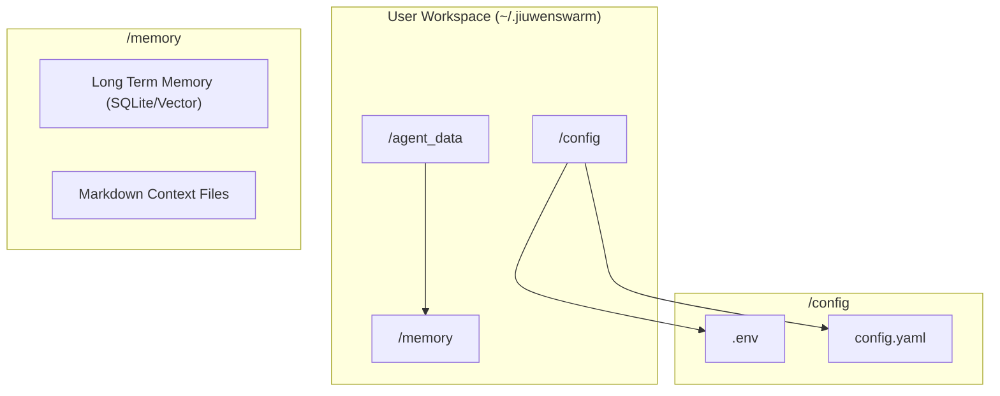
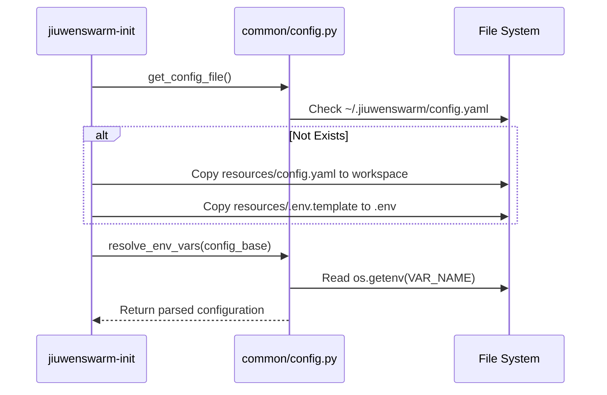

<!-- source: DeepWiki mcp.deepwiki.com · repo openJiuwen-ai/jiuwenswarm · page 1.1 Getting Started · fetched 2026-11-02 -->

# Getting Started

<details>
<summary>Relevant source files</summary>

The following files were used as context for generating this wiki page:

- [docs/assets/images/browser1.png](docs/assets/images/browser1.png)
- [docs/assets/images/browser2.png](docs/assets/images/browser2.png)
- [docs/en/Browser.md](docs/en/Browser.md)
- [docs/en/InstallGuide.md](docs/en/InstallGuide.md)
- [docs/en/Page-Overview.md](docs/en/Page-Overview.md)
- [docs/en/Quickstart.md](docs/en/Quickstart.md)
- [docs/en/README.md](docs/en/README.md)
- [docs/en/SUMMARY.md](docs/en/SUMMARY.md)
- [docs/en/install.md](docs/en/install.md)
- [docs/zh/Quickstart.md](docs/zh/Quickstart.md)
- [docs/zh/README.md](docs/zh/README.md)
- [docs/zh/SUMMARY.md](docs/zh/SUMMARY.md)
- [jiuwenswarm/common/config.py](jiuwenswarm/common/config.py)
- [pyproject.toml](pyproject.toml)
- [tests/unit_tests/test_app_web_handlers.py](tests/unit_tests/test_app_web_handlers.py)
- [tests/unit_tests/test_config.py](tests/unit_tests/test_config.py)
- [uv.lock](uv.lock)

</details>


This page provides a technical guide for installing and initializing JiuwenSwarm. It covers the environment requirements, the primary installation workflows (pip and source-build), and the automated workspace initialization process that sets up the local agent environment.

## Prerequisites

Before installation, ensure the host system meets the following technical specifications:

| Dependency | Requirement | Role |
| :--- | :--- | :--- |
| **Operating System** | Windows 10/11, macOS 10.15+, Linux | Multi-platform support |
| **Python** | `≥3.11`, `<3.14` | Core runtime (3.11 recommended) |
| **Node.js** | `≥18.x` | Required for Web UI and TUI frontend builds |
| **Git** | Latest | Required for source builds and skill discovery |

Sources: `[docs/en/Quickstart.md:9-17]()`, `[docs/zh/Quickstart.md:11-16]()`

---

## Installation Workflows

JiuwenSwarm supports two main installation paths depending on whether you are a user or a developer.

### 1. Standard Installation (pip)
This is the recommended path for users who want to run the stable version of JiuwenSwarm.

```bash
# Create and activate virtual environment
python -m venv jiuwenswarm
source jiuwenswarm/bin/activate  # Linux/Mac

# Install JiuwenSwarm
pip install jiuwenswarm
```
Sources: `[docs/en/Quickstart.md:27-39]()`, `[pyproject.toml:5-14]()`

### 2. Source Build (Developer Mode)
For developers contributing to the codebase or building custom extensions, the project supports `uv` and `conda` workflows.

**Using `uv`:**
```bash
# Clone the repository and sync dependencies
uv venv --python=3.11
uv sync

# Build the Web Frontend
cd jiuwenswarm/channels/web/frontend
npm install
npm run build
```
Sources: `[docs/zh/Quickstart.md:63-92]()`, `[pyproject.toml:114-118]()`

---

## Initialization and First Run

The initialization process is handled by the `jiuwenswarm-init` command, which maps to the `main` function in `jiuwenswarm/init_workspace.py`.

### Workspace Setup Logic
The initialization logic performs the following critical steps:
1. **Path Resolution**: Determines the target directory (defaulting to `~/.jiuwenswarm`) using `get_config_dir` `[jiuwenswarm/common/config.py:27-28]()`.
2. **Resource Population**: Copies configuration templates (`config.yaml`, `.env.template`) and agent resources from the package's `resources` directory to the user's workspace `[pyproject.toml:101-105]()`.
3. **Environment Variable Resolution**: The system uses `resolve_env_vars` to handle `${VAR:-default}` syntax within the YAML configuration files `[jiuwenswarm/common/config.py:35-76]()`.

### Command Reference
| Command | Entry Point | Description |
| :--- | :--- | :--- |
| `jiuwenswarm-init` | `jiuwenswarm.init_workspace:main` | Standard initialization of the user workspace. |
| `jiuwenswarm-start` | `jiuwenswarm.start_services:main` | Launches the `AgentServer` and `Gateway` processes. |
| `jiuwenswarm-web` | `jiuwenswarm.channels.web.app_web:main` | Standalone start for the Web channel. |

Sources: `[pyproject.toml:70-80]()`, `[jiuwenswarm/common/config.py:21-28]()`

---

## Workspace Structure

After running `jiuwenswarm-init`, the workspace directory is structured to isolate configuration from runtime data.

**JiuwenSwarm Workspace Layout**

Sources: `[jiuwenswarm/common/config.py:21-28]()`, `[docs/en/Quickstart.md:162-170]()`

---

## Environment Configuration

The `.env` file is the primary location for sensitive credentials. The system provides a `resolve_env_vars` function to inject these into the runtime configuration.

### Essential Variables
| Variable | Description |
| :--- | :--- |
| `API_KEY` | The API key for the LLM provider. |
| `API_BASE` | Base URL for the LLM API. |
| `MODEL_NAME` | The specific model identifier (e.g., `deepseek-chat`). |
| `MODEL_PROVIDER` | Provider type (e.g., `OpenAI`, `DeepSeek`). |

### Initialization Data Flow
The following diagram illustrates how the `jiuwenswarm-init` command bridges the source code templates to the active user environment.

**Initialization Data Flow**

Sources: `[jiuwenswarm/common/config.py:35-76]()`, `[jiuwenswarm/common/config.py:106-112]()`, `[pyproject.toml:101-105]()`

---

## Starting the Service

Once initialized and configured, start the service using the entry point:

```bash
jiuwenswarm-start
```

The system will output the status of the primary components:
1. **API Server (Gateway)**: Typically running at `http://localhost:8000`.
2. **Web Server (Frontend)**: Typically running at `http://localhost:5173`.

### Remote Access (Optional)
To allow external access, the `jiuwenswarm-web` command can be used to specify host and port:
```bash
jiuwenswarm-web --host 0.0.0.0 --port 8080
```

Sources: `[docs/en/Quickstart.md:51-57]()`, `[docs/en/Quickstart.md:65-71]()`, `[pyproject.toml:75]()`

---

