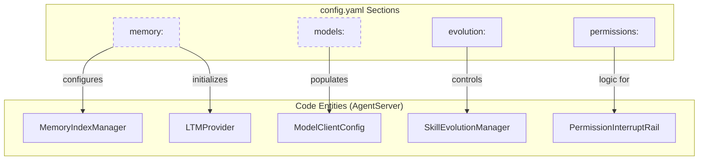
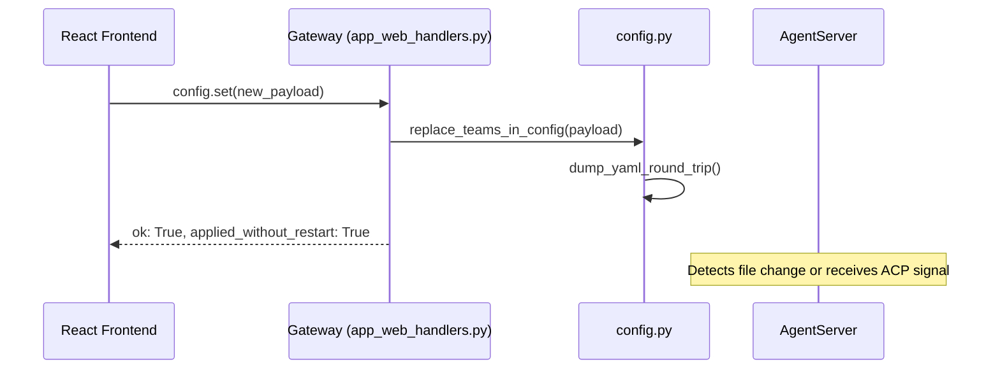

<!-- source: DeepWiki mcp.deepwiki.com · repo openJiuwen-ai/jiuwenswarm · page 1.2 Configuration Reference · fetched 2026-11-02 -->

# Configuration Reference

Relevant source files

The following files were used as context for generating this wiki page:

- [docs/assets/images/config-model-test.png](docs/assets/images/config-model-test.png)
- [docs/assets/images/config-vision-model-test-en.png](docs/assets/images/config-vision-model-test-en.png)
- [docs/assets/images/config-vision-model-test.png](docs/assets/images/config-vision-model-test.png)
- [docs/assets/images/config.png](docs/assets/images/config.png)
- [docs/assets/images/config_audio_model_demo.png](docs/assets/images/config_audio_model_demo.png)
- [docs/assets/images/config_context_compress.png](docs/assets/images/config_context_compress.png)
- [docs/assets/images/config_model_connect_test.png](docs/assets/images/config_model_connect_test.png)
- [docs/assets/images/config_tool_security_guard.png](docs/assets/images/config_tool_security_guard.png)
- [docs/assets/images/config_video_model_demo.png](docs/assets/images/config_video_model_demo.png)
- [docs/en/Configuration.md](docs/en/Configuration.md)
- [docs/en/SkillSelfEvolution.md](docs/en/SkillSelfEvolution.md)
- [docs/en/Skills.md](docs/en/Skills.md)
- [jiuwenswarm/common/config.py](jiuwenswarm/common/config.py)
- [pyproject.toml](pyproject.toml)
- [tests/unit_tests/test_app_web_handlers.py](tests/unit_tests/test_app_web_handlers.py)
- [tests/unit_tests/test_config.py](tests/unit_tests/test_config.py)
- [uv.lock](uv.lock)

JiuwenSwarm utilizes a dual-layer configuration system: a persistent `config.yaml` for system-wide behavioral settings and a `.env` file for sensitive credentials and environment-specific overrides. This page provides a technical breakdown of the configuration schema, the data flow between processes, and the hot-reload mechanism.

## 1. Configuration Architecture

The configuration is managed by the `AgentServer` and shared with the `Gateway` via the E2A protocol. At startup, the system initializes the workspace and populates it with default templates from the package resources [jiuwenswarm/init_workspace.py:1-20]().

### 1.1 Data Flow and Overrides
1.  **Environment Variables**: Loaded from `.env` via `load_dotenv`. These take highest precedence and can override `config.yaml` values using the `${VAR_NAME:-default}` syntax [jiuwenswarm/common/config.py:35-70]().
2.  **config.yaml**: The primary source for structured settings (models, memory, telemetry).
3.  **Resolution Logic**: The `resolve_env_vars` function recursively traverses the configuration dictionary, replacing placeholders with environment values [jiuwenswarm/common/config.py:35-76]().
4.  **Hot-Reload**: Changes made via the Web UI are persisted to `config.yaml` using `ruamel.yaml` to preserve comments and formatting [jiuwenswarm/common/config.py:126-143]().

### 1.2 System Entity Mapping
The following diagram illustrates how configuration sections map to specific classes and handlers within the codebase.

**Diagram: Configuration to Code Entity Mapping**

**Sources:** [jiuwenswarm/common/config.py:79-112](), [docs/en/Configuration.md:15-22]().

---

## 2. Detailed Section Reference

### 2.1 Memory System (`memory:`)
The memory configuration controls the multi-layered retrieval system. It distinguishes between different storage backends and external providers [docs/en/Configuration.md:18-18]().

| Key | Values | Description |
| :--- | :--- | :--- |
| `engine` | `builtin`, `external`, `both` | Controls which memory retrieval logic is active. |
| `external.provider` | `openjiuwen`, `mem0`, `openviking` | Selects the third-party memory backend. |

**Sources:** [jiuwenswarm/common/config.py:106-112](), [docs/en/Configuration.md:18-19]().

### 2.2 Model Configuration (`models:`)
JiuwenSwarm uses a polymorphic model configuration. The system supports multiple models simultaneously for quick switching via aliases [docs/en/Configuration.md:74-94]().

*   **Implementation**: Each entry maps to a configuration containing `api_base`, `api_key`, and `model_provider` (e.g., `OpenAI`, `Azure`, `SiliconFlow`) [docs/en/Configuration.md:46-55]().
*   **Normalization**: The `_normalize_config` function ensures that fields like `custom_headers` (passed as JSON strings via env) are parsed into native dictionaries [jiuwenswarm/common/config.py:79-104]().
*   **Multimodal Routing**: Specialized blocks route tasks to `Video Model`, `Audio Model`, and `Vision Model` [docs/en/Configuration.md:32-42]().

**Sources:** [jiuwenswarm/common/config.py:79-104](), [docs/en/Configuration.md:28-72]().

### 2.3 Skill Evolution (`evolution:`)
This section controls the self-improvement loop of the agent.

*   **Auto-Scan**: `evolution.auto_scan` (overridden by `EVOLUTION_AUTO_SCAN`) enables background detection of tool failures and user corrections [docs/en/SkillSelfEvolution.md:140-157]().
*   **Skill Creation**: `evolution.skill_create` allows the agent to propose new skills when a capability gap is detected [docs/en/SkillSelfEvolution.md:145-145]().

**Sources:** [docs/en/SkillSelfEvolution.md:1-222]().

### 2.4 Permissions and Guardrails (`permissions:`)
The system employs a tiered permission policy managed by the `PermissionInterruptRail`.

*   **Severity Levels**: `LOW`, `MEDIUM`, `HIGH`, `CRITICAL`.
*   **Action Mapping**:
    *   `allow`: Execute without prompt.
    *   `ask`: Trigger a `PermissionInterrupt` to the user via the Gateway.
    *   `deny`: Block execution immediately.

**Sources:** [docs/en/Configuration.md:22-22]().

---

## 3. Environment Variable Reference (.env)

The `.env` file is used for infrastructure-level settings and secrets.

| Variable | Description |
| :--- | :--- |
| `JIUWENSWARM_CONFIG_DIR` | Custom directory path for configuration files [jiuwenswarm/common/config.py:24-26](). |
| `GITHUB_TOKEN` | Used by `SkillNet` for higher API quotas during skill installation [docs/en/Skills.md:88-104](). |
| `EVOLUTION_AUTO_SCAN` | Environment override for skill evolution scanning [docs/en/SkillSelfEvolution.md:155-155](). |

**Sources:** [jiuwenswarm/common/config.py:24-26](), [docs/en/Skills.md:88-104]().

---

## 4. Multi-Instance and Hot-Reload
JiuwenSwarm supports running multiple isolated instances. Each instance calculates its own ports based on base offsets [pyproject.toml:71-82]().

### 4.1 Hot-Reload Mechanism
The Web UI communicates with the `Gateway` to update configurations. The `config.set` handler in `app_web_handlers.py` facilitates this [tests/unit_tests/test_app_web_handlers.py:52-69]().

**Diagram: Configuration Update Sequence**

**Sources:** [jiuwenswarm/common/config.py:152-201](), [tests/unit_tests/test_app_web_handlers.py:37-69]().

---

