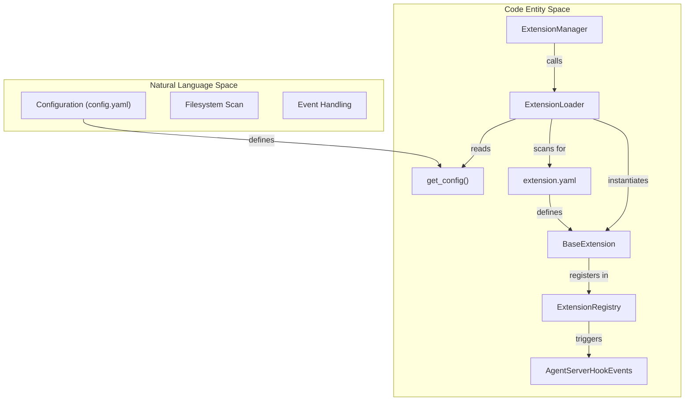
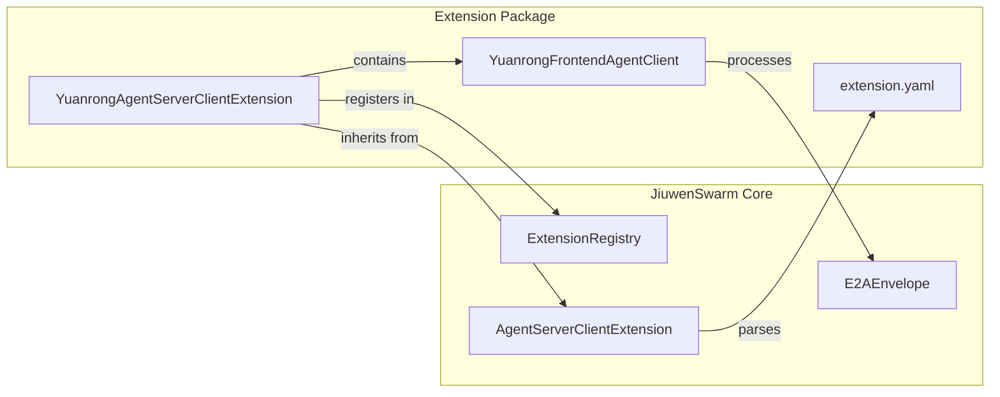

<!-- source: DeepWiki mcp.deepwiki.com · repo openJiuwen-ai/jiuwenswarm · page 10 Extensions and Plugin System · fetched 2026-11-02 -->

# Extensions and Plugin System

Relevant source files

The following files were used as context for generating this wiki page:

- [deploy/extensions/agent_client/__init__.py](deploy/extensions/agent_client/__init__.py)
- [deploy/extensions/agent_client/extension.py](deploy/extensions/agent_client/extension.py)
- [deploy/extensions/agent_client/extension.yaml](deploy/extensions/agent_client/extension.yaml)
- [jiuwenswarm/channels/tui/frontend/src/core/commands/builtins/agents.ts](jiuwenswarm/channels/tui/frontend/src/core/commands/builtins/agents.ts)
- [jiuwenswarm/channels/tui/frontend/src/core/commands/builtins/hooks.ts](jiuwenswarm/channels/tui/frontend/src/core/commands/builtins/hooks.ts)
- [jiuwenswarm/channels/tui/frontend/src/core/commands/builtins/plugin.ts](jiuwenswarm/channels/tui/frontend/src/core/commands/builtins/plugin.ts)
- [jiuwenswarm/channels/tui/frontend/src/core/commands/builtins/reload-plugins.ts](jiuwenswarm/channels/tui/frontend/src/core/commands/builtins/reload-plugins.ts)
- [jiuwenswarm/channels/tui/frontend/src/core/commands/builtins/usage.ts](jiuwenswarm/channels/tui/frontend/src/core/commands/builtins/usage.ts)
- [jiuwenswarm/extensions/yuanrong_frontend_client.py](jiuwenswarm/extensions/yuanrong_frontend_client.py)
- [jiuwenswarm/gateway/channel_manager/protocol/acp/acp_connect.py](jiuwenswarm/gateway/channel_manager/protocol/acp/acp_connect.py)

The JiuwenSwarm extension system allows for third-party functionality to be integrated into both the Gateway and AgentServer processes. It provides a structured way to discover, load, and manage the lifecycle of external plugins while offering hook-based interception points for core system events.

### Extension Management and Discovery

The `ExtensionManager` is responsible for the orchestration of the extension lifecycle. It utilizes the `ExtensionLoader` to scan directories defined in the system configuration for valid extension roots.

*   **Discovery**: Extensions are located by searching `extension_dirs` specified in the configuration.
*   **Loading**: The `ExtensionLoader` identifies extension roots containing an `extension.yaml` manifest and dynamically imports them. For example, the `AgentServerClient` implementation can be provided via an extension that registers itself during the initialization phase [deploy/extensions/agent_client/extension.py:25-57]().
*   **Registry**: Once loaded, extensions or their specific components (like `AgentServerClient` or `CryptoUtility`) are registered within the `ExtensionRegistry`.
*   **Shutdown**: During system teardown, the manager invokes the `shutdown()` method on all loaded extensions to ensure resource cleanup.

### Hook Events and Callbacks

JiuwenSwarm employs an event-driven architecture. Extensions can register handlers for specific lifecycle events to inspect or modify system behavior. Users can browse configured hooks and their statuses via the `/hooks` command in the TUI [jiuwenswarm/channels/tui/frontend/src/core/commands/builtins/hooks.ts:160-175]().

| Event Type | Description | Context Object |
| :--- | :--- | :--- |
| `MEMORY_BEFORE_CHAT` | Triggered before the agent processes a message; used to inject context. | `MemoryHookContext` |
| `MEMORY_AFTER_CHAT` | Triggered after a response is generated; used for memory persistence. | `MemoryHookContext` |

The system also supports dynamic reloading of plugins and skills through the `/reload-plugins` command, which triggers a refresh of the internal registry without restarting the entire process [jiuwenswarm/channels/tui/frontend/src/core/commands/builtins/reload-plugins.ts:12-54]().

### Extension System Architecture

The following diagram illustrates how the management entities relate to the code entities and the discovery process.

**Extension Discovery and Loading Flow**

**Sources:** [deploy/extensions/agent_client/extension.py:31-33](), [deploy/extensions/agent_client/extension.yaml:1-9](), [jiuwenswarm/channels/tui/frontend/src/core/commands/builtins/hooks.ts:31-90]()

### SDK and Implementation

Extensions are built by inheriting from the `BaseExtension` class, which provides built-in utilities for metadata loading and configuration management. A common use case is implementing a custom `AgentServerClient` to bridge the Gateway to different agent execution environments.

*   **Metadata**: Automatically loaded from `extension.yaml` which defines the extension ID, version, and dependencies [deploy/extensions/agent_client/extension.yaml:1-7]().
*   **Interfaces**: Specialized extensions like `AgentServerClientExtension` allow third parties to provide custom communication implementations. For example, the `YuanrongAgentServerClientExtension` wraps a `YuanrongFrontendAgentClient` to handle HTTP-based agent invocations [jiuwenswarm/extensions/yuanrong_frontend_client.py:28-49]().
*   **Client Compatibility**: Custom clients implement `send_request` and `send_request_stream` to translate internal `E2AEnvelope` objects into platform-specific payloads [jiuwenswarm/extensions/yuanrong_frontend_client.py:122-165]().

**Extension Component Interaction**

**Sources:** [deploy/extensions/agent_client/extension.py:12-22](), [jiuwenswarm/extensions/yuanrong_frontend_client.py:122-132](), [deploy/extensions/agent_client/extension.yaml:1-4]()

---

### Child Pages

*   **[Extension SDK](#10.1)**: Detailed guide on building extensions, including the `BaseExtension` lifecycle, `AgentServerClient` implementation, and hook event schemas. For details, see [Extension SDK](#10.1).
*   **[Instance Manager](#10.2)**: Technical details on managing multiple isolated JiuwenSwarm instances on a single host, including port calculation and configuration isolation. For details, see [Instance Manager](#10.2).

---

