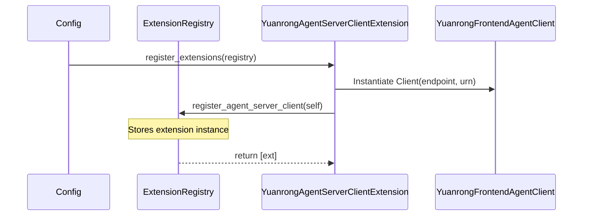
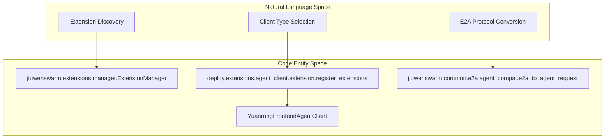

<!-- source: DeepWiki mcp.deepwiki.com · repo openJiuwen-ai/jiuwenswarm · page 10.1 Extension SDK · fetched 2026-11-02 -->

# Extension SDK

Relevant source files

The following files were used as context for generating this wiki page:

- [deploy/extensions/agent_client/__init__.py](deploy/extensions/agent_client/__init__.py)
- [deploy/extensions/agent_client/extension.py](deploy/extensions/agent_client/extension.py)
- [deploy/extensions/agent_client/extension.yaml](deploy/extensions/agent_client/extension.yaml)
- [docs/en/developer_guide.md](docs/en/developer_guide.md)
- [docs/zh/developer_guide.md](docs/zh/developer_guide.md)
- [jiuwenswarm/extensions/yuanrong_frontend_client.py](jiuwenswarm/extensions/yuanrong_frontend_client.py)
- [jiuwenswarm/gateway/channel_manager/protocol/acp/acp_connect.py](jiuwenswarm/gateway/channel_manager/protocol/acp/acp_connect.py)
- [scripts/build_python_packages.py](scripts/build_python_packages.py)
- [tests/unit_tests/agentserver/memory/test_external_memory_builder.py](tests/unit_tests/agentserver/memory/test_external_memory_builder.py)
- [tests/unit_tests/agentserver/memory/test_external_memory_config.py](tests/unit_tests/agentserver/memory/test_external_memory_config.py)

The JiuwenSwarm Extension SDK provides a standardized framework for extending the capabilities of the system. Extensions can intercept system events via hooks, provide custom cryptographic utilities, or implement specialized communication clients for the AgentServer, such as HTTP-based invocation clients.

## Extension Architecture

The extension system is built around a discovery mechanism that scans configured directories for extension packages. Each extension must inherit from a base class and provide a manifest file.

### Core Components

| Component | Role | File Reference |
| :--- | :--- | :--- |
| `ExtensionManager` | Orchestrates the discovery, loading, and shutdown of all extensions. | [jiuwenswarm/extensions/manager.py:26-34]() |
| `ExtensionRegistry` | A singleton that stores loaded extensions and manages specialized client registrations. | [jiuwenswarm/extensions/registry.py:13-25]() |
| `BaseExtension` | The abstract base class that all extensions must implement. | [jiuwenswarm/extensions/sdk/base.py:15-18]() |
| `AgentServerClientExtension` | Specialized base class for extensions providing AgentServer connectivity. | [jiuwenswarm/extensions/sdk/agent_server_client.py:7-13]() |

### Data Flow: Extension Registration
The following diagram illustrates how a specialized extension, such as the `YuanrongAgentServerClientExtension`, is registered and used by the system.

**Title: Specialized Client Extension Registration Flow**

Sources: [deploy/extensions/agent_client/extension.py:25-57](), [jiuwenswarm/extensions/yuanrong_frontend_client.py:35-46]()

---

## Building an Extension

### 1. Metadata Requirements
Every extension must reside in its own directory and contain an `extension.yaml` manifest. This file defines the identity and compatibility of the extension.

**Required Manifest Fields:**
* `id`: Unique identifier (e.g., `agent_client`).
* `name`: Human-readable name (e.g., `AgentServer Client`).
* `version`: SemVer string (e.g., `0.1.0`).
* `description`: Short summary of functionality.

Sources: [deploy/extensions/agent_client/extension.yaml:1-4](), [jiuwenswarm/extensions/sdk/base.py:54-82]()

### 2. The BaseExtension Class
Developers must subclass `BaseExtension` and implement the lifecycle methods.

*   `initialize(config: ExtensionConfig)`: Called during startup. Use this to setup resources or perform initial validation. [jiuwenswarm/extensions/sdk/base.py:21-28]()
*   `shutdown()`: Called when the system stops. [jiuwenswarm/extensions/sdk/base.py:30-36]()

### 3. Implementing AgentServerClient
Extensions providing custom communication logic (e.g., bridging to a serverless frontend via HTTP POST) must implement the `AgentServerClient` interface.

**Key Methods for `AgentServerClient`:**
* `connect(uri: str)`: Establishes the connection to the remote AgentServer endpoint. [jiuwenswarm/extensions/yuanrong_frontend_client.py:62-75]()
* `send_request(envelope: E2AEnvelope)`: Sends a non-streaming request using the E2A protocol. [jiuwenswarm/extensions/yuanrong_frontend_client.py:122-155]()
* `send_request_stream(envelope: E2AEnvelope)`: Handles SSE (Server-Sent Events) or chunked streaming responses. [jiuwenswarm/extensions/yuanrong_frontend_client.py:157-184]()

Sources: [jiuwenswarm/extensions/yuanrong_frontend_client.py:28-33](), [jiuwenswarm/gateway/routing/agent_client.py:21-21]()

---

## Communication and Protocol Support

The SDK is designed to work with the **E2A (External-to-Agent)** protocol. Extensions often serve as the bridge between raw platform events (like ACP JSON-RPC) and the internal agent message format.

### ACP Bridge Logic
For extensions handling IDE or Client plugins, the `AcpGatewayBridge` facilitates the translation between ACP JSON-RPC and JiuwenSwarm `Message` objects.

*   `inbound_intercept`: Intercepts JSON-RPC responses from the IDE to resolve tool calls. [jiuwenswarm/gateway/channel_manager/protocol/acp/acp_connect.py:147-197]()
*   `outbound_intercept`: Converts internal events into ACP output requests for the client. [jiuwenswarm/gateway/channel_manager/protocol/acp/acp_connect.py:199-205]()

Sources: [jiuwenswarm/gateway/channel_manager/protocol/acp/acp_connect.py:120-134]()

---

## Discovery and Loading Mechanism

The system discovers extensions based on the `extensions.extension_dirs` setting in the global configuration.

**Title: Code Entity Mapping - Client Extension Integration**

Sources: [deploy/extensions/agent_client/extension.py:31-40](), [jiuwenswarm/extensions/yuanrong_frontend_client.py:132-132](), [jiuwenswarm/extensions/manager.py:36-60]()

### Extension Registration Workflow
1.  The system calls `register_extensions(registry)` within the extension module. [deploy/extensions/agent_client/extension.py:25-25]()
2.  The extension checks the global configuration (`gateway.agent_client.type`) to determine if it should activate. [deploy/extensions/agent_client/extension.py:31-38]()
3.  If active, it instantiates the specialized client and registers it via `registry.register_agent_server_client(ext)`. [deploy/extensions/agent_client/extension.py:48-56]()

### Configuration and Metadata
Extensions can access their specific configuration via the `ExtensionConfig` passed to `initialize`. Metadata is automatically parsed from `extension.yaml` and cached to optimize repeated access.

Sources: [jiuwenswarm/extensions/sdk/base.py:21-28](), [jiuwenswarm/extensions/sdk/base.py:48-52]()

---

