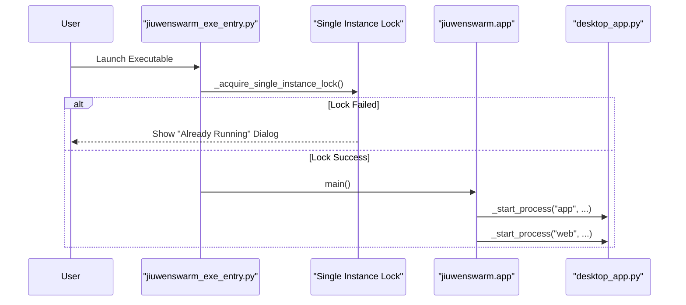

<!-- source: DeepWiki mcp.deepwiki.com · repo openJiuwen-ai/jiuwenswarm · page 10.2 Instance Manager · fetched 2026-11-02 -->

# Instance Manager

<details>
<summary>Relevant source files</summary>

The following files were used as context for generating this wiki page:

- [jiuwenswarm/app.py](jiuwenswarm/app.py)
- [jiuwenswarm/channels/desktop/desktop_app.py](jiuwenswarm/channels/desktop/desktop_app.py)
- [jiuwenswarm/channels/web/frontend/src/components/UpdatePanel/index.tsx](jiuwenswarm/channels/web/frontend/src/components/UpdatePanel/index.tsx)
- [jiuwenswarm/common/config.py](jiuwenswarm/common/config.py)
- [jiuwenswarm/common/updater.py](jiuwenswarm/common/updater.py)
- [jiuwenswarm/common/updater_restart_helper.py](jiuwenswarm/common/updater_restart_helper.py)
- [jiuwenswarm/common/upgrade_executor.py](jiuwenswarm/common/upgrade_executor.py)
- [jiuwenswarm/common/utils.py](jiuwenswarm/common/utils.py)
- [jiuwenswarm/common/version_source.py](jiuwenswarm/common/version_source.py)
- [pyproject.toml](pyproject.toml)
- [scripts/jiuwenswarm_exe_entry.py](scripts/jiuwenswarm_exe_entry.py)
- [tests/unit_tests/test_app_web_handlers.py](tests/unit_tests/test_app_web_handlers.py)
- [tests/unit_tests/test_config.py](tests/unit_tests/test_config.py)
- [uv.lock](uv.lock)

</details>


The Instance Manager provides multi-instance isolation for JiuwenSwarm, allowing multiple independent agent environments to coexist on a single host. It manages workspace partitioning, port assignment, and lifecycle tracking through environment variable isolation, specialized entry points, and instance-specific lock files.

## Multi-Instance Architecture

JiuwenSwarm supports two primary runtime environments:
1.  **Default Instance**: Located at `~/.jiuwenswarm`. It uses standard ports and is managed by `jiuwenswarm-init` and `jiuwenswarm-start` without additional arguments [jiuwenswarm/common/utils.py:5-9]().
2.  **Named Instances**: Managed via the `JIUWENSWARM_DATA_DIR` environment variable. This variable overrides the default root, redirecting all configuration, logs, and workspace data to a specific directory [jiuwenswarm/common/utils.py:5-6](), [jiuwenswarm/common/config.py:24-28]().

### Instance Configuration and Environment
Configuration is resolved hierarchically. The system uses a recursive resolver to handle environment variable substitution within the YAML configuration files.

| Mechanism | Code Entity | Role |
| :--- | :--- | :--- |
| **Env Resolution** | `resolve_env_vars` | Handles `${VAR:-default}` syntax in `config.yaml` [jiuwenswarm/common/config.py:35-43](). |
| **Path Discovery** | `get_config_dir()` | Locates the instance's config folder based on `JIUWENSWARM_DATA_DIR` [jiuwenswarm/common/config.py:24-28](). |
| **Workspace Init** | `jiuwenswarm-init` | Entry point for setting up the directory structure and templates [pyproject.toml:76](). |

Sources: [jiuwenswarm/common/config.py:20-28](), [jiuwenswarm/common/config.py:35-76](), [jiuwenswarm/common/utils.py:5-28]()

## Single Instance Locking

To prevent process conflicts within a single instance (especially for desktop and GUI runs), JiuwenSwarm implements a file-based locking mechanism.

### Lock File Implementation
The system attempts to acquire an exclusive lock on `.desktop.lock` within the instance data directory. This happens early in the execution lifecycle, before heavy imports, to ensure rapid failure if another instance is already active [scripts/jiuwenswarm_exe_entry.py:85-112]().

*   **Windows**: Uses `msvcrt.locking` with `LK_NBLCK` [scripts/jiuwenswarm_exe_entry.py:93-99]().
*   **Unix/macOS**: Uses `fcntl.flock` with `LOCK_EX | LOCK_NB` [scripts/jiuwenswarm_exe_entry.py:101-106]().

Sources: [scripts/jiuwenswarm_exe_entry.py:82-112](), [scripts/jiuwenswarm_exe_entry.py:115-130]()

## Port and Process Management

The Instance Manager coordinates the ports for the split-process architecture (AgentServer, Gateway, and Web UI).

### Process Coordination
When running in desktop mode, the `DesktopRuntime` manages child processes for the app backend and the web server. It uses specific flags to differentiate between the primary orchestrator and child services [jiuwenswarm/channels/desktop/desktop_app.py:23-30]().

**Instance Startup Sequence**

Sources: [scripts/jiuwenswarm_exe_entry.py:85-112](), [scripts/jiuwenswarm_exe_entry.py:203-210](), [jiuwenswarm/channels/desktop/desktop_app.py:103-117]()

## Data Flow and Persistence

The Instance Manager ensures that logs, configuration, and checkpoints are strictly partitioned by the data directory.

### Workspace Partitioning
The system defines a standard layout for every instance workspace, including specialized directories for memory, skills, and sessions [jiuwenswarm/common/utils.py:7-25]().

**Instance Directory Data Flow**
```mermaid
graph TD
    subgraph "Environment Control"
        ENV["JIUWENSWARM_DATA_DIR"]
    end

    subgraph "Instance Filesystem"
        CONF["/config/config.yaml"]
        DOTENV["/config/.env"]
        LOGS["/agent/.logs/"]
        WS["/agent/workspace/"]
    end

    subgraph "Code Entities"
        UTILS["jiuwenswarm.common.utils"]
        CONFIG_MOD["jiuwenswarm.common.config"]
    end

    ENV -->|Overrides Root| UTILS
    UTILS -->|get_config_file()| CONF
    CONFIG_MOD -->|resolve_env_vars()| CONF
    UTILS -->|get_logs_dir()| LOGS
```
Sources: [jiuwenswarm/common/utils.py:5-28](), [jiuwenswarm/common/config.py:20-28](), [jiuwenswarm/common/config.py:106-112]()

## Implementation Details

### Subprocess Isolation and Flags
Child processes are spawned with environment copies that maintain the `JIUWENSWARM_DATA_DIR` context. In the desktop application, child commands are constructed using specific flags like `--desktop-run-app` and `--desktop-run-web` to ensure they initialize correctly within the frozen executable environment [jiuwenswarm/channels/desktop/desktop_app.py:75-92](), [jiuwenswarm/channels/desktop/desktop_app.py:95-100]().

### Port Conflict Resolution
The `DesktopRuntime` includes utility functions to wait for TCP port release before attempting to restart or update an instance. This prevents "Address already in use" errors during instance transitions [jiuwenswarm/channels/desktop/desktop_app.py:119-140](), [jiuwenswarm/channels/desktop/desktop_app.py:179-180]().

Sources: [jiuwenswarm/channels/desktop/desktop_app.py:103-117](), [jiuwenswarm/channels/desktop/desktop_app.py:179-180](), [jiuwenswarm/common/utils.py:37-38]()

---

