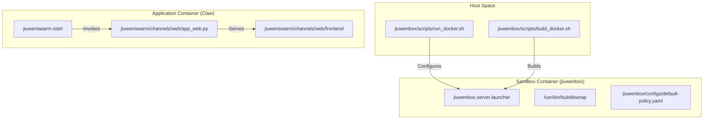
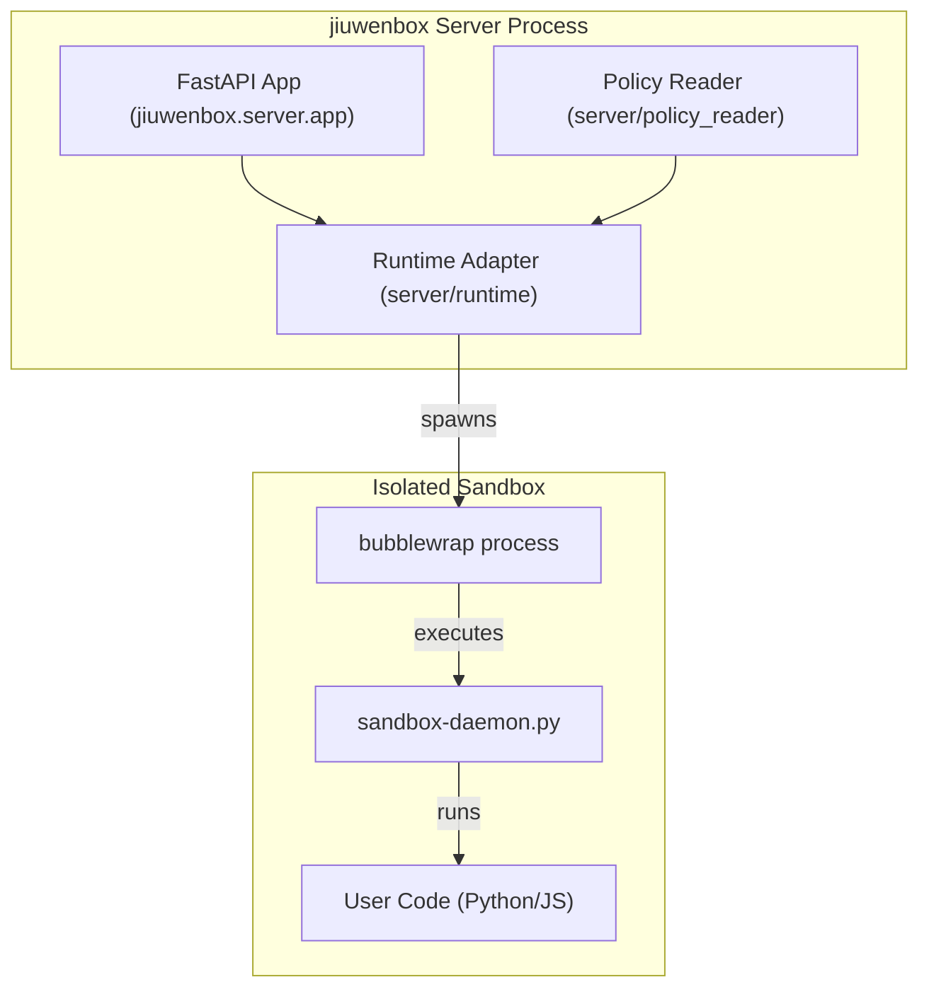

<!-- source: DeepWiki mcp.deepwiki.com · repo openJiuwen-ai/jiuwenswarm · page 11.1 Docker Deployment · fetched 2026-11-02 -->

# Docker Deployment

Relevant source files

The following files were used as context for generating this wiki page:

- [docker/Dockerfile.claw](docker/Dockerfile.claw)
- [docker/Dockerfile.claw.base](docker/Dockerfile.claw.base)
- [jiuwenbox/README.md](jiuwenbox/README.md)
- [jiuwenbox/README_CN.md](jiuwenbox/README_CN.md)
- [jiuwenbox/docker/Dockerfile](jiuwenbox/docker/Dockerfile)
- [jiuwenbox/scripts/run_docker.sh](jiuwenbox/scripts/run_docker.sh)
- [jiuwenbox/src/jiuwenbox/supervisor/bwrap.py](jiuwenbox/src/jiuwenbox/supervisor/bwrap.py)
- [jiuwenbox/src/jiuwenbox/supervisor/landlock_launcher.py](jiuwenbox/src/jiuwenbox/supervisor/landlock_launcher.py)
- [jiuwenbox/tests/integration/test_server_api_default.py](jiuwenbox/tests/integration/test_server_api_default.py)
- [jiuwenswarm/channels/tui/frontend/src/core/commands/builtins/sandbox.ts](jiuwenswarm/channels/tui/frontend/src/core/commands/builtins/sandbox.ts)
- [tests/ui_e2e/cron_ui_report.py](tests/ui_e2e/cron_ui_report.py)
- [tests/ui_e2e/todo_ui_report.py](tests/ui_e2e/todo_ui_report.py)

This page details the containerization strategy for JiuwenSwarm, focusing on the multi-stage build process for the Web UI and AgentServer, the `jiuwenbox` sandbox container, and environment configuration for containerized runs.

## Container Architecture

JiuwenSwarm utilizes a tiered Dockerfile structure to optimize build times and separate concerns between the application logic and the secure execution environment. The deployment consists of two primary container types: the application container ("Claw") and the sandbox container ("jiuwenbox").

### Docker Image Hierarchy

| Image | File | Purpose |
| :--- | :--- | :--- |
| **Base Image** | `Dockerfile.claw.base` | Installs system-level dependencies like Node.js and NPM on top of Python 3.11. [docker/Dockerfile.claw.base:1-7]() |
| **Application Image** | `Dockerfile.claw` | Builds the React frontend, installs Python dependencies, and configures the entrypoint. [docker/Dockerfile.claw:1-27]() |
| **Sandbox Image** | `jiuwenbox/docker/Dockerfile` | A specialized openEuler-based image for running isolated code in `bubblewrap`. [jiuwenbox/docker/Dockerfile:1-45]() |

### System Entity Mapping

The following diagram bridges the high-level deployment concepts to the specific code entities and scripts used to manage them.

**Deployment Entity Relationship**

Sources: [docker/Dockerfile.claw:14-26](), [jiuwenbox/docker/Dockerfile:44-45](), [jiuwenbox/scripts/run_docker.sh:9-13]()

## Application Container (Claw)

The primary application container encapsulates both the `AgentServer` and the `Gateway` (serving the Web frontend).

### Dockerfile.claw Implementation
1.  **User Configuration**: Creates a non-root `app` user for security [docker/Dockerfile.claw:5-6]().
2.  **Frontend Build**: Navigates to `jiuwenswarm/channels/web/frontend` to execute `npm install` and `npm run build` [docker/Dockerfile.claw:14-16]().
3.  **Network Configuration**: A `sed` command modifies `app_web.py` to change the default host from `localhost` to `0.0.0.0`, ensuring the service is reachable from outside the container [docker/Dockerfile.claw:21-21]().
4.  **Python Dependencies**: Installs the package in editable mode with all extras (`.[all]`) using a specified mirror [docker/Dockerfile.claw:22-22]().
5.  **Exposed Ports**: Port `5173` is exposed by default [docker/Dockerfile.claw:25-25]().

Sources: [docker/Dockerfile.claw:1-27]()

## Sandbox Container (jiuwenbox)

The `jiuwenbox` container provides a secure, isolated environment for the agent to execute code using `bubblewrap`.

### Sandbox Execution Flow
The `jiuwenbox` server manages the lifecycle of these isolated environments.

**Sandbox Runtime Flow**

Sources: [jiuwenbox/README.md:26-46](), [jiuwenbox/src/jiuwenbox/supervisor/bwrap.py:134-143](), [jiuwenbox/src/jiuwenbox/supervisor/landlock_launcher.py:211-224]()

### Configuration via run_docker.sh
The `run_docker.sh` script is the primary tool for deploying the sandbox. It supports several advanced modes:

*   **HTTP Mode**: Maps `JIUWENBOX_HOST_PORT` (default 8321) for the management API [jiuwenbox/scripts/run_docker.sh:13-23]().
*   **Unix Domain Socket (UDS) Mode**: When `JIUWENBOX_LISTEN` starts with `unix:///`, the script bind-mounts the socket directory into the container [jiuwenbox/scripts/run_docker.sh:163-177]().
*   **Audit Logging**: The `--save-logs` flag enables persistence of sandbox audit JSONL files to the host [jiuwenbox/scripts/run_docker.sh:194-201]().
*   **Inference Privacy Proxy**: Always maps port `8322` for the proxy, regardless of the management API transport [jiuwenbox/scripts/run_docker.sh:178-181]().

Sources: [jiuwenbox/scripts/run_docker.sh:1-201](), [jiuwenbox/README.md:116-158]()

## Environment and Port Configuration

### Core Ports
| Port | Service | Description |
| :--- | :--- | :--- |
| `5173` | Claw Gateway | Web UI and WebSocket API. [docker/Dockerfile.claw:25]() |
| `8321` | jiuwenbox API | Management API for sandbox control. [jiuwenbox/docker/Dockerfile:38]() |
| `8322` | Privacy Proxy | Inference proxy for LLM API key injection. [jiuwenbox/docker/Dockerfile:39]() |

### Environment Variables
*   **`JIUWENBOX_LISTEN`**: Sets the management API URI (e.g., `http://0.0.0.0:8321` or `unix:///run/jiuwenbox/jiuwenbox.sock`) [jiuwenbox/docker/Dockerfile:44]().
*   **`JIUWENBOX_SAVE_LOGS_DIR`**: Path inside the container where audit logs are written [jiuwenbox/scripts/run_docker.sh:199]().
*   **`JIUWENBOX_UDS_MODE`**: Octal permissions for the UDS socket file [jiuwenbox/scripts/run_docker.sh:188-190]().

### Deployment Summary
To deploy the full system using Docker:
1.  **Build Application**: `docker build -t jiuwenswarm:latest -f docker/Dockerfile.claw .`
2.  **Build Sandbox**: `cd jiuwenbox/scripts && ./build_docker.sh` [jiuwenbox/README.md:99-102]()
3.  **Run Sandbox**: `./run_docker.sh --save-logs /path/to/logs` [jiuwenbox/scripts/run_docker.sh:233]()
4.  **Run Application**: `docker run -p 5173:5173 jiuwenswarm:latest` [docker/Dockerfile.claw:25-26]()

Sources: [docker/Dockerfile.claw:1-27](), [jiuwenbox/scripts/run_docker.sh:1-245](), [jiuwenbox/README.md:95-114]()

---

