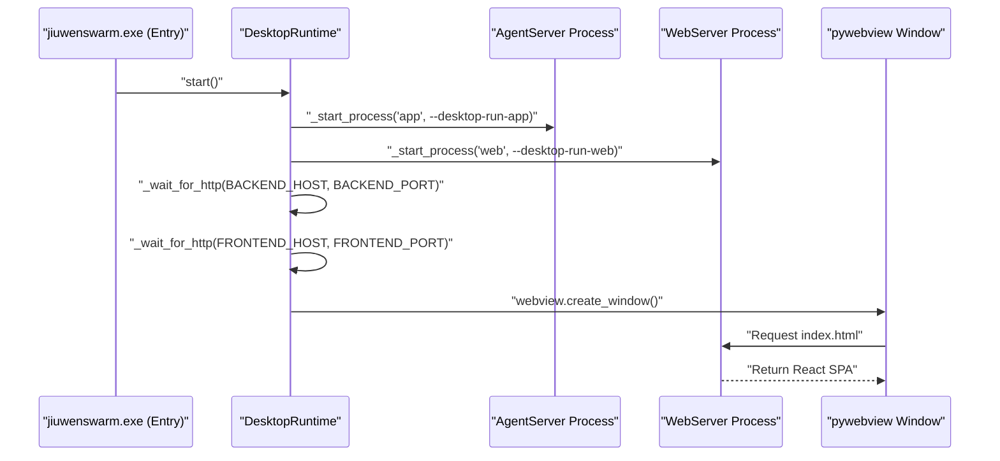
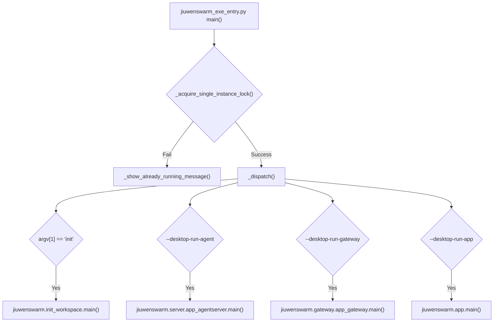

<!-- source: DeepWiki mcp.deepwiki.com · repo openJiuwen-ai/jiuwenswarm · page 11.2 Desktop Executable and Installer · fetched 2026-11-02 -->

# Desktop Executable and Installer

Relevant source files

The following files were used as context for generating this wiki page:

- [jiuwenswarm/app.py](jiuwenswarm/app.py)
- [jiuwenswarm/channels/desktop/desktop_app.py](jiuwenswarm/channels/desktop/desktop_app.py)
- [jiuwenswarm/channels/web/frontend/src/components/UpdatePanel/index.tsx](jiuwenswarm/channels/web/frontend/src/components/UpdatePanel/index.tsx)
- [jiuwenswarm/common/updater.py](jiuwenswarm/common/updater.py)
- [jiuwenswarm/common/updater_restart_helper.py](jiuwenswarm/common/updater_restart_helper.py)
- [jiuwenswarm/common/upgrade_executor.py](jiuwenswarm/common/upgrade_executor.py)
- [jiuwenswarm/common/utils.py](jiuwenswarm/common/utils.py)
- [jiuwenswarm/common/version.py](jiuwenswarm/common/version.py)
- [jiuwenswarm/common/version_source.py](jiuwenswarm/common/version_source.py)
- [packages/jiuwenswarm-tui/pyproject.toml](packages/jiuwenswarm-tui/pyproject.toml)
- [scripts/build-exe.bat](scripts/build-exe.bat)
- [scripts/build-exe.ps1](scripts/build-exe.ps1)
- [scripts/build-macos.sh](scripts/build-macos.sh)
- [scripts/build.ps1](scripts/build.ps1)
- [scripts/build.sh](scripts/build.sh)
- [scripts/installer.iss](scripts/installer.iss)
- [scripts/jiuwenswarm.spec](scripts/jiuwenswarm.spec)
- [scripts/jiuwenswarm_exe_entry.py](scripts/jiuwenswarm_exe_entry.py)

JiuwenSwarm provides a native desktop application experience for Windows and macOS. This is achieved by bundling the Python-based AgentServer, Gateway, and Web Frontend into a single standalone executable using PyInstaller, wrapped in a native window using `pywebview`, and distributed via platform-specific installers (Inno Setup for Windows and DMG for macOS).

## Desktop Application Wrapper

The desktop experience is managed by `jiuwenswarm/channels/desktop/desktop_app.py`, which acts as a process orchestrator and window manager. It utilizes `pywebview` to create a native window that serves the React frontend while managing the lifecycle of the underlying backend services.

### Key Components

*   **`DesktopRuntime`**: The central class managing the application lifecycle. It starts the backend processes (`AgentServer`, `Gateway`, and `Web Server`) and initializes the GUI window [jiuwenswarm/channels/desktop/desktop_app.py:235-243]().
*   **Process Orchestration**: The wrapper launches child processes using specific flags to distinguish between the core logic and its sub-services.
    *   `--desktop-run-app`: Runs the main application logic [jiuwenswarm/channels/desktop/desktop_app.py:27]().
    *   `--desktop-run-web`: Runs the FastAPI web server (`app_web.py`) [jiuwenswarm/channels/desktop/desktop_app.py:28]().
*   **Window API**: A `_WindowApi` class is exposed to the frontend via `pywebview`'s JS bridge, allowing the web UI to trigger native actions like minimizing, closing, or installing updates [jiuwenswarm/channels/desktop/desktop_app.py:208-223]().

### Data Flow: Desktop Startup

The following diagram illustrates how the desktop wrapper bootstraps the entire JiuwenSwarm ecosystem.

**Desktop Bootstrap Sequence**

Sources: [jiuwenswarm/channels/desktop/desktop_app.py:103-116](), [jiuwenswarm/channels/desktop/desktop_app.py:148-176](), [jiuwenswarm/channels/desktop/desktop_app.py:245-260]()

## PyInstaller Configuration (`jiuwenswarm.spec`)

The build process uses a PyInstaller `.spec` file to define how the Python environment and static assets are bundled.

*   **Entry Point**: The bundle starts at `scripts/jiuwenswarm_exe_entry.py` [scripts/jiuwenswarm.spec:115]().
*   **Static Assets**: It bundles the `jiuwenswarm/resources` folder (containing agent templates) and the compiled React frontend from `jiuwenswarm/channels/web/frontend/dist` [scripts/jiuwenswarm.spec:59-63]().
*   **Hidden Imports**: Since the system uses dynamic loading for agents and extensions, several modules must be explicitly listed, including `openjiuwen`, `chromadb`, `fastmcp`, and `jiuwenswarm.channels.web.app_web` [scripts/jiuwenswarm.spec:73-94]().
*   **Platform Specifics**: On Windows, it uses `logo.ico` and requests UAC admin privileges [scripts/jiuwenswarm.spec:158-159](). On macOS, it creates a `.app` BUNDLE with specific `info_plist` metadata [scripts/jiuwenswarm.spec:173-186]().

Sources: [scripts/jiuwenswarm.spec:1-187]()

## Executable Entry Point and Dispatcher

`scripts/jiuwenswarm_exe_entry.py` serves as the unified entry point for the bundled executable. It handles environment-specific initialization and dispatches execution to different modules based on command-line flags.

### Core Responsibilities
1.  **Single Instance Lock**: Uses a file lock at `~/.jiuwenswarm/.desktop.lock` to ensure only one instance of the desktop app runs at a time [scripts/jiuwenswarm_exe_entry.py:85-112]().
2.  **CWD Management**: On macOS, it shifts the current working directory to the user's home folder (`~/.jiuwenswarm`) to ensure log files remain writable [scripts/jiuwenswarm_exe_entry.py:16-25]().
3.  **Windows Subprocess Patching**: Monkey-patches `asyncio.create_subprocess_exec` and `subprocess.Popen` to include `CREATE_NO_WINDOW`, preventing console windows from flickering during tool execution [scripts/jiuwenswarm_exe_entry.py:47-69]().
4.  **Command Dispatching**: Routes to `init_workspace`, `app_agentserver`, `app_gateway`, or `app_web` based on flags like `--desktop-run-agent` or `--desktop-run-gateway` [scripts/jiuwenswarm_exe_entry.py:191-213]().

**Entry Point Dispatch Logic**

Sources: [scripts/jiuwenswarm_exe_entry.py:85-112](), [scripts/jiuwenswarm_exe_entry.py:191-213]()

## Build Scripts and Installers

### Windows: Inno Setup
The Windows installer is generated using `scripts/installer.iss`.
*   **Target**: Bundles the `dist/jiuwenswarm` directory created by PyInstaller [scripts/installer.iss:39]().
*   **Capabilities**: Handles desktop icon creation, admin privilege requests, and force-closing existing instances during upgrades [scripts/installer.iss:26-29]().
*   **Automation**: `scripts/build-exe.ps1` automates the entire flow: dependency sync -> `npm run build` -> `pyinstaller` -> `ISCC.exe` [scripts/build-exe.ps1:10-57]().

### macOS: DMG Build
The macOS build is managed by `scripts/build-macos.sh`.
*   **Process**: It compiles the frontend, runs PyInstaller to create a `.app` bundle, and then uses `hdiutil` to package the app into a compressed `.dmg` file [scripts/build-macos.sh:19-40]().

### Standalone TUI Package
In addition to the GUI, a standalone TUI package `jiuwenswarm-tui` is provided.
*   **Definition**: Located in `packages/jiuwenswarm-tui/pyproject.toml`.
*   **Entry Point**: Defines a script `jiuwenswarm-tui` mapping to `jiuwenswarm_tui.app:main` [packages/jiuwenswarm-tui/pyproject.toml:15-16]().
*   **Build**: Integrated into the main `scripts/build.sh` which uses `scripts/build_python_packages.py` to generate wheel files [scripts/build.sh:67-76]().

Sources: [scripts/installer.iss:1-48](), [scripts/build-exe.ps1:1-63](), [scripts/build-macos.sh:1-45](), [packages/jiuwenswarm-tui/pyproject.toml:1-32](), [scripts/build.sh:1-77]()

---

