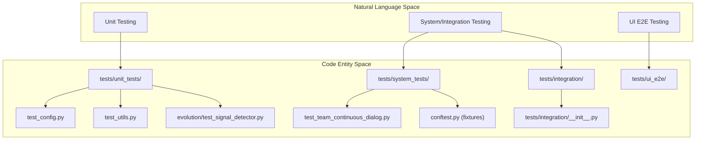
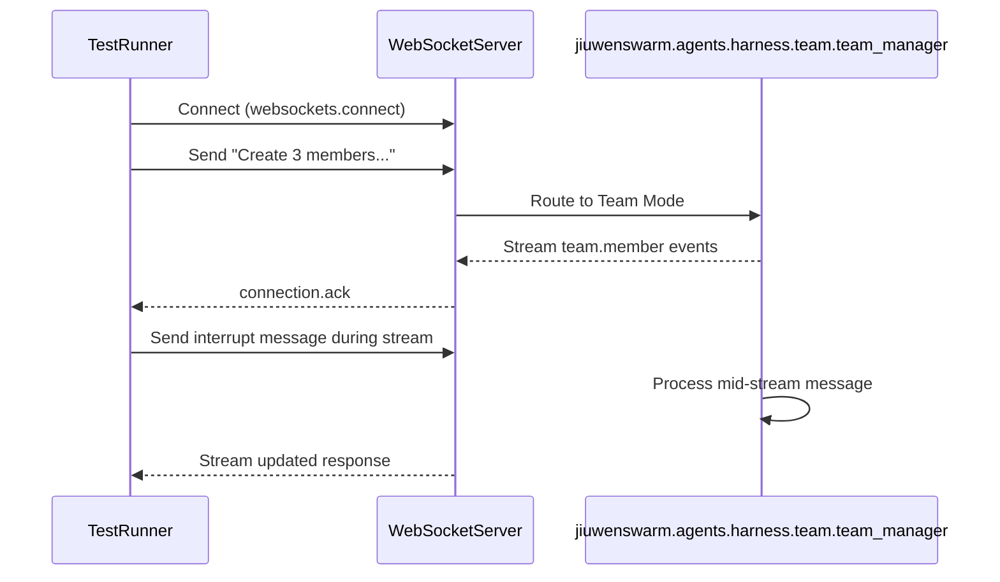

<!-- source: DeepWiki mcp.deepwiki.com · repo openJiuwen-ai/jiuwenswarm · page 12 Testing · fetched 2026-11-02 -->

# Testing

<details>
<summary>Relevant source files</summary>

The following files were used as context for generating this wiki page:

- [TESTING.md](TESTING.md)
- [pytest.ini](pytest.ini)
- [run_tests.sh](run_tests.sh)
- [tests/README.md](tests/README.md)
- [tests/__init__.py](tests/__init__.py)
- [tests/conftest.py](tests/conftest.py)
- [tests/integration/__init__.py](tests/integration/__init__.py)
- [tests/system_tests/conftest.py](tests/system_tests/conftest.py)
- [tests/system_tests/test_team_continuous_dialog.py](tests/system_tests/test_team_continuous_dialog.py)
- [tests/unit_tests/test_utils.py](tests/unit_tests/test_utils.py)

</details>


The JiuwenSwarm test infrastructure is designed to ensure the reliability of its split-process architecture, multi-agent orchestration, and skill evolution systems. The suite ranges from low-level unit tests for utility functions to complex system tests that simulate multi-agent team interactions via WebSockets.

## Test Infrastructure Overview

The project uses `pytest` as its primary testing framework, configured via `pytest.ini` [pytest.ini:1-42](). The test suite is categorized into three main tiers:

1.  **Unit Tests**: Focused on individual components like configuration parsing, signal detection, and message schema validation [TESTING.md:81-192]().
2.  **System/Integration Tests**: Validates end-to-end flows such as workspace initialization and continuous team dialogs [tests/system_tests/test_team_continuous_dialog.py:1-13]().
3.  **UI E2E Tests**: Automated scripts that interact with the Web UI to verify frontend-backend integration.

### Test Environment Mapping

The following diagram bridges the natural language test categories to the specific code entities and directories that implement them.

**Test Architecture Mapping**

Sources: [TESTING.md:4-30](), [tests/system_tests/test_team_continuous_dialog.py:34-40](), [tests/unit_tests/test_utils.py:15-103](), [tests/integration/__init__.py:1-3]()

---

## Running the Test Suite

Developers can run tests using the provided shell script or direct `pytest` commands.

### Using the Test Runner
The `run_tests.sh` script provides a convenient interface for common testing tasks [run_tests.sh:23-70]():
*   `./run_tests.sh -u`: Runs only unit tests [run_tests.sh:34-37]().
*   `./run_tests.sh -c`: Runs tests and generates an HTML coverage report [run_tests.sh:26-29]().
*   `./run_tests.sh -p`: Executes tests in parallel using `pytest-xdist` [run_tests.sh:42-45]().

### Direct Pytest Execution
For more granular control, use `pytest` with markers defined in `pytest.ini` [pytest.ini:23-29]():
```bash
# Run only integration tests
pytest -m integration

# Run tests for a specific module
pytest tests/unit_tests/test_config.py
```
Sources: [run_tests.sh:1-133](), [tests/README.md:25-93]()

---

## Unit and System Tests

Unit tests verify the core logic of the `AgentServer` and `Gateway`. Key areas include:
*   **Path Resolution**: Ensuring `get_root_dir` and `get_workspace_dir` handle environment overrides like `JIUWENSWARM_DATA_DIR` and `JIUWENSWARM_HOME` correctly [tests/unit_tests/test_utils.py:15-60](), [tests/unit_tests/test_utils.py:141-190]().
*   **Signal Detection**: Validating that `SkillEvolutionRail` can detect execution failures or user corrections in chat history [TESTING.md:127-146]().
*   **Configuration**: Testing `${VAR:-default}` expansion in `config.yaml` [TESTING.md:83-101]().

System tests often involve mocking the home directory via the `temp_home` fixture and package resources to test the `jiuwenswarm-init` workflow without affecting the developer's local machine [tests/system_tests/conftest.py:19-61]().

For details, see [Unit and System Tests](#12.1).

**System Test Flow: Team Dialog**

Sources: [tests/system_tests/test_team_continuous_dialog.py:190-218](), [tests/system_tests/test_team_continuous_dialog.py:137-189](), [tests/system_tests/test_team_continuous_dialog.py:46-46]()

---

## UI End-to-End Tests

UI E2E tests ensure that the React-based frontend communicates correctly with the backend via the E2A protocol. These tests typically cover:
*   **Session Management**: Creating, switching, and deleting chat sessions.
*   **Tool Output**: Verifying that tool results (like file reads or web searches) render correctly in the chat panel.
*   **Cron/Task Reporting**: Scripts like `cron_ui_report.py` verify that scheduled tasks correctly push updates to the UI.

For details, see [UI End-to-End Tests](#12.2).

---

## Configuration and Fixtures

The test suite relies on shared fixtures defined in `tests/conftest.py` and `tests/system_tests/conftest.py`:
*   `temp_workspace`: Creates a temporary directory structure including `config`, `workspace`, and `logs` [tests/conftest.py:14-26]().
*   `mock_env_vars`: Sets up standard API keys and providers for LLM mocking [tests/conftest.py:58-66]().
*   `verify_workspace_structure`: A helper to validate that the initialization process created all mandatory subdirectories such as `agent/skills`, `agent/memory`, and `agent/sessions` [tests/system_tests/conftest.py:151-199]().
*   `clean_environment`: Resets module-level caches in `jiuwenswarm.common.utils` to ensure test isolation [tests/system_tests/conftest.py:31-61]().

Sources: [tests/conftest.py:1-139](), [tests/system_tests/conftest.py:1-200]()

---

