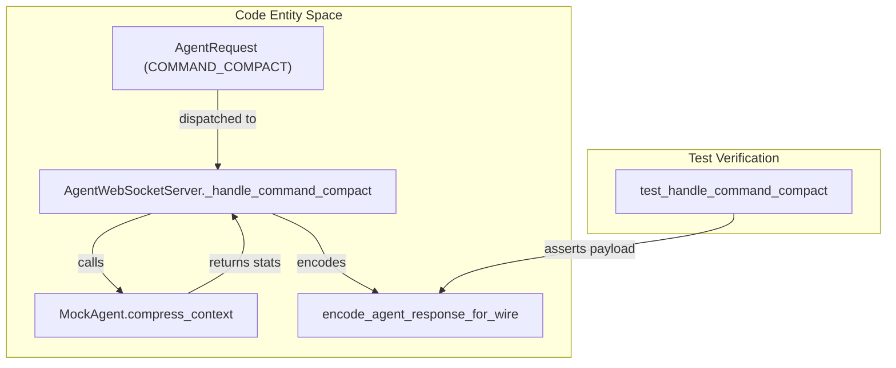
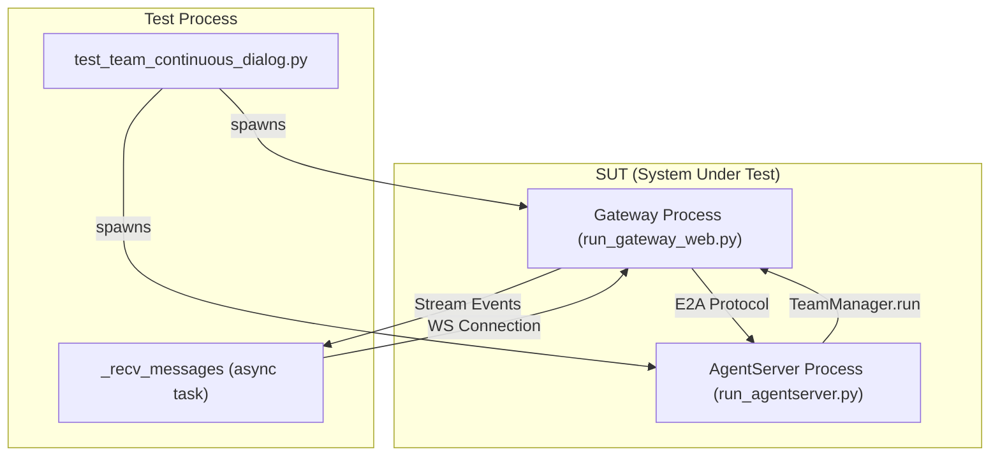

<!-- source: DeepWiki mcp.deepwiki.com · repo openJiuwen-ai/jiuwenswarm · page 12.1 Unit and System Tests · fetched 2026-11-02 -->

# Unit and System Tests

Relevant source files

The following files were used as context for generating this wiki page:

- [TESTING.md](TESTING.md)
- [run_tests.sh](run_tests.sh)
- [tests/README.md](tests/README.md)
- [tests/__init__.py](tests/__init__.py)
- [tests/conftest.py](tests/conftest.py)
- [tests/system_tests/conftest.py](tests/system_tests/conftest.py)
- [tests/system_tests/test_init_workspace.py](tests/system_tests/test_init_workspace.py)
- [tests/system_tests/test_team_continuous_dialog.py](tests/system_tests/test_team_continuous_dialog.py)
- [tests/unit_tests/agentserver/test_agentserver_cli_commands.py](tests/unit_tests/agentserver/test_agentserver_cli_commands.py)
- [tests/unit_tests/test_utils.py](tests/unit_tests/test_utils.py)

The JiuwenSwarm testing infrastructure provides a multi-layered verification system ranging from individual utility functions to complex multi-agent system dialogs. The suite is designed to ensure the reliability of the split-process architecture (AgentServer and Gateway), the E2A protocol, and the specialized agent modes (Code and Team).

## Test Infrastructure Overview

The testing framework is built on `pytest` and utilizes `pytest-asyncio` for handling the pervasive asynchronous operations within the codebase [TESTING.md:1-21]().

### Directory Structure
The tests are organized into three primary tiers:
*   **`tests/unit_tests/`**: Focuses on individual modules and classes in isolation [TESTING.md:15]().
    *   `agentserver/`: Tests for `AgentWebSocketServer` commands (compact, diff, session management) and adapter logic [tests/unit_tests/agentserver/test_agentserver_cli_commands.py:19-42]().
    *   `gateway/`: Tests for message routing and channel management [TESTING.md:22]().
    *   `evolution/`: Verification of skill self-evolution signals and schemas [TESTING.md:18-21]().
    *   `channel/`: Tests for specific IM platform integrations [TESTING.md:17]().
*   **`tests/system_tests/`**: End-to-end scenarios involving multiple components, often spawning real processes or using sophisticated mocks of the entire stack [tests/system_tests/test_team_continuous_dialog.py:3-13]().
*   **`tests/conftest.py`**: Contains global fixtures for temporary workspaces, mock configurations, and sample message data [tests/conftest.py:1-13]().

### Test Execution Utilities
A dedicated runner script, `run_tests.sh`, provides a unified interface for executing different subsets of the suite and generating coverage reports [run_tests.sh:1-22]().

| Flag | Purpose |
| :--- | :--- |
| `-u` | Runs only unit tests [run_tests.sh:34-37]() |
| `-i` | Runs only integration tests [run_tests.sh:38-41]() |
| `-c` | Generates an HTML coverage report using `pytest-cov` [run_tests.sh:26-29]() |
| `-p` | Enables parallel execution via `pytest-xdist` [run_tests.sh:42-45]() |

**Sources:** [TESTING.md:1-30](), [run_tests.sh:1-133](), [tests/conftest.py:1-13]()

---

## Unit Test Patterns

### AgentServer Command Handling
Unit tests for the `AgentWebSocketServer` verify its ability to process `AgentRequest` payloads via specialized handlers. Tests use an `AgentWebSocketServerHarness` to expose internal command handlers for verification [tests/unit_tests/agentserver/test_agentserver_cli_commands.py:19-42]().

*   **Context Compression**: `test_handle_command_compact_returns_custom_instructions` mocks an agent's `compress_context` method to verify that the server returns the correct token statistics and summary to the client [tests/unit_tests/agentserver/test_agentserver_cli_commands.py:111-162]().
*   **Directory Trust**: `test_handle_command_add_dir_returns_path_and_remember` verifies the integration with `persist_cli_trusted_directory` to ensure workspace security settings are persisted [tests/unit_tests/agentserver/test_agentserver_cli_commands.py:73-107]().

**Diagram: AgentServer Command Flow**
This diagram shows how a TUI or Web command is routed through the server logic in tests.

**Sources:** [tests/unit_tests/agentserver/test_agentserver_cli_commands.py:19-162](), [jiuwenswarm/server/agent_ws_server.py:1-50]()

### Utility and Path Resolution
The `jiuwenswarm.common.utils` module is heavily tested to ensure cross-platform path resolution and workspace detection work correctly, especially for multi-instance isolation [tests/unit_tests/test_utils.py:16-51]().

*   **Environment Overrides**: Tests verify that `JIUWENSWARM_DATA_DIR` and `JIUWENSWARM_HOME` correctly override default directory logic [tests/unit_tests/test_utils.py:141-174]().
*   **Path Caching**: Verification that `get_root_dir` and similar functions cache results to minimize filesystem access [tests/unit_tests/test_utils.py:53-59]().

**Sources:** [tests/unit_tests/test_utils.py:1-190]()

---

## System Test Patterns

System tests verify high-level behaviors that span the entire lifecycle of a JiuwenSwarm instance.

### Workspace Initialization
Tests for the `jiuwenswarm-init` command verify that the system can bootstrap a clean environment. The `verify_workspace_structure` fixture ensures that all required subdirectories (`config`, `agent/home`, `agent/skills`, `agent/memory`, `agent/sessions`, `agent/workspace`) are created with correct permissions [tests/system_tests/conftest.py:151-199]().

### Team Continuous Dialog
A critical system test verifies that a Team can handle continuous input while processing a stream.
1.  **Process Spawning**: The test spawns the `AgentServer` and `Gateway` as subprocesses using `_start_process` [tests/system_tests/test_team_continuous_dialog.py:68-79]().
2.  **WebSocket Interception**: The test connects to the Gateway via `websockets` and monitors the event stream, printing formatted events like `team.message` and `chat.delta` [tests/system_tests/test_team_continuous_dialog.py:137-189]().
3.  **Concurrency Check**: A second message is sent while the team is still generating events for the first message to verify session stability and the ability of the `TeamManager` to handle interleaved requests [tests/system_tests/test_team_continuous_dialog.py:200-218]().

**Diagram: System Test Process Orchestration**
This diagram maps the system test components to the actual runtime entities.

**Sources:** [tests/system_tests/test_team_continuous_dialog.py:1-218](), [tests/system_tests/conftest.py:151-199]()

---

## Key Test Utilities and Fixtures

### Shared Fixtures (`tests/conftest.py`)
*   **`temp_workspace`**: Creates a temporary directory and initializes the standard folder hierarchy for config, workspace, and skills [tests/conftest.py:14-27]().
*   **`temp_config_file`**: Populates the temporary workspace with a valid `config.yaml` containing mock model providers and evolution settings [tests/conftest.py:29-56]().
*   **`sample_messages`**: Provides a standard list of message dictionaries, including `tool_calls` and `tool` responses, used to test signal detection logic [tests/conftest.py:111-138]().

### Clean Environment (`tests/system_tests/conftest.py`)
*   **`clean_environment`**: A critical fixture that overrides the `HOME` environment variable, clears cached configurations, and resets internal state in `jiuwenswarm.common.utils` to ensure test isolation [tests/system_tests/conftest.py:31-61]().
*   **`mock_package_resources`**: Simulates the package resource directory structure (templates for `PRINCIPLE.md`, `TONE.md`, etc.) to test file copying during the initialization process [tests/system_tests/conftest.py:63-117]().

**Sources:** [tests/conftest.py:1-138](), [tests/system_tests/conftest.py:1-199]()

---

