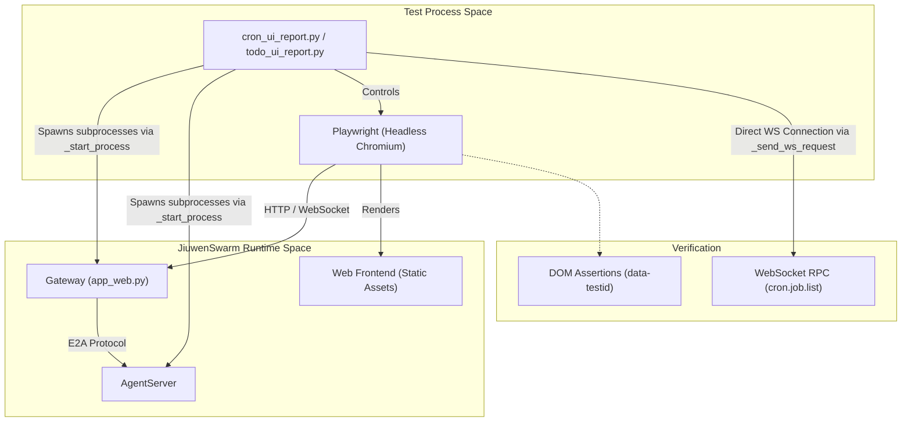
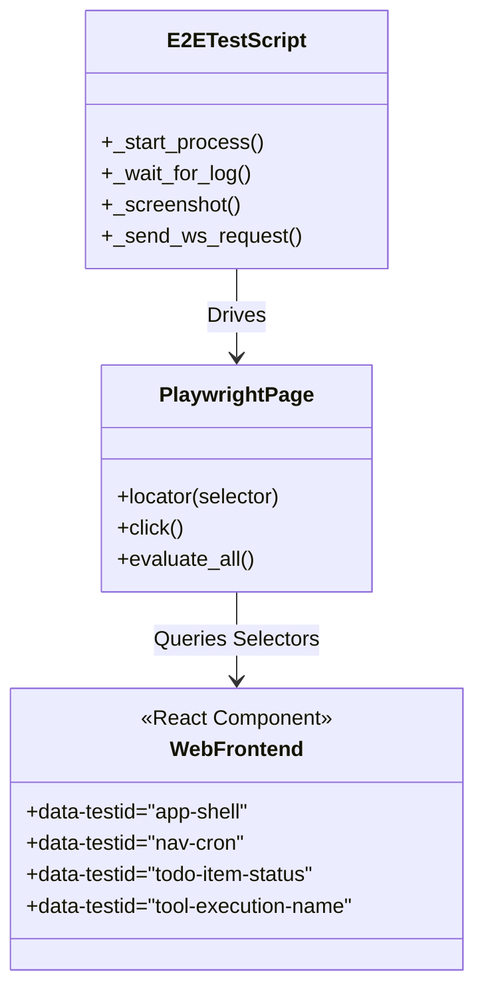

<!-- source: DeepWiki mcp.deepwiki.com · repo openJiuwen-ai/jiuwenswarm · page 12.2 UI End-to-End Tests · fetched 2026-11-02 -->

# UI End-to-End Tests

Relevant source files

The following files were used as context for generating this wiki page:

- [TESTING.md](TESTING.md)
- [docker/Dockerfile.claw](docker/Dockerfile.claw)
- [docker/Dockerfile.claw.base](docker/Dockerfile.claw.base)
- [run_tests.sh](run_tests.sh)
- [tests/README.md](tests/README.md)
- [tests/__init__.py](tests/__init__.py)
- [tests/conftest.py](tests/conftest.py)
- [tests/ui_e2e/cron_ui_report.py](tests/ui_e2e/cron_ui_report.py)
- [tests/ui_e2e/todo_ui_report.py](tests/ui_e2e/todo_ui_report.py)

The UI End-to-End (e2e) test suite provides automated validation of the JiuwenSwarm system by simulating real user interactions through the Web Frontend. These tests verify the entire stack, from the React UI components to the Gateway routing and the AgentServer's reasoning loops.

## Overview of E2E Infrastructure

The e2e suite utilizes **Playwright** to drive a headless browser (Chromium) and interacts with a live running instance of the system. Unlike unit tests, these scripts orchestrate the lifecycle of the backend processes before executing test scenarios.

### Key Components

| Component | Description |
|:---|:---|
| **Playwright** | Browser automation library used to interact with the DOM and capture screenshots [tests/ui_e2e/cron_ui_report.py:20](). |
| **Process Orchestration** | Scripts dynamically allocate free ports and spawn `app_web.py` and `AgentServer` processes [tests/ui_e2e/cron_ui_report.py:69-105](). |
| **Runtime Resolution** | Utilities in `runtime_openjiuwen.py` locate the correct Python interpreter and repository paths [tests/ui_e2e/cron_ui_report.py:23-33](). |
| **Report Generator** | Captures screenshots and generates Markdown reports containing execution details, logs, and system HEAD commits [tests/ui_e2e/todo_ui_report.py:222-250](). |

Sources: [tests/ui_e2e/cron_ui_report.py:1-120](), [tests/ui_e2e/todo_ui_report.py:1-100]()

## Data Flow and Architecture

The following diagram illustrates how the E2E test scripts interact with the JiuwenSwarm ecosystem.

### E2E Test Execution Flow

Sources: [tests/ui_e2e/cron_ui_report.py:95-105](), [tests/ui_e2e/cron_ui_report.py:148-150](), [tests/ui_e2e/cron_ui_report.py:122-145](), [tests/ui_e2e/todo_ui_report.py:136-143]()

## Test Scripts Implementation

The suite currently focuses on two critical functional areas: Scheduled Tasks (Cron) and Task Management (Todo).

### 1. Cron UI Tests (`cron_ui_report.py`)
This script validates the lifecycle of scheduled jobs. It bypasses the UI for setup/cleanup using direct WebSocket RPC calls and uses the UI for functional verification.

*   **Job Cleanup**: Uses `cron.job.list` and `cron.job.delete` via a direct `websockets` connection to ensure a clean state [tests/ui_e2e/cron_ui_report.py:147-163]().
*   **UI Interaction**: Navigates to the Cron panel using the `[data-testid="nav-cron"]` selector [tests/ui_e2e/cron_ui_report.py:229]().
*   **Verification**: Checks for job existence and previews upcoming execution times using the `_preview_job` helper [tests/ui_e2e/cron_ui_report.py:184-199]().

### 2. Todo UI Tests (`todo_ui_report.py`)
This script tests the Agent's ability to manipulate the Todo list through the Chat interface.

*   **Session Establishment**: Waits for the `[data-testid="app-shell"]` to provide a valid `data-session-id` [tests/ui_e2e/todo_ui_report.py:136-141]().
*   **Tool Execution Monitoring**: Monitors DOM elements with `[data-testid^="tool-execution-"]` via `_read_tool_executions` to verify the agent is calling the correct tools [tests/ui_e2e/todo_ui_report.py:200-209]().
*   **State Assertion**: Scrapes the UI for todo items using `[data-testid^="todo-item-"]` via `_read_todos` to verify status and text [tests/ui_e2e/todo_ui_report.py:211-219]().

Sources: [tests/ui_e2e/cron_ui_report.py:147-230](), [tests/ui_e2e/todo_ui_report.py:135-220]()

## Developer Guide for Contributing Tests

### Test Environment Setup
The e2e suite is integrated into the general test infrastructure but requires specific browser drivers.
1.  **Install Dependencies**: Install the `test` extra which includes `pytest` and `playwright` [tests/README.md:17-20]().
2.  **Build Frontend**: The `Dockerfile.claw` demonstrates the requirement to run `npm run build` in the web frontend directory [docker/Dockerfile.claw:14-16]().
3.  **Execution**: Scripts can be run directly or via `pytest`. The `run_tests.sh` script provides a unified entry point for running tests with coverage [run_tests.sh:81-87]().

### Mapping Natural Language to Code Entities
The e2e tests rely on specific `data-testid` attributes in the React frontend to identify components.

| NL Concept | Code Entity (Data Test ID) | Usage in Test |
|:---|:---|:---|
| Navigation Bar | `nav-cron` | Switching to the Cron management view [tests/ui_e2e/cron_ui_report.py:229](). |
| Tool Call | `tool-execution-{name}` | Verifying agent tool selection status [tests/ui_e2e/todo_ui_report.py:201](). |
| Todo Item | `todo-item-{id}` | Asserting task state and text content [tests/ui_e2e/todo_ui_report.py:212](). |
| App Shell | `app-shell` | Retrieving current `session_id` [tests/ui_e2e/todo_ui_report.py:136](). |

### Code Mapping Diagram

### Best Practices
*   **Port Management**: Always use `_pick_free_port()` to dynamically bind to available ports, preventing collisions [tests/ui_e2e/cron_ui_report.py:69-72]().
*   **Log Waiting**: Use `_wait_for_log()` to poll service logs for a "needle" string (e.g., "Uvicorn running on...") before attempting UI interaction [tests/ui_e2e/cron_ui_report.py:108-119]().
*   **Screenshots**: Capture screenshots on failure or for reporting using the `_screenshot` utility, which handles standard Playwright screenshots and CDP-based fallbacks [tests/ui_e2e/todo_ui_report.py:146-198]().
*   **Workspace Isolation**: Tests should utilize `temp_workspace` fixtures or similar logic to avoid polluting the developer's local environment [tests/conftest.py:14-26]().

Sources: [tests/ui_e2e/cron_ui_report.py:69-119](), [tests/ui_e2e/todo_ui_report.py:146-219](), [tests/conftest.py:14-26](), [run_tests.sh:1-133]()

---

