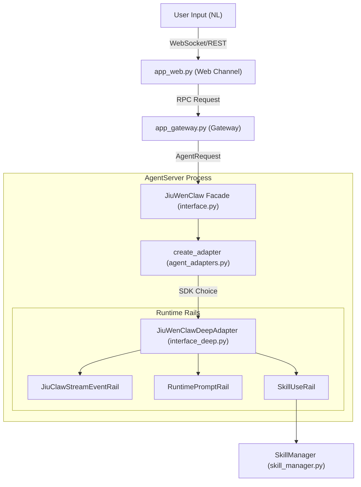
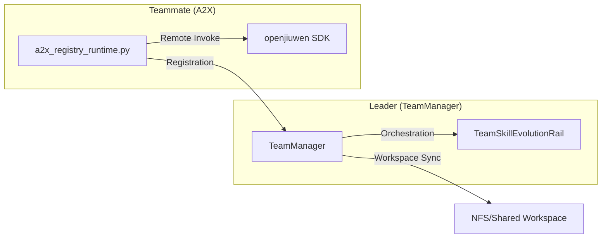

<!-- source: DeepWiki mcp.deepwiki.com · repo openJiuwen-ai/jiuwenswarm · page 13 Glossary · fetched 2026-11-02 -->

# Glossary

Relevant source files

The following files were used as context for generating this wiki page:

- [docs/en/CLI.md](docs/en/CLI.md)
- [docs/en/Modes.md](docs/en/Modes.md)
- [docs/en/SlashCommandArchitecture.md](docs/en/SlashCommandArchitecture.md)
- [docs/en/SlashCommands.md](docs/en/SlashCommands.md)
- [docs/zh/SLASH_COMMAND_ARCHITECTURE.md](docs/zh/SLASH_COMMAND_ARCHITECTURE.md)
- [jiuwenswarm/agents/harness/common/rails/stream_event_rail.py](jiuwenswarm/agents/harness/common/rails/stream_event_rail.py)
- [jiuwenswarm/agents/harness/team/__init__.py](jiuwenswarm/agents/harness/team/__init__.py)
- [jiuwenswarm/agents/harness/team/rails/team_member_skill_toolkit_rail.py](jiuwenswarm/agents/harness/team/rails/team_member_skill_toolkit_rail.py)
- [jiuwenswarm/agents/harness/team/rails/team_shared_skill_link_refresh_rail.py](jiuwenswarm/agents/harness/team/rails/team_shared_skill_link_refresh_rail.py)
- [jiuwenswarm/agents/harness/team/team_skill_links.py](jiuwenswarm/agents/harness/team/team_skill_links.py)
- [jiuwenswarm/channels/tui/frontend/src/core/commands/builtins/statusline.ts](jiuwenswarm/channels/tui/frontend/src/core/commands/builtins/statusline.ts)
- [jiuwenswarm/channels/web/frontend/src/App.tsx](jiuwenswarm/channels/web/frontend/src/App.tsx)
- [jiuwenswarm/channels/web/frontend/src/components/ConfigPanel/index.tsx](jiuwenswarm/channels/web/frontend/src/components/ConfigPanel/index.tsx)
- [jiuwenswarm/channels/web/frontend/src/hooks/useWebSocket.ts](jiuwenswarm/channels/web/frontend/src/hooks/useWebSocket.ts)
- [jiuwenswarm/channels/web/frontend/src/i18n/locales/en.json](jiuwenswarm/channels/web/frontend/src/i18n/locales/en.json)
- [jiuwenswarm/channels/web/frontend/src/i18n/locales/zh.json](jiuwenswarm/channels/web/frontend/src/i18n/locales/zh.json)
- [jiuwenswarm/common/config.py](jiuwenswarm/common/config.py)
- [jiuwenswarm/server/runtime/agent_adapter/interface.py](jiuwenswarm/server/runtime/agent_adapter/interface.py)
- [jiuwenswarm/server/runtime/agent_adapter/interface_deep.py](jiuwenswarm/server/runtime/agent_adapter/interface_deep.py)
- [jiuwenswarm/server/runtime/skill/skill_manager.py](jiuwenswarm/server/runtime/skill/skill_manager.py)
- [jiuwenswarm/server/utils/stream_utils.py](jiuwenswarm/server/utils/stream_utils.py)
- [pyproject.toml](pyproject.toml)
- [tests/unit_tests/agentserver/test_skill_manager_enable_disable.py](tests/unit_tests/agentserver/test_skill_manager_enable_disable.py)
- [tests/unit_tests/agentserver/test_skill_manager_path_safety.py](tests/unit_tests/agentserver/test_skill_manager_path_safety.py)
- [tests/unit_tests/gateway/test_slash_command.py](tests/unit_tests/gateway/test_slash_command.py)
- [tests/unit_tests/test_app_web_handlers.py](tests/unit_tests/test_app_web_handlers.py)
- [tests/unit_tests/test_config.py](tests/unit_tests/test_config.py)
- [uv.lock](uv.lock)

This page provides a comprehensive technical glossary of terms, abbreviations, and domain concepts specific to the JiuwenSwarm codebase. It serves as an onboarding reference for engineers to map conceptual terms to their underlying implementation in the code.

## Core System Entities

### AgentServer
The primary backend process responsible for the LLM execution loop, tool invocation, and agent state management. It hosts the agent runtime and communicates with the Gateway via WebSocket.
*   **Implementation**: `jiuwenswarm.server.app_agentserver` [pyproject.toml:72-72]()
*   **Key Class**: `JiuWenClaw` facade [jiuwenswarm/server/runtime/agent_adapter/interface.py:3-9]()

### Gateway
The process that manages external communication channels (Web, IM, TUI) and routes messages to the `AgentServer`. It acts as a protocol translator between external platform events and the internal E2A format.
*   **Implementation**: `jiuwenswarm.gateway.app_gateway` [pyproject.toml:73-73]()

### E2A (External-to-Agent)
The standard communication protocol used between the Gateway and the AgentServer. It encapsulates requests into an envelope that includes session metadata, channel IDs, and the message payload.
*   **Models**: `AgentRequest`, `AgentResponse` [jiuwenswarm/server/runtime/agent_adapter/interface.py:38-38]()
*   **Logic**: `build_user_prompt` [jiuwenswarm/server/runtime/agent_adapter/interface.py:164-180]()

### Rail
An interception layer mounted on an agent to provide specific capabilities or guardrails (e.g., security, memory, skill usage). Rails wrap the core execution loop.
*   **Implementation**: `openjiuwen.harness.rails` [jiuwenswarm/server/runtime/agent_adapter/interface_deep.py:54-64]()
*   **Examples**: `SecurityRail`, `SkillEvolutionRail`, `HeartbeatRail`, `MemoryRail` [jiuwenswarm/server/runtime/agent_adapter/interface_deep.py:57-63]()

---

## Agent Modes & Operations

| Term | Definition | Implementation Pointer |
| :--- | :--- | :--- |
| **Plan Mode** | A high-reasoning mode (`agent.plan`) where the agent uses a ReAct loop to decompose tasks. | `jiuwenswarm/server/runtime/agent_adapter/interface_deep.py` |
| **Code Mode** | A specialized mode for software engineering, utilizing `JiuwenClawCodeAdapter`. | `jiuwenswarm/server/runtime/agent_adapter/agent_adapters.py` |
| **Team Mode** | Multi-agent orchestration where a Leader manages Teammates. | `jiuwenswarm/agents/harness/team/` [jiuwenswarm/server/runtime/agent_adapter/interface_deep.py:102-106]() |
| **Auto-Harness** | An automated pipeline for repository assessment and optimization. | `AutoHarnessService` [jiuwenswarm/server/runtime/agent_adapter/interface_deep.py:108-108]() |

### System Mapping: Natural Language to Code Entity

The following diagram bridges conceptual user requests to the specific code classes that handle them.

**Diagram: Request Flow Mapping**

**Sources**: [jiuwenswarm/server/runtime/agent_adapter/interface.py:23-27](), [jiuwenswarm/server/runtime/agent_adapter/interface_deep.py:107-122](), [jiuwenswarm/server/runtime/skill/skill_manager.py:3-43]()

---

## Memory & Skills

### Skill Evolution
The process where the agent autonomously refines its capabilities based on feedback or error signals.
*   **Logic**: `SkillEvolutionRail` [jiuwenswarm/server/runtime/agent_adapter/interface_deep.py:58-58]()
*   **Helper**: `evolution_helpers.py` [jiuwenswarm/server/runtime/agent_adapter/interface_deep.py:147-175]()

### SkillManager
The component responsible for the lifecycle of agent skills, including discovery, installation from SkillNet/ClawHub, and marketplace management.
*   **Implementation**: `SkillManager` [jiuwenswarm/server/runtime/skill/skill_manager.py:3-43]()
*   **Marketplace**: `handle_skills_marketplace_list` [jiuwenswarm/server/runtime/agent_adapter/interface.py:105-105]()

### Project Memory
Context derived from local workspace files, indexed for hybrid search.
*   **Configuration**: `is_memory_enabled` [jiuwenswarm/server/runtime/agent_adapter/interface_deep.py:138-138]()
*   **Tooling**: `MemoryRail` [jiuwenswarm/server/runtime/agent_adapter/interface_deep.py:63-63]()

---

## Infrastructure & Lifecycle

### ACP (Agent Control Protocol)
A specialized channel protocol used by client plugins (like IDE extensions or the TUI) to handle tool responses and terminal interactions.
*   **Entry**: `app_acp.py` [pyproject.toml:78-78]()
*   **Connection**: `acp_connect.py` [pyproject.toml:79-79]()

### Cron Scheduler
A service for managing recurring tasks that can be triggered by the agent or system.
*   **Bridge**: `CronRuntimeBridge` [jiuwenswarm/server/runtime/agent_adapter/interface_deep.py:107-107]()
*   **Panel**: `CronPanel` [jiuwenswarm/channels/web/frontend/src/App.tsx:15-15]()

### Heartbeat
A background service that maintains channel activity and executes scheduled tasks.
*   **Configuration**: `HeartbeatRail` [jiuwenswarm/server/runtime/agent_adapter/interface_deep.py:62-62]()

**Diagram: Team Mode Distributed Runtime**

**Sources**: [jiuwenswarm/server/runtime/agent_adapter/interface_deep.py:102-106](), [jiuwenswarm/server/runtime/agent_adapter/evolution_helpers.py:151-153]()

---

## Technical Abbreviations

| Abbreviation | Full Term | Context |
| :--- | :--- | :--- |
| **LTM** | Long-Term Memory | Persistent vector/KV storage for agents. |
| **MCP** | Model Context Protocol | Standard for connecting agents to external data sources. |
| **TUI** | Terminal User Interface | Command-line frontend for JiuwenSwarm [pyproject.toml:78-80](). |
| **A2X** | Agent-to-External | Distributed teammate registration and remote member bootstrapping [jiuwenswarm/server/runtime/agent_adapter/interface_deep.py:102-106](). |
| **E2A** | External-to-Agent | Protocol bridging Gateway channels to AgentServer [jiuwenswarm/server/runtime/agent_adapter/interface.py:29-32](). |

**Sources**: [jiuwenswarm/server/runtime/agent_adapter/interface.py:1-131](), [jiuwenswarm/server/runtime/agent_adapter/interface_deep.py:1-186](), [jiuwenswarm/server/runtime/skill/skill_manager.py:1-112](), [pyproject.toml:1-82]()