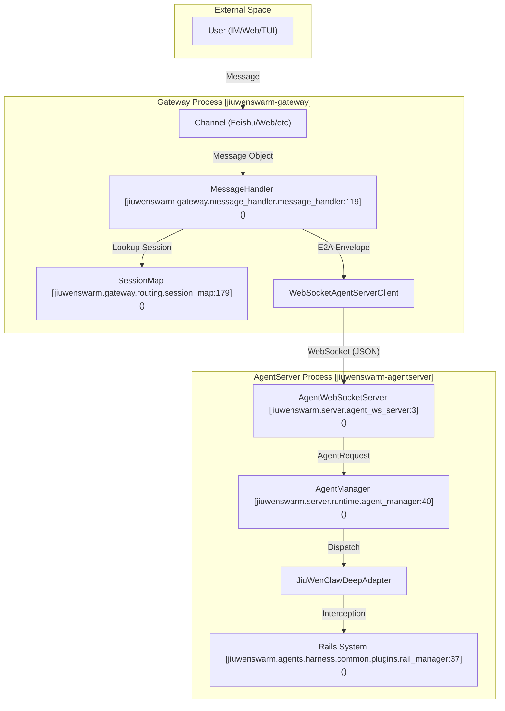

<!-- source: DeepWiki mcp.deepwiki.com · repo openJiuwen-ai/jiuwenswarm · page 2 Core Architecture · fetched 2026-11-02 -->

# Core Architecture

<details>
<summary>Relevant source files</summary>

The following files were used as context for generating this wiki page:

- [jiuwenswarm/agents/harness/common/auto_harness/config_validator.py](jiuwenswarm/agents/harness/common/auto_harness/config_validator.py)
- [jiuwenswarm/agents/harness/common/auto_harness/scheduler.py](jiuwenswarm/agents/harness/common/auto_harness/scheduler.py)
- [jiuwenswarm/agents/harness/common/auto_harness/service.py](jiuwenswarm/agents/harness/common/auto_harness/service.py)
- [jiuwenswarm/agents/harness/common/tools/bash_tool_safety.py](jiuwenswarm/agents/harness/common/tools/bash_tool_safety.py)
- [jiuwenswarm/agents/harness/common/tools/command_tools.py](jiuwenswarm/agents/harness/common/tools/command_tools.py)
- [jiuwenswarm/channels/tui/frontend/src/core/commands/builtins/auto-harness.ts](jiuwenswarm/channels/tui/frontend/src/core/commands/builtins/auto-harness.ts)
- [jiuwenswarm/channels/tui/frontend/src/ui/screen-layout.ts](jiuwenswarm/channels/tui/frontend/src/ui/screen-layout.ts)
- [jiuwenswarm/channels/tui/frontend/src/ui/transcript-entry-selection.ts](jiuwenswarm/channels/tui/frontend/src/ui/transcript-entry-selection.ts)
- [jiuwenswarm/channels/tui/frontend/src/ui/transcript-renderer.ts](jiuwenswarm/channels/tui/frontend/src/ui/transcript-renderer.ts)
- [jiuwenswarm/channels/web/frontend/src/components/HarnessPackagePanel/index.tsx](jiuwenswarm/channels/web/frontend/src/components/HarnessPackagePanel/index.tsx)
- [jiuwenswarm/channels/web/frontend/src/components/ToolPanel/HarnessExtensionTree.tsx](jiuwenswarm/channels/web/frontend/src/components/ToolPanel/HarnessExtensionTree.tsx)
- [jiuwenswarm/channels/web/frontend/src/services/webClient.ts](jiuwenswarm/channels/web/frontend/src/services/webClient.ts)
- [jiuwenswarm/channels/web/frontend/src/stores/chatStore.ts](jiuwenswarm/channels/web/frontend/src/stores/chatStore.ts)
- [jiuwenswarm/channels/web/frontend/src/stores/harnessStore.ts](jiuwenswarm/channels/web/frontend/src/stores/harnessStore.ts)
- [jiuwenswarm/channels/web/frontend/src/stores/index.ts](jiuwenswarm/channels/web/frontend/src/stores/index.ts)
- [jiuwenswarm/common/e2a/gateway_normalize.py](jiuwenswarm/common/e2a/gateway_normalize.py)
- [jiuwenswarm/common/schema/message.py](jiuwenswarm/common/schema/message.py)
- [jiuwenswarm/gateway/app_gateway.py](jiuwenswarm/gateway/app_gateway.py)
- [jiuwenswarm/gateway/channel_manager/tui/tui_connect.py](jiuwenswarm/gateway/channel_manager/tui/tui_connect.py)
- [jiuwenswarm/gateway/channel_manager/web/app_web_handlers.py](jiuwenswarm/gateway/channel_manager/web/app_web_handlers.py)
- [jiuwenswarm/gateway/channel_manager/web/web_connect.py](jiuwenswarm/gateway/channel_manager/web/web_connect.py)
- [jiuwenswarm/gateway/message_handler/message_handler.py](jiuwenswarm/gateway/message_handler/message_handler.py)
- [jiuwenswarm/server/agent_ws_server.py](jiuwenswarm/server/agent_ws_server.py)
- [jiuwenswarm/server/app_agentserver.py](jiuwenswarm/server/app_agentserver.py)

</details>


JiuwenSwarm utilizes a split-process architecture designed to decouple the high-performance agent runtime from the diverse communication channels (IM platforms, Web, TUI). This design ensures that heavy LLM orchestration and tool execution logic do not block the message-routing gateway, and allows for multi-instance isolation and independent scaling.

### System Topology

The system is primarily composed of two main processes: the **AgentServer** and the **Gateway**. These processes communicate via a specialized WebSocket protocol and share a common workspace directory.

#### High-Level Component Interaction
The following diagram illustrates how messages flow from an external user through the Gateway to the Agent runtime, highlighting the association between logical components and code entities.

**Diagram: Message Flow and Process Boundaries**

**Sources:** [jiuwenswarm/gateway/message_handler/message_handler.py:119-150](), [jiuwenswarm/server/agent_ws_server.py:3-20](), [jiuwenswarm/server/runtime/agent_manager.py:40]()

---

### Process Roles

#### 1. AgentServer (`jiuwenswarm-agentserver`)
The AgentServer is the heavy-lifting process. It hosts the `AgentManager` which manages the lifecycle of various agent modes (Fast, Plan, Code, Team).
- **Core Entity:** `AgentWebSocketServer` [jiuwenswarm/server/agent_ws_server.py:3]() acts as the entry point for the Gateway.
- **Responsibility:** LLM reasoning loops, tool execution (Skills), memory management, and Rail orchestration. It also manages specialized services like `AutoHarnessService` [jiuwenswarm/agents/harness/common/auto_harness/service.py:170]() for repository optimization.
- **For details, see [AgentServer and Agent Adapters](#2.1)**.

#### 2. Gateway (`jiuwenswarm-gateway`)
The Gateway is a lightweight process responsible for maintaining connections to external platforms.
- **Core Entity:** `MessageHandler` [jiuwenswarm/gateway/message_handler/message_handler.py:119]() coordinates the dual queues (`_user_messages` and `_robot_messages`).
- **Responsibility:** Message normalization, slash command parsing (`\new_session`, `\mode`), and routing messages to the correct `session_id`. It handles multiple channel types including `WebChannel` [jiuwenswarm/gateway/channel_manager/web/web_connect.py:55]() and TUI connections.
- **For details, see [Gateway and Message Routing](#2.2)**.

---

### E2A Protocol and Communication

The **E2A (External-to-Agent)** protocol is the "glue" between the Gateway and AgentServer. It encapsulates messages into envelopes that carry metadata, session context, and routing information.

| Entity | Role in Protocol | Code Reference |
| :--- | :--- | :--- |
| `E2AEnvelope` | Standard message container for cross-process wire format. | [jiuwenswarm/common/e2a/models.py:28]() |
| `AgentRequest` | Normalized request object used within the AgentServer. | [jiuwenswarm/common/schema/agent.py:34]() |
| `SessionMap` | Maps external identities to internal `session_id`. | [jiuwenswarm/gateway/routing/session_map.py:179]() |
| `ReqMethod` | Enum defining all supported cross-process operations. | [jiuwenswarm/common/schema/message.py:10]() |

**Diagram: Protocol Data Mapping**
```mermaid
classDiagram
    class E2AEnvelope {
        +request_id: str
        +session_id: str
        +payload: dict
        +metadata: dict
    }
    class Message {
        +content: str
        +channel_id: str
        +user_infos: dict
    }
    class AgentRequest {
        +request_id: str
        +params: dict
        +is_stream: bool
    }

    Message --|> E2AEnvelope : "Normalized by MessageHandler [jiuwenswarm.gateway.message_handler.message_handler:112]()"
    E2AEnvelope --|> AgentRequest : "Parsed by e2a_to_agent_request [jiuwenswarm.common.e2a.agent_compat:22]()"
```
**Sources:** [jiuwenswarm/common/e2a/models.py:28](), [jiuwenswarm/common/schema/agent.py:34](), [jiuwenswarm/common/schema/message.py:10-180]()

- **For details, see [E2A Protocol and Session Management](#2.3)**.

---

### Rails and Interception

Every request processed by the `AgentAdapter` passes through a **Rails System**. Rails are interceptors that can modify the prompt, validate tool usage, or interrupt the flow to ask for user permission.

Key built-in rails managed by `rail_manager` [jiuwenswarm/agents/harness/common/plugins/rail_manager.py:37]() include:
- `SecurityRail`: Filters sensitive output and blocks forbidden memory patterns.
- `PermissionInterruptRail`: Pauses execution for HIGH-severity tool permissions.
- `StreamEventRail`: Standardizes the streaming of events (tool calls, thoughts) to the frontend.
- `ProjectMemoryRail`: Injects relevant project context into the LLM prompt.

- **For details, see [Rails System](#2.4)**.

---

### Workspace and Persistence

Both processes share a common root directory. This shared state allows the Gateway to read configuration while the AgentServer persists session history and skill states.

| Path Component | Purpose | Code Reference |
| :--- | :--- | :--- |
| `config.yaml` | Main system configuration (Models, Channels, Memory). | [jiuwenswarm/common/config.py:52]() |
| `sessions/` | SQLite databases for session history and metadata. | [jiuwenswarm/common/utils.py:21]() |
| `auto-harness/` | Data for the AutoHarness optimization subsystem. | [jiuwenswarm/agents/harness/common/auto_harness/service.py:70]() |
| `skills/` | Installed skill packages and their states. | [jiuwenswarm/common/schema/message.py:73]() |

**Sources:** [jiuwenswarm/common/utils.py:21-25](), [jiuwenswarm/common/config.py:26-71](), [jiuwenswarm/agents/harness/common/auto_harness/service.py:70-76]()

---

### Child Pages
- [AgentServer and Agent Adapters](#2.1) — AgentWebSocketServer, JiuWenClaw facade, and adapters.
- [Gateway and Message Routing](#2.2) — MessageHandler, channel manager, and slash commands.
- [E2A Protocol and Session Management](#2.3) — Envelope formats, session lifecycles, and mapping.
- [Rails System](#2.4) — Interception framework and built-in guardrails.

---

