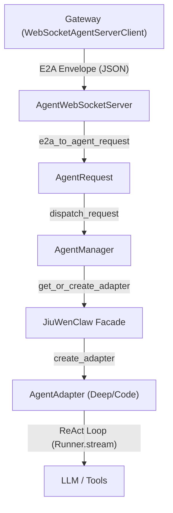
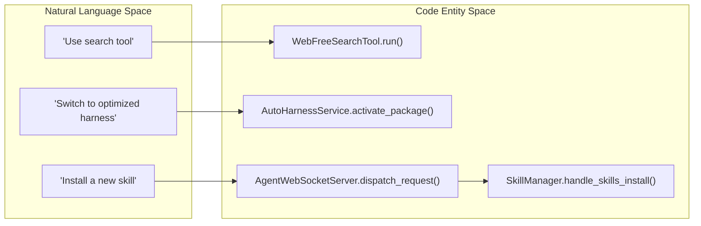

<!-- source: DeepWiki mcp.deepwiki.com · repo openJiuwen-ai/jiuwenswarm · page 2.1 AgentServer and Agent Adapters · fetched 2026-11-02 -->

# AgentServer and Agent Adapters

Relevant source files

The following files were used as context for generating this wiki page:

- [deploy/func/clawee.py](deploy/func/clawee.py)
- [jiuwenswarm/agents/harness/common/auto_harness/config_validator.py](jiuwenswarm/agents/harness/common/auto_harness/config_validator.py)
- [jiuwenswarm/agents/harness/common/auto_harness/scheduler.py](jiuwenswarm/agents/harness/common/auto_harness/scheduler.py)
- [jiuwenswarm/agents/harness/common/auto_harness/service.py](jiuwenswarm/agents/harness/common/auto_harness/service.py)
- [jiuwenswarm/agents/harness/common/rails/stream_event_rail.py](jiuwenswarm/agents/harness/common/rails/stream_event_rail.py)
- [jiuwenswarm/agents/harness/team/__init__.py](jiuwenswarm/agents/harness/team/__init__.py)
- [jiuwenswarm/agents/harness/team/rails/team_member_skill_toolkit_rail.py](jiuwenswarm/agents/harness/team/rails/team_member_skill_toolkit_rail.py)
- [jiuwenswarm/agents/harness/team/rails/team_shared_skill_link_refresh_rail.py](jiuwenswarm/agents/harness/team/rails/team_shared_skill_link_refresh_rail.py)
- [jiuwenswarm/agents/harness/team/team_skill_links.py](jiuwenswarm/agents/harness/team/team_skill_links.py)
- [jiuwenswarm/channels/tui/frontend/src/core/commands/builtins/auto-harness.ts](jiuwenswarm/channels/tui/frontend/src/core/commands/builtins/auto-harness.ts)
- [jiuwenswarm/channels/web/frontend/src/components/HarnessPackagePanel/index.tsx](jiuwenswarm/channels/web/frontend/src/components/HarnessPackagePanel/index.tsx)
- [jiuwenswarm/channels/web/frontend/src/components/ToolPanel/HarnessExtensionTree.tsx](jiuwenswarm/channels/web/frontend/src/components/ToolPanel/HarnessExtensionTree.tsx)
- [jiuwenswarm/channels/web/frontend/src/hooks/useWebSocket.ts](jiuwenswarm/channels/web/frontend/src/hooks/useWebSocket.ts)
- [jiuwenswarm/channels/web/frontend/src/stores/harnessStore.ts](jiuwenswarm/channels/web/frontend/src/stores/harnessStore.ts)
- [jiuwenswarm/channels/web/frontend/src/stores/index.ts](jiuwenswarm/channels/web/frontend/src/stores/index.ts)
- [jiuwenswarm/gateway/channel_manager/tui/tui_connect.py](jiuwenswarm/gateway/channel_manager/tui/tui_connect.py)
- [jiuwenswarm/gateway/channel_manager/web/app_web_handlers.py](jiuwenswarm/gateway/channel_manager/web/app_web_handlers.py)
- [jiuwenswarm/server/agent_ws_server.py](jiuwenswarm/server/agent_ws_server.py)
- [jiuwenswarm/server/runtime/agent_adapter/interface.py](jiuwenswarm/server/runtime/agent_adapter/interface.py)
- [jiuwenswarm/server/runtime/agent_adapter/interface_deep.py](jiuwenswarm/server/runtime/agent_adapter/interface_deep.py)
- [jiuwenswarm/server/runtime/agent_manager.py](jiuwenswarm/server/runtime/agent_manager.py)
- [jiuwenswarm/server/runtime/skill/skill_manager.py](jiuwenswarm/server/runtime/skill/skill_manager.py)
- [jiuwenswarm/server/runtime/tenant_agent_pool.py](jiuwenswarm/server/runtime/tenant_agent_pool.py)
- [jiuwenswarm/server/utils/stream_utils.py](jiuwenswarm/server/utils/stream_utils.py)
- [tests/unit_tests/agentserver/test_skill_manager_enable_disable.py](tests/unit_tests/agentserver/test_skill_manager_enable_disable.py)
- [tests/unit_tests/agentserver/test_skill_manager_path_safety.py](tests/unit_tests/agentserver/test_skill_manager_path_safety.py)

The AgentServer is the core execution process of JiuwenSwarm, responsible for managing the lifecycle of agents, orchestrating their reasoning loops, and interfacing with the underlying LLM and tool ecosystems. It operates as a WebSocket server that receives structured requests from the Gateway and executes them using specialized adapters for different operating modes (General Agent, Code, or Team).

## AgentWebSocketServer

The `AgentWebSocketServer` acts as the network entry point for the AgentServer process. It maintains a persistent connection with the Gateway's `WebSocketAgentServerClient`.

### Implementation and Lifecycle
*   **Message Normalization**: It converts incoming `E2AEnvelope` data into internal `AgentRequest` objects using `e2a_to_agent_request` [jiuwenswarm/server/agent_ws_server.py:22-22]().
*   **Heartbeat Mechanism**: To prevent WebSocket timeouts during long-running LLM generation or tool execution, it implements a streaming heartbeat (default 10s) [jiuwenswarm/server/agent_ws_server.py:84-86]().
*   **History Management**: It handles the restoration of history for the UI, filtering for restorable event types like `chat.final` and `team.message` [jiuwenswarm/server/agent_ws_server.py:89-100]().
*   **Project Resolution**: It resolves the stable project identity for agent construction, prioritizing `project_dir` from request parameters [jiuwenswarm/server/agent_ws_server.py:162-171]().

### Data Flow: Gateway to Agent
The following diagram illustrates how a message travels from the network into the agent's reasoning loop.

**Diagram: Request Ingestion Pipeline**

Sources: [jiuwenswarm/server/agent_ws_server.py:22-34](), [jiuwenswarm/server/runtime/agent_manager.py:40-41](), [jiuwenswarm/server/runtime/agent_adapter/interface.py:23-27]()

## JiuWenClaw Facade and Adapters

The `JiuWenClaw` facade (implemented in `interface.py`) provides a unified API for the `AgentManager` while abstracting the complexities of different SDK adapters.

### Adapter Hierarchy
1.  **AgentAdapter (Base)**: Defines the protocol for initialization and message processing [jiuwenswarm/server/runtime/agent_adapter/agent_adapters.py:24-27]().
2.  **JiuWenClawDeepAdapter**: The standard adapter for `agent.plan` and `agent.fast` modes. It leverages the `openjiuwen` core for ReAct loops and manages specialized services like `AutoHarnessService` [jiuwenswarm/server/runtime/agent_adapter/interface_deep.py:3-7]().
3.  **JiuwenClawCodeAdapter**: A specialized adapter optimized for software engineering tasks. It adds specific rails and configuration for coding environments.

### Request Routing
The Facade routes requests based on the `ReqMethod`. It includes specific routing for:
*   **Skills Management**: Methods like `SKILLS_LIST`, `SKILLS_INSTALL`, and `SKILLS_EVOLUTION_STATUS` are routed to specialized handlers [jiuwenswarm/server/runtime/agent_adapter/interface.py:100-131]().
*   **Plugin Management**: Handlers for listing, installing, and toggling plugins [jiuwenswarm/server/runtime/agent_adapter/interface.py:133-140]().
*   **Slash Commands**: Specific logic to parse `/skills use` commands to extract skill names and queries [jiuwenswarm/server/runtime/agent_adapter/interface.py:147-162]().

Sources: [jiuwenswarm/server/runtime/agent_adapter/interface.py:95-140](), [jiuwenswarm/server/runtime/agent_adapter/interface_deep.py:3-7]()

## Rail Orchestration and Tool Registration

Rails are interception layers that wrap the agent's execution to provide security, memory injection, and event streaming.

### Core Rails in Deep Adapter
The `JiuWenClawDeepAdapter` initializes a comprehensive set of rails during its `Runner` setup [jiuwenswarm/server/runtime/agent_adapter/interface_deep.py:54-66]().

| Rail Name | Function | File Reference |
| :--- | :--- | :--- |
| `SecurityRail` | Enforces safety and security boundaries | [jiuwenswarm/server/runtime/agent_adapter/interface_deep.py:57-57]() |
| `SkillEvolutionRail` | Detects signals for skill improvement | [jiuwenswarm/server/runtime/agent_adapter/interface_deep.py:58-58]() |
| `ContextProcessorRail` | Manages context window and compression | [jiuwenswarm/server/runtime/agent_adapter/interface_deep.py:66-66]() |
| `JiuClawStreamEventRail` | Standardizes event emission and pause checks | [jiuwenswarm/agents/harness/common/rails/stream_event_rail.py:3-9]() |

### Tool Registration and Multimodal Support
Tools are registered dynamically based on configuration.
*   **Web Tools**: Support for `WebFreeSearchTool`, `WebPaidSearchTool`, and `WebFetchWebpageTool` [jiuwenswarm/server/runtime/agent_adapter/interface_deep.py:71-73]().
*   **Multimodal**: Dedicated configuration for audio, vision, and video models/tools [jiuwenswarm/server/runtime/agent_adapter/interface_deep.py:177-186]().
*   **Skill Toolkits**: `SkillToolkit` allows agents to use dynamically loaded skills managed by the `SkillManager` [jiuwenswarm/server/runtime/agent_adapter/interface_deep.py:187-187]().

Sources: [jiuwenswarm/server/runtime/agent_adapter/interface_deep.py:54-77](), [jiuwenswarm/agents/harness/common/rails/stream_event_rail.py:1-9]()

## Agent Lifecycle and Hot-Reload

The AgentServer supports hot-reloading of configurations and skills, primarily through the `AutoHarnessService` and `SkillManager`.

### AutoHarness and Package Management
The `AutoHarnessService` manages "harness packages" which are optimized agent configurations.
*   **Lifecycle Reset**: On startup, `reset_harness_packages_state` ensures the agent starts in "native" mode by clearing active package IDs [jiuwenswarm/agents/harness/common/auto_harness/service.py:82-108]().
*   **Hot Activation**: The `HarnessPackagePanel` in the frontend allows users to trigger `harness.activate` RPCs, which the service handles by loading new runtime paths and configurations [jiuwenswarm/channels/web/frontend/src/components/HarnessPackagePanel/index.tsx:172-186]().

### Skill Management
The `SkillManager` handles the dynamic lifecycle of skills:
*   **Discovery**: Scans builtin and marketplace directories [jiuwenswarm/server/runtime/skill/skill_manager.py:36-40]().
*   **Safety**: Implements `_safe_child_path` to prevent path traversal during skill installation [jiuwenswarm/server/runtime/skill/skill_manager.py:215-220]().
*   **Persistence**: Tracks enabled/disabled states in `skills_state.json` [jiuwenswarm/server/runtime/skill/skill_manager.py:103-111]().

**Diagram: Agent Entity Mapping**
This diagram maps Natural Language concepts to the Code Entity Space within the AgentServer.

Sources: [jiuwenswarm/server/agent_ws_server.py:22-40](), [jiuwenswarm/server/runtime/skill/skill_manager.py:3-15](), [jiuwenswarm/agents/harness/common/auto_harness/service.py:170-190]()

## Distributed Team Initialization (A2X)

In Team Mode, the AgentServer interacts with the A2X (Agent-to-Anything) registry to participate in distributed orchestration.

*   **Registration**: If the agent is configured as a teammate, `register_blank_agent_if_teammate` is called during adapter initialization [jiuwenswarm/server/runtime/agent_adapter/interface_deep.py:102-106]().
*   **Capability Negotiation**: The `AgentManager` defines default capabilities like `ACP_DEFAULT_CAPABILITIES` for communication [jiuwenswarm/server/runtime/agent_manager.py:40-40]().

Sources: [jiuwenswarm/server/runtime/agent_adapter/interface_deep.py:102-106](), [jiuwenswarm/server/runtime/agent_manager.py:40-40]()

---

