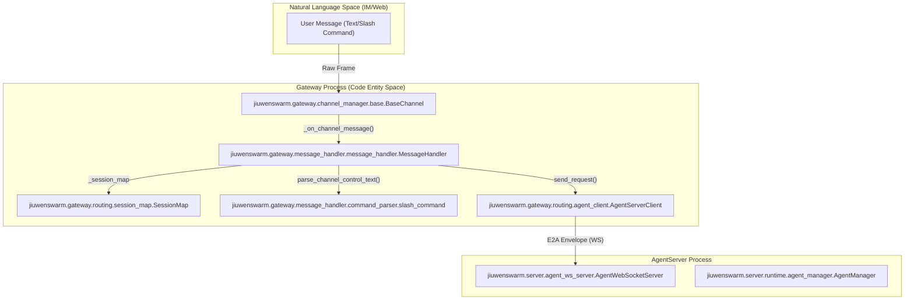
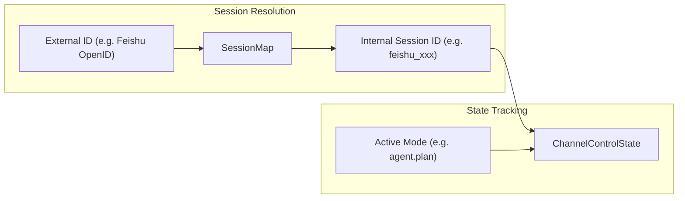

<!-- source: DeepWiki mcp.deepwiki.com · repo openJiuwen-ai/jiuwenswarm · page 2.2 Gateway and Message Routing · fetched 2026-11-02 -->

# Gateway and Message Routing

Relevant source files

The following files were used as context for generating this wiki page:

- [jiuwenswarm/agents/harness/common/tools/bash_tool_safety.py](jiuwenswarm/agents/harness/common/tools/bash_tool_safety.py)
- [jiuwenswarm/agents/harness/common/tools/command_tools.py](jiuwenswarm/agents/harness/common/tools/command_tools.py)
- [jiuwenswarm/channels/tui/frontend/src/ui/screen-layout.ts](jiuwenswarm/channels/tui/frontend/src/ui/screen-layout.ts)
- [jiuwenswarm/channels/tui/frontend/src/ui/transcript-entry-selection.ts](jiuwenswarm/channels/tui/frontend/src/ui/transcript-entry-selection.ts)
- [jiuwenswarm/channels/tui/frontend/src/ui/transcript-renderer.ts](jiuwenswarm/channels/tui/frontend/src/ui/transcript-renderer.ts)
- [jiuwenswarm/channels/web/frontend/src/services/webClient.ts](jiuwenswarm/channels/web/frontend/src/services/webClient.ts)
- [jiuwenswarm/channels/web/frontend/src/stores/chatStore.ts](jiuwenswarm/channels/web/frontend/src/stores/chatStore.ts)
- [jiuwenswarm/common/e2a/gateway_normalize.py](jiuwenswarm/common/e2a/gateway_normalize.py)
- [jiuwenswarm/common/schema/message.py](jiuwenswarm/common/schema/message.py)
- [jiuwenswarm/gateway/app_gateway.py](jiuwenswarm/gateway/app_gateway.py)
- [jiuwenswarm/gateway/channel_manager/channel_manager.py](jiuwenswarm/gateway/channel_manager/channel_manager.py)
- [jiuwenswarm/gateway/channel_manager/im_platforms/feishu/feishu_connect.py](jiuwenswarm/gateway/channel_manager/im_platforms/feishu/feishu_connect.py)
- [jiuwenswarm/gateway/channel_manager/web/web_connect.py](jiuwenswarm/gateway/channel_manager/web/web_connect.py)
- [jiuwenswarm/gateway/message_handler/message_handler.py](jiuwenswarm/gateway/message_handler/message_handler.py)
- [jiuwenswarm/server/app_agentserver.py](jiuwenswarm/server/app_agentserver.py)

The Gateway is a standalone process that serves as the communication hub of JiuwenSwarm. It bridges external communication channels (Web, IM platforms, ACP) to the `AgentServer` using a split-process architecture. Its primary responsibilities include message normalization, session mapping, slash command interception, and maintaining the E2A (External-to-Agent) protocol loop.

## Architecture Overview

The Gateway process is initialized in `jiuwenswarm/gateway/app_gateway.py` [jiuwenswarm/gateway/app_gateway.py:1-13](). It manages the `MessageHandler` and `ChannelManager` to route messages between users and agents.

### Core Components

| Component | Responsibility |
| :--- | :--- |
| `MessageHandler` | The central logic engine that manages inbound/outbound message queues and slash commands [jiuwenswarm/gateway/message_handler/message_handler.py:119-132](). |
| `ChannelManager` | Manages the lifecycle of various communication channels (Web, Feishu, etc.) [jiuwenswarm/gateway/channel_manager/channel_manager.py:22-28](). |
| `SessionMap` | Maintains the mapping between external platform IDs (e.g., Feishu OpenID) and internal session IDs [jiuwenswarm/gateway/message_handler/message_handler.py:179](). |
| `AgentServerClient` | A WebSocket client that connects the Gateway to the `AgentServer` [jiuwenswarm/gateway/message_handler/message_handler.py:145](). |

### Process Interaction Diagram

This diagram shows how the Gateway entities bridge the gap between a raw IM message and the Agent logic.

**Sources:** [jiuwenswarm/gateway/message_handler/message_handler.py:119-163](), [jiuwenswarm/gateway/channel_manager/channel_manager.py:58-68](), [jiuwenswarm/gateway/app_gateway.py:132-175]().

---

## Message Handling Pipeline

The `MessageHandler` uses a dual-queue system to decouple external channel IO from Agent processing [jiuwenswarm/gateway/message_handler/message_handler.py:121-128]().

### Inbound Flow (User to Agent)
1. **Reception**: A `BaseChannel` receives a message and calls the registered callback, which typically leads to `MessageHandler.handle_message(msg)` [jiuwenswarm/gateway/channel_manager/channel_manager.py:58-68]().
2. **Slash Command Parsing**: The handler uses `parse_channel_control_text` to check if the message is a local control command (e.g., `\new_session`, `\mode`) [jiuwenswarm/gateway/message_handler/message_handler.py:21-24]().
3. **Session Resolution**: Standard messages use `SessionMap` to resolve platform-specific identity to an internal `session_id` [jiuwenswarm/gateway/message_handler/message_handler.py:179]().
4. **Forwarding Loop**: The `_forward_task` task consumes messages from `_user_messages` and uses `AgentServerClient.send_request` to transmit messages to the AgentServer [jiuwenswarm/gateway/message_handler/message_handler.py:146-149]().

### Outbound Flow (Agent to User)
1. **Response Capture**: The `AgentServerClient` receives responses (e.g., `AgentResponse` or `AgentResponseChunk`) from the AgentServer.
2. **Normalization**: The response is converted into a `Message` object via `_response_to_message` or `_chunk_to_message` [jiuwenswarm/gateway/message_handler/message_handler.py:127-128]().
3. **Delivery**: The message is put into `_robot_messages` and consumed by the `ChannelManager` via `_dispatch_robot_messages` for delivery to the specific channel [jiuwenswarm/gateway/channel_manager/channel_manager.py:142-166]().

---

## Slash Command Parsing

The Gateway intercepts control commands that manage channel state. These are defined in `ReqMethod` [jiuwenswarm/common/schema/message.py:10-30]() and parsed using specialized logic.

### Supported Gateway Control Logic
The `MessageHandler` supports a variety of commands and request methods:
- **Session Management**: `SESSION_CREATE`, `SESSION_SWITCH`, `SESSION_DELETE`, `SESSION_FORK`, `SESSION_REWIND` [jiuwenswarm/common/schema/message.py:37-41]().
- **Mode Control**: Switching between `AGENT_PLAN`, `AGENT_FAST`, `TEAM`, etc. [jiuwenswarm/gateway/message_handler/message_handler.py:74-81]().
- **Slash Interception**: The `parse_channel_control_text` function identifies commands like `\new_session` or `\mode` from raw text input [jiuwenswarm/gateway/message_handler/message_handler.py:21-24]().

---

## Communication Channels

### Web Channel (WebSocket)
The `WebChannel` provides a specialized implementation for browser-based frontends [jiuwenswarm/gateway/channel_manager/web/web_connect.py:55-63]().
- **Method Handlers**: Supports registering custom handlers for specific `ReqMethod` types (e.g., `config.get`, `session.list`, `skills.list`) [jiuwenswarm/gateway/channel_manager/web/web_connect.py:90-96]().
- **File Processing**: Automatically handles file downloads and workspace mapping for incoming files in parameters [jiuwenswarm/gateway/channel_manager/web/web_connect.py:189-214]().

### IM Platform Channels (e.g., Feishu)
IM channels like `FeishuChannel` bridge third-party platforms [jiuwenswarm/gateway/channel_manager/im_platforms/feishu/feishu_connect.py:143-157]().
- **Message Dedup**: Uses `_message_dedup_cache` to prevent processing duplicate event notifications [jiuwenswarm/gateway/channel_manager/im_platforms/feishu/feishu_connect.py:183]().
- **Digital Avatar**: Supports group chat "digital avatar" logic where the agent monitors messages and responds when relevant [jiuwenswarm/gateway/channel_manager/im_platforms/feishu/feishu_connect.py:57-62]().

---

## Session and Identity Mapping

### SessionMap and Prefixes
The `SessionMap` handles identity persistence [jiuwenswarm/gateway/message_handler/message_handler.py:179](). It ensures that messages from the same IM user/group consistently map to the same internal session.
- **Prefixes**: Internal session IDs are often prefixed by channel type (e.g., `sess_`, `tui_`, `acp_`, `feishu_`, `wechat_`) to avoid collisions [jiuwenswarm/gateway/message_handler/message_handler.py:41-54]().
- **ACP Aliases**: For ACP (Agent Control Protocol) channels, the gateway maintains an `_acp_session_aliases` map to bridge external and internal session IDs [jiuwenswarm/gateway/message_handler/message_handler.py:161]().

### Channel Control State
The Gateway tracks per-channel state using `ChannelControlState`, which stores the active `session_id` and `ChannelMode` [jiuwenswarm/gateway/message_handler/message_handler.py:84-87]().

**Sources:** [jiuwenswarm/gateway/message_handler/message_handler.py:84-87](), [jiuwenswarm/gateway/message_handler/message_handler.py:178-179]().

**Sources:**
- `jiuwenswarm/gateway/message_handler/message_handler.py`
- `jiuwenswarm/gateway/channel_manager/channel_manager.py`
- `jiuwenswarm/gateway/app_gateway.py`
- `jiuwenswarm/common/schema/message.py`
- `jiuwenswarm/gateway/channel_manager/web/web_connect.py`
- `jiuwenswarm/gateway/channel_manager/im_platforms/feishu/feishu_connect.py`

---

