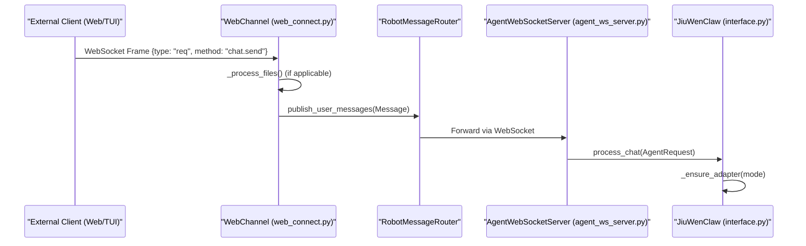
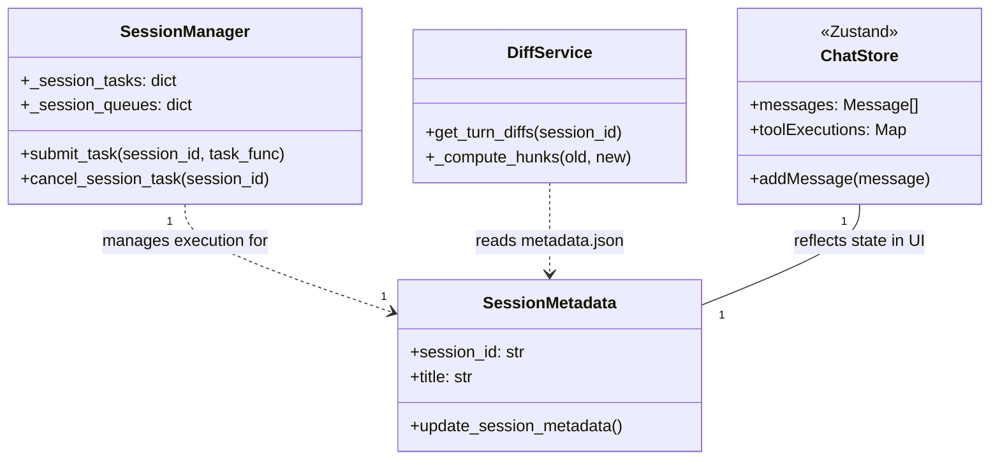

<!-- source: DeepWiki mcp.deepwiki.com · repo openJiuwen-ai/jiuwenswarm · page 2.3 E2A Protocol and Session Management · fetched 2026-11-02 -->

# E2A Protocol and Session Management

Relevant source files

The following files were used as context for generating this wiki page:

- [jiuwenswarm/agents/harness/common/memory/dreaming/__init__.py](jiuwenswarm/agents/harness/common/memory/dreaming/__init__.py)
- [jiuwenswarm/agents/harness/common/memory/dreaming/sweeper.py](jiuwenswarm/agents/harness/common/memory/dreaming/sweeper.py)
- [jiuwenswarm/channels/tui/frontend/src/core/commands/builtins/color.ts](jiuwenswarm/channels/tui/frontend/src/core/commands/builtins/color.ts)
- [jiuwenswarm/channels/tui/frontend/src/core/commands/builtins/diff.ts](jiuwenswarm/channels/tui/frontend/src/core/commands/builtins/diff.ts)
- [jiuwenswarm/channels/tui/frontend/src/core/commands/builtins/resume.ts](jiuwenswarm/channels/tui/frontend/src/core/commands/builtins/resume.ts)
- [jiuwenswarm/channels/tui/frontend/src/core/commands/builtins/rewind.ts](jiuwenswarm/channels/tui/frontend/src/core/commands/builtins/rewind.ts)
- [jiuwenswarm/channels/tui/frontend/src/core/tui-config-store.ts](jiuwenswarm/channels/tui/frontend/src/core/tui-config-store.ts)
- [jiuwenswarm/channels/tui/frontend/src/core/types.ts](jiuwenswarm/channels/tui/frontend/src/core/types.ts)
- [jiuwenswarm/channels/tui/frontend/src/ui/components/messages/diff-component.ts](jiuwenswarm/channels/tui/frontend/src/ui/components/messages/diff-component.ts)
- [jiuwenswarm/channels/tui/frontend/src/ui/theme.ts](jiuwenswarm/channels/tui/frontend/src/ui/theme.ts)
- [jiuwenswarm/channels/web/frontend/src/services/webClient.ts](jiuwenswarm/channels/web/frontend/src/services/webClient.ts)
- [jiuwenswarm/channels/web/frontend/src/stores/chatStore.ts](jiuwenswarm/channels/web/frontend/src/stores/chatStore.ts)
- [jiuwenswarm/common/e2a/gateway_normalize.py](jiuwenswarm/common/e2a/gateway_normalize.py)
- [jiuwenswarm/common/schema/message.py](jiuwenswarm/common/schema/message.py)
- [jiuwenswarm/gateway/channel_manager/web/web_connect.py](jiuwenswarm/gateway/channel_manager/web/web_connect.py)
- [jiuwenswarm/server/runtime/session/session_manager.py](jiuwenswarm/server/runtime/session/session_manager.py)
- [jiuwenswarm/server/runtime/session/session_metadata.py](jiuwenswarm/server/runtime/session/session_metadata.py)
- [jiuwenswarm/server/utils/diff_service.py](jiuwenswarm/server/utils/diff_service.py)
- [tests/system_tests/test_dreaming_e2e.py](tests/system_tests/test_dreaming_e2e.py)
- [tests/unit_tests/agentserver/memory/test_dreaming_sweeper.py](tests/unit_tests/agentserver/memory/test_dreaming_sweeper.py)
- [tests/unit_tests/agentserver/test_interface_interrupts.py](tests/unit_tests/agentserver/test_interface_interrupts.py)
- [tests/unit_tests/evolution/test_message.py](tests/unit_tests/evolution/test_message.py)

The External-to-Agent (E2A) protocol and the Agent Control Protocol (ACP) form the communication backbone of JiuwenSwarm. These protocols facilitate standardized interaction between external clients (IM platforms, IDE plugins, TUIs) and the multi-agent backend. Session management ensures that these interactions are stateful, persisted, and correctly routed across the split-process architecture.

## E2A Envelope and Message Routing

The E2A protocol uses a standardized `Message` envelope to wrap all communications. This envelope ensures that metadata such as `session_id`, `channel_id`, and `req_method` are preserved as messages move from the Gateway to the AgentServer.

### Message Structure
Messages are categorized into requests (`req`), responses (`res`), and events (`event`) [jiuwenswarm/common/schema/message.py:182-183](). Key fields include:
- `id`: A unique identifier for the request-response pair.
- `req_method`: The specific action (e.g., `CHAT_SEND`, `HISTORY_GET`) defined in the `ReqMethod` enum [jiuwenswarm/common/schema/message.py:10-30]().
- `params`: Payload for the request.
- `payload`: Data returned in a response or event.

### SessionMap and Identity Mapping
The Gateway maintains a mapping between external platform identities and internal `session_id`s. For the Web channel, this is handled by `WebChannel` which manages WebSocket client sets and routes incoming JSON frames to specific method handlers [jiuwenswarm/gateway/channel_manager/web/web_connect.py:55-74]().

### Data Flow: External to Agent
The following diagram illustrates how a message from an external client is transformed into a code entity and routed.

**Message Transformation and Routing**

Sources: [jiuwenswarm/gateway/channel_manager/web/web_connect.py:189-192](), [jiuwenswarm/gateway/channel_manager/web/web_connect.py:67-74](), [jiuwenswarm/server/runtime/agent_adapter/interface.py:9-11]().

## Agent Control Protocol (ACP)

ACP is a specialized subset of the E2A protocol designed for IDE integrations. It allows the agent to control the editor environment and receive tool responses back from the client.

### Key ACP Capabilities
- **Tool Responses**: Clients send `acp.tool_response` to provide results of local tool executions [jiuwenswarm/common/schema/message.py:12]().
- **Client-Side Rendering**: The protocol supports complex display types like `ToolCallDisplay` and `SubtaskState` to show progress in the client UI [jiuwenswarm/channels/tui/frontend/src/core/types.ts:43-81]().
- **Streaming State**: ACP clients track states such as `WaitingForConfirmation` when an agent hits a permission-guarded tool [jiuwenswarm/channels/tui/frontend/src/core/types.ts:1-7]().

## Session Lifecycle and Persistence

Sessions in JiuwenSwarm are persistent entities stored on disk. Each session contains metadata, conversation history, and runtime state.

### Session Metadata Management
Metadata is managed by `session_metadata.py`. To ensure high performance, it utilizes an asynchronous writing architecture:
- **Async Writes**: Metadata updates are queued in `_METADATA_QUEUE` and processed by a background `session-metadata-writer` thread [jiuwenswarm/server/runtime/session/session_metadata.py:18-22](), [jiuwenswarm/server/runtime/session/session_metadata.py:109-111]().
- **Memory Caching**: A `_METADATA_CACHE` protected by `_CACHE_LOCK` prevents race conditions where a read might return stale disk data before the async writer completes [jiuwenswarm/server/runtime/session/session_metadata.py:25-26]().
- **Title Generation**: Automatically generated from the first user message via `_auto_title`, capped at 50 characters [jiuwenswarm/server/runtime/session/session_metadata.py:126-132]().

### Metadata Fields
| Field | Description |
| :--- | :--- |
| `session_id` | Unique identifier for the session |
| `mode` | Current agent mode (e.g., `agent`, `code`, `team`) [jiuwenswarm/server/runtime/session/session_metadata.py:152]() |
| `accent_color` | UI customization stored per session [jiuwenswarm/server/runtime/session/session_metadata.py:172]() |
| `channel_metadata` | Platform-specific context like `cwd` (Current Working Directory) [jiuwenswarm/server/runtime/session/session_metadata.py:169]() |

Sources: [jiuwenswarm/server/runtime/session/session_metadata.py:144-156](), [jiuwenswarm/server/runtime/session/session_metadata.py:182-201]().

## History and State Management

### Session Task Control
The `SessionManager` handles the execution lifecycle of tasks within a session. It ensures that tasks are processed in a "Newest First" (LIFO) priority within a session's queue [jiuwenswarm/server/runtime/session/session_manager.py:20-24]().
- **Concurrency**: Multiple sessions can run tasks concurrently, but a single session processes its queue sequentially [jiuwenswarm/server/runtime/session/session_manager.py:88-90]().
- **Interruption**: The `cancel_session_task` method allows the system to terminate long-running LLM generations or tool executions [jiuwenswarm/server/runtime/session/session_manager.py:37-45]().

### Diff and Rewind Services
JiuwenSwarm provides advanced session manipulation through the `DiffService`:
- **Turn-based Diffs**: Computes file changes between user turns by comparing timestamps in `history.json` and agent operation logs [jiuwenswarm/server/utils/diff_service.py:20-39]().
- **Rewind/Fork**: Supports rolling back a session to a specific turn or branching it into a new session [jiuwenswarm/common/schema/message.py:41-43]().

**Session and History Entity Relationship**

Sources: [jiuwenswarm/server/runtime/session/session_manager.py:20-30](), [jiuwenswarm/server/runtime/session/session_metadata.py:1-10](), [jiuwenswarm/server/utils/diff_service.py:20-26](), [jiuwenswarm/channels/web/frontend/src/stores/chatStore.ts:56-72]().

### Interrupt Semantics
Interrupts (e.g., `CHAT_CANCEL`) are handled differently based on the mode. In `Team Mode`, the `TeamManager` is invoked to pause or cancel the entire multi-agent orchestration [tests/unit_tests/agentserver/test_interface_interrupts.py:30-36](). In standard modes, the `SessionManager` cancels the specific `asyncio.Task` associated with the session [jiuwenswarm/server/runtime/session/session_manager.py:45-51]().

Sources: [jiuwenswarm/server/runtime/session/session_manager.py:37-71](), [tests/unit_tests/agentserver/test_interface_interrupts.py:94-108]().

---

