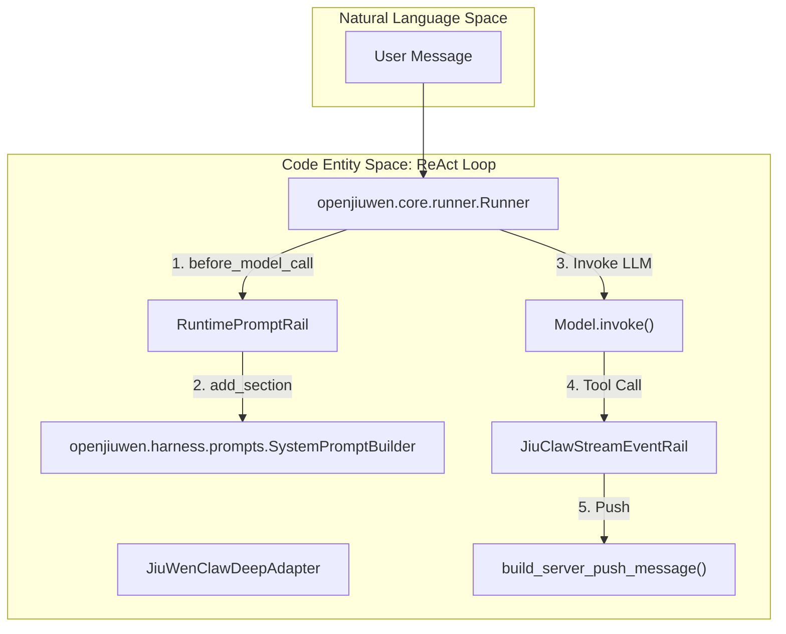
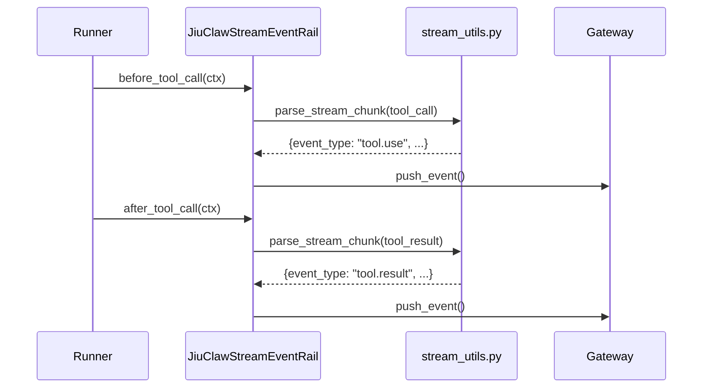

<!-- source: DeepWiki mcp.deepwiki.com · repo openJiuwen-ai/jiuwenswarm · page 2.4 Rails System · fetched 2026-11-02 -->

# Rails System

Relevant source files

The following files were used as context for generating this wiki page:

- [jiuwenswarm/agents/harness/code/prompt/__init__.py](jiuwenswarm/agents/harness/code/prompt/__init__.py)
- [jiuwenswarm/agents/harness/common/prompt/prompt_builder.py](jiuwenswarm/agents/harness/common/prompt/prompt_builder.py)
- [jiuwenswarm/agents/harness/common/prompt/shell_environment.py](jiuwenswarm/agents/harness/common/prompt/shell_environment.py)
- [jiuwenswarm/agents/harness/common/rails/ask_user_rail.py](jiuwenswarm/agents/harness/common/rails/ask_user_rail.py)
- [jiuwenswarm/agents/harness/common/rails/runtime_prompt_rail.py](jiuwenswarm/agents/harness/common/rails/runtime_prompt_rail.py)
- [jiuwenswarm/agents/harness/common/rails/stream_event_rail.py](jiuwenswarm/agents/harness/common/rails/stream_event_rail.py)
- [jiuwenswarm/agents/harness/common/tools/user_todo_tool.py](jiuwenswarm/agents/harness/common/tools/user_todo_tool.py)
- [jiuwenswarm/channels/web/frontend/src/hooks/useWebSocket.ts](jiuwenswarm/channels/web/frontend/src/hooks/useWebSocket.ts)
- [jiuwenswarm/server/runtime/agent_adapter/interface_deep.py](jiuwenswarm/server/runtime/agent_adapter/interface_deep.py)
- [jiuwenswarm/server/utils/stream_utils.py](jiuwenswarm/server/utils/stream_utils.py)
- [tests/unit/deep_agent/test_browser_subagent_integration.py](tests/unit/deep_agent/test_browser_subagent_integration.py)
- [tests/unit_tests/agentserver/test_system_prompt_restructure.py](tests/unit_tests/agentserver/test_system_prompt_restructure.py)

The Rails System in JiuwenSwarm is an interception framework built upon the `DeepAgentRail` architecture. It provides a modular way to inject logic into the agent's execution lifecycle, including prompt modification, tool call interception, security enforcement, and event streaming.

## Framework Architecture

Rails are mounted within the `AgentAdapter` (e.g., `JiuWenClawDeepAdapter` or `JiuWenClawCodeAdapter`) and executed by the underlying `Runner` [jiuwenswarm/server/runtime/agent_adapter/interface_deep.py:35-39](). Each rail implements specific hooks that trigger at different stages of the ReAct loop.

### Lifecycle Hooks
- `init`: Initializes the rail with the agent instance, often capturing a reference to the `SystemPromptBuilder` [jiuwenswarm/agents/harness/common/rails/runtime_prompt_rail.py:50-52]().
- `before_model_call`: Modifies the system prompt or inputs before sending them to the LLM [jiuwenswarm/agents/harness/common/rails/runtime_prompt_rail.py:126-128]().
- `before_tool_call`: Intercepts tool execution to validate permissions or block specific actions [jiuwenswarm/agents/harness/common/rails/stream_event_rail.py:65-74]().
- `after_tool_call`: Processes tool results before they are returned to the agent's context [jiuwenswarm/agents/harness/common/rails/stream_event_rail.py:150-160]().

### Rail Mounting and Orchestration
Rails are instantiated during the adapter setup [jiuwenswarm/server/runtime/agent_adapter/interface_deep.py:54-66](). The priority of execution is determined by the `priority` attribute of each rail class; lower values typically execute earlier in the hook chain [jiuwenswarm/agents/harness/common/rails/runtime_prompt_rail.py:31-31]().

**Rail Execution Flow**

Sources: [jiuwenswarm/server/runtime/agent_adapter/interface_deep.py:10-78](), [jiuwenswarm/agents/harness/common/rails/runtime_prompt_rail.py:126-147](), [jiuwenswarm/server/runtime/session/session_metadata.py:143-143]().

---

## Key Built-in Rails

### 1. Security and Permissions
*   **SecurityRail**: Provides foundational safety checks for LLM outputs and tool parameters [jiuwenswarm/server/runtime/agent_adapter/interface_deep.py:57-57]().
*   **PermissionInterruptRail**: Implements the tiered permission policy. It uses `build_permission_rail` to wrap sensitive tools and triggers `ask_user_question` events to seek manual approval [jiuwenswarm/agents/harness/common/rails/interrupt/interrupt_helpers.py:109-112]().

### 2. Memory Rails
*   **CodingMemoryRail & ProjectMemoryRail**: Specialized rails for Code Mode that manage the injection of relevant code snippets and project documentation.
*   **MemoryRail**: A general-purpose rail for handling short-term and long-term memory retrieval within the ReAct loop [jiuwenswarm/server/runtime/agent_adapter/interface_deep.py:63-63]().

### 3. Context and Prompt Management
*   **ContextProcessorRail**: Pre-processes raw context data before it is formatted into the prompt [jiuwenswarm/server/runtime/agent_adapter/interface_deep.py:66-66]().
*   **RuntimePromptRail**: Injects dynamic information like current time, OS details, current model name, and workspace status into the system prompt [jiuwenswarm/agents/harness/common/rails/runtime_prompt_rail.py:28-48](). It reads from `runtime_state.yaml` to ensure the LLM sees fresh data on every turn [jiuwenswarm/agents/harness/common/rails/runtime_prompt_rail.py:151-152]().
*   **ResponsePromptRail**: Injects the `response` section into the prompt, defining the message format and delivery rules (e.g., ensuring deliverables are in the final message) [jiuwenswarm/agents/harness/common/prompt/prompt_builder.py:123-127]().

### 4. Skill Evolution
*   **SkillUseRail**: Manages the discovery and selection of available skills [jiuwenswarm/server/runtime/agent_adapter/interface_deep.py:55-55]().
*   **SkillEvolutionRail & SkillCreateRail**: Detect signals that a new skill should be created or an existing one updated [jiuwenswarm/server/runtime/agent_adapter/interface_deep.py:58-59](). These rails manage the background evolution watcher and approval workflow.

### 5. Stream and Event Management
*   **StreamEventRail (`JiuClawStreamEventRail`)**: The primary bridge for real-time UI updates. It intercepts tool calls and results to emit `tool.use` and `tool.result` events [jiuwenswarm/agents/harness/common/rails/stream_event_rail.py:3-9](). It also handles `ask_user` tool calls by converting them into structured question payloads for the frontend [jiuwenswarm/agents/harness/common/rails/stream_event_rail.py:104-122]().

---

## Data Flow: Interception and Streaming

When an agent decides to use a tool, the `StreamEventRail` captures the intent and serializes it for the frontend using standard event types.

**Tool Interception Sequence**

Sources: [jiuwenswarm/agents/harness/common/rails/stream_event_rail.py:3-28](), [jiuwenswarm/server/utils/stream_utils.py:54-69]().

## Implementation Details

### Runtime Prompt Injection
The `RuntimePromptRail` ensures the agent is aware of its environment. It injects sections like `# 时间说明` (Time Description) and `# 运行时状态` (Runtime State) [jiuwenswarm/agents/harness/common/rails/runtime_prompt_rail.py:131-183](). This prevents the agent from hallucinating its own model type or current date.

### Stream Utility Parsing
The system uses `parse_stream_chunk` to normalize various SDK output formats (e.g., `OutputSchema`, `AgentResponseChunk`, or raw dicts) into a standard frontend-consumable dictionary [jiuwenswarm/server/utils/stream_utils.py:10-44](). This ensures that whether a rail emits a tool call or a reasoning block, the UI can render it correctly [jiuwenswarm/server/utils/stream_utils.py:185-195]().

### Rail Configuration Table

| Rail Class | Priority | Stage | Purpose |
| :--- | :--- | :--- | :--- |
| `RuntimePromptRail` | 5 | `before_model_call` | High-priority environment injection [jiuwenswarm/agents/harness/common/rails/runtime_prompt_rail.py:31-31]() |
| `SecurityRail` | 10 | `before_tool_call` | Safety guardrails and validation [jiuwenswarm/server/runtime/agent_adapter/interface_deep.py:57-57]() |
| `JiuClawStreamEventRail` | N/A | `before/after_tool` | Real-time UI event streaming [jiuwenswarm/agents/harness/common/rails/stream_event_rail.py:3-9]() |
| `SkillEvolutionRail` | N/A | `after_tool_call` | Skill discovery and evolution detection [jiuwenswarm/server/runtime/agent_adapter/interface_deep.py:58-58]() |

Sources: [jiuwenswarm/agents/harness/common/rails/runtime_prompt_rail.py:31-31](), [jiuwenswarm/server/runtime/agent_adapter/interface_deep.py:54-67](), [jiuwenswarm/agents/harness/common/rails/stream_event_rail.py:3-28]().

---

