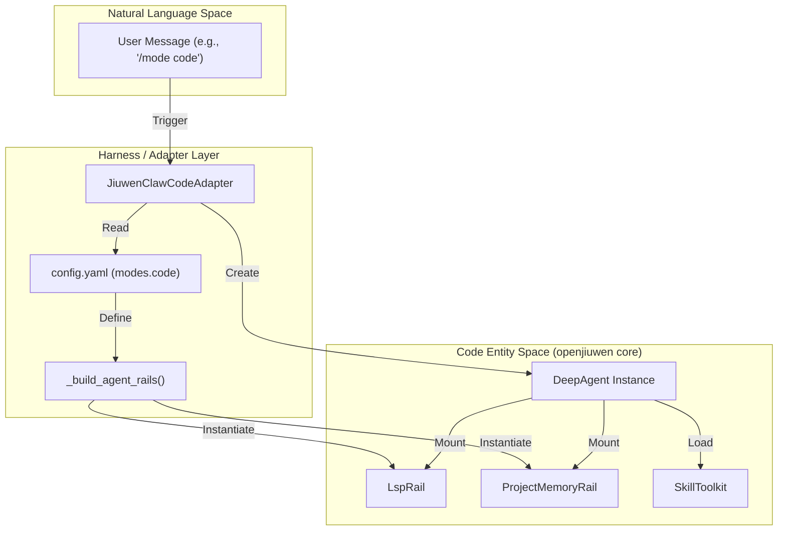
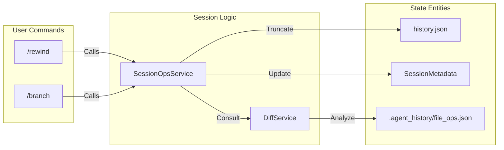

<!-- source: DeepWiki mcp.deepwiki.com · repo openJiuwen-ai/jiuwenswarm · page 3 Agent Modes and Harness · fetched 2026-11-02 -->

# Agent Modes and Harness

Relevant source files

The following files were used as context for generating this wiki page:

- [docs/en/CLI.md](docs/en/CLI.md)
- [docs/en/Modes.md](docs/en/Modes.md)
- [docs/en/SlashCommandArchitecture.md](docs/en/SlashCommandArchitecture.md)
- [docs/en/SlashCommands.md](docs/en/SlashCommands.md)
- [docs/zh/SLASH_COMMAND_ARCHITECTURE.md](docs/zh/SLASH_COMMAND_ARCHITECTURE.md)
- [jiuwenswarm/agents/harness/common/rails/stream_event_rail.py](jiuwenswarm/agents/harness/common/rails/stream_event_rail.py)
- [jiuwenswarm/channels/tui/frontend/src/core/commands/builtins/statusline.ts](jiuwenswarm/channels/tui/frontend/src/core/commands/builtins/statusline.ts)
- [jiuwenswarm/channels/web/frontend/src/hooks/useWebSocket.ts](jiuwenswarm/channels/web/frontend/src/hooks/useWebSocket.ts)
- [jiuwenswarm/server/runtime/agent_adapter/interface_deep.py](jiuwenswarm/server/runtime/agent_adapter/interface_deep.py)
- [jiuwenswarm/server/utils/stream_utils.py](jiuwenswarm/server/utils/stream_utils.py)
- [tests/unit_tests/gateway/test_slash_command.py](tests/unit_tests/gateway/test_slash_command.py)

JiuwenSwarm operates through three primary modes—**Agent**, **Code**, and **Team**—each tailored for specific task domains. These modes are orchestrated by a "Harness" layer that dynamically configures the agent's identity, toolset, subagent fleet, and safety rails based on the active session context.

## Overview of Operating Modes

The system uses a configuration-driven approach to instantiate agents. The `AgentServer` selects an appropriate adapter (e.g., `JiuWenClawDeepAdapter` or `JiuwenClawCodeAdapter`) to bridge the high-level mode request to the underlying `openjiuwen` core entities.

| Mode | Adapter Class | Primary Focus | Key Subagents |
| :--- | :--- | :--- | :--- |
| **Agent** | `JiuWenClawDeepAdapter` | General assistance & Research | `general_agent`, `research_agent` |
| **Code** | `JiuwenClawCodeAdapter` | Software engineering & LSP integration | `explore`, `plan`, `code`, `browser` |
| **Team** | `JiuWenClawDeepAdapter` | Multi-agent orchestration | Distributed teammates via A2X |

Sources: [jiuwenswarm/server/runtime/agent_adapter/interface_deep.py:3-52](), [jiuwenswarm/server/runtime/agent_adapter/interface_code.py:103-125]()

## The Harness Architecture

The Harness acts as the "operating system" for the agent. It manages the lifecycle of the `DeepAgent` instance, injecting necessary `Rails` for security and `Tools` for capability.

### Natural Language to Code Entity Mapping

The following diagram illustrates how a user request in "Natural Language Space" is transformed into a running "Code Entity Space" via the Harness.

**Harness Instantiation Flow**

Sources: [jiuwenswarm/server/runtime/agent_adapter/interface_code.py:136-175](), [docs/en/Modes.md:52-107]()

## Mode Summaries

### 3.1 Agent Mode and Plan Mode
The standard operating mode for general-purpose tasks. It utilizes a ReAct (Reasoning and Acting) loop to solve problems.
*   **Fast Mode (`agent.fast`)**: Optimized for quick responses with minimal subagent overhead and passive memory [docs/en/Modes.md:140]().
*   **Plan Mode (`agent.plan`)**: Employs a `TaskPlanningRail` to decompose complex queries into steps, utilizing proactive memory retrieval to maintain long-term context [jiuwenswarm/server/runtime/agent_adapter/interface_deep.py:56-66]().
*   **Auto-Harness**: A pipeline that automatically optimizes the local repository environment for the agent [jiuwenswarm/agents/harness/common/auto_harness.py:1-20]().

For details, see [Agent Mode and Plan Mode](#3.1).

### 3.2 Code Mode
A specialized environment for software development. It leverages the `JiuwenClawCodeAdapter` to mount engineering-specific rails.
*   **LSP Integration**: Real-time code analysis via `LspRail` [docs/en/Modes.md:74]().
*   **Specialized Rails**: Includes `CodingMemoryRail` for tracking code changes and `ProjectMemoryRail` for codebase-wide context [docs/en/Modes.md:141]().
*   **Session Control**: Supports advanced operations like `/rewind` to revert code changes and `/branch` to fork development paths [docs/en/CLI.md:122-182]().

For details, see [Code Mode](#3.2).

### 3.3 Team Mode and Multi-Agent Orchestration
Enables collaborative workflows where multiple agents work toward a single goal.
*   **Role Hierarchy**: Manages `leader` and `teammate` roles defined in the `modes.team` config [docs/en/Modes.md:85-107]().
*   **Distributed Execution**: Uses the **A2X Protocol** to register and reserve remote teammates across a network [jiuwenswarm/agents/harness/team/a2x/a2x_registry_runtime.py:102-106]().
*   **Synchronization**: Automatically syncs workspace state and skillsets between team members via `TeamManager`.

For details, see [Team Mode and Multi-Agent Orchestration](#3.3).

## Session Management Operations

The harness provides critical session operations that bridge the gap between conversation history and the physical workspace (especially in Code Mode).

**Session Operation Entities**

Sources: [jiuwenswarm/agents/harness/common/session_ops_service.py:1-150](), [docs/en/SlashCommands.md:137-182]()

### Key Components
*   **`DiffService`**: Analyzes `.agent_history` to provide turn-by-turn file change summaries [docs/en/SlashCommands.md:137-144]().
*   **`SessionOpsService`**: Handles the logic for `fork_session` (branching) and `rewind_session` (reverting to a previous turn) [jiuwenswarm/agents/harness/common/session_ops_service.py:1-10]().
*   **`JiuClawStreamEventRail`**: Manages the emission of tool calls, results, and context usage events to the frontend [jiuwenswarm/agents/harness/common/rails/stream_event_rail.py:3-9]().

---
**Sources:**
- [jiuwenswarm/server/runtime/agent_adapter/interface_deep.py]()
- [jiuwenswarm/server/runtime/agent_adapter/interface_code.py]()
- [jiuwenswarm/agents/harness/common/session_ops_service.py]()
- [jiuwenswarm/agents/harness/common/rails/stream_event_rail.py]()
- [docs/en/Modes.md]()
- [docs/en/CLI.md]()
- [docs/en/SlashCommands.md]()

---

