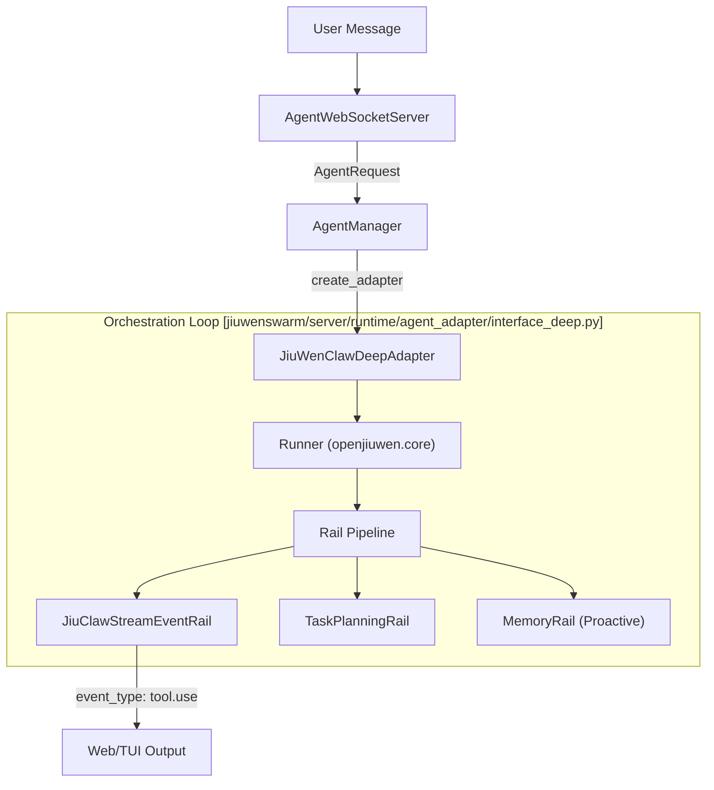
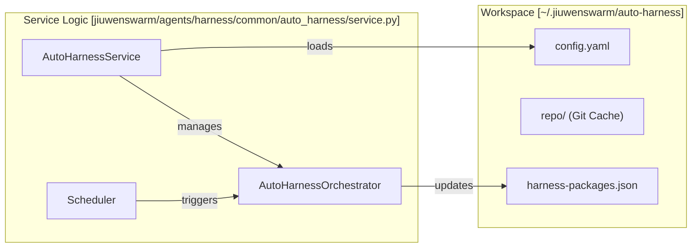

<!-- source: DeepWiki mcp.deepwiki.com · repo openJiuwen-ai/jiuwenswarm · page 3.1 Agent Mode and Plan Mode · fetched 2026-11-02 -->

# Agent Mode and Plan Mode

Relevant source files

The following files were used as context for generating this wiki page:

- [jiuwenswarm/agents/harness/common/auto_harness/config_validator.py](jiuwenswarm/agents/harness/common/auto_harness/config_validator.py)
- [jiuwenswarm/agents/harness/common/auto_harness/scheduler.py](jiuwenswarm/agents/harness/common/auto_harness/scheduler.py)
- [jiuwenswarm/agents/harness/common/auto_harness/service.py](jiuwenswarm/agents/harness/common/auto_harness/service.py)
- [jiuwenswarm/agents/harness/common/rails/interrupt/interrupt_helpers.py](jiuwenswarm/agents/harness/common/rails/interrupt/interrupt_helpers.py)
- [jiuwenswarm/agents/harness/common/rails/stream_event_rail.py](jiuwenswarm/agents/harness/common/rails/stream_event_rail.py)
- [jiuwenswarm/channels/tui/frontend/src/core/commands/builtins/auto-harness.ts](jiuwenswarm/channels/tui/frontend/src/core/commands/builtins/auto-harness.ts)
- [jiuwenswarm/channels/tui/frontend/src/core/commands/builtins/help.ts](jiuwenswarm/channels/tui/frontend/src/core/commands/builtins/help.ts)
- [jiuwenswarm/channels/tui/frontend/src/core/commands/builtins/mode.ts](jiuwenswarm/channels/tui/frontend/src/core/commands/builtins/mode.ts)
- [jiuwenswarm/channels/tui/frontend/src/core/commands/builtins/plan.ts](jiuwenswarm/channels/tui/frontend/src/core/commands/builtins/plan.ts)
- [jiuwenswarm/channels/tui/frontend/src/core/commands/builtins/switch.ts](jiuwenswarm/channels/tui/frontend/src/core/commands/builtins/switch.ts)
- [jiuwenswarm/channels/tui/frontend/src/core/commands/registry.ts](jiuwenswarm/channels/tui/frontend/src/core/commands/registry.ts)
- [jiuwenswarm/channels/web/frontend/src/components/HarnessPackagePanel/index.tsx](jiuwenswarm/channels/web/frontend/src/components/HarnessPackagePanel/index.tsx)
- [jiuwenswarm/channels/web/frontend/src/components/ToolPanel/HarnessExtensionTree.tsx](jiuwenswarm/channels/web/frontend/src/components/ToolPanel/HarnessExtensionTree.tsx)
- [jiuwenswarm/channels/web/frontend/src/hooks/useWebSocket.ts](jiuwenswarm/channels/web/frontend/src/hooks/useWebSocket.ts)
- [jiuwenswarm/channels/web/frontend/src/stores/harnessStore.ts](jiuwenswarm/channels/web/frontend/src/stores/harnessStore.ts)
- [jiuwenswarm/channels/web/frontend/src/stores/index.ts](jiuwenswarm/channels/web/frontend/src/stores/index.ts)
- [jiuwenswarm/gateway/channel_manager/tui/tui_connect.py](jiuwenswarm/gateway/channel_manager/tui/tui_connect.py)
- [jiuwenswarm/gateway/channel_manager/web/app_web_handlers.py](jiuwenswarm/gateway/channel_manager/web/app_web_handlers.py)
- [jiuwenswarm/server/agent_ws_server.py](jiuwenswarm/server/agent_ws_server.py)
- [jiuwenswarm/server/runtime/agent_adapter/interface_deep.py](jiuwenswarm/server/runtime/agent_adapter/interface_deep.py)
- [jiuwenswarm/server/utils/stream_utils.py](jiuwenswarm/server/utils/stream_utils.py)

This page describes the implementation and behavior of the primary operating modes in JiuwenSwarm: **Agent Mode** (fast) and **Plan Mode**. It details the underlying ReAct orchestration, the subagent fleet, proactive memory, and the **Auto-Harness** pipeline for repository-level optimization.

## 1. Overview of Modes

JiuwenSwarm utilizes specialized adapters to manage the interaction between the user and the LLM. The mode selection determines the orchestration logic and the set of rails applied to the session.

*   **Agent Mode (`agent.fast`):** A standard ReAct (Reasoning and Acting) loop designed for direct task execution with low latency.
*   **Plan Mode (`agent.plan`):** An advanced orchestration mode that incorporates proactive memory lookups and structured planning before execution.

The `JiuWenClawDeepAdapter` implements the `AgentAdapter` protocol to wrap the Deep SDK logic [jiuwenswarm/server/runtime/agent_adapter/interface_deep.py:3-7]().

### Mode Switching Logic
Modes are switched via the `/mode` slash command in the TUI or the mode selector in the Web UI. The system maps user-friendly aliases to specific backend modes:

| Alias | Backend Mode | Description |
| :--- | :--- | :--- |
| `agent` | `agent.plan` | Default agent mode with planning. |
| `fast` | `agent.fast` | Optimized for speed, minimal planning. |
| `plan` | `agent.plan` | Explicit planning mode. |

**Sources:** [jiuwenswarm/channels/tui/frontend/src/core/commands/builtins/mode.ts:37-49](), [jiuwenswarm/server/runtime/agent_adapter/interface_deep.py:39-51]()

---

## 2. ReAct Loop and Subagent Fleet

The core of the agent's intelligence is the ReAct loop, managed by the `Runner` and specialized rails [jiuwenswarm/server/runtime/agent_adapter/interface_deep.py:35-39]().

### The Subagent Fleet
In `agent.plan` and other advanced modes, the adapter configures a fleet of subagents to handle specialized tasks:
*   **General Agent:** Created using `AgentCard` for standard tasks [jiuwenswarm/server/runtime/agent_adapter/interface_deep.py:39]().
*   **Research Agent:** Built via `build_research_agent_config` for deep-dive information retrieval and documentation analysis [jiuwenswarm/server/runtime/agent_adapter/interface_deep.py:69]().
*   **Browser Agent:** Configured via `build_browser_agent_config` to interact with web content [jiuwenswarm/server/runtime/agent_adapter/interface_deep.py:68]().

### Proactive Memory
Plan mode utilizes **Proactive Memory**. The system checks if proactive memory is enabled via `is_proactive_memory()` and mounts the `MemoryRail` [jiuwenswarm/agents/harness/common/memory/config.py:139-140](), [jiuwenswarm/server/runtime/agent_adapter/interface_deep.py:63](). This rail automatically retrieves relevant context from the project index before the agent generates a plan, ensuring the LLM is "warmed up" with pertinent code snippets.

### Implementation Diagram: Agent Orchestration
This diagram bridges the Natural Language request to the code entities managing the ReAct loop.

**Sources:** [jiuwenswarm/server/agent_ws_server.py:22-40](), [jiuwenswarm/server/runtime/agent_adapter/interface_deep.py:46-64](), [jiuwenswarm/agents/harness/common/rails/stream_event_rail.py:3-9]()

---

## 3. Auto-Harness Pipeline

The **Auto-Harness** system is a specialized pipeline for repository optimization, integrated into the `JiuWenClawDeepAdapter` via the `AutoHarnessService` [jiuwenswarm/agents/harness/common/auto_harness/service.py:170-181]().

### Pipeline Stages and Optimization
The pipeline automates the "evolution" of an agent by modifying its harness or underlying code.

| Stage | Code Entity | Purpose |
| :--- | :--- | :--- |
| **Assess** | `current_stage_name: "assess"` | Evaluates the repository and identifies optimization targets. |
| **Plan** | `OptimizationTask` | Generates a structured plan for code modification. |
| **Code** | `ExtensionTaskPipeline` | Executes the `EXTENDED_EVOLVE_PIPELINE` to generate harness packages. |
| **CI Gate** | `_DEFAULT_CI_GATE_INSTALL_COMMAND` | Validates changes using `uv sync` or custom test commands. |
| **Activate** | `ExtendActivateStage` | Hot-reloads the new harness into the running agent. |

**Sources:** [jiuwenswarm/agents/harness/common/auto_harness/service.py:51-55](), [jiuwenswarm/agents/harness/common/auto_harness/service.py:78-79](), [jiuwenswarm/agents/harness/common/auto_harness/service.py:165-167]()

### Auto-Harness Implementation
The service manages active runs and repository caching in the `auto-harness` workspace directory.

**Sources:** [jiuwenswarm/agents/harness/common/auto_harness/service.py:70-76](), [jiuwenswarm/agents/harness/common/auto_harness/service.py:170-200](), [jiuwenswarm/gateway/channel_manager/tui/tui_connect.py:46-48]()

---

## 4. Execution and Streaming

All events in Agent and Plan mode are streamed back to the client via the `JiuClawStreamEventRail`. This rail intercepts internal SDK events and converts them into `AgentResponseChunk` objects [jiuwenswarm/agents/harness/common/rails/stream_event_rail.py:59-60]().

### Key Event Types
The `parse_stream_chunk` utility in `stream_utils.py` handles the conversion of SDK types to frontend-consumable JSON [jiuwenswarm/server/utils/stream_utils.py:10-25]():

*   **`chat.delta`**: Incremental text output from the LLM [jiuwenswarm/server/utils/stream_utils.py:183]().
*   **`tool.use`**: Notification that a tool (e.g., `bash`, `read_file`) is being invoked [jiuwenswarm/server/utils/stream_utils.py:58]().
*   **`chat.ask_user_question`**: Interruption for user permission or clarification [jiuwenswarm/server/utils/stream_utils.py:112-113]().
*   **`context.compression_state`**: Updates on the proactive memory compression process [jiuwenswarm/server/utils/stream_utils.py:116-128]().

**Sources:** [jiuwenswarm/server/utils/stream_utils.py:10-183](), [jiuwenswarm/agents/harness/common/rails/stream_event_rail.py:3-10]()

---

## 5. User Interaction (TUI/Web)

### Slash Commands
In the TUI, users manage modes and planning via:
*   `/mode <name>`: Switches the active adapter mode [jiuwenswarm/channels/tui/frontend/src/core/commands/builtins/mode.ts:54]().
*   `/plan`: Manually triggers a planning phase for the current task [jiuwenswarm/channels/tui/frontend/src/core/commands/registry.ts:31]().
*   `/auto-harness schedule start`: Sets up a recurring optimization task with a specific `--interval` [jiuwenswarm/channels/tui/frontend/src/core/commands/builtins/auto-harness.ts:187]().

### Web Interface
The React frontend uses the `useWebSocket` hook to process the `WsEvent` stream [jiuwenswarm/channels/web/frontend/src/hooks/useWebSocket.ts:7-31](). It maintains the `harnessStore` to track the status of Auto-Harness optimizations and `sessionStore` for the active chat mode [jiuwenswarm/channels/web/frontend/src/hooks/useWebSocket.ts:32-33]().

**Sources:** [jiuwenswarm/channels/tui/frontend/src/core/commands/builtins/mode.ts:52-56](), [jiuwenswarm/channels/tui/frontend/src/core/commands/builtins/auto-harness.ts:184-188](), [jiuwenswarm/channels/web/frontend/src/hooks/useWebSocket.ts:7-45]()

---

