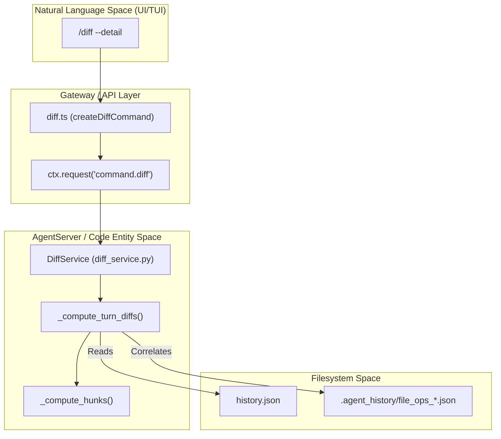
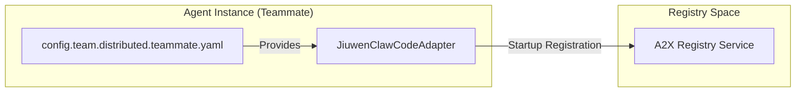

<!-- source: DeepWiki mcp.deepwiki.com · repo openJiuwen-ai/jiuwenswarm · page 3.2 Code Mode · fetched 2026-11-02 -->

# Code Mode

Relevant source files

The following files were used as context for generating this wiki page:

- [jiuwenswarm/agents/harness/code/prompt/code_prompt_builder.py](jiuwenswarm/agents/harness/code/prompt/code_prompt_builder.py)
- [jiuwenswarm/agents/harness/code/prompt/code_todo_tool_prompts.py](jiuwenswarm/agents/harness/code/prompt/code_todo_tool_prompts.py)
- [jiuwenswarm/agents/harness/code/rails/__init__.py](jiuwenswarm/agents/harness/code/rails/__init__.py)
- [jiuwenswarm/agents/harness/code/rails/code_task_planning_rail.py](jiuwenswarm/agents/harness/code/rails/code_task_planning_rail.py)
- [jiuwenswarm/agents/harness/code/tools/__init__.py](jiuwenswarm/agents/harness/code/tools/__init__.py)
- [jiuwenswarm/agents/harness/code/tools/code_todo_tools.py](jiuwenswarm/agents/harness/code/tools/code_todo_tools.py)
- [jiuwenswarm/agents/harness/common/rails/execution_guard/__init__.py](jiuwenswarm/agents/harness/common/rails/execution_guard/__init__.py)
- [jiuwenswarm/agents/harness/common/rails/execution_guard/circuit_breaker_rail.py](jiuwenswarm/agents/harness/common/rails/execution_guard/circuit_breaker_rail.py)
- [jiuwenswarm/channels/tui/frontend/src/core/commands/builtins/diff.ts](jiuwenswarm/channels/tui/frontend/src/core/commands/builtins/diff.ts)
- [jiuwenswarm/channels/tui/frontend/src/core/commands/builtins/rewind.ts](jiuwenswarm/channels/tui/frontend/src/core/commands/builtins/rewind.ts)
- [jiuwenswarm/channels/tui/frontend/src/core/types.ts](jiuwenswarm/channels/tui/frontend/src/core/types.ts)
- [jiuwenswarm/channels/tui/frontend/src/ui/components/messages/diff-component.ts](jiuwenswarm/channels/tui/frontend/src/ui/components/messages/diff-component.ts)
- [jiuwenswarm/resources/config.team.distributed.leader.yaml](jiuwenswarm/resources/config.team.distributed.leader.yaml)
- [jiuwenswarm/resources/config.team.distributed.teammate.yaml](jiuwenswarm/resources/config.team.distributed.teammate.yaml)
- [jiuwenswarm/resources/config.yaml](jiuwenswarm/resources/config.yaml)
- [jiuwenswarm/server/runtime/agent_adapter/code_agent_rail.py](jiuwenswarm/server/runtime/agent_adapter/code_agent_rail.py)
- [jiuwenswarm/server/runtime/agent_adapter/interface_code.py](jiuwenswarm/server/runtime/agent_adapter/interface_code.py)
- [jiuwenswarm/server/utils/diff_service.py](jiuwenswarm/server/utils/diff_service.py)
- [tests/unit_tests/agents/harness/code/test_code_todo_tool_prompts.py](tests/unit_tests/agents/harness/code/test_code_todo_tool_prompts.py)
- [tests/unit_tests/agentserver/test_code_adapter_lsp_rail.py](tests/unit_tests/agentserver/test_code_adapter_lsp_rail.py)

Code Mode is a specialized operating environment within JiuwenSwarm designed for deep repository interaction, software engineering tasks, and complex codebase manipulation. It leverages a dedicated adapter, a fleet of specialized subagents, and advanced memory rails to bridge the gap between natural language requirements and precise code modifications.

## JiuwenClawCodeAdapter

The `JiuwenClawCodeAdapter` is the central orchestration component for Code Mode. It inherits from `JiuWenClawDeepAdapter` and specializes the agent's capabilities by registering coding-specific tools and rails [jiuwenswarm/server/runtime/agent_adapter/interface_code.py:47-52]().

### Initialization and Workspace Management
When a session enters Code Mode, the adapter initializes a `DeepAgent` instance using `create_deep_agent()` [jiuwenswarm/server/runtime/agent_adapter/interface_code.py:27-27](). It manages two distinct directory paths:
- **`_workspace_dir`**: The target project directory where the agent performs file operations and LSP queries [jiuwenswarm/server/runtime/agent_adapter/interface_code.py:45-45]().
- **`_agent_workspace_dir`**: A system-internal directory for storing agent-specific data like coding memory and todo lists, ensuring these do not pollute the user's project [jiuwenswarm/server/runtime/agent_adapter/interface_code.py:70-70]().

### Specialized Subagent Fleet
Code Mode utilizes a "Fleet" architecture where the main agent delegates specific tasks to specialized subagents. These are registered via `SubagentRail` and `CodeAgentRail` [jiuwenswarm/server/runtime/agent_adapter/code_agent_rail.py:2-6]():

| Subagent | Role | Configuration Builder |
| :--- | :--- | :--- |
| `explore_agent` | Repository discovery and structure analysis. | `build_explore_agent_config` |
| `plan_agent` | High-level task decomposition and strategy. | `build_plan_agent_config` |
| `code_agent` | Precise file editing and diff generation. | `build_code_agent_config` |
| `browser_agent` | Web research and documentation fetching. | `build_browser_agent_config` |

**Sources:** [jiuwenswarm/server/runtime/agent_adapter/interface_code.py:38-42](), [jiuwenswarm/server/runtime/agent_adapter/code_agent_rail.py:173-183]()

## Specialized Rails

Rails in Code Mode act as interceptors that manage context, enforce permissions, and provide specialized domain knowledge.

### LspRail
Integrates Language Server Protocol capabilities. It allows the agent to perform semantic searches, find definitions, and check references across the codebase. In `JiuwenClawCodeAdapter`, `LspRail` is treated as a "fixed rail" that is always initialized if the environment allows [jiuwenswarm/server/runtime/agent_adapter/interface_code.py:34-37](). If the LSP server fails to start, the rail degrades gracefully with specific logging labels like `[server_start_failed]` [tests/unit_tests/agentserver/test_code_adapter_lsp_rail.py:116-120]().

### ProjectMemoryRail
Responsible for discovering and injecting project-specific rules and context into the system prompt. It scans for project-level documentation and injects it into the `SystemPromptBuilder` [jiuwenswarm/server/runtime/agent_adapter/interface_code.py:58-61]().

### CodingMemoryRail
Manages "Coding Memory"—long-term persistent knowledge about the user's preferences and architectural decisions. It resolves the project-specific memory directory using `resolve_project_coding_memory_dir` [jiuwenswarm/common/coding_memory_paths.py:66-66]().

### CircuitBreakerRail
Prevents the agent from entering infinite loops or repetitive tool-calling patterns. It monitors tool call history and triggers a `global_circuit_breaker` if no progress is made after a threshold (default 30 calls) [jiuwenswarm/agents/harness/common/rails/execution_guard/circuit_breaker_rail.py:27-32]().

**Sources:** [jiuwenswarm/server/runtime/agent_adapter/interface_code.py:30-35](), [jiuwenswarm/agents/harness/common/rails/execution_guard/circuit_breaker_rail.py:115-127](), [tests/unit_tests/agentserver/test_code_adapter_lsp_rail.py:136-140]()

## Session Operations: Rewind and Diff

Code Mode supports advanced state management, allowing users to navigate conversation history and visualize changes.

### Data Flow: Natural Language to Code Entity Space
The following diagram illustrates how a user's request for a diff (Natural Language Space) translates into specific code entities and filesystem checks (Code Entity Space).

Title: Diff Operation Data Flow

**Sources:** [jiuwenswarm/channels/tui/frontend/src/core/commands/builtins/diff.ts:12-22](), [jiuwenswarm/server/utils/diff_service.py:20-26](), [jiuwenswarm/server/utils/diff_service.py:39-42]()

### Implementation Details
- **DiffService**: Correlates `history.json` turns with file operations. It calculates `linesAdded` and `linesRemoved` by parsing diff hunks generated via `difflib` [jiuwenswarm/server/utils/diff_service.py:95-115]().
- **Rewind**: TUI and Web interfaces use the `/rewind` command to truncate session history. This involves identifying the target `turnIndex` and invoking the session operation service to clean up records [jiuwenswarm/channels/tui/frontend/src/core/commands/builtins/rewind.ts:1-5]().

## A2X Distributed Teammate Registration

In distributed Team Mode, a Code Mode agent can act as a "teammate" by registering itself with an A2X (Agent-to-X) Registry.

Title: A2X Teammate Registration Flow

### Registration Logic
The distributed configuration files (`config.team.distributed.leader.yaml` and `config.team.distributed.teammate.yaml`) define the telemetry and model settings required for a remote agent to join a swarm [jiuwenswarm/resources/config.team.distributed.leader.yaml:1-15]() [jiuwenswarm/resources/config.team.distributed.teammate.yaml:1-15](). 

- **Teammate Role**: A teammate instance runs with its own `AgentServer` but shares the workspace (often via NFS) with the leader.
- **A2X Integration**: The teammate registers its endpoint and capabilities to the leader's registry, allowing the leader to dispatch `task_tool` calls to it.

**Sources:** [jiuwenswarm/resources/config.team.distributed.leader.yaml:169-176](), [jiuwenswarm/resources/config.team.distributed.teammate.yaml:169-176]()

---

