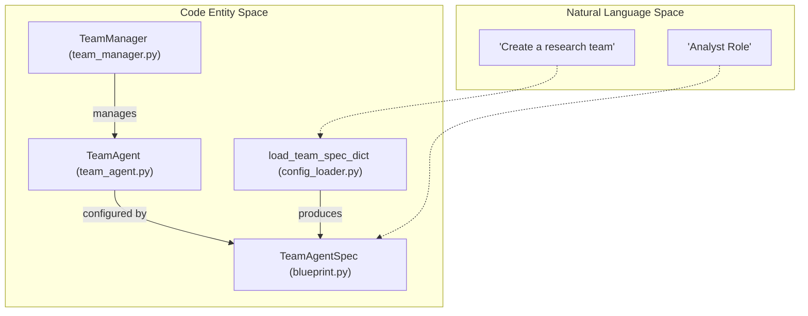
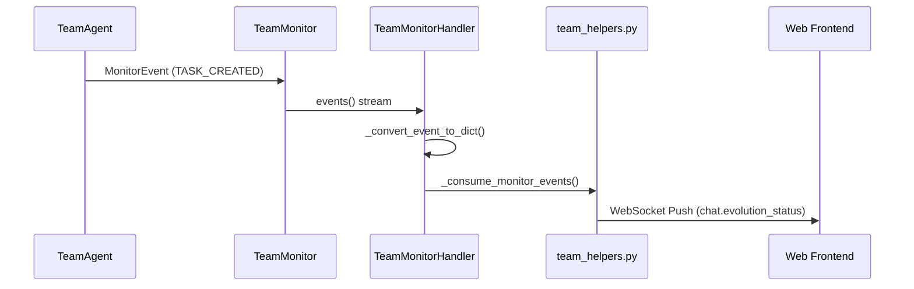

<!-- source: DeepWiki mcp.deepwiki.com · repo openJiuwen-ai/jiuwenswarm · page 3.3 Team Mode and Multi-Agent Orchestration · fetched 2026-11-02 -->

# Team Mode and Multi-Agent Orchestration

Relevant source files

The following files were used as context for generating this wiki page:

- [docs/en/DistributedTeam.md](docs/en/DistributedTeam.md)
- [jiuwenswarm/agents/harness/common/memory/embeddings.py](jiuwenswarm/agents/harness/common/memory/embeddings.py)
- [jiuwenswarm/agents/harness/team/config_loader.py](jiuwenswarm/agents/harness/team/config_loader.py)
- [jiuwenswarm/agents/harness/team/distributed_runtime.py](jiuwenswarm/agents/harness/team/distributed_runtime.py)
- [jiuwenswarm/agents/harness/team/remote_member_bootstrap.py](jiuwenswarm/agents/harness/team/remote_member_bootstrap.py)
- [jiuwenswarm/agents/harness/team/team_manager.py](jiuwenswarm/agents/harness/team/team_manager.py)
- [jiuwenswarm/agents/harness/team/team_runtime_inheritance.py](jiuwenswarm/agents/harness/team/team_runtime_inheritance.py)
- [jiuwenswarm/channels/tui/frontend/src/core/commands/builtins/evolve.ts](jiuwenswarm/channels/tui/frontend/src/core/commands/builtins/evolve.ts)
- [jiuwenswarm/common/openrouter_attribution.py](jiuwenswarm/common/openrouter_attribution.py)
- [jiuwenswarm/server/runtime/agent_adapter/evolution_helpers.py](jiuwenswarm/server/runtime/agent_adapter/evolution_helpers.py)
- [jiuwenswarm/server/runtime/agent_adapter/team_helpers.py](jiuwenswarm/server/runtime/agent_adapter/team_helpers.py)
- [scripts/nfs/README.md](scripts/nfs/README.md)
- [scripts/nfs/setup_nfs_client.sh](scripts/nfs/setup_nfs_client.sh)
- [scripts/nfs/setup_nfs_server.sh](scripts/nfs/setup_nfs_server.sh)
- [scripts/nfs/teardown_nfs_client.sh](scripts/nfs/teardown_nfs_client.sh)
- [scripts/nfs/teardown_nfs_server.sh](scripts/nfs/teardown_nfs_server.sh)
- [tests/system_tests/test_a2x_bootstrap_replace_flow.py](tests/system_tests/test_a2x_bootstrap_replace_flow.py)
- [tests/system_tests/test_remote_member_spawn_failfast_st.py](tests/system_tests/test_remote_member_spawn_failfast_st.py)
- [tests/unit_tests/agentserver/test_distributed_runtime.py](tests/unit_tests/agentserver/test_distributed_runtime.py)
- [tests/unit_tests/agentserver/test_evolution_helpers.py](tests/unit_tests/agentserver/test_evolution_helpers.py)
- [tests/unit_tests/agentserver/test_evolution_push_delivery.py](tests/unit_tests/agentserver/test_evolution_push_delivery.py)
- [tests/unit_tests/agentserver/test_remote_member_bootstrap.py](tests/unit_tests/agentserver/test_remote_member_bootstrap.py)
- [tests/unit_tests/agentserver/test_team_config_loader.py](tests/unit_tests/agentserver/test_team_config_loader.py)
- [tests/unit_tests/agentserver/test_team_helpers.py](tests/unit_tests/agentserver/test_team_helpers.py)
- [tests/unit_tests/agentserver/test_team_manager_registry.py](tests/unit_tests/agentserver/test_team_manager_registry.py)
- [tests/unit_tests/agentserver/test_team_manager_skill_state.py](tests/unit_tests/agentserver/test_team_manager_skill_state.py)
- [tests/unit_tests/agentserver/test_team_member_skill_toolkit_rail.py](tests/unit_tests/agentserver/test_team_member_skill_toolkit_rail.py)
- [tests/unit_tests/agentserver/test_team_runtime_inheritance.py](tests/unit_tests/agentserver/test_team_runtime_inheritance.py)
- [tests/unit_tests/agentserver/test_team_shared_skills.py](tests/unit_tests/agentserver/test_team_shared_skills.py)

Team Mode in JiuwenSwarm enables complex multi-agent collaboration by organizing agents into a hierarchical structure with a designated **Leader** and multiple **Teammates**. This mode facilitates task decomposition, parallel execution, and shared workspace management across local or distributed environments.

## TeamManager Lifecycle and Hierarchy

The `TeamManager` is the central coordinator for team lifecycle events, scoped by communication channel (e.g., "web", "feishu") [jiuwenswarm/agents/harness/team/team_manager.py:85-93](). It manages the transitions between session states and ensures that only one team is active per session.

### Leader/Teammate Hierarchy
Teams are defined by a `TeamAgentSpec` which designates roles [jiuwenswarm/agents/harness/team/config_loader.py:175-184]():
*   **Leader**: The entry point for user interaction. It decomposes high-level goals into sub-tasks and delegates them to teammates.
*   **Teammate**: Specialized agents (e.g., "analyst", "coder") that execute specific tasks assigned by the leader.

### Lifecycle Management
The `TeamManager` handles the following lifecycle stages:
1.  **Initialization**: Loading configuration via `load_team_spec_dict` [jiuwenswarm/agents/harness/team/config_loader.py:27-28]().
2.  **Activation**: Committing a runtime as "ready" and syncing session metadata via `sync_team_identity_metadata` [jiuwenswarm/server/runtime/agent_adapter/team_helpers.py:110-141]().
3.  **Switching**: Preparing for session switches by draining pending events and stopping active messengers [jiuwenswarm/agents/harness/team/team_manager.py:106-118]().
4.  **Teardown**: Releasing ZMQ ports and clearing internal registries [jiuwenswarm/agents/harness/team/team_manager.py:106-118]().

**Diagram: Team Entity Space Mapping**

Sources: [jiuwenswarm/agents/harness/team/team_manager.py:132-158](), [jiuwenswarm/agents/harness/team/config_loader.py:171-185](), [jiuwenswarm/server/runtime/agent_adapter/team_helpers.py:110-142]().

## Workspace and Skill Synchronization

Team members share a common environment to ensure consistency during task execution.

### Skill Synchronization
The system synchronizes skills across two levels:
*   **Global to Team**: Valid skills (containing `SKILL.md`) are linked from the global repository to the team's shared directory [jiuwenswarm/agents/harness/team/team_manager.py:61-68]().
*   **Team to Member**: Specific members inherit skills defined in the `agents` configuration. The `MemberSkillToolkitRail` ensures only authorized skills are available to specific teammates [jiuwenswarm/agents/harness/team/team_manager.py:29-31]().

### Workspace Inheritance
Teammates inherit a `TeamWorkspaceInfo` object containing paths for:
*   `root_dir`: The base directory for artifacts.
*   `skills_dir`: The synchronized skill repository.
*   `trajectory_registry`: Shared task history and trajectory data [jiuwenswarm/agents/harness/team/team_runtime_inheritance.py:55-62]().

Sources: [jiuwenswarm/agents/harness/team/team_manager.py:61-68](), [jiuwenswarm/agents/harness/team/config_loader.py:203-205](), [jiuwenswarm/agents/harness/team/team_runtime_inheritance.py:129-158]().

## TeamMonitorHandler and Event Monitoring

The `TeamMonitorHandler` translates internal `openjiuwen` monitor events into a format consumable by the JiuwenSwarm frontend [jiuwenswarm/agents/harness/team/monitor_handler.py:59-59]().

### Event Flow
1.  **Collection**: `_collect_events` asynchronously listens to the `TeamMonitor` stream [jiuwenswarm/agents/harness/team/monitor_handler.py:103-113]().
2.  **Conversion**: Events are mapped to standard types like `team.task`, `team.member`, or `team.message` [jiuwenswarm/agents/harness/team/monitor_handler.py:124-222]().
3.  **Broadcasting**: Events are pushed to the internal queue and subsequently broadcasted to the frontend via `_consume_monitor_events` [jiuwenswarm/server/runtime/agent_adapter/team_helpers.py:114-121]().

**Diagram: Monitor Data Flow**

Sources: [jiuwenswarm/agents/harness/team/monitor_handler.py:103-116](), [jiuwenswarm/server/runtime/agent_adapter/team_helpers.py:114-121](), [jiuwenswarm/agents/harness/team/monitor_handler.py:124-222]().

## Distributed Mode and A2X Reservations

In `distributed` mode, the team is spread across multiple processes or nodes, utilizing a PostgreSQL backend for shared state [jiuwenswarm/agents/harness/team/distributed_runtime.py:44-58]().

### A2X Reservations and Bootstrapping
When the Leader calls `spawn_member` for a remote teammate:
1.  **Remote Detection**: The system checks `jiuwen_remote_member_names` in metadata [jiuwenswarm/agents/harness/team/remote_member_bootstrap.py:54-56]().
2.  **Reservation**: A "blank" agent is reserved via A2X registry [jiuwenswarm/agents/harness/team/remote_member_bootstrap.py:30-31]().
3.  **Bootstrap Envelope**: A JSON payload is published via the P2P channel (`REMOTE_BOOTSTRAP_DIRECT_EVENT_TYPE`) [jiuwenswarm/agents/harness/team/remote_member_bootstrap.py:29-29]().
4.  **Remote Takeover**: The reserved agent applies runtime hints to join the team and sends an ACK [jiuwenswarm/agents/harness/team/remote_member_bootstrap.py:22-24]().

### Distributed Roles
*   **Leader**: Responsible for starting the PostgreSQL cluster and managing the A2X reservation pool [jiuwenswarm/agents/harness/team/distributed_runtime.py:45-57]().
*   **Teammate**: Connects to the leader's transport address and registers its availability [jiuwenswarm/agents/harness/team/remote_member_bootstrap.py:146-152]().

Sources: [jiuwenswarm/agents/harness/team/distributed_runtime.py:44-58](), [jiuwenswarm/agents/harness/team/remote_member_bootstrap.py:22-31](), [jiuwenswarm/agents/harness/team/remote_member_bootstrap.py:54-61]().

## Rail Orchestration in Team Mode

Teams utilize a specialized whitelist of rails to maintain security and functionality across distributed members [jiuwenswarm/agents/harness/team/team_runtime_inheritance.py:64-79]().

| Rail Name | Purpose |
| :--- | :--- |
| `RuntimePromptRail` | Injects channel and language context into the prompt [jiuwenswarm/agents/harness/team/team_runtime_inheritance.py:163-168](). |
| `SecurityRail` | Enforces tiered permission policies for all team members [jiuwenswarm/agents/harness/team/team_runtime_inheritance.py:204-209](). |
| `TeamSkillEvolutionRail` | Manages the autonomous improvement of team-wide skills [jiuwenswarm/agents/harness/team/team_runtime_inheritance.py:23-23](). |
| `TeamWorkspaceReportPathRail` | Ensures teammates use the correct shared workspace paths for reporting [jiuwenswarm/agents/harness/team/team_runtime_inheritance.py:226-231](). |

Sources: [jiuwenswarm/agents/harness/team/team_runtime_inheritance.py:64-79](), [jiuwenswarm/agents/harness/team/team_runtime_inheritance.py:129-160]().

---

