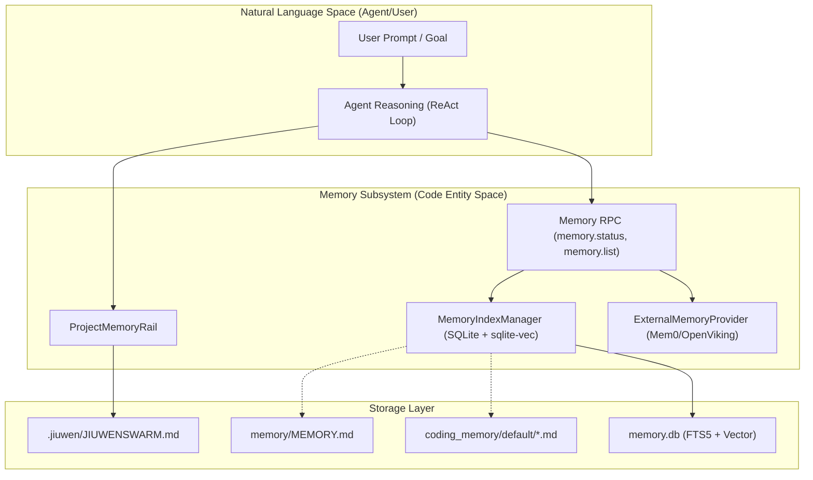
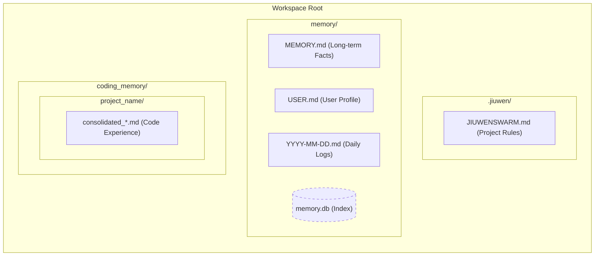

<!-- source: DeepWiki mcp.deepwiki.com · repo openJiuwen-ai/jiuwenswarm · page 4 Memory System · fetched 2026-11-02 -->

# Memory System

Relevant source files

The following files were used as context for generating this wiki page:

- [docs/assets/images/memory_agent.png](docs/assets/images/memory_agent.png)
- [docs/assets/images/memory_config.png](docs/assets/images/memory_config.png)
- [docs/assets/images/memory_files.png](docs/assets/images/memory_files.png)
- [docs/assets/images/memory_search.png](docs/assets/images/memory_search.png)
- [docs/assets/images/memory_write.png](docs/assets/images/memory_write.png)
- [docs/assets/images/user_md.png](docs/assets/images/user_md.png)
- [docs/en/Memory.md](docs/en/Memory.md)
- [jiuwenswarm/agents/harness/common/memory_rpc.py](jiuwenswarm/agents/harness/common/memory_rpc.py)
- [jiuwenswarm/channels/tui/frontend/src/core/commands/builtins/memory.ts](jiuwenswarm/channels/tui/frontend/src/core/commands/builtins/memory.ts)
- [jiuwenswarm/common/coding_memory_paths.py](jiuwenswarm/common/coding_memory_paths.py)
- [tests/unit_tests/agentserver/memory/test_memory_rpc.py](tests/unit_tests/agentserver/memory/test_memory_rpc.py)

The JiuwenSwarm memory system provides a multi-layered architecture designed to give agents persistent, cross-session recall. It bridges the gap between transient conversation history and long-term knowledge through a combination of local file-based storage, vector-indexed semantic search, and integration with external memory providers.

## Multi-Layered Memory Architecture

The system categorizes memory into distinct layers based on its scope and persistence. This architecture allows the agent to maintain a "short-term" focus on the current project while leveraging "long-term" insights from past interactions.

### Architecture Overview Diagram
This diagram illustrates the relationship between the Natural Language Space (where the agent operates) and the Code Entity Space (where data is managed).

**Sources:** [jiuwenswarm/agents/harness/common/memory_rpc.py:10-24](), [jiuwenswarm/agents/harness/common/coding_memory_paths.py:30-40](), [docs/en/Memory.md:120-142]()

### Core Memory Components

| Component | Code Entity | Role |
| :--- | :--- | :--- |
| **Project Memory** | `ProjectMemoryRail` | Injects local project rules and context (e.g., `.jiuwen/JIUWENSWARM.md`) directly into the prompt context. |
| **Long-Term Memory** | `MemoryIndexManager` | Manages the `memory.db` SQLite database, handling BM25 full-text search and vector indexing for semantic retrieval [docs/en/Memory.md:24-33](). |
| **Coding Memory** | `CodingMemoryRail` | Specialized for Code Mode; stores debugging root causes and API behaviors in project-scoped directories under `coding_memory/` [jiuwenswarm/common/coding_memory_paths.py:30-40](). |
| **External Providers** | `get_memory_engine` | Bridges to third-party services like `mem0`, `openviking`, or `openjiuwen` LTM [jiuwenswarm/agents/harness/common/memory_rpc.py:15-19](). |

## 4.1 Project Memory and Long-Term Memory
Project memory is discovery-based, allowing agents to understand repository-specific conventions. The system resolves project-scoped directories to isolate memory between different codebases [jiuwenswarm/common/coding_memory_paths.py:14-27]().

Long-term memory supports hybrid search. While retrieval defaults to BM25 full-text search, it can be upgraded to vector + BM25 hybrid search by configuring an `EMBED_API_KEY` [docs/en/Memory.md:24-33](). The frontend interacts with these layers via RPC handlers such as `handle_memory_list` and `handle_memory_status` [jiuwenswarm/agents/harness/common/memory_rpc.py:182-213]().

For details on file discovery, `@include` syntax, and SQLite indexing, see **[Project Memory and Long-Term Memory](#4.1)**.

## 4.2 External Memory Providers and Forbidden Memory
JiuwenSwarm can be configured to use external backends via the `memory.engine` setting, which supports `builtin`, `external`, `both`, or `none` [docs/en/Memory.md:9-19](). Supported external providers include:
- **openjiuwen**: Local long-term memory with Chroma/SQLite.
- **mem0**: Cloud-based fact extraction.
- **openviking**: ByteDance context database [docs/en/Memory.md:65-72]().

To ensure security, the system implements a **Forbidden Memory** filter. This component can be toggled via configuration and prevents the system from remembering or retrieving sensitive information defined in forbidden patterns [jiuwenswarm/agents/harness/common/memory_rpc.py:31-34]().

For details on external provider configuration and security filters, see **[External Memory Providers and Forbidden Memory](#4.2)**.

## Memory Storage Layout
The system defaults to a plain-text Markdown storage strategy for transparency, supplemented by a hidden index database.

**Sources:** [jiuwenswarm/common/coding_memory_paths.py:30-40](), [docs/en/Memory.md:120-142](), [jiuwenswarm/agents/harness/common/memory_rpc.py:108-122]()

## Dreaming: Sleep-Time Consolidation
Beyond real-time updates, the system features a **Dreaming** mechanism. This is an asynchronous process that scans past sessions during idle time to extract significant insights [docs/en/Memory.md:157-166]().
- **Agent Mode:** Extracts user preferences and background into `{workspace}/memory/DREAMING.md`.
- **Code Mode:** Extracts debugging root causes and design decisions into `{workspace}/coding_memory/consolidated_{hash}.md` [docs/en/Memory.md:161-165]().

Dreaming is controlled via the `memory.dreaming` configuration and can be toggled independently for different modes [docs/en/Memory.md:90-99]().

**Sources:** [docs/en/Memory.md:157-178](), [jiuwenswarm/agents/harness/common/memory_rpc.py:14-19]()

---

