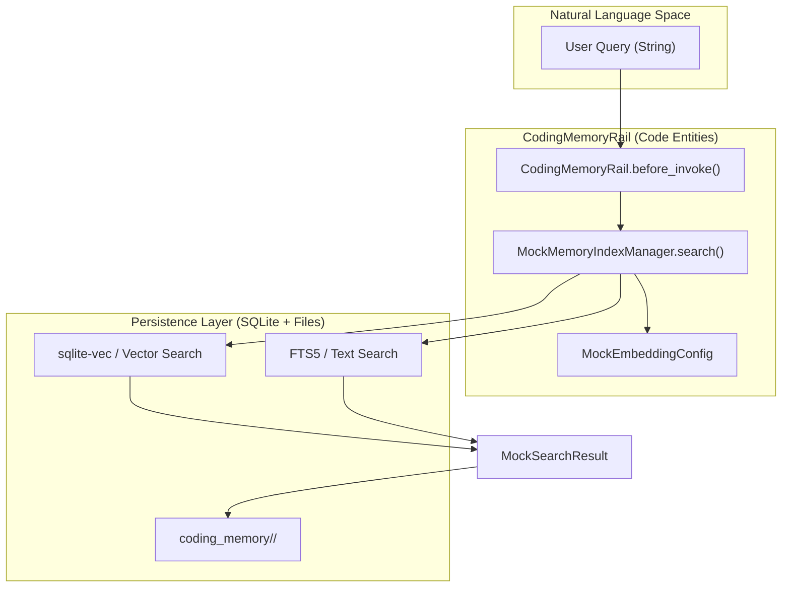
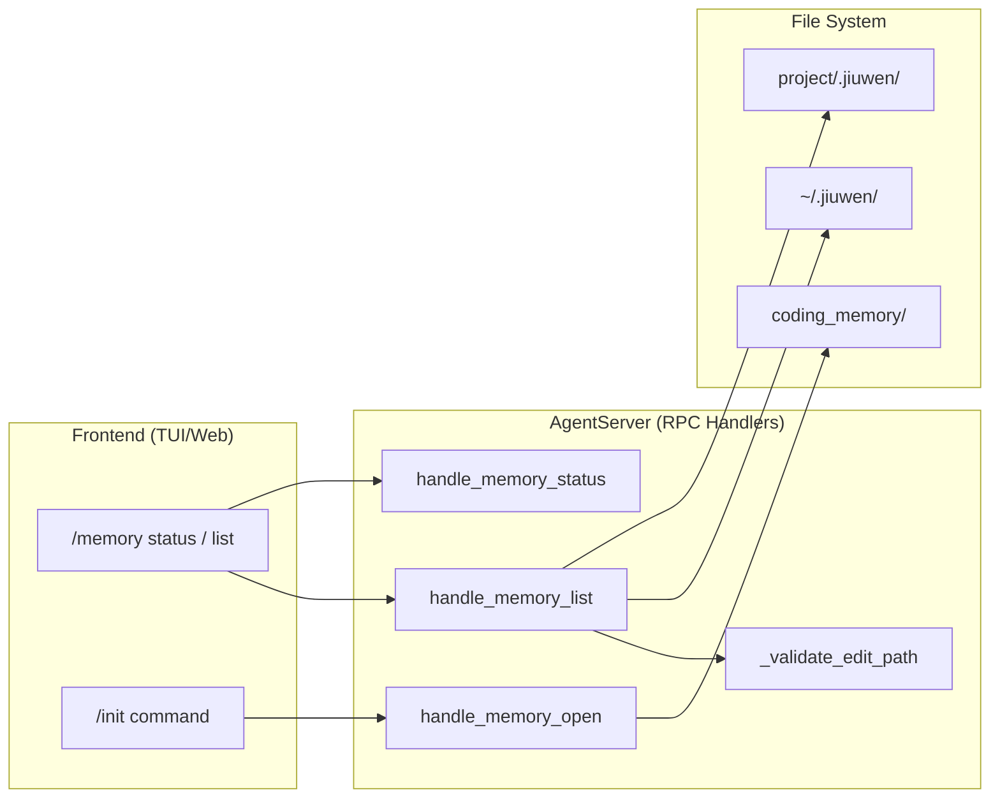

<!-- source: DeepWiki mcp.deepwiki.com · repo openJiuwen-ai/jiuwenswarm · page 4.1 Project Memory and Long-Term Memory · fetched 2026-11-02 -->

# Project Memory and Long-Term Memory

Relevant source files

The following files were used as context for generating this wiki page:

- [.gitignore](.gitignore)
- [jiuwenswarm/agents/harness/common/memory_rpc.py](jiuwenswarm/agents/harness/common/memory_rpc.py)
- [jiuwenswarm/agents/harness/common/rails/project_memory/files.py](jiuwenswarm/agents/harness/common/rails/project_memory/files.py)
- [jiuwenswarm/agents/harness/common/rails/project_memory_rail.py](jiuwenswarm/agents/harness/common/rails/project_memory_rail.py)
- [jiuwenswarm/channels/tui/frontend/src/core/commands/builtins/init.prompts.ts](jiuwenswarm/channels/tui/frontend/src/core/commands/builtins/init.prompts.ts)
- [jiuwenswarm/channels/tui/frontend/src/core/commands/builtins/init.ts](jiuwenswarm/channels/tui/frontend/src/core/commands/builtins/init.ts)
- [jiuwenswarm/channels/tui/frontend/src/core/commands/builtins/memory.ts](jiuwenswarm/channels/tui/frontend/src/core/commands/builtins/memory.ts)
- [jiuwenswarm/common/coding_memory_paths.py](jiuwenswarm/common/coding_memory_paths.py)
- [tests/system_tests/test_coding_memory.py](tests/system_tests/test_coding_memory.py)
- [tests/system_tests/test_project_memory.py](tests/system_tests/test_project_memory.py)
- [tests/unit_tests/agentserver/memory/__init__.py](tests/unit_tests/agentserver/memory/__init__.py)
- [tests/unit_tests/agentserver/memory/test_coding_memory_rail.py](tests/unit_tests/agentserver/memory/test_coding_memory_rail.py)
- [tests/unit_tests/agentserver/memory/test_coding_memory_tools.py](tests/unit_tests/agentserver/memory/test_coding_memory_tools.py)
- [tests/unit_tests/agentserver/memory/test_config.py](tests/unit_tests/agentserver/memory/test_config.py)
- [tests/unit_tests/agentserver/memory/test_frontmatter.py](tests/unit_tests/agentserver/memory/test_frontmatter.py)
- [tests/unit_tests/agentserver/memory/test_memory_rpc.py](tests/unit_tests/agentserver/memory/test_memory_rpc.py)
- [tests/unit_tests/agentserver/rails/test_project_memory_rail.py](tests/unit_tests/agentserver/rails/test_project_memory_rail.py)

The JiuwenSwarm memory system provides a multi-layered approach to context persistence, ranging from static project-level rules to dynamic, indexed long-term storage. It bridges the gap between the immediate conversation context and the vast knowledge stored in a repository or historical interactions.

## Project Memory Discovery

Project memory is a mechanism for injecting relevant markdown-based rules and documentation into an agent's prompt based on the current workspace or file path. This is primarily handled by the `ProjectMemoryRail` [jiuwenswarm/agents/harness/common/rails/project_memory_rail.py:20-21]() and its associated discovery helpers [jiuwenswarm/agents/harness/common/rails/project_memory/files.py:3-26]().

### Discovery Layers and Priority
Memory files are discovered across multiple layers. The system searches for files like `JIUWENSWARM.md` and `JIUWENSWARM.local.md` [jiuwenswarm/agents/harness/common/memory_rpc.py:91-91](). Higher-priority layers semantically override or append to lower ones [jiuwenswarm/agents/harness/common/rails/project_memory/files.py:28-29]():

| Layer | Priority | Location Examples |
| :--- | :--- | :--- |
| **Managed** | 10 | `/etc/jiuwen/JIUWENSWARM.md`, `/etc/jiuwen/rules/*.md` |
| **User** | 20 | `~/.jiuwen/JIUWENSWARM.md`, `~/.jiuwen/rules/*.md` |
| **Project** | 30 | `.jiuwen/JIUWENSWARM.md`, `.jiuwen/rules/*.md` |
| **Local** | 40 | `JIUWENSWARM.local.md` |

### Frontmatter Scoping and @include Syntax
Files support YAML frontmatter to restrict their application to specific sub-paths within a workspace using the `paths:` key [jiuwenswarm/agents/harness/common/rails/project_memory/files.py:17-20](). Additionally, the `@include` syntax allows files to reference other files, which are expanded during the loading process [jiuwenswarm/agents/harness/common/rails/project_memory/files.py:16-16]().

**Discovery Flow Logic:**
1.  **Root Identification**: The system identifies the workspace root and checks for markers like `.git` [tests/system_tests/test_project_memory.py:83-83]().
2.  **File Scanning**: The `discover_and_load_memory_files` function scans the workspace for supported markdown files [jiuwenswarm/agents/harness/common/rails/project_memory/__init__.py:22-22]().
3.  **Merging**: Content is merged into a single system prompt section named `Project Memory` (or `项目记忆` in Chinese) [tests/unit_tests/agentserver/rails/test_project_memory_rail.py:97-98]().
4.  **Injection**: The `ProjectMemoryRail` injects this content into the `system_prompt_builder` before model calls [tests/system_tests/test_project_memory.py:88-91]().

**Sources:** [jiuwenswarm/agents/harness/common/rails/project_memory/files.py:1-29](), [jiuwenswarm/agents/harness/common/rails/project_memory_rail.py:19-21](), [tests/system_tests/test_project_memory.py:80-120](), [jiuwenswarm/agents/harness/common/memory_rpc.py:90-105]()

---

## Long-Term Memory (LTM) Architecture

The Long-Term Memory system manages indexing and hybrid search (Vector + Full-Text Search).

### MemoryIndexManager and Coding Memory
The `MemoryIndexManager` (or its mock equivalent in testing) manages the persistence and retrieval of "Coding Memory" [tests/unit_tests/agentserver/memory/test_coding_memory_rail.py:29-34](). This memory is project-scoped and stored under `<agent_workspace>/coding_memory/<project_name>` [jiuwenswarm/common/coding_memory_paths.py:30-40]().

#### Data Flow: Natural Language to Code Entity Space
The following diagram illustrates how natural language queries are transformed into structured database lookups.

**Memory Search Pipeline**

**Sources:** [tests/unit_tests/agentserver/memory/test_coding_memory_rail.py:29-54](), [jiuwenswarm/common/coding_memory_paths.py:30-40](), [tests/unit_tests/agentserver/memory/test_coding_memory_rail.py:218-224]()

### Hybrid Search Mechanism
Search results are retrieved using a combination of semantic vector similarity and keyword matching.
1.  **Vector Search**: Uses embedding models configured via `embed` settings (API key, base URL, model) [jiuwenswarm/agents/harness/common/memory/config.py:56-71]().
2.  **Recall Limits**: Recalled content is constrained by `MAX_RECALL_RESULTS` (default 5) and `MAX_RECALL_TOTAL_BYTES` (default 10KB) to prevent prompt overflow [tests/unit_tests/agentserver/memory/test_coding_memory_rail.py:158-159]().

**Sources:** [tests/unit_tests/agentserver/memory/test_coding_memory_rail.py:48-54](), [tests/unit_tests/agentserver/memory/test_config.py:56-71]()

---

## Initialization and Tools

Users can initialize project memory using the `/init` slash command, which generates the `JIUWENSWARM.md` and `JIUWENSWARM.local.md` files [jiuwenswarm/channels/tui/frontend/src/core/commands/builtins/init.ts:72-74]().

### Memory Tools for Agents
Agents utilize specific tools for managing memory files:
- **Write/Edit**: Tools for creating or modifying markdown files in allowed memory directories [tests/system_tests/test_coding_memory.py:147-157]().
- **Discovery**: The `explore_agent` is often used to scan repositories and gather signals for memory initialization [jiuwenswarm/channels/tui/frontend/src/core/commands/builtins/init.prompts.ts:72-75]().

**Sources:** [jiuwenswarm/channels/tui/frontend/src/core/commands/builtins/init.ts:70-77](), [jiuwenswarm/channels/tui/frontend/src/core/commands/builtins/init.prompts.ts:47-65](), [tests/system_tests/test_coding_memory.py:142-174]()

---

## Frontend Integration and RPC

The frontend communicates with the memory system via RPC handlers defined in `memory_rpc.py` to provide visibility into the memory state.

### Memory RPC Handlers
The RPC layer handles requests for status, listing, and editing memory.

**Frontend to Backend Memory RPC Flow**

### Key RPC Functions
- `handle_memory_list`: Scans directories like `~/.jiuwen`, `.jiuwen`, and `coding_memory` to return a list of markdown files [jiuwenswarm/agents/harness/common/memory_rpc.py:178-190]().
- `_validate_edit_path`: Security filter that ensures file operations are restricted to allowed memory directories [jiuwenswarm/agents/harness/common/memory_rpc.py:73-105]().
- `handle_memory_status`: Returns detailed statistics, including index availability (FTS/Vector), file counts, and character totals for project and coding memory [jiuwenswarm/channels/tui/frontend/src/core/commands/builtins/memory.ts:24-62]().

**Sources:** [jiuwenswarm/agents/harness/common/memory_rpc.py:44-54](), [jiuwenswarm/agents/harness/common/memory_rpc.py:178-194](), [jiuwenswarm/channels/tui/frontend/src/core/commands/builtins/memory.ts:99-167](), [tests/unit_tests/agentserver/memory/test_memory_rpc.py:11-22]()

---

