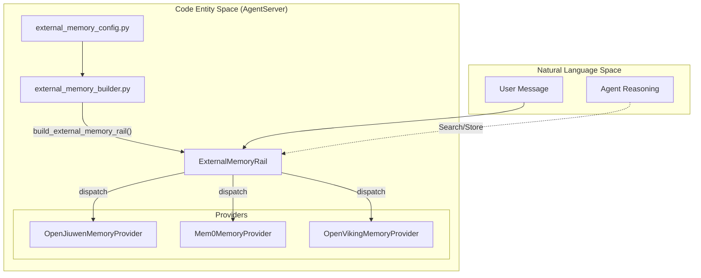
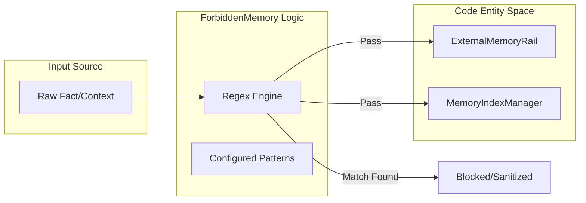

<!-- source: DeepWiki mcp.deepwiki.com · repo openJiuwen-ai/jiuwenswarm · page 4.2 External Memory Providers and Forbidden Memory · fetched 2026-11-02 -->

# External Memory Providers and Forbidden Memory

Relevant source files

The following files were used as context for generating this wiki page:

- [docs/en/developer_guide.md](docs/en/developer_guide.md)
- [docs/zh/developer_guide.md](docs/zh/developer_guide.md)
- [scripts/build_python_packages.py](scripts/build_python_packages.py)
- [tests/system_tests/test_coding_memory.py](tests/system_tests/test_coding_memory.py)
- [tests/unit_tests/agentserver/memory/__init__.py](tests/unit_tests/agentserver/memory/__init__.py)
- [tests/unit_tests/agentserver/memory/test_coding_memory_rail.py](tests/unit_tests/agentserver/memory/test_coding_memory_rail.py)
- [tests/unit_tests/agentserver/memory/test_coding_memory_tools.py](tests/unit_tests/agentserver/memory/test_coding_memory_tools.py)
- [tests/unit_tests/agentserver/memory/test_config.py](tests/unit_tests/agentserver/memory/test_config.py)
- [tests/unit_tests/agentserver/memory/test_external_memory_builder.py](tests/unit_tests/agentserver/memory/test_external_memory_builder.py)
- [tests/unit_tests/agentserver/memory/test_external_memory_config.py](tests/unit_tests/agentserver/memory/test_external_memory_config.py)
- [tests/unit_tests/agentserver/memory/test_frontmatter.py](tests/unit_tests/agentserver/memory/test_frontmatter.py)

The JiuwenSwarm memory system extends beyond local project context through integration with external Long-Term Memory (LTM) providers and robust security filtering via the Forbidden Memory mechanism. This architecture allows agents to persist facts across sessions while ensuring sensitive data is never stored.

## 1. Memory Engine Architecture

JiuwenSwarm utilizes a dual-engine approach to memory management, controlled by the `memory.engine` configuration. The system supports multiple modes to balance between local project context and global persistent knowledge.

### Engine Modes
*   **`builtin`**: Only local project and coding memory are active.
*   **`external`**: Only the configured external LTM provider is active.
*   **`both`**: Concurrent use of both local and external memory tools.
*   **`none`**: Disables all memory persistence rails.

The logic for parsing these modes is handled in `get_memory_engine`, which defaults to `builtin` if the configuration is missing or invalid [tests/unit_tests/agentserver/memory/test_external_memory_config.py:90-110]().

### Data Flow and Rail Integration
External memory is implemented as a specialized "Rail" that intercepts the agent's reasoning loop. The `external_memory_builder.py` module is responsible for dispatching the correct provider class based on the configuration [tests/unit_tests/agentserver/memory/test_external_memory_builder.py:3-7]().

**Memory Provider Implementation Diagram**

Sources: [tests/unit_tests/agentserver/memory/test_external_memory_builder.py:105-112](), [tests/unit_tests/agentserver/memory/test_external_memory_config.py:117-127]()

## 2. External Memory Providers

JiuwenSwarm supports three primary backends for long-term memory. The configuration for these is managed via the `get_external_memory_config` function, which populates provider-specific settings [tests/unit_tests/agentserver/memory/test_external_memory_config.py:133-142]().

### 2.1 OpenJiuwen LTM
A privacy-first solution that maps to a provider-expected shape via `build_openjiuwen_provider_config` [tests/unit_tests/agentserver/memory/test_external_memory_config.py:188-190]().
*   **Vector Store**: Uses `chroma` as the default vector backend [tests/unit_tests/agentserver/memory/test_external_memory_config.py:202]().
*   **KV Store**: Uses `shelve` by default for simple key-value persistence [tests/unit_tests/agentserver/memory/test_external_memory_config.py:201]().
*   **Relational**: Uses `sqlite` for structured data [tests/unit_tests/agentserver/memory/test_external_memory_config.py:203]().

### 2.2 Mem0
A cloud-based memory service. The `Mem0MemoryProvider` requires an `api_key`, `user_id`, and `agent_id` for initialization [tests/unit_tests/agentserver/memory/test_external_memory_builder.py:52-56](). It also supports semantic `rerank` capabilities [tests/unit_tests/agentserver/memory/test_external_memory_builder.py:55]().

### 2.3 OpenViking
An enterprise-grade backend. The `OpenVikingMemoryProvider` is initialized with an `endpoint`, `account`, and `api_key` [tests/unit_tests/agentserver/memory/test_external_memory_builder.py:68-73]().

| Provider | Type | Backend Key | Availability Check |
| :--- | :--- | :--- | :--- |
| **OpenJiuwen** | Local/Hybrid | `openjiuwen` | `OpenJiuwenMemoryProvider.is_available()` |
| **Mem0** | Cloud SaaS | `mem0` | `Mem0MemoryProvider.is_available()` |
| **OpenViking** | Enterprise | `openviking` | `OpenVikingMemoryProvider.is_available()` |

Sources: [tests/unit_tests/agentserver/memory/test_external_memory_builder.py:36-77](), [tests/unit_tests/agentserver/memory/test_external_memory_config.py:144-156]()

## 3. Forbidden Memory (Security Filter)

The Forbidden Memory system acts as a security gatekeeper, preventing sensitive information from being persisted. It utilizes regex patterns to scan content before storage operations.

### Security Implementation
The filter logic is integrated into the memory pipeline. Before any `Store` operation is committed to an external provider or the local `MemoryIndexManager`, the content is processed to ensure no forbidden patterns (e.g., API keys, passwords) are present.

**Security Filtering Diagram**

Sources: [tests/unit_tests/agentserver/memory/test_coding_memory_rail.py:29-38](), [tests/unit_tests/agentserver/memory/test_config.py:19-28]()

## 4. Memory Control and Environment

The memory system's behavior is influenced by environment variables, which are resolved recursively in the configuration via `_resolve_env_vars` [tests/unit_tests/agentserver/memory/test_config.py:19-28]().

### Configuration Toggles
*   **`is_memory_enabled`**: A global toggle that defaults to `True` if not explicitly disabled in the configuration [tests/unit_tests/agentserver/memory/test_config.py:44-53]().
*   **`get_memory_mode`**: Determines if the system operates in `local` (default) or `cloud` mode [tests/unit_tests/agentserver/memory/test_config.py:37-41]().
*   **`get_embed_config`**: Retrieves API keys and base URLs for embedding models used in vector search [tests/unit_tests/agentserver/memory/test_config.py:56-70]().

### Runtime Validation
For local coding memory, the system performs path validation to prevent directory traversal attacks, ensuring memory files remain within the designated workspace [tests/unit_tests/agentserver/memory/test_coding_memory_tools.py:19-34]().

Sources: [tests/unit_tests/agentserver/memory/test_config.py:73-103](), [tests/unit_tests/agentserver/memory/test_coding_memory_tools.py:19-34]()

---

