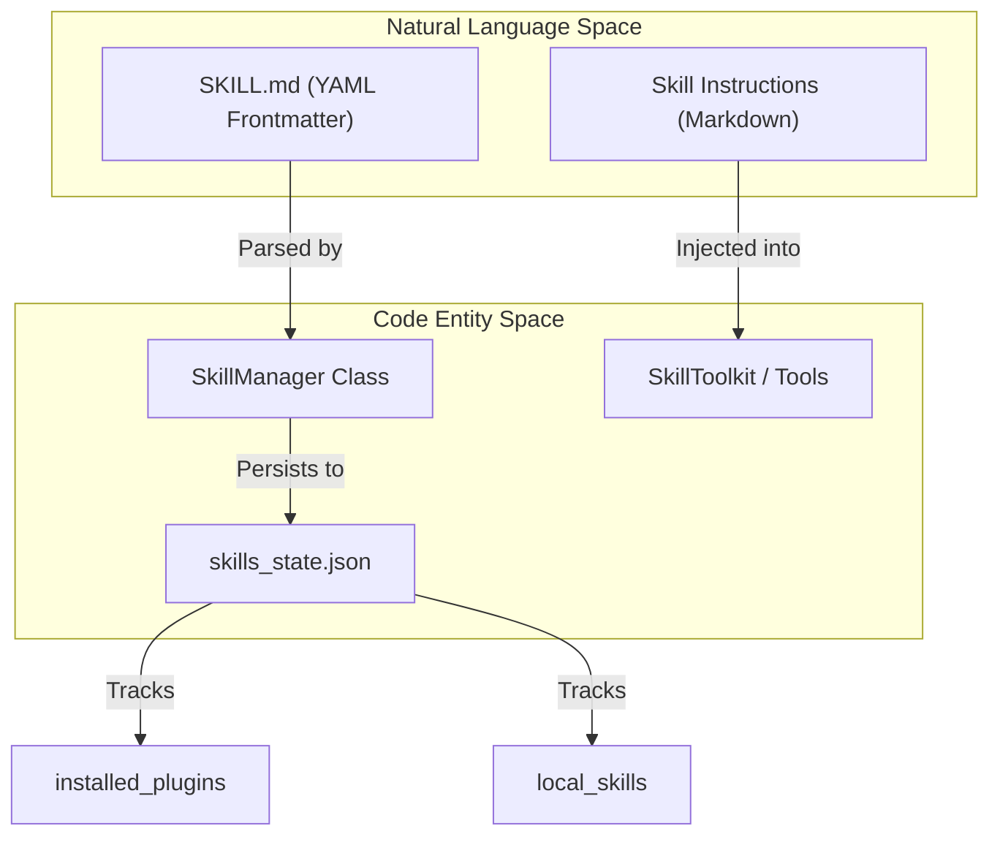
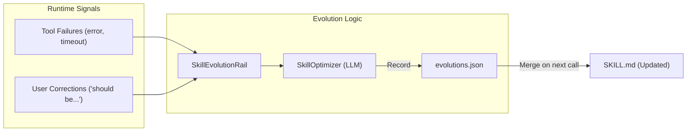

<!-- source: DeepWiki mcp.deepwiki.com · repo openJiuwen-ai/jiuwenswarm · page 5 Skill System · fetched 2026-11-02 -->

# Skill System

Relevant source files

The following files were used as context for generating this wiki page:

- [docs/en/Configuration.md](docs/en/Configuration.md)
- [docs/en/SkillSelfEvolution.md](docs/en/SkillSelfEvolution.md)
- [docs/en/Skills.md](docs/en/Skills.md)
- [jiuwenswarm/agents/harness/team/__init__.py](jiuwenswarm/agents/harness/team/__init__.py)
- [jiuwenswarm/agents/harness/team/rails/team_member_skill_toolkit_rail.py](jiuwenswarm/agents/harness/team/rails/team_member_skill_toolkit_rail.py)
- [jiuwenswarm/agents/harness/team/rails/team_shared_skill_link_refresh_rail.py](jiuwenswarm/agents/harness/team/rails/team_shared_skill_link_refresh_rail.py)
- [jiuwenswarm/agents/harness/team/team_skill_links.py](jiuwenswarm/agents/harness/team/team_skill_links.py)
- [jiuwenswarm/server/runtime/agent_adapter/interface.py](jiuwenswarm/server/runtime/agent_adapter/interface.py)
- [jiuwenswarm/server/runtime/skill/skill_manager.py](jiuwenswarm/server/runtime/skill/skill_manager.py)
- [tests/unit_tests/agentserver/test_skill_manager_enable_disable.py](tests/unit_tests/agentserver/test_skill_manager_enable_disable.py)
- [tests/unit_tests/agentserver/test_skill_manager_path_safety.py](tests/unit_tests/agentserver/test_skill_manager_path_safety.py)

The Skill System in JiuwenSwarm provides a robust framework for extending the capabilities of the agent through modular extensions. Skills are defined as installable, manageable, and reusable capability packages that expand the agent's capability boundaries beyond base chat and file operations [docs/en/Skills.md:9-13]().

This page offers a high-level overview of the Skills extension framework, including the concepts of skills, their lifecycle, and the mechanisms for their evolution.

## Core Concepts

A skill is typically a directory containing a **`SKILL.md`** file, which uses YAML frontmatter to define the skill's name, version, and purpose, alongside Markdown content describing the execution steps and constraints [docs/en/Skills.md:16-18]().

### Skill Sources
JiuwenSwarm supports a multi-source discovery model managed by the `SkillManager` [jiuwenswarm/server/runtime/skill/skill_manager.py:3-4]():

| Source | Description |
| :--- | :--- |
| **Built-in** | Core skills shipped with the product distribution [docs/en/Skills.md:59-59](). |
| **SkillNet** | A general AI skill connection platform based on GitHub repositories [docs/en/Skills.md:60-60](). |
| **ClawHub** | The official JiuwenSwarm ecosystem "app store" (https://clawhub.ai) [docs/en/Skills.md:61-61](). |
| **Marketplace** | Community-contributed third-party sources added via URL [docs/en/Skills.md:62-62](). |
| **Local Import** | User-authored skill files for development and debugging [docs/en/Skills.md:63-63](). |

Sources: [docs/en/Skills.md:53-64](), [jiuwenswarm/server/runtime/skill/skill_manager.py:100-131]()

## Architecture and Code Mapping

The skill system bridges natural language descriptions in `SKILL.md` with the execution logic in the `AgentServer`.

### From Language to Code
The following diagram illustrates how natural language skill definitions are processed into the system's runtime state.

**Skill Definition to Code Mapping**

Sources: [jiuwenswarm/server/runtime/skill/skill_manager.py:3-15](), [jiuwenswarm/server/runtime/skill/skilldev/state_utils.py:103-111](), [docs/en/Skills.md:16-18]()

### Skill Management and Lifecycle
The `SkillManager` handles the installation pipeline, including directory creation, zip extraction (with Zip-Slip protection), and state persistence [jiuwenswarm/server/runtime/skill/skill_manager.py:902-1050]().

*   **Discovery**: Searching SkillNet, ClawHub, or local paths.
*   **Installation**: Cloning from Git or extracting archives into the `_marketplace` or `skills` directory [jiuwenswarm/server/runtime/skill/skill_manager.py:95-96]().
*   **Persistence**: The `skills_state.json` file tracks enabled/disabled status and origins [jiuwenswarm/server/runtime/skill/skilldev/state_utils.py:105-110]().

For details, see [Skill Management and Lifecycle](#5.1).

Sources: [jiuwenswarm/server/runtime/skill/skill_manager.py:3-15](), [tests/unit_tests/agentserver/test_skill_manager_enable_disable.py:31-33]()

## Skill Self-Evolution

Unlike static tools, JiuwenSwarm skills can "evolve." The system uses a `SignalDetector` to watch for execution failures (e.g., timeouts) or user corrections (e.g., "that's wrong") [docs/en/SkillSelfEvolution.md:19-33]().

**Evolution Signal Pipeline**

Sources: [docs/en/SkillSelfEvolution.md:7-22](), [jiuwenswarm/server/runtime/agent_adapter/interface.py:128-131]()

*   **SkillEvolutionRail**: Intercepts tool results and user messages to identify improvement opportunities.
*   **evolutions.json**: A per-skill log that stores pending and applied changes [docs/en/SkillSelfEvolution.md:98-122]().
*   **Solidification**: The process of merging LLM-generated troubleshooting notes or examples back into the physical `SKILL.md` file [docs/en/SkillSelfEvolution.md:15-18]().

For details, see [Skill Self-Evolution](#5.2).

Sources: [docs/en/SkillSelfEvolution.md:5-18](), [jiuwenswarm/server/runtime/agent_adapter/interface.py:128-131]()

## Team and Multi-Agent Skills

In Team Mode, skills can be shared across multiple agents. The `TeamManager` coordinates the synchronization of skill directories, often using symbolic links or Windows junctions to provide a unified view of available capabilities across different agent workspaces [jiuwenswarm/agents/harness/team/team_skill_links.py:50-55]().

*   **TeamSharedSkillLinkRefreshRail**: Automatically refreshes shared links when a skill is updated [jiuwenswarm/agents/harness/team/rails/team_shared_skill_link_refresh_rail.py:17-18]().
*   **MemberSkillToolkitRail**: Binds skill-management tools (install/uninstall) specifically to a team member's scoped workspace [jiuwenswarm/agents/harness/team/rails/team_member_skill_toolkit_rail.py:23-24]().

Sources: [jiuwenswarm/agents/harness/team/team_skill_links.py:50-70](), [jiuwenswarm/agents/harness/team/rails/team_member_skill_toolkit_rail.py:41-50]()

---

- For details on installation and the `SkillManager`, see [Skill Management and Lifecycle](#5.1).
- For details on the evolution subsystem and `SignalDetector`, see [Skill Self-Evolution](#5.2).

---

