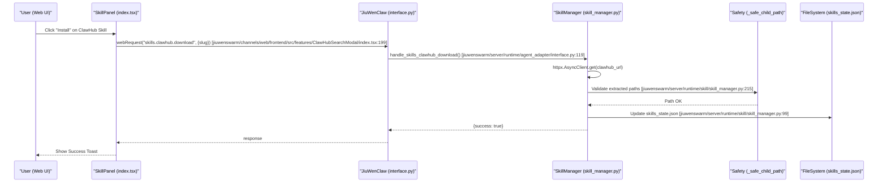
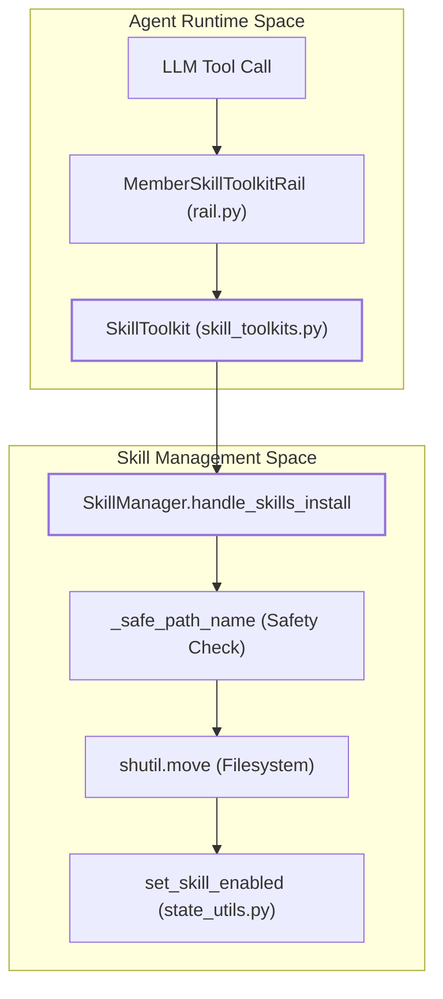

<!-- source: DeepWiki mcp.deepwiki.com · repo openJiuwen-ai/jiuwenswarm · page 5.1 Skill Management and Lifecycle · fetched 2026-11-02 -->

# Skill Management and Lifecycle

Relevant source files

The following files were used as context for generating this wiki page:

- [docs/assets/images/skill_page_auto.png](docs/assets/images/skill_page_auto.png)
- [jiuwenswarm/agents/harness/team/__init__.py](jiuwenswarm/agents/harness/team/__init__.py)
- [jiuwenswarm/agents/harness/team/rails/team_member_skill_toolkit_rail.py](jiuwenswarm/agents/harness/team/rails/team_member_skill_toolkit_rail.py)
- [jiuwenswarm/agents/harness/team/rails/team_shared_skill_link_refresh_rail.py](jiuwenswarm/agents/harness/team/rails/team_shared_skill_link_refresh_rail.py)
- [jiuwenswarm/agents/harness/team/team_skill_links.py](jiuwenswarm/agents/harness/team/team_skill_links.py)
- [jiuwenswarm/channels/web/frontend/src/components/SkillPanel/index.tsx](jiuwenswarm/channels/web/frontend/src/components/SkillPanel/index.tsx)
- [jiuwenswarm/channels/web/frontend/src/components/Switch/index.tsx](jiuwenswarm/channels/web/frontend/src/components/Switch/index.tsx)
- [jiuwenswarm/channels/web/frontend/src/features/ClawHubSearchModal/index.tsx](jiuwenswarm/channels/web/frontend/src/features/ClawHubSearchModal/index.tsx)
- [jiuwenswarm/channels/web/frontend/src/features/SkillNetSearchModal/index.tsx](jiuwenswarm/channels/web/frontend/src/features/SkillNetSearchModal/index.tsx)
- [jiuwenswarm/channels/web/frontend/src/features/SourceManagerModal/index.tsx](jiuwenswarm/channels/web/frontend/src/features/SourceManagerModal/index.tsx)
- [jiuwenswarm/channels/web/frontend/src/features/TeamSkillsHubModal/index.tsx](jiuwenswarm/channels/web/frontend/src/features/TeamSkillsHubModal/index.tsx)
- [jiuwenswarm/server/runtime/agent_adapter/interface.py](jiuwenswarm/server/runtime/agent_adapter/interface.py)
- [jiuwenswarm/server/runtime/skill/__init__.py](jiuwenswarm/server/runtime/skill/__init__.py)
- [jiuwenswarm/server/runtime/skill/skill_manager.py](jiuwenswarm/server/runtime/skill/skill_manager.py)
- [jiuwenswarm/server/runtime/skill/skilldev/__init__.py](jiuwenswarm/server/runtime/skill/skilldev/__init__.py)
- [jiuwenswarm/server/runtime/skill/skilldev/state_utils.py](jiuwenswarm/server/runtime/skill/skilldev/state_utils.py)
- [tests/unit_tests/agentserver/test_skill_manager_enable_disable.py](tests/unit_tests/agentserver/test_skill_manager_enable_disable.py)
- [tests/unit_tests/agentserver/test_skill_manager_path_safety.py](tests/unit_tests/agentserver/test_skill_manager_path_safety.py)

The Skill System in JiuwenSwarm allows for the dynamic extension of agent capabilities through "Skills"—packaged sets of tools, prompts, and logic. The `SkillManager` is the central authority for discovering, installing, and managing the lifecycle of these extensions.

## Skill Discovery and Sources

Skills are discovered from multiple sources, ranging from built-in system tools to remote marketplaces. The `SkillManager` aggregates these into a unified view for the agent and the user.

| Source | Description | Implementation Detail |
| :--- | :--- | :--- |
| **Builtin** | Core skills bundled with the JiuwenSwarm distribution. | Loaded from `get_builtin_skills_dir()` [jiuwenswarm/server/runtime/skill/skill_manager.py:39](). |
| **Local** | User-developed skills or manually imported folders. | Stored in the user's workspace `skills/` directory [jiuwenswarm/server/runtime/skill/skill_manager.py:38](). |
| **ClawHub** | Remote repository of community skills with token-based access. | Managed via `_get_marketplace_dir()` [jiuwenswarm/server/runtime/skill/skill_manager.py:95-96](). |
| **Team Skills Hub** | A specialized marketplace for enterprise/team environments. | Uses `TEAM_SKILLS_HUB_BASE_URL` (default: `https://teamskills.openjiuwen.com`) [jiuwenswarm/server/runtime/skill/skill_manager.py:61-62](). |
| **SkillNet** | A discovery protocol for finding skills via external indices. | Controlled by `SKILLNET_DOWNLOAD_TIMEOUT` and proxy settings [jiuwenswarm/server/runtime/skill/skill_manager.py:45-57](). |

**Sources:** [jiuwenswarm/server/runtime/skill/skill_manager.py:36-100](), [jiuwenswarm/channels/web/frontend/src/components/SkillPanel/index.tsx:107-112]()

## Installation Pipeline

The installation process transforms a "Skill Spec" (a URL, a local path, or a marketplace slug) into an active skill directory.

### Validation and Safety
Before extraction, the `SkillManager` performs rigorous path safety checks to prevent directory traversal attacks. The functions `_safe_path_name` and `_safe_child_path` ensure that skill names do not contain `..` or absolute paths [jiuwenswarm/server/runtime/skill/skill_manager.py:198-220]().

### Extraction Logic
1.  **Download/Clone**: For remote sources, the system supports Git clones, ZIP extraction, or TAR archives [jiuwenswarm/server/runtime/skill/skill_manager.py:16-20]().
2.  **Staging**: Files are extracted into a temporary directory.
3.  **SKILL.md Validation**: Every skill must contain a `SKILL.md` file with a YAML frontmatter header defining its `name`, `version`, and `description` [tests/unit_tests/agentserver/test_skill_manager_path_safety.py:76-79]().
4.  **Persistence**: Once validated, the skill is moved to the local workspace and registered in `skills_state.json`.

### Skill Installation Flow
The following diagram bridges the user's request from the Web UI to the internal code execution flow.

**Sources:** [jiuwenswarm/server/runtime/skill/skill_manager.py:198-220](), [jiuwenswarm/server/runtime/agent_adapter/interface.py:100-131](), [jiuwenswarm/channels/web/frontend/src/features/ClawHubSearchModal/index.tsx:187-217]()

## State Management and Persistence

The system maintains a persistent record of all installed and modified skills to ensure consistency across restarts.

### `skills_state.json`
Located in the agent's skills directory, this file is managed via `state_utils.py` [jiuwenswarm/server/runtime/skill/skill_manager.py:103-111](). It tracks:
*   **Installed Plugins**: List of marketplace-sourced skills [tests/unit_tests/agentserver/test_skill_manager_enable_disable.py:64-72]().
*   **Local Skills**: Manually imported or developed skills [tests/unit_tests/agentserver/test_skill_manager_enable_disable.py:69-71]().
*   **Enable/Disable Status**: A map of skill names to their boolean `enabled` state [tests/unit_tests/agentserver/test_skill_manager_enable_disable.py:37-50]().

### `evolutions.json`
Skills that have undergone "Self-Evolution" track their iterative changes in `evolutions.json` [jiuwenswarm/server/runtime/skill/skill_manager.py:88](). This file maps specific code changes back to the agent's reasoning process using `EvolutionRecord` and `EvolutionLog` objects [jiuwenswarm/server/runtime/skill/skill_manager.py:32-35]().

**Sources:** [jiuwenswarm/server/runtime/skill/skill_manager.py:88-111](), [tests/unit_tests/agentserver/test_skill_manager_enable_disable.py:17-50]()

## Skill Development and Toolkits

The `SkillDevService` and `SkillToolkit` provide the programmatic and UI interfaces for creating and managing skills.

### Key Class: `SkillToolkit`
The `SkillToolkit` exposes high-level methods to the LLM, allowing an agent to manage its own capabilities [jiuwenswarm/agents/harness/team/rails/team_member_skill_toolkit_rail.py:49]().
*   `install_skill`: Programmatically adds new capabilities.
*   `uninstall_skill`: Removes local skill directories and updates state [jiuwenswarm/agents/harness/team/rails/team_member_skill_toolkit_rail.py:99]().

### Internal Logic Interaction
This diagram shows how the `SkillToolkit` acts as a bridge between the Agent's decision-making and the `SkillManager`'s filesystem operations.

**Sources:** [jiuwenswarm/agents/harness/team/rails/team_member_skill_toolkit_rail.py:23-71](), [jiuwenswarm/server/runtime/skill/skill_manager.py:198-212](), [tests/unit_tests/agentserver/test_skill_manager_enable_disable.py:95-108]()

## Team Mode Synchronization

In Team Mode, skills can be shared across members using the `TeamSharedSkillLinkRefreshRail` [jiuwenswarm/agents/harness/team/rails/team_shared_skill_link_refresh_rail.py:17]().

*   **Refresh Trigger**: When an agent uses `write_file` or `edit_file` within the global skills directory, the rail triggers a link refresh [jiuwenswarm/agents/harness/team/rails/team_shared_skill_link_refresh_rail.py:32-44]().
*   **Member Isolation**: Each member can have its own `MemberSkillToolkitRail` to manage workspace-specific skills [jiuwenswarm/agents/harness/team/rails/team_member_skill_toolkit_rail.py:23-34]().

**Sources:** [jiuwenswarm/agents/harness/team/rails/team_shared_skill_link_refresh_rail.py:17-44](), [jiuwenswarm/agents/harness/team/rails/team_member_skill_toolkit_rail.py:41-71]()

---

