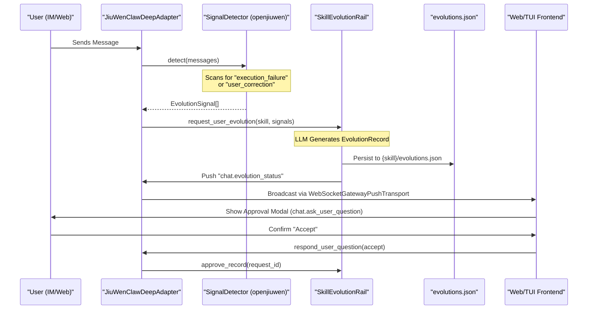
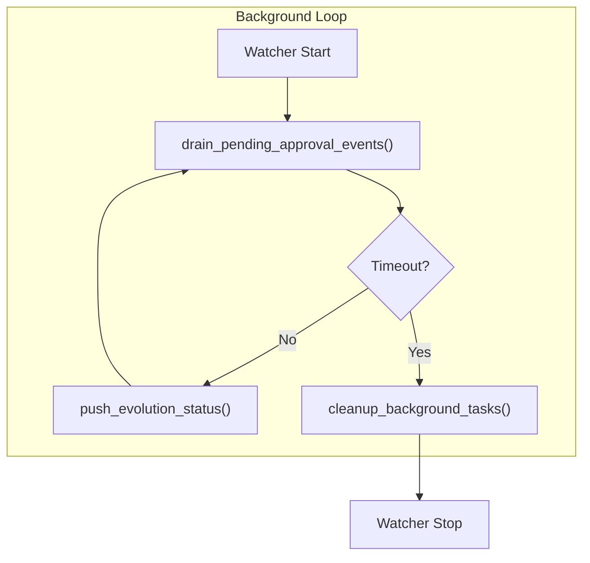

<!-- source: DeepWiki mcp.deepwiki.com · repo openJiuwen-ai/jiuwenswarm · page 5.2 Skill Self-Evolution · fetched 2026-11-02 -->

# Skill Self-Evolution

Relevant source files

The following files were used as context for generating this wiki page:

- [docs/assets/images/config_self_evolve.png](docs/assets/images/config_self_evolve.png)
- [jiuwenswarm/channels/tui/frontend/src/core/commands/builtins/evolve.ts](jiuwenswarm/channels/tui/frontend/src/core/commands/builtins/evolve.ts)
- [jiuwenswarm/server/runtime/agent_adapter/evolution_helpers.py](jiuwenswarm/server/runtime/agent_adapter/evolution_helpers.py)
- [jiuwenswarm/server/runtime/agent_adapter/team_helpers.py](jiuwenswarm/server/runtime/agent_adapter/team_helpers.py)
- [tests/unit_tests/agentserver/test_evolution_helpers.py](tests/unit_tests/agentserver/test_evolution_helpers.py)
- [tests/unit_tests/agentserver/test_evolution_push_delivery.py](tests/unit_tests/agentserver/test_evolution_push_delivery.py)
- [tests/unit_tests/agentserver/test_evolve_command_edges.py](tests/unit_tests/agentserver/test_evolve_command_edges.py)
- [tests/unit_tests/agentserver/test_team_helpers.py](tests/unit_tests/agentserver/test_team_helpers.py)
- [tests/unit_tests/evolution/test_schema.py](tests/unit_tests/evolution/test_schema.py)
- [tests/unit_tests/evolution/test_signal_detector.py](tests/unit_tests/evolution/test_signal_detector.py)

The Skill Self-Evolution subsystem is a proactive mechanism that enables JiuwenSwarm agents to improve their own capabilities. It monitors agent trajectories, detects patterns that suggest a need for new or improved skills, generates code-level "experience" (evolutions), and manages a human-in-the-loop approval workflow.

## Architecture Overview

The evolution system is implemented as a set of **Rails** that intercept agent activity and a background **Watcher** task that monitors the state of generated evolution proposals. It bridges the gap between high-level agent reasoning and the underlying file-based skill storage.

### Key Components

| Component | Role | File Reference |
| :--- | :--- | :--- |
| `SkillEvolutionRail` | Detects evolution signals in single-agent mode and triggers experience generation. | [jiuwenswarm/server/runtime/agent_adapter/interface_deep.py:127-128]() |
| `TeamSkillEvolutionRail` | Orchestrates skill evolution across a multi-agent team. | [jiuwenswarm/agents/harness/team/monitor_handler.py:28-28]() |
| `TeamSkillCreateRail` | Specifically handles the generation of entirely new skills. | [jiuwenswarm/server/runtime/agent_adapter/evolution_helpers.py:175-187]() |
| `EvolutionWatcher` | A background `asyncio.Task` that polls for completion of evolution generation via `_watch_team_evolution_and_push`. | [jiuwenswarm/server/runtime/agent_adapter/team_helpers.py:72-73]() |
| `SignalDetector` | Core logic for extracting "execution_failure" or "user_correction" signals from message history. | [openjiuwen/agent_evolving/signal.py:7-16]() |

### Data Flow: Signal to Approval

The following diagram illustrates how a natural language interaction triggers a code-level skill evolution proposal and its subsequent persistence.

**Diagram: Evolution Signal to Code Entity Space**

*Sources: [jiuwenswarm/server/runtime/agent_adapter/team_helpers.py:124-167](), [jiuwenswarm/server/runtime/agent_adapter/evolution_helpers.py:12-45](), [openjiuwen/agent_evolving/signal.py:16-42]()*

---

## Evolution Signal Detection

The system detects evolution signals by analyzing the agent's reasoning process and tool usage history using the `SignalDetector` class.

### Signal Types
*   **Execution Failure**: Detected when tool outputs contain keywords like `traceback`, `exception`, or `错误` [openjiuwen/agent_evolving/signal.py:175-186]().
*   **User Correction**: Detected when a user follows an agent's tool call with feedback like "不对，应该这样做" [openjiuwen/agent_evolving/signal.py:45-60]().

### Evolution Status Stages
The system reports progress to the UI via the `chat.evolution_status` event type, mapping internal SDK stages to normalized user-facing stages:
*   `detecting`: Analysis of signals is underway (`started`, `detecting_signals`) [jiuwenswarm/server/runtime/agent_adapter/evolution_helpers.py:83-84]().
*   `generating`: The LLM is writing the Python code or `SKILL.md` updates (`staging`, `generating_updates`) [jiuwenswarm/server/runtime/agent_adapter/evolution_helpers.py:85-86]().
*   `approval_required`: The proposal is ready for user review [jiuwenswarm/server/runtime/agent_adapter/evolution_helpers.py:87-87]().
*   `completed`: Changes have been successfully applied [jiuwenswarm/server/runtime/agent_adapter/evolution_helpers.py:90-90]().

*Sources: [jiuwenswarm/server/runtime/agent_adapter/evolution_helpers.py:82-101](), [openjiuwen/agent_evolving/signal.py:25-42]()*

---

## Approval Workflow (`ask_user_question`)

Evolutions are gated by a human-in-the-loop workflow. The `EvolutionRecord` remains in a `pending` state in `evolutions.json` until approved.

1.  **Event Generation**: The evolution rail emits a `chat.ask_user_question` event containing the proposed `EvolutionPatch` [jiuwenswarm/server/runtime/agent_adapter/evolution_helpers.py:12-16]().
2.  **Request ID Tracking**: A unique `request_id` (e.g., `team_skill_evolve_req1`) is assigned to link the UI response back to the specific evolution cycle [jiuwenswarm/server/runtime/agent_adapter/evolution_helpers.py:52-53]().
3.  **Persistence**: Proposal details are stored in the skill's local directory as `evolutions.json` [jiuwenswarm/server/runtime/agent_adapter/evolution_helpers.py:18-18]().
4.  **User Action**: Users can accept via labels like "accept", "接收", or "接受" [jiuwenswarm/server/runtime/agent_adapter/evolution_helpers.py:103-103]().

*Sources: [jiuwenswarm/server/runtime/agent_adapter/evolution_helpers.py:12-103](), [openjiuwen/agent_evolving/checkpointing/types.py:7-12]()*

---

## Slash Commands for Evolution

The system provides several built-in slash commands for manual intervention and inspection of the evolution state.

| Command | Description | File Reference |
| :--- | :--- | :--- |
| `/evolve <skill>` | Explicitly trigger evolution analysis for a specific skill. | [jiuwenswarm/channels/tui/frontend/src/core/commands/builtins/evolve.ts:8-29]() |
| `/evolve_list <skill>` | List pending evolution proposals with their calculated scores. | [jiuwenswarm/channels/tui/frontend/src/core/commands/builtins/evolve.ts:35-68]() |
| `/evolve_simplify` | Merge or simplify multiple evolution records into smaller, distinct tasks. | [jiuwenswarm/channels/tui/frontend/src/core/commands/builtins/evolve.ts:74-107]() |
| `/evolve_rebuild` | Rebuild the `SKILL.md` file using archived history and evolution records. | [jiuwenswarm/channels/tui/frontend/src/core/commands/builtins/evolve.ts:113-145]() |

---

## Evolution Watcher Task

The `_watch_team_evolution_and_push` function serves as the background monitor. It drains pending approval events from the rail and broadcasts them to the connected channel.

**Diagram: Evolution Watcher Lifecycle**

*Sources: [jiuwenswarm/server/runtime/agent_adapter/team_helpers.py:148-191](), [tests/unit_tests/agentserver/test_team_helpers.py:65-74]()*

### Implementation Details
*   **Idle Sleep**: The watcher sleeps for `TEAM_EVOLUTION_IDLE_SLEEP_SEC` (default 1.0s) when no events are present [jiuwenswarm/server/runtime/agent_adapter/evolution_helpers.py:19-19]().
*   **Timeout**: Evolution cycles have a default timeout of 900 seconds (15 minutes) [jiuwenswarm/server/runtime/agent_adapter/evolution_helpers.py:20-20]().
*   **Validation**: Before starting, the system validates that the skill exists and the `evolutions.json` file is writable [jiuwenswarm/server/runtime/agent_adapter/evolution_helpers.py:175-202]().

*Sources: [jiuwenswarm/server/runtime/agent_adapter/evolution_helpers.py:18-63](), [jiuwenswarm/server/runtime/agent_adapter/team_helpers.py:148-193]()*

---

