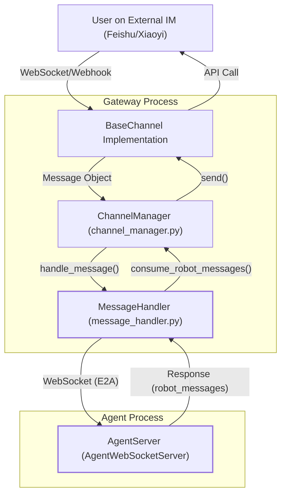
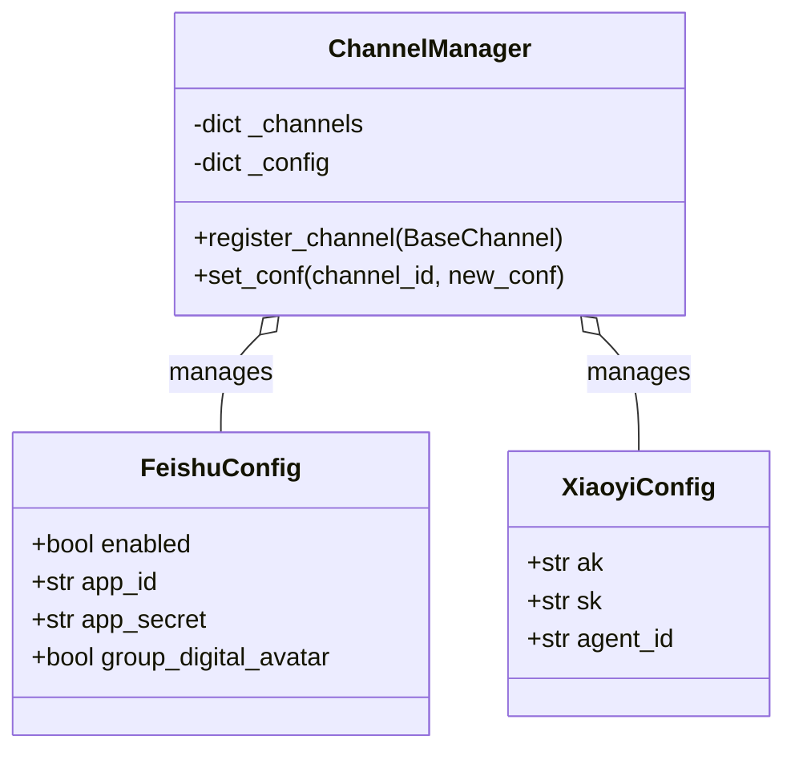

<!-- source: DeepWiki mcp.deepwiki.com · repo openJiuwen-ai/jiuwenswarm · page 6 Communication Channels · fetched 2026-11-02 -->

# Communication Channels

Relevant source files

The following files were used as context for generating this wiki page:

- [docs/assets/images/xiaoyi_hook.png](docs/assets/images/xiaoyi_hook.png)
- [docs/assets/images/xiaoyi_push_id.png](docs/assets/images/xiaoyi_push_id.png)
- [docs/en/Channels.md](docs/en/Channels.md)
- [jiuwenswarm/gateway/channel_manager/channel_manager.py](jiuwenswarm/gateway/channel_manager/channel_manager.py)
- [jiuwenswarm/gateway/channel_manager/im_platforms/feishu/feishu_connect.py](jiuwenswarm/gateway/channel_manager/im_platforms/feishu/feishu_connect.py)

JiuwenSwarm utilizes a unified communication hub to bridge external chat platforms and the internal multi-agent system. The **Gateway** process acts as the central router, managing inbound messages from various channels and forwarding them to the **AgentServer** via the E2A protocol.

## Overview of Channel Architecture

The system supports three primary categories of communication:
1.  **Web Channel**: A built-in FastAPI-based WebSocket interface for the official React web frontend.
2.  **IM Platform Channels**: Integrations with popular instant messaging platforms (Feishu, WeCom, WeChat, Telegram, Discord, WhatsApp, DingTalk, and Xiaoyi).
3.  **ACP Client Plugin Channel**: A standardized protocol for IDE plugins (like VS Code or JetBrains) to control the agent.

The `ChannelManager` handles the lifecycle of these connections—including registration, unregistration, and configuration hot-reloading [jiuwenswarm/gateway/channel_manager/channel_manager.py:22-28](). It ensures that messages are normalized before being passed to the `MessageHandler` [jiuwenswarm/gateway/channel_manager/channel_manager.py:58-69]().

### Message Routing Flow
The following diagram illustrates how an external message travels through the Gateway to reach the Agent logic and how responses are dispatched back.

**Gateway Message Routing (Natural Language to Code Entity)**

**Sources:** [jiuwenswarm/gateway/channel_manager/channel_manager.py:22-28](), [jiuwenswarm/gateway/channel_manager/channel_manager.py:142-157](), [docs/en/Channels.md:1-3]().

---

## 6.1 Web Channel and REST API
The Web channel is the primary interface for the browser-based UI. It provides:
*   **WebSocket Gateway**: Real-time message streaming and state updates.
*   **RPC Methods**: Operations like session management, skill management, and model configuration.
*   **Static Assets**: Serves the compiled React frontend.

For details, see [Web Channel and REST API](#6.1).

---

## 6.2 IM Platform Channels
JiuwenSwarm supports a wide array of IM platforms, allowing users to interact with agents where they already work.

| Category | Supported Platforms | Key Features |
| :--- | :--- | :--- |
| **Enterprise** | Feishu (Lark), WeCom, DingTalk | Group Digital Avatar, @Mention support, File upload |
| **Personal** | WeChat, WhatsApp (Baileys), Xiaoyi | Digital Avatar mode, Private DMs, Streaming |
| **Developer** | Telegram, Discord | Slash command support, Bot API integration |

### Digital Avatar Mode
A standout feature for Feishu and WeCom is the **Group Digital Avatar** [jiuwenswarm/gateway/channel_manager/im_platforms/feishu/feishu_connect.py:60](). When enabled, the bot represents a specific user in group chats, responding to relevant mentions in the first person [docs/en/Channels.md:5-9](). This requires configuring `my_user_id` (the user's platform open_id) and `bot_name` in the channel settings [jiuwenswarm/gateway/channel_manager/im_platforms/feishu/feishu_connect.py:58-59]().

For details, see [IM Platform Channels](#6.2).

**Sources:** [docs/en/Channels.md:1-9](), [jiuwenswarm/gateway/channel_manager/im_platforms/feishu/feishu_connect.py:34-63]().

---

## 6.3 ACP Client Plugin Channel
The **Agent Control Protocol (ACP)** is a specialized channel designed for IDE integrations. Unlike standard chat channels, ACP supports:
*   **Tool Response Round-trips**: Precise handling of tool execution results from the client side.
*   **Capability Negotiation**: Clients can declare `clientCapabilities` to define supported UI elements.
*   **Output Management**: Managed by `AcpOutputManager` to handle structured output for developer workflows.

For details, see [ACP Client Plugin Channel](#6.3).

---

## Configuration and Management
Channels can be configured via the **Web UI** or by manually editing the `config.yaml` file [docs/en/Channels.md:11-15](). The `ChannelManager` supports dynamic updates through `set_conf`, which triggers a callback to re-instantiate channels without a full process restart [jiuwenswarm/gateway/channel_manager/channel_manager.py:115-126]().

**Channel Configuration Structure (Code to Logic)**

**Sources:** [jiuwenswarm/gateway/channel_manager/channel_manager.py:30-45](), [jiuwenswarm/gateway/channel_manager/im_platforms/feishu/feishu_connect.py:34-63](), [docs/en/Channels.md:70-78]().

### Outbound Message Delivery
The `ChannelManager` runs a `_dispatch_robot_messages` loop that consumes messages from the `MessageHandler` and routes them to the correct `BaseChannel` implementation for delivery to the user [jiuwenswarm/gateway/channel_manager/channel_manager.py:142-157](). If a delivery fails (e.g., a Cron job push), it can notify the user via a fallback channel like the Web UI [jiuwenswarm/gateway/channel_manager/channel_manager.py:170-185]().

**Sources:** [jiuwenswarm/gateway/channel_manager/channel_manager.py:142-185]().

---

