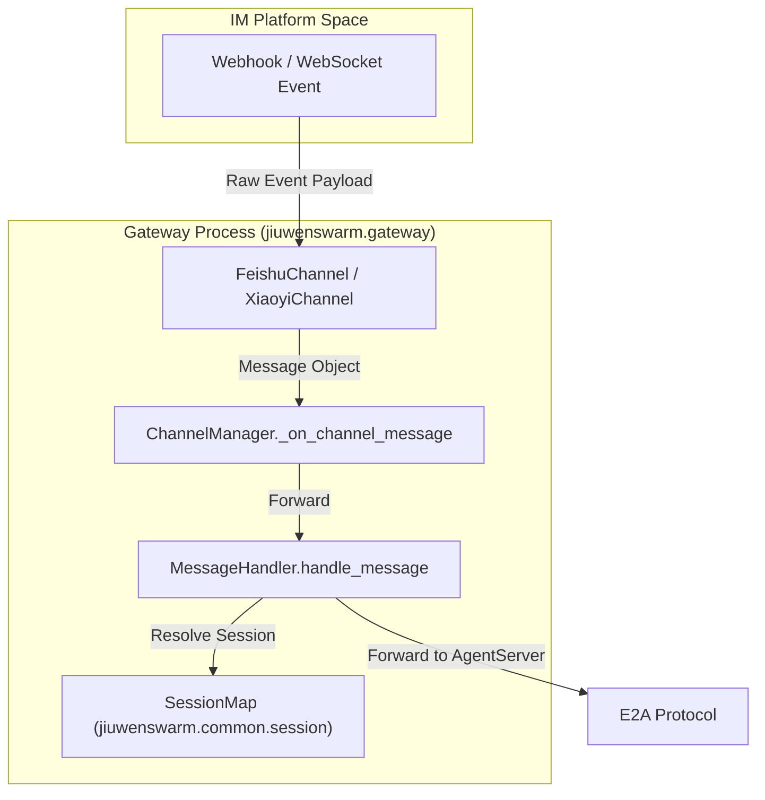
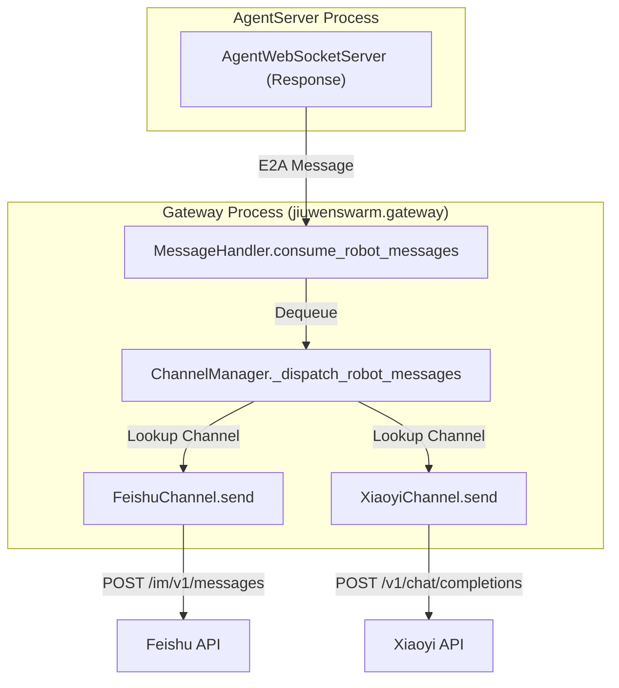

<!-- source: DeepWiki mcp.deepwiki.com · repo openJiuwen-ai/jiuwenswarm · page 6.2 IM Platform Channels · fetched 2026-11-02 -->

# IM Platform Channels

Relevant source files

The following files were used as context for generating this wiki page:

- [docs/assets/images/discord/1_create_new_app.png](docs/assets/images/discord/1_create_new_app.png)
- [docs/assets/images/discord/2_reset_bot_token.png](docs/assets/images/discord/2_reset_bot_token.png)
- [docs/assets/images/discord/3_set_required_intent.png](docs/assets/images/discord/3_set_required_intent.png)
- [docs/assets/images/discord/4_set_guild_install_scope_and_permissions.png](docs/assets/images/discord/4_set_guild_install_scope_and_permissions.png)
- [docs/assets/images/discord/5_select_install_methods_and_copy_setup_link.png](docs/assets/images/discord/5_select_install_methods_and_copy_setup_link.png)
- [docs/assets/images/xiaoyi_hook.png](docs/assets/images/xiaoyi_hook.png)
- [docs/assets/images/xiaoyi_push_id.png](docs/assets/images/xiaoyi_push_id.png)
- [docs/en/Channels.md](docs/en/Channels.md)
- [jiuwenswarm/gateway/channel_manager/channel_manager.py](jiuwenswarm/gateway/channel_manager/channel_manager.py)
- [jiuwenswarm/gateway/channel_manager/im_platforms/feishu/feishu_connect.py](jiuwenswarm/gateway/channel_manager/im_platforms/feishu/feishu_connect.py)

JiuwenSwarm supports integration with a wide variety of Instant Messaging (IM) platforms, allowing users to interact with agents via familiar chat interfaces. The system abstracts platform-specific complexities through a unified channel architecture within the Gateway process.

## Architecture and Data Flow

The IM channel integration is managed by the `ChannelManager` within the Gateway process. Each platform is implemented as a specialized class inheriting from `BaseChannel` [jiuwenswarm/gateway/channel_manager/base.py:12-42](). The `ChannelManager` handles the lifecycle of these channels, including registration, configuration updates, and message dispatching [jiuwenswarm/gateway/channel_manager/channel_manager.py:22-45]().

### Message Lifecycle
1.  **Inbound**: An IM platform sends a webhook or WebSocket event. For example, `FeishuChannel` uses a WebSocket long connection to receive events [jiuwenswarm/gateway/channel_manager/im_platforms/feishu/feishu_connect.py:145-157](). The raw payload is parsed into a standardized `Message` object [jiuwenswarm/common/schema/message.py:21-25]().
2.  **Routing**: The channel triggers a callback registered by the `ChannelManager`, which forwards the message to the `MessageHandler` [jiuwenswarm/gateway/channel_manager/channel_manager.py:58-69]().
3.  **Processing**: The `MessageHandler` identifies the session via the `SessionMap` and forwards the message to the `AgentServer` via the E2A protocol.
4.  **Outbound**: The `AgentServer` sends a response back to the Gateway. The `ChannelManager` runs a dispatch loop (`_dispatch_robot_messages`) that consumes these responses and calls the target channel's `send(msg)` method [jiuwenswarm/gateway/channel_manager/channel_manager.py:142-166]().

### Code Entity Space Bridge: Inbound Pipeline
The following diagram illustrates how raw IM events are transformed into system-wide `Message` entities using specific code components.

"IM Inbound Pipeline to Code Entities"

Sources: [jiuwenswarm/gateway/channel_manager/channel_manager.py:58-82](), [jiuwenswarm/gateway/channel_manager/im_platforms/feishu/feishu_connect.py:220-232](), [jiuwenswarm/gateway/channel_manager/channel_manager.py:142-166]()

---

## Supported Channels

### Feishu (Lark)
The Feishu channel is a robust implementation supporting text, images, and interactive cards. It uses the `lark_oapi` for communication [jiuwenswarm/gateway/channel_manager/im_platforms/feishu/feishu_connect.py:65-84]().

*   **Key Class**: `FeishuChannel` [jiuwenswarm/gateway/channel_manager/im_platforms/feishu/feishu_connect.py:143-162]()
*   **Configuration**: Defined in `FeishuConfig`, including `app_id`, `app_secret`, and `encrypt_key` [jiuwenswarm/gateway/channel_manager/im_platforms/feishu/feishu_connect.py:34-45]().
*   **Media Handling**: Utilizes `FeishuFileService` to handle image, audio, and video files [jiuwenswarm/gateway/channel_manager/im_platforms/feishu/feishu_connect.py:22-27]().
*   **Streaming**: Supports `enable_streaming` to deliver partial responses to users in real-time [jiuwenswarm/gateway/channel_manager/im_platforms/feishu/feishu_connect.py:43]().

### Huawei Xiaoyi
A specialized integration for HarmonyOS devices, allowing users to interact with JiuwenSwarm through the Xiaoyi assistant.
*   **Authentication**: Uses AK/SK (Access Key/Secret Key) and `agent_id` [docs/en/Channels.md:69-78]().
*   **Setup**: Requires creating a JiuwenSwarm-mode agent on the Xiaoyi Open Platform [docs/en/Channels.md:23-27]().

### WeChat & WeCom
JiuwenSwarm supports both standard WeChat and WeCom (Enterprise WeChat).
*   **Digital Avatar**: A key feature where the bot acts as a designated user's "digital avatar" in group chats, identifying relevant messages and replying in the first person [docs/en/Channels.md:5-9]().

### Other Channels
*   **Telegram / Discord**: Standard bot integrations using platform-specific APIs [docs/en/Channels.md:181-182]().
*   **WhatsApp**: Integrated via the **Baileys bridge** [docs/en/Channels.md:181-182]().
*   **DingTalk**: Supports robot communication and file exchange [docs/en/Channels.md:181-182]().

---

## Session and Group Handling

### SessionMap Scoping
To maintain conversation continuity, the `SessionMap` maps platform-specific identifiers to a unique JiuwenSwarm `session_id`.

| Platform | Identity Source | Scoping Logic |
| :--- | :--- | :--- |
| **Feishu** | `open_id` / `chat_id` | DMs use `open_id`; Groups use `chat_id` [jiuwenswarm/gateway/channel_manager/im_platforms/feishu/feishu_connect.py:48-49]() |
| **Xiaoyi** | `userId` | Scoped per user identity provided by Huawei platform [docs/en/Channels.md:75]() |
| **Web** | `session_id` | Direct mapping from browser/app session |

### Group Digital Avatar Mode
When `group_digital_avatar` is enabled (currently supported on Feishu and WeCom), the bot operates autonomously in group chats [docs/en/Channels.md:161-163]().

1.  **Relevance Detection**: The bot responds if it is @mentioned, if the represented user (`my_user_id`) is @mentioned, or if the user's name appears in the text [docs/en/Channels.md:163]().
2.  **Persona**: The bot replies on behalf of the user in the first person [docs/en/Channels.md:7]().
3.  **Permissions**: Since the avatar cannot prompt for confirmation in real-time, tool and path permissions must be pre-configured to `allow` or `deny` [docs/en/Channels.md:187-191]().

"Outbound Response Routing Bridge"

Sources: [jiuwenswarm/gateway/channel_manager/channel_manager.py:142-166](), [jiuwenswarm/gateway/channel_manager/im_platforms/feishu/feishu_connect.py:204-208]()

---

## Configuration Reference

IM channels are configured in `config.yaml` under the `channels` section. The `ChannelManager` supports hot-reloading these configurations [jiuwenswarm/gateway/channel_manager/channel_manager.py:115-134]().

*   **`enabled`**: Global toggle for the specific channel [jiuwenswarm/gateway/channel_manager/im_platforms/feishu/feishu_connect.py:37]().
*   **`group_digital_avatar`**: Enables the avatar mode for group chats [jiuwenswarm/gateway/channel_manager/im_platforms/feishu/feishu_connect.py:60]().
*   **`my_user_id`**: The platform-specific ID (e.g., Feishu `open_id`) of the user the bot represents [jiuwenswarm/gateway/channel_manager/im_platforms/feishu/feishu_connect.py:58]().
*   **`bot_name`**: The display name of the bot used for mention detection in group chats [jiuwenswarm/gateway/channel_manager/im_platforms/feishu/feishu_connect.py:59]().

Sources: [jiuwenswarm/gateway/channel_manager/im_platforms/feishu/feishu_connect.py:34-63](), [jiuwenswarm/gateway/channel_manager/channel_manager.py:109-134](), [docs/en/Channels.md:171-180]()

---

