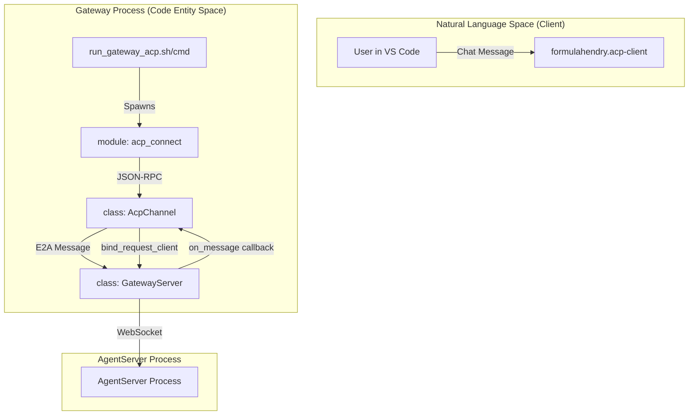
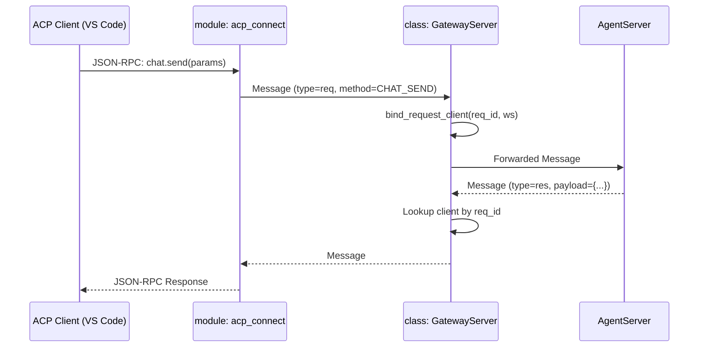
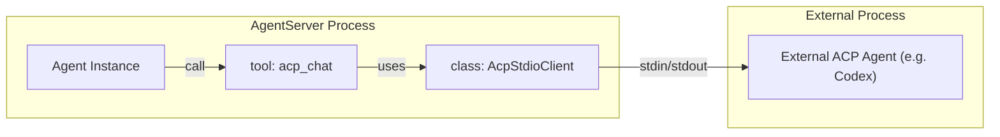

<!-- source: DeepWiki mcp.deepwiki.com · repo openJiuwen-ai/jiuwenswarm · page 6.3 ACP Client Plugin Channel · fetched 2026-11-02 -->

# ACP Client Plugin Channel

Relevant source files

The following files were used as context for generating this wiki page:

- [docs/en/ACP_Client_Config.md](docs/en/ACP_Client_Config.md)
- [jiuwenswarm/acp/__init__.py](jiuwenswarm/acp/__init__.py)
- [jiuwenswarm/acp/cli.py](jiuwenswarm/acp/cli.py)
- [jiuwenswarm/acp/stdio_client.py](jiuwenswarm/acp/stdio_client.py)
- [jiuwenswarm/acp/subprocess_env.py](jiuwenswarm/acp/subprocess_env.py)
- [jiuwenswarm/agents/harness/common/tools/acp_chat/__init__.py](jiuwenswarm/agents/harness/common/tools/acp_chat/__init__.py)
- [jiuwenswarm/agents/harness/common/tools/acp_chat/tool.py](jiuwenswarm/agents/harness/common/tools/acp_chat/tool.py)
- [scripts/run_gateway_acp.cmd](scripts/run_gateway_acp.cmd)
- [scripts/run_gateway_acp.sh](scripts/run_gateway_acp.sh)
- [tests/unit_tests/channel/test_acp_channel.py](tests/unit_tests/channel/test_acp_channel.py)
- [tests/unit_tests/gateway/test_app_gateway_acp.py](tests/unit_tests/gateway/test_app_gateway_acp.py)
- [tests/unit_tests/gateway/test_cli_channel_handlers.py](tests/unit_tests/gateway/test_cli_channel_handlers.py)

The Agent Control Protocol (ACP) client plugin channel allows JiuwenSwarm to integrate directly with IDEs and external tools, most notably the VS Code ACP Client extension. This channel enables a standardized communication layer between the JiuwenSwarm Gateway and external clients using a JSON-RPC based protocol.

## Overview of ACP

The Agent Control Protocol (ACP) is a specification designed to standardize how AI agents interact with user interfaces. In JiuwenSwarm, the ACP channel is implemented as a specialized bridge within the Gateway process. It handles the translation between standard JiuwenSwarm internal messages (`Message` objects) and the JSON-RPC frames expected by ACP-compliant clients [jiuwenswarm/gateway/channel_manager/protocol/acp/acp_connect.py:10-11]().

### Key Components

| Component | Description |
| :--- | :--- |
| `AcpChannel` | The main implementation of the ACP protocol, managing the lifecycle of the connection and message translation [jiuwenswarm/gateway/channel_manager/protocol/acp/acp_connect.py:10](). |
| `AcpChannelConfig` | Configuration object defining the channel ID (defaulting to `acp`) and default session parameters [jiuwenswarm/gateway/channel_manager/protocol/acp/acp_connect.py:10](). |
| `run_gateway_acp` | Entry point scripts (shell and batch) used by the VS Code extension to spawn the ACP bridge [scripts/run_gateway_acp.sh:1-14](). |
| `GatewayServer` | The parent server that manages routing and binds ACP requests to specific client instances [jiuwenswarm/gateway/app_gateway.py:7-12](). |
| `AcpStdioClient` | A minimal ACP client implementation used for one-shot tool calls or smoke tests via subprocess stdin/stdout [jiuwenswarm/acp/stdio_client.py:13](). |

**Sources:** [jiuwenswarm/gateway/channel_manager/protocol/acp/acp_connect.py:10-11](), [jiuwenswarm/gateway/app_gateway.py:7-12](), [scripts/run_gateway_acp.sh:1-14](), [jiuwenswarm/acp/stdio_client.py:13]()

## System Integration Diagram

The following diagram illustrates how the ACP channel bridges the "Natural Language Space" of the user to the "Code Entity Space" of the Gateway and AgentServer.

**ACP Bridge Architecture**

**Sources:** [jiuwenswarm/gateway/channel_manager/protocol/acp/acp_connect.py:10-56](), [jiuwenswarm/gateway/app_gateway.py:44-49](), [scripts/run_gateway_acp.sh:14]()

## Configuration and Initialization

The ACP channel is typically configured via the `channels.acp` section in the system configuration. It supports custom session IDs and metadata [tests/unit_tests/channel/test_acp_channel.py:106-116]().

### Capabilities Negotiation
Upon connection, the client sends an `initialize` request. The `AcpChannel` responds with a set of `agentCapabilities`, which defines what the client can expect from the JiuwenSwarm agent [tests/unit_tests/channel/test_acp_channel.py:183-197]():
*   **loadSession**: Currently `False` by default [tests/unit_tests/channel/test_acp_channel.py:192]().
*   **sessionCapabilities**: Includes `list` support [tests/unit_tests/channel/test_acp_channel.py:193]().
*   **mcpCapabilities**: Reports support for HTTP/SSE (currently `False` in default capability set) [tests/unit_tests/channel/test_acp_channel.py:194]().

### Execution Scripts
To connect the VS Code extension, the extension must be configured to point to the execution scripts:
*   **Windows**: `scripts/run_gateway_acp.cmd` [scripts/run_gateway_acp.cmd:1-9]()
*   **Linux/macOS**: `scripts/run_gateway_acp.sh` [scripts/run_gateway_acp.sh:1-14]()

These scripts set the `PYTHONPATH` and execute the `jiuwenswarm.gateway.channel_manager.protocol.acp.acp_connect` module, which acts as a bridge that connects to the main Gateway's WebSocket port [scripts/run_gateway_acp.sh:7-14]().

**Sources:** [tests/unit_tests/channel/test_acp_channel.py:106-116](), [tests/unit_tests/channel/test_acp_channel.py:183-197](), [scripts/run_gateway_acp.sh:1-14]()

## Message Data Flow

The ACP channel operates by translating between JSON-RPC and JiuwenSwarm's internal `Message` schema.

### Request-Response Round-trip
When a user sends a message through the ACP client, the following sequence occurs:
1.  **JSON-RPC Inbound**: The client sends a `chat/send` or similar method via `stdin`.
2.  **Normalization**: The Gateway normalizes the message. For example, `chat.resume` is mapped to an `INTERRUPT_RESUME` intent [tests/unit_tests/gateway/test_app_gateway_acp.py:87-104]().
3.  **Binding**: The `GatewayServer` uses `bind_request_client` to associate the unique ACP request ID with the specific connection [tests/unit_tests/gateway/test_app_gateway_acp.py:44-46]().
4.  **Forwarding**: The message is forwarded to the `AgentServer`.
5.  **Response/Event Outbound**: When the `AgentServer` replies, the `GatewayServer` targets the correct client using the stored binding [tests/unit_tests/gateway/test_app_gateway_acp.py:219-244]().

### Data Flow Diagram

**ACP Message Pipeline**

**Sources:** [jiuwenswarm/gateway/app_gateway.py:44-52](), [tests/unit_tests/gateway/test_app_gateway_acp.py:87-104](), [tests/unit_tests/gateway/test_app_gateway_acp.py:219-244]()

## ACP Tooling: acp_chat

JiuwenSwarm includes a specialized tool, `acp_chat`, which allows an agent to communicate with *other* external ACP agents running as subprocesses [jiuwenswarm/agents/harness/common/tools/acp_chat/tool.py:94-102]().

### Tool Implementation
The tool uses `AcpStdioClient` to manage the lifecycle of an external ACP process [jiuwenswarm/agents/harness/common/tools/acp_chat/tool.py:88-91](). It resolves commands and environment variables (supporting `${VAR}` placeholders) from the `acp_agents` section of `config.yaml` [jiuwenswarm/acp/subprocess_env.py:33-56]().

**ACP Tool Integration**

**Sources:** [jiuwenswarm/agents/harness/common/tools/acp_chat/tool.py:13-102](), [jiuwenswarm/acp/subprocess_env.py:33-56]()

## ACP Handlers

The channel implements several specific JSON-RPC methods to manage the session lifecycle:

| Method | Implementation Detail |
| :--- | :--- |
| `initialize` | Returns protocol version and agent metadata [tests/unit_tests/channel/test_acp_channel.py:183-191](). |
| `session/new` | Creates a new session mapping in the Gateway [tests/unit_tests/channel/test_acp_channel.py:198-203](). |
| `session/list` | Returns all active sessions known to the bridge [tests/unit_tests/channel/test_acp_channel.py:206-215](). |
| `chat.send` | Standard message delivery [tests/unit_tests/gateway/test_cli_channel_handlers.py:57-67](). |
| `config.get` | Allows the client to retrieve current configuration [tests/unit_tests/gateway/test_cli_channel_handlers.py:50](). |

**Sources:** [tests/unit_tests/channel/test_acp_channel.py:183-215](), [tests/unit_tests/gateway/test_cli_channel_handlers.py:50-67]()

---

