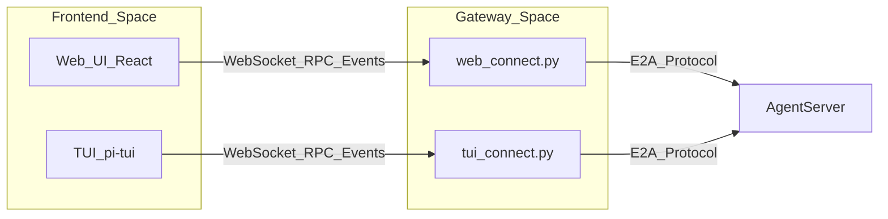
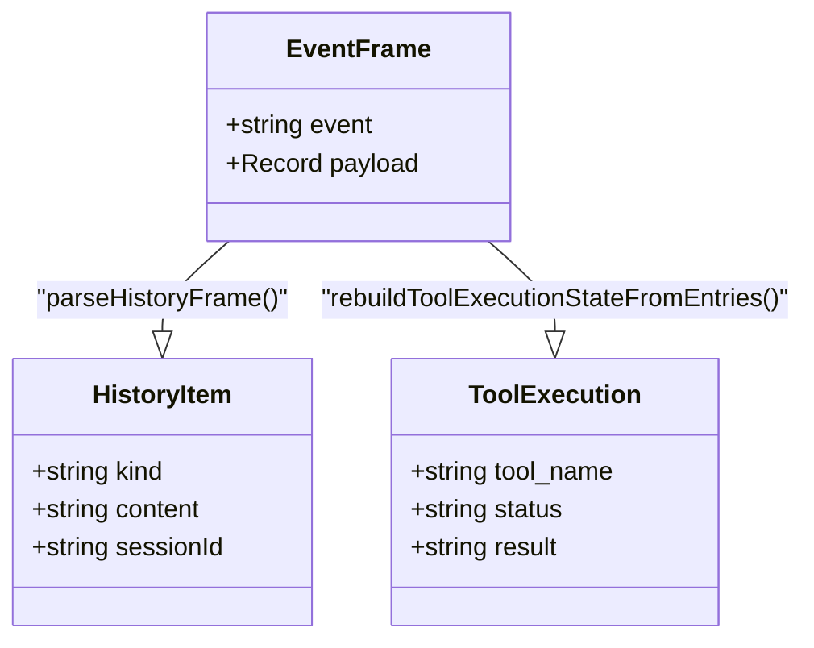

<!-- source: DeepWiki mcp.deepwiki.com · repo openJiuwen-ai/jiuwenswarm · page 7 Frontend Interfaces · fetched 2026-11-02 -->

# Frontend Interfaces

Relevant source files

The following files were used as context for generating this wiki page:

- [jiuwenswarm/channels/tui/frontend/src/app-state.ts](jiuwenswarm/channels/tui/frontend/src/app-state.ts)
- [jiuwenswarm/channels/tui/frontend/src/core/commands/CommandService.ts](jiuwenswarm/channels/tui/frontend/src/core/commands/CommandService.ts)
- [jiuwenswarm/channels/tui/frontend/src/core/commands/builtins/branch.ts](jiuwenswarm/channels/tui/frontend/src/core/commands/builtins/branch.ts)
- [jiuwenswarm/channels/tui/frontend/src/core/commands/builtins/config.ts](jiuwenswarm/channels/tui/frontend/src/core/commands/builtins/config.ts)
- [jiuwenswarm/channels/tui/frontend/src/core/commands/builtins/session.ts](jiuwenswarm/channels/tui/frontend/src/core/commands/builtins/session.ts)
- [jiuwenswarm/channels/tui/frontend/src/core/commands/types.ts](jiuwenswarm/channels/tui/frontend/src/core/commands/types.ts)
- [jiuwenswarm/channels/tui/frontend/src/ui/app-screen.ts](jiuwenswarm/channels/tui/frontend/src/ui/app-screen.ts)
- [jiuwenswarm/channels/web/frontend/src/App.tsx](jiuwenswarm/channels/web/frontend/src/App.tsx)
- [jiuwenswarm/channels/web/frontend/src/components/ConfigPanel/index.tsx](jiuwenswarm/channels/web/frontend/src/components/ConfigPanel/index.tsx)
- [jiuwenswarm/channels/web/frontend/src/i18n/locales/en.json](jiuwenswarm/channels/web/frontend/src/i18n/locales/en.json)
- [jiuwenswarm/channels/web/frontend/src/i18n/locales/zh.json](jiuwenswarm/channels/web/frontend/src/i18n/locales/zh.json)

JiuwenSwarm provides two primary user-facing interfaces: a **Web UI (React SPA)** for a rich, graphical experience and a **Terminal UI (TUI)** for developer-centric, keyboard-driven interaction. Both frontends communicate with the [Gateway](2.2.-Gateway-and-Message-Routing) via a shared WebSocket-based RPC and streaming protocol.

## Interface Overview

The frontend architecture is designed around a unified message lifecycle where both interfaces support real-time streaming, tool execution visualization, and interactive interrupts.

### Primary Frontends

| Frontend | Technology | Primary Use Case | Entry Point |
| :--- | :--- | :--- | :--- |
| **Web UI** | React, TypeScript, Tailwind | Full feature set, graphical configuration, i18n support. | [jiuwenswarm/channels/web/frontend/src/App.tsx:1-189]() |
| **TUI** | TypeScript, pi-tui | Low-latency terminal interaction, SSH-friendly, slash-command heavy. | [jiuwenswarm/channels/tui/frontend/src/ui/app-screen.ts:1-126]() |

### Interaction Model
The frontends bridge the "Natural Language Space" (user chat) and "Code Entity Space" (agent actions) through a structured event stream.

**Frontend-Gateway Connection Flow**

Sources: [jiuwenswarm/channels/web/frontend/src/App.tsx:42-42](), [jiuwenswarm/channels/tui/frontend/src/app-state.ts:51-51]()

## Web Frontend (React SPA)

The Web Frontend is a comprehensive Single Page Application (SPA) designed for multi-agent orchestration and detailed system monitoring.

*   **Core Navigation**: Managed in `App.tsx`, providing access to Chat, Agent Management, Teams, Skills, and System Configuration [jiuwenswarm/channels/web/frontend/src/App.tsx:7-22]().
*   **State Management**: Uses specialized stores (Zustand) via `useChatStore`, `useSessionStore`, and `useHarnessStore` for chat history and session metadata [jiuwenswarm/channels/web/frontend/src/App.tsx:46-46]().
*   **Configuration Panel**: The `ConfigPanel` allows for hot-reloading server settings, including model providers and multi-agent team definitions [jiuwenswarm/channels/web/frontend/src/components/ConfigPanel/index.tsx:171-206]().
*   **i18n Support**: Full internationalization for English and Chinese, covering all UI labels from navigation to task status messages [jiuwenswarm/channels/web/frontend/src/i18n/locales/en.json:17-34](), [jiuwenswarm/channels/web/frontend/src/i18n/locales/zh.json:17-34]().

For details, see [Web Frontend (React SPA)](#7.1).

## TUI Frontend (Terminal UI)

The TUI provides a high-performance terminal interface using the `pi-tui` library, optimized for developers who prefer staying within the command line.

*   **AppScreen**: The main UI component managing the terminal layout, including the transcript renderer and input editor [jiuwenswarm/channels/tui/frontend/src/ui/app-screen.ts:1-59]().
*   **Command Service**: Handles slash command parsing and execution, providing autocompletion for both built-in commands and installed skills [jiuwenswarm/channels/tui/frontend/src/core/commands/CommandService.ts:54-132]().
*   **State Management**: `CliPiAppState` tracks the connection status, active streaming chunks, and tool execution progress [jiuwenswarm/channels/tui/frontend/src/app-state.ts:174-213]().
*   **Interactive Components**: Includes specialized states for model selection, session branching, and configuration editing within the terminal [jiuwenswarm/channels/tui/frontend/src/ui/app-screen.ts:114-188]().

For details, see [TUI Frontend (Terminal UI)](#7.2).

## Shared Interaction Patterns

Both frontends implement a standardized set of interaction patterns to ensure consistency across different user interfaces.

### Slash Commands
A unified registry of slash commands allows users to control the agent's behavior, manage the workspace, and switch modes (e.g., `/branch`, `/session`, `/config`).
*   **Registry**: Commands are defined as `SlashCommand` objects with associated actions [jiuwenswarm/channels/tui/frontend/src/core/commands/types.ts:108-130]().
*   **Context**: Commands interact with the system via a `CommandContext` which abstracts WebSocket requests like `ctx.request` and `ctx.sendMessage` [jiuwenswarm/channels/tui/frontend/src/core/commands/types.ts:26-106]().

### Event Handling & Normalization
To bridge raw backend events to UI components, both frontends use normalization logic for tool calls and results.

**Event to UI Entity Mapping**

Sources: [jiuwenswarm/channels/tui/frontend/src/app-state.ts:1-30](), [jiuwenswarm/channels/web/frontend/src/App.tsx:38-41]()

### Interrupts and Mode Switching
*   **Interrupts**: Users can interrupt ongoing LLM generations. The frontends manage this via `isInterruptRequested` and `isProcessing` flags in the app state [jiuwenswarm/channels/tui/frontend/src/app-state.ts:104-111]().
*   **Session Branching**: The `/branch` (or `/fork`) command allows creating a new conversation context from the current point [jiuwenswarm/channels/tui/frontend/src/core/commands/builtins/branch.ts:11-40]().
*   **Configuration Management**: Both UIs support viewing and modifying configuration via `config.get` and `config.set` RPC calls [jiuwenswarm/channels/tui/frontend/src/core/commands/builtins/config.ts:101-137]().

For a complete list of commands, see [Slash Commands Reference](#7.3).

---

