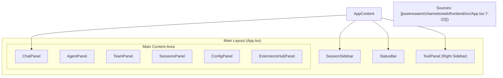
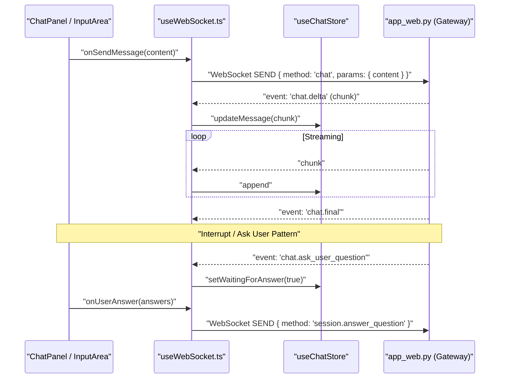

<!-- source: DeepWiki mcp.deepwiki.com · repo openJiuwen-ai/jiuwenswarm · page 7.1 Web Frontend (React SPA) · fetched 2026-11-02 -->

# Web Frontend (React SPA)

Relevant source files

The following files were used as context for generating this wiki page:

- [jiuwenswarm/agents/harness/common/rails/stream_event_rail.py](jiuwenswarm/agents/harness/common/rails/stream_event_rail.py)
- [jiuwenswarm/agents/harness/common/tools/send_file_to_user.py](jiuwenswarm/agents/harness/common/tools/send_file_to_user.py)
- [jiuwenswarm/agents/harness/common/tools/web_file_download.py](jiuwenswarm/agents/harness/common/tools/web_file_download.py)
- [jiuwenswarm/channels/web/app_web.py](jiuwenswarm/channels/web/app_web.py)
- [jiuwenswarm/channels/web/frontend/package-lock.json](jiuwenswarm/channels/web/frontend/package-lock.json)
- [jiuwenswarm/channels/web/frontend/package.json](jiuwenswarm/channels/web/frontend/package.json)
- [jiuwenswarm/channels/web/frontend/src/App.tsx](jiuwenswarm/channels/web/frontend/src/App.tsx)
- [jiuwenswarm/channels/web/frontend/src/components/ChatPanel/ChatPanel.css](jiuwenswarm/channels/web/frontend/src/components/ChatPanel/ChatPanel.css)
- [jiuwenswarm/channels/web/frontend/src/components/ChatPanel/InputArea.tsx](jiuwenswarm/channels/web/frontend/src/components/ChatPanel/InputArea.tsx)
- [jiuwenswarm/channels/web/frontend/src/components/ChatPanel/MessageItem.tsx](jiuwenswarm/channels/web/frontend/src/components/ChatPanel/MessageItem.tsx)
- [jiuwenswarm/channels/web/frontend/src/components/ChatPanel/index.tsx](jiuwenswarm/channels/web/frontend/src/components/ChatPanel/index.tsx)
- [jiuwenswarm/channels/web/frontend/src/components/ConfigPanel/index.tsx](jiuwenswarm/channels/web/frontend/src/components/ConfigPanel/index.tsx)
- [jiuwenswarm/channels/web/frontend/src/components/ExtensionsHubPanel/index.tsx](jiuwenswarm/channels/web/frontend/src/components/ExtensionsHubPanel/index.tsx)
- [jiuwenswarm/channels/web/frontend/src/components/HarnessPackagePanel/HarnessPackagePanel.css](jiuwenswarm/channels/web/frontend/src/components/HarnessPackagePanel/HarnessPackagePanel.css)
- [jiuwenswarm/channels/web/frontend/src/components/SessionSidebar/index.tsx](jiuwenswarm/channels/web/frontend/src/components/SessionSidebar/index.tsx)
- [jiuwenswarm/channels/web/frontend/src/components/ToolPanel/index.tsx](jiuwenswarm/channels/web/frontend/src/components/ToolPanel/index.tsx)
- [jiuwenswarm/channels/web/frontend/src/features/historyRestore.ts](jiuwenswarm/channels/web/frontend/src/features/historyRestore.ts)
- [jiuwenswarm/channels/web/frontend/src/features/shareImageExport.css](jiuwenswarm/channels/web/frontend/src/features/shareImageExport.css)
- [jiuwenswarm/channels/web/frontend/src/features/teamHistoryPanelRestore.ts](jiuwenswarm/channels/web/frontend/src/features/teamHistoryPanelRestore.ts)
- [jiuwenswarm/channels/web/frontend/src/hooks/useWebSocket.ts](jiuwenswarm/channels/web/frontend/src/hooks/useWebSocket.ts)
- [jiuwenswarm/channels/web/frontend/src/i18n/locales/en.json](jiuwenswarm/channels/web/frontend/src/i18n/locales/en.json)
- [jiuwenswarm/channels/web/frontend/src/i18n/locales/zh.json](jiuwenswarm/channels/web/frontend/src/i18n/locales/zh.json)
- [jiuwenswarm/channels/web/frontend/src/index.css](jiuwenswarm/channels/web/frontend/src/index.css)
- [jiuwenswarm/channels/web/frontend/src/types/message.ts](jiuwenswarm/channels/web/frontend/src/types/message.ts)
- [jiuwenswarm/server/runtime/agent_adapter/interface_deep.py](jiuwenswarm/server/runtime/agent_adapter/interface_deep.py)
- [jiuwenswarm/server/runtime/session/session_history.py](jiuwenswarm/server/runtime/session/session_history.py)
- [jiuwenswarm/server/utils/stream_utils.py](jiuwenswarm/server/utils/stream_utils.py)

The JiuwenSwarm web frontend is a high-performance React-based Single Page Application (SPA) that serves as the primary graphical interface for interacting with agents, teams, and system configurations. It communicates with the `AgentServer` via a WebSocket gateway (provided by the Web channel) to support real-time streaming, RPC-style commands, and proactive system notifications.

## 1. Application Architecture & Navigation

The entry point of the SPA is `App.tsx`, which manages the global layout, session persistence, and top-level navigation.

### App.tsx and Navigation
The application uses a sidebar-based navigation pattern managed by the `MainNavKey` state [jiuwenswarm/channels/web/frontend/src/App.tsx:58-58](). Navigation is handled by the `SessionSidebar` component, which supports a collapsed icon-only mode for maximized workspace area [jiuwenswarm/channels/web/frontend/src/components/SessionSidebar/index.tsx:5-6]().

Key navigation targets include:
- **Chat**: The primary interaction interface (`ChatPanel`) [jiuwenswarm/channels/web/frontend/src/App.tsx:8-8]().
- **Agent/Teams**: Management of individual agent profiles and multi-agent cluster configurations [jiuwenswarm/channels/web/frontend/src/App.tsx:11-12]().
- **Sessions**: History management and session-specific file browsing [jiuwenswarm/channels/web/frontend/src/App.tsx:13-13]().
- **Config**: Hot-reloading system settings and model providers [jiuwenswarm/channels/web/frontend/src/App.tsx:17-17]().

### Session Persistence
Session IDs are persisted using `sessionStorage` to ensure that refreshing a tab maintains the current conversation while allowing multiple independent browser tabs to operate in different sessions [jiuwenswarm/channels/web/frontend/src/App.tsx:152-158](). If no session is found, it defaults to a new session state [jiuwenswarm/channels/web/frontend/src/App.tsx:193-196]().

### Component Hierarchy

## 2. Communication: useWebSocket Hook

The `useWebSocket` hook is the central communication hub. It encapsulates the WebSocket lifecycle, message routing, and specialized interaction patterns like streaming and interrupts.

### Functional Capabilities
- **RPC Commands**: It manages WebSocket connections and message processing for various RPC-like methods including `session.list_files` and `config.get` [jiuwenswarm/channels/web/frontend/src/hooks/useWebSocket.ts:1-7]().
- **Streaming Content**: It handles `chat.delta` and `chat.final` events, updating the `ChatStore` in real-time to render LLM output chunks as they arrive [jiuwenswarm/channels/web/frontend/src/hooks/useWebSocket.ts:35-41]().
- **Team State Synchronization**: specialized logic for `team.task.*` events and `team.member.*` status updates, ensuring the UI reflects the cluster's current state [jiuwenswarm/channels/web/frontend/src/hooks/useWebSocket.ts:113-119]().
- **Interrupts & Questions**: Handles `chat.ask_user_question` events, allowing agents to pause and wait for user input via the `onUserAnswer` callback [jiuwenswarm/channels/web/frontend/src/hooks/useWebSocket.ts:18-20]().

### Data Flow: Message Lifecycle

*Sources: [jiuwenswarm/channels/web/frontend/src/hooks/useWebSocket.ts:30-45](), [jiuwenswarm/channels/web/frontend/src/components/ChatPanel/index.tsx:187-200](), [jiuwenswarm/server/utils/stream_utils.py:10-45]()*

## 3. Core Panels & Implementation

### ChatPanel & Message Lifecycle
The `ChatPanel` manages the conversation timeline. It utilizes `MessageList` and `MessageItem` to render different message types, including system events, tool calls, and standard chat [jiuwenswarm/channels/web/frontend/src/components/ChatPanel/index.tsx:11-16]().

- **Team Activity Rendering**: In `team` mode, it uses `AgentTeamActivityCard` to group and display member collaborations, task claims, and tool results [jiuwenswarm/channels/web/frontend/src/components/ChatPanel/index.tsx:88-122]().
- **Message Content**: Supports Markdown via `ReactMarkdown` [jiuwenswarm/channels/web/frontend/src/components/ChatPanel/MessageItem.tsx:45-63](), and specialized A2UI (Agent-to-UI) components [jiuwenswarm/channels/web/frontend/src/components/ChatPanel/MessageItem.tsx:25-26]().
- **Context Compression**: Displays `ContextCompressionLines` when the backend triggers context window management to summarize history [jiuwenswarm/channels/web/frontend/src/components/ChatPanel/MessageItem.tsx:119-165]().

### ConfigPanel & Hot-Reload
The `ConfigPanel` provides a UI for `config.yaml` and agent/team definitions.
- **Model Management**: Supports atomic replacement of the entire model list via `onModelsReplaceAll` [jiuwenswarm/channels/web/frontend/src/components/ConfigPanel/index.tsx:186-186]().
- **Agents & Teams**: Configures `AgentEntry` (models, skills, timeouts) and `TeamEntry` (leaders, members, spawn modes) [jiuwenswarm/channels/web/frontend/src/components/ConfigPanel/index.tsx:135-169]().
- **Validation**: Includes `onValidateModel` to test LLM connectivity before saving [jiuwenswarm/channels/web/frontend/src/components/ConfigPanel/index.tsx:177-182]().

### Specialized Management Panels
| Panel | Purpose | Key Implementation Details |
| :--- | :--- | :--- |
| **TeamPanel** | Cluster Monitoring | Tracks `memberStatus` (Running, Idle, Error) and `taskStatus` [jiuwenswarm/channels/web/frontend/src/i18n/locales/en.json:74-89](). |
| **ToolPanel** | Right Sidebar | Displays `TodoList`, `TeamArea`, and real-time `memoryUsage` (RSS MB / %) [jiuwenswarm/channels/web/frontend/src/components/ToolPanel/index.tsx:71-134](). |
| **ExtensionsHubPanel** | Harness Mgmt | Manages Harness extensions, including hot-reloading and status monitoring [jiuwenswarm/channels/web/frontend/src/App.tsx:22-22](). |
| **StatusBar** | Global Feedback | Shows `evolving` status during Skill Evolution detection and progress stages [jiuwenswarm/channels/web/frontend/src/i18n/locales/en.json:191-205](). |

## 4. Internationalization (i18n)

The frontend uses `react-i18next` for multi-language support, primarily English (`en.json`) and Chinese (`zh.json`).

- **Namespace Organization**: Locales are organized into `common`, `nav`, `team`, `chat`, and `statusBar` [jiuwenswarm/channels/web/frontend/src/i18n/locales/en.json:1-205]().
- **Team Terminology**: Precise translations for cluster concepts like `claimed`, `unblocked`, and `evolutionStages` [jiuwenswarm/channels/web/frontend/src/i18n/locales/zh.json:90-205]().
- **Dynamic Content**: Uses interpolation for counts and specific member names (e.g., `memberTasksTitle: "{{member}} 执行的任务"`) [jiuwenswarm/channels/web/frontend/src/i18n/locales/zh.json:65-65]().

## 5. Visual and Interaction Design

The system uses a custom design system with specialized components for agent-specific interactions.

- **Thinking Indicators**: Provides visual feedback during LLM reasoning phases [jiuwenswarm/channels/web/frontend/src/components/ChatPanel/index.tsx:46-58]().
- **Team Avatars**: Uses `TeamMemberAvatar` to identify different agents in a collaborative session [jiuwenswarm/channels/web/frontend/src/components/ChatPanel/MessageItem.tsx:33-33]().
- **Stream Event Processing**: The `JiuClawStreamEventRail` in the backend ensures that tool calls and results are emitted in a format the frontend's `normalizeToolCallPayload` can consume [jiuwenswarm/agents/harness/common/rails/stream_event_rail.py:3-9](), [jiuwenswarm/channels/web/frontend/src/hooks/useWebSocket.ts:43-45]().

Sources:
- [jiuwenswarm/channels/web/frontend/src/App.tsx]()
- [jiuwenswarm/channels/web/frontend/src/hooks/useWebSocket.ts]()
- [jiuwenswarm/channels/web/frontend/src/components/ChatPanel/index.tsx]()
- [jiuwenswarm/channels/web/frontend/src/components/ConfigPanel/index.tsx]()
- [jiuwenswarm/channels/web/frontend/src/components/ToolPanel/index.tsx]()
- [jiuwenswarm/channels/web/frontend/src/i18n/locales/en.json]()
- [jiuwenswarm/server/utils/stream_utils.py]()

---

