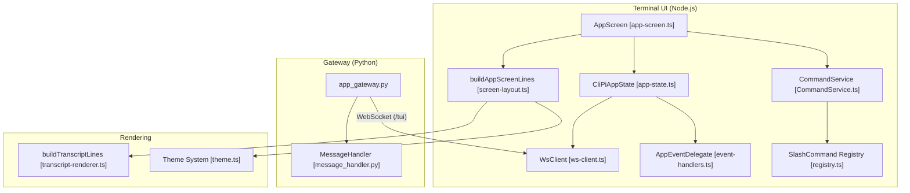

<!-- source: DeepWiki mcp.deepwiki.com · repo openJiuwen-ai/jiuwenswarm · page 7.2 TUI Frontend (Terminal UI) · fetched 2026-11-02 -->

# TUI Frontend (Terminal UI)

Relevant source files

The following files were used as context for generating this wiki page:

- [jiuwenswarm/agents/harness/common/tools/bash_tool_safety.py](jiuwenswarm/agents/harness/common/tools/bash_tool_safety.py)
- [jiuwenswarm/agents/harness/common/tools/command_tools.py](jiuwenswarm/agents/harness/common/tools/command_tools.py)
- [jiuwenswarm/channels/tui/frontend/src/app-state.ts](jiuwenswarm/channels/tui/frontend/src/app-state.ts)
- [jiuwenswarm/channels/tui/frontend/src/core/commands/CommandService.ts](jiuwenswarm/channels/tui/frontend/src/core/commands/CommandService.ts)
- [jiuwenswarm/channels/tui/frontend/src/core/commands/builtins/branch.ts](jiuwenswarm/channels/tui/frontend/src/core/commands/builtins/branch.ts)
- [jiuwenswarm/channels/tui/frontend/src/core/commands/builtins/compact.ts](jiuwenswarm/channels/tui/frontend/src/core/commands/builtins/compact.ts)
- [jiuwenswarm/channels/tui/frontend/src/core/commands/builtins/config.ts](jiuwenswarm/channels/tui/frontend/src/core/commands/builtins/config.ts)
- [jiuwenswarm/channels/tui/frontend/src/core/commands/builtins/recap.ts](jiuwenswarm/channels/tui/frontend/src/core/commands/builtins/recap.ts)
- [jiuwenswarm/channels/tui/frontend/src/core/commands/builtins/session.ts](jiuwenswarm/channels/tui/frontend/src/core/commands/builtins/session.ts)
- [jiuwenswarm/channels/tui/frontend/src/core/commands/types.ts](jiuwenswarm/channels/tui/frontend/src/core/commands/types.ts)
- [jiuwenswarm/channels/tui/frontend/src/core/compression-formatters.ts](jiuwenswarm/channels/tui/frontend/src/core/compression-formatters.ts)
- [jiuwenswarm/channels/tui/frontend/src/core/event-handlers.ts](jiuwenswarm/channels/tui/frontend/src/core/event-handlers.ts)
- [jiuwenswarm/channels/tui/frontend/src/core/history-parser.ts](jiuwenswarm/channels/tui/frontend/src/core/history-parser.ts)
- [jiuwenswarm/channels/tui/frontend/src/core/ws-client.ts](jiuwenswarm/channels/tui/frontend/src/core/ws-client.ts)
- [jiuwenswarm/channels/tui/frontend/src/index.ts](jiuwenswarm/channels/tui/frontend/src/index.ts)
- [jiuwenswarm/channels/tui/frontend/src/ui/app-screen.ts](jiuwenswarm/channels/tui/frontend/src/ui/app-screen.ts)
- [jiuwenswarm/channels/tui/frontend/src/ui/components/messages/meta-components.ts](jiuwenswarm/channels/tui/frontend/src/ui/components/messages/meta-components.ts)
- [jiuwenswarm/channels/tui/frontend/src/ui/keymap.ts](jiuwenswarm/channels/tui/frontend/src/ui/keymap.ts)
- [jiuwenswarm/channels/tui/frontend/src/ui/screen-layout.ts](jiuwenswarm/channels/tui/frontend/src/ui/screen-layout.ts)
- [jiuwenswarm/channels/tui/frontend/src/ui/transcript-entry-selection.ts](jiuwenswarm/channels/tui/frontend/src/ui/transcript-entry-selection.ts)
- [jiuwenswarm/channels/tui/frontend/src/ui/transcript-renderer.ts](jiuwenswarm/channels/tui/frontend/src/ui/transcript-renderer.ts)
- [jiuwenswarm/channels/tui/frontend/src/ui/welcome.ts](jiuwenswarm/channels/tui/frontend/src/ui/welcome.ts)
- [jiuwenswarm/channels/web/frontend/src/types/websocket.ts](jiuwenswarm/channels/web/frontend/src/types/websocket.ts)
- [jiuwenswarm/gateway/app_gateway.py](jiuwenswarm/gateway/app_gateway.py)
- [jiuwenswarm/gateway/message_handler/message_handler.py](jiuwenswarm/gateway/message_handler/message_handler.py)
- [jiuwenswarm/server/app_agentserver.py](jiuwenswarm/server/app_agentserver.py)
- [tests/unit_tests/agentserver/test_agentserver_acp.py](tests/unit_tests/agentserver/test_agentserver_acp.py)
- [tests/unit_tests/agentserver/test_agentserver_modes.py](tests/unit_tests/agentserver/test_agentserver_modes.py)

The JiuwenSwarm Terminal User Interface (TUI) is a high-performance TypeScript-based terminal application built on the `pi-tui` library. It provides a full-featured alternative to the Web UI, supporting real-time message streaming, complex layouts, slash commands, and multi-agent team monitoring directly within a terminal environment.

## Architecture Overview

The TUI operates as a standalone Node.js application that connects to the JiuwenSwarm Gateway via a specialized WebSocket sub-protocol.

### Component Relationship Diagram
This diagram bridges the TUI's high-level UI components to their underlying implementation classes and state management.

Sources: `jiuwenswarm/channels/tui/frontend/src/ui/app-screen.ts:1-66`(), `jiuwenswarm/channels/tui/frontend/src/app-state.ts:174-216`(), `jiuwenswarm/gateway/app_gateway.py:119-131`()

## State Management: CliPiAppState

`CliPiAppState` is the central reactive state store for the TUI. It manages the session lifecycle, history synchronization, and real-time event processing.

### Key Responsibilities
- **Session Management**: Handles `sessionId` generation and persistence [jiuwenswarm/channels/tui/frontend/src/app-state.ts:17-18]().
- **Event Delegation**: Implements `AppEventDelegate` to process incoming `EventFrame` messages such as `chat.delta`, `tool.use`, and `history.message` [jiuwenswarm/channels/tui/frontend/src/app-state.ts:20-27]().
- **History Synchronization**: Orchestrates the restoration of message history via `history.get` requests, managing pagination and frame reassembly [jiuwenswarm/channels/tui/frontend/src/app-state.ts:136-140]().
- **Snapshot Pattern**: Provides a read-only `AppSnapshot` to the rendering logic to ensure UI consistency during a single render pass [jiuwenswarm/channels/tui/frontend/src/app-state.ts:90-132]().

Sources: `jiuwenswarm/channels/tui/frontend/src/app-state.ts:174-216`(), `jiuwenswarm/channels/tui/frontend/src/core/event-handlers.ts:84-155`()

## UI Layout and Rendering

The TUI layout is calculated dynamically in `screen-layout.ts`. It partitions the terminal space into several functional regions.

### Screen Layout Regions
| Region | Component / Function | Description |
| :--- | :--- | :--- |
| **Status Bar** | `buildStatusLines` | Displays connection status, current mode, session title, and active subtasks [jiuwenswarm/channels/tui/frontend/src/ui/screen-layout.ts:100-156](). |
| **Transcript** | `buildTranscriptLines` | The main scrollable area rendering message history and tool executions [jiuwenswarm/channels/tui/frontend/src/ui/screen-layout.ts:10](). |
| **Team Panel** | `renderTeamPanel` | (Team Mode only) Displays the hierarchy and status of the agent fleet [jiuwenswarm/channels/tui/frontend/src/ui/screen-layout.ts:3](). |
| **Composer** | `AppScreen` | Multi-line text editor with autocomplete and slash command support [jiuwenswarm/channels/tui/frontend/src/ui/app-screen.ts:212-230](). |

### Transcript Renderer
The `transcript-renderer.ts` handles complex rendering logic for different message types:
- **Thinking Blocks**: Renders `thinking` kind entries with distinct visual styles [jiuwenswarm/channels/tui/frontend/src/ui/screen-layout.ts:21]().
- **Tool Executions**: Groups `tool.use` and `tool.result` frames into interactive blocks that can be expanded or collapsed [jiuwenswarm/channels/tui/frontend/src/app-state.ts:189]().
- **Welcome Screen**: Displays an ASCII art title and quick-start hints when a session is empty [jiuwenswarm/channels/tui/frontend/src/ui/welcome.ts:8-16]().

Sources: `jiuwenswarm/channels/tui/frontend/src/ui/screen-layout.ts:184-210`(), `jiuwenswarm/channels/tui/frontend/src/ui/welcome.ts:73-127`()

## Slash Command System

The TUI implements a robust slash command registry that mirrors the Gateway's capabilities while adding local TUI-specific controls.

### Command Execution Flow
1. **Parsing**: `parseSlashCommand` splits user input into command name and arguments [jiuwenswarm/channels/tui/frontend/src/ui/app-screen.ts:31]().
2. **Registry Lookup**: `CommandService` manages the installed commands and sub-commands [jiuwenswarm/channels/tui/frontend/src/ui/app-screen.ts:30-33]().
3. **Action Execution**:
    - **Local Commands**: (e.g., `/theme`, `/clear`) modify the `CliPiAppState` directly via `CommandContext` [jiuwenswarm/channels/tui/frontend/src/core/commands/types.ts:65-69]().
    - **Gateway Commands**: (e.g., `/model`, `/resume`) are forwarded as RPC calls over the WebSocket using `ctx.request` [jiuwenswarm/channels/tui/frontend/src/core/commands/types.ts:34-38]().

### Built-in Commands (Selection)
| Command | Implementation | Description |
| :--- | :--- | :--- |
| `/branch` | `createBranchCommand` | Creates a branch of the current conversation (fork) [jiuwenswarm/channels/tui/frontend/src/core/commands/builtins/branch.ts:11-13](). |
| `/config` | `ConfigEditorState` | Interactive TUI config editor for both frontend and backend settings [jiuwenswarm/channels/tui/frontend/src/ui/app-screen.ts:177-188](). |
| `/compact` | `compact.ts` | Toggles between detailed and compact transcript views [jiuwenswarm/channels/tui/frontend/src/core/commands/builtins/compact.ts](). |
| `/recap` | `recap.ts` | Triggers a summary of the current session [jiuwenswarm/channels/tui/frontend/src/core/commands/builtins/recap.ts](). |

Sources: `jiuwenswarm/channels/tui/frontend/src/core/commands/types.ts:108-130`(), `jiuwenswarm/channels/tui/frontend/src/core/commands/builtins/config.ts:9-19`()

## Communication Protocol

The TUI communicates with the Gateway using a JSON-framed WebSocket protocol via `WsClient`.

### Frame Structure
- **ReqFrame**: Outbound requests with an `id`, `method`, and `params` [jiuwenswarm/channels/tui/frontend/src/core/ws-client.ts:51]().
- **EventFrame**: Asynchronous server-to-client events (e.g., `chat.delta`, `chat.tool_use`) [jiuwenswarm/channels/tui/frontend/src/app-state.ts:29]().

### Gateway Message Routing
The `MessageHandler` in the Gateway process routes TUI messages to the `AgentServer`.
- **Single User Channel**: TUI is treated as a `_SINGLE_USER_CHANNEL_ID`, meaning one in-flight chat replaces prior work on that channel [jiuwenswarm/gateway/message_handler/message_handler.py:35-39]().
- **ACP Integration**: TUI often uses the Agent Control Protocol (ACP) for advanced tool interaction [jiuwenswarm/gateway/message_handler/message_handler.py:32-33]().

Sources: `jiuwenswarm/channels/tui/frontend/src/core/ws-client.ts:51-60`(), `jiuwenswarm/gateway/message_handler/message_handler.py:119-180`()

## Theme System

The TUI features a comprehensive theme system defined in `theme.ts`.

- **Theme Modes**: Supports multiple themes (e.g., `dark`, `light`) configured via `/config` [jiuwenswarm/channels/tui/frontend/src/core/commands/builtins/config.ts:23-33]().
- **Accent Colors**: User-selectable accents applied to active UI elements [jiuwenswarm/channels/tui/frontend/src/app-state.ts:44-50]().
- **Palette**: A centralized `palette` object provides helper functions for coloring text using `chalk` based on the active theme [jiuwenswarm/channels/tui/frontend/src/ui/theme.ts:9]().

Sources: `jiuwenswarm/channels/tui/frontend/src/ui/theme.ts:43-50`(), `jiuwenswarm/channels/tui/frontend/src/core/commands/builtins/config.ts:44-48`()

---

