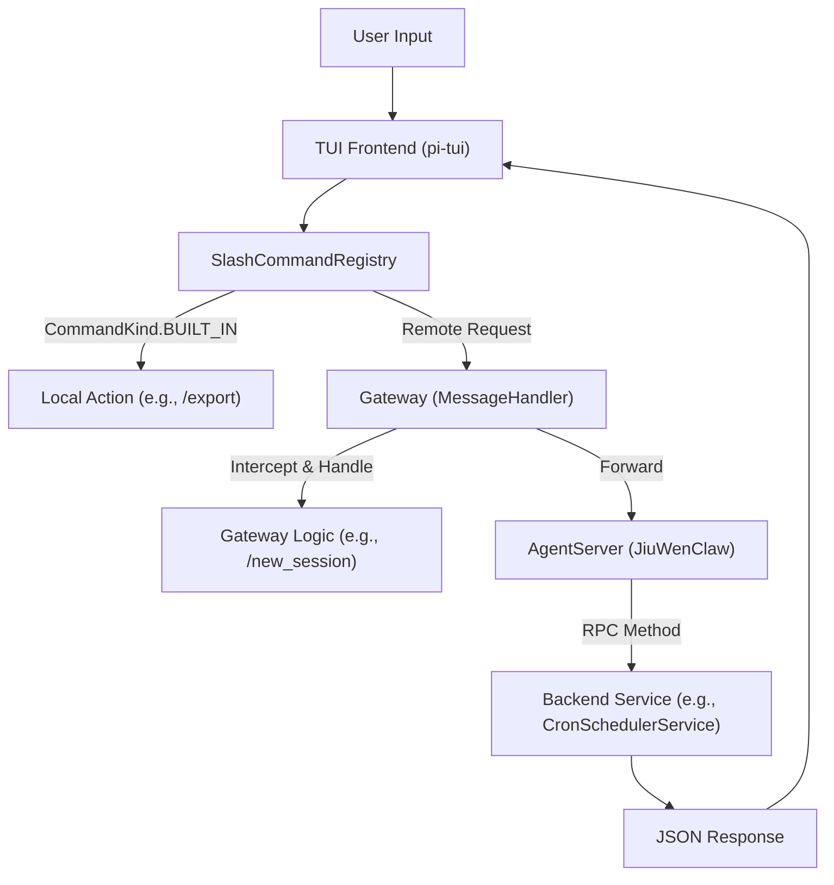
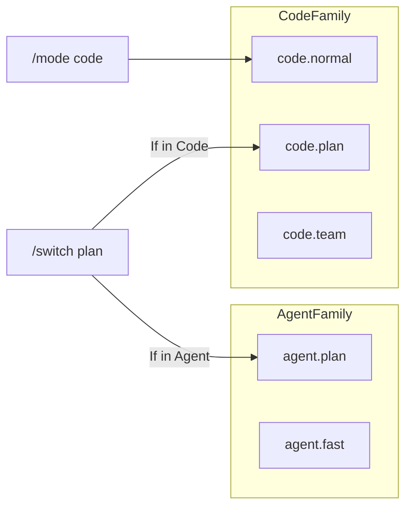

<!-- source: DeepWiki mcp.deepwiki.com · repo openJiuwen-ai/jiuwenswarm · page 7.3 Slash Commands Reference · fetched 2026-11-02 -->

# Slash Commands Reference

Relevant source files

The following files were used as context for generating this wiki page:

- [docs/en/CLI.md](docs/en/CLI.md)
- [docs/en/Modes.md](docs/en/Modes.md)
- [docs/en/SlashCommandArchitecture.md](docs/en/SlashCommandArchitecture.md)
- [docs/en/SlashCommands.md](docs/en/SlashCommands.md)
- [docs/en/ToolPermissionsSecurity.md](docs/en/ToolPermissionsSecurity.md)
- [docs/zh/SLASH_COMMAND_ARCHITECTURE.md](docs/zh/SLASH_COMMAND_ARCHITECTURE.md)
- [jiuwenswarm/agents/harness/common/rails/interrupt/interrupt_helpers.py](jiuwenswarm/agents/harness/common/rails/interrupt/interrupt_helpers.py)
- [jiuwenswarm/agents/harness/common/tools/cron/cron_tools.py](jiuwenswarm/agents/harness/common/tools/cron/cron_tools.py)
- [jiuwenswarm/channels/tui/frontend/src/core/commands/builtins/agents.ts](jiuwenswarm/channels/tui/frontend/src/core/commands/builtins/agents.ts)
- [jiuwenswarm/channels/tui/frontend/src/core/commands/builtins/context.ts](jiuwenswarm/channels/tui/frontend/src/core/commands/builtins/context.ts)
- [jiuwenswarm/channels/tui/frontend/src/core/commands/builtins/copy.ts](jiuwenswarm/channels/tui/frontend/src/core/commands/builtins/copy.ts)
- [jiuwenswarm/channels/tui/frontend/src/core/commands/builtins/cron.ts](jiuwenswarm/channels/tui/frontend/src/core/commands/builtins/cron.ts)
- [jiuwenswarm/channels/tui/frontend/src/core/commands/builtins/export.ts](jiuwenswarm/channels/tui/frontend/src/core/commands/builtins/export.ts)
- [jiuwenswarm/channels/tui/frontend/src/core/commands/builtins/help.ts](jiuwenswarm/channels/tui/frontend/src/core/commands/builtins/help.ts)
- [jiuwenswarm/channels/tui/frontend/src/core/commands/builtins/hooks.ts](jiuwenswarm/channels/tui/frontend/src/core/commands/builtins/hooks.ts)
- [jiuwenswarm/channels/tui/frontend/src/core/commands/builtins/mode.ts](jiuwenswarm/channels/tui/frontend/src/core/commands/builtins/mode.ts)
- [jiuwenswarm/channels/tui/frontend/src/core/commands/builtins/permissions.ts](jiuwenswarm/channels/tui/frontend/src/core/commands/builtins/permissions.ts)
- [jiuwenswarm/channels/tui/frontend/src/core/commands/builtins/plan.ts](jiuwenswarm/channels/tui/frontend/src/core/commands/builtins/plan.ts)
- [jiuwenswarm/channels/tui/frontend/src/core/commands/builtins/plugin.ts](jiuwenswarm/channels/tui/frontend/src/core/commands/builtins/plugin.ts)
- [jiuwenswarm/channels/tui/frontend/src/core/commands/builtins/reload-plugins.ts](jiuwenswarm/channels/tui/frontend/src/core/commands/builtins/reload-plugins.ts)
- [jiuwenswarm/channels/tui/frontend/src/core/commands/builtins/statusline.ts](jiuwenswarm/channels/tui/frontend/src/core/commands/builtins/statusline.ts)
- [jiuwenswarm/channels/tui/frontend/src/core/commands/builtins/switch.ts](jiuwenswarm/channels/tui/frontend/src/core/commands/builtins/switch.ts)
- [jiuwenswarm/channels/tui/frontend/src/core/commands/builtins/usage.ts](jiuwenswarm/channels/tui/frontend/src/core/commands/builtins/usage.ts)
- [jiuwenswarm/channels/tui/frontend/src/core/commands/clipboard.ts](jiuwenswarm/channels/tui/frontend/src/core/commands/clipboard.ts)
- [jiuwenswarm/channels/tui/frontend/src/core/commands/registry.ts](jiuwenswarm/channels/tui/frontend/src/core/commands/registry.ts)
- [jiuwenswarm/channels/web/frontend/src/components/CronPanel/index.tsx](jiuwenswarm/channels/web/frontend/src/components/CronPanel/index.tsx)
- [jiuwenswarm/gateway/channel_manager/im_platforms/dingtalk/dingtalk_connect.py](jiuwenswarm/gateway/channel_manager/im_platforms/dingtalk/dingtalk_connect.py)
- [jiuwenswarm/gateway/cron/controller.py](jiuwenswarm/gateway/cron/controller.py)
- [jiuwenswarm/gateway/cron/models.py](jiuwenswarm/gateway/cron/models.py)
- [jiuwenswarm/gateway/cron/scheduler.py](jiuwenswarm/gateway/cron/scheduler.py)
- [tests/unit_tests/gateway/test_slash_command.py](tests/unit_tests/gateway/test_slash_command.py)

Slash commands serve as the primary control interface for JiuwenSwarm, providing a unified syntax for managing sessions, workspace permissions, model configurations, and agent behaviors across the Terminal User Interface (TUI), Web environments, and IM channels.

## Command Architecture and Parsing

Commands are categorized by their **parsing location**: `TUI Local Parsing` (executed within the frontend process) and `Gateway / Agent Parsing` (forwarded via the E2A protocol to the backend or intercepted by the Gateway).

### Parsing Data Flow

The following diagram illustrates how a command entered in the TUI is either handled locally or routed to the `AgentServer`.

**Command Routing and Execution Flow**

Sources: [docs/en/SlashCommands.md:8-54](), [jiuwenswarm/channels/tui/frontend/src/core/commands/types.ts:1-20](), [jiuwenswarm/gateway/message_handler/message_handler.py:15-17]()

---

## TUI Local Commands

These commands are executed directly within the TUI frontend process. They primarily manage the local display, file exports, and session-specific metadata.

| Command | Implementation | Description |
| :--- | :--- | :--- |
| `/export` | `createExportCommand` | Exports conversation to `.txt` or clipboard. [jiuwenswarm/channels/tui/frontend/src/core/commands/builtins/export.ts:122-148]() |
| `/workspace` | `createWorkspaceCommand` | Manages `trusted_dirs` for file operations. [docs/en/SlashCommands.md:65-95]() |
| `/permissions` | `createPermissionsCommand` | Updates `PermissionInterruptRail` settings via RPC. [jiuwenswarm/channels/tui/frontend/src/core/commands/builtins/permissions.ts:34-45]() |
| `/statusline` | `createStatusLineCommand` | Configures a custom shell command to run in the TUI footer. [jiuwenswarm/channels/tui/frontend/src/core/commands/builtins/statusline.ts:131-180]() |
| `/theme` | `createThemeCommand` | Switches the TUI color theme. [docs/en/SlashCommands.md:21-21]() |

### Workspace and Trusted Directories
The `/workspace` command manages the `trusted_dirs` list. The TUI prompts the user to trust the current directory upon startup. If a path is outside the trusted scope, the `PermissionInterruptRail` triggers a user confirmation request before the agent can perform file operations.

Sources: [docs/en/SlashCommands.md:65-91](), [jiuwenswarm/agents/harness/common/rails/interrupt/interrupt_helpers.py:31-54]()

---

## Gateway and Agent Commands

These commands are identified by the Gateway and either handled internally (for session routing) or forwarded to the `AgentServer`.

### Mode Switching (`/mode`, `/switch`)
Mode management is handled by `createModeCommand` and `createSwitchCommand`. The system supports first-level mode entry and second-level sub-mode switching.

*   **Mode Families**: `agent` (General), `code` (Specialized Coding), `team` (Multi-agent).
*   **Sub-modes**: `plan` (ReAct with planning), `fast` (Direct response), `normal` (Standard code mode).

**Mode Transition Mapping**

Sources: [jiuwenswarm/channels/tui/frontend/src/core/commands/builtins/mode.ts:37-49](), [jiuwenswarm/channels/tui/frontend/src/core/commands/builtins/switch.ts:11-27]()

### Scheduled Tasks (`/cron`)
The `/cron` command manages automated tasks that wake the agent to perform actions. It interacts with the `CronSchedulerService` and `CronJobStore`.

*   **`list`**: Shows all scheduled jobs. [jiuwenswarm/channels/tui/frontend/src/core/commands/builtins/cron.ts:146-153]()
*   **`add`**: Creates a new job with a cron expression (5 or 7 fields). [jiuwenswarm/channels/tui/frontend/src/core/commands/builtins/cron.ts:164-171]()
*   **`run`**: Manually triggers a job execution immediately. [jiuwenswarm/channels/tui/frontend/src/core/commands/builtins/cron.ts:203-210]()

Sources: [jiuwenswarm/gateway/cron/scheduler.py:78-100](), [jiuwenswarm/gateway/cron/store.py:1-15]()

### Model Configuration (`/model`)
Allows hot-swapping the primary LLM configuration.
*   **`list`**: Shows models defined in `config.yaml` under `models.defaults`. [docs/en/SlashCommands.md:128-130]()
*   **`add`**: Appends new model provider details to the configuration. [docs/en/SlashCommands.md:130-131]()

### Skill Management (`/skills`)
Manages the lifecycle of agent skills (builtin, marketplace, or local).
*   **`list`**: Queries the currently available skill list. [docs/en/CLI.md:106-118]()
*   **`evolve`**: Manually triggers the skill self-evolution process for a specific skill. [docs/en/SlashCommands.md:30-30]()

---

## Session and Context Control

These commands manage the conversation history and token window usage.

| Command | Action | Implementation Detail |
| :--- | :--- | :--- |
| `/context` | View Usage | Returns token breakdown and context window percentage. [jiuwenswarm/channels/tui/frontend/src/core/commands/builtins/context.ts:1-20]() |
| `/compact` | Compress | Summarizes history to free up tokens. [docs/en/SlashCommands.md:147-155]() |
| `/rewind` | Undo | Reverts the session to a specific turn, deleting subsequent turns. [docs/en/CLI.md:147-168]() |
| `/branch` | Fork | Creates a new session branching from the current point. [docs/en/CLI.md:122-143]() |
| `/diff` | Review | Shows file changes per turn in the current session. [docs/en/SlashCommands.md:137-145]() |
| `/new_session`| Reset | Generates a new `session_id` and cancels running tasks. [docs/en/CLI.md:19-41]() |

Sources: [docs/en/SlashCommands.md:120-156](), [docs/en/CLI.md:1-180]()

---

## Summary Table of Commands

| Category | Commands |
| :--- | :--- |
| **Core** | `/help`, `/clear`, `/exit`, `/init`, `/copy`, `/export` |
| **Session** | `/resume`, `/rename`, `/session`, `/compact`, `/sessions`, `/new_session`, `/rewind`, `/branch` |
| **Model** | `/model`, `/theme`, `/color` |
| **Config** | `/config`, `/workspace`, `/diff`, `/plan`, `/permissions`, `/statusline` |
| **Skills** | `/skills`, `/teamskills`, `/evolve`, `/evolve_list`, `/evolve_rebuild` |
| **Resources**| `/mcp`, `/memory`, `/plugin`, `/cron` |

Sources: [jiuwenswarm/channels/tui/frontend/src/core/commands/builtins/help.ts:4-29](), [jiuwenswarm/channels/tui/frontend/src/core/commands/registry.ts:48-93]()

---

