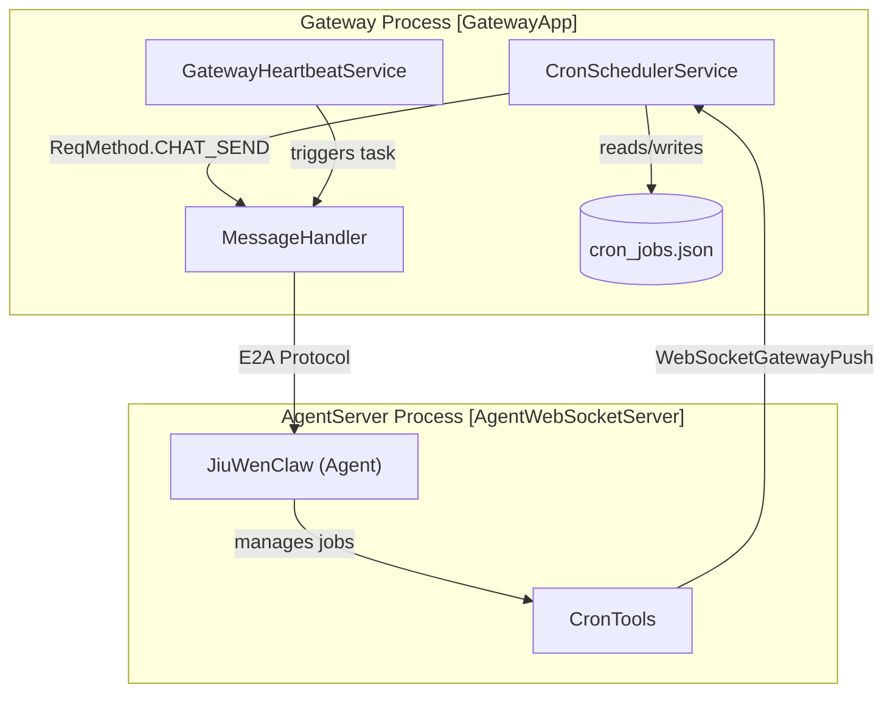

<!-- source: DeepWiki mcp.deepwiki.com · repo openJiuwen-ai/jiuwenswarm · page 8 Scheduled Tasks and Heartbeat · fetched 2026-11-02 -->

# Scheduled Tasks and Heartbeat

Relevant source files

The following files were used as context for generating this wiki page:

- [docs/en/ScheduledTasks.md](docs/en/ScheduledTasks.md)
- [jiuwenswarm/agents/harness/common/tools/cron/cron_tools.py](jiuwenswarm/agents/harness/common/tools/cron/cron_tools.py)
- [jiuwenswarm/channels/tui/frontend/src/core/commands/builtins/cron.ts](jiuwenswarm/channels/tui/frontend/src/core/commands/builtins/cron.ts)
- [jiuwenswarm/channels/web/frontend/src/components/CronPanel/index.tsx](jiuwenswarm/channels/web/frontend/src/components/CronPanel/index.tsx)
- [jiuwenswarm/gateway/channel_manager/im_platforms/dingtalk/dingtalk_connect.py](jiuwenswarm/gateway/channel_manager/im_platforms/dingtalk/dingtalk_connect.py)
- [jiuwenswarm/gateway/cron/controller.py](jiuwenswarm/gateway/cron/controller.py)
- [jiuwenswarm/gateway/cron/models.py](jiuwenswarm/gateway/cron/models.py)
- [jiuwenswarm/gateway/cron/scheduler.py](jiuwenswarm/gateway/cron/scheduler.py)

JiuwenSwarm provides two primary mechanisms for automated task execution: the **Cron Scheduler** and the **Heartbeat Service**. These subsystems allow the agent to perform proactive actions, such as sending daily reports or maintaining persistent connections, without direct user intervention. Both services reside within the **Gateway** process but interact heavily with the **AgentServer** to execute complex LLM-driven tasks [jiuwenswarm/gateway/cron/scheduler.py:12-17]().

### System Architecture Overview

The following diagram illustrates how the automated services bridge the Gateway and AgentServer components, specifically mapping the natural language intent to code entities.

**Automated Tasks Architecture**

Sources: [jiuwenswarm/gateway/cron/scheduler.py:78-92](), [jiuwenswarm/gateway/cron/controller.py:19-26](), [jiuwenswarm/agents/harness/common/tools/cron/cron_tools.py:53-68]()

---

### Cron Scheduler

The `CronSchedulerService` is an asynchronous service that manages time-based tasks [jiuwenswarm/gateway/cron/scheduler.py:78-79](). It supports both one-shot reminders and recurring schedules using standard cron expressions, including the Quartz 7-field format (second, minute, hour, day, month, weekday, year) [jiuwenswarm/gateway/cron/scheduler.py:50-66]().

**Key Features:**
*   **Persistence:** Jobs are stored in `cron_jobs.json` within the user workspace via `CronJobStore` [jiuwenswarm/gateway/cron/models.py:89-91]().
*   **Event Types:** The scheduler uses a priority queue (`heapq`) to handle three event types: `wake` (pre-warming the agent by sending a placeholder), `push` (executing the actual task), and `push_update` (delivering results from long-running agent turns) [jiuwenswarm/gateway/cron/scheduler.py:69-76]().
*   **Multi-Channel Delivery:** Results can be routed to various platforms including `web`, `feishu`, `whatsapp`, `wecom`, `xiaoyi`, `wechat`, and `dingtalk` [jiuwenswarm/gateway/cron/models.py:10-21]().
*   **LLM Integration:** Agents can create and manage their own scheduled tasks via `CronTools`, allowing users to say "Remind me to check the logs every morning at 9 AM" [jiuwenswarm/agents/harness/common/tools/cron/cron_tools.py:44-51]().

For detailed internals on job models and the asyncio loop, see **[Cron Scheduler](#8.1)**.

Sources: [jiuwenswarm/gateway/cron/scheduler.py:1-105](), [jiuwenswarm/gateway/cron/models.py:89-114](), [jiuwenswarm/channels/tui/frontend/src/core/commands/builtins/cron.ts:127-142]()

---

### Heartbeat Service

The `GatewayHeartbeatService` is designed for system health monitoring and "always-on" proactive tasks. Unlike the Cron Scheduler, which is highly granular and user-configurable, the Heartbeat service typically follows a fixed interval defined in the system configuration.

**Key Components:**
*   **HeartbeatConfig:** Defines the `interval`, `active_hours` for power saving, and the `relay_channel_id` for status reporting.
*   **HEARTBEAT.md:** The service can be configured to execute specific instructions found in a heartbeat markdown file, allowing for periodic workspace maintenance or status reporting.
*   **Channel Integration:** It ensures that IM channels (like `DingTalkChannel` or `FeishuChannel`) remain active by periodically sending probes or executing background syncs [jiuwenswarm/gateway/channel_manager/im_platforms/dingtalk/dingtalk_connect.py:228-235]().

For details on heartbeat configuration and the execution pipeline, see **[Heartbeat Service](#8.2)**.

Sources: [jiuwenswarm/gateway/channel_manager/im_platforms/dingtalk/dingtalk_connect.py:228-235](), [docs/en/ScheduledTasks.md:1-12]()

---

### Comparison of Automated Services

| Feature | Cron Scheduler | Heartbeat Service |
| :--- | :--- | :--- |
| **Primary Class** | `CronSchedulerService` | `GatewayHeartbeatService` |
| **Trigger Logic** | Cron expressions (Time-based) | Fixed intervals (Heartbeat) |
| **Storage** | `cron_jobs.json` | `config.yaml` |
| **Main Use Case** | Reminders, Daily Reports, User tasks | Health checks, Connection keep-alive |
| **Agent Access** | Full (via `CronTools` / `/cron` command) | Limited (System-level) |

**Code Entity Mapping**
| System Concept | Code Entity | File Path |
| :--- | :--- | :--- |
| Job Model | `CronJob` | [jiuwenswarm/gateway/cron/models.py:89-114]() |
| Storage Engine | `CronJobStore` | [jiuwenswarm/gateway/cron/store.py:14-14]() |
| API Controller | `CronController` | [jiuwenswarm/gateway/cron/controller.py:19-26]() |
| Scheduler Loop | `_loop` | [jiuwenswarm/gateway/cron/scheduler.py:138-138]() |
| UI Component | `CronPanel` | [jiuwenswarm/channels/web/frontend/src/components/CronPanel/index.tsx:15-46]() |

Sources: [jiuwenswarm/gateway/cron/scheduler.py:78-105](), [jiuwenswarm/gateway/cron/models.py:89-114](), [jiuwenswarm/channels/web/frontend/src/components/CronPanel/index.tsx:15-46]()

---

