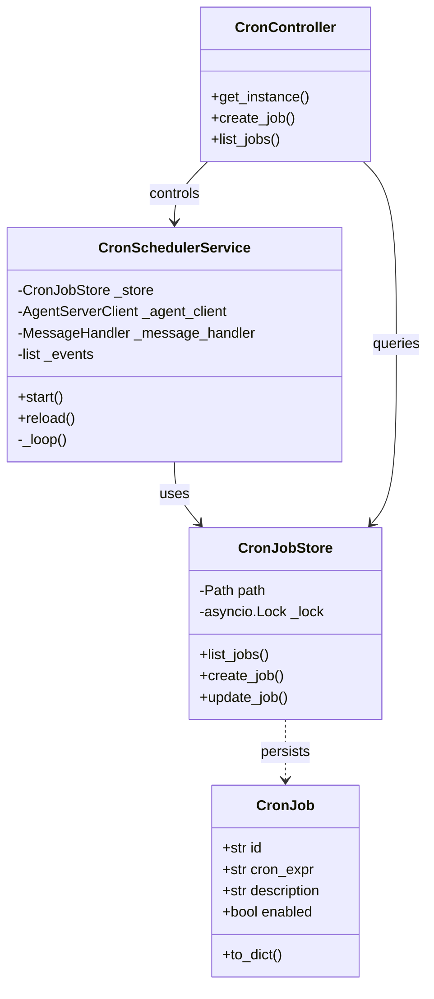
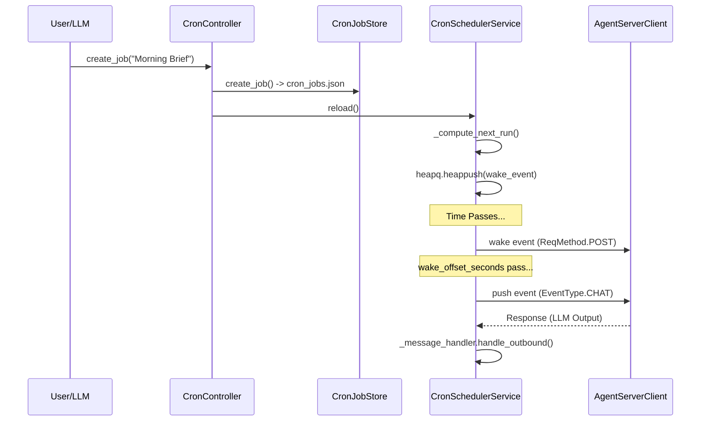

<!-- source: DeepWiki mcp.deepwiki.com · repo openJiuwen-ai/jiuwenswarm · page 8.1 Cron Scheduler · fetched 2026-11-02 -->

# Cron Scheduler

Relevant source files

The following files were used as context for generating this wiki page:

- [docs/en/ScheduledTasks.md](docs/en/ScheduledTasks.md)
- [jiuwenswarm/agents/harness/common/tools/cron/cron_tools.py](jiuwenswarm/agents/harness/common/tools/cron/cron_tools.py)
- [jiuwenswarm/channels/tui/frontend/src/core/commands/builtins/cron.ts](jiuwenswarm/channels/tui/frontend/src/core/commands/builtins/cron.ts)
- [jiuwenswarm/channels/web/frontend/src/components/CronPanel/index.tsx](jiuwenswarm/channels/web/frontend/src/components/CronPanel/index.tsx)
- [jiuwenswarm/gateway/channel_manager/im_platforms/dingtalk/dingtalk_connect.py](jiuwenswarm/gateway/channel_manager/im_platforms/dingtalk/dingtalk_connect.py)
- [jiuwenswarm/gateway/cron/controller.py](jiuwenswarm/gateway/cron/controller.py)
- [jiuwenswarm/gateway/cron/models.py](jiuwenswarm/gateway/cron/models.py)
- [jiuwenswarm/gateway/cron/scheduler.py](jiuwenswarm/gateway/cron/scheduler.py)

The Cron Scheduler in JiuwenSwarm provides a robust mechanism for executing automated tasks and pushing results to various communication channels. It allows agents to perform periodic work—such as daily summaries, health checks, or scheduled research—without direct user intervention.

## 1. Overview and Scope

The system is centered around the `CronSchedulerService`, which manages a collection of `CronJob` entities persisted in a local JSON store. Unlike simple timers, this scheduler supports a "wake-up" phase where the agent is prepared before the actual execution time, ensuring low-latency delivery for complex LLM tasks.

### Key Capabilities
- **Flexible Scheduling**: Supports standard 5-field cron and 7-field Quartz format (including seconds and years) [jiuwenswarm/gateway/cron/scheduler.py:54-57]().
- **Multi-Channel Delivery**: Routes results to `web`, `tui`, `feishu`, `whatsapp`, `wecom`, `xiaoyi`, `wechat`, and `dingtalk` [jiuwenswarm/gateway/cron/models.py:10-20]().
- **One-Shot & Recurring**: Supports both permanent schedules and tasks that delete themselves after a single run [jiuwenswarm/gateway/cron/models.py:113]().
- **LLM Integration**: Agents can create, list, and modify their own scheduled tasks via dedicated `CronTools` [jiuwenswarm/agents/harness/common/tools/cron/cron_tools.py:44-51]().

---

## 2. Data Models and Persistence

The scheduler uses a flat JSON structure for persistence, typically located at the path returned by `get_cron_jobs_path()` [jiuwenswarm/agents/harness/common/tools/cron/cron_tools.py:61-63]().

### CronJob Entity
The `CronJob` class represents the state and configuration of a task [jiuwenswarm/gateway/cron/models.py:89-113]().

| Field | Type | Description |
| :--- | :--- | :--- |
| `id` | `str` | Unique identifier [jiuwenswarm/gateway/cron/models.py:92](). |
| `name` | `str` | Human-readable name of the task [jiuwenswarm/gateway/cron/models.py:93](). |
| `cron_expr` | `str` | The cron expression (5 or 7 fields) [jiuwenswarm/gateway/cron/models.py:95](). |
| `wake_offset_seconds` | `int` | Seconds before the task to "wake" the agent (default 300s) [jiuwenswarm/gateway/cron/models.py:97](). |
| `description` | `str` | Natural language instruction sent to the agent [jiuwenswarm/gateway/cron/models.py:98](). |
| `targets` | `str` | Target channel ID (e.g., "web", "feishu") [jiuwenswarm/gateway/cron/models.py:103](). |
| `mode` | `str` | Execution mode: `agent` or `plan` [jiuwenswarm/gateway/cron/models.py:111](). |
| `delete_after_run` | `bool` | Auto-delete after execution [jiuwenswarm/gateway/cron/models.py:113](). |

### Cron Scheduler Entities
The following diagram maps high-level concepts to their implementation classes.

**Entity Relationship Diagram**

**Sources:** [jiuwenswarm/gateway/cron/models.py:89-113](), [jiuwenswarm/gateway/cron/store.py:14-25](), [jiuwenswarm/gateway/cron/scheduler.py:78-92](), [jiuwenswarm/gateway/cron/controller.py:19-25]().

---

## 3. The Async Scheduler Loop

The `CronSchedulerService` runs an internal `asyncio` loop that manages a priority queue (heap) of `_Event` objects [jiuwenswarm/gateway/cron/scheduler.py:94-100]().

### Event Types
The scheduler processes three distinct event kinds [jiuwenswarm/gateway/cron/scheduler.py:70-75]():
1.  **`wake`**: Triggered `wake_offset_seconds` before the task. It prepares the agent server.
2.  **`push`**: The actual execution time. The scheduler sends the task description to the agent.
3.  **`push_update`**: Used for sending follow-up results or status updates [jiuwenswarm/gateway/cron/scheduler.py:162-166]().

### Data Flow: Schedule to Delivery
This diagram shows how a natural language request becomes a scheduled execution in code.

**Cron Execution Pipeline**

**Sources:** [jiuwenswarm/gateway/cron/scheduler.py:157-199](), [jiuwenswarm/gateway/cron/scheduler.py:303-315](), [jiuwenswarm/gateway/cron/controller.py:127-159]().

---

## 4. Key Implementation Details

### Next Run Calculation
The scheduler uses `croniter` to calculate the next occurrence. It handles both 5-field and 7-field formats by checking the field count [jiuwenswarm/gateway/cron/scheduler.py:50-66]().

### Store Synchronization
The service monitors the `mtime` of the storage file to detect external changes and automatically triggers a `reload()` [jiuwenswarm/gateway/cron/scheduler.py:106-128]().

### One-Shot vs. Recurring
- **Recurring**: After a `push` event, the scheduler calculates the next run and re-inserts events into the heap.
- **One-Shot**: If `croniter` cannot find a next date, the job is marked as `expired` [jiuwenswarm/gateway/cron/scheduler.py:178-193](). If `delete_after_run` is true, the job is removed from the store [jiuwenswarm/gateway/cron/models.py:113]().

### Outbound Routing
When an agent generates a response, the scheduler uses `MessageHandler` to route to `targets`.
- **Feishu Enterprise**: Uses a specific `session_id` mapping for targeted delivery [jiuwenswarm/gateway/cron/controller.py:104-117]().
- **IM Channels**: Supports various platforms like DingTalk via `DingTalkChannel` [jiuwenswarm/gateway/channel_manager/im_platforms/dingtalk/dingtalk_connect.py:228-230]().

---

## 5. LLM and Interface Tools

The system provides tools for both the TUI/Web interfaces and the LLM itself.

### Slash Commands (TUI)
The TUI provides a `/cron` command with subcommands: `list`, `show`, `add`, `update`, `delete`, `toggle`, `run`, and `preview` [jiuwenswarm/channels/tui/frontend/src/core/commands/builtins/cron.ts:144-211]().

### Agent Tools
The `CronTools` class allows the LLM to interact with the scheduler. It uses `ContextVar` to isolate routing information per request [jiuwenswarm/agents/harness/common/tools/cron/cron_tools.py:29-31]().

| Function | Description |
| :--- | :--- |
| `cron_create_job` | Creates a new job with validation [jiuwenswarm/gateway/cron/controller.py:127-159](). |
| `cron_list_jobs` | Lists all jobs for the agent's context [jiuwenswarm/gateway/cron/controller.py:119-121](). |
| `cron_update_job` | Patches an existing job's configuration [jiuwenswarm/gateway/cron/controller.py:161-175](). |
| `cron_delete_job` | Removes a job from the persistent store [jiuwenswarm/gateway/cron/controller.py:186-189](). |

**Sources:** [jiuwenswarm/gateway/cron/controller.py:119-195](), [jiuwenswarm/agents/harness/common/tools/cron/cron_tools.py:44-60](), [jiuwenswarm/channels/tui/frontend/src/core/commands/builtins/cron.ts:127-141]().

---

