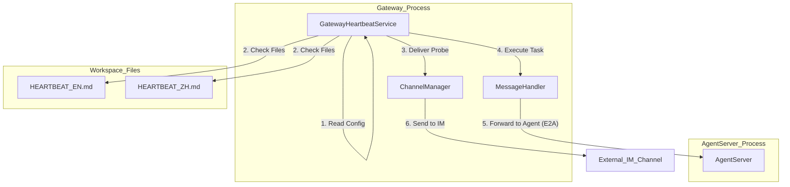
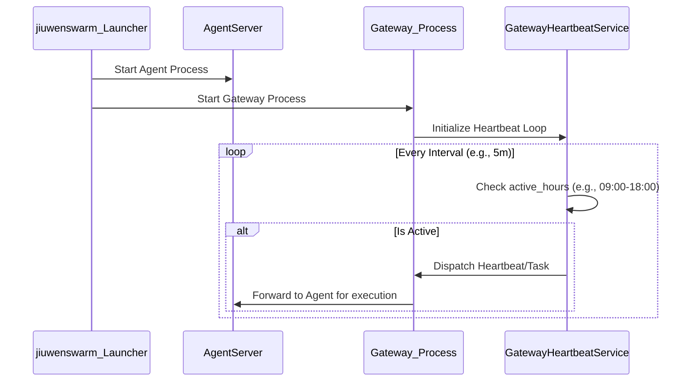

<!-- source: DeepWiki mcp.deepwiki.com · repo openJiuwen-ai/jiuwenswarm · page 8.2 Heartbeat Service · fetched 2026-11-02 -->

# Heartbeat Service

Relevant source files

The following files were used as context for generating this wiki page:

- [docs/en/ScheduledTasks.md](docs/en/ScheduledTasks.md)
- [jiuwenswarm/resources/agent/workspace/HEARTBEAT_EN.md](jiuwenswarm/resources/agent/workspace/HEARTBEAT_EN.md)
- [jiuwenswarm/resources/agent/workspace/HEARTBEAT_ZH.md](jiuwenswarm/resources/agent/workspace/HEARTBEAT_ZH.md)

The **Heartbeat Service** is a background maintenance subsystem within the JiuwenSwarm Gateway process. It ensures the system remains active across various communication channels by periodically sending probes and executing scheduled maintenance tasks defined in the local environment.

## Overview and Purpose

The `GatewayHeartbeatService` serves two primary functions:
1.  **Connection Persistence**: It sends periodic "heartbeat" signals to external IM channels (like Feishu, WeCom, or Discord) to keep connections alive and prevent session timeouts.
2.  **Task Execution**: It monitors the workspace for a `HEARTBEAT.md` file (or language-specific versions like `HEARTBEAT_ZH.md` or `HEARTBEAT_EN.md`). If present, it treats the content of this file as a task prompt for the agent to execute at specified intervals [jiuwenswarm/resources/agent/workspace/HEARTBEAT_EN.md:1-8]().

The service is initialized and managed by the Gateway entry point during the startup sequence.

## Heartbeat Configuration

The behavior of the heartbeat probe is governed by the `heartbeat` section in the system configuration. This configuration can be hot-reloaded or updated programmatically.

### Configuration Schema

| Key | Type | Description |
| :--- | :--- | :--- |
| `every` | `string` | The interval between heartbeats (e.g., "5m", "1h"). |
| `target` | `string` | The `channel_id` or `relay_channel_id` where the heartbeat message or probe should be delivered. |
| `active_hours` | `string` | A time range (e.g., "09:00-18:00") during which the heartbeat is active. |

### Configuration Management
The system provides utilities to persist heartbeat changes while preserving YAML comments and formatting using `ruamel.yaml`. This allows users to modify heartbeat parameters via the Web UI or slash commands, which then updates the underlying `config.yaml`.

**Sources:**
- [docs/en/ScheduledTasks.md:21-28]() (Reference to interval and target patterns)
- [jiuwenswarm/resources/agent/workspace/HEARTBEAT_EN.md:1-8]()

## Implementation and Data Flow

The `GatewayHeartbeatService` operates as an asynchronous loop within the Gateway process. It interacts with the `ChannelManager` to dispatch messages and probes.

### System Architecture Diagram

This diagram illustrates how the `GatewayHeartbeatService` interacts with other code entities to deliver heartbeats and execute maintenance tasks.

**Sources:**
- [jiuwenswarm/resources/agent/workspace/HEARTBEAT_ZH.md:1-8]()
- [jiuwenswarm/resources/agent/workspace/HEARTBEAT_EN.md:1-8]()

### Integration with Channel Delivery

The Heartbeat Service does not send raw socket data directly. Instead, it integrates with the standard delivery pipeline:

1.  **Probe Generation**: The service generates a message object with a specific request method.
2.  **Normalization**: Messages are passed through the Gateway's internal schema normalization to ensure compatibility with different channel adapters.
3.  **Routing**: The `ChannelManager` receives the message and identifies the correct `channel_id` (e.g., `feishu`, `web`, `discord`) based on the `relay_channel_id` or `target` defined in the heartbeat config.

## HEARTBEAT.md Task Execution

When a `HEARTBEAT.md` file (or its localized variants) exists in the agent's workspace, the Heartbeat Service transforms the periodic probe into a proactive task. This allows the agent to perform background work without user intervention.

### Execution Logic
1.  **Detection**: The service checks for the file existence at every configured interval.
2.  **Payload Creation**: It reads the markdown content, which may include instructions like "Check server status" or "Clear cache" [jiuwenswarm/resources/agent/workspace/HEARTBEAT_EN.md:5-7]().
3.  **Context Injection**: The request is tagged as a heartbeat-originated task, allowing the `AgentServer` to handle it with appropriate priority.
4.  **Delivery**: The message is injected into the `MessageHandler`, which forwards it to the `AgentServer` via the established WebSocket bridge.

**Sources:**
- [jiuwenswarm/resources/agent/workspace/HEARTBEAT_ZH.md:5-8]()
- [jiuwenswarm/resources/agent/workspace/HEARTBEAT_EN.md:5-8]()

## Process Lifecycle

The Heartbeat Service is a child task of the Gateway. In the split-process architecture, the Gateway (and its heartbeat loop) is typically started after the `AgentServer` has successfully initialized to ensure that any heartbeat-triggered tasks have a target for execution.

**Sources:**
- [docs/en/ScheduledTasks.md:21-28]()
- [jiuwenswarm/resources/agent/workspace/HEARTBEAT_EN.md:1-3]()

---

