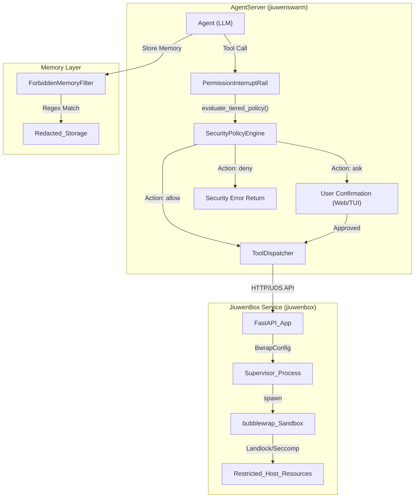
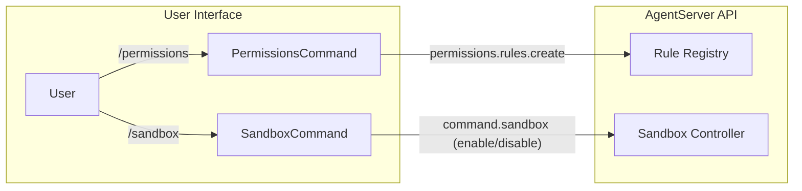

<!-- source: DeepWiki mcp.deepwiki.com · repo openJiuwen-ai/jiuwenswarm · page 9 Security and Permissions · fetched 2026-11-02 -->

# Security and Permissions

Relevant source files

The following files were used as context for generating this wiki page:

- [docs/en/ToolPermissionsSecurity.md](docs/en/ToolPermissionsSecurity.md)
- [jiuwenbox/README.md](jiuwenbox/README.md)
- [jiuwenbox/README_CN.md](jiuwenbox/README_CN.md)
- [jiuwenbox/docker/Dockerfile](jiuwenbox/docker/Dockerfile)
- [jiuwenbox/scripts/run_docker.sh](jiuwenbox/scripts/run_docker.sh)
- [jiuwenbox/src/jiuwenbox/supervisor/bwrap.py](jiuwenbox/src/jiuwenbox/supervisor/bwrap.py)
- [jiuwenbox/src/jiuwenbox/supervisor/landlock_launcher.py](jiuwenbox/src/jiuwenbox/supervisor/landlock_launcher.py)
- [jiuwenbox/tests/integration/test_server_api_default.py](jiuwenbox/tests/integration/test_server_api_default.py)
- [jiuwenswarm/channels/tui/frontend/src/core/commands/builtins/context.ts](jiuwenswarm/channels/tui/frontend/src/core/commands/builtins/context.ts)
- [jiuwenswarm/channels/tui/frontend/src/core/commands/builtins/copy.ts](jiuwenswarm/channels/tui/frontend/src/core/commands/builtins/copy.ts)
- [jiuwenswarm/channels/tui/frontend/src/core/commands/builtins/export.ts](jiuwenswarm/channels/tui/frontend/src/core/commands/builtins/export.ts)
- [jiuwenswarm/channels/tui/frontend/src/core/commands/builtins/permissions.ts](jiuwenswarm/channels/tui/frontend/src/core/commands/builtins/permissions.ts)
- [jiuwenswarm/channels/tui/frontend/src/core/commands/builtins/sandbox.ts](jiuwenswarm/channels/tui/frontend/src/core/commands/builtins/sandbox.ts)
- [jiuwenswarm/channels/tui/frontend/src/core/commands/clipboard.ts](jiuwenswarm/channels/tui/frontend/src/core/commands/clipboard.ts)

JiuwenSwarm implements a defense-in-depth security model designed to protect the host system while allowing autonomous agents to perform complex tasks. This model integrates tiered permission policies, runtime tool guardrails, isolated execution environments, and sensitive data filtering.

## Security Architecture Overview

The security system is distributed across the **AgentServer** and external execution services. The primary goal is to intercept high-risk operations before they reach the host operating system or the LLM's long-term memory.

### Security Component Interaction
The following diagram illustrates how a tool call from an agent (e.g., `bash`) is processed through the security layers before execution, mapping high-level concepts to the `jiuwenbox` and `jiuwenswarm` entities.

**Tool Execution Security Pipeline**

**Sources:** [docs/en/ToolPermissionsSecurity.md:22-26](), [jiuwenbox/src/jiuwenbox/supervisor/bwrap.py:134-143](), [jiuwenswarm/channels/tui/frontend/src/core/commands/builtins/permissions.ts:28-35]()

---

## Tiered Permission Policy

The **PermissionInterruptRail** is the central enforcement point for tool safety. It evaluates agent actions against a set of predefined and user-configurable rules. Rules are categorized by severity levels which determine the interaction model with the user.

| Severity | Description | Normal Mode | Strict Mode |
| :--- | :--- | :--- | :--- |
| `LOW` | Minor operations with minimal side effects. | `allow` | `allow` |
| `MEDIUM` | Operations modifying files in non-critical paths. | `allow` | `ask` |
| `HIGH` | Potentially destructive actions (e.g., recursive deletes). | `ask` | `ask` |
| `CRITICAL` | System-level threats (e.g., privilege escalation). | `ask` | `deny` |

The system uses `evaluate_tiered_policy` to match tool calls against `builtin_rules.yaml` (high-risk shell patterns) and user-defined `permissions.rules` in `config.yaml`.

For details on configuration and the confirmation workflow, see **[Tiered Permission Policy](#9.1)**.

**Sources:** [docs/en/ToolPermissionsSecurity.md:28-40](), [jiuwenswarm/channels/tui/frontend/src/core/commands/builtins/permissions.ts:85-103]()

---

## JiuwenBox Sandbox

To prevent "jailbreaking" or accidental system damage, JiuwenSwarm executes code and shell commands within **JiuwenBox**. This is a specialized Linux sandbox service that leverages kernel features for isolation.

*   **Process Isolation:** Spawns tools via `bubblewrap` with unique namespaces (PID, IPC, UTS, User).
*   **Filesystem Guardrails:** Restricts access using `Landlock` and static policies defined in `policy.yaml`.
*   **Network Isolation:** Supports optional network namespaces and firewall rules (`iptables`/`nftables`) to block or proxy outbound traffic.
*   **Inference Privacy Proxy:** An HTTP-aware proxy that handles LLM API requests and automatically injects API keys at the sandbox boundary.

For details on deployment and sandbox architecture, see **[JiuwenBox Sandbox](#9.2)**.

**Sources:** [jiuwenbox/README.md:11-22](), [jiuwenbox/src/jiuwenbox/supervisor/bwrap.py:78-111]()

---

## Forbidden Memory Filter

The **Forbidden Memory** filter prevents sensitive information (passwords, API keys, PII) from being persisted into long-term memory.

*   **Pattern Matching:** Uses configurable regex patterns in `config.yaml` to identify sensitive strings.
*   **Redaction:** If a match is found, the content is blocked or redacted before storage.
*   **User Control:** Can be enabled or disabled via the `memory.forbidden_memory_definition.enabled` flag.

**Sources:** [jiuwenswarm/channels/tui/frontend/src/core/commands/builtins/context.ts:1-10]() (context/memory management logic)

---

## Security Management via CLI

Users can manage security settings directly through the Terminal UI (TUI) or Web interface using built-in slash commands.

**Security Command Mapping**

| Command | Purpose |
| :--- | :--- |
| `/permissions allow <tool>` | Sets a baseline permission level for a specific tool. |
| `/sandbox enable` | Activates `jiuwenbox` isolation for tool execution. |
| `/sandbox files allow <path>` | Configures filesystem access for the sandbox at runtime. |
| `/export` | Safely exports conversation logs to file or clipboard with sanitization. |

**Sources:** [jiuwenswarm/channels/tui/frontend/src/core/commands/builtins/permissions.ts:28-35](), [jiuwenswarm/channels/tui/frontend/src/core/commands/builtins/sandbox.ts:104-111](), [jiuwenswarm/channels/tui/frontend/src/core/commands/builtins/export.ts:122-131]()

---

