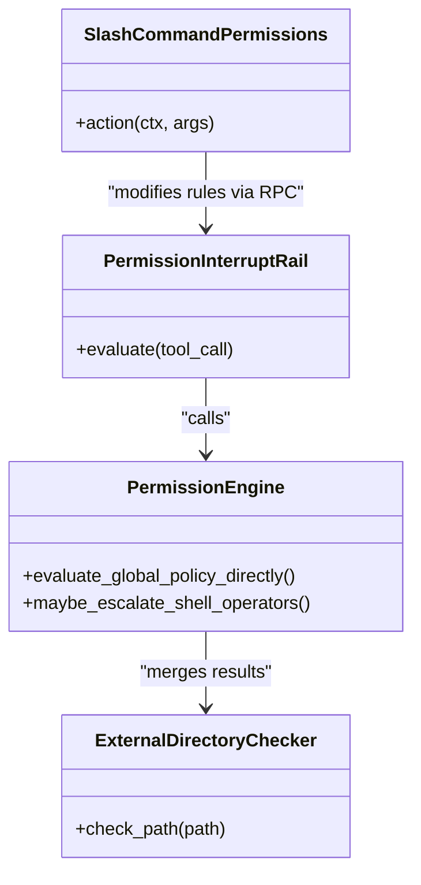

<!-- source: DeepWiki mcp.deepwiki.com · repo openJiuwen-ai/jiuwenswarm · page 9.1 Tiered Permission Policy · fetched 2026-11-02 -->

# Tiered Permission Policy

<details>
<summary>Relevant source files</summary>

The following files were used as context for generating this wiki page:

- [docs/en/ToolPermissionsSecurity.md](docs/en/ToolPermissionsSecurity.md)
- [jiuwenswarm/channels/tui/frontend/src/core/commands/builtins/context.ts](jiuwenswarm/channels/tui/frontend/src/core/commands/builtins/context.ts)
- [jiuwenswarm/channels/tui/frontend/src/core/commands/builtins/copy.ts](jiuwenswarm/channels/tui/frontend/src/core/commands/builtins/copy.ts)
- [jiuwenswarm/channels/tui/frontend/src/core/commands/builtins/export.ts](jiuwenswarm/channels/tui/frontend/src/core/commands/builtins/export.ts)
- [jiuwenswarm/channels/tui/frontend/src/core/commands/builtins/permissions.ts](jiuwenswarm/channels/tui/frontend/src/core/commands/builtins/permissions.ts)
- [jiuwenswarm/channels/tui/frontend/src/core/commands/clipboard.ts](jiuwenswarm/channels/tui/frontend/src/core/commands/clipboard.ts)
- [tests/unit_tests/agents/test_bash_tool_safety.py](tests/unit_tests/agents/test_bash_tool_safety.py)
- [tests/unit_tests/agents/test_command_safety.py](tests/unit_tests/agents/test_command_safety.py)

</details>


The **Tiered Permission Policy** is a security framework within JiuwenSwarm designed to govern agent interactions with sensitive tools and system resources. It operates through the `PermissionInterruptRail`, which intercepts tool calls and evaluates them against a set of severity levels and pattern-based rules. This system ensures that high-risk actions (such as file deletion or system modification) require explicit user confirmation or are denied outright.

## Architecture and Data Flow

The permission system is integrated into the `AgentServer` and acts as a guardrail within the agent's ReAct loop. When an agent attempts to execute a tool, the `PermissionInterruptRail` evaluates the request before it reaches the tool execution layer. The evaluation logic is driven by the `evaluate_tiered_policy()` function in the security module [docs/en/ToolPermissionsSecurity.md:24-25]().

### Core Components and Mapping

The system bridges natural language risk assessment to concrete code execution through the following entities:

| Concept | Code Entity | Role |
| :--- | :--- | :--- |
| **Permission Rail** | `PermissionInterruptRail` | Intercepts tool calls and evaluates rules [jiuwenswarm/agents/harness/rails/permission_rail.py](). |
| **Severity Levels** | `LOW`, `MEDIUM`, `HIGH`, `CRITICAL` | Categorizes the risk level of a tool or specific command [docs/en/ToolPermissionsSecurity.md:32-37](). |
| **Action Mapping** | `allow`, `ask`, `deny` | Determines the system response based on severity [jiuwenswarm/channels/tui/frontend/src/core/commands/builtins/permissions.ts:4-10](). |
| **Rule Definition** | `builtin_rules.yaml` | Stores pattern-based regex rules for command auditing [docs/en/ToolPermissionsSecurity.md:90-95](). |
| **Policy Engine** | `PermissionEngine` | Orchestrates global policy evaluation including shell escalation and external path checks [docs/en/ToolPermissionsSecurity.md:80-87](). |

### Permission Evaluation Flow

The following diagram illustrates how a tool call is processed through the tiered policy, including the priority of built-in vs. user rules.

**Figure 1: Tool Permission Evaluation Logic**
```mermaid
graph TD
    subgraph "Agent Runtime"
        A["Agent Loop"] -->| "tool_call" | B["PermissionInterruptRail"]
    end

    subgraph "Policy Engine (evaluate_tiered_policy)"
        B --> C{"Check Baseline?"}
        C -- "deny" --> H["Return DENY"]
        C -- "allow/ask" --> D{"Built-in Rules?"}
        
        D -- "Match (Deny)" --> H
        D -- "Match (Allow/Ask)" --> F["_finalize_hits"]
        D -- "No Match" --> E{"User Rules?"}
        
        E -- "Match (Deny)" --> H
        E -- "Match (Allow/Ask)" --> F
        
        F --> G{"Action?"}
        
        G -- "allow" --> I["Execute Tool"]
        G -- "deny" --> H
        G -- "ask" --> J["Interrupt: Ask User"]
    end

    subgraph "User Interaction"
        J --> K["ask_user_question Event"]
        K --> L["Frontend Confirmation"]
        L -->| "Approved" | I
        L -->| "Rejected" | H
    end
```
Sources: [docs/en/ToolPermissionsSecurity.md:49-78](), [jiuwenswarm/channels/tui/frontend/src/core/commands/builtins/permissions.ts:37-154]().

## Severity Levels and Actions

Permissions are categorized into four severity levels, which map to specific system behaviors based on the `permissions.permission_mode` (`normal` or `strict`) [docs/en/ToolPermissionsSecurity.md:28-31]().

| Severity | Normal Mode | Strict Mode | Description |
| :--- | :--- | :--- | :--- |
| **LOW** | `allow` | `allow` | Safe operations (e.g., `ls`, `read_file`). |
| **MEDIUM** | `allow` | **`ask`** | Operations with minor side effects. |
| **HIGH** | **`ask`** | **`ask`** | Sensitive operations (e.g., `write_file`). |
| **CRITICAL** | **`ask`** | **`deny`** | Dangerous operations (e.g., `rm -rf`). |

If an explicit `action` (allow/ask/deny) is specified in a rule, it overrides the severity-based mapping [docs/en/ToolPermissionsSecurity.md:29-30]().

Sources: [docs/en/ToolPermissionsSecurity.md:28-40]().

## Pattern-Based Rules

JiuwenSwarm uses a regex-based auditing system to identify high-risk commands within generic tools like `bash`.

### Category Matching
Rules are categorized to ensure accuracy:
*   **Shell category**: `pattern` matches the full command string [docs/en/ToolPermissionsSecurity.md:44-45]().
*   **Path category**: `pattern` matches path-like strings extracted from tool arguments [docs/en/ToolPermissionsSecurity.md:46-47]().

### Safety Guardrails
Specialized safety hooks are installed to protect the JiuwenSwarm process itself. For example, `bash_tool_safety` prevents agents from killing the TUI or backend processes using `pkill` or `killall` [tests/unit_tests/agents/test_bash_tool_safety.py:22-25](), [tests/unit_tests/agents/test_command_safety.py:16-54]().

### External Directory Protection
The `ExternalDirectoryChecker` applies additional checks when tool calls involve paths outside the agent workspace [docs/en/ToolPermissionsSecurity.md:99-105]().
*   **Prefix Matching**: Specific prefixes (e.g., `C:/Users/me/data`) can be set to `allow`, `deny`, or `ask` [docs/en/ToolPermissionsSecurity.md:103-104]().
*   **Default Policy**: Typically `"*": ask` to ensure any out-of-workspace access is confirmed [docs/en/ToolPermissionsSecurity.md:102]().

Sources: [docs/en/ToolPermissionsSecurity.md:41-48](), [docs/en/ToolPermissionsSecurity.md:99-105](), [tests/unit_tests/agents/test_command_safety.py:16-54]().

## User Confirmation Workflow

When a tool call is flagged with the `ask` action, the system triggers an interrupt.

1.  **Event Generation**: The `AgentServer` generates an interrupt request.
2.  **Payload Structure**: The payload contains a `request_id`, the specific `questions`, and a `source` identifying it as a permission check.
3.  **Frontend Handling**: The TUI or Web UI displays the question. In the TUI, this is handled via `ctx.askQuestions` which supports options like "Copy to clipboard" or "Save to file" in other contexts, but follows the same protocol for permissions [jiuwenswarm/channels/tui/frontend/src/core/commands/builtins/export.ts:163-181]().
4.  **Resumption**: Once the user provides a `UserAnswer`, the system resumes or terminates the tool execution based on the response.

**Figure 2: Permission Interaction Code Entities**

Sources: [docs/en/ToolPermissionsSecurity.md:80-87](), [jiuwenswarm/channels/tui/frontend/src/core/commands/builtins/permissions.ts:28-37]().

## Management via Slash Commands

Users can view and modify permissions at runtime using the `/permissions` command.

*   **View Rules**: Running `/permissions` without arguments retrieves tool-level settings via `permissions.tools.get` and rule lists via `permissions.rules.get` [jiuwenswarm/channels/tui/frontend/src/core/commands/builtins/permissions.ts:40-51]().
*   **Update Tool Level**: `/permissions [allow|ask|deny] <tool_name>` updates the tool baseline via `permissions.tools.update` [jiuwenswarm/channels/tui/frontend/src/core/commands/builtins/permissions.ts:141-144]().
*   **Create Pattern Rule**: `/permissions [allow|ask|deny] <tool(pattern)>` creates a specific regex-based rule (e.g., `/permissions allow bash(ls *)`) via `permissions.rules.create` [jiuwenswarm/channels/tui/frontend/src/core/commands/builtins/permissions.ts:85-103]().

Sources: [jiuwenswarm/channels/tui/frontend/src/core/commands/builtins/permissions.ts:28-155]().

---

