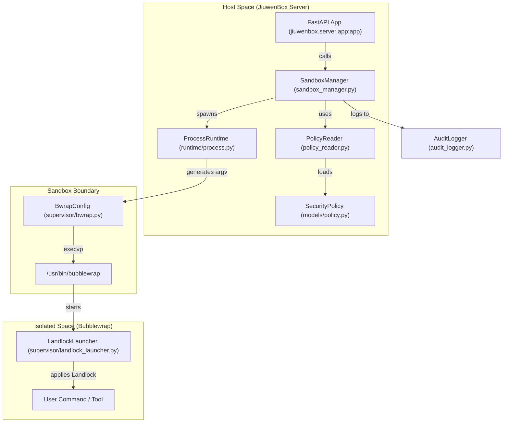
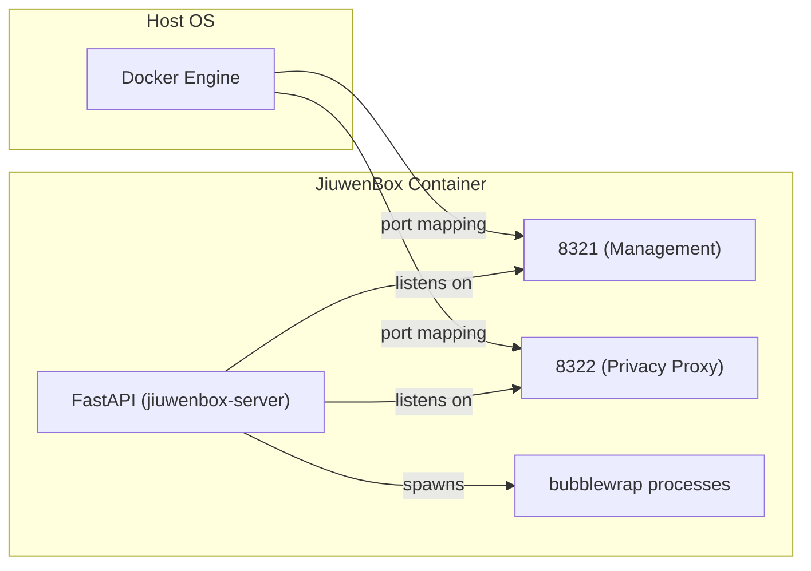

<!-- source: DeepWiki mcp.deepwiki.com · repo openJiuwen-ai/jiuwenswarm · page 9.2 JiuwenBox Sandbox · fetched 2026-11-02 -->

# JiuwenBox Sandbox

Relevant source files

The following files were used as context for generating this wiki page:

- [jiuwenbox/README.md](jiuwenbox/README.md)
- [jiuwenbox/README_CN.md](jiuwenbox/README_CN.md)
- [jiuwenbox/docker/Dockerfile](jiuwenbox/docker/Dockerfile)
- [jiuwenbox/pyproject.toml](jiuwenbox/pyproject.toml)
- [jiuwenbox/scripts/run_docker.sh](jiuwenbox/scripts/run_docker.sh)
- [jiuwenbox/src/jiuwenbox/bundled_configs.py](jiuwenbox/src/jiuwenbox/bundled_configs.py)
- [jiuwenbox/src/jiuwenbox/configs/code-agent-policy.yaml](jiuwenbox/src/jiuwenbox/configs/code-agent-policy.yaml)
- [jiuwenbox/src/jiuwenbox/configs/default-policy.yaml](jiuwenbox/src/jiuwenbox/configs/default-policy.yaml)
- [jiuwenbox/src/jiuwenbox/configs/enterprise-policy.yaml](jiuwenbox/src/jiuwenbox/configs/enterprise-policy.yaml)
- [jiuwenbox/src/jiuwenbox/configs/inference-policy.yaml](jiuwenbox/src/jiuwenbox/configs/inference-policy.yaml)
- [jiuwenbox/src/jiuwenbox/logging_config.py](jiuwenbox/src/jiuwenbox/logging_config.py)
- [jiuwenbox/src/jiuwenbox/models/policy.py](jiuwenbox/src/jiuwenbox/models/policy.py)
- [jiuwenbox/src/jiuwenbox/models/sandbox.py](jiuwenbox/src/jiuwenbox/models/sandbox.py)
- [jiuwenbox/src/jiuwenbox/server/app.py](jiuwenbox/src/jiuwenbox/server/app.py)
- [jiuwenbox/src/jiuwenbox/server/audit_logger.py](jiuwenbox/src/jiuwenbox/server/audit_logger.py)
- [jiuwenbox/src/jiuwenbox/server/launcher.py](jiuwenbox/src/jiuwenbox/server/launcher.py)
- [jiuwenbox/src/jiuwenbox/server/policy_reader.py](jiuwenbox/src/jiuwenbox/server/policy_reader.py)
- [jiuwenbox/src/jiuwenbox/server/routes/policy.py](jiuwenbox/src/jiuwenbox/server/routes/policy.py)
- [jiuwenbox/src/jiuwenbox/server/runtime/process.py](jiuwenbox/src/jiuwenbox/server/runtime/process.py)
- [jiuwenbox/src/jiuwenbox/server/sandbox_manager.py](jiuwenbox/src/jiuwenbox/server/sandbox_manager.py)
- [jiuwenbox/src/jiuwenbox/supervisor/bwrap.py](jiuwenbox/src/jiuwenbox/supervisor/bwrap.py)
- [jiuwenbox/src/jiuwenbox/supervisor/landlock_launcher.py](jiuwenbox/src/jiuwenbox/supervisor/landlock_launcher.py)
- [jiuwenbox/tests/conftest.py](jiuwenbox/tests/conftest.py)
- [jiuwenbox/tests/integration/test_inference_privacy_proxy.py](jiuwenbox/tests/integration/test_inference_privacy_proxy.py)
- [jiuwenbox/tests/integration/test_server_api_default.py](jiuwenbox/tests/integration/test_server_api_default.py)
- [jiuwenswarm/channels/tui/frontend/src/core/commands/builtins/sandbox.ts](jiuwenswarm/channels/tui/frontend/src/core/commands/builtins/sandbox.ts)

JiuwenBox is a lightweight Linux sandbox service designed to execute agent tools and arbitrary code snippets within a multi-layered isolation environment [jiuwenbox/README.md:3-8](). It operates as a standalone FastAPI server that manages the lifecycle of isolated processes using standard Linux security primitives like `bubblewrap`, `Landlock`, and `seccomp` [jiuwenbox/README.md:12-21]().

## Architecture Overview

The system follows a manager-supervisor architecture. A central server manages state and policies, while ephemeral supervisor processes handle the actual execution of sandboxed commands [jiuwenbox/README.md:25-39]().

### Component Interaction

The following diagram illustrates the data flow from an API request to the execution of a sandboxed command, mapping system concepts to specific code entities.

**Sandbox Execution Flow**

Sources: [jiuwenbox/README.md:25-39](), [jiuwenbox/src/jiuwenbox/server/sandbox_manager.py:98-125](), [jiuwenbox/src/jiuwenbox/supervisor/bwrap.py:134-143](), [jiuwenbox/src/jiuwenbox/server/app.py:21-27]()

### Key Code Entities
| Component | Implementation | Role |
| :--- | :--- | :--- |
| **Server** | `jiuwenbox.server.app:app` | FastAPI entry point for sandbox lifecycle, file transfer, and exec APIs [jiuwenbox/src/jiuwenbox/server/app.py:13-15](). |
| **Sandbox Manager** | `jiuwenbox.server.sandbox_manager:SandboxManager` | Orchestrates creation, start, stop, and deletion of sandboxes; persists `SandboxRef` state [jiuwenbox/src/jiuwenbox/server/sandbox_manager.py:98-109](). |
| **Bwrap Wrapper** | `jiuwenbox.supervisor.bwrap:BwrapConfig` | Translates `SecurityPolicy` models into `bubblewrap` CLI arguments [jiuwenbox/src/jiuwenbox/supervisor/bwrap.py:78-81](). |
| **Audit Logger** | `jiuwenbox.server.audit_logger:AuditLogger` | Records structured JSONL events (e.g., `exec_command`, `file_transfer`) for every sandbox action [jiuwenbox/src/jiuwenbox/server/sandbox_manager.py:25-30](). |
| **Landlock Launcher** | `jiuwenbox.supervisor.landlock_launcher` | In-sandbox Python script that applies Landlock rules before executing user code [jiuwenbox/README.md:37-40](). |

Sources: [jiuwenbox/src/jiuwenbox/server/sandbox_manager.py:98-125](), [jiuwenbox/src/jiuwenbox/server/app.py:132-155](), [jiuwenbox/src/jiuwenbox/supervisor/bwrap.py:1-8]()

## Isolation Mechanisms

JiuwenBox employs a "defense in depth" strategy using four primary Linux kernel features:

### 1. Process Isolation (bubblewrap)
The `BwrapConfig` class in `jiuwenbox.supervisor.bwrap` maps the `SecurityPolicy` to bubblewrap flags [jiuwenbox/src/jiuwenbox/supervisor/bwrap.py:134-143]().
- **Namespaces**: Supports unsharing `user`, `pid`, `net`, `ipc`, `cgroup`, and `uts` namespaces [jiuwenbox/src/jiuwenbox/supervisor/bwrap.py:86-91]().
- **Capabilities**: Explicitly adds or drops Linux capabilities via `cap_add` and `cap_drop` [jiuwenbox/src/jiuwenbox/supervisor/bwrap.py:92-93]().
- **Lifecycle Control**: Uses `--die-with-parent` to ensure the sandbox monitor and children are killed if the server process terminates unexpectedly [jiuwenbox/src/jiuwenbox/supervisor/bwrap.py:95-111]().

### 2. Filesystem Policy (Landlock)
Landlock provides fine-grained path-based access control even within the bubblewrap container.
- **Ruleset Enforcement**: Applied via the `landlock_launcher.py` module, which restricts filesystem access based on `BASE_READ_ONLY_ACCESS` and `BASE_READ_WRITE_ACCESS` masks [jiuwenbox/README.md:18-19]().
- **Policy Mapping**: The `BwrapConfig` processes `bind_root_entries` before `bind_mounts` to ensure explicit user overrides (allow/deny) take precedence over generic root mounts [jiuwenbox/src/jiuwenbox/supervisor/bwrap.py:163-173]().

### 3. System Call Filtering (Seccomp)
The sandbox blocks dangerous syscalls using seccomp filters. The `BwrapConfig` supports passing a `seccomp_fd` to bubblewrap [jiuwenbox/src/jiuwenbox/supervisor/bwrap.py:123-124](). Default policies typically block calls like `mount`, `ptrace`, and `reboot` [jiuwenbox/README.md:19]().

### 4. Network Isolation
Network mode is configurable via the `NetworkPolicy` [jiuwenbox/src/jiuwenbox/supervisor/bwrap.py:25-26]().
- **Isolated Mode**: When `network.mode` is set to `isolated`, JiuwenBox uses `iproute2`, `iptables`, and `nftables` to create a dedicated network namespace with restricted egress [jiuwenbox/README.md:49-51]().
- **Unshare Net**: Bubblewrap is configured with `unshare_net: bool = True` by default to strip network access unless explicitly configured [jiuwenbox/src/jiuwenbox/supervisor/bwrap.py:86]().

Sources: [jiuwenbox/src/jiuwenbox/supervisor/bwrap.py:78-155](), [jiuwenbox/README.md:12-22](), [jiuwenbox/src/jiuwenbox/server/sandbox_manager.py:153-159]()

## Policy Configuration and State

### Filesystem Configuration Logic
The `FilesystemPolicy` [jiuwenbox/src/jiuwenbox/models/policy.py:23]() distinguishes between:
- **`bind_mounts`**: Maps host paths to sandbox paths (read-only or read-write) [jiuwenbox/src/jiuwenbox/supervisor/bwrap.py:177-180]().
- **`tmpfs_mounts`**: Ephemeral in-memory filesystems for specific paths [jiuwenbox/src/jiuwenbox/supervisor/bwrap.py:118]().
- **`remount_ro`**: Paths that should be remounted as read-only after binding [jiuwenbox/src/jiuwenbox/supervisor/bwrap.py:119]().

### State Management
Sandboxes are tracked using `SandboxRef` models, which include the `SandboxPhase` (e.g., `READY`, `STOPPED`), `pid`, and `last_active_at` timestamp [jiuwenbox/src/jiuwenbox/models/sandbox.py:11-45]().
- **Ephemeral Registry**: JiuwenBox treats the sandbox registry as ephemeral across restarts to avoid reviving "ghost" processes [jiuwenbox/src/jiuwenbox/server/sandbox_manager.py:128-137]().
- **Idle Reaper**: A background task `_idle_reaper_task` monitors `last_active_at` to automatically stop sandboxes that have been idle past their timeout [jiuwenbox/src/jiuwenbox/server/sandbox_manager.py:124-127]().

Sources: [jiuwenbox/src/jiuwenbox/models/policy.py:23-28](), [jiuwenbox/src/jiuwenbox/models/sandbox.py:11-45](), [jiuwenbox/src/jiuwenbox/server/sandbox_manager.py:121-137]()

## Inference Privacy Proxy

The `ProxyManager` manages `InferencePrivacyProxy` instances that route LLM API requests [jiuwenbox/README.md:33-35]().

### API Key Injection
The proxy allows the sandbox to make LLM calls without exposing sensitive API keys to the user code. It intercepts HTTP requests and injects keys based on the provider:
- **OpenAI/Anthropic**: Intercepts requests to specific path prefixes and adds the required `Authorization` or `X-Api-Key` headers [jiuwenbox/README.md:22]().
- **Path Routing**: Uses path-based routing to forward requests from the sandbox to the real upstream LLM endpoints [jiuwenbox/README.md:42-43]().

Sources: [jiuwenbox/README.md:22-43](), [jiuwenbox/src/jiuwenbox/server/app.py:27-28]()

## Deployment and Setup

### Docker Deployment
The `Dockerfile` uses `openEuler 24.03` and installs essential security tools [jiuwenbox/docker/Dockerfile:1-23]().

**Deployment Architecture**

Sources: [jiuwenbox/docker/Dockerfile:38-45](), [jiuwenbox/scripts/run_docker.sh:159-181]()

### Execution over Unix Domain Sockets (UDS)
JiuwenBox supports serving its management API over UDS via `JIUWENBOX_LISTEN=unix:///path/to/socket` [jiuwenbox/README.md:118-129](). This is useful for same-host agents to avoid TCP overhead and port conflicts. The `run_docker.sh` script handles mounting the host UDS directory into the container [jiuwenbox/scripts/run_docker.sh:163-177]().

### Persistence and Audit Logs
By default, JiuwenBox writes no logs to disk. Persistence is enabled via `--save-logs DIR` [jiuwenbox/README.md:181-190]().
- **Audit Format**: `{sandbox_id}-{ISO8601}.audit.log` containing JSONL events [jiuwenbox/README.md:202-208]().
- **Truncation**: Output in audit logs is truncated to 4 KiB to prevent disk exhaustion while preserving error context [jiuwenbox/src/jiuwenbox/server/sandbox_manager.py:30-44]().

Sources: [jiuwenbox/scripts/run_docker.sh:187-201](), [jiuwenbox/src/jiuwenbox/server/app.py:132-155](), [jiuwenbox/src/jiuwenbox/server/sandbox_manager.py:25-44]()

---

