# Page: JiuwenSwarm Overview

# JiuwenSwarm Overview

<details>
<summary>Relevant source files</summary>

The following files were used as context for generating this wiki page:

- [README.md](README.md)
- [README_CN.md](README_CN.md)
- [docs/en/InstallGuide.md](docs/en/InstallGuide.md)
- [docs/en/Page-Overview.md](docs/en/Page-Overview.md)
- [docs/en/Quickstart_tui.md](docs/en/Quickstart_tui.md)
- [docs/en/README.md](docs/en/README.md)
- [docs/en/SUMMARY.md](docs/en/SUMMARY.md)
- [docs/en/install.md](docs/en/install.md)
- [docs/zh/Quickstart_tui.md](docs/zh/Quickstart_tui.md)
- [docs/zh/README.md](docs/zh/README.md)
- [docs/zh/SUMMARY.md](docs/zh/SUMMARY.md)
- [jiuwenswarm/common/config.py](jiuwenswarm/common/config.py)
- [pyproject.toml](pyproject.toml)
- [tests/unit_tests/test_app_web_handlers.py](tests/unit_tests/test_app_web_handlers.py)
- [tests/unit_tests/test_config.py](tests/unit_tests/test_config.py)
- [uv.lock](uv.lock)

</details>


**JiuwenSwarm** is an intelligent multi-agent framework built in Python, designed to act as a self-hosted AI butler [README.md:3-15](). It leverages a "swarm" architecture where multiple intelligent agents collaborate to execute complex tasks, ranging from general assistance to autonomous coding and multi-agent team coordination [README.md:15-17]().

The system is designed for high data sovereignty, supporting self-hosted deployment and integration with diverse platforms such as **Huawei Cloud MaaS**, **Xiaoyi Open Platform**, and various Instant Messaging (IM) channels [README.md:19-22]().

## System Architecture

JiuwenSwarm utilizes a split-process architecture to separate concerns between agent intelligence and communication management. The system is primarily composed of the **AgentServer** and the **Gateway** [pyproject.toml:72-73]().

*   **AgentServer**: The core execution engine where the LLM logic, tool orchestration, and agent modes (Agent, Code, Team) reside. It is launched via `jiuwenswarm-agentserver` [pyproject.toml:72]().
*   **Gateway**: The communication hub that routes messages between external channels (Web, TUI, IM platforms) and the AgentServer using the **E2A (External-to-Agent)** protocol. It is launched via `jiuwenswarm-gateway` [pyproject.toml:73]().

### High-Level Process Interaction
The following diagram illustrates how user requests move from "Natural Language Space" (Channels) into "Code Entity Space" (Internal Services).

**Diagram: System Entry and Routing**
```mermaid
graph TD
    subgraph "Natural Language Space (Channels)"
        [Web_UI] --> [app_web.py]
        [IM_Platforms] --> [channel_manager]
        [TUI_Frontend] --> [app_acp.py]
    end

    subgraph "Gateway Process (app_gateway.py)"
        [app_web.py] -- "E2A Protocol" --> [MessageHandler]
        [channel_manager] --> [MessageHandler]
        [app_acp.py] --> [MessageHandler]
        [MessageHandler] --> [SessionMap]
    end

    subgraph "AgentServer Process (app_agentserver.py)"
        [SessionMap] -- "WebSocket" --> [AgentWebSocketServer]
        [AgentWebSocketServer] --> [JiuWenClaw]
        [JiuWenClaw] --> [ModeHarness]
    end
```
**Sources:** [pyproject.toml:70-82](), [jiuwenswarm/common/config.py:106-112]()

## Key Capabilities

### 1. Multi-Mode Operation
JiuwenSwarm operates in specialized modes tailored for different task types:
*   **Agent Mode**: General-purpose assistance using ReAct loops.
*   **Code Mode**: Specialized for software development, utilizing specialized rails like `CodingMemoryRail` and `ProjectMemoryRail`.
*   **Team Mode**: Orchestrates multiple agents with leader/teammate hierarchies for complex project execution, supporting distributed deployments [pyproject.toml:49-53]().

### 2. Autonomous Evolution
The system features a **Skill Self-Evolution** mechanism. When users provide feedback or errors occur, the system can automatically refine its underlying skills based on feedback [README.md:31-34]().

### 3. Memory & Context
JiuwenSwarm employs a multi-layered memory system including:
*   **Short-term Project Memory**: Contextual information derived from local workspace files.
*   **Long-term Memory (LTM)**: Persistent storage using `chromadb`, `pgvector`, or `sqlite-vec` [pyproject.toml:16-39]().
*   **Forbidden Memory**: A security filter that prevents the storage of sensitive patterns.

### 4. Communication Channels
The framework supports a wide array of interfaces:
*   **Web**: A FastAPI-based web server [pyproject.toml:74]().
*   **TUI**: A terminal-based interface for developer workflows, launched via `jiuwenswarm-tui` [pyproject.toml:78]().
*   **IM Channels**: Native support for **Feishu/Lark**, **WeCom**, **Telegram**, **Discord**, and **DingTalk** [pyproject.toml:26-29]().

**Diagram: Memory Subsystem Integration**
```mermaid
graph LR
    subgraph "Code Entity Space"
        [JiuWenClaw] --> [Rails_System]
        [Rails_System] --> [CodingMemoryRail]
        [Rails_System] --> [ContextProcessorRail]
    end

    subgraph "Storage & Providers"
        [CodingMemoryRail] --> [sqlite_vec]
        [ContextProcessorRail] --> [MemoryIndexManager]
        [MemoryIndexManager] --> [chromadb]
        [MemoryIndexManager] --> [pgvector]
    end
```
**Sources:** [pyproject.toml:16-39](), [jiuwenswarm/common/config.py:106-112]()

## Configuration and Setup

JiuwenSwarm is managed via environment variables and YAML configuration:
1.  **Config Management**: The `jiuwenswarm.common.config` module handles loading and resolving environment variables within the configuration [jiuwenswarm/common/config.py:35-76]().
2.  **Initialization**: The `jiuwenswarm-init` command sets up the workspace, resources, and `.env.template` [pyproject.toml:76]().
3.  **Startup**: The `jiuwenswarm-start` command launches the necessary services [pyproject.toml:75]().

For detailed instructions on setting up your environment, see **[Getting Started](#1.1)**.
For a complete breakdown of configuration options, see **[Configuration Reference](#1.2)**.

## Documentation Map

*   **[Getting Started](#1.1)**: Installation via `pip` or source, and initial workspace setup using `jiuwenswarm-init`.
*   **[Configuration Reference](#1.2)**: Detailed guide to `config.yaml`, environment variables, and model provider settings.
*   **Core Architecture**: (Section 2) Deep dive into the Gateway, AgentServer, and E2A protocol.
*   **Agent Modes**: (Section 3) Details on Code, Team, and Plan modes.
*   **Memory & Skills**: (Sections 4 & 5) Exploration of the indexing system and skill evolution.

**Sources:** [README.md:103-137](), [docs/en/SUMMARY.md:1-41]()

---

# Page: Getting Started

# Getting Started

<details>
<summary>Relevant source files</summary>

The following files were used as context for generating this wiki page:

- [docs/assets/images/browser1.png](docs/assets/images/browser1.png)
- [docs/assets/images/browser2.png](docs/assets/images/browser2.png)
- [docs/en/Browser.md](docs/en/Browser.md)
- [docs/en/InstallGuide.md](docs/en/InstallGuide.md)
- [docs/en/Page-Overview.md](docs/en/Page-Overview.md)
- [docs/en/Quickstart.md](docs/en/Quickstart.md)
- [docs/en/README.md](docs/en/README.md)
- [docs/en/SUMMARY.md](docs/en/SUMMARY.md)
- [docs/en/install.md](docs/en/install.md)
- [docs/zh/Quickstart.md](docs/zh/Quickstart.md)
- [docs/zh/README.md](docs/zh/README.md)
- [docs/zh/SUMMARY.md](docs/zh/SUMMARY.md)
- [jiuwenswarm/common/config.py](jiuwenswarm/common/config.py)
- [pyproject.toml](pyproject.toml)
- [tests/unit_tests/test_app_web_handlers.py](tests/unit_tests/test_app_web_handlers.py)
- [tests/unit_tests/test_config.py](tests/unit_tests/test_config.py)
- [uv.lock](uv.lock)

</details>


This page provides a technical guide for installing and initializing JiuwenSwarm. It covers the environment requirements, the primary installation workflows (pip and source-build), and the automated workspace initialization process that sets up the local agent environment.

## Prerequisites

Before installation, ensure the host system meets the following technical specifications:

| Dependency | Requirement | Role |
| :--- | :--- | :--- |
| **Operating System** | Windows 10/11, macOS 10.15+, Linux | Multi-platform support |
| **Python** | `≥3.11`, `<3.14` | Core runtime (3.11 recommended) |
| **Node.js** | `≥18.x` | Required for Web UI and TUI frontend builds |
| **Git** | Latest | Required for source builds and skill discovery |

Sources: `[docs/en/Quickstart.md:9-17]()`, `[docs/zh/Quickstart.md:11-16]()`

---

## Installation Workflows

JiuwenSwarm supports two main installation paths depending on whether you are a user or a developer.

### 1. Standard Installation (pip)
This is the recommended path for users who want to run the stable version of JiuwenSwarm.

```bash
# Create and activate virtual environment
python -m venv jiuwenswarm
source jiuwenswarm/bin/activate  # Linux/Mac

# Install JiuwenSwarm
pip install jiuwenswarm
```
Sources: `[docs/en/Quickstart.md:27-39]()`, `[pyproject.toml:5-14]()`

### 2. Source Build (Developer Mode)
For developers contributing to the codebase or building custom extensions, the project supports `uv` and `conda` workflows.

**Using `uv`:**
```bash
# Clone the repository and sync dependencies
uv venv --python=3.11
uv sync

# Build the Web Frontend
cd jiuwenswarm/channels/web/frontend
npm install
npm run build
```
Sources: `[docs/zh/Quickstart.md:63-92]()`, `[pyproject.toml:114-118]()`

---

## Initialization and First Run

The initialization process is handled by the `jiuwenswarm-init` command, which maps to the `main` function in `jiuwenswarm/init_workspace.py`.

### Workspace Setup Logic
The initialization logic performs the following critical steps:
1. **Path Resolution**: Determines the target directory (defaulting to `~/.jiuwenswarm`) using `get_config_dir` `[jiuwenswarm/common/config.py:27-28]()`.
2. **Resource Population**: Copies configuration templates (`config.yaml`, `.env.template`) and agent resources from the package's `resources` directory to the user's workspace `[pyproject.toml:101-105]()`.
3. **Environment Variable Resolution**: The system uses `resolve_env_vars` to handle `${VAR:-default}` syntax within the YAML configuration files `[jiuwenswarm/common/config.py:35-76]()`.

### Command Reference
| Command | Entry Point | Description |
| :--- | :--- | :--- |
| `jiuwenswarm-init` | `jiuwenswarm.init_workspace:main` | Standard initialization of the user workspace. |
| `jiuwenswarm-start` | `jiuwenswarm.start_services:main` | Launches the `AgentServer` and `Gateway` processes. |
| `jiuwenswarm-web` | `jiuwenswarm.channels.web.app_web:main` | Standalone start for the Web channel. |

Sources: `[pyproject.toml:70-80]()`, `[jiuwenswarm/common/config.py:21-28]()`

---

## Workspace Structure

After running `jiuwenswarm-init`, the workspace directory is structured to isolate configuration from runtime data.

**JiuwenSwarm Workspace Layout**
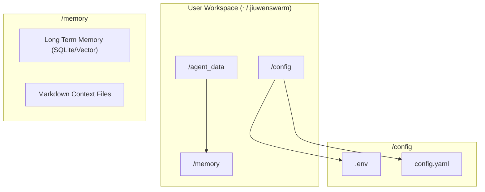
Sources: `[jiuwenswarm/common/config.py:21-28]()`, `[docs/en/Quickstart.md:162-170]()`

---

## Environment Configuration

The `.env` file is the primary location for sensitive credentials. The system provides a `resolve_env_vars` function to inject these into the runtime configuration.

### Essential Variables
| Variable | Description |
| :--- | :--- |
| `API_KEY` | The API key for the LLM provider. |
| `API_BASE` | Base URL for the LLM API. |
| `MODEL_NAME` | The specific model identifier (e.g., `deepseek-chat`). |
| `MODEL_PROVIDER` | Provider type (e.g., `OpenAI`, `DeepSeek`). |

### Initialization Data Flow
The following diagram illustrates how the `jiuwenswarm-init` command bridges the source code templates to the active user environment.

**Initialization Data Flow**
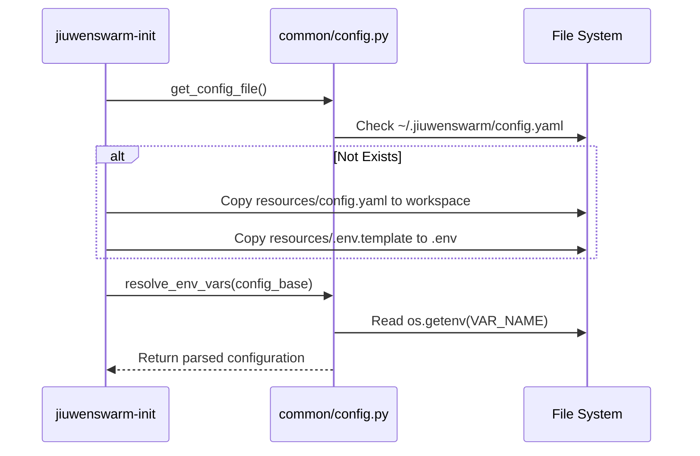
Sources: `[jiuwenswarm/common/config.py:35-76]()`, `[jiuwenswarm/common/config.py:106-112]()`, `[pyproject.toml:101-105]()`

---

## Starting the Service

Once initialized and configured, start the service using the entry point:

```bash
jiuwenswarm-start
```

The system will output the status of the primary components:
1. **API Server (Gateway)**: Typically running at `http://localhost:8000`.
2. **Web Server (Frontend)**: Typically running at `http://localhost:5173`.

### Remote Access (Optional)
To allow external access, the `jiuwenswarm-web` command can be used to specify host and port:
```bash
jiuwenswarm-web --host 0.0.0.0 --port 8080
```

Sources: `[docs/en/Quickstart.md:51-57]()`, `[docs/en/Quickstart.md:65-71]()`, `[pyproject.toml:75]()`

---

# Page: Configuration Reference

# Configuration Reference

<details>
<summary>Relevant source files</summary>

The following files were used as context for generating this wiki page:

- [docs/assets/images/config-model-test.png](docs/assets/images/config-model-test.png)
- [docs/assets/images/config-vision-model-test-en.png](docs/assets/images/config-vision-model-test-en.png)
- [docs/assets/images/config-vision-model-test.png](docs/assets/images/config-vision-model-test.png)
- [docs/assets/images/config.png](docs/assets/images/config.png)
- [docs/assets/images/config_audio_model_demo.png](docs/assets/images/config_audio_model_demo.png)
- [docs/assets/images/config_context_compress.png](docs/assets/images/config_context_compress.png)
- [docs/assets/images/config_model_connect_test.png](docs/assets/images/config_model_connect_test.png)
- [docs/assets/images/config_tool_security_guard.png](docs/assets/images/config_tool_security_guard.png)
- [docs/assets/images/config_video_model_demo.png](docs/assets/images/config_video_model_demo.png)
- [docs/en/Configuration.md](docs/en/Configuration.md)
- [docs/en/SkillSelfEvolution.md](docs/en/SkillSelfEvolution.md)
- [docs/en/Skills.md](docs/en/Skills.md)
- [jiuwenswarm/common/config.py](jiuwenswarm/common/config.py)
- [pyproject.toml](pyproject.toml)
- [tests/unit_tests/test_app_web_handlers.py](tests/unit_tests/test_app_web_handlers.py)
- [tests/unit_tests/test_config.py](tests/unit_tests/test_config.py)
- [uv.lock](uv.lock)

</details>


JiuwenSwarm utilizes a dual-layer configuration system: a persistent `config.yaml` for system-wide behavioral settings and a `.env` file for sensitive credentials and environment-specific overrides. This page provides a technical breakdown of the configuration schema, the data flow between processes, and the hot-reload mechanism.

## 1. Configuration Architecture

The configuration is managed by the `AgentServer` and shared with the `Gateway` via the E2A protocol. At startup, the system initializes the workspace and populates it with default templates from the package resources [jiuwenswarm/init_workspace.py:1-20]().

### 1.1 Data Flow and Overrides
1.  **Environment Variables**: Loaded from `.env` via `load_dotenv`. These take highest precedence and can override `config.yaml` values using the `${VAR_NAME:-default}` syntax [jiuwenswarm/common/config.py:35-70]().
2.  **config.yaml**: The primary source for structured settings (models, memory, telemetry).
3.  **Resolution Logic**: The `resolve_env_vars` function recursively traverses the configuration dictionary, replacing placeholders with environment values [jiuwenswarm/common/config.py:35-76]().
4.  **Hot-Reload**: Changes made via the Web UI are persisted to `config.yaml` using `ruamel.yaml` to preserve comments and formatting [jiuwenswarm/common/config.py:126-143]().

### 1.2 System Entity Mapping
The following diagram illustrates how configuration sections map to specific classes and handlers within the codebase.

**Diagram: Configuration to Code Entity Mapping**
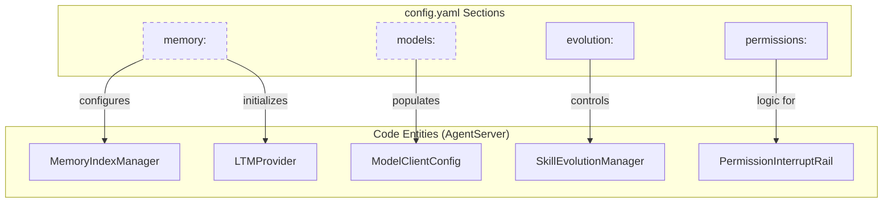
**Sources:** [jiuwenswarm/common/config.py:79-112](), [docs/en/Configuration.md:15-22]().

---

## 2. Detailed Section Reference

### 2.1 Memory System (`memory:`)
The memory configuration controls the multi-layered retrieval system. It distinguishes between different storage backends and external providers [docs/en/Configuration.md:18-18]().

| Key | Values | Description |
| :--- | :--- | :--- |
| `engine` | `builtin`, `external`, `both` | Controls which memory retrieval logic is active. |
| `external.provider` | `openjiuwen`, `mem0`, `openviking` | Selects the third-party memory backend. |

**Sources:** [jiuwenswarm/common/config.py:106-112](), [docs/en/Configuration.md:18-19]().

### 2.2 Model Configuration (`models:`)
JiuwenSwarm uses a polymorphic model configuration. The system supports multiple models simultaneously for quick switching via aliases [docs/en/Configuration.md:74-94]().

*   **Implementation**: Each entry maps to a configuration containing `api_base`, `api_key`, and `model_provider` (e.g., `OpenAI`, `Azure`, `SiliconFlow`) [docs/en/Configuration.md:46-55]().
*   **Normalization**: The `_normalize_config` function ensures that fields like `custom_headers` (passed as JSON strings via env) are parsed into native dictionaries [jiuwenswarm/common/config.py:79-104]().
*   **Multimodal Routing**: Specialized blocks route tasks to `Video Model`, `Audio Model`, and `Vision Model` [docs/en/Configuration.md:32-42]().

**Sources:** [jiuwenswarm/common/config.py:79-104](), [docs/en/Configuration.md:28-72]().

### 2.3 Skill Evolution (`evolution:`)
This section controls the self-improvement loop of the agent.

*   **Auto-Scan**: `evolution.auto_scan` (overridden by `EVOLUTION_AUTO_SCAN`) enables background detection of tool failures and user corrections [docs/en/SkillSelfEvolution.md:140-157]().
*   **Skill Creation**: `evolution.skill_create` allows the agent to propose new skills when a capability gap is detected [docs/en/SkillSelfEvolution.md:145-145]().

**Sources:** [docs/en/SkillSelfEvolution.md:1-222]().

### 2.4 Permissions and Guardrails (`permissions:`)
The system employs a tiered permission policy managed by the `PermissionInterruptRail`.

*   **Severity Levels**: `LOW`, `MEDIUM`, `HIGH`, `CRITICAL`.
*   **Action Mapping**:
    *   `allow`: Execute without prompt.
    *   `ask`: Trigger a `PermissionInterrupt` to the user via the Gateway.
    *   `deny`: Block execution immediately.

**Sources:** [docs/en/Configuration.md:22-22]().

---

## 3. Environment Variable Reference (.env)

The `.env` file is used for infrastructure-level settings and secrets.

| Variable | Description |
| :--- | :--- |
| `JIUWENSWARM_CONFIG_DIR` | Custom directory path for configuration files [jiuwenswarm/common/config.py:24-26](). |
| `GITHUB_TOKEN` | Used by `SkillNet` for higher API quotas during skill installation [docs/en/Skills.md:88-104](). |
| `EVOLUTION_AUTO_SCAN` | Environment override for skill evolution scanning [docs/en/SkillSelfEvolution.md:155-155](). |

**Sources:** [jiuwenswarm/common/config.py:24-26](), [docs/en/Skills.md:88-104]().

---

## 4. Multi-Instance and Hot-Reload
JiuwenSwarm supports running multiple isolated instances. Each instance calculates its own ports based on base offsets [pyproject.toml:71-82]().

### 4.1 Hot-Reload Mechanism
The Web UI communicates with the `Gateway` to update configurations. The `config.set` handler in `app_web_handlers.py` facilitates this [tests/unit_tests/test_app_web_handlers.py:52-69]().

**Diagram: Configuration Update Sequence**
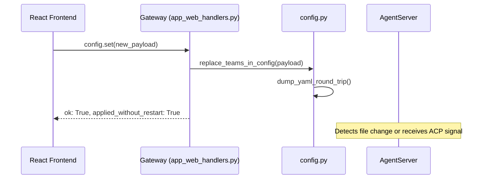
**Sources:** [jiuwenswarm/common/config.py:152-201](), [tests/unit_tests/test_app_web_handlers.py:37-69]().

---

# Page: Core Architecture

# Core Architecture

<details>
<summary>Relevant source files</summary>

The following files were used as context for generating this wiki page:

- [jiuwenswarm/agents/harness/common/auto_harness/config_validator.py](jiuwenswarm/agents/harness/common/auto_harness/config_validator.py)
- [jiuwenswarm/agents/harness/common/auto_harness/scheduler.py](jiuwenswarm/agents/harness/common/auto_harness/scheduler.py)
- [jiuwenswarm/agents/harness/common/auto_harness/service.py](jiuwenswarm/agents/harness/common/auto_harness/service.py)
- [jiuwenswarm/agents/harness/common/tools/bash_tool_safety.py](jiuwenswarm/agents/harness/common/tools/bash_tool_safety.py)
- [jiuwenswarm/agents/harness/common/tools/command_tools.py](jiuwenswarm/agents/harness/common/tools/command_tools.py)
- [jiuwenswarm/channels/tui/frontend/src/core/commands/builtins/auto-harness.ts](jiuwenswarm/channels/tui/frontend/src/core/commands/builtins/auto-harness.ts)
- [jiuwenswarm/channels/tui/frontend/src/ui/screen-layout.ts](jiuwenswarm/channels/tui/frontend/src/ui/screen-layout.ts)
- [jiuwenswarm/channels/tui/frontend/src/ui/transcript-entry-selection.ts](jiuwenswarm/channels/tui/frontend/src/ui/transcript-entry-selection.ts)
- [jiuwenswarm/channels/tui/frontend/src/ui/transcript-renderer.ts](jiuwenswarm/channels/tui/frontend/src/ui/transcript-renderer.ts)
- [jiuwenswarm/channels/web/frontend/src/components/HarnessPackagePanel/index.tsx](jiuwenswarm/channels/web/frontend/src/components/HarnessPackagePanel/index.tsx)
- [jiuwenswarm/channels/web/frontend/src/components/ToolPanel/HarnessExtensionTree.tsx](jiuwenswarm/channels/web/frontend/src/components/ToolPanel/HarnessExtensionTree.tsx)
- [jiuwenswarm/channels/web/frontend/src/services/webClient.ts](jiuwenswarm/channels/web/frontend/src/services/webClient.ts)
- [jiuwenswarm/channels/web/frontend/src/stores/chatStore.ts](jiuwenswarm/channels/web/frontend/src/stores/chatStore.ts)
- [jiuwenswarm/channels/web/frontend/src/stores/harnessStore.ts](jiuwenswarm/channels/web/frontend/src/stores/harnessStore.ts)
- [jiuwenswarm/channels/web/frontend/src/stores/index.ts](jiuwenswarm/channels/web/frontend/src/stores/index.ts)
- [jiuwenswarm/common/e2a/gateway_normalize.py](jiuwenswarm/common/e2a/gateway_normalize.py)
- [jiuwenswarm/common/schema/message.py](jiuwenswarm/common/schema/message.py)
- [jiuwenswarm/gateway/app_gateway.py](jiuwenswarm/gateway/app_gateway.py)
- [jiuwenswarm/gateway/channel_manager/tui/tui_connect.py](jiuwenswarm/gateway/channel_manager/tui/tui_connect.py)
- [jiuwenswarm/gateway/channel_manager/web/app_web_handlers.py](jiuwenswarm/gateway/channel_manager/web/app_web_handlers.py)
- [jiuwenswarm/gateway/channel_manager/web/web_connect.py](jiuwenswarm/gateway/channel_manager/web/web_connect.py)
- [jiuwenswarm/gateway/message_handler/message_handler.py](jiuwenswarm/gateway/message_handler/message_handler.py)
- [jiuwenswarm/server/agent_ws_server.py](jiuwenswarm/server/agent_ws_server.py)
- [jiuwenswarm/server/app_agentserver.py](jiuwenswarm/server/app_agentserver.py)

</details>


JiuwenSwarm utilizes a split-process architecture designed to decouple the high-performance agent runtime from the diverse communication channels (IM platforms, Web, TUI). This design ensures that heavy LLM orchestration and tool execution logic do not block the message-routing gateway, and allows for multi-instance isolation and independent scaling.

### System Topology

The system is primarily composed of two main processes: the **AgentServer** and the **Gateway**. These processes communicate via a specialized WebSocket protocol and share a common workspace directory.

#### High-Level Component Interaction
The following diagram illustrates how messages flow from an external user through the Gateway to the Agent runtime, highlighting the association between logical components and code entities.

**Diagram: Message Flow and Process Boundaries**
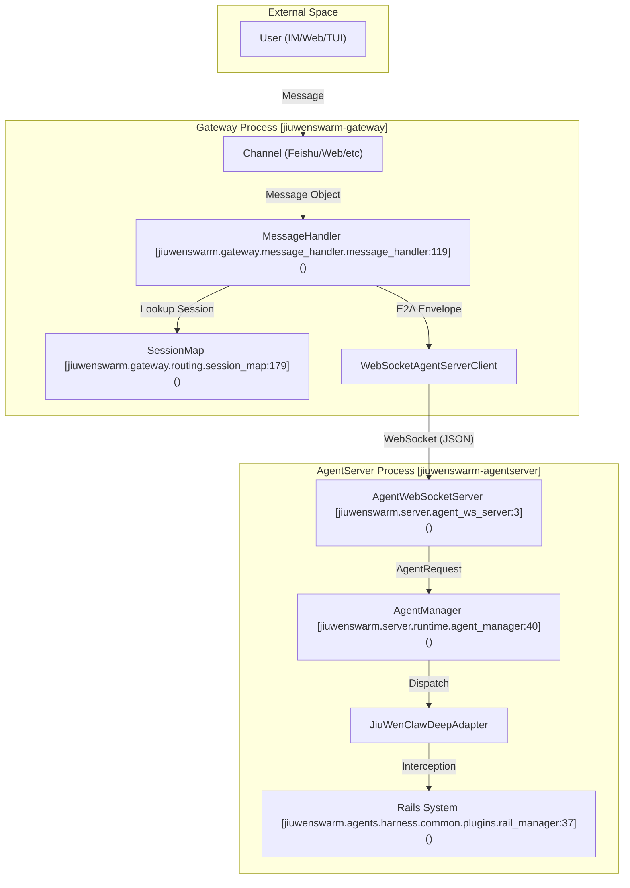
**Sources:** [jiuwenswarm/gateway/message_handler/message_handler.py:119-150](), [jiuwenswarm/server/agent_ws_server.py:3-20](), [jiuwenswarm/server/runtime/agent_manager.py:40]()

---

### Process Roles

#### 1. AgentServer (`jiuwenswarm-agentserver`)
The AgentServer is the heavy-lifting process. It hosts the `AgentManager` which manages the lifecycle of various agent modes (Fast, Plan, Code, Team).
- **Core Entity:** `AgentWebSocketServer` [jiuwenswarm/server/agent_ws_server.py:3]() acts as the entry point for the Gateway.
- **Responsibility:** LLM reasoning loops, tool execution (Skills), memory management, and Rail orchestration. It also manages specialized services like `AutoHarnessService` [jiuwenswarm/agents/harness/common/auto_harness/service.py:170]() for repository optimization.
- **For details, see [AgentServer and Agent Adapters](#2.1)**.

#### 2. Gateway (`jiuwenswarm-gateway`)
The Gateway is a lightweight process responsible for maintaining connections to external platforms.
- **Core Entity:** `MessageHandler` [jiuwenswarm/gateway/message_handler/message_handler.py:119]() coordinates the dual queues (`_user_messages` and `_robot_messages`).
- **Responsibility:** Message normalization, slash command parsing (`\new_session`, `\mode`), and routing messages to the correct `session_id`. It handles multiple channel types including `WebChannel` [jiuwenswarm/gateway/channel_manager/web/web_connect.py:55]() and TUI connections.
- **For details, see [Gateway and Message Routing](#2.2)**.

---

### E2A Protocol and Communication

The **E2A (External-to-Agent)** protocol is the "glue" between the Gateway and AgentServer. It encapsulates messages into envelopes that carry metadata, session context, and routing information.

| Entity | Role in Protocol | Code Reference |
| :--- | :--- | :--- |
| `E2AEnvelope` | Standard message container for cross-process wire format. | [jiuwenswarm/common/e2a/models.py:28]() |
| `AgentRequest` | Normalized request object used within the AgentServer. | [jiuwenswarm/common/schema/agent.py:34]() |
| `SessionMap` | Maps external identities to internal `session_id`. | [jiuwenswarm/gateway/routing/session_map.py:179]() |
| `ReqMethod` | Enum defining all supported cross-process operations. | [jiuwenswarm/common/schema/message.py:10]() |

**Diagram: Protocol Data Mapping**
```mermaid
classDiagram
    class E2AEnvelope {
        +request_id: str
        +session_id: str
        +payload: dict
        +metadata: dict
    }
    class Message {
        +content: str
        +channel_id: str
        +user_infos: dict
    }
    class AgentRequest {
        +request_id: str
        +params: dict
        +is_stream: bool
    }

    Message --|> E2AEnvelope : "Normalized by MessageHandler [jiuwenswarm.gateway.message_handler.message_handler:112]()"
    E2AEnvelope --|> AgentRequest : "Parsed by e2a_to_agent_request [jiuwenswarm.common.e2a.agent_compat:22]()"
```
**Sources:** [jiuwenswarm/common/e2a/models.py:28](), [jiuwenswarm/common/schema/agent.py:34](), [jiuwenswarm/common/schema/message.py:10-180]()

- **For details, see [E2A Protocol and Session Management](#2.3)**.

---

### Rails and Interception

Every request processed by the `AgentAdapter` passes through a **Rails System**. Rails are interceptors that can modify the prompt, validate tool usage, or interrupt the flow to ask for user permission.

Key built-in rails managed by `rail_manager` [jiuwenswarm/agents/harness/common/plugins/rail_manager.py:37]() include:
- `SecurityRail`: Filters sensitive output and blocks forbidden memory patterns.
- `PermissionInterruptRail`: Pauses execution for HIGH-severity tool permissions.
- `StreamEventRail`: Standardizes the streaming of events (tool calls, thoughts) to the frontend.
- `ProjectMemoryRail`: Injects relevant project context into the LLM prompt.

- **For details, see [Rails System](#2.4)**.

---

### Workspace and Persistence

Both processes share a common root directory. This shared state allows the Gateway to read configuration while the AgentServer persists session history and skill states.

| Path Component | Purpose | Code Reference |
| :--- | :--- | :--- |
| `config.yaml` | Main system configuration (Models, Channels, Memory). | [jiuwenswarm/common/config.py:52]() |
| `sessions/` | SQLite databases for session history and metadata. | [jiuwenswarm/common/utils.py:21]() |
| `auto-harness/` | Data for the AutoHarness optimization subsystem. | [jiuwenswarm/agents/harness/common/auto_harness/service.py:70]() |
| `skills/` | Installed skill packages and their states. | [jiuwenswarm/common/schema/message.py:73]() |

**Sources:** [jiuwenswarm/common/utils.py:21-25](), [jiuwenswarm/common/config.py:26-71](), [jiuwenswarm/agents/harness/common/auto_harness/service.py:70-76]()

---

### Child Pages
- [AgentServer and Agent Adapters](#2.1) — AgentWebSocketServer, JiuWenClaw facade, and adapters.
- [Gateway and Message Routing](#2.2) — MessageHandler, channel manager, and slash commands.
- [E2A Protocol and Session Management](#2.3) — Envelope formats, session lifecycles, and mapping.
- [Rails System](#2.4) — Interception framework and built-in guardrails.

---

# Page: AgentServer and Agent Adapters

# AgentServer and Agent Adapters

<details>
<summary>Relevant source files</summary>

The following files were used as context for generating this wiki page:

- [deploy/func/clawee.py](deploy/func/clawee.py)
- [jiuwenswarm/agents/harness/common/auto_harness/config_validator.py](jiuwenswarm/agents/harness/common/auto_harness/config_validator.py)
- [jiuwenswarm/agents/harness/common/auto_harness/scheduler.py](jiuwenswarm/agents/harness/common/auto_harness/scheduler.py)
- [jiuwenswarm/agents/harness/common/auto_harness/service.py](jiuwenswarm/agents/harness/common/auto_harness/service.py)
- [jiuwenswarm/agents/harness/common/rails/stream_event_rail.py](jiuwenswarm/agents/harness/common/rails/stream_event_rail.py)
- [jiuwenswarm/agents/harness/team/__init__.py](jiuwenswarm/agents/harness/team/__init__.py)
- [jiuwenswarm/agents/harness/team/rails/team_member_skill_toolkit_rail.py](jiuwenswarm/agents/harness/team/rails/team_member_skill_toolkit_rail.py)
- [jiuwenswarm/agents/harness/team/rails/team_shared_skill_link_refresh_rail.py](jiuwenswarm/agents/harness/team/rails/team_shared_skill_link_refresh_rail.py)
- [jiuwenswarm/agents/harness/team/team_skill_links.py](jiuwenswarm/agents/harness/team/team_skill_links.py)
- [jiuwenswarm/channels/tui/frontend/src/core/commands/builtins/auto-harness.ts](jiuwenswarm/channels/tui/frontend/src/core/commands/builtins/auto-harness.ts)
- [jiuwenswarm/channels/web/frontend/src/components/HarnessPackagePanel/index.tsx](jiuwenswarm/channels/web/frontend/src/components/HarnessPackagePanel/index.tsx)
- [jiuwenswarm/channels/web/frontend/src/components/ToolPanel/HarnessExtensionTree.tsx](jiuwenswarm/channels/web/frontend/src/components/ToolPanel/HarnessExtensionTree.tsx)
- [jiuwenswarm/channels/web/frontend/src/hooks/useWebSocket.ts](jiuwenswarm/channels/web/frontend/src/hooks/useWebSocket.ts)
- [jiuwenswarm/channels/web/frontend/src/stores/harnessStore.ts](jiuwenswarm/channels/web/frontend/src/stores/harnessStore.ts)
- [jiuwenswarm/channels/web/frontend/src/stores/index.ts](jiuwenswarm/channels/web/frontend/src/stores/index.ts)
- [jiuwenswarm/gateway/channel_manager/tui/tui_connect.py](jiuwenswarm/gateway/channel_manager/tui/tui_connect.py)
- [jiuwenswarm/gateway/channel_manager/web/app_web_handlers.py](jiuwenswarm/gateway/channel_manager/web/app_web_handlers.py)
- [jiuwenswarm/server/agent_ws_server.py](jiuwenswarm/server/agent_ws_server.py)
- [jiuwenswarm/server/runtime/agent_adapter/interface.py](jiuwenswarm/server/runtime/agent_adapter/interface.py)
- [jiuwenswarm/server/runtime/agent_adapter/interface_deep.py](jiuwenswarm/server/runtime/agent_adapter/interface_deep.py)
- [jiuwenswarm/server/runtime/agent_manager.py](jiuwenswarm/server/runtime/agent_manager.py)
- [jiuwenswarm/server/runtime/skill/skill_manager.py](jiuwenswarm/server/runtime/skill/skill_manager.py)
- [jiuwenswarm/server/runtime/tenant_agent_pool.py](jiuwenswarm/server/runtime/tenant_agent_pool.py)
- [jiuwenswarm/server/utils/stream_utils.py](jiuwenswarm/server/utils/stream_utils.py)
- [tests/unit_tests/agentserver/test_skill_manager_enable_disable.py](tests/unit_tests/agentserver/test_skill_manager_enable_disable.py)
- [tests/unit_tests/agentserver/test_skill_manager_path_safety.py](tests/unit_tests/agentserver/test_skill_manager_path_safety.py)

</details>


The AgentServer is the core execution process of JiuwenSwarm, responsible for managing the lifecycle of agents, orchestrating their reasoning loops, and interfacing with the underlying LLM and tool ecosystems. It operates as a WebSocket server that receives structured requests from the Gateway and executes them using specialized adapters for different operating modes (General Agent, Code, or Team).

## AgentWebSocketServer

The `AgentWebSocketServer` acts as the network entry point for the AgentServer process. It maintains a persistent connection with the Gateway's `WebSocketAgentServerClient`.

### Implementation and Lifecycle
*   **Message Normalization**: It converts incoming `E2AEnvelope` data into internal `AgentRequest` objects using `e2a_to_agent_request` [jiuwenswarm/server/agent_ws_server.py:22-22]().
*   **Heartbeat Mechanism**: To prevent WebSocket timeouts during long-running LLM generation or tool execution, it implements a streaming heartbeat (default 10s) [jiuwenswarm/server/agent_ws_server.py:84-86]().
*   **History Management**: It handles the restoration of history for the UI, filtering for restorable event types like `chat.final` and `team.message` [jiuwenswarm/server/agent_ws_server.py:89-100]().
*   **Project Resolution**: It resolves the stable project identity for agent construction, prioritizing `project_dir` from request parameters [jiuwenswarm/server/agent_ws_server.py:162-171]().

### Data Flow: Gateway to Agent
The following diagram illustrates how a message travels from the network into the agent's reasoning loop.

**Diagram: Request Ingestion Pipeline**
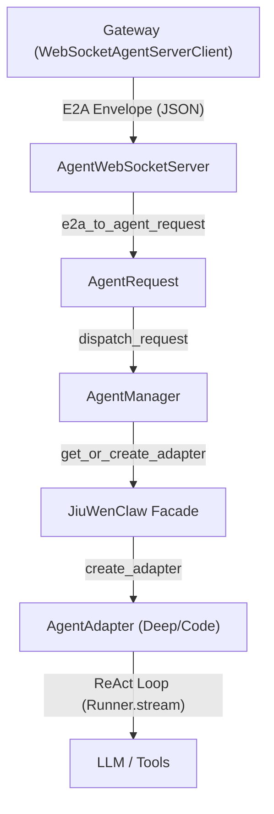
Sources: [jiuwenswarm/server/agent_ws_server.py:22-34](), [jiuwenswarm/server/runtime/agent_manager.py:40-41](), [jiuwenswarm/server/runtime/agent_adapter/interface.py:23-27]()

## JiuWenClaw Facade and Adapters

The `JiuWenClaw` facade (implemented in `interface.py`) provides a unified API for the `AgentManager` while abstracting the complexities of different SDK adapters.

### Adapter Hierarchy
1.  **AgentAdapter (Base)**: Defines the protocol for initialization and message processing [jiuwenswarm/server/runtime/agent_adapter/agent_adapters.py:24-27]().
2.  **JiuWenClawDeepAdapter**: The standard adapter for `agent.plan` and `agent.fast` modes. It leverages the `openjiuwen` core for ReAct loops and manages specialized services like `AutoHarnessService` [jiuwenswarm/server/runtime/agent_adapter/interface_deep.py:3-7]().
3.  **JiuwenClawCodeAdapter**: A specialized adapter optimized for software engineering tasks. It adds specific rails and configuration for coding environments.

### Request Routing
The Facade routes requests based on the `ReqMethod`. It includes specific routing for:
*   **Skills Management**: Methods like `SKILLS_LIST`, `SKILLS_INSTALL`, and `SKILLS_EVOLUTION_STATUS` are routed to specialized handlers [jiuwenswarm/server/runtime/agent_adapter/interface.py:100-131]().
*   **Plugin Management**: Handlers for listing, installing, and toggling plugins [jiuwenswarm/server/runtime/agent_adapter/interface.py:133-140]().
*   **Slash Commands**: Specific logic to parse `/skills use` commands to extract skill names and queries [jiuwenswarm/server/runtime/agent_adapter/interface.py:147-162]().

Sources: [jiuwenswarm/server/runtime/agent_adapter/interface.py:95-140](), [jiuwenswarm/server/runtime/agent_adapter/interface_deep.py:3-7]()

## Rail Orchestration and Tool Registration

Rails are interception layers that wrap the agent's execution to provide security, memory injection, and event streaming.

### Core Rails in Deep Adapter
The `JiuWenClawDeepAdapter` initializes a comprehensive set of rails during its `Runner` setup [jiuwenswarm/server/runtime/agent_adapter/interface_deep.py:54-66]().

| Rail Name | Function | File Reference |
| :--- | :--- | :--- |
| `SecurityRail` | Enforces safety and security boundaries | [jiuwenswarm/server/runtime/agent_adapter/interface_deep.py:57-57]() |
| `SkillEvolutionRail` | Detects signals for skill improvement | [jiuwenswarm/server/runtime/agent_adapter/interface_deep.py:58-58]() |
| `ContextProcessorRail` | Manages context window and compression | [jiuwenswarm/server/runtime/agent_adapter/interface_deep.py:66-66]() |
| `JiuClawStreamEventRail` | Standardizes event emission and pause checks | [jiuwenswarm/agents/harness/common/rails/stream_event_rail.py:3-9]() |

### Tool Registration and Multimodal Support
Tools are registered dynamically based on configuration.
*   **Web Tools**: Support for `WebFreeSearchTool`, `WebPaidSearchTool`, and `WebFetchWebpageTool` [jiuwenswarm/server/runtime/agent_adapter/interface_deep.py:71-73]().
*   **Multimodal**: Dedicated configuration for audio, vision, and video models/tools [jiuwenswarm/server/runtime/agent_adapter/interface_deep.py:177-186]().
*   **Skill Toolkits**: `SkillToolkit` allows agents to use dynamically loaded skills managed by the `SkillManager` [jiuwenswarm/server/runtime/agent_adapter/interface_deep.py:187-187]().

Sources: [jiuwenswarm/server/runtime/agent_adapter/interface_deep.py:54-77](), [jiuwenswarm/agents/harness/common/rails/stream_event_rail.py:1-9]()

## Agent Lifecycle and Hot-Reload

The AgentServer supports hot-reloading of configurations and skills, primarily through the `AutoHarnessService` and `SkillManager`.

### AutoHarness and Package Management
The `AutoHarnessService` manages "harness packages" which are optimized agent configurations.
*   **Lifecycle Reset**: On startup, `reset_harness_packages_state` ensures the agent starts in "native" mode by clearing active package IDs [jiuwenswarm/agents/harness/common/auto_harness/service.py:82-108]().
*   **Hot Activation**: The `HarnessPackagePanel` in the frontend allows users to trigger `harness.activate` RPCs, which the service handles by loading new runtime paths and configurations [jiuwenswarm/channels/web/frontend/src/components/HarnessPackagePanel/index.tsx:172-186]().

### Skill Management
The `SkillManager` handles the dynamic lifecycle of skills:
*   **Discovery**: Scans builtin and marketplace directories [jiuwenswarm/server/runtime/skill/skill_manager.py:36-40]().
*   **Safety**: Implements `_safe_child_path` to prevent path traversal during skill installation [jiuwenswarm/server/runtime/skill/skill_manager.py:215-220]().
*   **Persistence**: Tracks enabled/disabled states in `skills_state.json` [jiuwenswarm/server/runtime/skill/skill_manager.py:103-111]().

**Diagram: Agent Entity Mapping**
This diagram maps Natural Language concepts to the Code Entity Space within the AgentServer.

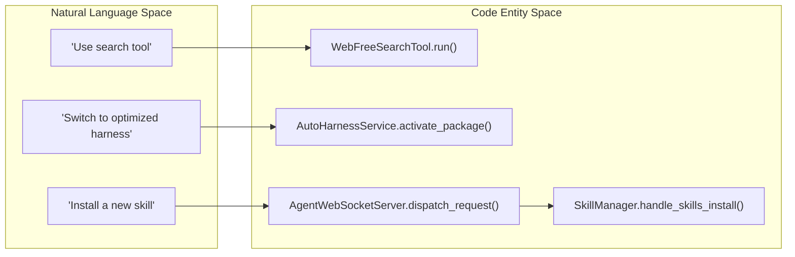
Sources: [jiuwenswarm/server/agent_ws_server.py:22-40](), [jiuwenswarm/server/runtime/skill/skill_manager.py:3-15](), [jiuwenswarm/agents/harness/common/auto_harness/service.py:170-190]()

## Distributed Team Initialization (A2X)

In Team Mode, the AgentServer interacts with the A2X (Agent-to-Anything) registry to participate in distributed orchestration.

*   **Registration**: If the agent is configured as a teammate, `register_blank_agent_if_teammate` is called during adapter initialization [jiuwenswarm/server/runtime/agent_adapter/interface_deep.py:102-106]().
*   **Capability Negotiation**: The `AgentManager` defines default capabilities like `ACP_DEFAULT_CAPABILITIES` for communication [jiuwenswarm/server/runtime/agent_manager.py:40-40]().

Sources: [jiuwenswarm/server/runtime/agent_adapter/interface_deep.py:102-106](), [jiuwenswarm/server/runtime/agent_manager.py:40-40]()

---

# Page: Gateway and Message Routing

# Gateway and Message Routing

<details>
<summary>Relevant source files</summary>

The following files were used as context for generating this wiki page:

- [jiuwenswarm/agents/harness/common/tools/bash_tool_safety.py](jiuwenswarm/agents/harness/common/tools/bash_tool_safety.py)
- [jiuwenswarm/agents/harness/common/tools/command_tools.py](jiuwenswarm/agents/harness/common/tools/command_tools.py)
- [jiuwenswarm/channels/tui/frontend/src/ui/screen-layout.ts](jiuwenswarm/channels/tui/frontend/src/ui/screen-layout.ts)
- [jiuwenswarm/channels/tui/frontend/src/ui/transcript-entry-selection.ts](jiuwenswarm/channels/tui/frontend/src/ui/transcript-entry-selection.ts)
- [jiuwenswarm/channels/tui/frontend/src/ui/transcript-renderer.ts](jiuwenswarm/channels/tui/frontend/src/ui/transcript-renderer.ts)
- [jiuwenswarm/channels/web/frontend/src/services/webClient.ts](jiuwenswarm/channels/web/frontend/src/services/webClient.ts)
- [jiuwenswarm/channels/web/frontend/src/stores/chatStore.ts](jiuwenswarm/channels/web/frontend/src/stores/chatStore.ts)
- [jiuwenswarm/common/e2a/gateway_normalize.py](jiuwenswarm/common/e2a/gateway_normalize.py)
- [jiuwenswarm/common/schema/message.py](jiuwenswarm/common/schema/message.py)
- [jiuwenswarm/gateway/app_gateway.py](jiuwenswarm/gateway/app_gateway.py)
- [jiuwenswarm/gateway/channel_manager/channel_manager.py](jiuwenswarm/gateway/channel_manager/channel_manager.py)
- [jiuwenswarm/gateway/channel_manager/im_platforms/feishu/feishu_connect.py](jiuwenswarm/gateway/channel_manager/im_platforms/feishu/feishu_connect.py)
- [jiuwenswarm/gateway/channel_manager/web/web_connect.py](jiuwenswarm/gateway/channel_manager/web/web_connect.py)
- [jiuwenswarm/gateway/message_handler/message_handler.py](jiuwenswarm/gateway/message_handler/message_handler.py)
- [jiuwenswarm/server/app_agentserver.py](jiuwenswarm/server/app_agentserver.py)

</details>


The Gateway is a standalone process that serves as the communication hub of JiuwenSwarm. It bridges external communication channels (Web, IM platforms, ACP) to the `AgentServer` using a split-process architecture. Its primary responsibilities include message normalization, session mapping, slash command interception, and maintaining the E2A (External-to-Agent) protocol loop.

## Architecture Overview

The Gateway process is initialized in `jiuwenswarm/gateway/app_gateway.py` [jiuwenswarm/gateway/app_gateway.py:1-13](). It manages the `MessageHandler` and `ChannelManager` to route messages between users and agents.

### Core Components

| Component | Responsibility |
| :--- | :--- |
| `MessageHandler` | The central logic engine that manages inbound/outbound message queues and slash commands [jiuwenswarm/gateway/message_handler/message_handler.py:119-132](). |
| `ChannelManager` | Manages the lifecycle of various communication channels (Web, Feishu, etc.) [jiuwenswarm/gateway/channel_manager/channel_manager.py:22-28](). |
| `SessionMap` | Maintains the mapping between external platform IDs (e.g., Feishu OpenID) and internal session IDs [jiuwenswarm/gateway/message_handler/message_handler.py:179](). |
| `AgentServerClient` | A WebSocket client that connects the Gateway to the `AgentServer` [jiuwenswarm/gateway/message_handler/message_handler.py:145](). |

### Process Interaction Diagram

This diagram shows how the Gateway entities bridge the gap between a raw IM message and the Agent logic.

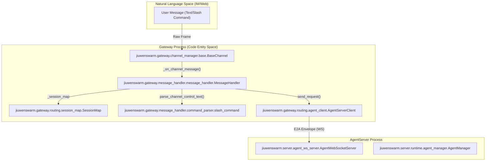
**Sources:** [jiuwenswarm/gateway/message_handler/message_handler.py:119-163](), [jiuwenswarm/gateway/channel_manager/channel_manager.py:58-68](), [jiuwenswarm/gateway/app_gateway.py:132-175]().

---

## Message Handling Pipeline

The `MessageHandler` uses a dual-queue system to decouple external channel IO from Agent processing [jiuwenswarm/gateway/message_handler/message_handler.py:121-128]().

### Inbound Flow (User to Agent)
1. **Reception**: A `BaseChannel` receives a message and calls the registered callback, which typically leads to `MessageHandler.handle_message(msg)` [jiuwenswarm/gateway/channel_manager/channel_manager.py:58-68]().
2. **Slash Command Parsing**: The handler uses `parse_channel_control_text` to check if the message is a local control command (e.g., `\new_session`, `\mode`) [jiuwenswarm/gateway/message_handler/message_handler.py:21-24]().
3. **Session Resolution**: Standard messages use `SessionMap` to resolve platform-specific identity to an internal `session_id` [jiuwenswarm/gateway/message_handler/message_handler.py:179]().
4. **Forwarding Loop**: The `_forward_task` task consumes messages from `_user_messages` and uses `AgentServerClient.send_request` to transmit messages to the AgentServer [jiuwenswarm/gateway/message_handler/message_handler.py:146-149]().

### Outbound Flow (Agent to User)
1. **Response Capture**: The `AgentServerClient` receives responses (e.g., `AgentResponse` or `AgentResponseChunk`) from the AgentServer.
2. **Normalization**: The response is converted into a `Message` object via `_response_to_message` or `_chunk_to_message` [jiuwenswarm/gateway/message_handler/message_handler.py:127-128]().
3. **Delivery**: The message is put into `_robot_messages` and consumed by the `ChannelManager` via `_dispatch_robot_messages` for delivery to the specific channel [jiuwenswarm/gateway/channel_manager/channel_manager.py:142-166]().

---

## Slash Command Parsing

The Gateway intercepts control commands that manage channel state. These are defined in `ReqMethod` [jiuwenswarm/common/schema/message.py:10-30]() and parsed using specialized logic.

### Supported Gateway Control Logic
The `MessageHandler` supports a variety of commands and request methods:
- **Session Management**: `SESSION_CREATE`, `SESSION_SWITCH`, `SESSION_DELETE`, `SESSION_FORK`, `SESSION_REWIND` [jiuwenswarm/common/schema/message.py:37-41]().
- **Mode Control**: Switching between `AGENT_PLAN`, `AGENT_FAST`, `TEAM`, etc. [jiuwenswarm/gateway/message_handler/message_handler.py:74-81]().
- **Slash Interception**: The `parse_channel_control_text` function identifies commands like `\new_session` or `\mode` from raw text input [jiuwenswarm/gateway/message_handler/message_handler.py:21-24]().

---

## Communication Channels

### Web Channel (WebSocket)
The `WebChannel` provides a specialized implementation for browser-based frontends [jiuwenswarm/gateway/channel_manager/web/web_connect.py:55-63]().
- **Method Handlers**: Supports registering custom handlers for specific `ReqMethod` types (e.g., `config.get`, `session.list`, `skills.list`) [jiuwenswarm/gateway/channel_manager/web/web_connect.py:90-96]().
- **File Processing**: Automatically handles file downloads and workspace mapping for incoming files in parameters [jiuwenswarm/gateway/channel_manager/web/web_connect.py:189-214]().

### IM Platform Channels (e.g., Feishu)
IM channels like `FeishuChannel` bridge third-party platforms [jiuwenswarm/gateway/channel_manager/im_platforms/feishu/feishu_connect.py:143-157]().
- **Message Dedup**: Uses `_message_dedup_cache` to prevent processing duplicate event notifications [jiuwenswarm/gateway/channel_manager/im_platforms/feishu/feishu_connect.py:183]().
- **Digital Avatar**: Supports group chat "digital avatar" logic where the agent monitors messages and responds when relevant [jiuwenswarm/gateway/channel_manager/im_platforms/feishu/feishu_connect.py:57-62]().

---

## Session and Identity Mapping

### SessionMap and Prefixes
The `SessionMap` handles identity persistence [jiuwenswarm/gateway/message_handler/message_handler.py:179](). It ensures that messages from the same IM user/group consistently map to the same internal session.
- **Prefixes**: Internal session IDs are often prefixed by channel type (e.g., `sess_`, `tui_`, `acp_`, `feishu_`, `wechat_`) to avoid collisions [jiuwenswarm/gateway/message_handler/message_handler.py:41-54]().
- **ACP Aliases**: For ACP (Agent Control Protocol) channels, the gateway maintains an `_acp_session_aliases` map to bridge external and internal session IDs [jiuwenswarm/gateway/message_handler/message_handler.py:161]().

### Channel Control State
The Gateway tracks per-channel state using `ChannelControlState`, which stores the active `session_id` and `ChannelMode` [jiuwenswarm/gateway/message_handler/message_handler.py:84-87]().

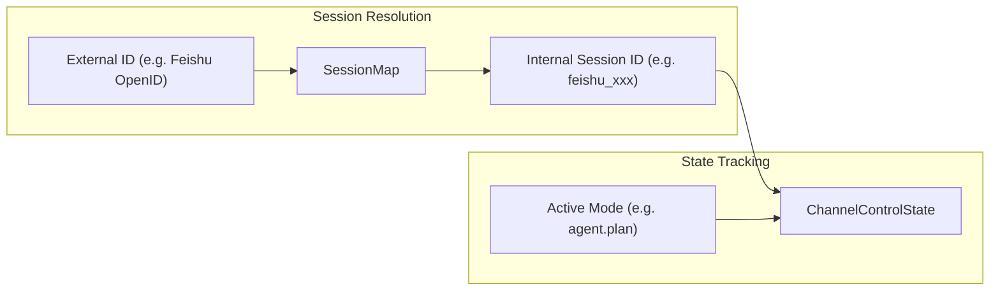
**Sources:** [jiuwenswarm/gateway/message_handler/message_handler.py:84-87](), [jiuwenswarm/gateway/message_handler/message_handler.py:178-179]().

**Sources:**
- `jiuwenswarm/gateway/message_handler/message_handler.py`
- `jiuwenswarm/gateway/channel_manager/channel_manager.py`
- `jiuwenswarm/gateway/app_gateway.py`
- `jiuwenswarm/common/schema/message.py`
- `jiuwenswarm/gateway/channel_manager/web/web_connect.py`
- `jiuwenswarm/gateway/channel_manager/im_platforms/feishu/feishu_connect.py`

---

# Page: E2A Protocol and Session Management

# E2A Protocol and Session Management

<details>
<summary>Relevant source files</summary>

The following files were used as context for generating this wiki page:

- [jiuwenswarm/agents/harness/common/memory/dreaming/__init__.py](jiuwenswarm/agents/harness/common/memory/dreaming/__init__.py)
- [jiuwenswarm/agents/harness/common/memory/dreaming/sweeper.py](jiuwenswarm/agents/harness/common/memory/dreaming/sweeper.py)
- [jiuwenswarm/channels/tui/frontend/src/core/commands/builtins/color.ts](jiuwenswarm/channels/tui/frontend/src/core/commands/builtins/color.ts)
- [jiuwenswarm/channels/tui/frontend/src/core/commands/builtins/diff.ts](jiuwenswarm/channels/tui/frontend/src/core/commands/builtins/diff.ts)
- [jiuwenswarm/channels/tui/frontend/src/core/commands/builtins/resume.ts](jiuwenswarm/channels/tui/frontend/src/core/commands/builtins/resume.ts)
- [jiuwenswarm/channels/tui/frontend/src/core/commands/builtins/rewind.ts](jiuwenswarm/channels/tui/frontend/src/core/commands/builtins/rewind.ts)
- [jiuwenswarm/channels/tui/frontend/src/core/tui-config-store.ts](jiuwenswarm/channels/tui/frontend/src/core/tui-config-store.ts)
- [jiuwenswarm/channels/tui/frontend/src/core/types.ts](jiuwenswarm/channels/tui/frontend/src/core/types.ts)
- [jiuwenswarm/channels/tui/frontend/src/ui/components/messages/diff-component.ts](jiuwenswarm/channels/tui/frontend/src/ui/components/messages/diff-component.ts)
- [jiuwenswarm/channels/tui/frontend/src/ui/theme.ts](jiuwenswarm/channels/tui/frontend/src/ui/theme.ts)
- [jiuwenswarm/channels/web/frontend/src/services/webClient.ts](jiuwenswarm/channels/web/frontend/src/services/webClient.ts)
- [jiuwenswarm/channels/web/frontend/src/stores/chatStore.ts](jiuwenswarm/channels/web/frontend/src/stores/chatStore.ts)
- [jiuwenswarm/common/e2a/gateway_normalize.py](jiuwenswarm/common/e2a/gateway_normalize.py)
- [jiuwenswarm/common/schema/message.py](jiuwenswarm/common/schema/message.py)
- [jiuwenswarm/gateway/channel_manager/web/web_connect.py](jiuwenswarm/gateway/channel_manager/web/web_connect.py)
- [jiuwenswarm/server/runtime/session/session_manager.py](jiuwenswarm/server/runtime/session/session_manager.py)
- [jiuwenswarm/server/runtime/session/session_metadata.py](jiuwenswarm/server/runtime/session/session_metadata.py)
- [jiuwenswarm/server/utils/diff_service.py](jiuwenswarm/server/utils/diff_service.py)
- [tests/system_tests/test_dreaming_e2e.py](tests/system_tests/test_dreaming_e2e.py)
- [tests/unit_tests/agentserver/memory/test_dreaming_sweeper.py](tests/unit_tests/agentserver/memory/test_dreaming_sweeper.py)
- [tests/unit_tests/agentserver/test_interface_interrupts.py](tests/unit_tests/agentserver/test_interface_interrupts.py)
- [tests/unit_tests/evolution/test_message.py](tests/unit_tests/evolution/test_message.py)

</details>


The External-to-Agent (E2A) protocol and the Agent Control Protocol (ACP) form the communication backbone of JiuwenSwarm. These protocols facilitate standardized interaction between external clients (IM platforms, IDE plugins, TUIs) and the multi-agent backend. Session management ensures that these interactions are stateful, persisted, and correctly routed across the split-process architecture.

## E2A Envelope and Message Routing

The E2A protocol uses a standardized `Message` envelope to wrap all communications. This envelope ensures that metadata such as `session_id`, `channel_id`, and `req_method` are preserved as messages move from the Gateway to the AgentServer.

### Message Structure
Messages are categorized into requests (`req`), responses (`res`), and events (`event`) [jiuwenswarm/common/schema/message.py:182-183](). Key fields include:
- `id`: A unique identifier for the request-response pair.
- `req_method`: The specific action (e.g., `CHAT_SEND`, `HISTORY_GET`) defined in the `ReqMethod` enum [jiuwenswarm/common/schema/message.py:10-30]().
- `params`: Payload for the request.
- `payload`: Data returned in a response or event.

### SessionMap and Identity Mapping
The Gateway maintains a mapping between external platform identities and internal `session_id`s. For the Web channel, this is handled by `WebChannel` which manages WebSocket client sets and routes incoming JSON frames to specific method handlers [jiuwenswarm/gateway/channel_manager/web/web_connect.py:55-74]().

### Data Flow: External to Agent
The following diagram illustrates how a message from an external client is transformed into a code entity and routed.

**Message Transformation and Routing**
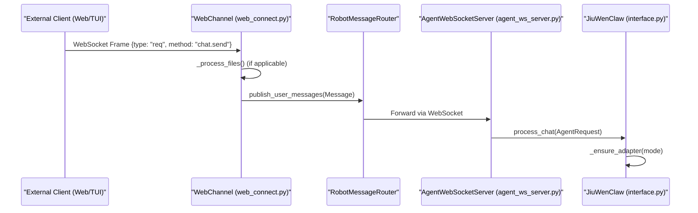
Sources: [jiuwenswarm/gateway/channel_manager/web/web_connect.py:189-192](), [jiuwenswarm/gateway/channel_manager/web/web_connect.py:67-74](), [jiuwenswarm/server/runtime/agent_adapter/interface.py:9-11]().

## Agent Control Protocol (ACP)

ACP is a specialized subset of the E2A protocol designed for IDE integrations. It allows the agent to control the editor environment and receive tool responses back from the client.

### Key ACP Capabilities
- **Tool Responses**: Clients send `acp.tool_response` to provide results of local tool executions [jiuwenswarm/common/schema/message.py:12]().
- **Client-Side Rendering**: The protocol supports complex display types like `ToolCallDisplay` and `SubtaskState` to show progress in the client UI [jiuwenswarm/channels/tui/frontend/src/core/types.ts:43-81]().
- **Streaming State**: ACP clients track states such as `WaitingForConfirmation` when an agent hits a permission-guarded tool [jiuwenswarm/channels/tui/frontend/src/core/types.ts:1-7]().

## Session Lifecycle and Persistence

Sessions in JiuwenSwarm are persistent entities stored on disk. Each session contains metadata, conversation history, and runtime state.

### Session Metadata Management
Metadata is managed by `session_metadata.py`. To ensure high performance, it utilizes an asynchronous writing architecture:
- **Async Writes**: Metadata updates are queued in `_METADATA_QUEUE` and processed by a background `session-metadata-writer` thread [jiuwenswarm/server/runtime/session/session_metadata.py:18-22](), [jiuwenswarm/server/runtime/session/session_metadata.py:109-111]().
- **Memory Caching**: A `_METADATA_CACHE` protected by `_CACHE_LOCK` prevents race conditions where a read might return stale disk data before the async writer completes [jiuwenswarm/server/runtime/session/session_metadata.py:25-26]().
- **Title Generation**: Automatically generated from the first user message via `_auto_title`, capped at 50 characters [jiuwenswarm/server/runtime/session/session_metadata.py:126-132]().

### Metadata Fields
| Field | Description |
| :--- | :--- |
| `session_id` | Unique identifier for the session |
| `mode` | Current agent mode (e.g., `agent`, `code`, `team`) [jiuwenswarm/server/runtime/session/session_metadata.py:152]() |
| `accent_color` | UI customization stored per session [jiuwenswarm/server/runtime/session/session_metadata.py:172]() |
| `channel_metadata` | Platform-specific context like `cwd` (Current Working Directory) [jiuwenswarm/server/runtime/session/session_metadata.py:169]() |

Sources: [jiuwenswarm/server/runtime/session/session_metadata.py:144-156](), [jiuwenswarm/server/runtime/session/session_metadata.py:182-201]().

## History and State Management

### Session Task Control
The `SessionManager` handles the execution lifecycle of tasks within a session. It ensures that tasks are processed in a "Newest First" (LIFO) priority within a session's queue [jiuwenswarm/server/runtime/session/session_manager.py:20-24]().
- **Concurrency**: Multiple sessions can run tasks concurrently, but a single session processes its queue sequentially [jiuwenswarm/server/runtime/session/session_manager.py:88-90]().
- **Interruption**: The `cancel_session_task` method allows the system to terminate long-running LLM generations or tool executions [jiuwenswarm/server/runtime/session/session_manager.py:37-45]().

### Diff and Rewind Services
JiuwenSwarm provides advanced session manipulation through the `DiffService`:
- **Turn-based Diffs**: Computes file changes between user turns by comparing timestamps in `history.json` and agent operation logs [jiuwenswarm/server/utils/diff_service.py:20-39]().
- **Rewind/Fork**: Supports rolling back a session to a specific turn or branching it into a new session [jiuwenswarm/common/schema/message.py:41-43]().

**Session and History Entity Relationship**
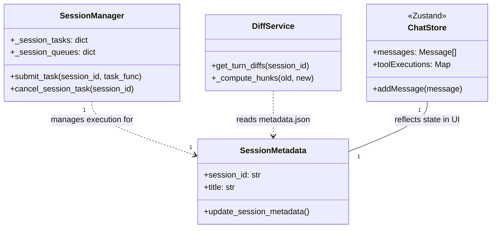
Sources: [jiuwenswarm/server/runtime/session/session_manager.py:20-30](), [jiuwenswarm/server/runtime/session/session_metadata.py:1-10](), [jiuwenswarm/server/utils/diff_service.py:20-26](), [jiuwenswarm/channels/web/frontend/src/stores/chatStore.ts:56-72]().

### Interrupt Semantics
Interrupts (e.g., `CHAT_CANCEL`) are handled differently based on the mode. In `Team Mode`, the `TeamManager` is invoked to pause or cancel the entire multi-agent orchestration [tests/unit_tests/agentserver/test_interface_interrupts.py:30-36](). In standard modes, the `SessionManager` cancels the specific `asyncio.Task` associated with the session [jiuwenswarm/server/runtime/session/session_manager.py:45-51]().

Sources: [jiuwenswarm/server/runtime/session/session_manager.py:37-71](), [tests/unit_tests/agentserver/test_interface_interrupts.py:94-108]().

---

# Page: Rails System

# Rails System

<details>
<summary>Relevant source files</summary>

The following files were used as context for generating this wiki page:

- [jiuwenswarm/agents/harness/code/prompt/__init__.py](jiuwenswarm/agents/harness/code/prompt/__init__.py)
- [jiuwenswarm/agents/harness/common/prompt/prompt_builder.py](jiuwenswarm/agents/harness/common/prompt/prompt_builder.py)
- [jiuwenswarm/agents/harness/common/prompt/shell_environment.py](jiuwenswarm/agents/harness/common/prompt/shell_environment.py)
- [jiuwenswarm/agents/harness/common/rails/ask_user_rail.py](jiuwenswarm/agents/harness/common/rails/ask_user_rail.py)
- [jiuwenswarm/agents/harness/common/rails/runtime_prompt_rail.py](jiuwenswarm/agents/harness/common/rails/runtime_prompt_rail.py)
- [jiuwenswarm/agents/harness/common/rails/stream_event_rail.py](jiuwenswarm/agents/harness/common/rails/stream_event_rail.py)
- [jiuwenswarm/agents/harness/common/tools/user_todo_tool.py](jiuwenswarm/agents/harness/common/tools/user_todo_tool.py)
- [jiuwenswarm/channels/web/frontend/src/hooks/useWebSocket.ts](jiuwenswarm/channels/web/frontend/src/hooks/useWebSocket.ts)
- [jiuwenswarm/server/runtime/agent_adapter/interface_deep.py](jiuwenswarm/server/runtime/agent_adapter/interface_deep.py)
- [jiuwenswarm/server/utils/stream_utils.py](jiuwenswarm/server/utils/stream_utils.py)
- [tests/unit/deep_agent/test_browser_subagent_integration.py](tests/unit/deep_agent/test_browser_subagent_integration.py)
- [tests/unit_tests/agentserver/test_system_prompt_restructure.py](tests/unit_tests/agentserver/test_system_prompt_restructure.py)

</details>


The Rails System in JiuwenSwarm is an interception framework built upon the `DeepAgentRail` architecture. It provides a modular way to inject logic into the agent's execution lifecycle, including prompt modification, tool call interception, security enforcement, and event streaming.

## Framework Architecture

Rails are mounted within the `AgentAdapter` (e.g., `JiuWenClawDeepAdapter` or `JiuWenClawCodeAdapter`) and executed by the underlying `Runner` [jiuwenswarm/server/runtime/agent_adapter/interface_deep.py:35-39](). Each rail implements specific hooks that trigger at different stages of the ReAct loop.

### Lifecycle Hooks
- `init`: Initializes the rail with the agent instance, often capturing a reference to the `SystemPromptBuilder` [jiuwenswarm/agents/harness/common/rails/runtime_prompt_rail.py:50-52]().
- `before_model_call`: Modifies the system prompt or inputs before sending them to the LLM [jiuwenswarm/agents/harness/common/rails/runtime_prompt_rail.py:126-128]().
- `before_tool_call`: Intercepts tool execution to validate permissions or block specific actions [jiuwenswarm/agents/harness/common/rails/stream_event_rail.py:65-74]().
- `after_tool_call`: Processes tool results before they are returned to the agent's context [jiuwenswarm/agents/harness/common/rails/stream_event_rail.py:150-160]().

### Rail Mounting and Orchestration
Rails are instantiated during the adapter setup [jiuwenswarm/server/runtime/agent_adapter/interface_deep.py:54-66](). The priority of execution is determined by the `priority` attribute of each rail class; lower values typically execute earlier in the hook chain [jiuwenswarm/agents/harness/common/rails/runtime_prompt_rail.py:31-31]().

**Rail Execution Flow**

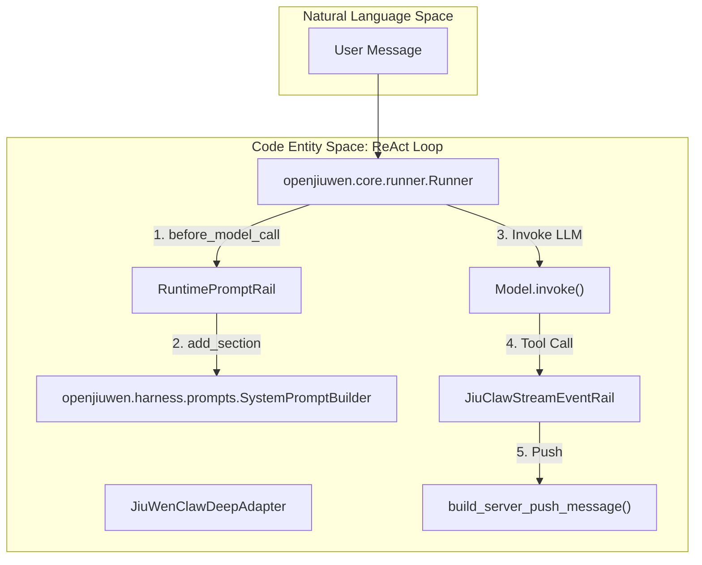
Sources: [jiuwenswarm/server/runtime/agent_adapter/interface_deep.py:10-78](), [jiuwenswarm/agents/harness/common/rails/runtime_prompt_rail.py:126-147](), [jiuwenswarm/server/runtime/session/session_metadata.py:143-143]().

---

## Key Built-in Rails

### 1. Security and Permissions
*   **SecurityRail**: Provides foundational safety checks for LLM outputs and tool parameters [jiuwenswarm/server/runtime/agent_adapter/interface_deep.py:57-57]().
*   **PermissionInterruptRail**: Implements the tiered permission policy. It uses `build_permission_rail` to wrap sensitive tools and triggers `ask_user_question` events to seek manual approval [jiuwenswarm/agents/harness/common/rails/interrupt/interrupt_helpers.py:109-112]().

### 2. Memory Rails
*   **CodingMemoryRail & ProjectMemoryRail**: Specialized rails for Code Mode that manage the injection of relevant code snippets and project documentation.
*   **MemoryRail**: A general-purpose rail for handling short-term and long-term memory retrieval within the ReAct loop [jiuwenswarm/server/runtime/agent_adapter/interface_deep.py:63-63]().

### 3. Context and Prompt Management
*   **ContextProcessorRail**: Pre-processes raw context data before it is formatted into the prompt [jiuwenswarm/server/runtime/agent_adapter/interface_deep.py:66-66]().
*   **RuntimePromptRail**: Injects dynamic information like current time, OS details, current model name, and workspace status into the system prompt [jiuwenswarm/agents/harness/common/rails/runtime_prompt_rail.py:28-48](). It reads from `runtime_state.yaml` to ensure the LLM sees fresh data on every turn [jiuwenswarm/agents/harness/common/rails/runtime_prompt_rail.py:151-152]().
*   **ResponsePromptRail**: Injects the `response` section into the prompt, defining the message format and delivery rules (e.g., ensuring deliverables are in the final message) [jiuwenswarm/agents/harness/common/prompt/prompt_builder.py:123-127]().

### 4. Skill Evolution
*   **SkillUseRail**: Manages the discovery and selection of available skills [jiuwenswarm/server/runtime/agent_adapter/interface_deep.py:55-55]().
*   **SkillEvolutionRail & SkillCreateRail**: Detect signals that a new skill should be created or an existing one updated [jiuwenswarm/server/runtime/agent_adapter/interface_deep.py:58-59](). These rails manage the background evolution watcher and approval workflow.

### 5. Stream and Event Management
*   **StreamEventRail (`JiuClawStreamEventRail`)**: The primary bridge for real-time UI updates. It intercepts tool calls and results to emit `tool.use` and `tool.result` events [jiuwenswarm/agents/harness/common/rails/stream_event_rail.py:3-9](). It also handles `ask_user` tool calls by converting them into structured question payloads for the frontend [jiuwenswarm/agents/harness/common/rails/stream_event_rail.py:104-122]().

---

## Data Flow: Interception and Streaming

When an agent decides to use a tool, the `StreamEventRail` captures the intent and serializes it for the frontend using standard event types.

**Tool Interception Sequence**

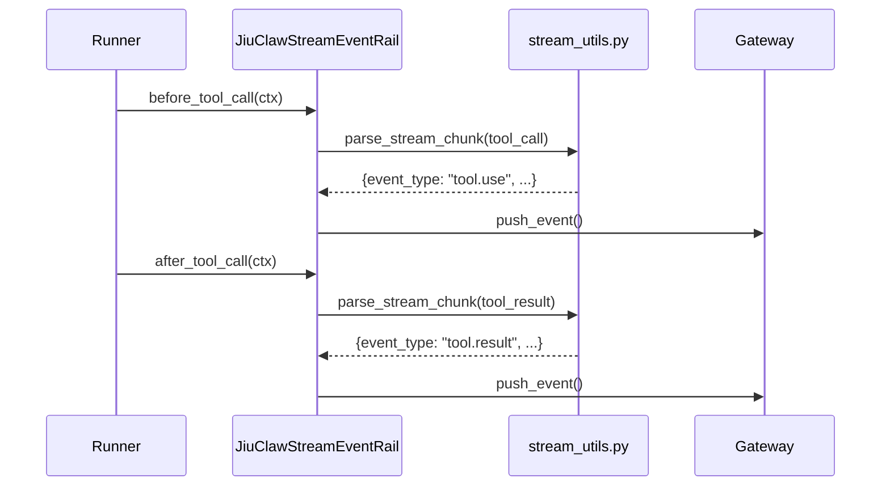
Sources: [jiuwenswarm/agents/harness/common/rails/stream_event_rail.py:3-28](), [jiuwenswarm/server/utils/stream_utils.py:54-69]().

## Implementation Details

### Runtime Prompt Injection
The `RuntimePromptRail` ensures the agent is aware of its environment. It injects sections like `# 时间说明` (Time Description) and `# 运行时状态` (Runtime State) [jiuwenswarm/agents/harness/common/rails/runtime_prompt_rail.py:131-183](). This prevents the agent from hallucinating its own model type or current date.

### Stream Utility Parsing
The system uses `parse_stream_chunk` to normalize various SDK output formats (e.g., `OutputSchema`, `AgentResponseChunk`, or raw dicts) into a standard frontend-consumable dictionary [jiuwenswarm/server/utils/stream_utils.py:10-44](). This ensures that whether a rail emits a tool call or a reasoning block, the UI can render it correctly [jiuwenswarm/server/utils/stream_utils.py:185-195]().

### Rail Configuration Table

| Rail Class | Priority | Stage | Purpose |
| :--- | :--- | :--- | :--- |
| `RuntimePromptRail` | 5 | `before_model_call` | High-priority environment injection [jiuwenswarm/agents/harness/common/rails/runtime_prompt_rail.py:31-31]() |
| `SecurityRail` | 10 | `before_tool_call` | Safety guardrails and validation [jiuwenswarm/server/runtime/agent_adapter/interface_deep.py:57-57]() |
| `JiuClawStreamEventRail` | N/A | `before/after_tool` | Real-time UI event streaming [jiuwenswarm/agents/harness/common/rails/stream_event_rail.py:3-9]() |
| `SkillEvolutionRail` | N/A | `after_tool_call` | Skill discovery and evolution detection [jiuwenswarm/server/runtime/agent_adapter/interface_deep.py:58-58]() |

Sources: [jiuwenswarm/agents/harness/common/rails/runtime_prompt_rail.py:31-31](), [jiuwenswarm/server/runtime/agent_adapter/interface_deep.py:54-67](), [jiuwenswarm/agents/harness/common/rails/stream_event_rail.py:3-28]().

---

# Page: Agent Modes and Harness

# Agent Modes and Harness

<details>
<summary>Relevant source files</summary>

The following files were used as context for generating this wiki page:

- [docs/en/CLI.md](docs/en/CLI.md)
- [docs/en/Modes.md](docs/en/Modes.md)
- [docs/en/SlashCommandArchitecture.md](docs/en/SlashCommandArchitecture.md)
- [docs/en/SlashCommands.md](docs/en/SlashCommands.md)
- [docs/zh/SLASH_COMMAND_ARCHITECTURE.md](docs/zh/SLASH_COMMAND_ARCHITECTURE.md)
- [jiuwenswarm/agents/harness/common/rails/stream_event_rail.py](jiuwenswarm/agents/harness/common/rails/stream_event_rail.py)
- [jiuwenswarm/channels/tui/frontend/src/core/commands/builtins/statusline.ts](jiuwenswarm/channels/tui/frontend/src/core/commands/builtins/statusline.ts)
- [jiuwenswarm/channels/web/frontend/src/hooks/useWebSocket.ts](jiuwenswarm/channels/web/frontend/src/hooks/useWebSocket.ts)
- [jiuwenswarm/server/runtime/agent_adapter/interface_deep.py](jiuwenswarm/server/runtime/agent_adapter/interface_deep.py)
- [jiuwenswarm/server/utils/stream_utils.py](jiuwenswarm/server/utils/stream_utils.py)
- [tests/unit_tests/gateway/test_slash_command.py](tests/unit_tests/gateway/test_slash_command.py)

</details>


JiuwenSwarm operates through three primary modes—**Agent**, **Code**, and **Team**—each tailored for specific task domains. These modes are orchestrated by a "Harness" layer that dynamically configures the agent's identity, toolset, subagent fleet, and safety rails based on the active session context.

## Overview of Operating Modes

The system uses a configuration-driven approach to instantiate agents. The `AgentServer` selects an appropriate adapter (e.g., `JiuWenClawDeepAdapter` or `JiuwenClawCodeAdapter`) to bridge the high-level mode request to the underlying `openjiuwen` core entities.

| Mode | Adapter Class | Primary Focus | Key Subagents |
| :--- | :--- | :--- | :--- |
| **Agent** | `JiuWenClawDeepAdapter` | General assistance & Research | `general_agent`, `research_agent` |
| **Code** | `JiuwenClawCodeAdapter` | Software engineering & LSP integration | `explore`, `plan`, `code`, `browser` |
| **Team** | `JiuWenClawDeepAdapter` | Multi-agent orchestration | Distributed teammates via A2X |

Sources: [jiuwenswarm/server/runtime/agent_adapter/interface_deep.py:3-52](), [jiuwenswarm/server/runtime/agent_adapter/interface_code.py:103-125]()

## The Harness Architecture

The Harness acts as the "operating system" for the agent. It manages the lifecycle of the `DeepAgent` instance, injecting necessary `Rails` for security and `Tools` for capability.

### Natural Language to Code Entity Mapping

The following diagram illustrates how a user request in "Natural Language Space" is transformed into a running "Code Entity Space" via the Harness.

**Harness Instantiation Flow**
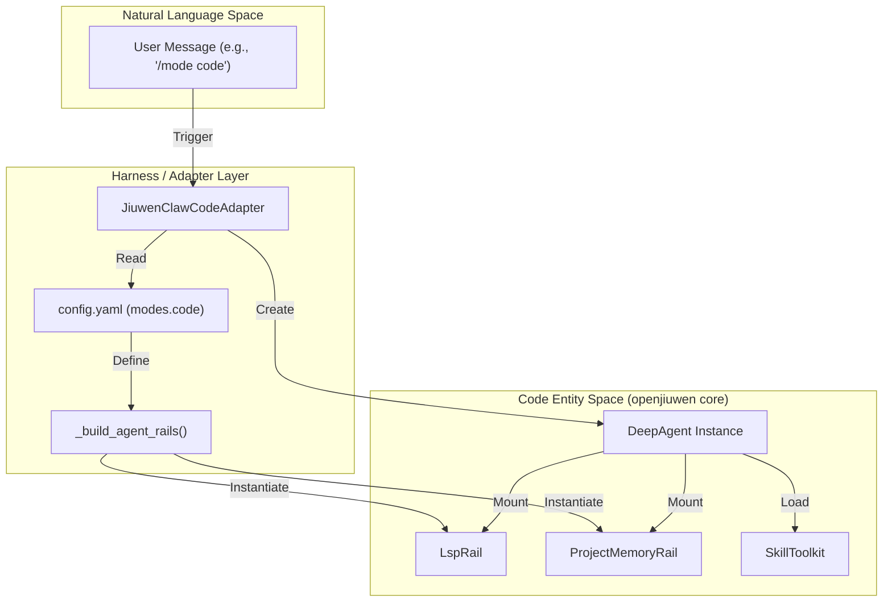
Sources: [jiuwenswarm/server/runtime/agent_adapter/interface_code.py:136-175](), [docs/en/Modes.md:52-107]()

## Mode Summaries

### 3.1 Agent Mode and Plan Mode
The standard operating mode for general-purpose tasks. It utilizes a ReAct (Reasoning and Acting) loop to solve problems.
*   **Fast Mode (`agent.fast`)**: Optimized for quick responses with minimal subagent overhead and passive memory [docs/en/Modes.md:140]().
*   **Plan Mode (`agent.plan`)**: Employs a `TaskPlanningRail` to decompose complex queries into steps, utilizing proactive memory retrieval to maintain long-term context [jiuwenswarm/server/runtime/agent_adapter/interface_deep.py:56-66]().
*   **Auto-Harness**: A pipeline that automatically optimizes the local repository environment for the agent [jiuwenswarm/agents/harness/common/auto_harness.py:1-20]().

For details, see [Agent Mode and Plan Mode](#3.1).

### 3.2 Code Mode
A specialized environment for software development. It leverages the `JiuwenClawCodeAdapter` to mount engineering-specific rails.
*   **LSP Integration**: Real-time code analysis via `LspRail` [docs/en/Modes.md:74]().
*   **Specialized Rails**: Includes `CodingMemoryRail` for tracking code changes and `ProjectMemoryRail` for codebase-wide context [docs/en/Modes.md:141]().
*   **Session Control**: Supports advanced operations like `/rewind` to revert code changes and `/branch` to fork development paths [docs/en/CLI.md:122-182]().

For details, see [Code Mode](#3.2).

### 3.3 Team Mode and Multi-Agent Orchestration
Enables collaborative workflows where multiple agents work toward a single goal.
*   **Role Hierarchy**: Manages `leader` and `teammate` roles defined in the `modes.team` config [docs/en/Modes.md:85-107]().
*   **Distributed Execution**: Uses the **A2X Protocol** to register and reserve remote teammates across a network [jiuwenswarm/agents/harness/team/a2x/a2x_registry_runtime.py:102-106]().
*   **Synchronization**: Automatically syncs workspace state and skillsets between team members via `TeamManager`.

For details, see [Team Mode and Multi-Agent Orchestration](#3.3).

## Session Management Operations

The harness provides critical session operations that bridge the gap between conversation history and the physical workspace (especially in Code Mode).

**Session Operation Entities**
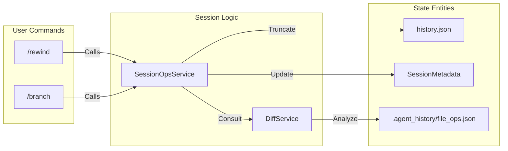
Sources: [jiuwenswarm/agents/harness/common/session_ops_service.py:1-150](), [docs/en/SlashCommands.md:137-182]()

### Key Components
*   **`DiffService`**: Analyzes `.agent_history` to provide turn-by-turn file change summaries [docs/en/SlashCommands.md:137-144]().
*   **`SessionOpsService`**: Handles the logic for `fork_session` (branching) and `rewind_session` (reverting to a previous turn) [jiuwenswarm/agents/harness/common/session_ops_service.py:1-10]().
*   **`JiuClawStreamEventRail`**: Manages the emission of tool calls, results, and context usage events to the frontend [jiuwenswarm/agents/harness/common/rails/stream_event_rail.py:3-9]().

---
**Sources:**
- [jiuwenswarm/server/runtime/agent_adapter/interface_deep.py]()
- [jiuwenswarm/server/runtime/agent_adapter/interface_code.py]()
- [jiuwenswarm/agents/harness/common/session_ops_service.py]()
- [jiuwenswarm/agents/harness/common/rails/stream_event_rail.py]()
- [docs/en/Modes.md]()
- [docs/en/CLI.md]()
- [docs/en/SlashCommands.md]()

---

# Page: Agent Mode and Plan Mode

# Agent Mode and Plan Mode

<details>
<summary>Relevant source files</summary>

The following files were used as context for generating this wiki page:

- [jiuwenswarm/agents/harness/common/auto_harness/config_validator.py](jiuwenswarm/agents/harness/common/auto_harness/config_validator.py)
- [jiuwenswarm/agents/harness/common/auto_harness/scheduler.py](jiuwenswarm/agents/harness/common/auto_harness/scheduler.py)
- [jiuwenswarm/agents/harness/common/auto_harness/service.py](jiuwenswarm/agents/harness/common/auto_harness/service.py)
- [jiuwenswarm/agents/harness/common/rails/interrupt/interrupt_helpers.py](jiuwenswarm/agents/harness/common/rails/interrupt/interrupt_helpers.py)
- [jiuwenswarm/agents/harness/common/rails/stream_event_rail.py](jiuwenswarm/agents/harness/common/rails/stream_event_rail.py)
- [jiuwenswarm/channels/tui/frontend/src/core/commands/builtins/auto-harness.ts](jiuwenswarm/channels/tui/frontend/src/core/commands/builtins/auto-harness.ts)
- [jiuwenswarm/channels/tui/frontend/src/core/commands/builtins/help.ts](jiuwenswarm/channels/tui/frontend/src/core/commands/builtins/help.ts)
- [jiuwenswarm/channels/tui/frontend/src/core/commands/builtins/mode.ts](jiuwenswarm/channels/tui/frontend/src/core/commands/builtins/mode.ts)
- [jiuwenswarm/channels/tui/frontend/src/core/commands/builtins/plan.ts](jiuwenswarm/channels/tui/frontend/src/core/commands/builtins/plan.ts)
- [jiuwenswarm/channels/tui/frontend/src/core/commands/builtins/switch.ts](jiuwenswarm/channels/tui/frontend/src/core/commands/builtins/switch.ts)
- [jiuwenswarm/channels/tui/frontend/src/core/commands/registry.ts](jiuwenswarm/channels/tui/frontend/src/core/commands/registry.ts)
- [jiuwenswarm/channels/web/frontend/src/components/HarnessPackagePanel/index.tsx](jiuwenswarm/channels/web/frontend/src/components/HarnessPackagePanel/index.tsx)
- [jiuwenswarm/channels/web/frontend/src/components/ToolPanel/HarnessExtensionTree.tsx](jiuwenswarm/channels/web/frontend/src/components/ToolPanel/HarnessExtensionTree.tsx)
- [jiuwenswarm/channels/web/frontend/src/hooks/useWebSocket.ts](jiuwenswarm/channels/web/frontend/src/hooks/useWebSocket.ts)
- [jiuwenswarm/channels/web/frontend/src/stores/harnessStore.ts](jiuwenswarm/channels/web/frontend/src/stores/harnessStore.ts)
- [jiuwenswarm/channels/web/frontend/src/stores/index.ts](jiuwenswarm/channels/web/frontend/src/stores/index.ts)
- [jiuwenswarm/gateway/channel_manager/tui/tui_connect.py](jiuwenswarm/gateway/channel_manager/tui/tui_connect.py)
- [jiuwenswarm/gateway/channel_manager/web/app_web_handlers.py](jiuwenswarm/gateway/channel_manager/web/app_web_handlers.py)
- [jiuwenswarm/server/agent_ws_server.py](jiuwenswarm/server/agent_ws_server.py)
- [jiuwenswarm/server/runtime/agent_adapter/interface_deep.py](jiuwenswarm/server/runtime/agent_adapter/interface_deep.py)
- [jiuwenswarm/server/utils/stream_utils.py](jiuwenswarm/server/utils/stream_utils.py)

</details>


This page describes the implementation and behavior of the primary operating modes in JiuwenSwarm: **Agent Mode** (fast) and **Plan Mode**. It details the underlying ReAct orchestration, the subagent fleet, proactive memory, and the **Auto-Harness** pipeline for repository-level optimization.

## 1. Overview of Modes

JiuwenSwarm utilizes specialized adapters to manage the interaction between the user and the LLM. The mode selection determines the orchestration logic and the set of rails applied to the session.

*   **Agent Mode (`agent.fast`):** A standard ReAct (Reasoning and Acting) loop designed for direct task execution with low latency.
*   **Plan Mode (`agent.plan`):** An advanced orchestration mode that incorporates proactive memory lookups and structured planning before execution.

The `JiuWenClawDeepAdapter` implements the `AgentAdapter` protocol to wrap the Deep SDK logic [jiuwenswarm/server/runtime/agent_adapter/interface_deep.py:3-7]().

### Mode Switching Logic
Modes are switched via the `/mode` slash command in the TUI or the mode selector in the Web UI. The system maps user-friendly aliases to specific backend modes:

| Alias | Backend Mode | Description |
| :--- | :--- | :--- |
| `agent` | `agent.plan` | Default agent mode with planning. |
| `fast` | `agent.fast` | Optimized for speed, minimal planning. |
| `plan` | `agent.plan` | Explicit planning mode. |

**Sources:** [jiuwenswarm/channels/tui/frontend/src/core/commands/builtins/mode.ts:37-49](), [jiuwenswarm/server/runtime/agent_adapter/interface_deep.py:39-51]()

---

## 2. ReAct Loop and Subagent Fleet

The core of the agent's intelligence is the ReAct loop, managed by the `Runner` and specialized rails [jiuwenswarm/server/runtime/agent_adapter/interface_deep.py:35-39]().

### The Subagent Fleet
In `agent.plan` and other advanced modes, the adapter configures a fleet of subagents to handle specialized tasks:
*   **General Agent:** Created using `AgentCard` for standard tasks [jiuwenswarm/server/runtime/agent_adapter/interface_deep.py:39]().
*   **Research Agent:** Built via `build_research_agent_config` for deep-dive information retrieval and documentation analysis [jiuwenswarm/server/runtime/agent_adapter/interface_deep.py:69]().
*   **Browser Agent:** Configured via `build_browser_agent_config` to interact with web content [jiuwenswarm/server/runtime/agent_adapter/interface_deep.py:68]().

### Proactive Memory
Plan mode utilizes **Proactive Memory**. The system checks if proactive memory is enabled via `is_proactive_memory()` and mounts the `MemoryRail` [jiuwenswarm/agents/harness/common/memory/config.py:139-140](), [jiuwenswarm/server/runtime/agent_adapter/interface_deep.py:63](). This rail automatically retrieves relevant context from the project index before the agent generates a plan, ensuring the LLM is "warmed up" with pertinent code snippets.

### Implementation Diagram: Agent Orchestration
This diagram bridges the Natural Language request to the code entities managing the ReAct loop.

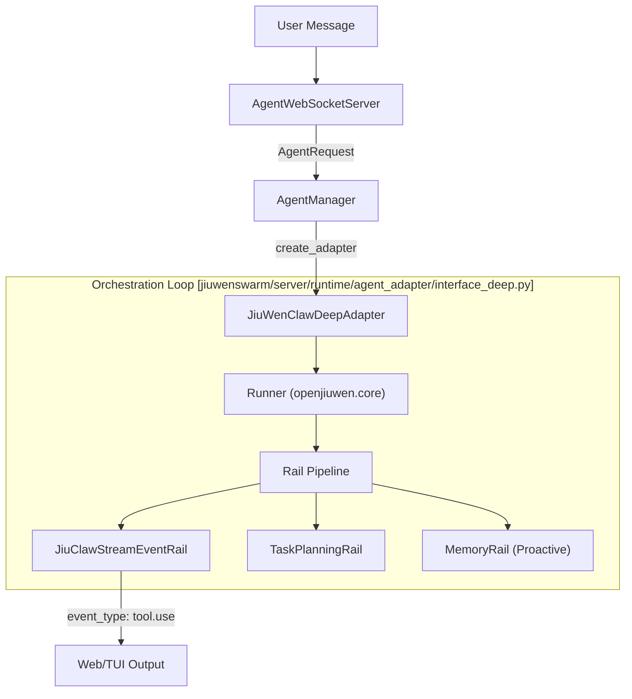
**Sources:** [jiuwenswarm/server/agent_ws_server.py:22-40](), [jiuwenswarm/server/runtime/agent_adapter/interface_deep.py:46-64](), [jiuwenswarm/agents/harness/common/rails/stream_event_rail.py:3-9]()

---

## 3. Auto-Harness Pipeline

The **Auto-Harness** system is a specialized pipeline for repository optimization, integrated into the `JiuWenClawDeepAdapter` via the `AutoHarnessService` [jiuwenswarm/agents/harness/common/auto_harness/service.py:170-181]().

### Pipeline Stages and Optimization
The pipeline automates the "evolution" of an agent by modifying its harness or underlying code.

| Stage | Code Entity | Purpose |
| :--- | :--- | :--- |
| **Assess** | `current_stage_name: "assess"` | Evaluates the repository and identifies optimization targets. |
| **Plan** | `OptimizationTask` | Generates a structured plan for code modification. |
| **Code** | `ExtensionTaskPipeline` | Executes the `EXTENDED_EVOLVE_PIPELINE` to generate harness packages. |
| **CI Gate** | `_DEFAULT_CI_GATE_INSTALL_COMMAND` | Validates changes using `uv sync` or custom test commands. |
| **Activate** | `ExtendActivateStage` | Hot-reloads the new harness into the running agent. |

**Sources:** [jiuwenswarm/agents/harness/common/auto_harness/service.py:51-55](), [jiuwenswarm/agents/harness/common/auto_harness/service.py:78-79](), [jiuwenswarm/agents/harness/common/auto_harness/service.py:165-167]()

### Auto-Harness Implementation
The service manages active runs and repository caching in the `auto-harness` workspace directory.

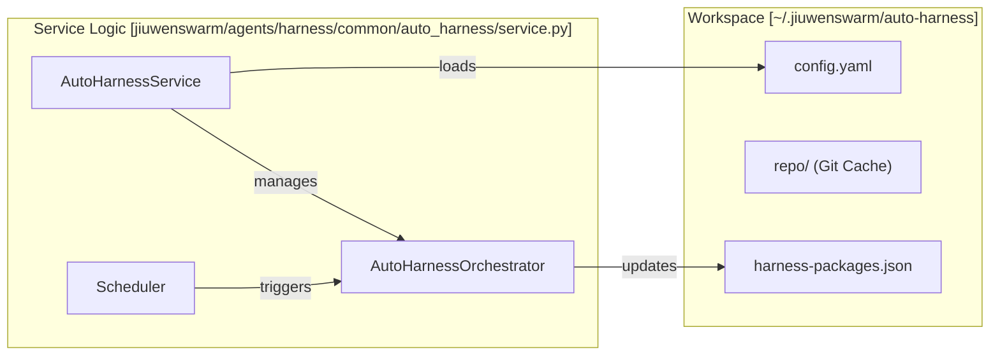
**Sources:** [jiuwenswarm/agents/harness/common/auto_harness/service.py:70-76](), [jiuwenswarm/agents/harness/common/auto_harness/service.py:170-200](), [jiuwenswarm/gateway/channel_manager/tui/tui_connect.py:46-48]()

---

## 4. Execution and Streaming

All events in Agent and Plan mode are streamed back to the client via the `JiuClawStreamEventRail`. This rail intercepts internal SDK events and converts them into `AgentResponseChunk` objects [jiuwenswarm/agents/harness/common/rails/stream_event_rail.py:59-60]().

### Key Event Types
The `parse_stream_chunk` utility in `stream_utils.py` handles the conversion of SDK types to frontend-consumable JSON [jiuwenswarm/server/utils/stream_utils.py:10-25]():

*   **`chat.delta`**: Incremental text output from the LLM [jiuwenswarm/server/utils/stream_utils.py:183]().
*   **`tool.use`**: Notification that a tool (e.g., `bash`, `read_file`) is being invoked [jiuwenswarm/server/utils/stream_utils.py:58]().
*   **`chat.ask_user_question`**: Interruption for user permission or clarification [jiuwenswarm/server/utils/stream_utils.py:112-113]().
*   **`context.compression_state`**: Updates on the proactive memory compression process [jiuwenswarm/server/utils/stream_utils.py:116-128]().

**Sources:** [jiuwenswarm/server/utils/stream_utils.py:10-183](), [jiuwenswarm/agents/harness/common/rails/stream_event_rail.py:3-10]()

---

## 5. User Interaction (TUI/Web)

### Slash Commands
In the TUI, users manage modes and planning via:
*   `/mode <name>`: Switches the active adapter mode [jiuwenswarm/channels/tui/frontend/src/core/commands/builtins/mode.ts:54]().
*   `/plan`: Manually triggers a planning phase for the current task [jiuwenswarm/channels/tui/frontend/src/core/commands/registry.ts:31]().
*   `/auto-harness schedule start`: Sets up a recurring optimization task with a specific `--interval` [jiuwenswarm/channels/tui/frontend/src/core/commands/builtins/auto-harness.ts:187]().

### Web Interface
The React frontend uses the `useWebSocket` hook to process the `WsEvent` stream [jiuwenswarm/channels/web/frontend/src/hooks/useWebSocket.ts:7-31](). It maintains the `harnessStore` to track the status of Auto-Harness optimizations and `sessionStore` for the active chat mode [jiuwenswarm/channels/web/frontend/src/hooks/useWebSocket.ts:32-33]().

**Sources:** [jiuwenswarm/channels/tui/frontend/src/core/commands/builtins/mode.ts:52-56](), [jiuwenswarm/channels/tui/frontend/src/core/commands/builtins/auto-harness.ts:184-188](), [jiuwenswarm/channels/web/frontend/src/hooks/useWebSocket.ts:7-45]()

---

# Page: Code Mode

# Code Mode

<details>
<summary>Relevant source files</summary>

The following files were used as context for generating this wiki page:

- [jiuwenswarm/agents/harness/code/prompt/code_prompt_builder.py](jiuwenswarm/agents/harness/code/prompt/code_prompt_builder.py)
- [jiuwenswarm/agents/harness/code/prompt/code_todo_tool_prompts.py](jiuwenswarm/agents/harness/code/prompt/code_todo_tool_prompts.py)
- [jiuwenswarm/agents/harness/code/rails/__init__.py](jiuwenswarm/agents/harness/code/rails/__init__.py)
- [jiuwenswarm/agents/harness/code/rails/code_task_planning_rail.py](jiuwenswarm/agents/harness/code/rails/code_task_planning_rail.py)
- [jiuwenswarm/agents/harness/code/tools/__init__.py](jiuwenswarm/agents/harness/code/tools/__init__.py)
- [jiuwenswarm/agents/harness/code/tools/code_todo_tools.py](jiuwenswarm/agents/harness/code/tools/code_todo_tools.py)
- [jiuwenswarm/agents/harness/common/rails/execution_guard/__init__.py](jiuwenswarm/agents/harness/common/rails/execution_guard/__init__.py)
- [jiuwenswarm/agents/harness/common/rails/execution_guard/circuit_breaker_rail.py](jiuwenswarm/agents/harness/common/rails/execution_guard/circuit_breaker_rail.py)
- [jiuwenswarm/channels/tui/frontend/src/core/commands/builtins/diff.ts](jiuwenswarm/channels/tui/frontend/src/core/commands/builtins/diff.ts)
- [jiuwenswarm/channels/tui/frontend/src/core/commands/builtins/rewind.ts](jiuwenswarm/channels/tui/frontend/src/core/commands/builtins/rewind.ts)
- [jiuwenswarm/channels/tui/frontend/src/core/types.ts](jiuwenswarm/channels/tui/frontend/src/core/types.ts)
- [jiuwenswarm/channels/tui/frontend/src/ui/components/messages/diff-component.ts](jiuwenswarm/channels/tui/frontend/src/ui/components/messages/diff-component.ts)
- [jiuwenswarm/resources/config.team.distributed.leader.yaml](jiuwenswarm/resources/config.team.distributed.leader.yaml)
- [jiuwenswarm/resources/config.team.distributed.teammate.yaml](jiuwenswarm/resources/config.team.distributed.teammate.yaml)
- [jiuwenswarm/resources/config.yaml](jiuwenswarm/resources/config.yaml)
- [jiuwenswarm/server/runtime/agent_adapter/code_agent_rail.py](jiuwenswarm/server/runtime/agent_adapter/code_agent_rail.py)
- [jiuwenswarm/server/runtime/agent_adapter/interface_code.py](jiuwenswarm/server/runtime/agent_adapter/interface_code.py)
- [jiuwenswarm/server/utils/diff_service.py](jiuwenswarm/server/utils/diff_service.py)
- [tests/unit_tests/agents/harness/code/test_code_todo_tool_prompts.py](tests/unit_tests/agents/harness/code/test_code_todo_tool_prompts.py)
- [tests/unit_tests/agentserver/test_code_adapter_lsp_rail.py](tests/unit_tests/agentserver/test_code_adapter_lsp_rail.py)

</details>


Code Mode is a specialized operating environment within JiuwenSwarm designed for deep repository interaction, software engineering tasks, and complex codebase manipulation. It leverages a dedicated adapter, a fleet of specialized subagents, and advanced memory rails to bridge the gap between natural language requirements and precise code modifications.

## JiuwenClawCodeAdapter

The `JiuwenClawCodeAdapter` is the central orchestration component for Code Mode. It inherits from `JiuWenClawDeepAdapter` and specializes the agent's capabilities by registering coding-specific tools and rails [jiuwenswarm/server/runtime/agent_adapter/interface_code.py:47-52]().

### Initialization and Workspace Management
When a session enters Code Mode, the adapter initializes a `DeepAgent` instance using `create_deep_agent()` [jiuwenswarm/server/runtime/agent_adapter/interface_code.py:27-27](). It manages two distinct directory paths:
- **`_workspace_dir`**: The target project directory where the agent performs file operations and LSP queries [jiuwenswarm/server/runtime/agent_adapter/interface_code.py:45-45]().
- **`_agent_workspace_dir`**: A system-internal directory for storing agent-specific data like coding memory and todo lists, ensuring these do not pollute the user's project [jiuwenswarm/server/runtime/agent_adapter/interface_code.py:70-70]().

### Specialized Subagent Fleet
Code Mode utilizes a "Fleet" architecture where the main agent delegates specific tasks to specialized subagents. These are registered via `SubagentRail` and `CodeAgentRail` [jiuwenswarm/server/runtime/agent_adapter/code_agent_rail.py:2-6]():

| Subagent | Role | Configuration Builder |
| :--- | :--- | :--- |
| `explore_agent` | Repository discovery and structure analysis. | `build_explore_agent_config` |
| `plan_agent` | High-level task decomposition and strategy. | `build_plan_agent_config` |
| `code_agent` | Precise file editing and diff generation. | `build_code_agent_config` |
| `browser_agent` | Web research and documentation fetching. | `build_browser_agent_config` |

**Sources:** [jiuwenswarm/server/runtime/agent_adapter/interface_code.py:38-42](), [jiuwenswarm/server/runtime/agent_adapter/code_agent_rail.py:173-183]()

## Specialized Rails

Rails in Code Mode act as interceptors that manage context, enforce permissions, and provide specialized domain knowledge.

### LspRail
Integrates Language Server Protocol capabilities. It allows the agent to perform semantic searches, find definitions, and check references across the codebase. In `JiuwenClawCodeAdapter`, `LspRail` is treated as a "fixed rail" that is always initialized if the environment allows [jiuwenswarm/server/runtime/agent_adapter/interface_code.py:34-37](). If the LSP server fails to start, the rail degrades gracefully with specific logging labels like `[server_start_failed]` [tests/unit_tests/agentserver/test_code_adapter_lsp_rail.py:116-120]().

### ProjectMemoryRail
Responsible for discovering and injecting project-specific rules and context into the system prompt. It scans for project-level documentation and injects it into the `SystemPromptBuilder` [jiuwenswarm/server/runtime/agent_adapter/interface_code.py:58-61]().

### CodingMemoryRail
Manages "Coding Memory"—long-term persistent knowledge about the user's preferences and architectural decisions. It resolves the project-specific memory directory using `resolve_project_coding_memory_dir` [jiuwenswarm/common/coding_memory_paths.py:66-66]().

### CircuitBreakerRail
Prevents the agent from entering infinite loops or repetitive tool-calling patterns. It monitors tool call history and triggers a `global_circuit_breaker` if no progress is made after a threshold (default 30 calls) [jiuwenswarm/agents/harness/common/rails/execution_guard/circuit_breaker_rail.py:27-32]().

**Sources:** [jiuwenswarm/server/runtime/agent_adapter/interface_code.py:30-35](), [jiuwenswarm/agents/harness/common/rails/execution_guard/circuit_breaker_rail.py:115-127](), [tests/unit_tests/agentserver/test_code_adapter_lsp_rail.py:136-140]()

## Session Operations: Rewind and Diff

Code Mode supports advanced state management, allowing users to navigate conversation history and visualize changes.

### Data Flow: Natural Language to Code Entity Space
The following diagram illustrates how a user's request for a diff (Natural Language Space) translates into specific code entities and filesystem checks (Code Entity Space).

Title: Diff Operation Data Flow
```mermaid
graph TD
    subgraph "Natural Language Space (UI/TUI)"
        UserCmd["/diff --detail"]
    end

    subgraph "Gateway / API Layer"
        DiffCmd["diff.ts (createDiffCommand)"]
        RPC["ctx.request('command.diff')"]
    end

    subgraph "AgentServer / Code Entity Space"
        DiffSvc["DiffService (diff_service.py)"]
        TurnComp["_compute_turn_diffs()"]
        HunkComp["_compute_hunks()"]
    end

    subgraph "Filesystem Space"
        HistJSON["history.json"]
        AgentHist[".agent_history/file_ops_*.json"]
    end

    UserCmd --> DiffCmd
    DiffCmd --> RPC
    RPC --> DiffSvc
    DiffSvc --> TurnComp
    TurnComp -- "Reads" --> HistJSON
    TurnComp -- "Correlates" --> AgentHist
    TurnComp --> HunkComp
```
**Sources:** [jiuwenswarm/channels/tui/frontend/src/core/commands/builtins/diff.ts:12-22](), [jiuwenswarm/server/utils/diff_service.py:20-26](), [jiuwenswarm/server/utils/diff_service.py:39-42]()

### Implementation Details
- **DiffService**: Correlates `history.json` turns with file operations. It calculates `linesAdded` and `linesRemoved` by parsing diff hunks generated via `difflib` [jiuwenswarm/server/utils/diff_service.py:95-115]().
- **Rewind**: TUI and Web interfaces use the `/rewind` command to truncate session history. This involves identifying the target `turnIndex` and invoking the session operation service to clean up records [jiuwenswarm/channels/tui/frontend/src/core/commands/builtins/rewind.ts:1-5]().

## A2X Distributed Teammate Registration

In distributed Team Mode, a Code Mode agent can act as a "teammate" by registering itself with an A2X (Agent-to-X) Registry.

Title: A2X Teammate Registration Flow
```mermaid
graph LR
    subgraph "Agent Instance (Teammate)"
        Config["config.team.distributed.teammate.yaml"]
        Adapter["JiuwenClawCodeAdapter"]
    end

    subgraph "Registry Space"
        A2XRegistry["A2X Registry Service"]
    end

    Config -- "Provides" --> Adapter
    Adapter -- "Startup Registration" --> A2XRegistry
```

### Registration Logic
The distributed configuration files (`config.team.distributed.leader.yaml` and `config.team.distributed.teammate.yaml`) define the telemetry and model settings required for a remote agent to join a swarm [jiuwenswarm/resources/config.team.distributed.leader.yaml:1-15]() [jiuwenswarm/resources/config.team.distributed.teammate.yaml:1-15](). 

- **Teammate Role**: A teammate instance runs with its own `AgentServer` but shares the workspace (often via NFS) with the leader.
- **A2X Integration**: The teammate registers its endpoint and capabilities to the leader's registry, allowing the leader to dispatch `task_tool` calls to it.

**Sources:** [jiuwenswarm/resources/config.team.distributed.leader.yaml:169-176](), [jiuwenswarm/resources/config.team.distributed.teammate.yaml:169-176]()

---

# Page: Team Mode and Multi-Agent Orchestration

# Team Mode and Multi-Agent Orchestration

<details>
<summary>Relevant source files</summary>

The following files were used as context for generating this wiki page:

- [docs/en/DistributedTeam.md](docs/en/DistributedTeam.md)
- [jiuwenswarm/agents/harness/common/memory/embeddings.py](jiuwenswarm/agents/harness/common/memory/embeddings.py)
- [jiuwenswarm/agents/harness/team/config_loader.py](jiuwenswarm/agents/harness/team/config_loader.py)
- [jiuwenswarm/agents/harness/team/distributed_runtime.py](jiuwenswarm/agents/harness/team/distributed_runtime.py)
- [jiuwenswarm/agents/harness/team/remote_member_bootstrap.py](jiuwenswarm/agents/harness/team/remote_member_bootstrap.py)
- [jiuwenswarm/agents/harness/team/team_manager.py](jiuwenswarm/agents/harness/team/team_manager.py)
- [jiuwenswarm/agents/harness/team/team_runtime_inheritance.py](jiuwenswarm/agents/harness/team/team_runtime_inheritance.py)
- [jiuwenswarm/channels/tui/frontend/src/core/commands/builtins/evolve.ts](jiuwenswarm/channels/tui/frontend/src/core/commands/builtins/evolve.ts)
- [jiuwenswarm/common/openrouter_attribution.py](jiuwenswarm/common/openrouter_attribution.py)
- [jiuwenswarm/server/runtime/agent_adapter/evolution_helpers.py](jiuwenswarm/server/runtime/agent_adapter/evolution_helpers.py)
- [jiuwenswarm/server/runtime/agent_adapter/team_helpers.py](jiuwenswarm/server/runtime/agent_adapter/team_helpers.py)
- [scripts/nfs/README.md](scripts/nfs/README.md)
- [scripts/nfs/setup_nfs_client.sh](scripts/nfs/setup_nfs_client.sh)
- [scripts/nfs/setup_nfs_server.sh](scripts/nfs/setup_nfs_server.sh)
- [scripts/nfs/teardown_nfs_client.sh](scripts/nfs/teardown_nfs_client.sh)
- [scripts/nfs/teardown_nfs_server.sh](scripts/nfs/teardown_nfs_server.sh)
- [tests/system_tests/test_a2x_bootstrap_replace_flow.py](tests/system_tests/test_a2x_bootstrap_replace_flow.py)
- [tests/system_tests/test_remote_member_spawn_failfast_st.py](tests/system_tests/test_remote_member_spawn_failfast_st.py)
- [tests/unit_tests/agentserver/test_distributed_runtime.py](tests/unit_tests/agentserver/test_distributed_runtime.py)
- [tests/unit_tests/agentserver/test_evolution_helpers.py](tests/unit_tests/agentserver/test_evolution_helpers.py)
- [tests/unit_tests/agentserver/test_evolution_push_delivery.py](tests/unit_tests/agentserver/test_evolution_push_delivery.py)
- [tests/unit_tests/agentserver/test_remote_member_bootstrap.py](tests/unit_tests/agentserver/test_remote_member_bootstrap.py)
- [tests/unit_tests/agentserver/test_team_config_loader.py](tests/unit_tests/agentserver/test_team_config_loader.py)
- [tests/unit_tests/agentserver/test_team_helpers.py](tests/unit_tests/agentserver/test_team_helpers.py)
- [tests/unit_tests/agentserver/test_team_manager_registry.py](tests/unit_tests/agentserver/test_team_manager_registry.py)
- [tests/unit_tests/agentserver/test_team_manager_skill_state.py](tests/unit_tests/agentserver/test_team_manager_skill_state.py)
- [tests/unit_tests/agentserver/test_team_member_skill_toolkit_rail.py](tests/unit_tests/agentserver/test_team_member_skill_toolkit_rail.py)
- [tests/unit_tests/agentserver/test_team_runtime_inheritance.py](tests/unit_tests/agentserver/test_team_runtime_inheritance.py)
- [tests/unit_tests/agentserver/test_team_shared_skills.py](tests/unit_tests/agentserver/test_team_shared_skills.py)

</details>


Team Mode in JiuwenSwarm enables complex multi-agent collaboration by organizing agents into a hierarchical structure with a designated **Leader** and multiple **Teammates**. This mode facilitates task decomposition, parallel execution, and shared workspace management across local or distributed environments.

## TeamManager Lifecycle and Hierarchy

The `TeamManager` is the central coordinator for team lifecycle events, scoped by communication channel (e.g., "web", "feishu") [jiuwenswarm/agents/harness/team/team_manager.py:85-93](). It manages the transitions between session states and ensures that only one team is active per session.

### Leader/Teammate Hierarchy
Teams are defined by a `TeamAgentSpec` which designates roles [jiuwenswarm/agents/harness/team/config_loader.py:175-184]():
*   **Leader**: The entry point for user interaction. It decomposes high-level goals into sub-tasks and delegates them to teammates.
*   **Teammate**: Specialized agents (e.g., "analyst", "coder") that execute specific tasks assigned by the leader.

### Lifecycle Management
The `TeamManager` handles the following lifecycle stages:
1.  **Initialization**: Loading configuration via `load_team_spec_dict` [jiuwenswarm/agents/harness/team/config_loader.py:27-28]().
2.  **Activation**: Committing a runtime as "ready" and syncing session metadata via `sync_team_identity_metadata` [jiuwenswarm/server/runtime/agent_adapter/team_helpers.py:110-141]().
3.  **Switching**: Preparing for session switches by draining pending events and stopping active messengers [jiuwenswarm/agents/harness/team/team_manager.py:106-118]().
4.  **Teardown**: Releasing ZMQ ports and clearing internal registries [jiuwenswarm/agents/harness/team/team_manager.py:106-118]().

**Diagram: Team Entity Space Mapping**
```mermaid
graph TD
    subgraph "Natural Language Space"
        UserQuery["'Create a research team'"]
        RoleDef["'Analyst Role'"]
    end

    subgraph "Code Entity Space"
        TM["TeamManager (team_manager.py)"]
        TAS["TeamAgentSpec (blueprint.py)"]
        TA["TeamAgent (team_agent.py)"]
        CL["load_team_spec_dict (config_loader.py)"]
        
        TM -- "manages" --> TA
        TA -- "configured by" --> TAS
        CL -- "produces" --> TAS
    end

    UserQuery -.-> CL
    RoleDef -.-> TAS
```
Sources: [jiuwenswarm/agents/harness/team/team_manager.py:132-158](), [jiuwenswarm/agents/harness/team/config_loader.py:171-185](), [jiuwenswarm/server/runtime/agent_adapter/team_helpers.py:110-142]().

## Workspace and Skill Synchronization

Team members share a common environment to ensure consistency during task execution.

### Skill Synchronization
The system synchronizes skills across two levels:
*   **Global to Team**: Valid skills (containing `SKILL.md`) are linked from the global repository to the team's shared directory [jiuwenswarm/agents/harness/team/team_manager.py:61-68]().
*   **Team to Member**: Specific members inherit skills defined in the `agents` configuration. The `MemberSkillToolkitRail` ensures only authorized skills are available to specific teammates [jiuwenswarm/agents/harness/team/team_manager.py:29-31]().

### Workspace Inheritance
Teammates inherit a `TeamWorkspaceInfo` object containing paths for:
*   `root_dir`: The base directory for artifacts.
*   `skills_dir`: The synchronized skill repository.
*   `trajectory_registry`: Shared task history and trajectory data [jiuwenswarm/agents/harness/team/team_runtime_inheritance.py:55-62]().

Sources: [jiuwenswarm/agents/harness/team/team_manager.py:61-68](), [jiuwenswarm/agents/harness/team/config_loader.py:203-205](), [jiuwenswarm/agents/harness/team/team_runtime_inheritance.py:129-158]().

## TeamMonitorHandler and Event Monitoring

The `TeamMonitorHandler` translates internal `openjiuwen` monitor events into a format consumable by the JiuwenSwarm frontend [jiuwenswarm/agents/harness/team/monitor_handler.py:59-59]().

### Event Flow
1.  **Collection**: `_collect_events` asynchronously listens to the `TeamMonitor` stream [jiuwenswarm/agents/harness/team/monitor_handler.py:103-113]().
2.  **Conversion**: Events are mapped to standard types like `team.task`, `team.member`, or `team.message` [jiuwenswarm/agents/harness/team/monitor_handler.py:124-222]().
3.  **Broadcasting**: Events are pushed to the internal queue and subsequently broadcasted to the frontend via `_consume_monitor_events` [jiuwenswarm/server/runtime/agent_adapter/team_helpers.py:114-121]().

**Diagram: Monitor Data Flow**
```mermaid
sequenceDiagram
    participant TA as TeamAgent
    participant TM as TeamMonitor
    participant MH as TeamMonitorHandler
    participant TH as team_helpers.py
    participant FE as Web Frontend

    TA->>TM: MonitorEvent (TASK_CREATED)
    TM->>MH: events() stream
    MH->>MH: _convert_event_to_dict()
    MH->>TH: _consume_monitor_events()
    TH->>FE: WebSocket Push (chat.evolution_status)
```
Sources: [jiuwenswarm/agents/harness/team/monitor_handler.py:103-116](), [jiuwenswarm/server/runtime/agent_adapter/team_helpers.py:114-121](), [jiuwenswarm/agents/harness/team/monitor_handler.py:124-222]().

## Distributed Mode and A2X Reservations

In `distributed` mode, the team is spread across multiple processes or nodes, utilizing a PostgreSQL backend for shared state [jiuwenswarm/agents/harness/team/distributed_runtime.py:44-58]().

### A2X Reservations and Bootstrapping
When the Leader calls `spawn_member` for a remote teammate:
1.  **Remote Detection**: The system checks `jiuwen_remote_member_names` in metadata [jiuwenswarm/agents/harness/team/remote_member_bootstrap.py:54-56]().
2.  **Reservation**: A "blank" agent is reserved via A2X registry [jiuwenswarm/agents/harness/team/remote_member_bootstrap.py:30-31]().
3.  **Bootstrap Envelope**: A JSON payload is published via the P2P channel (`REMOTE_BOOTSTRAP_DIRECT_EVENT_TYPE`) [jiuwenswarm/agents/harness/team/remote_member_bootstrap.py:29-29]().
4.  **Remote Takeover**: The reserved agent applies runtime hints to join the team and sends an ACK [jiuwenswarm/agents/harness/team/remote_member_bootstrap.py:22-24]().

### Distributed Roles
*   **Leader**: Responsible for starting the PostgreSQL cluster and managing the A2X reservation pool [jiuwenswarm/agents/harness/team/distributed_runtime.py:45-57]().
*   **Teammate**: Connects to the leader's transport address and registers its availability [jiuwenswarm/agents/harness/team/remote_member_bootstrap.py:146-152]().

Sources: [jiuwenswarm/agents/harness/team/distributed_runtime.py:44-58](), [jiuwenswarm/agents/harness/team/remote_member_bootstrap.py:22-31](), [jiuwenswarm/agents/harness/team/remote_member_bootstrap.py:54-61]().

## Rail Orchestration in Team Mode

Teams utilize a specialized whitelist of rails to maintain security and functionality across distributed members [jiuwenswarm/agents/harness/team/team_runtime_inheritance.py:64-79]().

| Rail Name | Purpose |
| :--- | :--- |
| `RuntimePromptRail` | Injects channel and language context into the prompt [jiuwenswarm/agents/harness/team/team_runtime_inheritance.py:163-168](). |
| `SecurityRail` | Enforces tiered permission policies for all team members [jiuwenswarm/agents/harness/team/team_runtime_inheritance.py:204-209](). |
| `TeamSkillEvolutionRail` | Manages the autonomous improvement of team-wide skills [jiuwenswarm/agents/harness/team/team_runtime_inheritance.py:23-23](). |
| `TeamWorkspaceReportPathRail` | Ensures teammates use the correct shared workspace paths for reporting [jiuwenswarm/agents/harness/team/team_runtime_inheritance.py:226-231](). |

Sources: [jiuwenswarm/agents/harness/team/team_runtime_inheritance.py:64-79](), [jiuwenswarm/agents/harness/team/team_runtime_inheritance.py:129-160]().

---

# Page: Memory System

# Memory System

<details>
<summary>Relevant source files</summary>

The following files were used as context for generating this wiki page:

- [docs/assets/images/memory_agent.png](docs/assets/images/memory_agent.png)
- [docs/assets/images/memory_config.png](docs/assets/images/memory_config.png)
- [docs/assets/images/memory_files.png](docs/assets/images/memory_files.png)
- [docs/assets/images/memory_search.png](docs/assets/images/memory_search.png)
- [docs/assets/images/memory_write.png](docs/assets/images/memory_write.png)
- [docs/assets/images/user_md.png](docs/assets/images/user_md.png)
- [docs/en/Memory.md](docs/en/Memory.md)
- [jiuwenswarm/agents/harness/common/memory_rpc.py](jiuwenswarm/agents/harness/common/memory_rpc.py)
- [jiuwenswarm/channels/tui/frontend/src/core/commands/builtins/memory.ts](jiuwenswarm/channels/tui/frontend/src/core/commands/builtins/memory.ts)
- [jiuwenswarm/common/coding_memory_paths.py](jiuwenswarm/common/coding_memory_paths.py)
- [tests/unit_tests/agentserver/memory/test_memory_rpc.py](tests/unit_tests/agentserver/memory/test_memory_rpc.py)

</details>


The JiuwenSwarm memory system provides a multi-layered architecture designed to give agents persistent, cross-session recall. It bridges the gap between transient conversation history and long-term knowledge through a combination of local file-based storage, vector-indexed semantic search, and integration with external memory providers.

## Multi-Layered Memory Architecture

The system categorizes memory into distinct layers based on its scope and persistence. This architecture allows the agent to maintain a "short-term" focus on the current project while leveraging "long-term" insights from past interactions.

### Architecture Overview Diagram
This diagram illustrates the relationship between the Natural Language Space (where the agent operates) and the Code Entity Space (where data is managed).

```mermaid
graph TD
    subgraph "Natural Language Space (Agent/User)"
        A["User Prompt / Goal"]
        B["Agent Reasoning (ReAct Loop)"]
    end

    subgraph "Memory Subsystem (Code Entity Space)"
        C["ProjectMemoryRail"]
        D["MemoryIndexManager (SQLite + sqlite-vec)"]
        E["Memory RPC (memory.status, memory.list)"]
        F["ExternalMemoryProvider (Mem0/OpenViking)"]
    end

    subgraph "Storage Layer"
        G[".jiuwen/JIUWENSWARM.md"]
        H["memory/MEMORY.md"]
        I["coding_memory/default/*.md"]
        J["memory.db (FTS5 + Vector)"]
    end

    A --> B
    B --> C
    B --> E
    C --> G
    E --> D
    D --> J
    E --> F
    D -.-> I
    D -.-> H
```
**Sources:** [jiuwenswarm/agents/harness/common/memory_rpc.py:10-24](), [jiuwenswarm/agents/harness/common/coding_memory_paths.py:30-40](), [docs/en/Memory.md:120-142]()

### Core Memory Components

| Component | Code Entity | Role |
| :--- | :--- | :--- |
| **Project Memory** | `ProjectMemoryRail` | Injects local project rules and context (e.g., `.jiuwen/JIUWENSWARM.md`) directly into the prompt context. |
| **Long-Term Memory** | `MemoryIndexManager` | Manages the `memory.db` SQLite database, handling BM25 full-text search and vector indexing for semantic retrieval [docs/en/Memory.md:24-33](). |
| **Coding Memory** | `CodingMemoryRail` | Specialized for Code Mode; stores debugging root causes and API behaviors in project-scoped directories under `coding_memory/` [jiuwenswarm/common/coding_memory_paths.py:30-40](). |
| **External Providers** | `get_memory_engine` | Bridges to third-party services like `mem0`, `openviking`, or `openjiuwen` LTM [jiuwenswarm/agents/harness/common/memory_rpc.py:15-19](). |

## 4.1 Project Memory and Long-Term Memory
Project memory is discovery-based, allowing agents to understand repository-specific conventions. The system resolves project-scoped directories to isolate memory between different codebases [jiuwenswarm/common/coding_memory_paths.py:14-27]().

Long-term memory supports hybrid search. While retrieval defaults to BM25 full-text search, it can be upgraded to vector + BM25 hybrid search by configuring an `EMBED_API_KEY` [docs/en/Memory.md:24-33](). The frontend interacts with these layers via RPC handlers such as `handle_memory_list` and `handle_memory_status` [jiuwenswarm/agents/harness/common/memory_rpc.py:182-213]().

For details on file discovery, `@include` syntax, and SQLite indexing, see **[Project Memory and Long-Term Memory](#4.1)**.

## 4.2 External Memory Providers and Forbidden Memory
JiuwenSwarm can be configured to use external backends via the `memory.engine` setting, which supports `builtin`, `external`, `both`, or `none` [docs/en/Memory.md:9-19](). Supported external providers include:
- **openjiuwen**: Local long-term memory with Chroma/SQLite.
- **mem0**: Cloud-based fact extraction.
- **openviking**: ByteDance context database [docs/en/Memory.md:65-72]().

To ensure security, the system implements a **Forbidden Memory** filter. This component can be toggled via configuration and prevents the system from remembering or retrieving sensitive information defined in forbidden patterns [jiuwenswarm/agents/harness/common/memory_rpc.py:31-34]().

For details on external provider configuration and security filters, see **[External Memory Providers and Forbidden Memory](#4.2)**.

## Memory Storage Layout
The system defaults to a plain-text Markdown storage strategy for transparency, supplemented by a hidden index database.

```mermaid
graph LR
    subgraph "Workspace Root"
        subgraph ".jiuwen/"
            PM["JIUWENSWARM.md (Project Rules)"]
        end
        subgraph "memory/"
            LTM["MEMORY.md (Long-term Facts)"]
            UP["USER.md (User Profile)"]
            LOG["YYYY-MM-DD.md (Daily Logs)"]
            DB[("memory.db (Index)")]
        end
        subgraph "coding_memory/"
            subgraph "project_name/"
                CM["consolidated_*.md (Code Experience)"]
            end
        end
    end

    style DB stroke-dasharray: 5 5
```
**Sources:** [jiuwenswarm/common/coding_memory_paths.py:30-40](), [docs/en/Memory.md:120-142](), [jiuwenswarm/agents/harness/common/memory_rpc.py:108-122]()

## Dreaming: Sleep-Time Consolidation
Beyond real-time updates, the system features a **Dreaming** mechanism. This is an asynchronous process that scans past sessions during idle time to extract significant insights [docs/en/Memory.md:157-166]().
- **Agent Mode:** Extracts user preferences and background into `{workspace}/memory/DREAMING.md`.
- **Code Mode:** Extracts debugging root causes and design decisions into `{workspace}/coding_memory/consolidated_{hash}.md` [docs/en/Memory.md:161-165]().

Dreaming is controlled via the `memory.dreaming` configuration and can be toggled independently for different modes [docs/en/Memory.md:90-99]().

**Sources:** [docs/en/Memory.md:157-178](), [jiuwenswarm/agents/harness/common/memory_rpc.py:14-19]()

---

# Page: Project Memory and Long-Term Memory

# Project Memory and Long-Term Memory

<details>
<summary>Relevant source files</summary>

The following files were used as context for generating this wiki page:

- [.gitignore](.gitignore)
- [jiuwenswarm/agents/harness/common/memory_rpc.py](jiuwenswarm/agents/harness/common/memory_rpc.py)
- [jiuwenswarm/agents/harness/common/rails/project_memory/files.py](jiuwenswarm/agents/harness/common/rails/project_memory/files.py)
- [jiuwenswarm/agents/harness/common/rails/project_memory_rail.py](jiuwenswarm/agents/harness/common/rails/project_memory_rail.py)
- [jiuwenswarm/channels/tui/frontend/src/core/commands/builtins/init.prompts.ts](jiuwenswarm/channels/tui/frontend/src/core/commands/builtins/init.prompts.ts)
- [jiuwenswarm/channels/tui/frontend/src/core/commands/builtins/init.ts](jiuwenswarm/channels/tui/frontend/src/core/commands/builtins/init.ts)
- [jiuwenswarm/channels/tui/frontend/src/core/commands/builtins/memory.ts](jiuwenswarm/channels/tui/frontend/src/core/commands/builtins/memory.ts)
- [jiuwenswarm/common/coding_memory_paths.py](jiuwenswarm/common/coding_memory_paths.py)
- [tests/system_tests/test_coding_memory.py](tests/system_tests/test_coding_memory.py)
- [tests/system_tests/test_project_memory.py](tests/system_tests/test_project_memory.py)
- [tests/unit_tests/agentserver/memory/__init__.py](tests/unit_tests/agentserver/memory/__init__.py)
- [tests/unit_tests/agentserver/memory/test_coding_memory_rail.py](tests/unit_tests/agentserver/memory/test_coding_memory_rail.py)
- [tests/unit_tests/agentserver/memory/test_coding_memory_tools.py](tests/unit_tests/agentserver/memory/test_coding_memory_tools.py)
- [tests/unit_tests/agentserver/memory/test_config.py](tests/unit_tests/agentserver/memory/test_config.py)
- [tests/unit_tests/agentserver/memory/test_frontmatter.py](tests/unit_tests/agentserver/memory/test_frontmatter.py)
- [tests/unit_tests/agentserver/memory/test_memory_rpc.py](tests/unit_tests/agentserver/memory/test_memory_rpc.py)
- [tests/unit_tests/agentserver/rails/test_project_memory_rail.py](tests/unit_tests/agentserver/rails/test_project_memory_rail.py)

</details>


The JiuwenSwarm memory system provides a multi-layered approach to context persistence, ranging from static project-level rules to dynamic, indexed long-term storage. It bridges the gap between the immediate conversation context and the vast knowledge stored in a repository or historical interactions.

## Project Memory Discovery

Project memory is a mechanism for injecting relevant markdown-based rules and documentation into an agent's prompt based on the current workspace or file path. This is primarily handled by the `ProjectMemoryRail` [jiuwenswarm/agents/harness/common/rails/project_memory_rail.py:20-21]() and its associated discovery helpers [jiuwenswarm/agents/harness/common/rails/project_memory/files.py:3-26]().

### Discovery Layers and Priority
Memory files are discovered across multiple layers. The system searches for files like `JIUWENSWARM.md` and `JIUWENSWARM.local.md` [jiuwenswarm/agents/harness/common/memory_rpc.py:91-91](). Higher-priority layers semantically override or append to lower ones [jiuwenswarm/agents/harness/common/rails/project_memory/files.py:28-29]():

| Layer | Priority | Location Examples |
| :--- | :--- | :--- |
| **Managed** | 10 | `/etc/jiuwen/JIUWENSWARM.md`, `/etc/jiuwen/rules/*.md` |
| **User** | 20 | `~/.jiuwen/JIUWENSWARM.md`, `~/.jiuwen/rules/*.md` |
| **Project** | 30 | `.jiuwen/JIUWENSWARM.md`, `.jiuwen/rules/*.md` |
| **Local** | 40 | `JIUWENSWARM.local.md` |

### Frontmatter Scoping and @include Syntax
Files support YAML frontmatter to restrict their application to specific sub-paths within a workspace using the `paths:` key [jiuwenswarm/agents/harness/common/rails/project_memory/files.py:17-20](). Additionally, the `@include` syntax allows files to reference other files, which are expanded during the loading process [jiuwenswarm/agents/harness/common/rails/project_memory/files.py:16-16]().

**Discovery Flow Logic:**
1.  **Root Identification**: The system identifies the workspace root and checks for markers like `.git` [tests/system_tests/test_project_memory.py:83-83]().
2.  **File Scanning**: The `discover_and_load_memory_files` function scans the workspace for supported markdown files [jiuwenswarm/agents/harness/common/rails/project_memory/__init__.py:22-22]().
3.  **Merging**: Content is merged into a single system prompt section named `Project Memory` (or `项目记忆` in Chinese) [tests/unit_tests/agentserver/rails/test_project_memory_rail.py:97-98]().
4.  **Injection**: The `ProjectMemoryRail` injects this content into the `system_prompt_builder` before model calls [tests/system_tests/test_project_memory.py:88-91]().

**Sources:** [jiuwenswarm/agents/harness/common/rails/project_memory/files.py:1-29](), [jiuwenswarm/agents/harness/common/rails/project_memory_rail.py:19-21](), [tests/system_tests/test_project_memory.py:80-120](), [jiuwenswarm/agents/harness/common/memory_rpc.py:90-105]()

---

## Long-Term Memory (LTM) Architecture

The Long-Term Memory system manages indexing and hybrid search (Vector + Full-Text Search).

### MemoryIndexManager and Coding Memory
The `MemoryIndexManager` (or its mock equivalent in testing) manages the persistence and retrieval of "Coding Memory" [tests/unit_tests/agentserver/memory/test_coding_memory_rail.py:29-34](). This memory is project-scoped and stored under `<agent_workspace>/coding_memory/<project_name>` [jiuwenswarm/common/coding_memory_paths.py:30-40]().

#### Data Flow: Natural Language to Code Entity Space
The following diagram illustrates how natural language queries are transformed into structured database lookups.

**Memory Search Pipeline**
```mermaid
graph TD
    subgraph "Natural Language Space"
        UserQuery["User Query (String)"]
    end

    subgraph "CodingMemoryRail (Code Entities)"
        CMR_Invoke["CodingMemoryRail.before_invoke()"]
        MIM_Search["MockMemoryIndexManager.search()"]
        EmbedCfg["MockEmbeddingConfig"]
    end

    subgraph "Persistence Layer (SQLite + Files)"
        VEC_Index["sqlite-vec / Vector Search"]
        FTS_Index["FTS5 / Text Search"]
        CM_Dir["coding_memory/<project_name>/"]
    end

    UserQuery --> CMR_Invoke
    CMR_Invoke --> MIM_Search
    MIM_Search --> EmbedCfg
    MIM_Search --> VEC_Index
    MIM_Search --> FTS_Index
    VEC_Index --> Results["MockSearchResult"]
    FTS_Index --> Results
    Results --> CM_Dir
```
**Sources:** [tests/unit_tests/agentserver/memory/test_coding_memory_rail.py:29-54](), [jiuwenswarm/common/coding_memory_paths.py:30-40](), [tests/unit_tests/agentserver/memory/test_coding_memory_rail.py:218-224]()

### Hybrid Search Mechanism
Search results are retrieved using a combination of semantic vector similarity and keyword matching.
1.  **Vector Search**: Uses embedding models configured via `embed` settings (API key, base URL, model) [jiuwenswarm/agents/harness/common/memory/config.py:56-71]().
2.  **Recall Limits**: Recalled content is constrained by `MAX_RECALL_RESULTS` (default 5) and `MAX_RECALL_TOTAL_BYTES` (default 10KB) to prevent prompt overflow [tests/unit_tests/agentserver/memory/test_coding_memory_rail.py:158-159]().

**Sources:** [tests/unit_tests/agentserver/memory/test_coding_memory_rail.py:48-54](), [tests/unit_tests/agentserver/memory/test_config.py:56-71]()

---

## Initialization and Tools

Users can initialize project memory using the `/init` slash command, which generates the `JIUWENSWARM.md` and `JIUWENSWARM.local.md` files [jiuwenswarm/channels/tui/frontend/src/core/commands/builtins/init.ts:72-74]().

### Memory Tools for Agents
Agents utilize specific tools for managing memory files:
- **Write/Edit**: Tools for creating or modifying markdown files in allowed memory directories [tests/system_tests/test_coding_memory.py:147-157]().
- **Discovery**: The `explore_agent` is often used to scan repositories and gather signals for memory initialization [jiuwenswarm/channels/tui/frontend/src/core/commands/builtins/init.prompts.ts:72-75]().

**Sources:** [jiuwenswarm/channels/tui/frontend/src/core/commands/builtins/init.ts:70-77](), [jiuwenswarm/channels/tui/frontend/src/core/commands/builtins/init.prompts.ts:47-65](), [tests/system_tests/test_coding_memory.py:142-174]()

---

## Frontend Integration and RPC

The frontend communicates with the memory system via RPC handlers defined in `memory_rpc.py` to provide visibility into the memory state.

### Memory RPC Handlers
The RPC layer handles requests for status, listing, and editing memory.

**Frontend to Backend Memory RPC Flow**
```mermaid
graph LR
    subgraph "Frontend (TUI/Web)"
        TUI_Cmd["/memory status / list"]
        TUI_Init["/init command"]
    end

    subgraph "AgentServer (RPC Handlers)"
        H_MemStatus["handle_memory_status"]
        H_MemList["handle_memory_list"]
        H_MemOpen["handle_memory_open"]
        V_Path["_validate_edit_path"]
    end

    subgraph "File System"
        CM_Path["coding_memory/"]
        PJ_Mem["project/.jiuwen/"]
        US_Mem["~/.jiuwen/"]
    end

    TUI_Cmd --> H_MemStatus
    TUI_Cmd --> H_MemList
    TUI_Init --> H_MemOpen
    H_MemList --> PJ_Mem
    H_MemList --> US_Mem
    H_MemOpen --> CM_Path
    H_MemList --> V_Path
```

### Key RPC Functions
- `handle_memory_list`: Scans directories like `~/.jiuwen`, `.jiuwen`, and `coding_memory` to return a list of markdown files [jiuwenswarm/agents/harness/common/memory_rpc.py:178-190]().
- `_validate_edit_path`: Security filter that ensures file operations are restricted to allowed memory directories [jiuwenswarm/agents/harness/common/memory_rpc.py:73-105]().
- `handle_memory_status`: Returns detailed statistics, including index availability (FTS/Vector), file counts, and character totals for project and coding memory [jiuwenswarm/channels/tui/frontend/src/core/commands/builtins/memory.ts:24-62]().

**Sources:** [jiuwenswarm/agents/harness/common/memory_rpc.py:44-54](), [jiuwenswarm/agents/harness/common/memory_rpc.py:178-194](), [jiuwenswarm/channels/tui/frontend/src/core/commands/builtins/memory.ts:99-167](), [tests/unit_tests/agentserver/memory/test_memory_rpc.py:11-22]()

---

# Page: External Memory Providers and Forbidden Memory

# External Memory Providers and Forbidden Memory

<details>
<summary>Relevant source files</summary>

The following files were used as context for generating this wiki page:

- [docs/en/developer_guide.md](docs/en/developer_guide.md)
- [docs/zh/developer_guide.md](docs/zh/developer_guide.md)
- [scripts/build_python_packages.py](scripts/build_python_packages.py)
- [tests/system_tests/test_coding_memory.py](tests/system_tests/test_coding_memory.py)
- [tests/unit_tests/agentserver/memory/__init__.py](tests/unit_tests/agentserver/memory/__init__.py)
- [tests/unit_tests/agentserver/memory/test_coding_memory_rail.py](tests/unit_tests/agentserver/memory/test_coding_memory_rail.py)
- [tests/unit_tests/agentserver/memory/test_coding_memory_tools.py](tests/unit_tests/agentserver/memory/test_coding_memory_tools.py)
- [tests/unit_tests/agentserver/memory/test_config.py](tests/unit_tests/agentserver/memory/test_config.py)
- [tests/unit_tests/agentserver/memory/test_external_memory_builder.py](tests/unit_tests/agentserver/memory/test_external_memory_builder.py)
- [tests/unit_tests/agentserver/memory/test_external_memory_config.py](tests/unit_tests/agentserver/memory/test_external_memory_config.py)
- [tests/unit_tests/agentserver/memory/test_frontmatter.py](tests/unit_tests/agentserver/memory/test_frontmatter.py)

</details>


The JiuwenSwarm memory system extends beyond local project context through integration with external Long-Term Memory (LTM) providers and robust security filtering via the Forbidden Memory mechanism. This architecture allows agents to persist facts across sessions while ensuring sensitive data is never stored.

## 1. Memory Engine Architecture

JiuwenSwarm utilizes a dual-engine approach to memory management, controlled by the `memory.engine` configuration. The system supports multiple modes to balance between local project context and global persistent knowledge.

### Engine Modes
*   **`builtin`**: Only local project and coding memory are active.
*   **`external`**: Only the configured external LTM provider is active.
*   **`both`**: Concurrent use of both local and external memory tools.
*   **`none`**: Disables all memory persistence rails.

The logic for parsing these modes is handled in `get_memory_engine`, which defaults to `builtin` if the configuration is missing or invalid [tests/unit_tests/agentserver/memory/test_external_memory_config.py:90-110]().

### Data Flow and Rail Integration
External memory is implemented as a specialized "Rail" that intercepts the agent's reasoning loop. The `external_memory_builder.py` module is responsible for dispatching the correct provider class based on the configuration [tests/unit_tests/agentserver/memory/test_external_memory_builder.py:3-7]().

**Memory Provider Implementation Diagram**
```mermaid
graph TD
    subgraph "Natural Language Space"
        UserMsg["User Message"]
        AgentThought["Agent Reasoning"]
    end

    subgraph "Code Entity Space (AgentServer)"
        Config["external_memory_config.py"]
        Builder["external_memory_builder.py"]
        EMRail["ExternalMemoryRail"]
        
        subgraph "Providers"
            OJ["OpenJiuwenMemoryProvider"]
            M0["Mem0MemoryProvider"]
            OV["OpenVikingMemoryProvider"]
        end
    end

    UserMsg --> EMRail
    Config --> Builder
    Builder -->|"build_external_memory_rail()"| EMRail
    EMRail -->|"dispatch"| OJ
    EMRail -->|"dispatch"| M0
    EMRail -->|"dispatch"| OV
    AgentThought -.->|"Search/Store"| EMRail
```
Sources: [tests/unit_tests/agentserver/memory/test_external_memory_builder.py:105-112](), [tests/unit_tests/agentserver/memory/test_external_memory_config.py:117-127]()

## 2. External Memory Providers

JiuwenSwarm supports three primary backends for long-term memory. The configuration for these is managed via the `get_external_memory_config` function, which populates provider-specific settings [tests/unit_tests/agentserver/memory/test_external_memory_config.py:133-142]().

### 2.1 OpenJiuwen LTM
A privacy-first solution that maps to a provider-expected shape via `build_openjiuwen_provider_config` [tests/unit_tests/agentserver/memory/test_external_memory_config.py:188-190]().
*   **Vector Store**: Uses `chroma` as the default vector backend [tests/unit_tests/agentserver/memory/test_external_memory_config.py:202]().
*   **KV Store**: Uses `shelve` by default for simple key-value persistence [tests/unit_tests/agentserver/memory/test_external_memory_config.py:201]().
*   **Relational**: Uses `sqlite` for structured data [tests/unit_tests/agentserver/memory/test_external_memory_config.py:203]().

### 2.2 Mem0
A cloud-based memory service. The `Mem0MemoryProvider` requires an `api_key`, `user_id`, and `agent_id` for initialization [tests/unit_tests/agentserver/memory/test_external_memory_builder.py:52-56](). It also supports semantic `rerank` capabilities [tests/unit_tests/agentserver/memory/test_external_memory_builder.py:55]().

### 2.3 OpenViking
An enterprise-grade backend. The `OpenVikingMemoryProvider` is initialized with an `endpoint`, `account`, and `api_key` [tests/unit_tests/agentserver/memory/test_external_memory_builder.py:68-73]().

| Provider | Type | Backend Key | Availability Check |
| :--- | :--- | :--- | :--- |
| **OpenJiuwen** | Local/Hybrid | `openjiuwen` | `OpenJiuwenMemoryProvider.is_available()` |
| **Mem0** | Cloud SaaS | `mem0` | `Mem0MemoryProvider.is_available()` |
| **OpenViking** | Enterprise | `openviking` | `OpenVikingMemoryProvider.is_available()` |

Sources: [tests/unit_tests/agentserver/memory/test_external_memory_builder.py:36-77](), [tests/unit_tests/agentserver/memory/test_external_memory_config.py:144-156]()

## 3. Forbidden Memory (Security Filter)

The Forbidden Memory system acts as a security gatekeeper, preventing sensitive information from being persisted. It utilizes regex patterns to scan content before storage operations.

### Security Implementation
The filter logic is integrated into the memory pipeline. Before any `Store` operation is committed to an external provider or the local `MemoryIndexManager`, the content is processed to ensure no forbidden patterns (e.g., API keys, passwords) are present.

**Security Filtering Diagram**
```mermaid
graph LR
    subgraph "Input Source"
        RawMem["Raw Fact/Context"]
    end

    subgraph "ForbiddenMemory Logic"
        Scanner["Regex Engine"]
        Patterns["Configured Patterns"]
    end

    subgraph "Code Entity Space"
        LTM["ExternalMemoryRail"]
        LocalDB["MemoryIndexManager"]
    end

    RawMem --> Scanner
    Scanner -- "Pass" --> LTM
    Scanner -- "Pass" --> LocalDB
    Scanner -- "Match Found" --> Blocked["Blocked/Sanitized"]
```
Sources: [tests/unit_tests/agentserver/memory/test_coding_memory_rail.py:29-38](), [tests/unit_tests/agentserver/memory/test_config.py:19-28]()

## 4. Memory Control and Environment

The memory system's behavior is influenced by environment variables, which are resolved recursively in the configuration via `_resolve_env_vars` [tests/unit_tests/agentserver/memory/test_config.py:19-28]().

### Configuration Toggles
*   **`is_memory_enabled`**: A global toggle that defaults to `True` if not explicitly disabled in the configuration [tests/unit_tests/agentserver/memory/test_config.py:44-53]().
*   **`get_memory_mode`**: Determines if the system operates in `local` (default) or `cloud` mode [tests/unit_tests/agentserver/memory/test_config.py:37-41]().
*   **`get_embed_config`**: Retrieves API keys and base URLs for embedding models used in vector search [tests/unit_tests/agentserver/memory/test_config.py:56-70]().

### Runtime Validation
For local coding memory, the system performs path validation to prevent directory traversal attacks, ensuring memory files remain within the designated workspace [tests/unit_tests/agentserver/memory/test_coding_memory_tools.py:19-34]().

Sources: [tests/unit_tests/agentserver/memory/test_config.py:73-103](), [tests/unit_tests/agentserver/memory/test_coding_memory_tools.py:19-34]()

---

# Page: Skill System

# Skill System

<details>
<summary>Relevant source files</summary>

The following files were used as context for generating this wiki page:

- [docs/en/Configuration.md](docs/en/Configuration.md)
- [docs/en/SkillSelfEvolution.md](docs/en/SkillSelfEvolution.md)
- [docs/en/Skills.md](docs/en/Skills.md)
- [jiuwenswarm/agents/harness/team/__init__.py](jiuwenswarm/agents/harness/team/__init__.py)
- [jiuwenswarm/agents/harness/team/rails/team_member_skill_toolkit_rail.py](jiuwenswarm/agents/harness/team/rails/team_member_skill_toolkit_rail.py)
- [jiuwenswarm/agents/harness/team/rails/team_shared_skill_link_refresh_rail.py](jiuwenswarm/agents/harness/team/rails/team_shared_skill_link_refresh_rail.py)
- [jiuwenswarm/agents/harness/team/team_skill_links.py](jiuwenswarm/agents/harness/team/team_skill_links.py)
- [jiuwenswarm/server/runtime/agent_adapter/interface.py](jiuwenswarm/server/runtime/agent_adapter/interface.py)
- [jiuwenswarm/server/runtime/skill/skill_manager.py](jiuwenswarm/server/runtime/skill/skill_manager.py)
- [tests/unit_tests/agentserver/test_skill_manager_enable_disable.py](tests/unit_tests/agentserver/test_skill_manager_enable_disable.py)
- [tests/unit_tests/agentserver/test_skill_manager_path_safety.py](tests/unit_tests/agentserver/test_skill_manager_path_safety.py)

</details>


The Skill System in JiuwenSwarm provides a robust framework for extending the capabilities of the agent through modular extensions. Skills are defined as installable, manageable, and reusable capability packages that expand the agent's capability boundaries beyond base chat and file operations [docs/en/Skills.md:9-13]().

This page offers a high-level overview of the Skills extension framework, including the concepts of skills, their lifecycle, and the mechanisms for their evolution.

## Core Concepts

A skill is typically a directory containing a **`SKILL.md`** file, which uses YAML frontmatter to define the skill's name, version, and purpose, alongside Markdown content describing the execution steps and constraints [docs/en/Skills.md:16-18]().

### Skill Sources
JiuwenSwarm supports a multi-source discovery model managed by the `SkillManager` [jiuwenswarm/server/runtime/skill/skill_manager.py:3-4]():

| Source | Description |
| :--- | :--- |
| **Built-in** | Core skills shipped with the product distribution [docs/en/Skills.md:59-59](). |
| **SkillNet** | A general AI skill connection platform based on GitHub repositories [docs/en/Skills.md:60-60](). |
| **ClawHub** | The official JiuwenSwarm ecosystem "app store" (https://clawhub.ai) [docs/en/Skills.md:61-61](). |
| **Marketplace** | Community-contributed third-party sources added via URL [docs/en/Skills.md:62-62](). |
| **Local Import** | User-authored skill files for development and debugging [docs/en/Skills.md:63-63](). |

Sources: [docs/en/Skills.md:53-64](), [jiuwenswarm/server/runtime/skill/skill_manager.py:100-131]()

## Architecture and Code Mapping

The skill system bridges natural language descriptions in `SKILL.md` with the execution logic in the `AgentServer`.

### From Language to Code
The following diagram illustrates how natural language skill definitions are processed into the system's runtime state.

**Skill Definition to Code Mapping**
```mermaid
graph TD
    subgraph "Natural Language Space"
        A["SKILL.md (YAML Frontmatter)"]
        B["Skill Instructions (Markdown)"]
    end

    subgraph "Code Entity Space"
        C["SkillManager Class"]
        D["skills_state.json"]
        E["SkillToolkit / Tools"]
    end

    A -->|"Parsed by"| C
    B -->|"Injected into"| E
    C -->|"Persists to"| D
    D -->|"Tracks"| F["installed_plugins"]
    D -->|"Tracks"| G["local_skills"]
```
Sources: [jiuwenswarm/server/runtime/skill/skill_manager.py:3-15](), [jiuwenswarm/server/runtime/skill/skilldev/state_utils.py:103-111](), [docs/en/Skills.md:16-18]()

### Skill Management and Lifecycle
The `SkillManager` handles the installation pipeline, including directory creation, zip extraction (with Zip-Slip protection), and state persistence [jiuwenswarm/server/runtime/skill/skill_manager.py:902-1050]().

*   **Discovery**: Searching SkillNet, ClawHub, or local paths.
*   **Installation**: Cloning from Git or extracting archives into the `_marketplace` or `skills` directory [jiuwenswarm/server/runtime/skill/skill_manager.py:95-96]().
*   **Persistence**: The `skills_state.json` file tracks enabled/disabled status and origins [jiuwenswarm/server/runtime/skill/skilldev/state_utils.py:105-110]().

For details, see [Skill Management and Lifecycle](#5.1).

Sources: [jiuwenswarm/server/runtime/skill/skill_manager.py:3-15](), [tests/unit_tests/agentserver/test_skill_manager_enable_disable.py:31-33]()

## Skill Self-Evolution

Unlike static tools, JiuwenSwarm skills can "evolve." The system uses a `SignalDetector` to watch for execution failures (e.g., timeouts) or user corrections (e.g., "that's wrong") [docs/en/SkillSelfEvolution.md:19-33]().

**Evolution Signal Pipeline**
```mermaid
graph LR
    subgraph "Runtime Signals"
        H["Tool Failures (error, timeout)"]
        I["User Corrections ('should be...')"]
    end

    subgraph "Evolution Logic"
        J["SkillEvolutionRail"]
        K["SkillOptimizer (LLM)"]
        L["evolutions.json"]
    end

    H --> J
    I --> J
    J --> K
    K -->|"Record"| L
    L -->|"Merge on next call"| M["SKILL.md (Updated)"]
```
Sources: [docs/en/SkillSelfEvolution.md:7-22](), [jiuwenswarm/server/runtime/agent_adapter/interface.py:128-131]()

*   **SkillEvolutionRail**: Intercepts tool results and user messages to identify improvement opportunities.
*   **evolutions.json**: A per-skill log that stores pending and applied changes [docs/en/SkillSelfEvolution.md:98-122]().
*   **Solidification**: The process of merging LLM-generated troubleshooting notes or examples back into the physical `SKILL.md` file [docs/en/SkillSelfEvolution.md:15-18]().

For details, see [Skill Self-Evolution](#5.2).

Sources: [docs/en/SkillSelfEvolution.md:5-18](), [jiuwenswarm/server/runtime/agent_adapter/interface.py:128-131]()

## Team and Multi-Agent Skills

In Team Mode, skills can be shared across multiple agents. The `TeamManager` coordinates the synchronization of skill directories, often using symbolic links or Windows junctions to provide a unified view of available capabilities across different agent workspaces [jiuwenswarm/agents/harness/team/team_skill_links.py:50-55]().

*   **TeamSharedSkillLinkRefreshRail**: Automatically refreshes shared links when a skill is updated [jiuwenswarm/agents/harness/team/rails/team_shared_skill_link_refresh_rail.py:17-18]().
*   **MemberSkillToolkitRail**: Binds skill-management tools (install/uninstall) specifically to a team member's scoped workspace [jiuwenswarm/agents/harness/team/rails/team_member_skill_toolkit_rail.py:23-24]().

Sources: [jiuwenswarm/agents/harness/team/team_skill_links.py:50-70](), [jiuwenswarm/agents/harness/team/rails/team_member_skill_toolkit_rail.py:41-50]()

---

- For details on installation and the `SkillManager`, see [Skill Management and Lifecycle](#5.1).
- For details on the evolution subsystem and `SignalDetector`, see [Skill Self-Evolution](#5.2).

---

# Page: Skill Management and Lifecycle

# Skill Management and Lifecycle

<details>
<summary>Relevant source files</summary>

The following files were used as context for generating this wiki page:

- [docs/assets/images/skill_page_auto.png](docs/assets/images/skill_page_auto.png)
- [jiuwenswarm/agents/harness/team/__init__.py](jiuwenswarm/agents/harness/team/__init__.py)
- [jiuwenswarm/agents/harness/team/rails/team_member_skill_toolkit_rail.py](jiuwenswarm/agents/harness/team/rails/team_member_skill_toolkit_rail.py)
- [jiuwenswarm/agents/harness/team/rails/team_shared_skill_link_refresh_rail.py](jiuwenswarm/agents/harness/team/rails/team_shared_skill_link_refresh_rail.py)
- [jiuwenswarm/agents/harness/team/team_skill_links.py](jiuwenswarm/agents/harness/team/team_skill_links.py)
- [jiuwenswarm/channels/web/frontend/src/components/SkillPanel/index.tsx](jiuwenswarm/channels/web/frontend/src/components/SkillPanel/index.tsx)
- [jiuwenswarm/channels/web/frontend/src/components/Switch/index.tsx](jiuwenswarm/channels/web/frontend/src/components/Switch/index.tsx)
- [jiuwenswarm/channels/web/frontend/src/features/ClawHubSearchModal/index.tsx](jiuwenswarm/channels/web/frontend/src/features/ClawHubSearchModal/index.tsx)
- [jiuwenswarm/channels/web/frontend/src/features/SkillNetSearchModal/index.tsx](jiuwenswarm/channels/web/frontend/src/features/SkillNetSearchModal/index.tsx)
- [jiuwenswarm/channels/web/frontend/src/features/SourceManagerModal/index.tsx](jiuwenswarm/channels/web/frontend/src/features/SourceManagerModal/index.tsx)
- [jiuwenswarm/channels/web/frontend/src/features/TeamSkillsHubModal/index.tsx](jiuwenswarm/channels/web/frontend/src/features/TeamSkillsHubModal/index.tsx)
- [jiuwenswarm/server/runtime/agent_adapter/interface.py](jiuwenswarm/server/runtime/agent_adapter/interface.py)
- [jiuwenswarm/server/runtime/skill/__init__.py](jiuwenswarm/server/runtime/skill/__init__.py)
- [jiuwenswarm/server/runtime/skill/skill_manager.py](jiuwenswarm/server/runtime/skill/skill_manager.py)
- [jiuwenswarm/server/runtime/skill/skilldev/__init__.py](jiuwenswarm/server/runtime/skill/skilldev/__init__.py)
- [jiuwenswarm/server/runtime/skill/skilldev/state_utils.py](jiuwenswarm/server/runtime/skill/skilldev/state_utils.py)
- [tests/unit_tests/agentserver/test_skill_manager_enable_disable.py](tests/unit_tests/agentserver/test_skill_manager_enable_disable.py)
- [tests/unit_tests/agentserver/test_skill_manager_path_safety.py](tests/unit_tests/agentserver/test_skill_manager_path_safety.py)

</details>


The Skill System in JiuwenSwarm allows for the dynamic extension of agent capabilities through "Skills"—packaged sets of tools, prompts, and logic. The `SkillManager` is the central authority for discovering, installing, and managing the lifecycle of these extensions.

## Skill Discovery and Sources

Skills are discovered from multiple sources, ranging from built-in system tools to remote marketplaces. The `SkillManager` aggregates these into a unified view for the agent and the user.

| Source | Description | Implementation Detail |
| :--- | :--- | :--- |
| **Builtin** | Core skills bundled with the JiuwenSwarm distribution. | Loaded from `get_builtin_skills_dir()` [jiuwenswarm/server/runtime/skill/skill_manager.py:39](). |
| **Local** | User-developed skills or manually imported folders. | Stored in the user's workspace `skills/` directory [jiuwenswarm/server/runtime/skill/skill_manager.py:38](). |
| **ClawHub** | Remote repository of community skills with token-based access. | Managed via `_get_marketplace_dir()` [jiuwenswarm/server/runtime/skill/skill_manager.py:95-96](). |
| **Team Skills Hub** | A specialized marketplace for enterprise/team environments. | Uses `TEAM_SKILLS_HUB_BASE_URL` (default: `https://teamskills.openjiuwen.com`) [jiuwenswarm/server/runtime/skill/skill_manager.py:61-62](). |
| **SkillNet** | A discovery protocol for finding skills via external indices. | Controlled by `SKILLNET_DOWNLOAD_TIMEOUT` and proxy settings [jiuwenswarm/server/runtime/skill/skill_manager.py:45-57](). |

**Sources:** [jiuwenswarm/server/runtime/skill/skill_manager.py:36-100](), [jiuwenswarm/channels/web/frontend/src/components/SkillPanel/index.tsx:107-112]()

## Installation Pipeline

The installation process transforms a "Skill Spec" (a URL, a local path, or a marketplace slug) into an active skill directory.

### Validation and Safety
Before extraction, the `SkillManager` performs rigorous path safety checks to prevent directory traversal attacks. The functions `_safe_path_name` and `_safe_child_path` ensure that skill names do not contain `..` or absolute paths [jiuwenswarm/server/runtime/skill/skill_manager.py:198-220]().

### Extraction Logic
1.  **Download/Clone**: For remote sources, the system supports Git clones, ZIP extraction, or TAR archives [jiuwenswarm/server/runtime/skill/skill_manager.py:16-20]().
2.  **Staging**: Files are extracted into a temporary directory.
3.  **SKILL.md Validation**: Every skill must contain a `SKILL.md` file with a YAML frontmatter header defining its `name`, `version`, and `description` [tests/unit_tests/agentserver/test_skill_manager_path_safety.py:76-79]().
4.  **Persistence**: Once validated, the skill is moved to the local workspace and registered in `skills_state.json`.

### Skill Installation Flow
The following diagram bridges the user's request from the Web UI to the internal code execution flow.

```mermaid
sequenceDiagram
    participant User as "User (Web UI)"
    participant WP as "SkillPanel (index.tsx)"
    participant JC as "JiuWenClaw (interface.py)"
    participant SM as "SkillManager (skill_manager.py)"
    participant Safety as "Safety (_safe_child_path)"
    participant FS as "FileSystem (skills_state.json)"

    User->>WP: Click "Install" on ClawHub Skill
    WP->>JC: webRequest("skills.clawhub.download", {slug}) [jiuwenswarm/channels/web/frontend/src/features/ClawHubSearchModal/index.tsx:199]
    JC->>SM: handle_skills_clawhub_download() [jiuwenswarm/server/runtime/agent_adapter/interface.py:119]
    SM->>SM: httpx.AsyncClient.get(clawhub_url)
    SM->>Safety: Validate extracted paths [jiuwenswarm/server/runtime/skill/skill_manager.py:215]
    Safety-->>SM: Path OK
    SM->>FS: Update skills_state.json [jiuwenswarm/server/runtime/skill/skill_manager.py:99]
    SM-->>JC: {success: true}
    JC-->>WP: response
    WP-->>User: Show Success Toast
```

**Sources:** [jiuwenswarm/server/runtime/skill/skill_manager.py:198-220](), [jiuwenswarm/server/runtime/agent_adapter/interface.py:100-131](), [jiuwenswarm/channels/web/frontend/src/features/ClawHubSearchModal/index.tsx:187-217]()

## State Management and Persistence

The system maintains a persistent record of all installed and modified skills to ensure consistency across restarts.

### `skills_state.json`
Located in the agent's skills directory, this file is managed via `state_utils.py` [jiuwenswarm/server/runtime/skill/skill_manager.py:103-111](). It tracks:
*   **Installed Plugins**: List of marketplace-sourced skills [tests/unit_tests/agentserver/test_skill_manager_enable_disable.py:64-72]().
*   **Local Skills**: Manually imported or developed skills [tests/unit_tests/agentserver/test_skill_manager_enable_disable.py:69-71]().
*   **Enable/Disable Status**: A map of skill names to their boolean `enabled` state [tests/unit_tests/agentserver/test_skill_manager_enable_disable.py:37-50]().

### `evolutions.json`
Skills that have undergone "Self-Evolution" track their iterative changes in `evolutions.json` [jiuwenswarm/server/runtime/skill/skill_manager.py:88](). This file maps specific code changes back to the agent's reasoning process using `EvolutionRecord` and `EvolutionLog` objects [jiuwenswarm/server/runtime/skill/skill_manager.py:32-35]().

**Sources:** [jiuwenswarm/server/runtime/skill/skill_manager.py:88-111](), [tests/unit_tests/agentserver/test_skill_manager_enable_disable.py:17-50]()

## Skill Development and Toolkits

The `SkillDevService` and `SkillToolkit` provide the programmatic and UI interfaces for creating and managing skills.

### Key Class: `SkillToolkit`
The `SkillToolkit` exposes high-level methods to the LLM, allowing an agent to manage its own capabilities [jiuwenswarm/agents/harness/team/rails/team_member_skill_toolkit_rail.py:49]().
*   `install_skill`: Programmatically adds new capabilities.
*   `uninstall_skill`: Removes local skill directories and updates state [jiuwenswarm/agents/harness/team/rails/team_member_skill_toolkit_rail.py:99]().

### Internal Logic Interaction
This diagram shows how the `SkillToolkit` acts as a bridge between the Agent's decision-making and the `SkillManager`'s filesystem operations.

```mermaid
graph TD
    subgraph AgentRuntime["Agent Runtime Space"]
        A["LLM Tool Call"] --> B["MemberSkillToolkitRail (rail.py)"]
        B --> C["SkillToolkit (skill_toolkits.py)"]
    end

    subgraph ManagerSpace["Skill Management Space"]
        C --> D["SkillManager.handle_skills_install"]
        D --> E["_safe_path_name (Safety Check)"]
        E --> F["shutil.move (Filesystem)"]
        F --> G["set_skill_enabled (state_utils.py)"]
    end

    style C stroke-width:2px
    style D stroke-width:2px
```

**Sources:** [jiuwenswarm/agents/harness/team/rails/team_member_skill_toolkit_rail.py:23-71](), [jiuwenswarm/server/runtime/skill/skill_manager.py:198-212](), [tests/unit_tests/agentserver/test_skill_manager_enable_disable.py:95-108]()

## Team Mode Synchronization

In Team Mode, skills can be shared across members using the `TeamSharedSkillLinkRefreshRail` [jiuwenswarm/agents/harness/team/rails/team_shared_skill_link_refresh_rail.py:17]().

*   **Refresh Trigger**: When an agent uses `write_file` or `edit_file` within the global skills directory, the rail triggers a link refresh [jiuwenswarm/agents/harness/team/rails/team_shared_skill_link_refresh_rail.py:32-44]().
*   **Member Isolation**: Each member can have its own `MemberSkillToolkitRail` to manage workspace-specific skills [jiuwenswarm/agents/harness/team/rails/team_member_skill_toolkit_rail.py:23-34]().

**Sources:** [jiuwenswarm/agents/harness/team/rails/team_shared_skill_link_refresh_rail.py:17-44](), [jiuwenswarm/agents/harness/team/rails/team_member_skill_toolkit_rail.py:41-71]()

---

# Page: Skill Self-Evolution

# Skill Self-Evolution

<details>
<summary>Relevant source files</summary>

The following files were used as context for generating this wiki page:

- [docs/assets/images/config_self_evolve.png](docs/assets/images/config_self_evolve.png)
- [jiuwenswarm/channels/tui/frontend/src/core/commands/builtins/evolve.ts](jiuwenswarm/channels/tui/frontend/src/core/commands/builtins/evolve.ts)
- [jiuwenswarm/server/runtime/agent_adapter/evolution_helpers.py](jiuwenswarm/server/runtime/agent_adapter/evolution_helpers.py)
- [jiuwenswarm/server/runtime/agent_adapter/team_helpers.py](jiuwenswarm/server/runtime/agent_adapter/team_helpers.py)
- [tests/unit_tests/agentserver/test_evolution_helpers.py](tests/unit_tests/agentserver/test_evolution_helpers.py)
- [tests/unit_tests/agentserver/test_evolution_push_delivery.py](tests/unit_tests/agentserver/test_evolution_push_delivery.py)
- [tests/unit_tests/agentserver/test_evolve_command_edges.py](tests/unit_tests/agentserver/test_evolve_command_edges.py)
- [tests/unit_tests/agentserver/test_team_helpers.py](tests/unit_tests/agentserver/test_team_helpers.py)
- [tests/unit_tests/evolution/test_schema.py](tests/unit_tests/evolution/test_schema.py)
- [tests/unit_tests/evolution/test_signal_detector.py](tests/unit_tests/evolution/test_signal_detector.py)

</details>


The Skill Self-Evolution subsystem is a proactive mechanism that enables JiuwenSwarm agents to improve their own capabilities. It monitors agent trajectories, detects patterns that suggest a need for new or improved skills, generates code-level "experience" (evolutions), and manages a human-in-the-loop approval workflow.

## Architecture Overview

The evolution system is implemented as a set of **Rails** that intercept agent activity and a background **Watcher** task that monitors the state of generated evolution proposals. It bridges the gap between high-level agent reasoning and the underlying file-based skill storage.

### Key Components

| Component | Role | File Reference |
| :--- | :--- | :--- |
| `SkillEvolutionRail` | Detects evolution signals in single-agent mode and triggers experience generation. | [jiuwenswarm/server/runtime/agent_adapter/interface_deep.py:127-128]() |
| `TeamSkillEvolutionRail` | Orchestrates skill evolution across a multi-agent team. | [jiuwenswarm/agents/harness/team/monitor_handler.py:28-28]() |
| `TeamSkillCreateRail` | Specifically handles the generation of entirely new skills. | [jiuwenswarm/server/runtime/agent_adapter/evolution_helpers.py:175-187]() |
| `EvolutionWatcher` | A background `asyncio.Task` that polls for completion of evolution generation via `_watch_team_evolution_and_push`. | [jiuwenswarm/server/runtime/agent_adapter/team_helpers.py:72-73]() |
| `SignalDetector` | Core logic for extracting "execution_failure" or "user_correction" signals from message history. | [openjiuwen/agent_evolving/signal.py:7-16]() |

### Data Flow: Signal to Approval

The following diagram illustrates how a natural language interaction triggers a code-level skill evolution proposal and its subsequent persistence.

**Diagram: Evolution Signal to Code Entity Space**

```mermaid
sequenceDiagram
    participant User as "User (IM/Web)"
    participant Agent as "JiuWenClawDeepAdapter"
    participant Detector as "SignalDetector (openjiuwen)"
    participant Rail as "SkillEvolutionRail"
    participant Store as "evolutions.json"
    participant UI as "Web/TUI Frontend"

    User->>Agent: Sends Message
    Agent->>Detector: detect(messages)
    Note over Detector: Scans for "execution_failure"<br/>or "user_correction"
    Detector-->>Agent: EvolutionSignal[]
    Agent->>Rail: request_user_evolution(skill, signals)
    Note over Rail: LLM Generates EvolutionRecord
    Rail->>Store: Persist to {skill}/evolutions.json
    Rail->>Agent: Push "chat.evolution_status"
    Agent->>UI: Broadcast via WebSocketGatewayPushTransport
    UI->>User: Show Approval Modal (chat.ask_user_question)
    User->>UI: Confirm "Accept"
    UI->>Agent: respond_user_question(accept)
    Agent->>Rail: approve_record(request_id)
```
*Sources: [jiuwenswarm/server/runtime/agent_adapter/team_helpers.py:124-167](), [jiuwenswarm/server/runtime/agent_adapter/evolution_helpers.py:12-45](), [openjiuwen/agent_evolving/signal.py:16-42]()*

---

## Evolution Signal Detection

The system detects evolution signals by analyzing the agent's reasoning process and tool usage history using the `SignalDetector` class.

### Signal Types
*   **Execution Failure**: Detected when tool outputs contain keywords like `traceback`, `exception`, or `错误` [openjiuwen/agent_evolving/signal.py:175-186]().
*   **User Correction**: Detected when a user follows an agent's tool call with feedback like "不对，应该这样做" [openjiuwen/agent_evolving/signal.py:45-60]().

### Evolution Status Stages
The system reports progress to the UI via the `chat.evolution_status` event type, mapping internal SDK stages to normalized user-facing stages:
*   `detecting`: Analysis of signals is underway (`started`, `detecting_signals`) [jiuwenswarm/server/runtime/agent_adapter/evolution_helpers.py:83-84]().
*   `generating`: The LLM is writing the Python code or `SKILL.md` updates (`staging`, `generating_updates`) [jiuwenswarm/server/runtime/agent_adapter/evolution_helpers.py:85-86]().
*   `approval_required`: The proposal is ready for user review [jiuwenswarm/server/runtime/agent_adapter/evolution_helpers.py:87-87]().
*   `completed`: Changes have been successfully applied [jiuwenswarm/server/runtime/agent_adapter/evolution_helpers.py:90-90]().

*Sources: [jiuwenswarm/server/runtime/agent_adapter/evolution_helpers.py:82-101](), [openjiuwen/agent_evolving/signal.py:25-42]()*

---

## Approval Workflow (`ask_user_question`)

Evolutions are gated by a human-in-the-loop workflow. The `EvolutionRecord` remains in a `pending` state in `evolutions.json` until approved.

1.  **Event Generation**: The evolution rail emits a `chat.ask_user_question` event containing the proposed `EvolutionPatch` [jiuwenswarm/server/runtime/agent_adapter/evolution_helpers.py:12-16]().
2.  **Request ID Tracking**: A unique `request_id` (e.g., `team_skill_evolve_req1`) is assigned to link the UI response back to the specific evolution cycle [jiuwenswarm/server/runtime/agent_adapter/evolution_helpers.py:52-53]().
3.  **Persistence**: Proposal details are stored in the skill's local directory as `evolutions.json` [jiuwenswarm/server/runtime/agent_adapter/evolution_helpers.py:18-18]().
4.  **User Action**: Users can accept via labels like "accept", "接收", or "接受" [jiuwenswarm/server/runtime/agent_adapter/evolution_helpers.py:103-103]().

*Sources: [jiuwenswarm/server/runtime/agent_adapter/evolution_helpers.py:12-103](), [openjiuwen/agent_evolving/checkpointing/types.py:7-12]()*

---

## Slash Commands for Evolution

The system provides several built-in slash commands for manual intervention and inspection of the evolution state.

| Command | Description | File Reference |
| :--- | :--- | :--- |
| `/evolve <skill>` | Explicitly trigger evolution analysis for a specific skill. | [jiuwenswarm/channels/tui/frontend/src/core/commands/builtins/evolve.ts:8-29]() |
| `/evolve_list <skill>` | List pending evolution proposals with their calculated scores. | [jiuwenswarm/channels/tui/frontend/src/core/commands/builtins/evolve.ts:35-68]() |
| `/evolve_simplify` | Merge or simplify multiple evolution records into smaller, distinct tasks. | [jiuwenswarm/channels/tui/frontend/src/core/commands/builtins/evolve.ts:74-107]() |
| `/evolve_rebuild` | Rebuild the `SKILL.md` file using archived history and evolution records. | [jiuwenswarm/channels/tui/frontend/src/core/commands/builtins/evolve.ts:113-145]() |

---

## Evolution Watcher Task

The `_watch_team_evolution_and_push` function serves as the background monitor. It drains pending approval events from the rail and broadcasts them to the connected channel.

**Diagram: Evolution Watcher Lifecycle**

```mermaid
graph TD
    subgraph "Background Loop"
        START["Watcher Start"]
        DRAIN["drain_pending_approval_events()"]
        TIMEOUT{"Timeout?"}
        PUSH["push_evolution_status()"]
        CLEANUP["cleanup_background_tasks()"]
    end

    START --> DRAIN
    DRAIN --> TIMEOUT
    TIMEOUT -- "No" --> PUSH
    PUSH --> DRAIN
    TIMEOUT -- "Yes" --> CLEANUP
    CLEANUP --> END["Watcher Stop"]
```

*Sources: [jiuwenswarm/server/runtime/agent_adapter/team_helpers.py:148-191](), [tests/unit_tests/agentserver/test_team_helpers.py:65-74]()*

### Implementation Details
*   **Idle Sleep**: The watcher sleeps for `TEAM_EVOLUTION_IDLE_SLEEP_SEC` (default 1.0s) when no events are present [jiuwenswarm/server/runtime/agent_adapter/evolution_helpers.py:19-19]().
*   **Timeout**: Evolution cycles have a default timeout of 900 seconds (15 minutes) [jiuwenswarm/server/runtime/agent_adapter/evolution_helpers.py:20-20]().
*   **Validation**: Before starting, the system validates that the skill exists and the `evolutions.json` file is writable [jiuwenswarm/server/runtime/agent_adapter/evolution_helpers.py:175-202]().

*Sources: [jiuwenswarm/server/runtime/agent_adapter/evolution_helpers.py:18-63](), [jiuwenswarm/server/runtime/agent_adapter/team_helpers.py:148-193]()*

---

# Page: Communication Channels

# Communication Channels

<details>
<summary>Relevant source files</summary>

The following files were used as context for generating this wiki page:

- [docs/assets/images/xiaoyi_hook.png](docs/assets/images/xiaoyi_hook.png)
- [docs/assets/images/xiaoyi_push_id.png](docs/assets/images/xiaoyi_push_id.png)
- [docs/en/Channels.md](docs/en/Channels.md)
- [jiuwenswarm/gateway/channel_manager/channel_manager.py](jiuwenswarm/gateway/channel_manager/channel_manager.py)
- [jiuwenswarm/gateway/channel_manager/im_platforms/feishu/feishu_connect.py](jiuwenswarm/gateway/channel_manager/im_platforms/feishu/feishu_connect.py)

</details>


JiuwenSwarm utilizes a unified communication hub to bridge external chat platforms and the internal multi-agent system. The **Gateway** process acts as the central router, managing inbound messages from various channels and forwarding them to the **AgentServer** via the E2A protocol.

## Overview of Channel Architecture

The system supports three primary categories of communication:
1.  **Web Channel**: A built-in FastAPI-based WebSocket interface for the official React web frontend.
2.  **IM Platform Channels**: Integrations with popular instant messaging platforms (Feishu, WeCom, WeChat, Telegram, Discord, WhatsApp, DingTalk, and Xiaoyi).
3.  **ACP Client Plugin Channel**: A standardized protocol for IDE plugins (like VS Code or JetBrains) to control the agent.

The `ChannelManager` handles the lifecycle of these connections—including registration, unregistration, and configuration hot-reloading [jiuwenswarm/gateway/channel_manager/channel_manager.py:22-28](). It ensures that messages are normalized before being passed to the `MessageHandler` [jiuwenswarm/gateway/channel_manager/channel_manager.py:58-69]().

### Message Routing Flow
The following diagram illustrates how an external message travels through the Gateway to reach the Agent logic and how responses are dispatched back.

**Gateway Message Routing (Natural Language to Code Entity)**
```mermaid
graph TD
    User["User on External IM (Feishu/Xiaoyi)"] -- "WebSocket/Webhook" --> Inbound["BaseChannel Implementation"]
    Inbound -- "Message Object" --> CM["ChannelManager"]
    CM -- "handle_message()" --> MH["MessageHandler"]
    MH -- "WebSocket (E2A)" --> AS["AgentServer (AgentWebSocketServer)"]
    
    AS -- "Response (robot_messages)" --> MH
    MH -- "consume_robot_messages()" --> CM
    CM -- "send()" --> Inbound
    Inbound -- "API Call" --> User
    
    subgraph "Gateway Process"
        Inbound
        CM["ChannelManager (channel_manager.py)"]
        MH["MessageHandler (message_handler.py)"]
    end
    
    subgraph "Agent Process"
        AS["AgentServer (AgentWebSocketServer)"]
    end

    style MH stroke-width:2px
    style AS stroke-width:2px
```
**Sources:** [jiuwenswarm/gateway/channel_manager/channel_manager.py:22-28](), [jiuwenswarm/gateway/channel_manager/channel_manager.py:142-157](), [docs/en/Channels.md:1-3]().

---

## 6.1 Web Channel and REST API
The Web channel is the primary interface for the browser-based UI. It provides:
*   **WebSocket Gateway**: Real-time message streaming and state updates.
*   **RPC Methods**: Operations like session management, skill management, and model configuration.
*   **Static Assets**: Serves the compiled React frontend.

For details, see [Web Channel and REST API](#6.1).

---

## 6.2 IM Platform Channels
JiuwenSwarm supports a wide array of IM platforms, allowing users to interact with agents where they already work.

| Category | Supported Platforms | Key Features |
| :--- | :--- | :--- |
| **Enterprise** | Feishu (Lark), WeCom, DingTalk | Group Digital Avatar, @Mention support, File upload |
| **Personal** | WeChat, WhatsApp (Baileys), Xiaoyi | Digital Avatar mode, Private DMs, Streaming |
| **Developer** | Telegram, Discord | Slash command support, Bot API integration |

### Digital Avatar Mode
A standout feature for Feishu and WeCom is the **Group Digital Avatar** [jiuwenswarm/gateway/channel_manager/im_platforms/feishu/feishu_connect.py:60](). When enabled, the bot represents a specific user in group chats, responding to relevant mentions in the first person [docs/en/Channels.md:5-9](). This requires configuring `my_user_id` (the user's platform open_id) and `bot_name` in the channel settings [jiuwenswarm/gateway/channel_manager/im_platforms/feishu/feishu_connect.py:58-59]().

For details, see [IM Platform Channels](#6.2).

**Sources:** [docs/en/Channels.md:1-9](), [jiuwenswarm/gateway/channel_manager/im_platforms/feishu/feishu_connect.py:34-63]().

---

## 6.3 ACP Client Plugin Channel
The **Agent Control Protocol (ACP)** is a specialized channel designed for IDE integrations. Unlike standard chat channels, ACP supports:
*   **Tool Response Round-trips**: Precise handling of tool execution results from the client side.
*   **Capability Negotiation**: Clients can declare `clientCapabilities` to define supported UI elements.
*   **Output Management**: Managed by `AcpOutputManager` to handle structured output for developer workflows.

For details, see [ACP Client Plugin Channel](#6.3).

---

## Configuration and Management
Channels can be configured via the **Web UI** or by manually editing the `config.yaml` file [docs/en/Channels.md:11-15](). The `ChannelManager` supports dynamic updates through `set_conf`, which triggers a callback to re-instantiate channels without a full process restart [jiuwenswarm/gateway/channel_manager/channel_manager.py:115-126]().

**Channel Configuration Structure (Code to Logic)**
```mermaid
classDiagram
    class ChannelManager {
        -dict _channels
        -dict _config
        +register_channel(BaseChannel)
        +set_conf(channel_id, new_conf)
    }
    class FeishuConfig {
        +bool enabled
        +str app_id
        +str app_secret
        +bool group_digital_avatar
    }
    class XiaoyiConfig {
        +str ak
        +str sk
        +str agent_id
    }
    
    ChannelManager o-- FeishuConfig : manages
    ChannelManager o-- XiaoyiConfig : manages
```
**Sources:** [jiuwenswarm/gateway/channel_manager/channel_manager.py:30-45](), [jiuwenswarm/gateway/channel_manager/im_platforms/feishu/feishu_connect.py:34-63](), [docs/en/Channels.md:70-78]().

### Outbound Message Delivery
The `ChannelManager` runs a `_dispatch_robot_messages` loop that consumes messages from the `MessageHandler` and routes them to the correct `BaseChannel` implementation for delivery to the user [jiuwenswarm/gateway/channel_manager/channel_manager.py:142-157](). If a delivery fails (e.g., a Cron job push), it can notify the user via a fallback channel like the Web UI [jiuwenswarm/gateway/channel_manager/channel_manager.py:170-185]().

**Sources:** [jiuwenswarm/gateway/channel_manager/channel_manager.py:142-185]().

---

# Page: Web Channel and REST API

# Web Channel and REST API

<details>
<summary>Relevant source files</summary>

The following files were used as context for generating this wiki page:

- [jiuwenswarm/channels/web/app_web.py](jiuwenswarm/channels/web/app_web.py)
- [jiuwenswarm/channels/web/frontend/package-lock.json](jiuwenswarm/channels/web/frontend/package-lock.json)
- [jiuwenswarm/channels/web/frontend/package.json](jiuwenswarm/channels/web/frontend/package.json)
- [jiuwenswarm/channels/web/frontend/src/components/ChatPanel/ChatPanel.css](jiuwenswarm/channels/web/frontend/src/components/ChatPanel/ChatPanel.css)
- [jiuwenswarm/channels/web/frontend/src/components/ChatPanel/index.tsx](jiuwenswarm/channels/web/frontend/src/components/ChatPanel/index.tsx)
- [jiuwenswarm/channels/web/frontend/src/components/ToolPanel/index.tsx](jiuwenswarm/channels/web/frontend/src/components/ToolPanel/index.tsx)
- [jiuwenswarm/channels/web/frontend/src/features/shareImageExport.css](jiuwenswarm/channels/web/frontend/src/features/shareImageExport.css)
- [jiuwenswarm/channels/web/frontend/src/features/teamHistoryPanelRestore.ts](jiuwenswarm/channels/web/frontend/src/features/teamHistoryPanelRestore.ts)
- [jiuwenswarm/channels/web/frontend/src/services/webClient.ts](jiuwenswarm/channels/web/frontend/src/services/webClient.ts)
- [jiuwenswarm/channels/web/frontend/src/stores/chatStore.ts](jiuwenswarm/channels/web/frontend/src/stores/chatStore.ts)
- [jiuwenswarm/channels/web/frontend/vite.config.ts](jiuwenswarm/channels/web/frontend/vite.config.ts)
- [jiuwenswarm/common/e2a/gateway_normalize.py](jiuwenswarm/common/e2a/gateway_normalize.py)
- [jiuwenswarm/common/schema/message.py](jiuwenswarm/common/schema/message.py)
- [jiuwenswarm/gateway/channel_manager/web/web_connect.py](jiuwenswarm/gateway/channel_manager/web/web_connect.py)
- [jiuwenswarm/server/runtime/session/session_history.py](jiuwenswarm/server/runtime/session/session_history.py)

</details>


The Web channel provides the primary graphical interface and programmatic API for JiuwenSwarm. It consists of a FastAPI-based web server for static assets and file management, and a WebSocket gateway for real-time Remote Procedure Call (RPC) communication and message streaming.

## System Architecture and Data Flow

The Web channel architecture separates static content delivery from stateful agent communication. The `app_web.py` server acts as the entry point for the browser, while `web_connect.py` manages the persistent bi-directional connection to the Gateway process.

### High-Level Web Data Flow
1.  **Frontend Initialization**: The React SPA is served by `app_web.py`.
2.  **WebSocket Handshake**: The frontend establishes a connection to the `WebChannel` defined in `web_connect.py`.
3.  **RPC Execution**: User actions (e.g., changing models, listing skills) send `req` frames via WebSocket. These are routed to handlers registered in the channel.
4.  **Agent Interaction**: Chat messages are wrapped in the E2A protocol and forwarded to the AgentServer via the `RobotMessageRouter`.

Title: Web Channel Communication Flow
```mermaid
graph TD
    subgraph "Browser (React SPA)"
        "ChatPanel[ChatPanel/index.tsx]" -- "req: chat.send" --> "webClient[services/webClient.ts]"
        "ConfigPanel" -- "req: config.set" --> "webClient[services/webClient.ts]"
    end

    subgraph "Gateway Process"
        "app_web.py" -- "Serves SPA" --> "Browser (React SPA)"
        "WebChannel[web_connect.py]" -- "Handles WS" --> "webClient[services/webClient.ts]"
        "WebChannel[web_connect.py]" -- "Route RPC" --> "MethodHandlers"
        "WebChannel[web_connect.py]" -- "Forward Msg" --> "RobotMessageRouter"
    end

    subgraph "AgentServer Process"
        "RobotMessageRouter" -- "E2A Protocol" --> "AgentWebSocketServer"
        "AgentWebSocketServer" -- "Logic" --> "JiuWenClaw"
    end

    "MethodHandlers" -- "Update" --> "config.yaml"
    "MethodHandlers" -- "Manage" --> "sessions/"
```
Sources: `[jiuwenswarm/channels/web/app_web.py:137-158]()`, `[jiuwenswarm/gateway/channel_manager/web/web_connect.py:55-63]()`, `[jiuwenswarm/channels/web/frontend/src/services/webClient.ts:243-260]()`

---

## FastAPI Web Server (`app_web.py`)

The `app_web.py` script runs a specialized HTTP server that performs three main roles: serving the frontend, providing a file API, and acting as a reverse proxy for the WebSocket gateway.

### Key Components
*   **SPA Handling**: The `_SpaStaticHandler` ensures that all non-file routes are redirected to `index.html`, supporting React Router navigation `[jiuwenswarm/channels/web/app_web.py:137-158]()`.
*   **File API**: Provides endpoints for reading and writing files within the agent's workspace. It supports automatic encoding detection to handle diverse file types `[jiuwenswarm/channels/web/app_web.py:180-189]()`.
*   **Agent Data Generation**: The `_generate_agent_data` function scans the `agent/workspace` directory to build a JSON tree (`agent-data.json`) used by the frontend file explorer `[jiuwenswarm/channels/web/app_web.py:83-134]()`.

### WebSocket Proxying
To simplify deployment, `app_web.py` can proxy WebSocket traffic from the standard HTTP port to the internal Gateway port (default `19000`). It includes logic to handle WebSocket handshakes and frame parsing for logging purposes `[jiuwenswarm/channels/web/app_web.py:192-205]()`.

Sources: `[jiuwenswarm/channels/web/app_web.py:1-205]()`

---

## WebSocket Gateway (`web_connect.py`)

The `WebChannel` class implements the `BaseChannel` interface for the Gateway process. It manages the lifecycle of client connections and provides the transport layer for the JSON-RPC-like protocol used by the web frontend.

### Frame Protocol
The channel communicates using three frame types:
1.  **req**: Sent by the client to invoke a method (e.g., `ReqMethod.CHAT_SEND`) `[jiuwenswarm/common/schema/message.py:14-17]()`.
2.  **res**: Sent by the server as a direct response to a `req` `[jiuwenswarm/gateway/channel_manager/web/web_connect.py:108-124]()`.
3.  **event**: Unsolicited or streaming data sent by the server (e.g., `chat.delta`, `chat.subtask_update`) `[jiuwenswarm/gateway/channel_manager/web/web_connect.py:137-152]()`.

### Implementation Details
*   **Method Registration**: Handlers are registered via `register_method(method, handler)` `[jiuwenswarm/gateway/channel_manager/web/web_connect.py:90-96]()`.
*   **Origin Validation**: Supports WebSocket origin checks via `is_allowed_browser_origin` to prevent Cross-Site WebSocket Hijacking (CSWSH) `[jiuwenswarm/gateway/channel_manager/web/web_connect.py:26-32]()`.
*   **File Processing**: Automatically handles file uploads sent in message params by downloading them to the agent's workspace before forwarding to the agent `[jiuwenswarm/gateway/channel_manager/web/web_connect.py:189-215]()`.

Sources: `[jiuwenswarm/gateway/channel_manager/web/web_connect.py:55-215]()`, `[jiuwenswarm/common/schema/message.py:10-180]()`

---

## RPC and History Management

The web channel handles complex state synchronization, particularly for Team Mode, by merging live WebSocket events with persisted history.

### Team History Restoration
When a session is loaded, the frontend calls `loadTeamHistoryPanelState` to fetch previous activity `[jiuwenswarm/channels/web/frontend/src/features/teamHistoryPanelRestore.ts:35-41]()`. This state is merged with current memory via `mergeById` to ensure UI consistency without data loss during reconnection `[jiuwenswarm/channels/web/frontend/src/components/ToolPanel/index.tsx:35-58]()`.

### Persistence Logic
The backend uses an asynchronous worker to append records to `history.json` `[jiuwenswarm/server/runtime/session/session_history.py:112-132]()`.
*   **Team Filtering**: `read_team_history_records` specifically filters for events like `team.task` or `team.member` to populate the Team Panel `[jiuwenswarm/server/runtime/session/session_history.py:79-98]()`.
*   **Serialization**: Custom serialization handles `datetime` and complex nested objects `[jiuwenswarm/server/runtime/session/session_history.py:22-32]()`.

Sources: `[jiuwenswarm/server/runtime/session/session_history.py:1-205]()`, `[jiuwenswarm/channels/web/frontend/src/components/ToolPanel/index.tsx:155-204]()`

---

## Frontend Build and Serve

The frontend is a React application built using Vite.

### Build Configuration
The `package.json` defines scripts for generating agent folder metadata before building `[jiuwenswarm/channels/web/frontend/package.json:6-10]()`. It relies on dependencies like `zustand` for state management and `react-i18next` for internationalization `[jiuwenswarm/channels/web/frontend/package.json:14-29]()`.

### Frontend Communication Layer
The `WebClient` class in `webClient.ts` manages the WebSocket state machine (`connecting`, `ready`, `reconnecting`, `closed`) `[jiuwenswarm/channels/web/frontend/src/services/webClient.ts:75-90]()`.
*   **Legacy Event Mapping**: Maps internal event strings to standard dotted notation (e.g., `content_chunk` -> `chat.delta`) `[jiuwenswarm/channels/web/frontend/src/services/webClient.ts:27-45]()`.
*   **Request Sequencing**: Each request is assigned a unique ID to match incoming `res` frames `[jiuwenswarm/channels/web/frontend/src/services/webClient.ts:254-260]()`.

Title: Web Frontend to Backend Entity Mapping
```mermaid
graph LR
    subgraph "Frontend [src/stores/]"
        "chatStore.ts" -- "uses" --> "webClient.ts"
        "sessionStore.ts" -- "uses" --> "webClient.ts"
    end

    subgraph "Gateway [web/]"
        "webClient.ts" -- "WS: ReqMethod" --> "WebChannel[web_connect.py]"
        "WebChannel[web_connect.py]" -- "dispatch" --> "MethodHandlers"
    end

    subgraph "History [session/]"
        "MethodHandlers" -- "reads" --> "session_history.py"
        "session_history.py" -- "writes" --> "history.json"
    end
```
Sources: `[jiuwenswarm/channels/web/frontend/src/services/webClient.ts:75-100]()`, `[jiuwenswarm/gateway/channel_manager/web/web_connect.py:90-96]()`, `[jiuwenswarm/server/runtime/session/session_history.py:135-172]()`

---

# Page: IM Platform Channels

# IM Platform Channels

<details>
<summary>Relevant source files</summary>

The following files were used as context for generating this wiki page:

- [docs/assets/images/discord/1_create_new_app.png](docs/assets/images/discord/1_create_new_app.png)
- [docs/assets/images/discord/2_reset_bot_token.png](docs/assets/images/discord/2_reset_bot_token.png)
- [docs/assets/images/discord/3_set_required_intent.png](docs/assets/images/discord/3_set_required_intent.png)
- [docs/assets/images/discord/4_set_guild_install_scope_and_permissions.png](docs/assets/images/discord/4_set_guild_install_scope_and_permissions.png)
- [docs/assets/images/discord/5_select_install_methods_and_copy_setup_link.png](docs/assets/images/discord/5_select_install_methods_and_copy_setup_link.png)
- [docs/assets/images/xiaoyi_hook.png](docs/assets/images/xiaoyi_hook.png)
- [docs/assets/images/xiaoyi_push_id.png](docs/assets/images/xiaoyi_push_id.png)
- [docs/en/Channels.md](docs/en/Channels.md)
- [jiuwenswarm/gateway/channel_manager/channel_manager.py](jiuwenswarm/gateway/channel_manager/channel_manager.py)
- [jiuwenswarm/gateway/channel_manager/im_platforms/feishu/feishu_connect.py](jiuwenswarm/gateway/channel_manager/im_platforms/feishu/feishu_connect.py)

</details>


JiuwenSwarm supports integration with a wide variety of Instant Messaging (IM) platforms, allowing users to interact with agents via familiar chat interfaces. The system abstracts platform-specific complexities through a unified channel architecture within the Gateway process.

## Architecture and Data Flow

The IM channel integration is managed by the `ChannelManager` within the Gateway process. Each platform is implemented as a specialized class inheriting from `BaseChannel` [jiuwenswarm/gateway/channel_manager/base.py:12-42](). The `ChannelManager` handles the lifecycle of these channels, including registration, configuration updates, and message dispatching [jiuwenswarm/gateway/channel_manager/channel_manager.py:22-45]().

### Message Lifecycle
1.  **Inbound**: An IM platform sends a webhook or WebSocket event. For example, `FeishuChannel` uses a WebSocket long connection to receive events [jiuwenswarm/gateway/channel_manager/im_platforms/feishu/feishu_connect.py:145-157](). The raw payload is parsed into a standardized `Message` object [jiuwenswarm/common/schema/message.py:21-25]().
2.  **Routing**: The channel triggers a callback registered by the `ChannelManager`, which forwards the message to the `MessageHandler` [jiuwenswarm/gateway/channel_manager/channel_manager.py:58-69]().
3.  **Processing**: The `MessageHandler` identifies the session via the `SessionMap` and forwards the message to the `AgentServer` via the E2A protocol.
4.  **Outbound**: The `AgentServer` sends a response back to the Gateway. The `ChannelManager` runs a dispatch loop (`_dispatch_robot_messages`) that consumes these responses and calls the target channel's `send(msg)` method [jiuwenswarm/gateway/channel_manager/channel_manager.py:142-166]().

### Code Entity Space Bridge: Inbound Pipeline
The following diagram illustrates how raw IM events are transformed into system-wide `Message` entities using specific code components.

"IM Inbound Pipeline to Code Entities"
```mermaid
graph TD
    subgraph "IM Platform Space"
        A["Webhook / WebSocket Event"]
    end

    subgraph "Gateway Process (jiuwenswarm.gateway)"
        B["FeishuChannel / XiaoyiChannel"]
        C["ChannelManager._on_channel_message"]
        D["MessageHandler.handle_message"]
        E["SessionMap (jiuwenswarm.common.session)"]
    end

    A -->|"Raw Event Payload"| B
    B -->|"Message Object"| C
    C -->|"Forward"| D
    D -->|"Resolve Session"| E
    D -->|"Forward to AgentServer"| F["E2A Protocol"]
```
Sources: [jiuwenswarm/gateway/channel_manager/channel_manager.py:58-82](), [jiuwenswarm/gateway/channel_manager/im_platforms/feishu/feishu_connect.py:220-232](), [jiuwenswarm/gateway/channel_manager/channel_manager.py:142-166]()

---

## Supported Channels

### Feishu (Lark)
The Feishu channel is a robust implementation supporting text, images, and interactive cards. It uses the `lark_oapi` for communication [jiuwenswarm/gateway/channel_manager/im_platforms/feishu/feishu_connect.py:65-84]().

*   **Key Class**: `FeishuChannel` [jiuwenswarm/gateway/channel_manager/im_platforms/feishu/feishu_connect.py:143-162]()
*   **Configuration**: Defined in `FeishuConfig`, including `app_id`, `app_secret`, and `encrypt_key` [jiuwenswarm/gateway/channel_manager/im_platforms/feishu/feishu_connect.py:34-45]().
*   **Media Handling**: Utilizes `FeishuFileService` to handle image, audio, and video files [jiuwenswarm/gateway/channel_manager/im_platforms/feishu/feishu_connect.py:22-27]().
*   **Streaming**: Supports `enable_streaming` to deliver partial responses to users in real-time [jiuwenswarm/gateway/channel_manager/im_platforms/feishu/feishu_connect.py:43]().

### Huawei Xiaoyi
A specialized integration for HarmonyOS devices, allowing users to interact with JiuwenSwarm through the Xiaoyi assistant.
*   **Authentication**: Uses AK/SK (Access Key/Secret Key) and `agent_id` [docs/en/Channels.md:69-78]().
*   **Setup**: Requires creating a JiuwenSwarm-mode agent on the Xiaoyi Open Platform [docs/en/Channels.md:23-27]().

### WeChat & WeCom
JiuwenSwarm supports both standard WeChat and WeCom (Enterprise WeChat).
*   **Digital Avatar**: A key feature where the bot acts as a designated user's "digital avatar" in group chats, identifying relevant messages and replying in the first person [docs/en/Channels.md:5-9]().

### Other Channels
*   **Telegram / Discord**: Standard bot integrations using platform-specific APIs [docs/en/Channels.md:181-182]().
*   **WhatsApp**: Integrated via the **Baileys bridge** [docs/en/Channels.md:181-182]().
*   **DingTalk**: Supports robot communication and file exchange [docs/en/Channels.md:181-182]().

---

## Session and Group Handling

### SessionMap Scoping
To maintain conversation continuity, the `SessionMap` maps platform-specific identifiers to a unique JiuwenSwarm `session_id`.

| Platform | Identity Source | Scoping Logic |
| :--- | :--- | :--- |
| **Feishu** | `open_id` / `chat_id` | DMs use `open_id`; Groups use `chat_id` [jiuwenswarm/gateway/channel_manager/im_platforms/feishu/feishu_connect.py:48-49]() |
| **Xiaoyi** | `userId` | Scoped per user identity provided by Huawei platform [docs/en/Channels.md:75]() |
| **Web** | `session_id` | Direct mapping from browser/app session |

### Group Digital Avatar Mode
When `group_digital_avatar` is enabled (currently supported on Feishu and WeCom), the bot operates autonomously in group chats [docs/en/Channels.md:161-163]().

1.  **Relevance Detection**: The bot responds if it is @mentioned, if the represented user (`my_user_id`) is @mentioned, or if the user's name appears in the text [docs/en/Channels.md:163]().
2.  **Persona**: The bot replies on behalf of the user in the first person [docs/en/Channels.md:7]().
3.  **Permissions**: Since the avatar cannot prompt for confirmation in real-time, tool and path permissions must be pre-configured to `allow` or `deny` [docs/en/Channels.md:187-191]().

"Outbound Response Routing Bridge"
```mermaid
graph TD
    subgraph "AgentServer Process"
        G["AgentWebSocketServer (Response)"]
    end

    subgraph "Gateway Process (jiuwenswarm.gateway)"
        H["MessageHandler.consume_robot_messages"]
        I["ChannelManager._dispatch_robot_messages"]
        J["FeishuChannel.send"]
        K["XiaoyiChannel.send"]
    end

    G -->|"E2A Message"| H
    H -->|"Dequeue"| I
    I -->|"Lookup Channel"| J
    I -->|"Lookup Channel"| K
    J -->|"POST /im/v1/messages"| L["Feishu API"]
    K -->|"POST /v1/chat/completions"| M["Xiaoyi API"]
```
Sources: [jiuwenswarm/gateway/channel_manager/channel_manager.py:142-166](), [jiuwenswarm/gateway/channel_manager/im_platforms/feishu/feishu_connect.py:204-208]()

---

## Configuration Reference

IM channels are configured in `config.yaml` under the `channels` section. The `ChannelManager` supports hot-reloading these configurations [jiuwenswarm/gateway/channel_manager/channel_manager.py:115-134]().

*   **`enabled`**: Global toggle for the specific channel [jiuwenswarm/gateway/channel_manager/im_platforms/feishu/feishu_connect.py:37]().
*   **`group_digital_avatar`**: Enables the avatar mode for group chats [jiuwenswarm/gateway/channel_manager/im_platforms/feishu/feishu_connect.py:60]().
*   **`my_user_id`**: The platform-specific ID (e.g., Feishu `open_id`) of the user the bot represents [jiuwenswarm/gateway/channel_manager/im_platforms/feishu/feishu_connect.py:58]().
*   **`bot_name`**: The display name of the bot used for mention detection in group chats [jiuwenswarm/gateway/channel_manager/im_platforms/feishu/feishu_connect.py:59]().

Sources: [jiuwenswarm/gateway/channel_manager/im_platforms/feishu/feishu_connect.py:34-63](), [jiuwenswarm/gateway/channel_manager/channel_manager.py:109-134](), [docs/en/Channels.md:171-180]()

---

# Page: ACP Client Plugin Channel

# ACP Client Plugin Channel

<details>
<summary>Relevant source files</summary>

The following files were used as context for generating this wiki page:

- [docs/en/ACP_Client_Config.md](docs/en/ACP_Client_Config.md)
- [jiuwenswarm/acp/__init__.py](jiuwenswarm/acp/__init__.py)
- [jiuwenswarm/acp/cli.py](jiuwenswarm/acp/cli.py)
- [jiuwenswarm/acp/stdio_client.py](jiuwenswarm/acp/stdio_client.py)
- [jiuwenswarm/acp/subprocess_env.py](jiuwenswarm/acp/subprocess_env.py)
- [jiuwenswarm/agents/harness/common/tools/acp_chat/__init__.py](jiuwenswarm/agents/harness/common/tools/acp_chat/__init__.py)
- [jiuwenswarm/agents/harness/common/tools/acp_chat/tool.py](jiuwenswarm/agents/harness/common/tools/acp_chat/tool.py)
- [scripts/run_gateway_acp.cmd](scripts/run_gateway_acp.cmd)
- [scripts/run_gateway_acp.sh](scripts/run_gateway_acp.sh)
- [tests/unit_tests/channel/test_acp_channel.py](tests/unit_tests/channel/test_acp_channel.py)
- [tests/unit_tests/gateway/test_app_gateway_acp.py](tests/unit_tests/gateway/test_app_gateway_acp.py)
- [tests/unit_tests/gateway/test_cli_channel_handlers.py](tests/unit_tests/gateway/test_cli_channel_handlers.py)

</details>


The Agent Control Protocol (ACP) client plugin channel allows JiuwenSwarm to integrate directly with IDEs and external tools, most notably the VS Code ACP Client extension. This channel enables a standardized communication layer between the JiuwenSwarm Gateway and external clients using a JSON-RPC based protocol.

## Overview of ACP

The Agent Control Protocol (ACP) is a specification designed to standardize how AI agents interact with user interfaces. In JiuwenSwarm, the ACP channel is implemented as a specialized bridge within the Gateway process. It handles the translation between standard JiuwenSwarm internal messages (`Message` objects) and the JSON-RPC frames expected by ACP-compliant clients [jiuwenswarm/gateway/channel_manager/protocol/acp/acp_connect.py:10-11]().

### Key Components

| Component | Description |
| :--- | :--- |
| `AcpChannel` | The main implementation of the ACP protocol, managing the lifecycle of the connection and message translation [jiuwenswarm/gateway/channel_manager/protocol/acp/acp_connect.py:10](). |
| `AcpChannelConfig` | Configuration object defining the channel ID (defaulting to `acp`) and default session parameters [jiuwenswarm/gateway/channel_manager/protocol/acp/acp_connect.py:10](). |
| `run_gateway_acp` | Entry point scripts (shell and batch) used by the VS Code extension to spawn the ACP bridge [scripts/run_gateway_acp.sh:1-14](). |
| `GatewayServer` | The parent server that manages routing and binds ACP requests to specific client instances [jiuwenswarm/gateway/app_gateway.py:7-12](). |
| `AcpStdioClient` | A minimal ACP client implementation used for one-shot tool calls or smoke tests via subprocess stdin/stdout [jiuwenswarm/acp/stdio_client.py:13](). |

**Sources:** [jiuwenswarm/gateway/channel_manager/protocol/acp/acp_connect.py:10-11](), [jiuwenswarm/gateway/app_gateway.py:7-12](), [scripts/run_gateway_acp.sh:1-14](), [jiuwenswarm/acp/stdio_client.py:13]()

## System Integration Diagram

The following diagram illustrates how the ACP channel bridges the "Natural Language Space" of the user to the "Code Entity Space" of the Gateway and AgentServer.

**ACP Bridge Architecture**
```mermaid
graph TD
    subgraph "Natural Language Space (Client)"
        User["User in VS Code"] -- "Chat Message" --> VSCodeACP["formulahendry.acp-client"]
    end

    subgraph "Gateway Process (Code Entity Space)"
        BridgeScript["run_gateway_acp.sh/cmd"] -- "Spawns" --> AcpConnect["module: acp_connect"]
        AcpConnect -- "JSON-RPC" --> AcpChannel["class: AcpChannel"]
        AcpChannel -- "E2A Message" --> GatewayServer["class: GatewayServer"]
    end

    subgraph "AgentServer Process"
        GatewayServer -- "WebSocket" --> AgentServer["AgentServer Process"]
    end

    AcpChannel -- "bind_request_client" --> GatewayServer
    GatewayServer -- "on_message callback" --> AcpChannel
```
**Sources:** [jiuwenswarm/gateway/channel_manager/protocol/acp/acp_connect.py:10-56](), [jiuwenswarm/gateway/app_gateway.py:44-49](), [scripts/run_gateway_acp.sh:14]()

## Configuration and Initialization

The ACP channel is typically configured via the `channels.acp` section in the system configuration. It supports custom session IDs and metadata [tests/unit_tests/channel/test_acp_channel.py:106-116]().

### Capabilities Negotiation
Upon connection, the client sends an `initialize` request. The `AcpChannel` responds with a set of `agentCapabilities`, which defines what the client can expect from the JiuwenSwarm agent [tests/unit_tests/channel/test_acp_channel.py:183-197]():
*   **loadSession**: Currently `False` by default [tests/unit_tests/channel/test_acp_channel.py:192]().
*   **sessionCapabilities**: Includes `list` support [tests/unit_tests/channel/test_acp_channel.py:193]().
*   **mcpCapabilities**: Reports support for HTTP/SSE (currently `False` in default capability set) [tests/unit_tests/channel/test_acp_channel.py:194]().

### Execution Scripts
To connect the VS Code extension, the extension must be configured to point to the execution scripts:
*   **Windows**: `scripts/run_gateway_acp.cmd` [scripts/run_gateway_acp.cmd:1-9]()
*   **Linux/macOS**: `scripts/run_gateway_acp.sh` [scripts/run_gateway_acp.sh:1-14]()

These scripts set the `PYTHONPATH` and execute the `jiuwenswarm.gateway.channel_manager.protocol.acp.acp_connect` module, which acts as a bridge that connects to the main Gateway's WebSocket port [scripts/run_gateway_acp.sh:7-14]().

**Sources:** [tests/unit_tests/channel/test_acp_channel.py:106-116](), [tests/unit_tests/channel/test_acp_channel.py:183-197](), [scripts/run_gateway_acp.sh:1-14]()

## Message Data Flow

The ACP channel operates by translating between JSON-RPC and JiuwenSwarm's internal `Message` schema.

### Request-Response Round-trip
When a user sends a message through the ACP client, the following sequence occurs:
1.  **JSON-RPC Inbound**: The client sends a `chat/send` or similar method via `stdin`.
2.  **Normalization**: The Gateway normalizes the message. For example, `chat.resume` is mapped to an `INTERRUPT_RESUME` intent [tests/unit_tests/gateway/test_app_gateway_acp.py:87-104]().
3.  **Binding**: The `GatewayServer` uses `bind_request_client` to associate the unique ACP request ID with the specific connection [tests/unit_tests/gateway/test_app_gateway_acp.py:44-46]().
4.  **Forwarding**: The message is forwarded to the `AgentServer`.
5.  **Response/Event Outbound**: When the `AgentServer` replies, the `GatewayServer` targets the correct client using the stored binding [tests/unit_tests/gateway/test_app_gateway_acp.py:219-244]().

### Data Flow Diagram

**ACP Message Pipeline**
```mermaid
sequenceDiagram
    participant C as ACP Client (VS Code)
    participant B as module: acp_connect
    participant G as class: GatewayServer
    participant A as AgentServer

    C->>B: JSON-RPC: chat.send(params)
    B->>G: Message (type=req, method=CHAT_SEND)
    G->>G: bind_request_client(req_id, ws)
    G->>A: Forwarded Message
    A-->>G: Message (type=res, payload={...})
    G->>G: Lookup client by req_id
    G-->>B: Message
    B-->>C: JSON-RPC Response
```
**Sources:** [jiuwenswarm/gateway/app_gateway.py:44-52](), [tests/unit_tests/gateway/test_app_gateway_acp.py:87-104](), [tests/unit_tests/gateway/test_app_gateway_acp.py:219-244]()

## ACP Tooling: acp_chat

JiuwenSwarm includes a specialized tool, `acp_chat`, which allows an agent to communicate with *other* external ACP agents running as subprocesses [jiuwenswarm/agents/harness/common/tools/acp_chat/tool.py:94-102]().

### Tool Implementation
The tool uses `AcpStdioClient` to manage the lifecycle of an external ACP process [jiuwenswarm/agents/harness/common/tools/acp_chat/tool.py:88-91](). It resolves commands and environment variables (supporting `${VAR}` placeholders) from the `acp_agents` section of `config.yaml` [jiuwenswarm/acp/subprocess_env.py:33-56]().

**ACP Tool Integration**
```mermaid
graph LR
    subgraph "AgentServer Process"
        Agent["Agent Instance"] -- "call" --> Tool["tool: acp_chat"]
        Tool -- "uses" --> Client["class: AcpStdioClient"]
    end
    
    subgraph "External Process"
        Client -- "stdin/stdout" --> ExternalAgent["External ACP Agent (e.g. Codex)"]
    end
```
**Sources:** [jiuwenswarm/agents/harness/common/tools/acp_chat/tool.py:13-102](), [jiuwenswarm/acp/subprocess_env.py:33-56]()

## ACP Handlers

The channel implements several specific JSON-RPC methods to manage the session lifecycle:

| Method | Implementation Detail |
| :--- | :--- |
| `initialize` | Returns protocol version and agent metadata [tests/unit_tests/channel/test_acp_channel.py:183-191](). |
| `session/new` | Creates a new session mapping in the Gateway [tests/unit_tests/channel/test_acp_channel.py:198-203](). |
| `session/list` | Returns all active sessions known to the bridge [tests/unit_tests/channel/test_acp_channel.py:206-215](). |
| `chat.send` | Standard message delivery [tests/unit_tests/gateway/test_cli_channel_handlers.py:57-67](). |
| `config.get` | Allows the client to retrieve current configuration [tests/unit_tests/gateway/test_cli_channel_handlers.py:50](). |

**Sources:** [tests/unit_tests/channel/test_acp_channel.py:183-215](), [tests/unit_tests/gateway/test_cli_channel_handlers.py:50-67]()

---

# Page: Frontend Interfaces

# Frontend Interfaces

<details>
<summary>Relevant source files</summary>

The following files were used as context for generating this wiki page:

- [jiuwenswarm/channels/tui/frontend/src/app-state.ts](jiuwenswarm/channels/tui/frontend/src/app-state.ts)
- [jiuwenswarm/channels/tui/frontend/src/core/commands/CommandService.ts](jiuwenswarm/channels/tui/frontend/src/core/commands/CommandService.ts)
- [jiuwenswarm/channels/tui/frontend/src/core/commands/builtins/branch.ts](jiuwenswarm/channels/tui/frontend/src/core/commands/builtins/branch.ts)
- [jiuwenswarm/channels/tui/frontend/src/core/commands/builtins/config.ts](jiuwenswarm/channels/tui/frontend/src/core/commands/builtins/config.ts)
- [jiuwenswarm/channels/tui/frontend/src/core/commands/builtins/session.ts](jiuwenswarm/channels/tui/frontend/src/core/commands/builtins/session.ts)
- [jiuwenswarm/channels/tui/frontend/src/core/commands/types.ts](jiuwenswarm/channels/tui/frontend/src/core/commands/types.ts)
- [jiuwenswarm/channels/tui/frontend/src/ui/app-screen.ts](jiuwenswarm/channels/tui/frontend/src/ui/app-screen.ts)
- [jiuwenswarm/channels/web/frontend/src/App.tsx](jiuwenswarm/channels/web/frontend/src/App.tsx)
- [jiuwenswarm/channels/web/frontend/src/components/ConfigPanel/index.tsx](jiuwenswarm/channels/web/frontend/src/components/ConfigPanel/index.tsx)
- [jiuwenswarm/channels/web/frontend/src/i18n/locales/en.json](jiuwenswarm/channels/web/frontend/src/i18n/locales/en.json)
- [jiuwenswarm/channels/web/frontend/src/i18n/locales/zh.json](jiuwenswarm/channels/web/frontend/src/i18n/locales/zh.json)

</details>


JiuwenSwarm provides two primary user-facing interfaces: a **Web UI (React SPA)** for a rich, graphical experience and a **Terminal UI (TUI)** for developer-centric, keyboard-driven interaction. Both frontends communicate with the [Gateway](2.2.-Gateway-and-Message-Routing) via a shared WebSocket-based RPC and streaming protocol.

## Interface Overview

The frontend architecture is designed around a unified message lifecycle where both interfaces support real-time streaming, tool execution visualization, and interactive interrupts.

### Primary Frontends

| Frontend | Technology | Primary Use Case | Entry Point |
| :--- | :--- | :--- | :--- |
| **Web UI** | React, TypeScript, Tailwind | Full feature set, graphical configuration, i18n support. | [jiuwenswarm/channels/web/frontend/src/App.tsx:1-189]() |
| **TUI** | TypeScript, pi-tui | Low-latency terminal interaction, SSH-friendly, slash-command heavy. | [jiuwenswarm/channels/tui/frontend/src/ui/app-screen.ts:1-126]() |

### Interaction Model
The frontends bridge the "Natural Language Space" (user chat) and "Code Entity Space" (agent actions) through a structured event stream.

**Frontend-Gateway Connection Flow**
```mermaid
graph LR
    subgraph "Frontend_Space"
        Web["Web_UI_React"]
        TUI["TUI_pi-tui"]
    end

    subgraph "Gateway_Space"
        WC["web_connect.py"]
        TC["tui_connect.py"]
    end

    Web -- "WebSocket_RPC_Events" --> WC
    TUI -- "WebSocket_RPC_Events" --> TC
    WC -- "E2A_Protocol" --> AS["AgentServer"]
    TC -- "E2A_Protocol" --> AS
```
Sources: [jiuwenswarm/channels/web/frontend/src/App.tsx:42-42](), [jiuwenswarm/channels/tui/frontend/src/app-state.ts:51-51]()

## Web Frontend (React SPA)

The Web Frontend is a comprehensive Single Page Application (SPA) designed for multi-agent orchestration and detailed system monitoring.

*   **Core Navigation**: Managed in `App.tsx`, providing access to Chat, Agent Management, Teams, Skills, and System Configuration [jiuwenswarm/channels/web/frontend/src/App.tsx:7-22]().
*   **State Management**: Uses specialized stores (Zustand) via `useChatStore`, `useSessionStore`, and `useHarnessStore` for chat history and session metadata [jiuwenswarm/channels/web/frontend/src/App.tsx:46-46]().
*   **Configuration Panel**: The `ConfigPanel` allows for hot-reloading server settings, including model providers and multi-agent team definitions [jiuwenswarm/channels/web/frontend/src/components/ConfigPanel/index.tsx:171-206]().
*   **i18n Support**: Full internationalization for English and Chinese, covering all UI labels from navigation to task status messages [jiuwenswarm/channels/web/frontend/src/i18n/locales/en.json:17-34](), [jiuwenswarm/channels/web/frontend/src/i18n/locales/zh.json:17-34]().

For details, see [Web Frontend (React SPA)](#7.1).

## TUI Frontend (Terminal UI)

The TUI provides a high-performance terminal interface using the `pi-tui` library, optimized for developers who prefer staying within the command line.

*   **AppScreen**: The main UI component managing the terminal layout, including the transcript renderer and input editor [jiuwenswarm/channels/tui/frontend/src/ui/app-screen.ts:1-59]().
*   **Command Service**: Handles slash command parsing and execution, providing autocompletion for both built-in commands and installed skills [jiuwenswarm/channels/tui/frontend/src/core/commands/CommandService.ts:54-132]().
*   **State Management**: `CliPiAppState` tracks the connection status, active streaming chunks, and tool execution progress [jiuwenswarm/channels/tui/frontend/src/app-state.ts:174-213]().
*   **Interactive Components**: Includes specialized states for model selection, session branching, and configuration editing within the terminal [jiuwenswarm/channels/tui/frontend/src/ui/app-screen.ts:114-188]().

For details, see [TUI Frontend (Terminal UI)](#7.2).

## Shared Interaction Patterns

Both frontends implement a standardized set of interaction patterns to ensure consistency across different user interfaces.

### Slash Commands
A unified registry of slash commands allows users to control the agent's behavior, manage the workspace, and switch modes (e.g., `/branch`, `/session`, `/config`).
*   **Registry**: Commands are defined as `SlashCommand` objects with associated actions [jiuwenswarm/channels/tui/frontend/src/core/commands/types.ts:108-130]().
*   **Context**: Commands interact with the system via a `CommandContext` which abstracts WebSocket requests like `ctx.request` and `ctx.sendMessage` [jiuwenswarm/channels/tui/frontend/src/core/commands/types.ts:26-106]().

### Event Handling & Normalization
To bridge raw backend events to UI components, both frontends use normalization logic for tool calls and results.

**Event to UI Entity Mapping**
```mermaid
classDiagram
    class EventFrame {
        +string event
        +Record payload
    }
    class HistoryItem {
        +string kind
        +string content
        +string sessionId
    }
    class ToolExecution {
        +string tool_name
        +string status
        +string result
    }

    EventFrame --|> HistoryItem : "parseHistoryFrame()"
    EventFrame --|> ToolExecution : "rebuildToolExecutionStateFromEntries()"
```
Sources: [jiuwenswarm/channels/tui/frontend/src/app-state.ts:1-30](), [jiuwenswarm/channels/web/frontend/src/App.tsx:38-41]()

### Interrupts and Mode Switching
*   **Interrupts**: Users can interrupt ongoing LLM generations. The frontends manage this via `isInterruptRequested` and `isProcessing` flags in the app state [jiuwenswarm/channels/tui/frontend/src/app-state.ts:104-111]().
*   **Session Branching**: The `/branch` (or `/fork`) command allows creating a new conversation context from the current point [jiuwenswarm/channels/tui/frontend/src/core/commands/builtins/branch.ts:11-40]().
*   **Configuration Management**: Both UIs support viewing and modifying configuration via `config.get` and `config.set` RPC calls [jiuwenswarm/channels/tui/frontend/src/core/commands/builtins/config.ts:101-137]().

For a complete list of commands, see [Slash Commands Reference](#7.3).

---

# Page: Web Frontend (React SPA)

# Web Frontend (React SPA)

<details>
<summary>Relevant source files</summary>

The following files were used as context for generating this wiki page:

- [jiuwenswarm/agents/harness/common/rails/stream_event_rail.py](jiuwenswarm/agents/harness/common/rails/stream_event_rail.py)
- [jiuwenswarm/agents/harness/common/tools/send_file_to_user.py](jiuwenswarm/agents/harness/common/tools/send_file_to_user.py)
- [jiuwenswarm/agents/harness/common/tools/web_file_download.py](jiuwenswarm/agents/harness/common/tools/web_file_download.py)
- [jiuwenswarm/channels/web/app_web.py](jiuwenswarm/channels/web/app_web.py)
- [jiuwenswarm/channels/web/frontend/package-lock.json](jiuwenswarm/channels/web/frontend/package-lock.json)
- [jiuwenswarm/channels/web/frontend/package.json](jiuwenswarm/channels/web/frontend/package.json)
- [jiuwenswarm/channels/web/frontend/src/App.tsx](jiuwenswarm/channels/web/frontend/src/App.tsx)
- [jiuwenswarm/channels/web/frontend/src/components/ChatPanel/ChatPanel.css](jiuwenswarm/channels/web/frontend/src/components/ChatPanel/ChatPanel.css)
- [jiuwenswarm/channels/web/frontend/src/components/ChatPanel/InputArea.tsx](jiuwenswarm/channels/web/frontend/src/components/ChatPanel/InputArea.tsx)
- [jiuwenswarm/channels/web/frontend/src/components/ChatPanel/MessageItem.tsx](jiuwenswarm/channels/web/frontend/src/components/ChatPanel/MessageItem.tsx)
- [jiuwenswarm/channels/web/frontend/src/components/ChatPanel/index.tsx](jiuwenswarm/channels/web/frontend/src/components/ChatPanel/index.tsx)
- [jiuwenswarm/channels/web/frontend/src/components/ConfigPanel/index.tsx](jiuwenswarm/channels/web/frontend/src/components/ConfigPanel/index.tsx)
- [jiuwenswarm/channels/web/frontend/src/components/ExtensionsHubPanel/index.tsx](jiuwenswarm/channels/web/frontend/src/components/ExtensionsHubPanel/index.tsx)
- [jiuwenswarm/channels/web/frontend/src/components/HarnessPackagePanel/HarnessPackagePanel.css](jiuwenswarm/channels/web/frontend/src/components/HarnessPackagePanel/HarnessPackagePanel.css)
- [jiuwenswarm/channels/web/frontend/src/components/SessionSidebar/index.tsx](jiuwenswarm/channels/web/frontend/src/components/SessionSidebar/index.tsx)
- [jiuwenswarm/channels/web/frontend/src/components/ToolPanel/index.tsx](jiuwenswarm/channels/web/frontend/src/components/ToolPanel/index.tsx)
- [jiuwenswarm/channels/web/frontend/src/features/historyRestore.ts](jiuwenswarm/channels/web/frontend/src/features/historyRestore.ts)
- [jiuwenswarm/channels/web/frontend/src/features/shareImageExport.css](jiuwenswarm/channels/web/frontend/src/features/shareImageExport.css)
- [jiuwenswarm/channels/web/frontend/src/features/teamHistoryPanelRestore.ts](jiuwenswarm/channels/web/frontend/src/features/teamHistoryPanelRestore.ts)
- [jiuwenswarm/channels/web/frontend/src/hooks/useWebSocket.ts](jiuwenswarm/channels/web/frontend/src/hooks/useWebSocket.ts)
- [jiuwenswarm/channels/web/frontend/src/i18n/locales/en.json](jiuwenswarm/channels/web/frontend/src/i18n/locales/en.json)
- [jiuwenswarm/channels/web/frontend/src/i18n/locales/zh.json](jiuwenswarm/channels/web/frontend/src/i18n/locales/zh.json)
- [jiuwenswarm/channels/web/frontend/src/index.css](jiuwenswarm/channels/web/frontend/src/index.css)
- [jiuwenswarm/channels/web/frontend/src/types/message.ts](jiuwenswarm/channels/web/frontend/src/types/message.ts)
- [jiuwenswarm/server/runtime/agent_adapter/interface_deep.py](jiuwenswarm/server/runtime/agent_adapter/interface_deep.py)
- [jiuwenswarm/server/runtime/session/session_history.py](jiuwenswarm/server/runtime/session/session_history.py)
- [jiuwenswarm/server/utils/stream_utils.py](jiuwenswarm/server/utils/stream_utils.py)

</details>


The JiuwenSwarm web frontend is a high-performance React-based Single Page Application (SPA) that serves as the primary graphical interface for interacting with agents, teams, and system configurations. It communicates with the `AgentServer` via a WebSocket gateway (provided by the Web channel) to support real-time streaming, RPC-style commands, and proactive system notifications.

## 1. Application Architecture & Navigation

The entry point of the SPA is `App.tsx`, which manages the global layout, session persistence, and top-level navigation.

### App.tsx and Navigation
The application uses a sidebar-based navigation pattern managed by the `MainNavKey` state [jiuwenswarm/channels/web/frontend/src/App.tsx:58-58](). Navigation is handled by the `SessionSidebar` component, which supports a collapsed icon-only mode for maximized workspace area [jiuwenswarm/channels/web/frontend/src/components/SessionSidebar/index.tsx:5-6]().

Key navigation targets include:
- **Chat**: The primary interaction interface (`ChatPanel`) [jiuwenswarm/channels/web/frontend/src/App.tsx:8-8]().
- **Agent/Teams**: Management of individual agent profiles and multi-agent cluster configurations [jiuwenswarm/channels/web/frontend/src/App.tsx:11-12]().
- **Sessions**: History management and session-specific file browsing [jiuwenswarm/channels/web/frontend/src/App.tsx:13-13]().
- **Config**: Hot-reloading system settings and model providers [jiuwenswarm/channels/web/frontend/src/App.tsx:17-17]().

### Session Persistence
Session IDs are persisted using `sessionStorage` to ensure that refreshing a tab maintains the current conversation while allowing multiple independent browser tabs to operate in different sessions [jiuwenswarm/channels/web/frontend/src/App.tsx:152-158](). If no session is found, it defaults to a new session state [jiuwenswarm/channels/web/frontend/src/App.tsx:193-196]().

### Component Hierarchy
```mermaid
graph TD
    subgraph "Main Layout (App.tsx)"
        SSB["SessionSidebar"]
        STB["StatusBar"]
        subgraph "Main Content Area"
            CP["ChatPanel"]
            AP["AgentPanel"]
            TP["TeamPanel"]
            SP["SessionsPanel"]
            CFP["ConfigPanel"]
            EHP["ExtensionsHubPanel"]
        end
        TLP["ToolPanel (Right Sidebar)"]
    end

    AppContent["AppContent"] --> SSB
    AppContent --> STB
    AppContent --> CP
    AppContent --> TLP

    Sources["Sources: [jiuwenswarm/channels/web/frontend/src/App.tsx:7-22]()"]
```

## 2. Communication: useWebSocket Hook

The `useWebSocket` hook is the central communication hub. It encapsulates the WebSocket lifecycle, message routing, and specialized interaction patterns like streaming and interrupts.

### Functional Capabilities
- **RPC Commands**: It manages WebSocket connections and message processing for various RPC-like methods including `session.list_files` and `config.get` [jiuwenswarm/channels/web/frontend/src/hooks/useWebSocket.ts:1-7]().
- **Streaming Content**: It handles `chat.delta` and `chat.final` events, updating the `ChatStore` in real-time to render LLM output chunks as they arrive [jiuwenswarm/channels/web/frontend/src/hooks/useWebSocket.ts:35-41]().
- **Team State Synchronization**: specialized logic for `team.task.*` events and `team.member.*` status updates, ensuring the UI reflects the cluster's current state [jiuwenswarm/channels/web/frontend/src/hooks/useWebSocket.ts:113-119]().
- **Interrupts & Questions**: Handles `chat.ask_user_question` events, allowing agents to pause and wait for user input via the `onUserAnswer` callback [jiuwenswarm/channels/web/frontend/src/hooks/useWebSocket.ts:18-20]().

### Data Flow: Message Lifecycle
```mermaid
sequenceDiagram
    participant UI as "ChatPanel / InputArea"
    participant WS as "useWebSocket.ts"
    participant Store as "useChatStore"
    participant Srv as "app_web.py (Gateway)"

    UI->>WS: "onSendMessage(content)"
    WS->>Srv: "WebSocket SEND { method: 'chat', params: { content } }"
    Srv-->>WS: "event: 'chat.delta' (chunk)"
    WS->>Store: "updateMessage(chunk)"
    loop Streaming
        Srv-->>WS: "chunk"
        WS->>Store: "append"
    end
    Srv-->>WS: "event: 'chat.final'"
    
    Note over UI, Srv: "Interrupt / Ask User Pattern"
    Srv-->>WS: "event: 'chat.ask_user_question'"
    WS->>Store: "setWaitingForAnswer(true)"
    UI->>WS: "onUserAnswer(answers)"
    WS->>Srv: "WebSocket SEND { method: 'session.answer_question' }"
```
*Sources: [jiuwenswarm/channels/web/frontend/src/hooks/useWebSocket.ts:30-45](), [jiuwenswarm/channels/web/frontend/src/components/ChatPanel/index.tsx:187-200](), [jiuwenswarm/server/utils/stream_utils.py:10-45]()*

## 3. Core Panels & Implementation

### ChatPanel & Message Lifecycle
The `ChatPanel` manages the conversation timeline. It utilizes `MessageList` and `MessageItem` to render different message types, including system events, tool calls, and standard chat [jiuwenswarm/channels/web/frontend/src/components/ChatPanel/index.tsx:11-16]().

- **Team Activity Rendering**: In `team` mode, it uses `AgentTeamActivityCard` to group and display member collaborations, task claims, and tool results [jiuwenswarm/channels/web/frontend/src/components/ChatPanel/index.tsx:88-122]().
- **Message Content**: Supports Markdown via `ReactMarkdown` [jiuwenswarm/channels/web/frontend/src/components/ChatPanel/MessageItem.tsx:45-63](), and specialized A2UI (Agent-to-UI) components [jiuwenswarm/channels/web/frontend/src/components/ChatPanel/MessageItem.tsx:25-26]().
- **Context Compression**: Displays `ContextCompressionLines` when the backend triggers context window management to summarize history [jiuwenswarm/channels/web/frontend/src/components/ChatPanel/MessageItem.tsx:119-165]().

### ConfigPanel & Hot-Reload
The `ConfigPanel` provides a UI for `config.yaml` and agent/team definitions.
- **Model Management**: Supports atomic replacement of the entire model list via `onModelsReplaceAll` [jiuwenswarm/channels/web/frontend/src/components/ConfigPanel/index.tsx:186-186]().
- **Agents & Teams**: Configures `AgentEntry` (models, skills, timeouts) and `TeamEntry` (leaders, members, spawn modes) [jiuwenswarm/channels/web/frontend/src/components/ConfigPanel/index.tsx:135-169]().
- **Validation**: Includes `onValidateModel` to test LLM connectivity before saving [jiuwenswarm/channels/web/frontend/src/components/ConfigPanel/index.tsx:177-182]().

### Specialized Management Panels
| Panel | Purpose | Key Implementation Details |
| :--- | :--- | :--- |
| **TeamPanel** | Cluster Monitoring | Tracks `memberStatus` (Running, Idle, Error) and `taskStatus` [jiuwenswarm/channels/web/frontend/src/i18n/locales/en.json:74-89](). |
| **ToolPanel** | Right Sidebar | Displays `TodoList`, `TeamArea`, and real-time `memoryUsage` (RSS MB / %) [jiuwenswarm/channels/web/frontend/src/components/ToolPanel/index.tsx:71-134](). |
| **ExtensionsHubPanel** | Harness Mgmt | Manages Harness extensions, including hot-reloading and status monitoring [jiuwenswarm/channels/web/frontend/src/App.tsx:22-22](). |
| **StatusBar** | Global Feedback | Shows `evolving` status during Skill Evolution detection and progress stages [jiuwenswarm/channels/web/frontend/src/i18n/locales/en.json:191-205](). |

## 4. Internationalization (i18n)

The frontend uses `react-i18next` for multi-language support, primarily English (`en.json`) and Chinese (`zh.json`).

- **Namespace Organization**: Locales are organized into `common`, `nav`, `team`, `chat`, and `statusBar` [jiuwenswarm/channels/web/frontend/src/i18n/locales/en.json:1-205]().
- **Team Terminology**: Precise translations for cluster concepts like `claimed`, `unblocked`, and `evolutionStages` [jiuwenswarm/channels/web/frontend/src/i18n/locales/zh.json:90-205]().
- **Dynamic Content**: Uses interpolation for counts and specific member names (e.g., `memberTasksTitle: "{{member}} 执行的任务"`) [jiuwenswarm/channels/web/frontend/src/i18n/locales/zh.json:65-65]().

## 5. Visual and Interaction Design

The system uses a custom design system with specialized components for agent-specific interactions.

- **Thinking Indicators**: Provides visual feedback during LLM reasoning phases [jiuwenswarm/channels/web/frontend/src/components/ChatPanel/index.tsx:46-58]().
- **Team Avatars**: Uses `TeamMemberAvatar` to identify different agents in a collaborative session [jiuwenswarm/channels/web/frontend/src/components/ChatPanel/MessageItem.tsx:33-33]().
- **Stream Event Processing**: The `JiuClawStreamEventRail` in the backend ensures that tool calls and results are emitted in a format the frontend's `normalizeToolCallPayload` can consume [jiuwenswarm/agents/harness/common/rails/stream_event_rail.py:3-9](), [jiuwenswarm/channels/web/frontend/src/hooks/useWebSocket.ts:43-45]().

Sources:
- [jiuwenswarm/channels/web/frontend/src/App.tsx]()
- [jiuwenswarm/channels/web/frontend/src/hooks/useWebSocket.ts]()
- [jiuwenswarm/channels/web/frontend/src/components/ChatPanel/index.tsx]()
- [jiuwenswarm/channels/web/frontend/src/components/ConfigPanel/index.tsx]()
- [jiuwenswarm/channels/web/frontend/src/components/ToolPanel/index.tsx]()
- [jiuwenswarm/channels/web/frontend/src/i18n/locales/en.json]()
- [jiuwenswarm/server/utils/stream_utils.py]()

---

# Page: TUI Frontend (Terminal UI)

# TUI Frontend (Terminal UI)

<details>
<summary>Relevant source files</summary>

The following files were used as context for generating this wiki page:

- [jiuwenswarm/agents/harness/common/tools/bash_tool_safety.py](jiuwenswarm/agents/harness/common/tools/bash_tool_safety.py)
- [jiuwenswarm/agents/harness/common/tools/command_tools.py](jiuwenswarm/agents/harness/common/tools/command_tools.py)
- [jiuwenswarm/channels/tui/frontend/src/app-state.ts](jiuwenswarm/channels/tui/frontend/src/app-state.ts)
- [jiuwenswarm/channels/tui/frontend/src/core/commands/CommandService.ts](jiuwenswarm/channels/tui/frontend/src/core/commands/CommandService.ts)
- [jiuwenswarm/channels/tui/frontend/src/core/commands/builtins/branch.ts](jiuwenswarm/channels/tui/frontend/src/core/commands/builtins/branch.ts)
- [jiuwenswarm/channels/tui/frontend/src/core/commands/builtins/compact.ts](jiuwenswarm/channels/tui/frontend/src/core/commands/builtins/compact.ts)
- [jiuwenswarm/channels/tui/frontend/src/core/commands/builtins/config.ts](jiuwenswarm/channels/tui/frontend/src/core/commands/builtins/config.ts)
- [jiuwenswarm/channels/tui/frontend/src/core/commands/builtins/recap.ts](jiuwenswarm/channels/tui/frontend/src/core/commands/builtins/recap.ts)
- [jiuwenswarm/channels/tui/frontend/src/core/commands/builtins/session.ts](jiuwenswarm/channels/tui/frontend/src/core/commands/builtins/session.ts)
- [jiuwenswarm/channels/tui/frontend/src/core/commands/types.ts](jiuwenswarm/channels/tui/frontend/src/core/commands/types.ts)
- [jiuwenswarm/channels/tui/frontend/src/core/compression-formatters.ts](jiuwenswarm/channels/tui/frontend/src/core/compression-formatters.ts)
- [jiuwenswarm/channels/tui/frontend/src/core/event-handlers.ts](jiuwenswarm/channels/tui/frontend/src/core/event-handlers.ts)
- [jiuwenswarm/channels/tui/frontend/src/core/history-parser.ts](jiuwenswarm/channels/tui/frontend/src/core/history-parser.ts)
- [jiuwenswarm/channels/tui/frontend/src/core/ws-client.ts](jiuwenswarm/channels/tui/frontend/src/core/ws-client.ts)
- [jiuwenswarm/channels/tui/frontend/src/index.ts](jiuwenswarm/channels/tui/frontend/src/index.ts)
- [jiuwenswarm/channels/tui/frontend/src/ui/app-screen.ts](jiuwenswarm/channels/tui/frontend/src/ui/app-screen.ts)
- [jiuwenswarm/channels/tui/frontend/src/ui/components/messages/meta-components.ts](jiuwenswarm/channels/tui/frontend/src/ui/components/messages/meta-components.ts)
- [jiuwenswarm/channels/tui/frontend/src/ui/keymap.ts](jiuwenswarm/channels/tui/frontend/src/ui/keymap.ts)
- [jiuwenswarm/channels/tui/frontend/src/ui/screen-layout.ts](jiuwenswarm/channels/tui/frontend/src/ui/screen-layout.ts)
- [jiuwenswarm/channels/tui/frontend/src/ui/transcript-entry-selection.ts](jiuwenswarm/channels/tui/frontend/src/ui/transcript-entry-selection.ts)
- [jiuwenswarm/channels/tui/frontend/src/ui/transcript-renderer.ts](jiuwenswarm/channels/tui/frontend/src/ui/transcript-renderer.ts)
- [jiuwenswarm/channels/tui/frontend/src/ui/welcome.ts](jiuwenswarm/channels/tui/frontend/src/ui/welcome.ts)
- [jiuwenswarm/channels/web/frontend/src/types/websocket.ts](jiuwenswarm/channels/web/frontend/src/types/websocket.ts)
- [jiuwenswarm/gateway/app_gateway.py](jiuwenswarm/gateway/app_gateway.py)
- [jiuwenswarm/gateway/message_handler/message_handler.py](jiuwenswarm/gateway/message_handler/message_handler.py)
- [jiuwenswarm/server/app_agentserver.py](jiuwenswarm/server/app_agentserver.py)
- [tests/unit_tests/agentserver/test_agentserver_acp.py](tests/unit_tests/agentserver/test_agentserver_acp.py)
- [tests/unit_tests/agentserver/test_agentserver_modes.py](tests/unit_tests/agentserver/test_agentserver_modes.py)

</details>


The JiuwenSwarm Terminal User Interface (TUI) is a high-performance TypeScript-based terminal application built on the `pi-tui` library. It provides a full-featured alternative to the Web UI, supporting real-time message streaming, complex layouts, slash commands, and multi-agent team monitoring directly within a terminal environment.

## Architecture Overview

The TUI operates as a standalone Node.js application that connects to the JiuwenSwarm Gateway via a specialized WebSocket sub-protocol.

### Component Relationship Diagram
This diagram bridges the TUI's high-level UI components to their underlying implementation classes and state management.

```mermaid
graph TD
    subgraph "Terminal UI (Node.js)"
        A["AppScreen [app-screen.ts]"] --> B["CliPiAppState [app-state.ts]"]
        A --> C["CommandService [CommandService.ts]"]
        A --> D["buildAppScreenLines [screen-layout.ts]"]
        
        B --> E["WsClient [ws-client.ts]"]
        B --> F["AppEventDelegate [event-handlers.ts]"]
        
        C --> G["SlashCommand Registry [registry.ts]"]
    end

    subgraph "Gateway (Python)"
        H["app_gateway.py"] -- "WebSocket (/tui)" --> E
        H --> I["MessageHandler [message_handler.py]"]
    end

    subgraph "Rendering"
        D --> J["buildTranscriptLines [transcript-renderer.ts]"]
        D --> K["Theme System [theme.ts]"]
    end
```
Sources: `jiuwenswarm/channels/tui/frontend/src/ui/app-screen.ts:1-66`(), `jiuwenswarm/channels/tui/frontend/src/app-state.ts:174-216`(), `jiuwenswarm/gateway/app_gateway.py:119-131`()

## State Management: CliPiAppState

`CliPiAppState` is the central reactive state store for the TUI. It manages the session lifecycle, history synchronization, and real-time event processing.

### Key Responsibilities
- **Session Management**: Handles `sessionId` generation and persistence [jiuwenswarm/channels/tui/frontend/src/app-state.ts:17-18]().
- **Event Delegation**: Implements `AppEventDelegate` to process incoming `EventFrame` messages such as `chat.delta`, `tool.use`, and `history.message` [jiuwenswarm/channels/tui/frontend/src/app-state.ts:20-27]().
- **History Synchronization**: Orchestrates the restoration of message history via `history.get` requests, managing pagination and frame reassembly [jiuwenswarm/channels/tui/frontend/src/app-state.ts:136-140]().
- **Snapshot Pattern**: Provides a read-only `AppSnapshot` to the rendering logic to ensure UI consistency during a single render pass [jiuwenswarm/channels/tui/frontend/src/app-state.ts:90-132]().

Sources: `jiuwenswarm/channels/tui/frontend/src/app-state.ts:174-216`(), `jiuwenswarm/channels/tui/frontend/src/core/event-handlers.ts:84-155`()

## UI Layout and Rendering

The TUI layout is calculated dynamically in `screen-layout.ts`. It partitions the terminal space into several functional regions.

### Screen Layout Regions
| Region | Component / Function | Description |
| :--- | :--- | :--- |
| **Status Bar** | `buildStatusLines` | Displays connection status, current mode, session title, and active subtasks [jiuwenswarm/channels/tui/frontend/src/ui/screen-layout.ts:100-156](). |
| **Transcript** | `buildTranscriptLines` | The main scrollable area rendering message history and tool executions [jiuwenswarm/channels/tui/frontend/src/ui/screen-layout.ts:10](). |
| **Team Panel** | `renderTeamPanel` | (Team Mode only) Displays the hierarchy and status of the agent fleet [jiuwenswarm/channels/tui/frontend/src/ui/screen-layout.ts:3](). |
| **Composer** | `AppScreen` | Multi-line text editor with autocomplete and slash command support [jiuwenswarm/channels/tui/frontend/src/ui/app-screen.ts:212-230](). |

### Transcript Renderer
The `transcript-renderer.ts` handles complex rendering logic for different message types:
- **Thinking Blocks**: Renders `thinking` kind entries with distinct visual styles [jiuwenswarm/channels/tui/frontend/src/ui/screen-layout.ts:21]().
- **Tool Executions**: Groups `tool.use` and `tool.result` frames into interactive blocks that can be expanded or collapsed [jiuwenswarm/channels/tui/frontend/src/app-state.ts:189]().
- **Welcome Screen**: Displays an ASCII art title and quick-start hints when a session is empty [jiuwenswarm/channels/tui/frontend/src/ui/welcome.ts:8-16]().

Sources: `jiuwenswarm/channels/tui/frontend/src/ui/screen-layout.ts:184-210`(), `jiuwenswarm/channels/tui/frontend/src/ui/welcome.ts:73-127`()

## Slash Command System

The TUI implements a robust slash command registry that mirrors the Gateway's capabilities while adding local TUI-specific controls.

### Command Execution Flow
1. **Parsing**: `parseSlashCommand` splits user input into command name and arguments [jiuwenswarm/channels/tui/frontend/src/ui/app-screen.ts:31]().
2. **Registry Lookup**: `CommandService` manages the installed commands and sub-commands [jiuwenswarm/channels/tui/frontend/src/ui/app-screen.ts:30-33]().
3. **Action Execution**:
    - **Local Commands**: (e.g., `/theme`, `/clear`) modify the `CliPiAppState` directly via `CommandContext` [jiuwenswarm/channels/tui/frontend/src/core/commands/types.ts:65-69]().
    - **Gateway Commands**: (e.g., `/model`, `/resume`) are forwarded as RPC calls over the WebSocket using `ctx.request` [jiuwenswarm/channels/tui/frontend/src/core/commands/types.ts:34-38]().

### Built-in Commands (Selection)
| Command | Implementation | Description |
| :--- | :--- | :--- |
| `/branch` | `createBranchCommand` | Creates a branch of the current conversation (fork) [jiuwenswarm/channels/tui/frontend/src/core/commands/builtins/branch.ts:11-13](). |
| `/config` | `ConfigEditorState` | Interactive TUI config editor for both frontend and backend settings [jiuwenswarm/channels/tui/frontend/src/ui/app-screen.ts:177-188](). |
| `/compact` | `compact.ts` | Toggles between detailed and compact transcript views [jiuwenswarm/channels/tui/frontend/src/core/commands/builtins/compact.ts](). |
| `/recap` | `recap.ts` | Triggers a summary of the current session [jiuwenswarm/channels/tui/frontend/src/core/commands/builtins/recap.ts](). |

Sources: `jiuwenswarm/channels/tui/frontend/src/core/commands/types.ts:108-130`(), `jiuwenswarm/channels/tui/frontend/src/core/commands/builtins/config.ts:9-19`()

## Communication Protocol

The TUI communicates with the Gateway using a JSON-framed WebSocket protocol via `WsClient`.

### Frame Structure
- **ReqFrame**: Outbound requests with an `id`, `method`, and `params` [jiuwenswarm/channels/tui/frontend/src/core/ws-client.ts:51]().
- **EventFrame**: Asynchronous server-to-client events (e.g., `chat.delta`, `chat.tool_use`) [jiuwenswarm/channels/tui/frontend/src/app-state.ts:29]().

### Gateway Message Routing
The `MessageHandler` in the Gateway process routes TUI messages to the `AgentServer`.
- **Single User Channel**: TUI is treated as a `_SINGLE_USER_CHANNEL_ID`, meaning one in-flight chat replaces prior work on that channel [jiuwenswarm/gateway/message_handler/message_handler.py:35-39]().
- **ACP Integration**: TUI often uses the Agent Control Protocol (ACP) for advanced tool interaction [jiuwenswarm/gateway/message_handler/message_handler.py:32-33]().

Sources: `jiuwenswarm/channels/tui/frontend/src/core/ws-client.ts:51-60`(), `jiuwenswarm/gateway/message_handler/message_handler.py:119-180`()

## Theme System

The TUI features a comprehensive theme system defined in `theme.ts`.

- **Theme Modes**: Supports multiple themes (e.g., `dark`, `light`) configured via `/config` [jiuwenswarm/channels/tui/frontend/src/core/commands/builtins/config.ts:23-33]().
- **Accent Colors**: User-selectable accents applied to active UI elements [jiuwenswarm/channels/tui/frontend/src/app-state.ts:44-50]().
- **Palette**: A centralized `palette` object provides helper functions for coloring text using `chalk` based on the active theme [jiuwenswarm/channels/tui/frontend/src/ui/theme.ts:9]().

Sources: `jiuwenswarm/channels/tui/frontend/src/ui/theme.ts:43-50`(), `jiuwenswarm/channels/tui/frontend/src/core/commands/builtins/config.ts:44-48`()

---

# Page: Slash Commands Reference

# Slash Commands Reference

<details>
<summary>Relevant source files</summary>

The following files were used as context for generating this wiki page:

- [docs/en/CLI.md](docs/en/CLI.md)
- [docs/en/Modes.md](docs/en/Modes.md)
- [docs/en/SlashCommandArchitecture.md](docs/en/SlashCommandArchitecture.md)
- [docs/en/SlashCommands.md](docs/en/SlashCommands.md)
- [docs/en/ToolPermissionsSecurity.md](docs/en/ToolPermissionsSecurity.md)
- [docs/zh/SLASH_COMMAND_ARCHITECTURE.md](docs/zh/SLASH_COMMAND_ARCHITECTURE.md)
- [jiuwenswarm/agents/harness/common/rails/interrupt/interrupt_helpers.py](jiuwenswarm/agents/harness/common/rails/interrupt/interrupt_helpers.py)
- [jiuwenswarm/agents/harness/common/tools/cron/cron_tools.py](jiuwenswarm/agents/harness/common/tools/cron/cron_tools.py)
- [jiuwenswarm/channels/tui/frontend/src/core/commands/builtins/agents.ts](jiuwenswarm/channels/tui/frontend/src/core/commands/builtins/agents.ts)
- [jiuwenswarm/channels/tui/frontend/src/core/commands/builtins/context.ts](jiuwenswarm/channels/tui/frontend/src/core/commands/builtins/context.ts)
- [jiuwenswarm/channels/tui/frontend/src/core/commands/builtins/copy.ts](jiuwenswarm/channels/tui/frontend/src/core/commands/builtins/copy.ts)
- [jiuwenswarm/channels/tui/frontend/src/core/commands/builtins/cron.ts](jiuwenswarm/channels/tui/frontend/src/core/commands/builtins/cron.ts)
- [jiuwenswarm/channels/tui/frontend/src/core/commands/builtins/export.ts](jiuwenswarm/channels/tui/frontend/src/core/commands/builtins/export.ts)
- [jiuwenswarm/channels/tui/frontend/src/core/commands/builtins/help.ts](jiuwenswarm/channels/tui/frontend/src/core/commands/builtins/help.ts)
- [jiuwenswarm/channels/tui/frontend/src/core/commands/builtins/hooks.ts](jiuwenswarm/channels/tui/frontend/src/core/commands/builtins/hooks.ts)
- [jiuwenswarm/channels/tui/frontend/src/core/commands/builtins/mode.ts](jiuwenswarm/channels/tui/frontend/src/core/commands/builtins/mode.ts)
- [jiuwenswarm/channels/tui/frontend/src/core/commands/builtins/permissions.ts](jiuwenswarm/channels/tui/frontend/src/core/commands/builtins/permissions.ts)
- [jiuwenswarm/channels/tui/frontend/src/core/commands/builtins/plan.ts](jiuwenswarm/channels/tui/frontend/src/core/commands/builtins/plan.ts)
- [jiuwenswarm/channels/tui/frontend/src/core/commands/builtins/plugin.ts](jiuwenswarm/channels/tui/frontend/src/core/commands/builtins/plugin.ts)
- [jiuwenswarm/channels/tui/frontend/src/core/commands/builtins/reload-plugins.ts](jiuwenswarm/channels/tui/frontend/src/core/commands/builtins/reload-plugins.ts)
- [jiuwenswarm/channels/tui/frontend/src/core/commands/builtins/statusline.ts](jiuwenswarm/channels/tui/frontend/src/core/commands/builtins/statusline.ts)
- [jiuwenswarm/channels/tui/frontend/src/core/commands/builtins/switch.ts](jiuwenswarm/channels/tui/frontend/src/core/commands/builtins/switch.ts)
- [jiuwenswarm/channels/tui/frontend/src/core/commands/builtins/usage.ts](jiuwenswarm/channels/tui/frontend/src/core/commands/builtins/usage.ts)
- [jiuwenswarm/channels/tui/frontend/src/core/commands/clipboard.ts](jiuwenswarm/channels/tui/frontend/src/core/commands/clipboard.ts)
- [jiuwenswarm/channels/tui/frontend/src/core/commands/registry.ts](jiuwenswarm/channels/tui/frontend/src/core/commands/registry.ts)
- [jiuwenswarm/channels/web/frontend/src/components/CronPanel/index.tsx](jiuwenswarm/channels/web/frontend/src/components/CronPanel/index.tsx)
- [jiuwenswarm/gateway/channel_manager/im_platforms/dingtalk/dingtalk_connect.py](jiuwenswarm/gateway/channel_manager/im_platforms/dingtalk/dingtalk_connect.py)
- [jiuwenswarm/gateway/cron/controller.py](jiuwenswarm/gateway/cron/controller.py)
- [jiuwenswarm/gateway/cron/models.py](jiuwenswarm/gateway/cron/models.py)
- [jiuwenswarm/gateway/cron/scheduler.py](jiuwenswarm/gateway/cron/scheduler.py)
- [tests/unit_tests/gateway/test_slash_command.py](tests/unit_tests/gateway/test_slash_command.py)

</details>


Slash commands serve as the primary control interface for JiuwenSwarm, providing a unified syntax for managing sessions, workspace permissions, model configurations, and agent behaviors across the Terminal User Interface (TUI), Web environments, and IM channels.

## Command Architecture and Parsing

Commands are categorized by their **parsing location**: `TUI Local Parsing` (executed within the frontend process) and `Gateway / Agent Parsing` (forwarded via the E2A protocol to the backend or intercepted by the Gateway).

### Parsing Data Flow

The following diagram illustrates how a command entered in the TUI is either handled locally or routed to the `AgentServer`.

**Command Routing and Execution Flow**
```mermaid
graph TD
    User["User Input"] --> TUI["TUI Frontend (pi-tui)"]
    TUI --> Registry["SlashCommandRegistry"]
    
    Registry -- "CommandKind.BUILT_IN" --> LocalExec["Local Action (e.g., /export)"]
    Registry -- "Remote Request" --> Gateway["Gateway (MessageHandler)"]
    
    Gateway -- "Intercept & Handle" --> GW_Logic["Gateway Logic (e.g., /new_session)"]
    Gateway -- "Forward" --> AgentServer["AgentServer (JiuWenClaw)"]
    
    AgentServer -- "RPC Method" --> Service["Backend Service (e.g., CronSchedulerService)"]
    Service --> Result["JSON Response"]
    Result --> TUI
```
Sources: [docs/en/SlashCommands.md:8-54](), [jiuwenswarm/channels/tui/frontend/src/core/commands/types.ts:1-20](), [jiuwenswarm/gateway/message_handler/message_handler.py:15-17]()

---

## TUI Local Commands

These commands are executed directly within the TUI frontend process. They primarily manage the local display, file exports, and session-specific metadata.

| Command | Implementation | Description |
| :--- | :--- | :--- |
| `/export` | `createExportCommand` | Exports conversation to `.txt` or clipboard. [jiuwenswarm/channels/tui/frontend/src/core/commands/builtins/export.ts:122-148]() |
| `/workspace` | `createWorkspaceCommand` | Manages `trusted_dirs` for file operations. [docs/en/SlashCommands.md:65-95]() |
| `/permissions` | `createPermissionsCommand` | Updates `PermissionInterruptRail` settings via RPC. [jiuwenswarm/channels/tui/frontend/src/core/commands/builtins/permissions.ts:34-45]() |
| `/statusline` | `createStatusLineCommand` | Configures a custom shell command to run in the TUI footer. [jiuwenswarm/channels/tui/frontend/src/core/commands/builtins/statusline.ts:131-180]() |
| `/theme` | `createThemeCommand` | Switches the TUI color theme. [docs/en/SlashCommands.md:21-21]() |

### Workspace and Trusted Directories
The `/workspace` command manages the `trusted_dirs` list. The TUI prompts the user to trust the current directory upon startup. If a path is outside the trusted scope, the `PermissionInterruptRail` triggers a user confirmation request before the agent can perform file operations.

Sources: [docs/en/SlashCommands.md:65-91](), [jiuwenswarm/agents/harness/common/rails/interrupt/interrupt_helpers.py:31-54]()

---

## Gateway and Agent Commands

These commands are identified by the Gateway and either handled internally (for session routing) or forwarded to the `AgentServer`.

### Mode Switching (`/mode`, `/switch`)
Mode management is handled by `createModeCommand` and `createSwitchCommand`. The system supports first-level mode entry and second-level sub-mode switching.

*   **Mode Families**: `agent` (General), `code` (Specialized Coding), `team` (Multi-agent).
*   **Sub-modes**: `plan` (ReAct with planning), `fast` (Direct response), `normal` (Standard code mode).

**Mode Transition Mapping**
```mermaid
graph LR
    subgraph "AgentFamily"
        A_PLAN["agent.plan"]
        A_FAST["agent.fast"]
    end
    
    subgraph "CodeFamily"
        C_NORM["code.normal"]
        C_PLAN["code.plan"]
        C_TEAM["code.team"]
    end
    
    CMD_MODE["/mode code"] --> C_NORM
    CMD_SWITCH["/switch plan"] -- "If in Agent" --> A_PLAN
    CMD_SWITCH -- "If in Code" --> C_PLAN
```
Sources: [jiuwenswarm/channels/tui/frontend/src/core/commands/builtins/mode.ts:37-49](), [jiuwenswarm/channels/tui/frontend/src/core/commands/builtins/switch.ts:11-27]()

### Scheduled Tasks (`/cron`)
The `/cron` command manages automated tasks that wake the agent to perform actions. It interacts with the `CronSchedulerService` and `CronJobStore`.

*   **`list`**: Shows all scheduled jobs. [jiuwenswarm/channels/tui/frontend/src/core/commands/builtins/cron.ts:146-153]()
*   **`add`**: Creates a new job with a cron expression (5 or 7 fields). [jiuwenswarm/channels/tui/frontend/src/core/commands/builtins/cron.ts:164-171]()
*   **`run`**: Manually triggers a job execution immediately. [jiuwenswarm/channels/tui/frontend/src/core/commands/builtins/cron.ts:203-210]()

Sources: [jiuwenswarm/gateway/cron/scheduler.py:78-100](), [jiuwenswarm/gateway/cron/store.py:1-15]()

### Model Configuration (`/model`)
Allows hot-swapping the primary LLM configuration.
*   **`list`**: Shows models defined in `config.yaml` under `models.defaults`. [docs/en/SlashCommands.md:128-130]()
*   **`add`**: Appends new model provider details to the configuration. [docs/en/SlashCommands.md:130-131]()

### Skill Management (`/skills`)
Manages the lifecycle of agent skills (builtin, marketplace, or local).
*   **`list`**: Queries the currently available skill list. [docs/en/CLI.md:106-118]()
*   **`evolve`**: Manually triggers the skill self-evolution process for a specific skill. [docs/en/SlashCommands.md:30-30]()

---

## Session and Context Control

These commands manage the conversation history and token window usage.

| Command | Action | Implementation Detail |
| :--- | :--- | :--- |
| `/context` | View Usage | Returns token breakdown and context window percentage. [jiuwenswarm/channels/tui/frontend/src/core/commands/builtins/context.ts:1-20]() |
| `/compact` | Compress | Summarizes history to free up tokens. [docs/en/SlashCommands.md:147-155]() |
| `/rewind` | Undo | Reverts the session to a specific turn, deleting subsequent turns. [docs/en/CLI.md:147-168]() |
| `/branch` | Fork | Creates a new session branching from the current point. [docs/en/CLI.md:122-143]() |
| `/diff` | Review | Shows file changes per turn in the current session. [docs/en/SlashCommands.md:137-145]() |
| `/new_session`| Reset | Generates a new `session_id` and cancels running tasks. [docs/en/CLI.md:19-41]() |

Sources: [docs/en/SlashCommands.md:120-156](), [docs/en/CLI.md:1-180]()

---

## Summary Table of Commands

| Category | Commands |
| :--- | :--- |
| **Core** | `/help`, `/clear`, `/exit`, `/init`, `/copy`, `/export` |
| **Session** | `/resume`, `/rename`, `/session`, `/compact`, `/sessions`, `/new_session`, `/rewind`, `/branch` |
| **Model** | `/model`, `/theme`, `/color` |
| **Config** | `/config`, `/workspace`, `/diff`, `/plan`, `/permissions`, `/statusline` |
| **Skills** | `/skills`, `/teamskills`, `/evolve`, `/evolve_list`, `/evolve_rebuild` |
| **Resources**| `/mcp`, `/memory`, `/plugin`, `/cron` |

Sources: [jiuwenswarm/channels/tui/frontend/src/core/commands/builtins/help.ts:4-29](), [jiuwenswarm/channels/tui/frontend/src/core/commands/registry.ts:48-93]()

---

# Page: Scheduled Tasks and Heartbeat

# Scheduled Tasks and Heartbeat

<details>
<summary>Relevant source files</summary>

The following files were used as context for generating this wiki page:

- [docs/en/ScheduledTasks.md](docs/en/ScheduledTasks.md)
- [jiuwenswarm/agents/harness/common/tools/cron/cron_tools.py](jiuwenswarm/agents/harness/common/tools/cron/cron_tools.py)
- [jiuwenswarm/channels/tui/frontend/src/core/commands/builtins/cron.ts](jiuwenswarm/channels/tui/frontend/src/core/commands/builtins/cron.ts)
- [jiuwenswarm/channels/web/frontend/src/components/CronPanel/index.tsx](jiuwenswarm/channels/web/frontend/src/components/CronPanel/index.tsx)
- [jiuwenswarm/gateway/channel_manager/im_platforms/dingtalk/dingtalk_connect.py](jiuwenswarm/gateway/channel_manager/im_platforms/dingtalk/dingtalk_connect.py)
- [jiuwenswarm/gateway/cron/controller.py](jiuwenswarm/gateway/cron/controller.py)
- [jiuwenswarm/gateway/cron/models.py](jiuwenswarm/gateway/cron/models.py)
- [jiuwenswarm/gateway/cron/scheduler.py](jiuwenswarm/gateway/cron/scheduler.py)

</details>


JiuwenSwarm provides two primary mechanisms for automated task execution: the **Cron Scheduler** and the **Heartbeat Service**. These subsystems allow the agent to perform proactive actions, such as sending daily reports or maintaining persistent connections, without direct user intervention. Both services reside within the **Gateway** process but interact heavily with the **AgentServer** to execute complex LLM-driven tasks [jiuwenswarm/gateway/cron/scheduler.py:12-17]().

### System Architecture Overview

The following diagram illustrates how the automated services bridge the Gateway and AgentServer components, specifically mapping the natural language intent to code entities.

**Automated Tasks Architecture**
```mermaid
graph TD
    subgraph "Gateway Process [GatewayApp]"
        CS["CronSchedulerService"]
        HS["GatewayHeartbeatService"]
        MH["MessageHandler"]
        Store[("cron_jobs.json")]
    end

    subgraph "AgentServer Process [AgentWebSocketServer]"
        Claw["JiuWenClaw (Agent)"]
        Tools["CronTools"]
    end

    CS -- "reads/writes" --> Store
    CS -- "ReqMethod.CHAT_SEND" --> MH
    HS -- "triggers task" --> MH
    MH -- "E2A Protocol" --> Claw
    Claw -- "manages jobs" --> Tools
    Tools -- "WebSocketGatewayPush" --> CS
```
Sources: [jiuwenswarm/gateway/cron/scheduler.py:78-92](), [jiuwenswarm/gateway/cron/controller.py:19-26](), [jiuwenswarm/agents/harness/common/tools/cron/cron_tools.py:53-68]()

---

### Cron Scheduler

The `CronSchedulerService` is an asynchronous service that manages time-based tasks [jiuwenswarm/gateway/cron/scheduler.py:78-79](). It supports both one-shot reminders and recurring schedules using standard cron expressions, including the Quartz 7-field format (second, minute, hour, day, month, weekday, year) [jiuwenswarm/gateway/cron/scheduler.py:50-66]().

**Key Features:**
*   **Persistence:** Jobs are stored in `cron_jobs.json` within the user workspace via `CronJobStore` [jiuwenswarm/gateway/cron/models.py:89-91]().
*   **Event Types:** The scheduler uses a priority queue (`heapq`) to handle three event types: `wake` (pre-warming the agent by sending a placeholder), `push` (executing the actual task), and `push_update` (delivering results from long-running agent turns) [jiuwenswarm/gateway/cron/scheduler.py:69-76]().
*   **Multi-Channel Delivery:** Results can be routed to various platforms including `web`, `feishu`, `whatsapp`, `wecom`, `xiaoyi`, `wechat`, and `dingtalk` [jiuwenswarm/gateway/cron/models.py:10-21]().
*   **LLM Integration:** Agents can create and manage their own scheduled tasks via `CronTools`, allowing users to say "Remind me to check the logs every morning at 9 AM" [jiuwenswarm/agents/harness/common/tools/cron/cron_tools.py:44-51]().

For detailed internals on job models and the asyncio loop, see **[Cron Scheduler](#8.1)**.

Sources: [jiuwenswarm/gateway/cron/scheduler.py:1-105](), [jiuwenswarm/gateway/cron/models.py:89-114](), [jiuwenswarm/channels/tui/frontend/src/core/commands/builtins/cron.ts:127-142]()

---

### Heartbeat Service

The `GatewayHeartbeatService` is designed for system health monitoring and "always-on" proactive tasks. Unlike the Cron Scheduler, which is highly granular and user-configurable, the Heartbeat service typically follows a fixed interval defined in the system configuration.

**Key Components:**
*   **HeartbeatConfig:** Defines the `interval`, `active_hours` for power saving, and the `relay_channel_id` for status reporting.
*   **HEARTBEAT.md:** The service can be configured to execute specific instructions found in a heartbeat markdown file, allowing for periodic workspace maintenance or status reporting.
*   **Channel Integration:** It ensures that IM channels (like `DingTalkChannel` or `FeishuChannel`) remain active by periodically sending probes or executing background syncs [jiuwenswarm/gateway/channel_manager/im_platforms/dingtalk/dingtalk_connect.py:228-235]().

For details on heartbeat configuration and the execution pipeline, see **[Heartbeat Service](#8.2)**.

Sources: [jiuwenswarm/gateway/channel_manager/im_platforms/dingtalk/dingtalk_connect.py:228-235](), [docs/en/ScheduledTasks.md:1-12]()

---

### Comparison of Automated Services

| Feature | Cron Scheduler | Heartbeat Service |
| :--- | :--- | :--- |
| **Primary Class** | `CronSchedulerService` | `GatewayHeartbeatService` |
| **Trigger Logic** | Cron expressions (Time-based) | Fixed intervals (Heartbeat) |
| **Storage** | `cron_jobs.json` | `config.yaml` |
| **Main Use Case** | Reminders, Daily Reports, User tasks | Health checks, Connection keep-alive |
| **Agent Access** | Full (via `CronTools` / `/cron` command) | Limited (System-level) |

**Code Entity Mapping**
| System Concept | Code Entity | File Path |
| :--- | :--- | :--- |
| Job Model | `CronJob` | [jiuwenswarm/gateway/cron/models.py:89-114]() |
| Storage Engine | `CronJobStore` | [jiuwenswarm/gateway/cron/store.py:14-14]() |
| API Controller | `CronController` | [jiuwenswarm/gateway/cron/controller.py:19-26]() |
| Scheduler Loop | `_loop` | [jiuwenswarm/gateway/cron/scheduler.py:138-138]() |
| UI Component | `CronPanel` | [jiuwenswarm/channels/web/frontend/src/components/CronPanel/index.tsx:15-46]() |

Sources: [jiuwenswarm/gateway/cron/scheduler.py:78-105](), [jiuwenswarm/gateway/cron/models.py:89-114](), [jiuwenswarm/channels/web/frontend/src/components/CronPanel/index.tsx:15-46]()

---

# Page: Cron Scheduler

# Cron Scheduler

<details>
<summary>Relevant source files</summary>

The following files were used as context for generating this wiki page:

- [docs/en/ScheduledTasks.md](docs/en/ScheduledTasks.md)
- [jiuwenswarm/agents/harness/common/tools/cron/cron_tools.py](jiuwenswarm/agents/harness/common/tools/cron/cron_tools.py)
- [jiuwenswarm/channels/tui/frontend/src/core/commands/builtins/cron.ts](jiuwenswarm/channels/tui/frontend/src/core/commands/builtins/cron.ts)
- [jiuwenswarm/channels/web/frontend/src/components/CronPanel/index.tsx](jiuwenswarm/channels/web/frontend/src/components/CronPanel/index.tsx)
- [jiuwenswarm/gateway/channel_manager/im_platforms/dingtalk/dingtalk_connect.py](jiuwenswarm/gateway/channel_manager/im_platforms/dingtalk/dingtalk_connect.py)
- [jiuwenswarm/gateway/cron/controller.py](jiuwenswarm/gateway/cron/controller.py)
- [jiuwenswarm/gateway/cron/models.py](jiuwenswarm/gateway/cron/models.py)
- [jiuwenswarm/gateway/cron/scheduler.py](jiuwenswarm/gateway/cron/scheduler.py)

</details>


The Cron Scheduler in JiuwenSwarm provides a robust mechanism for executing automated tasks and pushing results to various communication channels. It allows agents to perform periodic work—such as daily summaries, health checks, or scheduled research—without direct user intervention.

## 1. Overview and Scope

The system is centered around the `CronSchedulerService`, which manages a collection of `CronJob` entities persisted in a local JSON store. Unlike simple timers, this scheduler supports a "wake-up" phase where the agent is prepared before the actual execution time, ensuring low-latency delivery for complex LLM tasks.

### Key Capabilities
- **Flexible Scheduling**: Supports standard 5-field cron and 7-field Quartz format (including seconds and years) [jiuwenswarm/gateway/cron/scheduler.py:54-57]().
- **Multi-Channel Delivery**: Routes results to `web`, `tui`, `feishu`, `whatsapp`, `wecom`, `xiaoyi`, `wechat`, and `dingtalk` [jiuwenswarm/gateway/cron/models.py:10-20]().
- **One-Shot & Recurring**: Supports both permanent schedules and tasks that delete themselves after a single run [jiuwenswarm/gateway/cron/models.py:113]().
- **LLM Integration**: Agents can create, list, and modify their own scheduled tasks via dedicated `CronTools` [jiuwenswarm/agents/harness/common/tools/cron/cron_tools.py:44-51]().

---

## 2. Data Models and Persistence

The scheduler uses a flat JSON structure for persistence, typically located at the path returned by `get_cron_jobs_path()` [jiuwenswarm/agents/harness/common/tools/cron/cron_tools.py:61-63]().

### CronJob Entity
The `CronJob` class represents the state and configuration of a task [jiuwenswarm/gateway/cron/models.py:89-113]().

| Field | Type | Description |
| :--- | :--- | :--- |
| `id` | `str` | Unique identifier [jiuwenswarm/gateway/cron/models.py:92](). |
| `name` | `str` | Human-readable name of the task [jiuwenswarm/gateway/cron/models.py:93](). |
| `cron_expr` | `str` | The cron expression (5 or 7 fields) [jiuwenswarm/gateway/cron/models.py:95](). |
| `wake_offset_seconds` | `int` | Seconds before the task to "wake" the agent (default 300s) [jiuwenswarm/gateway/cron/models.py:97](). |
| `description` | `str` | Natural language instruction sent to the agent [jiuwenswarm/gateway/cron/models.py:98](). |
| `targets` | `str` | Target channel ID (e.g., "web", "feishu") [jiuwenswarm/gateway/cron/models.py:103](). |
| `mode` | `str` | Execution mode: `agent` or `plan` [jiuwenswarm/gateway/cron/models.py:111](). |
| `delete_after_run` | `bool` | Auto-delete after execution [jiuwenswarm/gateway/cron/models.py:113](). |

### Cron Scheduler Entities
The following diagram maps high-level concepts to their implementation classes.

**Entity Relationship Diagram**
```mermaid
classDiagram
    class CronJobStore {
        -Path path
        -asyncio.Lock _lock
        +list_jobs()
        +create_job()
        +update_job()
    }
    class CronSchedulerService {
        -CronJobStore _store
        -AgentServerClient _agent_client
        -MessageHandler _message_handler
        -list _events
        +start()
        +reload()
        -_loop()
    }
    class CronJob {
        +str id
        +str cron_expr
        +str description
        +bool enabled
        +to_dict()
    }
    class CronController {
        +get_instance()
        +create_job()
        +list_jobs()
    }

    CronSchedulerService --> CronJobStore : uses
    CronJobStore ..> CronJob : persists
    CronController --> CronSchedulerService : controls
    CronController --> CronJobStore : queries
```
**Sources:** [jiuwenswarm/gateway/cron/models.py:89-113](), [jiuwenswarm/gateway/cron/store.py:14-25](), [jiuwenswarm/gateway/cron/scheduler.py:78-92](), [jiuwenswarm/gateway/cron/controller.py:19-25]().

---

## 3. The Async Scheduler Loop

The `CronSchedulerService` runs an internal `asyncio` loop that manages a priority queue (heap) of `_Event` objects [jiuwenswarm/gateway/cron/scheduler.py:94-100]().

### Event Types
The scheduler processes three distinct event kinds [jiuwenswarm/gateway/cron/scheduler.py:70-75]():
1.  **`wake`**: Triggered `wake_offset_seconds` before the task. It prepares the agent server.
2.  **`push`**: The actual execution time. The scheduler sends the task description to the agent.
3.  **`push_update`**: Used for sending follow-up results or status updates [jiuwenswarm/gateway/cron/scheduler.py:162-166]().

### Data Flow: Schedule to Delivery
This diagram shows how a natural language request becomes a scheduled execution in code.

**Cron Execution Pipeline**
```mermaid
sequenceDiagram
    participant U as User/LLM
    participant C as CronController
    participant S as CronJobStore
    participant SCH as CronSchedulerService
    participant AS as AgentServerClient

    U->>C: create_job("Morning Brief")
    C->>S: create_job() -> cron_jobs.json
    C->>SCH: reload()
    SCH->>SCH: _compute_next_run()
    SCH->>SCH: heapq.heappush(wake_event)
    Note over SCH: Time Passes...
    SCH->>AS: wake event (ReqMethod.POST)
    Note over SCH: wake_offset_seconds pass...
    SCH->>AS: push event (EventType.CHAT)
    AS-->>SCH: Response (LLM Output)
    SCH->>SCH: _message_handler.handle_outbound()
```
**Sources:** [jiuwenswarm/gateway/cron/scheduler.py:157-199](), [jiuwenswarm/gateway/cron/scheduler.py:303-315](), [jiuwenswarm/gateway/cron/controller.py:127-159]().

---

## 4. Key Implementation Details

### Next Run Calculation
The scheduler uses `croniter` to calculate the next occurrence. It handles both 5-field and 7-field formats by checking the field count [jiuwenswarm/gateway/cron/scheduler.py:50-66]().

### Store Synchronization
The service monitors the `mtime` of the storage file to detect external changes and automatically triggers a `reload()` [jiuwenswarm/gateway/cron/scheduler.py:106-128]().

### One-Shot vs. Recurring
- **Recurring**: After a `push` event, the scheduler calculates the next run and re-inserts events into the heap.
- **One-Shot**: If `croniter` cannot find a next date, the job is marked as `expired` [jiuwenswarm/gateway/cron/scheduler.py:178-193](). If `delete_after_run` is true, the job is removed from the store [jiuwenswarm/gateway/cron/models.py:113]().

### Outbound Routing
When an agent generates a response, the scheduler uses `MessageHandler` to route to `targets`.
- **Feishu Enterprise**: Uses a specific `session_id` mapping for targeted delivery [jiuwenswarm/gateway/cron/controller.py:104-117]().
- **IM Channels**: Supports various platforms like DingTalk via `DingTalkChannel` [jiuwenswarm/gateway/channel_manager/im_platforms/dingtalk/dingtalk_connect.py:228-230]().

---

## 5. LLM and Interface Tools

The system provides tools for both the TUI/Web interfaces and the LLM itself.

### Slash Commands (TUI)
The TUI provides a `/cron` command with subcommands: `list`, `show`, `add`, `update`, `delete`, `toggle`, `run`, and `preview` [jiuwenswarm/channels/tui/frontend/src/core/commands/builtins/cron.ts:144-211]().

### Agent Tools
The `CronTools` class allows the LLM to interact with the scheduler. It uses `ContextVar` to isolate routing information per request [jiuwenswarm/agents/harness/common/tools/cron/cron_tools.py:29-31]().

| Function | Description |
| :--- | :--- |
| `cron_create_job` | Creates a new job with validation [jiuwenswarm/gateway/cron/controller.py:127-159](). |
| `cron_list_jobs` | Lists all jobs for the agent's context [jiuwenswarm/gateway/cron/controller.py:119-121](). |
| `cron_update_job` | Patches an existing job's configuration [jiuwenswarm/gateway/cron/controller.py:161-175](). |
| `cron_delete_job` | Removes a job from the persistent store [jiuwenswarm/gateway/cron/controller.py:186-189](). |

**Sources:** [jiuwenswarm/gateway/cron/controller.py:119-195](), [jiuwenswarm/agents/harness/common/tools/cron/cron_tools.py:44-60](), [jiuwenswarm/channels/tui/frontend/src/core/commands/builtins/cron.ts:127-141]().

---

# Page: Heartbeat Service

# Heartbeat Service

<details>
<summary>Relevant source files</summary>

The following files were used as context for generating this wiki page:

- [docs/en/ScheduledTasks.md](docs/en/ScheduledTasks.md)
- [jiuwenswarm/resources/agent/workspace/HEARTBEAT_EN.md](jiuwenswarm/resources/agent/workspace/HEARTBEAT_EN.md)
- [jiuwenswarm/resources/agent/workspace/HEARTBEAT_ZH.md](jiuwenswarm/resources/agent/workspace/HEARTBEAT_ZH.md)

</details>


The **Heartbeat Service** is a background maintenance subsystem within the JiuwenSwarm Gateway process. It ensures the system remains active across various communication channels by periodically sending probes and executing scheduled maintenance tasks defined in the local environment.

## Overview and Purpose

The `GatewayHeartbeatService` serves two primary functions:
1.  **Connection Persistence**: It sends periodic "heartbeat" signals to external IM channels (like Feishu, WeCom, or Discord) to keep connections alive and prevent session timeouts.
2.  **Task Execution**: It monitors the workspace for a `HEARTBEAT.md` file (or language-specific versions like `HEARTBEAT_ZH.md` or `HEARTBEAT_EN.md`). If present, it treats the content of this file as a task prompt for the agent to execute at specified intervals [jiuwenswarm/resources/agent/workspace/HEARTBEAT_EN.md:1-8]().

The service is initialized and managed by the Gateway entry point during the startup sequence.

## Heartbeat Configuration

The behavior of the heartbeat probe is governed by the `heartbeat` section in the system configuration. This configuration can be hot-reloaded or updated programmatically.

### Configuration Schema

| Key | Type | Description |
| :--- | :--- | :--- |
| `every` | `string` | The interval between heartbeats (e.g., "5m", "1h"). |
| `target` | `string` | The `channel_id` or `relay_channel_id` where the heartbeat message or probe should be delivered. |
| `active_hours` | `string` | A time range (e.g., "09:00-18:00") during which the heartbeat is active. |

### Configuration Management
The system provides utilities to persist heartbeat changes while preserving YAML comments and formatting using `ruamel.yaml`. This allows users to modify heartbeat parameters via the Web UI or slash commands, which then updates the underlying `config.yaml`.

**Sources:**
- [docs/en/ScheduledTasks.md:21-28]() (Reference to interval and target patterns)
- [jiuwenswarm/resources/agent/workspace/HEARTBEAT_EN.md:1-8]()

## Implementation and Data Flow

The `GatewayHeartbeatService` operates as an asynchronous loop within the Gateway process. It interacts with the `ChannelManager` to dispatch messages and probes.

### System Architecture Diagram

This diagram illustrates how the `GatewayHeartbeatService` interacts with other code entities to deliver heartbeats and execute maintenance tasks.

```mermaid
graph TD
    subgraph "Gateway_Process"
        HB_SVC["GatewayHeartbeatService"]
        CM["ChannelManager"]
        MSG_H["MessageHandler"]
    end

    subgraph "AgentServer_Process"
        AS["AgentServer"]
    end

    subgraph "Workspace_Files"
        HB_MD_EN["HEARTBEAT_EN.md"]
        HB_MD_ZH["HEARTBEAT_ZH.md"]
    end

    HB_SVC -- "1. Read Config" --> HB_SVC
    HB_SVC -- "2. Check Files" --> HB_MD_EN
    HB_SVC -- "2. Check Files" --> HB_MD_ZH
    HB_SVC -- "3. Deliver Probe" --> CM
    HB_SVC -- "4. Execute Task" --> MSG_H
    MSG_H -- "5. Forward to Agent (E2A)" --> AS
    CM -- "6. Send to IM" --> IM_CH["External_IM_Channel"]
```

**Sources:**
- [jiuwenswarm/resources/agent/workspace/HEARTBEAT_ZH.md:1-8]()
- [jiuwenswarm/resources/agent/workspace/HEARTBEAT_EN.md:1-8]()

### Integration with Channel Delivery

The Heartbeat Service does not send raw socket data directly. Instead, it integrates with the standard delivery pipeline:

1.  **Probe Generation**: The service generates a message object with a specific request method.
2.  **Normalization**: Messages are passed through the Gateway's internal schema normalization to ensure compatibility with different channel adapters.
3.  **Routing**: The `ChannelManager` receives the message and identifies the correct `channel_id` (e.g., `feishu`, `web`, `discord`) based on the `relay_channel_id` or `target` defined in the heartbeat config.

## HEARTBEAT.md Task Execution

When a `HEARTBEAT.md` file (or its localized variants) exists in the agent's workspace, the Heartbeat Service transforms the periodic probe into a proactive task. This allows the agent to perform background work without user intervention.

### Execution Logic
1.  **Detection**: The service checks for the file existence at every configured interval.
2.  **Payload Creation**: It reads the markdown content, which may include instructions like "Check server status" or "Clear cache" [jiuwenswarm/resources/agent/workspace/HEARTBEAT_EN.md:5-7]().
3.  **Context Injection**: The request is tagged as a heartbeat-originated task, allowing the `AgentServer` to handle it with appropriate priority.
4.  **Delivery**: The message is injected into the `MessageHandler`, which forwards it to the `AgentServer` via the established WebSocket bridge.

**Sources:**
- [jiuwenswarm/resources/agent/workspace/HEARTBEAT_ZH.md:5-8]()
- [jiuwenswarm/resources/agent/workspace/HEARTBEAT_EN.md:5-8]()

## Process Lifecycle

The Heartbeat Service is a child task of the Gateway. In the split-process architecture, the Gateway (and its heartbeat loop) is typically started after the `AgentServer` has successfully initialized to ensure that any heartbeat-triggered tasks have a target for execution.

```mermaid
sequenceDiagram
    participant App as jiuwenswarm_Launcher
    participant AS as AgentServer
    participant GW as Gateway_Process
    participant HB as GatewayHeartbeatService

    App->>AS: Start Agent Process
    App->>GW: Start Gateway Process
    GW->>HB: Initialize Heartbeat Loop
    loop Every Interval (e.g., 5m)
        HB->>HB: Check active_hours (e.g., 09:00-18:00)
        alt Is Active
            HB->>GW: Dispatch Heartbeat/Task
            GW->>AS: Forward to Agent for execution
        end
    end
```

**Sources:**
- [docs/en/ScheduledTasks.md:21-28]()
- [jiuwenswarm/resources/agent/workspace/HEARTBEAT_EN.md:1-3]()

---

# Page: Security and Permissions

# Security and Permissions

<details>
<summary>Relevant source files</summary>

The following files were used as context for generating this wiki page:

- [docs/en/ToolPermissionsSecurity.md](docs/en/ToolPermissionsSecurity.md)
- [jiuwenbox/README.md](jiuwenbox/README.md)
- [jiuwenbox/README_CN.md](jiuwenbox/README_CN.md)
- [jiuwenbox/docker/Dockerfile](jiuwenbox/docker/Dockerfile)
- [jiuwenbox/scripts/run_docker.sh](jiuwenbox/scripts/run_docker.sh)
- [jiuwenbox/src/jiuwenbox/supervisor/bwrap.py](jiuwenbox/src/jiuwenbox/supervisor/bwrap.py)
- [jiuwenbox/src/jiuwenbox/supervisor/landlock_launcher.py](jiuwenbox/src/jiuwenbox/supervisor/landlock_launcher.py)
- [jiuwenbox/tests/integration/test_server_api_default.py](jiuwenbox/tests/integration/test_server_api_default.py)
- [jiuwenswarm/channels/tui/frontend/src/core/commands/builtins/context.ts](jiuwenswarm/channels/tui/frontend/src/core/commands/builtins/context.ts)
- [jiuwenswarm/channels/tui/frontend/src/core/commands/builtins/copy.ts](jiuwenswarm/channels/tui/frontend/src/core/commands/builtins/copy.ts)
- [jiuwenswarm/channels/tui/frontend/src/core/commands/builtins/export.ts](jiuwenswarm/channels/tui/frontend/src/core/commands/builtins/export.ts)
- [jiuwenswarm/channels/tui/frontend/src/core/commands/builtins/permissions.ts](jiuwenswarm/channels/tui/frontend/src/core/commands/builtins/permissions.ts)
- [jiuwenswarm/channels/tui/frontend/src/core/commands/builtins/sandbox.ts](jiuwenswarm/channels/tui/frontend/src/core/commands/builtins/sandbox.ts)
- [jiuwenswarm/channels/tui/frontend/src/core/commands/clipboard.ts](jiuwenswarm/channels/tui/frontend/src/core/commands/clipboard.ts)

</details>


JiuwenSwarm implements a defense-in-depth security model designed to protect the host system while allowing autonomous agents to perform complex tasks. This model integrates tiered permission policies, runtime tool guardrails, isolated execution environments, and sensitive data filtering.

## Security Architecture Overview

The security system is distributed across the **AgentServer** and external execution services. The primary goal is to intercept high-risk operations before they reach the host operating system or the LLM's long-term memory.

### Security Component Interaction
The following diagram illustrates how a tool call from an agent (e.g., `bash`) is processed through the security layers before execution, mapping high-level concepts to the `jiuwenbox` and `jiuwenswarm` entities.

**Tool Execution Security Pipeline**
```mermaid
graph TD
    subgraph "AgentServer (jiuwenswarm)"
        A["Agent (LLM)"] -- "Tool Call" --> B["PermissionInterruptRail"]
        B -- "evaluate_tiered_policy()" --> C["SecurityPolicyEngine"]
        C -- "Action: allow" --> D["ToolDispatcher"]
        C -- "Action: ask" --> E["User Confirmation (Web/TUI)"]
        C -- "Action: deny" --> F["Security Error Return"]
        E -- "Approved" --> D
    end

    subgraph "JiuwenBox Service (jiuwenbox)"
        D -- "HTTP/UDS API" --> G["FastAPI_App"]
        G -- "BwrapConfig" --> H["Supervisor_Process"]
        H -- "spawn" --> I["bubblewrap_Sandbox"]
        I -- "Landlock/Seccomp" --> J["Restricted_Host_Resources"]
    end

    subgraph "Memory Layer"
        A -- "Store Memory" --> K["ForbiddenMemoryFilter"]
        K -- "Regex Match" --> L["Redacted_Storage"]
    end
```
**Sources:** [docs/en/ToolPermissionsSecurity.md:22-26](), [jiuwenbox/src/jiuwenbox/supervisor/bwrap.py:134-143](), [jiuwenswarm/channels/tui/frontend/src/core/commands/builtins/permissions.ts:28-35]()

---

## Tiered Permission Policy

The **PermissionInterruptRail** is the central enforcement point for tool safety. It evaluates agent actions against a set of predefined and user-configurable rules. Rules are categorized by severity levels which determine the interaction model with the user.

| Severity | Description | Normal Mode | Strict Mode |
| :--- | :--- | :--- | :--- |
| `LOW` | Minor operations with minimal side effects. | `allow` | `allow` |
| `MEDIUM` | Operations modifying files in non-critical paths. | `allow` | `ask` |
| `HIGH` | Potentially destructive actions (e.g., recursive deletes). | `ask` | `ask` |
| `CRITICAL` | System-level threats (e.g., privilege escalation). | `ask` | `deny` |

The system uses `evaluate_tiered_policy` to match tool calls against `builtin_rules.yaml` (high-risk shell patterns) and user-defined `permissions.rules` in `config.yaml`.

For details on configuration and the confirmation workflow, see **[Tiered Permission Policy](#9.1)**.

**Sources:** [docs/en/ToolPermissionsSecurity.md:28-40](), [jiuwenswarm/channels/tui/frontend/src/core/commands/builtins/permissions.ts:85-103]()

---

## JiuwenBox Sandbox

To prevent "jailbreaking" or accidental system damage, JiuwenSwarm executes code and shell commands within **JiuwenBox**. This is a specialized Linux sandbox service that leverages kernel features for isolation.

*   **Process Isolation:** Spawns tools via `bubblewrap` with unique namespaces (PID, IPC, UTS, User).
*   **Filesystem Guardrails:** Restricts access using `Landlock` and static policies defined in `policy.yaml`.
*   **Network Isolation:** Supports optional network namespaces and firewall rules (`iptables`/`nftables`) to block or proxy outbound traffic.
*   **Inference Privacy Proxy:** An HTTP-aware proxy that handles LLM API requests and automatically injects API keys at the sandbox boundary.

For details on deployment and sandbox architecture, see **[JiuwenBox Sandbox](#9.2)**.

**Sources:** [jiuwenbox/README.md:11-22](), [jiuwenbox/src/jiuwenbox/supervisor/bwrap.py:78-111]()

---

## Forbidden Memory Filter

The **Forbidden Memory** filter prevents sensitive information (passwords, API keys, PII) from being persisted into long-term memory.

*   **Pattern Matching:** Uses configurable regex patterns in `config.yaml` to identify sensitive strings.
*   **Redaction:** If a match is found, the content is blocked or redacted before storage.
*   **User Control:** Can be enabled or disabled via the `memory.forbidden_memory_definition.enabled` flag.

**Sources:** [jiuwenswarm/channels/tui/frontend/src/core/commands/builtins/context.ts:1-10]() (context/memory management logic)

---

## Security Management via CLI

Users can manage security settings directly through the Terminal UI (TUI) or Web interface using built-in slash commands.

**Security Command Mapping**
```mermaid
graph LR
    subgraph "User Interface"
        U["User"] -- "/permissions" --> C1["PermissionsCommand"]
        U -- "/sandbox" --> C2["SandboxCommand"]
    end

    subgraph "AgentServer API"
        C1 -- "permissions.rules.create" --> S1["Rule Registry"]
        C2 -- "command.sandbox (enable/disable)" --> S2["Sandbox Controller"]
    end
```

| Command | Purpose |
| :--- | :--- |
| `/permissions allow <tool>` | Sets a baseline permission level for a specific tool. |
| `/sandbox enable` | Activates `jiuwenbox` isolation for tool execution. |
| `/sandbox files allow <path>` | Configures filesystem access for the sandbox at runtime. |
| `/export` | Safely exports conversation logs to file or clipboard with sanitization. |

**Sources:** [jiuwenswarm/channels/tui/frontend/src/core/commands/builtins/permissions.ts:28-35](), [jiuwenswarm/channels/tui/frontend/src/core/commands/builtins/sandbox.ts:104-111](), [jiuwenswarm/channels/tui/frontend/src/core/commands/builtins/export.ts:122-131]()

---

# Page: Tiered Permission Policy

# Tiered Permission Policy

<details>
<summary>Relevant source files</summary>

The following files were used as context for generating this wiki page:

- [docs/en/ToolPermissionsSecurity.md](docs/en/ToolPermissionsSecurity.md)
- [jiuwenswarm/channels/tui/frontend/src/core/commands/builtins/context.ts](jiuwenswarm/channels/tui/frontend/src/core/commands/builtins/context.ts)
- [jiuwenswarm/channels/tui/frontend/src/core/commands/builtins/copy.ts](jiuwenswarm/channels/tui/frontend/src/core/commands/builtins/copy.ts)
- [jiuwenswarm/channels/tui/frontend/src/core/commands/builtins/export.ts](jiuwenswarm/channels/tui/frontend/src/core/commands/builtins/export.ts)
- [jiuwenswarm/channels/tui/frontend/src/core/commands/builtins/permissions.ts](jiuwenswarm/channels/tui/frontend/src/core/commands/builtins/permissions.ts)
- [jiuwenswarm/channels/tui/frontend/src/core/commands/clipboard.ts](jiuwenswarm/channels/tui/frontend/src/core/commands/clipboard.ts)
- [tests/unit_tests/agents/test_bash_tool_safety.py](tests/unit_tests/agents/test_bash_tool_safety.py)
- [tests/unit_tests/agents/test_command_safety.py](tests/unit_tests/agents/test_command_safety.py)

</details>


The **Tiered Permission Policy** is a security framework within JiuwenSwarm designed to govern agent interactions with sensitive tools and system resources. It operates through the `PermissionInterruptRail`, which intercepts tool calls and evaluates them against a set of severity levels and pattern-based rules. This system ensures that high-risk actions (such as file deletion or system modification) require explicit user confirmation or are denied outright.

## Architecture and Data Flow

The permission system is integrated into the `AgentServer` and acts as a guardrail within the agent's ReAct loop. When an agent attempts to execute a tool, the `PermissionInterruptRail` evaluates the request before it reaches the tool execution layer. The evaluation logic is driven by the `evaluate_tiered_policy()` function in the security module [docs/en/ToolPermissionsSecurity.md:24-25]().

### Core Components and Mapping

The system bridges natural language risk assessment to concrete code execution through the following entities:

| Concept | Code Entity | Role |
| :--- | :--- | :--- |
| **Permission Rail** | `PermissionInterruptRail` | Intercepts tool calls and evaluates rules [jiuwenswarm/agents/harness/rails/permission_rail.py](). |
| **Severity Levels** | `LOW`, `MEDIUM`, `HIGH`, `CRITICAL` | Categorizes the risk level of a tool or specific command [docs/en/ToolPermissionsSecurity.md:32-37](). |
| **Action Mapping** | `allow`, `ask`, `deny` | Determines the system response based on severity [jiuwenswarm/channels/tui/frontend/src/core/commands/builtins/permissions.ts:4-10](). |
| **Rule Definition** | `builtin_rules.yaml` | Stores pattern-based regex rules for command auditing [docs/en/ToolPermissionsSecurity.md:90-95](). |
| **Policy Engine** | `PermissionEngine` | Orchestrates global policy evaluation including shell escalation and external path checks [docs/en/ToolPermissionsSecurity.md:80-87](). |

### Permission Evaluation Flow

The following diagram illustrates how a tool call is processed through the tiered policy, including the priority of built-in vs. user rules.

**Figure 1: Tool Permission Evaluation Logic**
```mermaid
graph TD
    subgraph "Agent Runtime"
        A["Agent Loop"] -->| "tool_call" | B["PermissionInterruptRail"]
    end

    subgraph "Policy Engine (evaluate_tiered_policy)"
        B --> C{"Check Baseline?"}
        C -- "deny" --> H["Return DENY"]
        C -- "allow/ask" --> D{"Built-in Rules?"}
        
        D -- "Match (Deny)" --> H
        D -- "Match (Allow/Ask)" --> F["_finalize_hits"]
        D -- "No Match" --> E{"User Rules?"}
        
        E -- "Match (Deny)" --> H
        E -- "Match (Allow/Ask)" --> F
        
        F --> G{"Action?"}
        
        G -- "allow" --> I["Execute Tool"]
        G -- "deny" --> H
        G -- "ask" --> J["Interrupt: Ask User"]
    end

    subgraph "User Interaction"
        J --> K["ask_user_question Event"]
        K --> L["Frontend Confirmation"]
        L -->| "Approved" | I
        L -->| "Rejected" | H
    end
```
Sources: [docs/en/ToolPermissionsSecurity.md:49-78](), [jiuwenswarm/channels/tui/frontend/src/core/commands/builtins/permissions.ts:37-154]().

## Severity Levels and Actions

Permissions are categorized into four severity levels, which map to specific system behaviors based on the `permissions.permission_mode` (`normal` or `strict`) [docs/en/ToolPermissionsSecurity.md:28-31]().

| Severity | Normal Mode | Strict Mode | Description |
| :--- | :--- | :--- | :--- |
| **LOW** | `allow` | `allow` | Safe operations (e.g., `ls`, `read_file`). |
| **MEDIUM** | `allow` | **`ask`** | Operations with minor side effects. |
| **HIGH** | **`ask`** | **`ask`** | Sensitive operations (e.g., `write_file`). |
| **CRITICAL** | **`ask`** | **`deny`** | Dangerous operations (e.g., `rm -rf`). |

If an explicit `action` (allow/ask/deny) is specified in a rule, it overrides the severity-based mapping [docs/en/ToolPermissionsSecurity.md:29-30]().

Sources: [docs/en/ToolPermissionsSecurity.md:28-40]().

## Pattern-Based Rules

JiuwenSwarm uses a regex-based auditing system to identify high-risk commands within generic tools like `bash`.

### Category Matching
Rules are categorized to ensure accuracy:
*   **Shell category**: `pattern` matches the full command string [docs/en/ToolPermissionsSecurity.md:44-45]().
*   **Path category**: `pattern` matches path-like strings extracted from tool arguments [docs/en/ToolPermissionsSecurity.md:46-47]().

### Safety Guardrails
Specialized safety hooks are installed to protect the JiuwenSwarm process itself. For example, `bash_tool_safety` prevents agents from killing the TUI or backend processes using `pkill` or `killall` [tests/unit_tests/agents/test_bash_tool_safety.py:22-25](), [tests/unit_tests/agents/test_command_safety.py:16-54]().

### External Directory Protection
The `ExternalDirectoryChecker` applies additional checks when tool calls involve paths outside the agent workspace [docs/en/ToolPermissionsSecurity.md:99-105]().
*   **Prefix Matching**: Specific prefixes (e.g., `C:/Users/me/data`) can be set to `allow`, `deny`, or `ask` [docs/en/ToolPermissionsSecurity.md:103-104]().
*   **Default Policy**: Typically `"*": ask` to ensure any out-of-workspace access is confirmed [docs/en/ToolPermissionsSecurity.md:102]().

Sources: [docs/en/ToolPermissionsSecurity.md:41-48](), [docs/en/ToolPermissionsSecurity.md:99-105](), [tests/unit_tests/agents/test_command_safety.py:16-54]().

## User Confirmation Workflow

When a tool call is flagged with the `ask` action, the system triggers an interrupt.

1.  **Event Generation**: The `AgentServer` generates an interrupt request.
2.  **Payload Structure**: The payload contains a `request_id`, the specific `questions`, and a `source` identifying it as a permission check.
3.  **Frontend Handling**: The TUI or Web UI displays the question. In the TUI, this is handled via `ctx.askQuestions` which supports options like "Copy to clipboard" or "Save to file" in other contexts, but follows the same protocol for permissions [jiuwenswarm/channels/tui/frontend/src/core/commands/builtins/export.ts:163-181]().
4.  **Resumption**: Once the user provides a `UserAnswer`, the system resumes or terminates the tool execution based on the response.

**Figure 2: Permission Interaction Code Entities**
```mermaid
classDiagram
    class PermissionInterruptRail {
        +evaluate(tool_call)
    }
    class PermissionEngine {
        +evaluate_global_policy_directly()
        +maybe_escalate_shell_operators()
    }
    class ExternalDirectoryChecker {
        +check_path(path)
    }
    class SlashCommandPermissions {
        +action(ctx, args)
    }

    PermissionInterruptRail --> PermissionEngine : "calls"
    PermissionEngine --> ExternalDirectoryChecker : "merges results"
    SlashCommandPermissions --> PermissionInterruptRail : "modifies rules via RPC"
```
Sources: [docs/en/ToolPermissionsSecurity.md:80-87](), [jiuwenswarm/channels/tui/frontend/src/core/commands/builtins/permissions.ts:28-37]().

## Management via Slash Commands

Users can view and modify permissions at runtime using the `/permissions` command.

*   **View Rules**: Running `/permissions` without arguments retrieves tool-level settings via `permissions.tools.get` and rule lists via `permissions.rules.get` [jiuwenswarm/channels/tui/frontend/src/core/commands/builtins/permissions.ts:40-51]().
*   **Update Tool Level**: `/permissions [allow|ask|deny] <tool_name>` updates the tool baseline via `permissions.tools.update` [jiuwenswarm/channels/tui/frontend/src/core/commands/builtins/permissions.ts:141-144]().
*   **Create Pattern Rule**: `/permissions [allow|ask|deny] <tool(pattern)>` creates a specific regex-based rule (e.g., `/permissions allow bash(ls *)`) via `permissions.rules.create` [jiuwenswarm/channels/tui/frontend/src/core/commands/builtins/permissions.ts:85-103]().

Sources: [jiuwenswarm/channels/tui/frontend/src/core/commands/builtins/permissions.ts:28-155]().

---

# Page: JiuwenBox Sandbox

# JiuwenBox Sandbox

<details>
<summary>Relevant source files</summary>

The following files were used as context for generating this wiki page:

- [jiuwenbox/README.md](jiuwenbox/README.md)
- [jiuwenbox/README_CN.md](jiuwenbox/README_CN.md)
- [jiuwenbox/docker/Dockerfile](jiuwenbox/docker/Dockerfile)
- [jiuwenbox/pyproject.toml](jiuwenbox/pyproject.toml)
- [jiuwenbox/scripts/run_docker.sh](jiuwenbox/scripts/run_docker.sh)
- [jiuwenbox/src/jiuwenbox/bundled_configs.py](jiuwenbox/src/jiuwenbox/bundled_configs.py)
- [jiuwenbox/src/jiuwenbox/configs/code-agent-policy.yaml](jiuwenbox/src/jiuwenbox/configs/code-agent-policy.yaml)
- [jiuwenbox/src/jiuwenbox/configs/default-policy.yaml](jiuwenbox/src/jiuwenbox/configs/default-policy.yaml)
- [jiuwenbox/src/jiuwenbox/configs/enterprise-policy.yaml](jiuwenbox/src/jiuwenbox/configs/enterprise-policy.yaml)
- [jiuwenbox/src/jiuwenbox/configs/inference-policy.yaml](jiuwenbox/src/jiuwenbox/configs/inference-policy.yaml)
- [jiuwenbox/src/jiuwenbox/logging_config.py](jiuwenbox/src/jiuwenbox/logging_config.py)
- [jiuwenbox/src/jiuwenbox/models/policy.py](jiuwenbox/src/jiuwenbox/models/policy.py)
- [jiuwenbox/src/jiuwenbox/models/sandbox.py](jiuwenbox/src/jiuwenbox/models/sandbox.py)
- [jiuwenbox/src/jiuwenbox/server/app.py](jiuwenbox/src/jiuwenbox/server/app.py)
- [jiuwenbox/src/jiuwenbox/server/audit_logger.py](jiuwenbox/src/jiuwenbox/server/audit_logger.py)
- [jiuwenbox/src/jiuwenbox/server/launcher.py](jiuwenbox/src/jiuwenbox/server/launcher.py)
- [jiuwenbox/src/jiuwenbox/server/policy_reader.py](jiuwenbox/src/jiuwenbox/server/policy_reader.py)
- [jiuwenbox/src/jiuwenbox/server/routes/policy.py](jiuwenbox/src/jiuwenbox/server/routes/policy.py)
- [jiuwenbox/src/jiuwenbox/server/runtime/process.py](jiuwenbox/src/jiuwenbox/server/runtime/process.py)
- [jiuwenbox/src/jiuwenbox/server/sandbox_manager.py](jiuwenbox/src/jiuwenbox/server/sandbox_manager.py)
- [jiuwenbox/src/jiuwenbox/supervisor/bwrap.py](jiuwenbox/src/jiuwenbox/supervisor/bwrap.py)
- [jiuwenbox/src/jiuwenbox/supervisor/landlock_launcher.py](jiuwenbox/src/jiuwenbox/supervisor/landlock_launcher.py)
- [jiuwenbox/tests/conftest.py](jiuwenbox/tests/conftest.py)
- [jiuwenbox/tests/integration/test_inference_privacy_proxy.py](jiuwenbox/tests/integration/test_inference_privacy_proxy.py)
- [jiuwenbox/tests/integration/test_server_api_default.py](jiuwenbox/tests/integration/test_server_api_default.py)
- [jiuwenswarm/channels/tui/frontend/src/core/commands/builtins/sandbox.ts](jiuwenswarm/channels/tui/frontend/src/core/commands/builtins/sandbox.ts)

</details>


JiuwenBox is a lightweight Linux sandbox service designed to execute agent tools and arbitrary code snippets within a multi-layered isolation environment [jiuwenbox/README.md:3-8](). It operates as a standalone FastAPI server that manages the lifecycle of isolated processes using standard Linux security primitives like `bubblewrap`, `Landlock`, and `seccomp` [jiuwenbox/README.md:12-21]().

## Architecture Overview

The system follows a manager-supervisor architecture. A central server manages state and policies, while ephemeral supervisor processes handle the actual execution of sandboxed commands [jiuwenbox/README.md:25-39]().

### Component Interaction

The following diagram illustrates the data flow from an API request to the execution of a sandboxed command, mapping system concepts to specific code entities.

**Sandbox Execution Flow**
```mermaid
graph TD
    subgraph "Host Space (JiuwenBox Server)"
        A["FastAPI App (jiuwenbox.server.app:app)"] -- "calls" --> SM["SandboxManager (sandbox_manager.py)"]
        SM -- "uses" --> PR["PolicyReader (policy_reader.py)"]
        PR -- "loads" --> SP["SecurityPolicy (models/policy.py)"]
        SM -- "spawns" --> RT["ProcessRuntime (runtime/process.py)"]
    end

    subgraph "Sandbox Boundary"
        RT -- "generates argv" --> BW["BwrapConfig (supervisor/bwrap.py)"]
        BW -- "execvp" --> BWRAP["/usr/bin/bubblewrap"]
    end

    subgraph "Isolated Space (Bubblewrap)"
        BWRAP -- "starts" --> LL["LandlockLauncher (supervisor/landlock_launcher.py)"]
        LL -- "applies Landlock" --> CMD["User Command / Tool"]
    end

    SM -- "logs to" --> AL["AuditLogger (audit_logger.py)"]
```
Sources: [jiuwenbox/README.md:25-39](), [jiuwenbox/src/jiuwenbox/server/sandbox_manager.py:98-125](), [jiuwenbox/src/jiuwenbox/supervisor/bwrap.py:134-143](), [jiuwenbox/src/jiuwenbox/server/app.py:21-27]()

### Key Code Entities
| Component | Implementation | Role |
| :--- | :--- | :--- |
| **Server** | `jiuwenbox.server.app:app` | FastAPI entry point for sandbox lifecycle, file transfer, and exec APIs [jiuwenbox/src/jiuwenbox/server/app.py:13-15](). |
| **Sandbox Manager** | `jiuwenbox.server.sandbox_manager:SandboxManager` | Orchestrates creation, start, stop, and deletion of sandboxes; persists `SandboxRef` state [jiuwenbox/src/jiuwenbox/server/sandbox_manager.py:98-109](). |
| **Bwrap Wrapper** | `jiuwenbox.supervisor.bwrap:BwrapConfig` | Translates `SecurityPolicy` models into `bubblewrap` CLI arguments [jiuwenbox/src/jiuwenbox/supervisor/bwrap.py:78-81](). |
| **Audit Logger** | `jiuwenbox.server.audit_logger:AuditLogger` | Records structured JSONL events (e.g., `exec_command`, `file_transfer`) for every sandbox action [jiuwenbox/src/jiuwenbox/server/sandbox_manager.py:25-30](). |
| **Landlock Launcher** | `jiuwenbox.supervisor.landlock_launcher` | In-sandbox Python script that applies Landlock rules before executing user code [jiuwenbox/README.md:37-40](). |

Sources: [jiuwenbox/src/jiuwenbox/server/sandbox_manager.py:98-125](), [jiuwenbox/src/jiuwenbox/server/app.py:132-155](), [jiuwenbox/src/jiuwenbox/supervisor/bwrap.py:1-8]()

## Isolation Mechanisms

JiuwenBox employs a "defense in depth" strategy using four primary Linux kernel features:

### 1. Process Isolation (bubblewrap)
The `BwrapConfig` class in `jiuwenbox.supervisor.bwrap` maps the `SecurityPolicy` to bubblewrap flags [jiuwenbox/src/jiuwenbox/supervisor/bwrap.py:134-143]().
- **Namespaces**: Supports unsharing `user`, `pid`, `net`, `ipc`, `cgroup`, and `uts` namespaces [jiuwenbox/src/jiuwenbox/supervisor/bwrap.py:86-91]().
- **Capabilities**: Explicitly adds or drops Linux capabilities via `cap_add` and `cap_drop` [jiuwenbox/src/jiuwenbox/supervisor/bwrap.py:92-93]().
- **Lifecycle Control**: Uses `--die-with-parent` to ensure the sandbox monitor and children are killed if the server process terminates unexpectedly [jiuwenbox/src/jiuwenbox/supervisor/bwrap.py:95-111]().

### 2. Filesystem Policy (Landlock)
Landlock provides fine-grained path-based access control even within the bubblewrap container.
- **Ruleset Enforcement**: Applied via the `landlock_launcher.py` module, which restricts filesystem access based on `BASE_READ_ONLY_ACCESS` and `BASE_READ_WRITE_ACCESS` masks [jiuwenbox/README.md:18-19]().
- **Policy Mapping**: The `BwrapConfig` processes `bind_root_entries` before `bind_mounts` to ensure explicit user overrides (allow/deny) take precedence over generic root mounts [jiuwenbox/src/jiuwenbox/supervisor/bwrap.py:163-173]().

### 3. System Call Filtering (Seccomp)
The sandbox blocks dangerous syscalls using seccomp filters. The `BwrapConfig` supports passing a `seccomp_fd` to bubblewrap [jiuwenbox/src/jiuwenbox/supervisor/bwrap.py:123-124](). Default policies typically block calls like `mount`, `ptrace`, and `reboot` [jiuwenbox/README.md:19]().

### 4. Network Isolation
Network mode is configurable via the `NetworkPolicy` [jiuwenbox/src/jiuwenbox/supervisor/bwrap.py:25-26]().
- **Isolated Mode**: When `network.mode` is set to `isolated`, JiuwenBox uses `iproute2`, `iptables`, and `nftables` to create a dedicated network namespace with restricted egress [jiuwenbox/README.md:49-51]().
- **Unshare Net**: Bubblewrap is configured with `unshare_net: bool = True` by default to strip network access unless explicitly configured [jiuwenbox/src/jiuwenbox/supervisor/bwrap.py:86]().

Sources: [jiuwenbox/src/jiuwenbox/supervisor/bwrap.py:78-155](), [jiuwenbox/README.md:12-22](), [jiuwenbox/src/jiuwenbox/server/sandbox_manager.py:153-159]()

## Policy Configuration and State

### Filesystem Configuration Logic
The `FilesystemPolicy` [jiuwenbox/src/jiuwenbox/models/policy.py:23]() distinguishes between:
- **`bind_mounts`**: Maps host paths to sandbox paths (read-only or read-write) [jiuwenbox/src/jiuwenbox/supervisor/bwrap.py:177-180]().
- **`tmpfs_mounts`**: Ephemeral in-memory filesystems for specific paths [jiuwenbox/src/jiuwenbox/supervisor/bwrap.py:118]().
- **`remount_ro`**: Paths that should be remounted as read-only after binding [jiuwenbox/src/jiuwenbox/supervisor/bwrap.py:119]().

### State Management
Sandboxes are tracked using `SandboxRef` models, which include the `SandboxPhase` (e.g., `READY`, `STOPPED`), `pid`, and `last_active_at` timestamp [jiuwenbox/src/jiuwenbox/models/sandbox.py:11-45]().
- **Ephemeral Registry**: JiuwenBox treats the sandbox registry as ephemeral across restarts to avoid reviving "ghost" processes [jiuwenbox/src/jiuwenbox/server/sandbox_manager.py:128-137]().
- **Idle Reaper**: A background task `_idle_reaper_task` monitors `last_active_at` to automatically stop sandboxes that have been idle past their timeout [jiuwenbox/src/jiuwenbox/server/sandbox_manager.py:124-127]().

Sources: [jiuwenbox/src/jiuwenbox/models/policy.py:23-28](), [jiuwenbox/src/jiuwenbox/models/sandbox.py:11-45](), [jiuwenbox/src/jiuwenbox/server/sandbox_manager.py:121-137]()

## Inference Privacy Proxy

The `ProxyManager` manages `InferencePrivacyProxy` instances that route LLM API requests [jiuwenbox/README.md:33-35]().

### API Key Injection
The proxy allows the sandbox to make LLM calls without exposing sensitive API keys to the user code. It intercepts HTTP requests and injects keys based on the provider:
- **OpenAI/Anthropic**: Intercepts requests to specific path prefixes and adds the required `Authorization` or `X-Api-Key` headers [jiuwenbox/README.md:22]().
- **Path Routing**: Uses path-based routing to forward requests from the sandbox to the real upstream LLM endpoints [jiuwenbox/README.md:42-43]().

Sources: [jiuwenbox/README.md:22-43](), [jiuwenbox/src/jiuwenbox/server/app.py:27-28]()

## Deployment and Setup

### Docker Deployment
The `Dockerfile` uses `openEuler 24.03` and installs essential security tools [jiuwenbox/docker/Dockerfile:1-23]().

**Deployment Architecture**
```mermaid
graph LR
    subgraph "Host OS"
        D["Docker Engine"]
    end

    subgraph "JiuwenBox Container"
        A["FastAPI (jiuwenbox-server)"] -- "listens on" --> P1["8321 (Management)"]
        A -- "listens on" --> P2["8322 (Privacy Proxy)"]
        A -- "spawns" --> BW["bubblewrap processes"]
    end

    D -- "port mapping" --> P1
    D -- "port mapping" --> P2
```
Sources: [jiuwenbox/docker/Dockerfile:38-45](), [jiuwenbox/scripts/run_docker.sh:159-181]()

### Execution over Unix Domain Sockets (UDS)
JiuwenBox supports serving its management API over UDS via `JIUWENBOX_LISTEN=unix:///path/to/socket` [jiuwenbox/README.md:118-129](). This is useful for same-host agents to avoid TCP overhead and port conflicts. The `run_docker.sh` script handles mounting the host UDS directory into the container [jiuwenbox/scripts/run_docker.sh:163-177]().

### Persistence and Audit Logs
By default, JiuwenBox writes no logs to disk. Persistence is enabled via `--save-logs DIR` [jiuwenbox/README.md:181-190]().
- **Audit Format**: `{sandbox_id}-{ISO8601}.audit.log` containing JSONL events [jiuwenbox/README.md:202-208]().
- **Truncation**: Output in audit logs is truncated to 4 KiB to prevent disk exhaustion while preserving error context [jiuwenbox/src/jiuwenbox/server/sandbox_manager.py:30-44]().

Sources: [jiuwenbox/scripts/run_docker.sh:187-201](), [jiuwenbox/src/jiuwenbox/server/app.py:132-155](), [jiuwenbox/src/jiuwenbox/server/sandbox_manager.py:25-44]()

---

# Page: Extensions and Plugin System

# Extensions and Plugin System

<details>
<summary>Relevant source files</summary>

The following files were used as context for generating this wiki page:

- [deploy/extensions/agent_client/__init__.py](deploy/extensions/agent_client/__init__.py)
- [deploy/extensions/agent_client/extension.py](deploy/extensions/agent_client/extension.py)
- [deploy/extensions/agent_client/extension.yaml](deploy/extensions/agent_client/extension.yaml)
- [jiuwenswarm/channels/tui/frontend/src/core/commands/builtins/agents.ts](jiuwenswarm/channels/tui/frontend/src/core/commands/builtins/agents.ts)
- [jiuwenswarm/channels/tui/frontend/src/core/commands/builtins/hooks.ts](jiuwenswarm/channels/tui/frontend/src/core/commands/builtins/hooks.ts)
- [jiuwenswarm/channels/tui/frontend/src/core/commands/builtins/plugin.ts](jiuwenswarm/channels/tui/frontend/src/core/commands/builtins/plugin.ts)
- [jiuwenswarm/channels/tui/frontend/src/core/commands/builtins/reload-plugins.ts](jiuwenswarm/channels/tui/frontend/src/core/commands/builtins/reload-plugins.ts)
- [jiuwenswarm/channels/tui/frontend/src/core/commands/builtins/usage.ts](jiuwenswarm/channels/tui/frontend/src/core/commands/builtins/usage.ts)
- [jiuwenswarm/extensions/yuanrong_frontend_client.py](jiuwenswarm/extensions/yuanrong_frontend_client.py)
- [jiuwenswarm/gateway/channel_manager/protocol/acp/acp_connect.py](jiuwenswarm/gateway/channel_manager/protocol/acp/acp_connect.py)

</details>


The JiuwenSwarm extension system allows for third-party functionality to be integrated into both the Gateway and AgentServer processes. It provides a structured way to discover, load, and manage the lifecycle of external plugins while offering hook-based interception points for core system events.

### Extension Management and Discovery

The `ExtensionManager` is responsible for the orchestration of the extension lifecycle. It utilizes the `ExtensionLoader` to scan directories defined in the system configuration for valid extension roots.

*   **Discovery**: Extensions are located by searching `extension_dirs` specified in the configuration.
*   **Loading**: The `ExtensionLoader` identifies extension roots containing an `extension.yaml` manifest and dynamically imports them. For example, the `AgentServerClient` implementation can be provided via an extension that registers itself during the initialization phase [deploy/extensions/agent_client/extension.py:25-57]().
*   **Registry**: Once loaded, extensions or their specific components (like `AgentServerClient` or `CryptoUtility`) are registered within the `ExtensionRegistry`.
*   **Shutdown**: During system teardown, the manager invokes the `shutdown()` method on all loaded extensions to ensure resource cleanup.

### Hook Events and Callbacks

JiuwenSwarm employs an event-driven architecture. Extensions can register handlers for specific lifecycle events to inspect or modify system behavior. Users can browse configured hooks and their statuses via the `/hooks` command in the TUI [jiuwenswarm/channels/tui/frontend/src/core/commands/builtins/hooks.ts:160-175]().

| Event Type | Description | Context Object |
| :--- | :--- | :--- |
| `MEMORY_BEFORE_CHAT` | Triggered before the agent processes a message; used to inject context. | `MemoryHookContext` |
| `MEMORY_AFTER_CHAT` | Triggered after a response is generated; used for memory persistence. | `MemoryHookContext` |

The system also supports dynamic reloading of plugins and skills through the `/reload-plugins` command, which triggers a refresh of the internal registry without restarting the entire process [jiuwenswarm/channels/tui/frontend/src/core/commands/builtins/reload-plugins.ts:12-54]().

### Extension System Architecture

The following diagram illustrates how the management entities relate to the code entities and the discovery process.

**Extension Discovery and Loading Flow**
```mermaid
graph TD
    subgraph "Natural Language Space"
        A["Configuration (config.yaml)"]
        B["Filesystem Scan"]
        C["Event Handling"]
    end

    subgraph "Code Entity Space"
        direction TB
        Config["get_config()"]
        EM["ExtensionManager"]
        EL["ExtensionLoader"]
        ER["ExtensionRegistry"]
        Manifest["extension.yaml"]
        BaseExt["BaseExtension"]
        Hook["AgentServerHookEvents"]
    end

    A -- "defines" --> Config
    EM -- "calls" --> EL
    EL -- "reads" --> Config
    EL -- "scans for" --> Manifest
    Manifest -- "defines" --> BaseExt
    EL -- "instantiates" --> BaseExt
    BaseExt -- "registers in" --> ER
    ER -- "triggers" --> Hook
```
**Sources:** [deploy/extensions/agent_client/extension.py:31-33](), [deploy/extensions/agent_client/extension.yaml:1-9](), [jiuwenswarm/channels/tui/frontend/src/core/commands/builtins/hooks.ts:31-90]()

### SDK and Implementation

Extensions are built by inheriting from the `BaseExtension` class, which provides built-in utilities for metadata loading and configuration management. A common use case is implementing a custom `AgentServerClient` to bridge the Gateway to different agent execution environments.

*   **Metadata**: Automatically loaded from `extension.yaml` which defines the extension ID, version, and dependencies [deploy/extensions/agent_client/extension.yaml:1-7]().
*   **Interfaces**: Specialized extensions like `AgentServerClientExtension` allow third parties to provide custom communication implementations. For example, the `YuanrongAgentServerClientExtension` wraps a `YuanrongFrontendAgentClient` to handle HTTP-based agent invocations [jiuwenswarm/extensions/yuanrong_frontend_client.py:28-49]().
*   **Client Compatibility**: Custom clients implement `send_request` and `send_request_stream` to translate internal `E2AEnvelope` objects into platform-specific payloads [jiuwenswarm/extensions/yuanrong_frontend_client.py:122-165]().

**Extension Component Interaction**
```mermaid
graph LR
    subgraph "Extension Package"
        Manifest["extension.yaml"]
        Impl["YuanrongAgentServerClientExtension"]
        SubClient["YuanrongFrontendAgentClient"]
    end

    subgraph "JiuwenSwarm Core"
        Registry["ExtensionRegistry"]
        SDK["AgentServerClientExtension"]
        E2A["E2AEnvelope"]
    end

    Impl -- "inherits from" --> SDK
    SDK -- "parses" --> Manifest
    Impl -- "contains" --> SubClient
    Impl -- "registers in" --> Registry
    SubClient -- "processes" --> E2A
```
**Sources:** [deploy/extensions/agent_client/extension.py:12-22](), [jiuwenswarm/extensions/yuanrong_frontend_client.py:122-132](), [deploy/extensions/agent_client/extension.yaml:1-4]()

---

### Child Pages

*   **[Extension SDK](#10.1)**: Detailed guide on building extensions, including the `BaseExtension` lifecycle, `AgentServerClient` implementation, and hook event schemas. For details, see [Extension SDK](#10.1).
*   **[Instance Manager](#10.2)**: Technical details on managing multiple isolated JiuwenSwarm instances on a single host, including port calculation and configuration isolation. For details, see [Instance Manager](#10.2).

---

# Page: Extension SDK

# Extension SDK

<details>
<summary>Relevant source files</summary>

The following files were used as context for generating this wiki page:

- [deploy/extensions/agent_client/__init__.py](deploy/extensions/agent_client/__init__.py)
- [deploy/extensions/agent_client/extension.py](deploy/extensions/agent_client/extension.py)
- [deploy/extensions/agent_client/extension.yaml](deploy/extensions/agent_client/extension.yaml)
- [docs/en/developer_guide.md](docs/en/developer_guide.md)
- [docs/zh/developer_guide.md](docs/zh/developer_guide.md)
- [jiuwenswarm/extensions/yuanrong_frontend_client.py](jiuwenswarm/extensions/yuanrong_frontend_client.py)
- [jiuwenswarm/gateway/channel_manager/protocol/acp/acp_connect.py](jiuwenswarm/gateway/channel_manager/protocol/acp/acp_connect.py)
- [scripts/build_python_packages.py](scripts/build_python_packages.py)
- [tests/unit_tests/agentserver/memory/test_external_memory_builder.py](tests/unit_tests/agentserver/memory/test_external_memory_builder.py)
- [tests/unit_tests/agentserver/memory/test_external_memory_config.py](tests/unit_tests/agentserver/memory/test_external_memory_config.py)

</details>


The JiuwenSwarm Extension SDK provides a standardized framework for extending the capabilities of the system. Extensions can intercept system events via hooks, provide custom cryptographic utilities, or implement specialized communication clients for the AgentServer, such as HTTP-based invocation clients.

## Extension Architecture

The extension system is built around a discovery mechanism that scans configured directories for extension packages. Each extension must inherit from a base class and provide a manifest file.

### Core Components

| Component | Role | File Reference |
| :--- | :--- | :--- |
| `ExtensionManager` | Orchestrates the discovery, loading, and shutdown of all extensions. | [jiuwenswarm/extensions/manager.py:26-34]() |
| `ExtensionRegistry` | A singleton that stores loaded extensions and manages specialized client registrations. | [jiuwenswarm/extensions/registry.py:13-25]() |
| `BaseExtension` | The abstract base class that all extensions must implement. | [jiuwenswarm/extensions/sdk/base.py:15-18]() |
| `AgentServerClientExtension` | Specialized base class for extensions providing AgentServer connectivity. | [jiuwenswarm/extensions/sdk/agent_server_client.py:7-13]() |

### Data Flow: Extension Registration
The following diagram illustrates how a specialized extension, such as the `YuanrongAgentServerClientExtension`, is registered and used by the system.

**Title: Specialized Client Extension Registration Flow**
```mermaid
sequenceDiagram
    participant C as Config
    participant R as ExtensionRegistry
    participant E as YuanrongAgentServerClientExtension
    participant Cl as YuanrongFrontendAgentClient

    C->>E: register_extensions(registry)
    E->>Cl: Instantiate Client(endpoint, urn)
    E->>R: register_agent_server_client(self)
    Note over R: Stores extension instance
    R-->>E: return [ext]
```
Sources: [deploy/extensions/agent_client/extension.py:25-57](), [jiuwenswarm/extensions/yuanrong_frontend_client.py:35-46]()

---

## Building an Extension

### 1. Metadata Requirements
Every extension must reside in its own directory and contain an `extension.yaml` manifest. This file defines the identity and compatibility of the extension.

**Required Manifest Fields:**
* `id`: Unique identifier (e.g., `agent_client`).
* `name`: Human-readable name (e.g., `AgentServer Client`).
* `version`: SemVer string (e.g., `0.1.0`).
* `description`: Short summary of functionality.

Sources: [deploy/extensions/agent_client/extension.yaml:1-4](), [jiuwenswarm/extensions/sdk/base.py:54-82]()

### 2. The BaseExtension Class
Developers must subclass `BaseExtension` and implement the lifecycle methods.

*   `initialize(config: ExtensionConfig)`: Called during startup. Use this to setup resources or perform initial validation. [jiuwenswarm/extensions/sdk/base.py:21-28]()
*   `shutdown()`: Called when the system stops. [jiuwenswarm/extensions/sdk/base.py:30-36]()

### 3. Implementing AgentServerClient
Extensions providing custom communication logic (e.g., bridging to a serverless frontend via HTTP POST) must implement the `AgentServerClient` interface.

**Key Methods for `AgentServerClient`:**
* `connect(uri: str)`: Establishes the connection to the remote AgentServer endpoint. [jiuwenswarm/extensions/yuanrong_frontend_client.py:62-75]()
* `send_request(envelope: E2AEnvelope)`: Sends a non-streaming request using the E2A protocol. [jiuwenswarm/extensions/yuanrong_frontend_client.py:122-155]()
* `send_request_stream(envelope: E2AEnvelope)`: Handles SSE (Server-Sent Events) or chunked streaming responses. [jiuwenswarm/extensions/yuanrong_frontend_client.py:157-184]()

Sources: [jiuwenswarm/extensions/yuanrong_frontend_client.py:28-33](), [jiuwenswarm/gateway/routing/agent_client.py:21-21]()

---

## Communication and Protocol Support

The SDK is designed to work with the **E2A (External-to-Agent)** protocol. Extensions often serve as the bridge between raw platform events (like ACP JSON-RPC) and the internal agent message format.

### ACP Bridge Logic
For extensions handling IDE or Client plugins, the `AcpGatewayBridge` facilitates the translation between ACP JSON-RPC and JiuwenSwarm `Message` objects.

*   `inbound_intercept`: Intercepts JSON-RPC responses from the IDE to resolve tool calls. [jiuwenswarm/gateway/channel_manager/protocol/acp/acp_connect.py:147-197]()
*   `outbound_intercept`: Converts internal events into ACP output requests for the client. [jiuwenswarm/gateway/channel_manager/protocol/acp/acp_connect.py:199-205]()

Sources: [jiuwenswarm/gateway/channel_manager/protocol/acp/acp_connect.py:120-134]()

---

## Discovery and Loading Mechanism

The system discovers extensions based on the `extensions.extension_dirs` setting in the global configuration.

**Title: Code Entity Mapping - Client Extension Integration**
```mermaid
graph TD
    subgraph "Natural Language Space"
        Discovery["Extension Discovery"]
        ClientType["Client Type Selection"]
        Protocol["E2A Protocol Conversion"]
    end

    subgraph "Code Entity Space"
        Discovery --> Loader["jiuwenswarm.extensions.manager.ExtensionManager"]
        ClientType --> TypeCheck["deploy.extensions.agent_client.extension.register_extensions"]
        TypeCheck --> Yuanrong["YuanrongFrontendAgentClient"]
        Protocol --> E2AConv["jiuwenswarm.common.e2a.agent_compat.e2a_to_agent_request"]
    end
```
Sources: [deploy/extensions/agent_client/extension.py:31-40](), [jiuwenswarm/extensions/yuanrong_frontend_client.py:132-132](), [jiuwenswarm/extensions/manager.py:36-60]()

### Extension Registration Workflow
1.  The system calls `register_extensions(registry)` within the extension module. [deploy/extensions/agent_client/extension.py:25-25]()
2.  The extension checks the global configuration (`gateway.agent_client.type`) to determine if it should activate. [deploy/extensions/agent_client/extension.py:31-38]()
3.  If active, it instantiates the specialized client and registers it via `registry.register_agent_server_client(ext)`. [deploy/extensions/agent_client/extension.py:48-56]()

### Configuration and Metadata
Extensions can access their specific configuration via the `ExtensionConfig` passed to `initialize`. Metadata is automatically parsed from `extension.yaml` and cached to optimize repeated access.

Sources: [jiuwenswarm/extensions/sdk/base.py:21-28](), [jiuwenswarm/extensions/sdk/base.py:48-52]()

---

# Page: Instance Manager

# Instance Manager

<details>
<summary>Relevant source files</summary>

The following files were used as context for generating this wiki page:

- [jiuwenswarm/app.py](jiuwenswarm/app.py)
- [jiuwenswarm/channels/desktop/desktop_app.py](jiuwenswarm/channels/desktop/desktop_app.py)
- [jiuwenswarm/channels/web/frontend/src/components/UpdatePanel/index.tsx](jiuwenswarm/channels/web/frontend/src/components/UpdatePanel/index.tsx)
- [jiuwenswarm/common/config.py](jiuwenswarm/common/config.py)
- [jiuwenswarm/common/updater.py](jiuwenswarm/common/updater.py)
- [jiuwenswarm/common/updater_restart_helper.py](jiuwenswarm/common/updater_restart_helper.py)
- [jiuwenswarm/common/upgrade_executor.py](jiuwenswarm/common/upgrade_executor.py)
- [jiuwenswarm/common/utils.py](jiuwenswarm/common/utils.py)
- [jiuwenswarm/common/version_source.py](jiuwenswarm/common/version_source.py)
- [pyproject.toml](pyproject.toml)
- [scripts/jiuwenswarm_exe_entry.py](scripts/jiuwenswarm_exe_entry.py)
- [tests/unit_tests/test_app_web_handlers.py](tests/unit_tests/test_app_web_handlers.py)
- [tests/unit_tests/test_config.py](tests/unit_tests/test_config.py)
- [uv.lock](uv.lock)

</details>


The Instance Manager provides multi-instance isolation for JiuwenSwarm, allowing multiple independent agent environments to coexist on a single host. It manages workspace partitioning, port assignment, and lifecycle tracking through environment variable isolation, specialized entry points, and instance-specific lock files.

## Multi-Instance Architecture

JiuwenSwarm supports two primary runtime environments:
1.  **Default Instance**: Located at `~/.jiuwenswarm`. It uses standard ports and is managed by `jiuwenswarm-init` and `jiuwenswarm-start` without additional arguments [jiuwenswarm/common/utils.py:5-9]().
2.  **Named Instances**: Managed via the `JIUWENSWARM_DATA_DIR` environment variable. This variable overrides the default root, redirecting all configuration, logs, and workspace data to a specific directory [jiuwenswarm/common/utils.py:5-6](), [jiuwenswarm/common/config.py:24-28]().

### Instance Configuration and Environment
Configuration is resolved hierarchically. The system uses a recursive resolver to handle environment variable substitution within the YAML configuration files.

| Mechanism | Code Entity | Role |
| :--- | :--- | :--- |
| **Env Resolution** | `resolve_env_vars` | Handles `${VAR:-default}` syntax in `config.yaml` [jiuwenswarm/common/config.py:35-43](). |
| **Path Discovery** | `get_config_dir()` | Locates the instance's config folder based on `JIUWENSWARM_DATA_DIR` [jiuwenswarm/common/config.py:24-28](). |
| **Workspace Init** | `jiuwenswarm-init` | Entry point for setting up the directory structure and templates [pyproject.toml:76](). |

Sources: [jiuwenswarm/common/config.py:20-28](), [jiuwenswarm/common/config.py:35-76](), [jiuwenswarm/common/utils.py:5-28]()

## Single Instance Locking

To prevent process conflicts within a single instance (especially for desktop and GUI runs), JiuwenSwarm implements a file-based locking mechanism.

### Lock File Implementation
The system attempts to acquire an exclusive lock on `.desktop.lock` within the instance data directory. This happens early in the execution lifecycle, before heavy imports, to ensure rapid failure if another instance is already active [scripts/jiuwenswarm_exe_entry.py:85-112]().

*   **Windows**: Uses `msvcrt.locking` with `LK_NBLCK` [scripts/jiuwenswarm_exe_entry.py:93-99]().
*   **Unix/macOS**: Uses `fcntl.flock` with `LOCK_EX | LOCK_NB` [scripts/jiuwenswarm_exe_entry.py:101-106]().

Sources: [scripts/jiuwenswarm_exe_entry.py:82-112](), [scripts/jiuwenswarm_exe_entry.py:115-130]()

## Port and Process Management

The Instance Manager coordinates the ports for the split-process architecture (AgentServer, Gateway, and Web UI).

### Process Coordination
When running in desktop mode, the `DesktopRuntime` manages child processes for the app backend and the web server. It uses specific flags to differentiate between the primary orchestrator and child services [jiuwenswarm/channels/desktop/desktop_app.py:23-30]().

**Instance Startup Sequence**
```mermaid
sequenceDiagram
    participant User
    participant Entry as "jiuwenswarm_exe_entry.py"
    participant Lock as "Single Instance Lock"
    participant App as "jiuwenswarm.app"
    participant Desktop as "desktop_app.py"

    User->>Entry: Launch Executable
    Entry->>Lock: _acquire_single_instance_lock()
    alt Lock Failed
        Lock-->>User: Show "Already Running" Dialog
    else Lock Success
        Entry->>App: main()
        App->>Desktop: _start_process("app", ...)
        App->>Desktop: _start_process("web", ...)
    end
```
Sources: [scripts/jiuwenswarm_exe_entry.py:85-112](), [scripts/jiuwenswarm_exe_entry.py:203-210](), [jiuwenswarm/channels/desktop/desktop_app.py:103-117]()

## Data Flow and Persistence

The Instance Manager ensures that logs, configuration, and checkpoints are strictly partitioned by the data directory.

### Workspace Partitioning
The system defines a standard layout for every instance workspace, including specialized directories for memory, skills, and sessions [jiuwenswarm/common/utils.py:7-25]().

**Instance Directory Data Flow**
```mermaid
graph TD
    subgraph "Environment Control"
        ENV["JIUWENSWARM_DATA_DIR"]
    end

    subgraph "Instance Filesystem"
        CONF["/config/config.yaml"]
        DOTENV["/config/.env"]
        LOGS["/agent/.logs/"]
        WS["/agent/workspace/"]
    end

    subgraph "Code Entities"
        UTILS["jiuwenswarm.common.utils"]
        CONFIG_MOD["jiuwenswarm.common.config"]
    end

    ENV -->|Overrides Root| UTILS
    UTILS -->|get_config_file()| CONF
    CONFIG_MOD -->|resolve_env_vars()| CONF
    UTILS -->|get_logs_dir()| LOGS
```
Sources: [jiuwenswarm/common/utils.py:5-28](), [jiuwenswarm/common/config.py:20-28](), [jiuwenswarm/common/config.py:106-112]()

## Implementation Details

### Subprocess Isolation and Flags
Child processes are spawned with environment copies that maintain the `JIUWENSWARM_DATA_DIR` context. In the desktop application, child commands are constructed using specific flags like `--desktop-run-app` and `--desktop-run-web` to ensure they initialize correctly within the frozen executable environment [jiuwenswarm/channels/desktop/desktop_app.py:75-92](), [jiuwenswarm/channels/desktop/desktop_app.py:95-100]().

### Port Conflict Resolution
The `DesktopRuntime` includes utility functions to wait for TCP port release before attempting to restart or update an instance. This prevents "Address already in use" errors during instance transitions [jiuwenswarm/channels/desktop/desktop_app.py:119-140](), [jiuwenswarm/channels/desktop/desktop_app.py:179-180]().

Sources: [jiuwenswarm/channels/desktop/desktop_app.py:103-117](), [jiuwenswarm/channels/desktop/desktop_app.py:179-180](), [jiuwenswarm/common/utils.py:37-38]()

---

# Page: Deployment and Build

# Deployment and Build

<details>
<summary>Relevant source files</summary>

The following files were used as context for generating this wiki page:

- [docker/Dockerfile.claw](docker/Dockerfile.claw)
- [docker/Dockerfile.claw.base](docker/Dockerfile.claw.base)
- [jiuwenswarm/common/version.py](jiuwenswarm/common/version.py)
- [packages/jiuwenswarm-tui/pyproject.toml](packages/jiuwenswarm-tui/pyproject.toml)
- [scripts/build-exe.bat](scripts/build-exe.bat)
- [scripts/build-exe.ps1](scripts/build-exe.ps1)
- [scripts/build-macos.sh](scripts/build-macos.sh)
- [scripts/build.ps1](scripts/build.ps1)
- [scripts/build.sh](scripts/build.sh)
- [scripts/installer.iss](scripts/installer.iss)
- [scripts/jiuwenswarm.spec](scripts/jiuwenswarm.spec)
- [tests/ui_e2e/cron_ui_report.py](tests/ui_e2e/cron_ui_report.py)
- [tests/ui_e2e/todo_ui_report.py](tests/ui_e2e/todo_ui_report.py)

</details>


This page provides a high-level overview of the build systems and deployment strategies for JiuwenSwarm. The project supports multiple distribution formats, ranging from containerized Docker environments for server-side deployment to standalone desktop executables and specialized terminal UI (TUI) packages.

### Distribution Overview

JiuwenSwarm is built as a multi-process system requiring both a Python backend (AgentServer and Gateway) and a React-based frontend. The build process typically involves two major stages:
1.  **Frontend Compilation**: Building the React SPA located in `jiuwenswarm/channels/web/frontend` using `npm` [scripts/build.sh:12-24]().
2.  **Backend Packaging**: Bundling the Python source, resources, and the compiled frontend into a final distributable format (Docker Image, Wheel, or Executable) [scripts/jiuwenswarm.spec:59-63]().

The following diagram illustrates the relationship between source entities and the resulting build artifacts:

**Build Artifact Pipeline**
```mermaid
graph TD
    subgraph "Source_Space"
        [web_frontend] --> |"npm_run_build"| [dist_folder]
        [jiuwenswarm_python] --> |"pyproject.toml"| [python_env]
        [resources] --> |"agent_templates"| [bundled_data]
    end

    subgraph "Build_Processes"
        [dist_folder] & [python_env] & [bundled_data] --> [build_sh]
        [dist_folder] & [python_env] & [bundled_data] --> [jiuwenswarm_spec]
        [dist_folder] & [python_env] & [bundled_data] --> [Dockerfile_claw]
    end

    subgraph "Deployment_Artifacts"
        [build_sh] --> |"pip_build"| [whl_package]
        [jiuwenswarm_spec] --> |"PyInstaller"| [exe_dmg_bundle]
        [Dockerfile_claw] --> |"Docker_engine"| [container_image]
    end
```
Sources: [scripts/build.sh:1-68](), [scripts/jiuwenswarm.spec:1-63](), [docker/Dockerfile.claw:1-27]()

---

### Docker Deployment
Docker is the recommended method for server-side or headless deployments. The project provides a multi-stage build process to ensure a lean production image.

*   **`Dockerfile.claw`**: The primary container definition that bundles the web frontend and the server. It automates the `npm install` and `npm run build` steps before installing the Python package with `pip install -e ".[all]"` [docker/Dockerfile.claw:13-22]().
*   **Base Images**: `Dockerfile.claw.base` provides a pre-configured environment with Node.js and Python 3.11 to speed up subsequent builds [docker/Dockerfile.claw.base:1-7]().
*   **Networking**: The container exposes port `5173` by default and uses `jiuwenswarm-start` as the entry point [docker/Dockerfile.claw:24-26]().

For detailed configuration and environment variable setup, see [Docker Deployment (#11.1)]().

---

### Desktop Executable and Installer
For end-users requiring a native application experience, JiuwenSwarm can be packaged into a standalone executable for Windows and macOS.

*   **PyInstaller Configuration**: The `jiuwenswarm.spec` file defines how the application is bundled, including hidden imports for critical libraries like `webview`, `chromadb`, and `openjiuwen` [scripts/jiuwenswarm.spec:72-94]().
*   **Platform Scripts**: 
    *   **Windows**: Uses `build-exe.ps1` or `build-exe.bat` to trigger the build, followed by `installer.iss` for creating an Inno Setup installer [scripts/build-exe.bat:1-32](), [scripts/installer.iss:1-49]().
    *   **macOS**: Uses `build-macos.sh` to generate a `.app` bundle and a `.dmg` disk image [scripts/build-macos.sh:1-45]().
*   **Desktop Wrapper**: The application entry point for the executable is `scripts/jiuwenswarm_exe_entry.py`, which leverages `jiuwenswarm.channels.web.desktop_app` [scripts/jiuwenswarm.spec:115](), [scripts/jiuwenswarm.spec:93]().

For details on building the desktop application, see [Desktop Executable and Installer (#11.2)]().

---

### Package Builds (Wheel and TUI)
In addition to full application bundles, JiuwenSwarm supports standard Python packaging.

*   **Core Wheel**: `scripts/build.sh` (or `build.ps1` on Windows) compiles the frontend and generates a `.whl` file using the `build` module [scripts/build.sh:53-56](). It includes a cleanup mechanism to ensure `node_modules` are not included in the final package [scripts/build.sh:34-51]().
*   **JiuwenSwarm TUI**: A specialized package for terminal-based interaction. It is defined in `packages/jiuwenswarm-tui/pyproject.toml` and provides the `jiuwenswarm-tui` entry point [packages/jiuwenswarm-tui/pyproject.toml:1-16]().

**Entity Mapping: Build Scripts to Outputs**
| Script | Primary Tool | Output Artifact | Targeted Platform |
| :--- | :--- | :--- | :--- |
| `build.sh` | `python -m build` | `.whl` package | Cross-platform Python |
| `jiuwenswarm.spec` | `PyInstaller` | `dist/jiuwenswarm/` | Windows/macOS Desktop |
| `installer.iss` | `Inno Setup` | `JiuwenSwarm-setup.exe` | Windows Installer |
| `build-macos.sh` | `hdiutil` | `JiuwenSwarm.dmg` | macOS Disk Image |
| `Dockerfile.claw` | `docker build` | Container Image | Linux/Cloud/Server |

Sources: [scripts/build.sh:53-68](), [scripts/jiuwenswarm.spec:141-171](), [scripts/installer.iss:19-20](), [scripts/build-macos.sh:40-41](), [docker/Dockerfile.claw:1-27]()

---

### Versioning
The project version is centrally managed in `jiuwenswarm/common/version.py` [jiuwenswarm/common/version.py:3](). This version string is referenced across all build scripts, including the macOS `BUNDLE` configuration [scripts/jiuwenswarm.spec:182-183]() and the Inno Setup metadata [scripts/installer.iss:5]().

Sources: [jiuwenswarm/common/version.py:1-3](), [scripts/jiuwenswarm.spec:182-183](), [scripts/installer.iss:5]()

---

# Page: Docker Deployment

# Docker Deployment

<details>
<summary>Relevant source files</summary>

The following files were used as context for generating this wiki page:

- [docker/Dockerfile.claw](docker/Dockerfile.claw)
- [docker/Dockerfile.claw.base](docker/Dockerfile.claw.base)
- [jiuwenbox/README.md](jiuwenbox/README.md)
- [jiuwenbox/README_CN.md](jiuwenbox/README_CN.md)
- [jiuwenbox/docker/Dockerfile](jiuwenbox/docker/Dockerfile)
- [jiuwenbox/scripts/run_docker.sh](jiuwenbox/scripts/run_docker.sh)
- [jiuwenbox/src/jiuwenbox/supervisor/bwrap.py](jiuwenbox/src/jiuwenbox/supervisor/bwrap.py)
- [jiuwenbox/src/jiuwenbox/supervisor/landlock_launcher.py](jiuwenbox/src/jiuwenbox/supervisor/landlock_launcher.py)
- [jiuwenbox/tests/integration/test_server_api_default.py](jiuwenbox/tests/integration/test_server_api_default.py)
- [jiuwenswarm/channels/tui/frontend/src/core/commands/builtins/sandbox.ts](jiuwenswarm/channels/tui/frontend/src/core/commands/builtins/sandbox.ts)
- [tests/ui_e2e/cron_ui_report.py](tests/ui_e2e/cron_ui_report.py)
- [tests/ui_e2e/todo_ui_report.py](tests/ui_e2e/todo_ui_report.py)

</details>


This page details the containerization strategy for JiuwenSwarm, focusing on the multi-stage build process for the Web UI and AgentServer, the `jiuwenbox` sandbox container, and environment configuration for containerized runs.

## Container Architecture

JiuwenSwarm utilizes a tiered Dockerfile structure to optimize build times and separate concerns between the application logic and the secure execution environment. The deployment consists of two primary container types: the application container ("Claw") and the sandbox container ("jiuwenbox").

### Docker Image Hierarchy

| Image | File | Purpose |
| :--- | :--- | :--- |
| **Base Image** | `Dockerfile.claw.base` | Installs system-level dependencies like Node.js and NPM on top of Python 3.11. [docker/Dockerfile.claw.base:1-7]() |
| **Application Image** | `Dockerfile.claw` | Builds the React frontend, installs Python dependencies, and configures the entrypoint. [docker/Dockerfile.claw:1-27]() |
| **Sandbox Image** | `jiuwenbox/docker/Dockerfile` | A specialized openEuler-based image for running isolated code in `bubblewrap`. [jiuwenbox/docker/Dockerfile:1-45]() |

### System Entity Mapping

The following diagram bridges the high-level deployment concepts to the specific code entities and scripts used to manage them.

**Deployment Entity Relationship**
```mermaid
graph TD
    subgraph "Host Space"
        RUN_SH["jiuwenbox/scripts/run_docker.sh"]
        BUILD_SH["jiuwenbox/scripts/build_docker.sh"]
    end

    subgraph "Application Container (Claw)"
        START_CMD["jiuwenswarm-start"]
        WEB_APP["jiuwenswarm/channels/web/app_web.py"]
        FRONTEND["jiuwenswarm/channels/web/frontend"]
    end

    subgraph "Sandbox Container (jiuwenbox)"
        LAUNCHER["jiuwenbox.server.launcher"]
        BWRAP["/usr/bin/bubblewrap"]
        POLICY["jiuwenbox/configs/default-policy.yaml"]
    end

    RUN_SH -- "Configures" --> LAUNCHER
    BUILD_SH -- "Builds" --> LAUNCHER
    START_CMD -- "Invokes" --> WEB_APP
    WEB_APP -- "Serves" --> FRONTEND
```
Sources: [docker/Dockerfile.claw:14-26](), [jiuwenbox/docker/Dockerfile:44-45](), [jiuwenbox/scripts/run_docker.sh:9-13]()

## Application Container (Claw)

The primary application container encapsulates both the `AgentServer` and the `Gateway` (serving the Web frontend).

### Dockerfile.claw Implementation
1.  **User Configuration**: Creates a non-root `app` user for security [docker/Dockerfile.claw:5-6]().
2.  **Frontend Build**: Navigates to `jiuwenswarm/channels/web/frontend` to execute `npm install` and `npm run build` [docker/Dockerfile.claw:14-16]().
3.  **Network Configuration**: A `sed` command modifies `app_web.py` to change the default host from `localhost` to `0.0.0.0`, ensuring the service is reachable from outside the container [docker/Dockerfile.claw:21-21]().
4.  **Python Dependencies**: Installs the package in editable mode with all extras (`.[all]`) using a specified mirror [docker/Dockerfile.claw:22-22]().
5.  **Exposed Ports**: Port `5173` is exposed by default [docker/Dockerfile.claw:25-25]().

Sources: [docker/Dockerfile.claw:1-27]()

## Sandbox Container (jiuwenbox)

The `jiuwenbox` container provides a secure, isolated environment for the agent to execute code using `bubblewrap`.

### Sandbox Execution Flow
The `jiuwenbox` server manages the lifecycle of these isolated environments.

**Sandbox Runtime Flow**
```mermaid
graph TD
    subgraph "jiuwenbox Server Process"
        API["FastAPI App (jiuwenbox.server.app)"]
        RT_ADAPT["Runtime Adapter (server/runtime)"]
        POLICY_R["Policy Reader (server/policy_reader)"]
    end

    subgraph "Isolated Sandbox"
        BWRAP_PROC["bubblewrap process"]
        DAEMON["sandbox-daemon.py"]
        USER_CODE["User Code (Python/JS)"]
    end

    API --> RT_ADAPT
    POLICY_R --> RT_ADAPT
    RT_ADAPT -- "spawns" --> BWRAP_PROC
    BWRAP_PROC -- "executes" --> DAEMON
    DAEMON -- "runs" --> USER_CODE
```
Sources: [jiuwenbox/README.md:26-46](), [jiuwenbox/src/jiuwenbox/supervisor/bwrap.py:134-143](), [jiuwenbox/src/jiuwenbox/supervisor/landlock_launcher.py:211-224]()

### Configuration via run_docker.sh
The `run_docker.sh` script is the primary tool for deploying the sandbox. It supports several advanced modes:

*   **HTTP Mode**: Maps `JIUWENBOX_HOST_PORT` (default 8321) for the management API [jiuwenbox/scripts/run_docker.sh:13-23]().
*   **Unix Domain Socket (UDS) Mode**: When `JIUWENBOX_LISTEN` starts with `unix:///`, the script bind-mounts the socket directory into the container [jiuwenbox/scripts/run_docker.sh:163-177]().
*   **Audit Logging**: The `--save-logs` flag enables persistence of sandbox audit JSONL files to the host [jiuwenbox/scripts/run_docker.sh:194-201]().
*   **Inference Privacy Proxy**: Always maps port `8322` for the proxy, regardless of the management API transport [jiuwenbox/scripts/run_docker.sh:178-181]().

Sources: [jiuwenbox/scripts/run_docker.sh:1-201](), [jiuwenbox/README.md:116-158]()

## Environment and Port Configuration

### Core Ports
| Port | Service | Description |
| :--- | :--- | :--- |
| `5173` | Claw Gateway | Web UI and WebSocket API. [docker/Dockerfile.claw:25]() |
| `8321` | jiuwenbox API | Management API for sandbox control. [jiuwenbox/docker/Dockerfile:38]() |
| `8322` | Privacy Proxy | Inference proxy for LLM API key injection. [jiuwenbox/docker/Dockerfile:39]() |

### Environment Variables
*   **`JIUWENBOX_LISTEN`**: Sets the management API URI (e.g., `http://0.0.0.0:8321` or `unix:///run/jiuwenbox/jiuwenbox.sock`) [jiuwenbox/docker/Dockerfile:44]().
*   **`JIUWENBOX_SAVE_LOGS_DIR`**: Path inside the container where audit logs are written [jiuwenbox/scripts/run_docker.sh:199]().
*   **`JIUWENBOX_UDS_MODE`**: Octal permissions for the UDS socket file [jiuwenbox/scripts/run_docker.sh:188-190]().

### Deployment Summary
To deploy the full system using Docker:
1.  **Build Application**: `docker build -t jiuwenswarm:latest -f docker/Dockerfile.claw .`
2.  **Build Sandbox**: `cd jiuwenbox/scripts && ./build_docker.sh` [jiuwenbox/README.md:99-102]()
3.  **Run Sandbox**: `./run_docker.sh --save-logs /path/to/logs` [jiuwenbox/scripts/run_docker.sh:233]()
4.  **Run Application**: `docker run -p 5173:5173 jiuwenswarm:latest` [docker/Dockerfile.claw:25-26]()

Sources: [docker/Dockerfile.claw:1-27](), [jiuwenbox/scripts/run_docker.sh:1-245](), [jiuwenbox/README.md:95-114]()

---

# Page: Desktop Executable and Installer

# Desktop Executable and Installer

<details>
<summary>Relevant source files</summary>

The following files were used as context for generating this wiki page:

- [jiuwenswarm/app.py](jiuwenswarm/app.py)
- [jiuwenswarm/channels/desktop/desktop_app.py](jiuwenswarm/channels/desktop/desktop_app.py)
- [jiuwenswarm/channels/web/frontend/src/components/UpdatePanel/index.tsx](jiuwenswarm/channels/web/frontend/src/components/UpdatePanel/index.tsx)
- [jiuwenswarm/common/updater.py](jiuwenswarm/common/updater.py)
- [jiuwenswarm/common/updater_restart_helper.py](jiuwenswarm/common/updater_restart_helper.py)
- [jiuwenswarm/common/upgrade_executor.py](jiuwenswarm/common/upgrade_executor.py)
- [jiuwenswarm/common/utils.py](jiuwenswarm/common/utils.py)
- [jiuwenswarm/common/version.py](jiuwenswarm/common/version.py)
- [jiuwenswarm/common/version_source.py](jiuwenswarm/common/version_source.py)
- [packages/jiuwenswarm-tui/pyproject.toml](packages/jiuwenswarm-tui/pyproject.toml)
- [scripts/build-exe.bat](scripts/build-exe.bat)
- [scripts/build-exe.ps1](scripts/build-exe.ps1)
- [scripts/build-macos.sh](scripts/build-macos.sh)
- [scripts/build.ps1](scripts/build.ps1)
- [scripts/build.sh](scripts/build.sh)
- [scripts/installer.iss](scripts/installer.iss)
- [scripts/jiuwenswarm.spec](scripts/jiuwenswarm.spec)
- [scripts/jiuwenswarm_exe_entry.py](scripts/jiuwenswarm_exe_entry.py)

</details>


JiuwenSwarm provides a native desktop application experience for Windows and macOS. This is achieved by bundling the Python-based AgentServer, Gateway, and Web Frontend into a single standalone executable using PyInstaller, wrapped in a native window using `pywebview`, and distributed via platform-specific installers (Inno Setup for Windows and DMG for macOS).

## Desktop Application Wrapper

The desktop experience is managed by `jiuwenswarm/channels/desktop/desktop_app.py`, which acts as a process orchestrator and window manager. It utilizes `pywebview` to create a native window that serves the React frontend while managing the lifecycle of the underlying backend services.

### Key Components

*   **`DesktopRuntime`**: The central class managing the application lifecycle. It starts the backend processes (`AgentServer`, `Gateway`, and `Web Server`) and initializes the GUI window [jiuwenswarm/channels/desktop/desktop_app.py:235-243]().
*   **Process Orchestration**: The wrapper launches child processes using specific flags to distinguish between the core logic and its sub-services.
    *   `--desktop-run-app`: Runs the main application logic [jiuwenswarm/channels/desktop/desktop_app.py:27]().
    *   `--desktop-run-web`: Runs the FastAPI web server (`app_web.py`) [jiuwenswarm/channels/desktop/desktop_app.py:28]().
*   **Window API**: A `_WindowApi` class is exposed to the frontend via `pywebview`'s JS bridge, allowing the web UI to trigger native actions like minimizing, closing, or installing updates [jiuwenswarm/channels/desktop/desktop_app.py:208-223]().

### Data Flow: Desktop Startup

The following diagram illustrates how the desktop wrapper bootstraps the entire JiuwenSwarm ecosystem.

**Desktop Bootstrap Sequence**
```mermaid
sequenceDiagram
    participant EXE as "jiuwenswarm.exe (Entry)"
    participant DRT as "DesktopRuntime"
    participant APP as "AgentServer Process"
    participant WEB as "WebServer Process"
    participant UI as "pywebview Window"

    EXE->>DRT: "start()"
    DRT->>APP: "_start_process('app', --desktop-run-app)"
    DRT->>WEB: "_start_process('web', --desktop-run-web)"
    DRT->>DRT: "_wait_for_http(BACKEND_HOST, BACKEND_PORT)"
    DRT->>DRT: "_wait_for_http(FRONTEND_HOST, FRONTEND_PORT)"
    DRT->>UI: "webview.create_window()"
    UI->>WEB: "Request index.html"
    WEB-->>UI: "Return React SPA"
```
Sources: [jiuwenswarm/channels/desktop/desktop_app.py:103-116](), [jiuwenswarm/channels/desktop/desktop_app.py:148-176](), [jiuwenswarm/channels/desktop/desktop_app.py:245-260]()

## PyInstaller Configuration (`jiuwenswarm.spec`)

The build process uses a PyInstaller `.spec` file to define how the Python environment and static assets are bundled.

*   **Entry Point**: The bundle starts at `scripts/jiuwenswarm_exe_entry.py` [scripts/jiuwenswarm.spec:115]().
*   **Static Assets**: It bundles the `jiuwenswarm/resources` folder (containing agent templates) and the compiled React frontend from `jiuwenswarm/channels/web/frontend/dist` [scripts/jiuwenswarm.spec:59-63]().
*   **Hidden Imports**: Since the system uses dynamic loading for agents and extensions, several modules must be explicitly listed, including `openjiuwen`, `chromadb`, `fastmcp`, and `jiuwenswarm.channels.web.app_web` [scripts/jiuwenswarm.spec:73-94]().
*   **Platform Specifics**: On Windows, it uses `logo.ico` and requests UAC admin privileges [scripts/jiuwenswarm.spec:158-159](). On macOS, it creates a `.app` BUNDLE with specific `info_plist` metadata [scripts/jiuwenswarm.spec:173-186]().

Sources: [scripts/jiuwenswarm.spec:1-187]()

## Executable Entry Point and Dispatcher

`scripts/jiuwenswarm_exe_entry.py` serves as the unified entry point for the bundled executable. It handles environment-specific initialization and dispatches execution to different modules based on command-line flags.

### Core Responsibilities
1.  **Single Instance Lock**: Uses a file lock at `~/.jiuwenswarm/.desktop.lock` to ensure only one instance of the desktop app runs at a time [scripts/jiuwenswarm_exe_entry.py:85-112]().
2.  **CWD Management**: On macOS, it shifts the current working directory to the user's home folder (`~/.jiuwenswarm`) to ensure log files remain writable [scripts/jiuwenswarm_exe_entry.py:16-25]().
3.  **Windows Subprocess Patching**: Monkey-patches `asyncio.create_subprocess_exec` and `subprocess.Popen` to include `CREATE_NO_WINDOW`, preventing console windows from flickering during tool execution [scripts/jiuwenswarm_exe_entry.py:47-69]().
4.  **Command Dispatching**: Routes to `init_workspace`, `app_agentserver`, `app_gateway`, or `app_web` based on flags like `--desktop-run-agent` or `--desktop-run-gateway` [scripts/jiuwenswarm_exe_entry.py:191-213]().

**Entry Point Dispatch Logic**
```mermaid
graph TD
    START["jiuwenswarm_exe_entry.py main()"] --> LOCK{"_acquire_single_instance_lock()"}
    LOCK -- "Fail" --> MSG["_show_already_running_message()"]
    LOCK -- "Success" --> DISPATCH["_dispatch()"]
    
    DISPATCH --> FLAG_INIT{"argv[1] == 'init'"}
    FLAG_INIT -- "Yes" --> INIT["jiuwenswarm.init_workspace.main()"]
    
    DISPATCH --> FLAG_AGENT{"--desktop-run-agent"}
    FLAG_AGENT -- "Yes" --> AGENT["jiuwenswarm.server.app_agentserver.main()"]
    
    DISPATCH --> FLAG_GW{"--desktop-run-gateway"}
    FLAG_GW -- "Yes" --> GW["jiuwenswarm.gateway.app_gateway.main()"]
    
    DISPATCH --> FLAG_APP{"--desktop-run-app"}
    FLAG_APP -- "Yes" --> APP_MAIN["jiuwenswarm.app.main()"]
```
Sources: [scripts/jiuwenswarm_exe_entry.py:85-112](), [scripts/jiuwenswarm_exe_entry.py:191-213]()

## Build Scripts and Installers

### Windows: Inno Setup
The Windows installer is generated using `scripts/installer.iss`.
*   **Target**: Bundles the `dist/jiuwenswarm` directory created by PyInstaller [scripts/installer.iss:39]().
*   **Capabilities**: Handles desktop icon creation, admin privilege requests, and force-closing existing instances during upgrades [scripts/installer.iss:26-29]().
*   **Automation**: `scripts/build-exe.ps1` automates the entire flow: dependency sync -> `npm run build` -> `pyinstaller` -> `ISCC.exe` [scripts/build-exe.ps1:10-57]().

### macOS: DMG Build
The macOS build is managed by `scripts/build-macos.sh`.
*   **Process**: It compiles the frontend, runs PyInstaller to create a `.app` bundle, and then uses `hdiutil` to package the app into a compressed `.dmg` file [scripts/build-macos.sh:19-40]().

### Standalone TUI Package
In addition to the GUI, a standalone TUI package `jiuwenswarm-tui` is provided.
*   **Definition**: Located in `packages/jiuwenswarm-tui/pyproject.toml`.
*   **Entry Point**: Defines a script `jiuwenswarm-tui` mapping to `jiuwenswarm_tui.app:main` [packages/jiuwenswarm-tui/pyproject.toml:15-16]().
*   **Build**: Integrated into the main `scripts/build.sh` which uses `scripts/build_python_packages.py` to generate wheel files [scripts/build.sh:67-76]().

Sources: [scripts/installer.iss:1-48](), [scripts/build-exe.ps1:1-63](), [scripts/build-macos.sh:1-45](), [packages/jiuwenswarm-tui/pyproject.toml:1-32](), [scripts/build.sh:1-77]()

---

# Page: Testing

# Testing

<details>
<summary>Relevant source files</summary>

The following files were used as context for generating this wiki page:

- [TESTING.md](TESTING.md)
- [pytest.ini](pytest.ini)
- [run_tests.sh](run_tests.sh)
- [tests/README.md](tests/README.md)
- [tests/__init__.py](tests/__init__.py)
- [tests/conftest.py](tests/conftest.py)
- [tests/integration/__init__.py](tests/integration/__init__.py)
- [tests/system_tests/conftest.py](tests/system_tests/conftest.py)
- [tests/system_tests/test_team_continuous_dialog.py](tests/system_tests/test_team_continuous_dialog.py)
- [tests/unit_tests/test_utils.py](tests/unit_tests/test_utils.py)

</details>


The JiuwenSwarm test infrastructure is designed to ensure the reliability of its split-process architecture, multi-agent orchestration, and skill evolution systems. The suite ranges from low-level unit tests for utility functions to complex system tests that simulate multi-agent team interactions via WebSockets.

## Test Infrastructure Overview

The project uses `pytest` as its primary testing framework, configured via `pytest.ini` [pytest.ini:1-42](). The test suite is categorized into three main tiers:

1.  **Unit Tests**: Focused on individual components like configuration parsing, signal detection, and message schema validation [TESTING.md:81-192]().
2.  **System/Integration Tests**: Validates end-to-end flows such as workspace initialization and continuous team dialogs [tests/system_tests/test_team_continuous_dialog.py:1-13]().
3.  **UI E2E Tests**: Automated scripts that interact with the Web UI to verify frontend-backend integration.

### Test Environment Mapping

The following diagram bridges the natural language test categories to the specific code entities and directories that implement them.

**Test Architecture Mapping**
```mermaid
graph TD
    subgraph "Natural Language Space"
        A["Unit Testing"]
        B["System/Integration Testing"]
        C["UI E2E Testing"]
    end

    subgraph "Code Entity Space"
        A --> D["tests/unit_tests/"]
        B --> E["tests/system_tests/"]
        B --> F["tests/integration/"]
        C --> G["tests/ui_e2e/"]
        
        D --> D1["test_config.py"]
        D --> D2["test_utils.py"]
        D --> D3["evolution/test_signal_detector.py"]
        
        E --> E1["test_team_continuous_dialog.py"]
        E --> E2["conftest.py (fixtures)"]
        
        F --> F1["tests/integration/__init__.py"]
    end
```
Sources: [TESTING.md:4-30](), [tests/system_tests/test_team_continuous_dialog.py:34-40](), [tests/unit_tests/test_utils.py:15-103](), [tests/integration/__init__.py:1-3]()

---

## Running the Test Suite

Developers can run tests using the provided shell script or direct `pytest` commands.

### Using the Test Runner
The `run_tests.sh` script provides a convenient interface for common testing tasks [run_tests.sh:23-70]():
*   `./run_tests.sh -u`: Runs only unit tests [run_tests.sh:34-37]().
*   `./run_tests.sh -c`: Runs tests and generates an HTML coverage report [run_tests.sh:26-29]().
*   `./run_tests.sh -p`: Executes tests in parallel using `pytest-xdist` [run_tests.sh:42-45]().

### Direct Pytest Execution
For more granular control, use `pytest` with markers defined in `pytest.ini` [pytest.ini:23-29]():
```bash
# Run only integration tests
pytest -m integration

# Run tests for a specific module
pytest tests/unit_tests/test_config.py
```
Sources: [run_tests.sh:1-133](), [tests/README.md:25-93]()

---

## Unit and System Tests

Unit tests verify the core logic of the `AgentServer` and `Gateway`. Key areas include:
*   **Path Resolution**: Ensuring `get_root_dir` and `get_workspace_dir` handle environment overrides like `JIUWENSWARM_DATA_DIR` and `JIUWENSWARM_HOME` correctly [tests/unit_tests/test_utils.py:15-60](), [tests/unit_tests/test_utils.py:141-190]().
*   **Signal Detection**: Validating that `SkillEvolutionRail` can detect execution failures or user corrections in chat history [TESTING.md:127-146]().
*   **Configuration**: Testing `${VAR:-default}` expansion in `config.yaml` [TESTING.md:83-101]().

System tests often involve mocking the home directory via the `temp_home` fixture and package resources to test the `jiuwenswarm-init` workflow without affecting the developer's local machine [tests/system_tests/conftest.py:19-61]().

For details, see [Unit and System Tests](#12.1).

**System Test Flow: Team Dialog**
```mermaid
sequenceDiagram
    participant T as TestRunner
    participant WS as WebSocketServer
    participant TM as jiuwenswarm.agents.harness.team.team_manager
    
    T->>WS: Connect (websockets.connect)
    T->>WS: Send "Create 3 members..."
    WS->>TM: Route to Team Mode
    TM-->>WS: Stream team.member events
    WS-->>T: connection.ack
    T->>WS: Send interrupt message during stream
    TM->>TM: Process mid-stream message
    WS-->>T: Stream updated response
```
Sources: [tests/system_tests/test_team_continuous_dialog.py:190-218](), [tests/system_tests/test_team_continuous_dialog.py:137-189](), [tests/system_tests/test_team_continuous_dialog.py:46-46]()

---

## UI End-to-End Tests

UI E2E tests ensure that the React-based frontend communicates correctly with the backend via the E2A protocol. These tests typically cover:
*   **Session Management**: Creating, switching, and deleting chat sessions.
*   **Tool Output**: Verifying that tool results (like file reads or web searches) render correctly in the chat panel.
*   **Cron/Task Reporting**: Scripts like `cron_ui_report.py` verify that scheduled tasks correctly push updates to the UI.

For details, see [UI End-to-End Tests](#12.2).

---

## Configuration and Fixtures

The test suite relies on shared fixtures defined in `tests/conftest.py` and `tests/system_tests/conftest.py`:
*   `temp_workspace`: Creates a temporary directory structure including `config`, `workspace`, and `logs` [tests/conftest.py:14-26]().
*   `mock_env_vars`: Sets up standard API keys and providers for LLM mocking [tests/conftest.py:58-66]().
*   `verify_workspace_structure`: A helper to validate that the initialization process created all mandatory subdirectories such as `agent/skills`, `agent/memory`, and `agent/sessions` [tests/system_tests/conftest.py:151-199]().
*   `clean_environment`: Resets module-level caches in `jiuwenswarm.common.utils` to ensure test isolation [tests/system_tests/conftest.py:31-61]().

Sources: [tests/conftest.py:1-139](), [tests/system_tests/conftest.py:1-200]()

---

# Page: Unit and System Tests

# Unit and System Tests

<details>
<summary>Relevant source files</summary>

The following files were used as context for generating this wiki page:

- [TESTING.md](TESTING.md)
- [run_tests.sh](run_tests.sh)
- [tests/README.md](tests/README.md)
- [tests/__init__.py](tests/__init__.py)
- [tests/conftest.py](tests/conftest.py)
- [tests/system_tests/conftest.py](tests/system_tests/conftest.py)
- [tests/system_tests/test_init_workspace.py](tests/system_tests/test_init_workspace.py)
- [tests/system_tests/test_team_continuous_dialog.py](tests/system_tests/test_team_continuous_dialog.py)
- [tests/unit_tests/agentserver/test_agentserver_cli_commands.py](tests/unit_tests/agentserver/test_agentserver_cli_commands.py)
- [tests/unit_tests/test_utils.py](tests/unit_tests/test_utils.py)

</details>


The JiuwenSwarm testing infrastructure provides a multi-layered verification system ranging from individual utility functions to complex multi-agent system dialogs. The suite is designed to ensure the reliability of the split-process architecture (AgentServer and Gateway), the E2A protocol, and the specialized agent modes (Code and Team).

## Test Infrastructure Overview

The testing framework is built on `pytest` and utilizes `pytest-asyncio` for handling the pervasive asynchronous operations within the codebase [TESTING.md:1-21]().

### Directory Structure
The tests are organized into three primary tiers:
*   **`tests/unit_tests/`**: Focuses on individual modules and classes in isolation [TESTING.md:15]().
    *   `agentserver/`: Tests for `AgentWebSocketServer` commands (compact, diff, session management) and adapter logic [tests/unit_tests/agentserver/test_agentserver_cli_commands.py:19-42]().
    *   `gateway/`: Tests for message routing and channel management [TESTING.md:22]().
    *   `evolution/`: Verification of skill self-evolution signals and schemas [TESTING.md:18-21]().
    *   `channel/`: Tests for specific IM platform integrations [TESTING.md:17]().
*   **`tests/system_tests/`**: End-to-end scenarios involving multiple components, often spawning real processes or using sophisticated mocks of the entire stack [tests/system_tests/test_team_continuous_dialog.py:3-13]().
*   **`tests/conftest.py`**: Contains global fixtures for temporary workspaces, mock configurations, and sample message data [tests/conftest.py:1-13]().

### Test Execution Utilities
A dedicated runner script, `run_tests.sh`, provides a unified interface for executing different subsets of the suite and generating coverage reports [run_tests.sh:1-22]().

| Flag | Purpose |
| :--- | :--- |
| `-u` | Runs only unit tests [run_tests.sh:34-37]() |
| `-i` | Runs only integration tests [run_tests.sh:38-41]() |
| `-c` | Generates an HTML coverage report using `pytest-cov` [run_tests.sh:26-29]() |
| `-p` | Enables parallel execution via `pytest-xdist` [run_tests.sh:42-45]() |

**Sources:** [TESTING.md:1-30](), [run_tests.sh:1-133](), [tests/conftest.py:1-13]()

---

## Unit Test Patterns

### AgentServer Command Handling
Unit tests for the `AgentWebSocketServer` verify its ability to process `AgentRequest` payloads via specialized handlers. Tests use an `AgentWebSocketServerHarness` to expose internal command handlers for verification [tests/unit_tests/agentserver/test_agentserver_cli_commands.py:19-42]().

*   **Context Compression**: `test_handle_command_compact_returns_custom_instructions` mocks an agent's `compress_context` method to verify that the server returns the correct token statistics and summary to the client [tests/unit_tests/agentserver/test_agentserver_cli_commands.py:111-162]().
*   **Directory Trust**: `test_handle_command_add_dir_returns_path_and_remember` verifies the integration with `persist_cli_trusted_directory` to ensure workspace security settings are persisted [tests/unit_tests/agentserver/test_agentserver_cli_commands.py:73-107]().

**Diagram: AgentServer Command Flow**
This diagram shows how a TUI or Web command is routed through the server logic in tests.

```mermaid
graph TD
    subgraph "Code Entity Space"
        A["AgentRequest (COMMAND_COMPACT)"] -- "dispatched to" --> B["AgentWebSocketServer._handle_command_compact"]
        B -- "calls" --> C["MockAgent.compress_context"]
        C -- "returns stats" --> B
        B -- "encodes" --> D["encode_agent_response_for_wire"]
    end
    
    subgraph "Test Verification"
        E["test_handle_command_compact"] -- "asserts payload" --> D
    end
```
**Sources:** [tests/unit_tests/agentserver/test_agentserver_cli_commands.py:19-162](), [jiuwenswarm/server/agent_ws_server.py:1-50]()

### Utility and Path Resolution
The `jiuwenswarm.common.utils` module is heavily tested to ensure cross-platform path resolution and workspace detection work correctly, especially for multi-instance isolation [tests/unit_tests/test_utils.py:16-51]().

*   **Environment Overrides**: Tests verify that `JIUWENSWARM_DATA_DIR` and `JIUWENSWARM_HOME` correctly override default directory logic [tests/unit_tests/test_utils.py:141-174]().
*   **Path Caching**: Verification that `get_root_dir` and similar functions cache results to minimize filesystem access [tests/unit_tests/test_utils.py:53-59]().

**Sources:** [tests/unit_tests/test_utils.py:1-190]()

---

## System Test Patterns

System tests verify high-level behaviors that span the entire lifecycle of a JiuwenSwarm instance.

### Workspace Initialization
Tests for the `jiuwenswarm-init` command verify that the system can bootstrap a clean environment. The `verify_workspace_structure` fixture ensures that all required subdirectories (`config`, `agent/home`, `agent/skills`, `agent/memory`, `agent/sessions`, `agent/workspace`) are created with correct permissions [tests/system_tests/conftest.py:151-199]().

### Team Continuous Dialog
A critical system test verifies that a Team can handle continuous input while processing a stream.
1.  **Process Spawning**: The test spawns the `AgentServer` and `Gateway` as subprocesses using `_start_process` [tests/system_tests/test_team_continuous_dialog.py:68-79]().
2.  **WebSocket Interception**: The test connects to the Gateway via `websockets` and monitors the event stream, printing formatted events like `team.message` and `chat.delta` [tests/system_tests/test_team_continuous_dialog.py:137-189]().
3.  **Concurrency Check**: A second message is sent while the team is still generating events for the first message to verify session stability and the ability of the `TeamManager` to handle interleaved requests [tests/system_tests/test_team_continuous_dialog.py:200-218]().

**Diagram: System Test Process Orchestration**
This diagram maps the system test components to the actual runtime entities.

```mermaid
graph TD
    subgraph "Test Process"
        A["test_team_continuous_dialog.py"]
        B["_recv_messages (async task)"]
    end

    subgraph "SUT (System Under Test)"
        C["Gateway Process (run_gateway_web.py)"]
        D["AgentServer Process (run_agentserver.py)"]
    end

    A -- "spawns" --> C
    A -- "spawns" --> D
    B -- "WS Connection" --> C
    C -- "E2A Protocol" --> D
    D -- "TeamManager.run" --> C
    C -- "Stream Events" --> B
```
**Sources:** [tests/system_tests/test_team_continuous_dialog.py:1-218](), [tests/system_tests/conftest.py:151-199]()

---

## Key Test Utilities and Fixtures

### Shared Fixtures (`tests/conftest.py`)
*   **`temp_workspace`**: Creates a temporary directory and initializes the standard folder hierarchy for config, workspace, and skills [tests/conftest.py:14-27]().
*   **`temp_config_file`**: Populates the temporary workspace with a valid `config.yaml` containing mock model providers and evolution settings [tests/conftest.py:29-56]().
*   **`sample_messages`**: Provides a standard list of message dictionaries, including `tool_calls` and `tool` responses, used to test signal detection logic [tests/conftest.py:111-138]().

### Clean Environment (`tests/system_tests/conftest.py`)
*   **`clean_environment`**: A critical fixture that overrides the `HOME` environment variable, clears cached configurations, and resets internal state in `jiuwenswarm.common.utils` to ensure test isolation [tests/system_tests/conftest.py:31-61]().
*   **`mock_package_resources`**: Simulates the package resource directory structure (templates for `PRINCIPLE.md`, `TONE.md`, etc.) to test file copying during the initialization process [tests/system_tests/conftest.py:63-117]().

**Sources:** [tests/conftest.py:1-138](), [tests/system_tests/conftest.py:1-199]()

---

# Page: UI End-to-End Tests

# UI End-to-End Tests

<details>
<summary>Relevant source files</summary>

The following files were used as context for generating this wiki page:

- [TESTING.md](TESTING.md)
- [docker/Dockerfile.claw](docker/Dockerfile.claw)
- [docker/Dockerfile.claw.base](docker/Dockerfile.claw.base)
- [run_tests.sh](run_tests.sh)
- [tests/README.md](tests/README.md)
- [tests/__init__.py](tests/__init__.py)
- [tests/conftest.py](tests/conftest.py)
- [tests/ui_e2e/cron_ui_report.py](tests/ui_e2e/cron_ui_report.py)
- [tests/ui_e2e/todo_ui_report.py](tests/ui_e2e/todo_ui_report.py)

</details>


The UI End-to-End (e2e) test suite provides automated validation of the JiuwenSwarm system by simulating real user interactions through the Web Frontend. These tests verify the entire stack, from the React UI components to the Gateway routing and the AgentServer's reasoning loops.

## Overview of E2E Infrastructure

The e2e suite utilizes **Playwright** to drive a headless browser (Chromium) and interacts with a live running instance of the system. Unlike unit tests, these scripts orchestrate the lifecycle of the backend processes before executing test scenarios.

### Key Components

| Component | Description |
|:---|:---|
| **Playwright** | Browser automation library used to interact with the DOM and capture screenshots [tests/ui_e2e/cron_ui_report.py:20](). |
| **Process Orchestration** | Scripts dynamically allocate free ports and spawn `app_web.py` and `AgentServer` processes [tests/ui_e2e/cron_ui_report.py:69-105](). |
| **Runtime Resolution** | Utilities in `runtime_openjiuwen.py` locate the correct Python interpreter and repository paths [tests/ui_e2e/cron_ui_report.py:23-33](). |
| **Report Generator** | Captures screenshots and generates Markdown reports containing execution details, logs, and system HEAD commits [tests/ui_e2e/todo_ui_report.py:222-250](). |

Sources: [tests/ui_e2e/cron_ui_report.py:1-120](), [tests/ui_e2e/todo_ui_report.py:1-100]()

## Data Flow and Architecture

The following diagram illustrates how the E2E test scripts interact with the JiuwenSwarm ecosystem.

### E2E Test Execution Flow
```mermaid
graph TD
    subgraph "Test Process Space"
        A["cron_ui_report.py / todo_ui_report.py"]
        B["Playwright (Headless Chromium)"]
    end

    subgraph "JiuwenSwarm Runtime Space"
        C["Gateway (app_web.py)"]
        D["AgentServer"]
        E["Web Frontend (Static Assets)"]
    end

    A -- "Spawns subprocesses via _start_process" --> C
    A -- "Spawns subprocesses via _start_process" --> D
    A -- "Controls" --> B
    B -- "HTTP / WebSocket" --> C
    C -- "E2A Protocol" --> D
    B -- "Renders" --> E
    
    subgraph "Verification"
        F["DOM Assertions (data-testid)"]
        G["WebSocket RPC (cron.job.list)"]
    end
    
    B -.-> F
    A -- "Direct WS Connection via _send_ws_request" --> G
```
Sources: [tests/ui_e2e/cron_ui_report.py:95-105](), [tests/ui_e2e/cron_ui_report.py:148-150](), [tests/ui_e2e/cron_ui_report.py:122-145](), [tests/ui_e2e/todo_ui_report.py:136-143]()

## Test Scripts Implementation

The suite currently focuses on two critical functional areas: Scheduled Tasks (Cron) and Task Management (Todo).

### 1. Cron UI Tests (`cron_ui_report.py`)
This script validates the lifecycle of scheduled jobs. It bypasses the UI for setup/cleanup using direct WebSocket RPC calls and uses the UI for functional verification.

*   **Job Cleanup**: Uses `cron.job.list` and `cron.job.delete` via a direct `websockets` connection to ensure a clean state [tests/ui_e2e/cron_ui_report.py:147-163]().
*   **UI Interaction**: Navigates to the Cron panel using the `[data-testid="nav-cron"]` selector [tests/ui_e2e/cron_ui_report.py:229]().
*   **Verification**: Checks for job existence and previews upcoming execution times using the `_preview_job` helper [tests/ui_e2e/cron_ui_report.py:184-199]().

### 2. Todo UI Tests (`todo_ui_report.py`)
This script tests the Agent's ability to manipulate the Todo list through the Chat interface.

*   **Session Establishment**: Waits for the `[data-testid="app-shell"]` to provide a valid `data-session-id` [tests/ui_e2e/todo_ui_report.py:136-141]().
*   **Tool Execution Monitoring**: Monitors DOM elements with `[data-testid^="tool-execution-"]` via `_read_tool_executions` to verify the agent is calling the correct tools [tests/ui_e2e/todo_ui_report.py:200-209]().
*   **State Assertion**: Scrapes the UI for todo items using `[data-testid^="todo-item-"]` via `_read_todos` to verify status and text [tests/ui_e2e/todo_ui_report.py:211-219]().

Sources: [tests/ui_e2e/cron_ui_report.py:147-230](), [tests/ui_e2e/todo_ui_report.py:135-220]()

## Developer Guide for Contributing Tests

### Test Environment Setup
The e2e suite is integrated into the general test infrastructure but requires specific browser drivers.
1.  **Install Dependencies**: Install the `test` extra which includes `pytest` and `playwright` [tests/README.md:17-20]().
2.  **Build Frontend**: The `Dockerfile.claw` demonstrates the requirement to run `npm run build` in the web frontend directory [docker/Dockerfile.claw:14-16]().
3.  **Execution**: Scripts can be run directly or via `pytest`. The `run_tests.sh` script provides a unified entry point for running tests with coverage [run_tests.sh:81-87]().

### Mapping Natural Language to Code Entities
The e2e tests rely on specific `data-testid` attributes in the React frontend to identify components.

| NL Concept | Code Entity (Data Test ID) | Usage in Test |
|:---|:---|:---|
| Navigation Bar | `nav-cron` | Switching to the Cron management view [tests/ui_e2e/cron_ui_report.py:229](). |
| Tool Call | `tool-execution-{name}` | Verifying agent tool selection status [tests/ui_e2e/todo_ui_report.py:201](). |
| Todo Item | `todo-item-{id}` | Asserting task state and text content [tests/ui_e2e/todo_ui_report.py:212](). |
| App Shell | `app-shell` | Retrieving current `session_id` [tests/ui_e2e/todo_ui_report.py:136](). |

### Code Mapping Diagram
```mermaid
classDiagram
    class E2ETestScript {
        +_start_process()
        +_wait_for_log()
        +_screenshot()
        +_send_ws_request()
    }
    class PlaywrightPage {
        +locator(selector)
        +click()
        +evaluate_all()
    }
    class WebFrontend {
        <<React Component>>
        +data-testid="app-shell"
        +data-testid="nav-cron"
        +data-testid="todo-item-status"
        +data-testid="tool-execution-name"
    }
    E2ETestScript --> PlaywrightPage : Drives
    PlaywrightPage --> WebFrontend : Queries Selectors
```

### Best Practices
*   **Port Management**: Always use `_pick_free_port()` to dynamically bind to available ports, preventing collisions [tests/ui_e2e/cron_ui_report.py:69-72]().
*   **Log Waiting**: Use `_wait_for_log()` to poll service logs for a "needle" string (e.g., "Uvicorn running on...") before attempting UI interaction [tests/ui_e2e/cron_ui_report.py:108-119]().
*   **Screenshots**: Capture screenshots on failure or for reporting using the `_screenshot` utility, which handles standard Playwright screenshots and CDP-based fallbacks [tests/ui_e2e/todo_ui_report.py:146-198]().
*   **Workspace Isolation**: Tests should utilize `temp_workspace` fixtures or similar logic to avoid polluting the developer's local environment [tests/conftest.py:14-26]().

Sources: [tests/ui_e2e/cron_ui_report.py:69-119](), [tests/ui_e2e/todo_ui_report.py:146-219](), [tests/conftest.py:14-26](), [run_tests.sh:1-133]()

---

# Page: Glossary

# Glossary

<details>
<summary>Relevant source files</summary>

The following files were used as context for generating this wiki page:

- [docs/en/CLI.md](docs/en/CLI.md)
- [docs/en/Modes.md](docs/en/Modes.md)
- [docs/en/SlashCommandArchitecture.md](docs/en/SlashCommandArchitecture.md)
- [docs/en/SlashCommands.md](docs/en/SlashCommands.md)
- [docs/zh/SLASH_COMMAND_ARCHITECTURE.md](docs/zh/SLASH_COMMAND_ARCHITECTURE.md)
- [jiuwenswarm/agents/harness/common/rails/stream_event_rail.py](jiuwenswarm/agents/harness/common/rails/stream_event_rail.py)
- [jiuwenswarm/agents/harness/team/__init__.py](jiuwenswarm/agents/harness/team/__init__.py)
- [jiuwenswarm/agents/harness/team/rails/team_member_skill_toolkit_rail.py](jiuwenswarm/agents/harness/team/rails/team_member_skill_toolkit_rail.py)
- [jiuwenswarm/agents/harness/team/rails/team_shared_skill_link_refresh_rail.py](jiuwenswarm/agents/harness/team/rails/team_shared_skill_link_refresh_rail.py)
- [jiuwenswarm/agents/harness/team/team_skill_links.py](jiuwenswarm/agents/harness/team/team_skill_links.py)
- [jiuwenswarm/channels/tui/frontend/src/core/commands/builtins/statusline.ts](jiuwenswarm/channels/tui/frontend/src/core/commands/builtins/statusline.ts)
- [jiuwenswarm/channels/web/frontend/src/App.tsx](jiuwenswarm/channels/web/frontend/src/App.tsx)
- [jiuwenswarm/channels/web/frontend/src/components/ConfigPanel/index.tsx](jiuwenswarm/channels/web/frontend/src/components/ConfigPanel/index.tsx)
- [jiuwenswarm/channels/web/frontend/src/hooks/useWebSocket.ts](jiuwenswarm/channels/web/frontend/src/hooks/useWebSocket.ts)
- [jiuwenswarm/channels/web/frontend/src/i18n/locales/en.json](jiuwenswarm/channels/web/frontend/src/i18n/locales/en.json)
- [jiuwenswarm/channels/web/frontend/src/i18n/locales/zh.json](jiuwenswarm/channels/web/frontend/src/i18n/locales/zh.json)
- [jiuwenswarm/common/config.py](jiuwenswarm/common/config.py)
- [jiuwenswarm/server/runtime/agent_adapter/interface.py](jiuwenswarm/server/runtime/agent_adapter/interface.py)
- [jiuwenswarm/server/runtime/agent_adapter/interface_deep.py](jiuwenswarm/server/runtime/agent_adapter/interface_deep.py)
- [jiuwenswarm/server/runtime/skill/skill_manager.py](jiuwenswarm/server/runtime/skill/skill_manager.py)
- [jiuwenswarm/server/utils/stream_utils.py](jiuwenswarm/server/utils/stream_utils.py)
- [pyproject.toml](pyproject.toml)
- [tests/unit_tests/agentserver/test_skill_manager_enable_disable.py](tests/unit_tests/agentserver/test_skill_manager_enable_disable.py)
- [tests/unit_tests/agentserver/test_skill_manager_path_safety.py](tests/unit_tests/agentserver/test_skill_manager_path_safety.py)
- [tests/unit_tests/gateway/test_slash_command.py](tests/unit_tests/gateway/test_slash_command.py)
- [tests/unit_tests/test_app_web_handlers.py](tests/unit_tests/test_app_web_handlers.py)
- [tests/unit_tests/test_config.py](tests/unit_tests/test_config.py)
- [uv.lock](uv.lock)

</details>


This page provides a comprehensive technical glossary of terms, abbreviations, and domain concepts specific to the JiuwenSwarm codebase. It serves as an onboarding reference for engineers to map conceptual terms to their underlying implementation in the code.

## Core System Entities

### AgentServer
The primary backend process responsible for the LLM execution loop, tool invocation, and agent state management. It hosts the agent runtime and communicates with the Gateway via WebSocket.
*   **Implementation**: `jiuwenswarm.server.app_agentserver` [pyproject.toml:72-72]()
*   **Key Class**: `JiuWenClaw` facade [jiuwenswarm/server/runtime/agent_adapter/interface.py:3-9]()

### Gateway
The process that manages external communication channels (Web, IM, TUI) and routes messages to the `AgentServer`. It acts as a protocol translator between external platform events and the internal E2A format.
*   **Implementation**: `jiuwenswarm.gateway.app_gateway` [pyproject.toml:73-73]()

### E2A (External-to-Agent)
The standard communication protocol used between the Gateway and the AgentServer. It encapsulates requests into an envelope that includes session metadata, channel IDs, and the message payload.
*   **Models**: `AgentRequest`, `AgentResponse` [jiuwenswarm/server/runtime/agent_adapter/interface.py:38-38]()
*   **Logic**: `build_user_prompt` [jiuwenswarm/server/runtime/agent_adapter/interface.py:164-180]()

### Rail
An interception layer mounted on an agent to provide specific capabilities or guardrails (e.g., security, memory, skill usage). Rails wrap the core execution loop.
*   **Implementation**: `openjiuwen.harness.rails` [jiuwenswarm/server/runtime/agent_adapter/interface_deep.py:54-64]()
*   **Examples**: `SecurityRail`, `SkillEvolutionRail`, `HeartbeatRail`, `MemoryRail` [jiuwenswarm/server/runtime/agent_adapter/interface_deep.py:57-63]()

---

## Agent Modes & Operations

| Term | Definition | Implementation Pointer |
| :--- | :--- | :--- |
| **Plan Mode** | A high-reasoning mode (`agent.plan`) where the agent uses a ReAct loop to decompose tasks. | `jiuwenswarm/server/runtime/agent_adapter/interface_deep.py` |
| **Code Mode** | A specialized mode for software engineering, utilizing `JiuwenClawCodeAdapter`. | `jiuwenswarm/server/runtime/agent_adapter/agent_adapters.py` |
| **Team Mode** | Multi-agent orchestration where a Leader manages Teammates. | `jiuwenswarm/agents/harness/team/` [jiuwenswarm/server/runtime/agent_adapter/interface_deep.py:102-106]() |
| **Auto-Harness** | An automated pipeline for repository assessment and optimization. | `AutoHarnessService` [jiuwenswarm/server/runtime/agent_adapter/interface_deep.py:108-108]() |

### System Mapping: Natural Language to Code Entity

The following diagram bridges conceptual user requests to the specific code classes that handle them.

**Diagram: Request Flow Mapping**
```mermaid
graph TD
    User["User Input (NL)"] -- "WebSocket/REST" --> Web["app_web.py (Web Channel)"]
    Web -- "RPC Request" --> GW["app_gateway.py (Gateway)"]
    GW -- "AgentRequest" --> Facade["JiuWenClaw Facade (interface.py)"]
    
    subgraph "AgentServer Process"
        Facade --> AdapterFactory["create_adapter (agent_adapters.py)"]
        AdapterFactory -- "SDK Choice" --> Deep["JiuWenClawDeepAdapter (interface_deep.py)"]
        
        subgraph "Runtime Rails"
            Deep --> StreamRail["JiuClawStreamEventRail"]
            Deep --> PromptRail["RuntimePromptRail"]
            Deep --> SkillRail["SkillUseRail"]
        end
    end
    
    SkillRail --> SM["SkillManager (skill_manager.py)"]
```
**Sources**: [jiuwenswarm/server/runtime/agent_adapter/interface.py:23-27](), [jiuwenswarm/server/runtime/agent_adapter/interface_deep.py:107-122](), [jiuwenswarm/server/runtime/skill/skill_manager.py:3-43]()

---

## Memory & Skills

### Skill Evolution
The process where the agent autonomously refines its capabilities based on feedback or error signals.
*   **Logic**: `SkillEvolutionRail` [jiuwenswarm/server/runtime/agent_adapter/interface_deep.py:58-58]()
*   **Helper**: `evolution_helpers.py` [jiuwenswarm/server/runtime/agent_adapter/interface_deep.py:147-175]()

### SkillManager
The component responsible for the lifecycle of agent skills, including discovery, installation from SkillNet/ClawHub, and marketplace management.
*   **Implementation**: `SkillManager` [jiuwenswarm/server/runtime/skill/skill_manager.py:3-43]()
*   **Marketplace**: `handle_skills_marketplace_list` [jiuwenswarm/server/runtime/agent_adapter/interface.py:105-105]()

### Project Memory
Context derived from local workspace files, indexed for hybrid search.
*   **Configuration**: `is_memory_enabled` [jiuwenswarm/server/runtime/agent_adapter/interface_deep.py:138-138]()
*   **Tooling**: `MemoryRail` [jiuwenswarm/server/runtime/agent_adapter/interface_deep.py:63-63]()

---

## Infrastructure & Lifecycle

### ACP (Agent Control Protocol)
A specialized channel protocol used by client plugins (like IDE extensions or the TUI) to handle tool responses and terminal interactions.
*   **Entry**: `app_acp.py` [pyproject.toml:78-78]()
*   **Connection**: `acp_connect.py` [pyproject.toml:79-79]()

### Cron Scheduler
A service for managing recurring tasks that can be triggered by the agent or system.
*   **Bridge**: `CronRuntimeBridge` [jiuwenswarm/server/runtime/agent_adapter/interface_deep.py:107-107]()
*   **Panel**: `CronPanel` [jiuwenswarm/channels/web/frontend/src/App.tsx:15-15]()

### Heartbeat
A background service that maintains channel activity and executes scheduled tasks.
*   **Configuration**: `HeartbeatRail` [jiuwenswarm/server/runtime/agent_adapter/interface_deep.py:62-62]()

**Diagram: Team Mode Distributed Runtime**
```mermaid
graph LR
    subgraph "Leader (TeamManager)"
        TM["TeamManager"] -- "Orchestration" --> TSK["TeamSkillEvolutionRail"]
    end
    
    subgraph "Teammate (A2X)"
        A2X["a2x_registry_runtime.py"] -- "Registration" --> TM
        A2X -- "Remote Invoke" --> SDK["openjiuwen SDK"]
    end

    TM -- "Workspace Sync" --> WS["NFS/Shared Workspace"]
```
**Sources**: [jiuwenswarm/server/runtime/agent_adapter/interface_deep.py:102-106](), [jiuwenswarm/server/runtime/agent_adapter/evolution_helpers.py:151-153]()

---

## Technical Abbreviations

| Abbreviation | Full Term | Context |
| :--- | :--- | :--- |
| **LTM** | Long-Term Memory | Persistent vector/KV storage for agents. |
| **MCP** | Model Context Protocol | Standard for connecting agents to external data sources. |
| **TUI** | Terminal User Interface | Command-line frontend for JiuwenSwarm [pyproject.toml:78-80](). |
| **A2X** | Agent-to-External | Distributed teammate registration and remote member bootstrapping [jiuwenswarm/server/runtime/agent_adapter/interface_deep.py:102-106](). |
| **E2A** | External-to-Agent | Protocol bridging Gateway channels to AgentServer [jiuwenswarm/server/runtime/agent_adapter/interface.py:29-32](). |

**Sources**: [jiuwenswarm/server/runtime/agent_adapter/interface.py:1-131](), [jiuwenswarm/server/runtime/agent_adapter/interface_deep.py:1-186](), [jiuwenswarm/server/runtime/skill/skill_manager.py:1-112](), [pyproject.toml:1-82]()