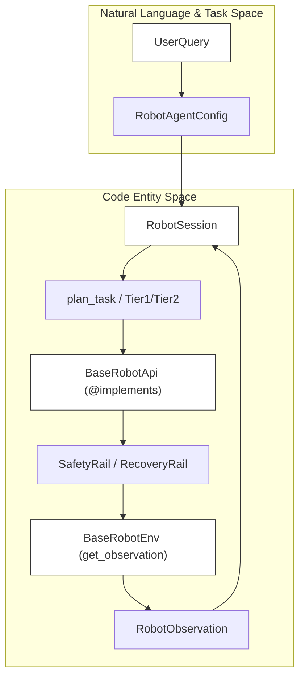
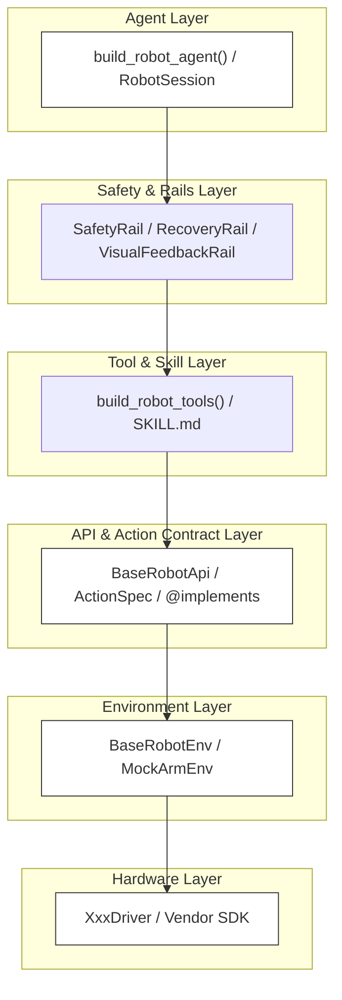

<!-- source: DeepWiki mcp.deepwiki.com · repo openJiuwen-ai/jiuwensymbiosis · page 1 Overview · fetched 2026-11-02 -->

# Overview

Relevant source files

The following files were used as context for generating this wiki page:

- [.gitignore](.gitignore)
- [AGENTS.md](AGENTS.md)
- [Open_Source_Software_Notice.txt](Open_Source_Software_Notice.txt)
- [README.md](README.md)
- [docs/images/architecture-dependencies.en.svg](docs/images/architecture-dependencies.en.svg)
- [docs/images/architecture-dependencies.zh.svg](docs/images/architecture-dependencies.zh.svg)
- [docs/images/architecture-layers.en.svg](docs/images/architecture-layers.en.svg)
- [docs/images/architecture-layers.zh.svg](docs/images/architecture-layers.zh.svg)
- [docs/images/architecture-task-sequence.en.svg](docs/images/architecture-task-sequence.en.svg)
- [docs/images/architecture-task-sequence.zh.svg](docs/images/architecture-task-sequence.zh.svg)
- [jiuwensymbiosis/gui/__main__.py](jiuwensymbiosis/gui/__main__.py)
- [jiuwensymbiosis/gui/assets/app_icon.png](jiuwensymbiosis/gui/assets/app_icon.png)
- [pyproject.toml](pyproject.toml)
- [requirements.txt](requirements.txt)
- [scripts/cruzr/dual_arm_grasp_bringup.py](scripts/cruzr/dual_arm_grasp_bringup.py)
- [scripts/new_adapter/render.py](scripts/new_adapter/render.py)
- [scripts/validate_adapter.py](scripts/validate_adapter.py)
- [templates/xxx_adapter/calibration.py](templates/xxx_adapter/calibration.py)
- [templates/xxx_adapter/env.py](templates/xxx_adapter/env.py)
- [tests/unit_tests/test_layering.py](tests/unit_tests/test_layering.py)

`jiuwensymbiosis` is an embodied-agent framework built on top of `openjiuwen` designed to adapt a single safe, auditable Agent workflow across diverse robot bodies [README.md:5-6](), [pyproject.toml:9](). By decoupling the high-level task planner and action vocabulary from low-level vendor SDKs via a capability-gated adapter pattern, the framework enables robust hardware-agnostic operation [README.md:9-11]().

Sources: `[README.md:5-6]`, `[pyproject.toml:9-15]`

---

## Perceive-Plan-Execute-Observe-Feedback Loop

The runtime architecture centers around a continuous execution cycle where the agent perceives the world state, plans action contracts (`ActionSpec`), executes commands through safety rails and tools, observes the resulting environment changes, and feeds diagnostic data back into memory [README.md:26]().

*Figure 1: Perceive-Plan-Execute-Observe-Feedback loop mapped to core code entities.*

Sources: `[README.md:26-26]`, `[AGENTS.md:97-105]`

---

## Layered Architecture

The framework enforces strict layering from high-level agent constructs down to hardware drivers. Commands flow top-down while observations, errors, and traces propagate bottom-up [AGENTS.md:95-105](). Algorithmic packages like `perception/` and `motion/` reside strictly below the `api/` layer to prevent circular dependencies, validated by architectural tests [tests/unit_tests/test_layering.py:4-10]().

*Figure 2: Layered architecture mapping capability gates and control flow.*

For deep technical specifications on capability gating, boundary checks, and enforcement testing, see [Layered Architecture](#1.2).

Sources: `[AGENTS.md:97-105]`, `[tests/unit_tests/test_layering.py:4-44]`

---

## Repository Structure & Subsystems

The codebase is organized into modular packages separating agents, APIs, environment bindings, physical adapters, user interfaces, and calibration routines:

| Directory / Module | Core Responsibility |
| --- | --- |
| `jiuwensymbiosis/adapters/` | Hardware-specific implementations (`piper`, `so101`, `cruzr`) and shared commons (`_common`) [README.md:75-77](), [pyproject.toml:108-111]() |
| `jiuwensymbiosis/api/` | Shared action vocabulary (`ActionSpec`), state definitions, and `@implements` mixins [README.md:9](), [AGENTS.md:13]() |
| `jiuwensymbiosis/env/` | Single hardware abstraction contract (`BaseRobotEnv`, `RobotObservation`) [AGENTS.md:103]() |
| `jiuwensymbiosis/motion/` & `perception/` | Body-agnostic kinematics, trajectory planning, and vision pipelines [README.md:18]() |
| `jiuwensymbiosis/gui/` | NiceGUI browser-based application shell and run engine [AGENTS.md:55-66](), [pyproject.toml:72-77]() |
| `jiuwensymbiosis/calibration/` | Hand-eye calibration workflows (`eye-in-hand` vs `eye-to-hand`) [pyproject.toml:78-85]() |
| `scripts/` | Validation scripts (`validate_adapter.py`), adapter generation, and bringup demos [AGENTS.md:39-41](), [scripts/cruzr/dual_arm_grasp_bringup.py:5-12]() |

Sources: `[README.md:9-18]`, `[pyproject.toml:72-111]`, `[AGENTS.md:39-66]`, `[scripts/cruzr/dual_arm_grasp_bringup.py:5-12]`

---

## Child Pages

For detailed documentation, refer to the following sub-pages:
- [Getting Started & Installation](#1.1) — Installation procedures, optional extras (`piper`, `so101`, `cruzr`, `voice`, `gui`, `calib`), runtime requirements, and quick-start guides [README.md:35-69](), [pyproject.toml:23-86]().
- [Layered Architecture](#1.2) — Detailed breakdown of Agent, Rails, Tools, Skill/API, Env, and Hardware layering, along with capability gating and architecture enforcement tests [AGENTS.md:93-105](), [tests/unit_tests/test_layering.py:4-44]().
- [CLI Entrypoints](#1.3) — Console scripts including `jiuwensymbiosis-run`, replay utilities, GUI startup, state/action introspection, and calibration CLIs [pyproject.toml:87-101](), [AGENTS.md:46-73]().

Sources: `[README.md:35-69]`, `[pyproject.toml:23-101]`, `[AGENTS.md:46-105]`, `[tests/unit_tests/test_layering.py:4-44]`

---

